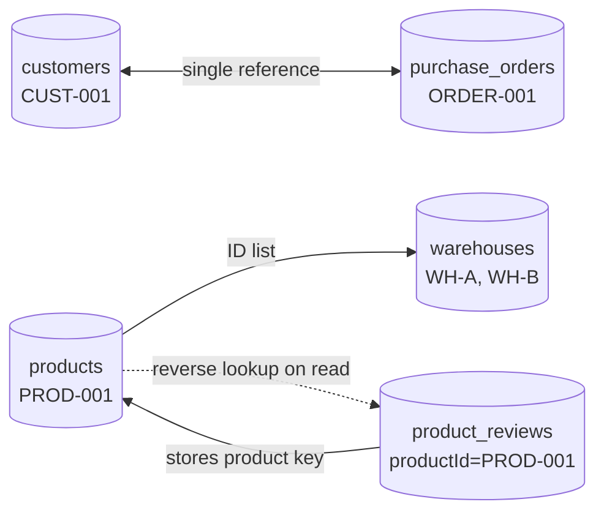
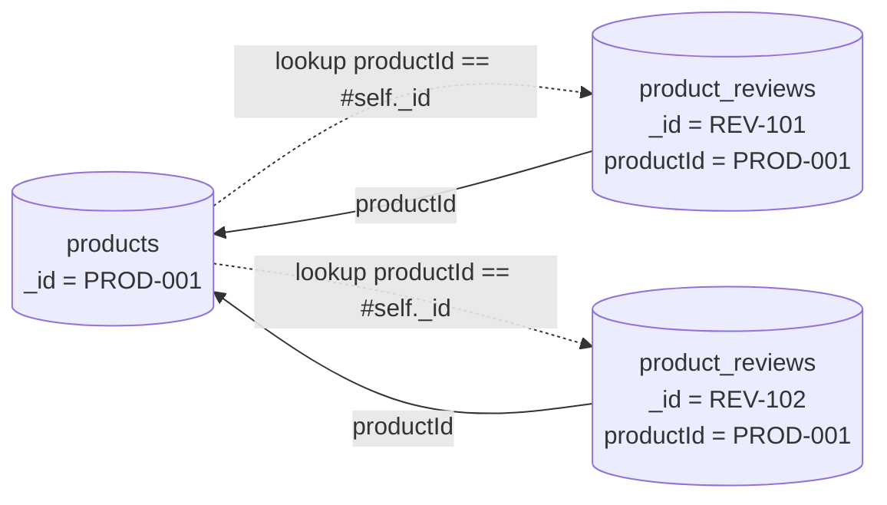

# Single References, Collection References, and Reverse References

> **Chapter:** Document References  
> **Module scope:** `SPRING_DATA_MONGODB` — using Spring Data MongoDB to connect, map documents, and operate on data via `MongoTemplate` or repositories. Choosing how to model references directly impacts query design, aggregations, indexes, transactions, reactive access, testing, and performance diagnostics; this lesson focuses on three relationship representations: **single-document references**, **collection-based multi-document references**, and **reverse-reference queries**.

## 1. Why Reference Documents?

MongoDB encourages designing data around how the application **reads and updates** it. A small object always used together with a parent entity is usually well suited for **embedding**. However, when two objects have independent lifecycles, are shared across many places, or grow unpredictably in size, storing them in separate collections and **referencing** them is worth considering.

Example in a sales system:

- `Customer` has its own customer profile used by many orders.
- `PurchaseOrder` can keep a reference to the customer rather than duplicating the entire profile.
- `Warehouse` is an independent storage location; a product can be stocked across multiple warehouses.
- `ProductReview` belongs to a product, yet review volume grows continuously. Each review record stores `productId`; when needed, the application queries **in reverse** from the product to retrieve its reviews.



**Important:** MongoDB does not automatically create foreign key constraints between documents like a relational database. A reference value may point to a document that no longer exists. Spring Data MongoDB also **does not automatically cascade save/delete** referenced objects. The application must actively design save ordering, deletion guards, and orphan handling.

### Embed or Reference?

| Criterion | Embed in parent document | Reference separate document |
| --- | --- | --- |
| Data lifecycle | Usually tied to the parent | Can be managed independently |
| Reading both parent and child | Usually a single document read | May require extra queries to resolve |
| Data shared across places | Prone to duplication | One target document can be referenced from many places |
| Unbounded growing arrays | Enlarges document, risks hitting size limits | Stores many child documents in a separate collection |
| Atomicity | Operations on a single document are atomic | Multi-document changes need conditions/transactions if business requires |
| Synchronization/updates | Updated directly inside the parent | Must manage relationships and cross-document consistency |

Do not turn every attribute into a reference. For instance, a handful of line items in an order usually belong embedded, whereas a shared customer profile usually belongs as a reference.

## 2. Three Relationship Mechanisms in Spring Data MongoDB

Spring Data MongoDB offers different options:

| Mechanism | Stored BSON format | How it is read |
| --- | --- | --- |
| **Manual ID** (`String customerId`) | Scalar field such as `"customerId": "CUST-001"` | Application calls repository/template to load target |
| **`@DocumentReference`** | Default is `_id` value or pointer value per config | Spring Data resolves automatically via `lookup` when materializing entity |
| **`@DBRef`** | DBRef formatted with `$ref`, `$id`, sometimes `$db` | Spring Data reads DBRef and resolves target document |

`@DocumentReference` has been available since Spring Data MongoDB 3.3 and supports more flexible representations than the DBRef format. Both `@DBRef` and `@DocumentReference` can reference **a single object** or **a collection of objects**, yet neither turns MongoDB into a relational ORM with foreign keys and cascades like JPA.

The following examples use **business string IDs** like `CUST-001` and `PROD-001`. They are not 24-character ObjectId hex strings, making BSON string behavior clear. In systems using real `ObjectId`s, BSON types of ID fields and reference key fields must match.

## 3. Single References with @DocumentReference

### 3.1. Domain Model: Order Referencing Customer

Suppose there are two collections `customers` and `purchase_orders`. Each order belongs to **one customer**:

```java
import org.springframework.data.annotation.Id;
import org.springframework.data.mongodb.core.mapping.Document;

@Document(collection = "customers")
public class Customer {
    @Id
    private String id;
    private String fullName;

    protected Customer() {}

    public Customer(String id, String fullName) {
        this.id = id;
        this.fullName = fullName;
    }

    public String getId() { return id; }
    public String getFullName() { return fullName; }
}
```

```java
import org.springframework.data.annotation.Id;
import org.springframework.data.mongodb.core.mapping.Document;
import org.springframework.data.mongodb.core.mapping.DocumentReference;

@Document(collection = "purchase_orders")
public class PurchaseOrder {
    @Id
    private String id;

    @DocumentReference
    private Customer customer;

    private String status;

    protected PurchaseOrder() {}

    public PurchaseOrder(String id, Customer customer, String status) {
        this.id = id;
        this.customer = customer;
        this.status = status;
    }

    public String getId() { return id; }
    public Customer getCustomer() { return customer; }
    public String getStatus() { return status; }
}
```

`@DocumentReference` on `PurchaseOrder.customer` has notable defaults:

- The reference field stores the **ID value of `Customer`**, rather than embedding the full `Customer`.
- Default `lookup` queries by `_id` of the target collection, expressed as `{ '_id': ?#{#target} }`.
- Default target collection is inferred from the `Customer` type, namely `customers` via `@Document(collection = "customers")`.
- `lazy = false` by default: when reading `PurchaseOrder` through mapping, Spring Data tries to resolve `customer` right away.

### 3.2. Save the Target Object Separately First

Example with two repositories:

```java
import org.springframework.data.mongodb.repository.MongoRepository;

public interface CustomerRepository
        extends MongoRepository<Customer, String> {}

public interface PurchaseOrderRepository
        extends MongoRepository<PurchaseOrder, String> {}
```

Business save flow:

```java
Customer customer = customerRepository.save(
    new Customer("CUST-001", "Nguyen An")
);

PurchaseOrder order = purchaseOrderRepository.save(
    new PurchaseOrder("ORDER-001", customer, "PENDING")
);
```

After saving, you can inspect both documents in `mongosh` (omitting type hint fields like `_class` if present):

```javascript
// customers
{
  _id: "CUST-001",
  fullName: "Nguyen An"
}

// purchase_orders
{
  _id: "ORDER-001",
  customer: "CUST-001",
  status: "PENDING"
}
```

These are **two documents in two collections**. The order's `customer` field holds the ID for resolution. It is neither `{fullName: ...}` nor a DBRef `$ref`/`$id` structure.

**No automatic cascade save:** calling `purchaseOrderRepository.save(order)` only saves the order. If the new `Customer` does not exist yet, the reference will not automatically create a matching customer in the database. In real systems, use a service responsible for creating/verifying customers and defining how deleted customers are handled.

### 3.3. Reading a Single Reference

```java
PurchaseOrder loaded =
    purchaseOrderRepository.findById("ORDER-001").orElseThrow();

String customerName = loaded.getCustomer().getFullName();
```

Spring Data reads the order, sees `customer = "CUST-001"`, and performs a lookup in `customers` to construct `Customer`. Because it is eager by default, reading the root can cause extra queries to MongoDB. Exact round trips and query batching depend on data shape, resolution mechanism, and framework version.

If the target customer does not exist, the relationship may fail to resolve completely and the property becomes `null`/missing depending on API handling; the application must guard accesses to `getCustomer()` and define rules for orphaned data. Never treat the presence of an ID in `purchase_orders` as proof that the document exists in `customers`.

## 4. A Collection of References: List, Set, and Multiple Targets

### 4.1. Using List<Warehouse> to Reference Multiple Warehouses

A product is distributed across multiple warehouses, and each warehouse exists independently:

```java
import org.springframework.data.annotation.Id;
import org.springframework.data.mongodb.core.mapping.Document;

@Document(collection = "warehouses")
public class Warehouse {
    @Id
    private String id;
    private String name;

    protected Warehouse() {}

    public Warehouse(String id, String name) {
        this.id = id;
        this.name = name;
    }

    public String getId() { return id; }
    public String getName() { return name; }
}
```

```java
import java.util.List;
import org.springframework.data.annotation.Id;
import org.springframework.data.mongodb.core.mapping.Document;
import org.springframework.data.mongodb.core.mapping.DocumentReference;

@Document(collection = "catalog_items")
public class CatalogItem {
    @Id
    private String id;

    @DocumentReference(collection = "warehouses")
    private List<Warehouse> warehouses;

    protected CatalogItem() {}

    public CatalogItem(String id, List<Warehouse> warehouses) {
        this.id = id;
        this.warehouses = warehouses;
    }

    public String getId() { return id; }
    public List<Warehouse> getWarehouses() { return warehouses; }
}
```

`collection = "warehouses"` is written **explicitly** to illustrate the `collection` attribute of `@DocumentReference`. Since the target type `Warehouse` already has `@Document(collection = "warehouses")` above, this parameter could be omitted.

```java
Warehouse a = warehouseRepository.save(
    new Warehouse("WH-A", "Northern Warehouse")
);
Warehouse b = warehouseRepository.save(
    new Warehouse("WH-B", "Southern Warehouse")
);

CatalogItem saved = catalogItemRepository.save(
    new CatalogItem("PROD-001", List.of(a, b))
);
```

Where `warehouseRepository` and `catalogItemRepository` are repositories for the two corresponding domain types. BSON may be represented as:

```json
{
  "_id": "PROD-001",
  "warehouses": ["WH-A", "WH-B"]
}
```

When reading `CatalogItem` through Spring Data, the ID list is resolved into `Warehouse` objects. The Spring Data MongoDB documentation notes that collection reference values can be combined into a query using the `$or` operator, and restoring original element order is **best effort** under suitable lookup conditions. If order is a strict business requirement, model an ordering field and use explicit queries/sorting and tests.

### 4.2. Do Not Turn Reference Arrays into Unbounded Lists

Small, clearly bounded ID arrays are generally fine to store directly inside the parent document. If a product has millions of reviews or a group has hundreds of thousands of users, storing all IDs inside a root array is a poor choice because:

- The root document grows in size and update cost.
- MongoDB has a document size limit (typically 16 MiB per BSON document).
- Loading the root can trigger excessive resolution queries or construct a massive object graph.
- Frequent member additions/removals turn a single document into a hotspot of write contention.

Instead, let the child document **hold the parent's ID key** and query by that key. This is the foundation of **reverse references** in the next section.

### 4.3. Lazy Loading and Ordering in Collections

```java
@DocumentReference(lazy = true, sort = "{ 'name' : 1 }")
private List<Warehouse> warehouses;
```

This example illustrates an **alternative** option for `CatalogItem.warehouses`: `lazy = true` defers resolution until accessed, while `sort` provides server-side ordering for resolved results. Test exact behavior against your driver/Spring Data version, especially with custom lookups. Do not expect `lazy` to eliminate query cost; it only shifts **when** the query happens.

Lazy references may use proxies, leading to issues when:

- `toString()`, logging, JSON serialization, or a debugger inadvertently calls getters and triggers queries.
- Classes/interfaces cannot be proxied under current Java settings; since Java 16, strong encapsulation can make proxying certain concrete types difficult.
- Object graphs contain circular references causing infinite recursion or excessive reads during serialization.

Prefer declaring fields with interfaces like `List<Warehouse>` instead of locking to a concrete implementation; verify against your Java version and runtime libraries.

## 5. Reverse References: Child Holds Key, Parent Queries for Children

### 5.1. The Problem: A Product with Many Reviews

Suppose each `ProductReview` has a `productId` field pointing to `Product`. Review volume grows over time. We want to expose a domain API `product.getReviews()`, yet **avoid storing the entire list of review IDs inside the `products` document**.



A review class storing the product ID normally:

```java
import java.time.Instant;
import org.springframework.data.annotation.Id;
import org.springframework.data.mongodb.core.index.Indexed;
import org.springframework.data.mongodb.core.mapping.Document;

@Document(collection = "product_reviews")
public class ProductReview {
    @Id
    private String id;

    @Indexed
    private String productId;

    private int rating;
    private Instant createdAt;

    protected ProductReview() {}

    public ProductReview(
            String id, String productId, int rating, Instant createdAt) {
        this.id = id;
        this.productId = productId;
        this.rating = rating;
        this.createdAt = createdAt;
    }

    public String getId() { return id; }
    public String getProductId() { return productId; }
    public int getRating() { return rating; }
    public Instant getCreatedAt() { return createdAt; }
}
```

In `Product`, declare a **read-only reverse reference**:

```java
import java.util.List;
import org.springframework.data.annotation.Id;
import org.springframework.data.annotation.ReadOnlyProperty;
import org.springframework.data.mongodb.core.mapping.Document;
import org.springframework.data.mongodb.core.mapping.DocumentReference;

@Document(collection = "products")
public class Product {
    @Id
    private String id;
    private String name;

    @ReadOnlyProperty
    @DocumentReference(
        lookup = "{ 'productId' : ?#{#self._id} }",
        sort = "{ 'createdAt' : -1 }"
    )
    private List<ProductReview> reviews;

    protected Product() {}

    public Product(String id, String name) {
        this.id = id;
        this.name = name;
    }

    public String getId() { return id; }
    public String getName() { return name; }
    public List<ProductReview> getReviews() { return reviews; }
}
```

**Annotation breakdown:**

- `@ReadOnlyProperty` indicates that the `reviews` field **is not written into the `products` document**. It is a read-only property constructed from data in another collection.
- `@DocumentReference(lookup = ...)` defines the filter used to find reviews. In this lookup, `#self` is the **`Product` document currently being read**, and `#self._id` is its actual `_id` value.
- `productId` in the expression is the **BSON field name in the `product_reviews` collection**. Here both the Java property and BSON field are `productId` because `@Field` is not used.
- `sort = "{ 'createdAt' : -1 }"` requests newest reviews first; indexes should match actual queries and sorts.

Stored data looks like:

```javascript
// Collection products:
{ _id: "PROD-001", name: "Fountain pen" }

// Collection product_reviews:
{ _id: "REV-101", productId: "PROD-001", rating: 5,
  createdAt: ISODate("2026-11-19T09:00:00Z") }
{ _id: "REV-102", productId: "PROD-001", rating: 4,
  createdAt: ISODate("2026-11-20T09:00:00Z") }
```

The `products` document has no `reviews` array. When Spring Data materializes `Product` and resolves the reverse reference, the lookup corresponds to finding reviews where `productId = "PROD-001"`. Depending on eager/lazy configuration, the query runs either on read or on property access.

### 5.2. Saving and Updating in the Reverse Reference Model

```java
Product product = productRepository.save(
    new Product("PROD-001", "Fountain pen")
);

productReviewRepository.save(new ProductReview(
    "REV-101", product.getId(), 5,
    Instant.parse("2026-11-19T09:00:00Z")
));

productReviewRepository.save(new ProductReview(
    "REV-102", product.getId(), 4,
    Instant.parse("2026-11-20T09:00:00Z")
));

Product loaded = productRepository.findById("PROD-001").orElseThrow();
List<ProductReview> reviews = loaded.getReviews();
```

`productRepository` and `productReviewRepository` correspond to `MongoRepository<Product, String>` and `MongoRepository<ProductReview, String>` beans declared in the application.

**The actual relationship is maintained on the review side.** Saving `Product` **does not** automatically insert/update `ProductReview` just because `reviews` exists in RAM. To move a review to another product, explicitly update the review's `productId`; never mutate the read-only list on the parent and expect MongoDB to write to the child side.

### 5.3. Data Types Between `#self._id` and the Reference Key Must Match

This is a critical MongoDB trap: `@Id String id` can be converted by Spring Data into a BSON `ObjectId` when the string looks like a valid ObjectId, whereas a regular `String productId` field is stored as a BSON string.

For instance, if `products._id` is actually `ObjectId("64b7a327f9c0b1e2d3a4f501")` while `product_reviews.productId` is the string `"64b7a327f9c0b1e2d3a4f501"`, the lookup:

```javascript
db.product_reviews.find({
  productId: ObjectId("64b7a327f9c0b1e2d3a4f501")
})
```

will **not match** the BSON string value. MongoDB distinguishes data types. The `PROD-001` IDs in the main example avoid this mismatch.

When using real ObjectIds, define both `Product.id` and `ProductReview.productId` consistently at the Java/BSON layers—such as using `org.bson.types.ObjectId` on both—or configure conversions explicitly. Inspect raw data in `mongosh` rather than merely comparing string representations when debugging.

## 6. @DocumentReference Is Not Like @DBRef

### 6.1. DBRef Storage Format

`@DBRef` is a different reference mechanism supported by Spring Data MongoDB:

```java
import org.springframework.data.mongodb.core.mapping.DBRef;

@DBRef
private Customer customer;
```

Typical BSON looks like:

```javascript
{
  _id: "ORDER-001",
  customer: {
    $ref: "customers",
    $id: "CUST-001"
    // $db may appear when a database is explicitly specified.
  }
}
```

`$ref` is the target collection name, `$id` is the target document identifier. This is a conventional BSON reference structure, unlike default `@DocumentReference` which stores a scalar ID.

### 6.2. Detailed Comparison

| Aspect | `@DBRef` | `@DocumentReference` |
| --- | --- | --- |
| Default representation | BSON DBRef containing `$ref`/`$id` | Scalar ID of the target document |
| Target collection | Usually stored inside the DBRef | Inferred from type by default; can specify `collection` |
| Custom lookup | Constrained by DBRef format | Supports `lookup` on fields other than `_id` |
| Collection of references | `List<…>` and suitable collection types | `List<…>`, maps/collections as supported |
| Lazy loading | `@DBRef(lazy = true)` | `@DocumentReference(lazy = true)` |
| Cascade save/delete | **Not automatic** | **Not automatic** |
| Read-only reverse reference | Not a typical pattern | `@ReadOnlyProperty` + `lookup` using `#self` |
| Reactive reference resolution | Check version/API support | Spring Data MongoDB 5.1.x docs state **reading document references via reactive infrastructure is not supported** |

If an application already stores `DBRef`, simply swapping `@DBRef` to `@DocumentReference` without migrating data may prevent the mapper from reading existing references. Inspect actual BSON data and plan a migration or compatibility support before changing storage format.

### 6.3. Cross-Collection and Cross-Database References

`@DocumentReference` has `collection` and `db` attributes to specify where the target entity resides when needed. Example:

```java
@DocumentReference(
    db = "customer_directory",
    collection = "customers"
)
private Customer customer;
```

This is an **illustrative configuration**, applicable only when infrastructure and access permissions truly allow reading `customer_directory`. Do not use cross-database references by default when all services operate within a single database; evaluate permission management, latency, backups, and framework version behavior.

## 7. Referencing by Business Key Instead of _id

Not every system wants to point to `_id`. Suppose `Customer` has a stable `customerCode` used across external integrations. `@DocumentReference(lookup = "...")` enables lookup via that key:

```java
import org.springframework.data.annotation.Id;
import org.springframework.data.mongodb.core.index.Indexed;
import org.springframework.data.mongodb.core.mapping.Document;

@Document(collection = "customers")
public class CustomerByCode {
    @Id
    private String id;

    @Indexed(unique = true)
    private String customerCode;

    protected CustomerByCode() {}

    public String getId() { return id; }
    public String getCustomerCode() { return customerCode; }
}
```

```java
@DocumentReference(lookup = "{ 'customerCode' : ?#{#target} }")
private CustomerByCode customer;
```

The lookup reads a pointer value from the current document and finds the customer by `customerCode`. When **writing** a pointer other than the default ID, the application may need to register a converter to `DocumentPointer` so Spring Data knows which value to store in the reference field.

Converter example:

```java
import org.springframework.core.convert.converter.Converter;
import org.springframework.data.convert.WritingConverter;
import org.springframework.data.mongodb.core.mapping.DocumentPointer;

@WritingConverter
public class CustomerCodePointerConverter
        implements Converter<CustomerByCode, DocumentPointer<String>> {

    @Override
    public DocumentPointer<String> convert(CustomerByCode customer) {
        return () -> customer.getCustomerCode();
    }
}
```

This converter must be registered with `MongoCustomConversions` or the conversion configuration mechanism supported by your project's Spring Data version. Without a converter, certain `lookup` shapes may derive pointers from properties in the expression per documentation, yet **never assume every custom lookup automatically writes correctly**: verify raw BSON after saving.

Place a unique index on the lookup key if each reference is expected to resolve to a single document. `@Indexed(unique = true)` only expresses configuration intent; automatic index creation depends on settings and deployment processes. In production, verify the index exists and existing data does not violate uniqueness.

## 8. Reading via Repository, MongoTemplate, and Explicit Queries

### 8.1. When the Target Object Is Needed Immediately

When a use case genuinely needs the `Customer` of a `PurchaseOrder`, `@DocumentReference` gives the Java layer the mapped object directly. Remember, however, that code showing “one `findById` call” **does not mean one round trip to MongoDB**.

```java
PurchaseOrder order =
    purchaseOrderRepository.findById("ORDER-001").orElseThrow();

Customer customer = order.getCustomer();
```

If a list page displays 100 orders and each needs its customer, observe how many queries occur during resolution. Depending on loading strategy and dataset, there is risk of many extra queries resembling the **N+1** problem. Consider DTOs containing appropriate snapshots, caching with clear consistency rules, or batch loading where needed.

### 8.2. When Only the ID Is Needed, Explicit Reading Is Simpler

Instead of reference mapping, you can store:

```java
@Document(collection = "purchase_orders")
public class OrderWithCustomerId {
    @Id
    private String id;
    private String customerId;

    // Constructor/getters omitted.
}
```

Then intentionally call `customerRepository.findById(order.getCustomerId())` in the service. This pattern has the advantage of easily measurable query counts, straightforward pagination, controllable caching, and compatibility with reactive access. In return, service code must handle missing customers and assemble data when APIs need fields from both documents.

### 8.3. Querying Reverse References Directly via Repository

Instead of forcing access through `product.getReviews()`, you can write:

```java
import org.springframework.data.domain.Page;
import org.springframework.data.domain.Pageable;
import org.springframework.data.mongodb.repository.MongoRepository;

public interface ProductReviewRepository
        extends MongoRepository<ProductReview, String> {

    Page<ProductReview> findByProductIdOrderByCreatedAtDesc(
        String productId, Pageable pageable
    );
}
```

With large review counts, direct paginated querying is much easier to control than resolving an unbounded `List<ProductReview>` field. Use a compound index matching `productId` and `createdAt`; if deterministic ordering is needed for reviews with identical timestamps, add a tie-breaker such as `_id` and adjust the index accordingly.

### 8.4. `$lookup` Aggregation as Another Option

`MongoTemplate` provides the Aggregation API to express MongoDB pipelines. When combining multiple collections **server-side**, you can use `$lookup` instead of materializing the root and resolving references individually:

```javascript
db.purchase_orders.aggregate([
  { $match: { status: "PENDING" } },
  {
    $lookup: {
      from: "customers",
      localField: "customer",
      foreignField: "_id",
      as: "customerDetails"
    }
  }
])
```

This example applies when default `@DocumentReference` **stores a scalar ID in `purchase_orders.customer`**. If that field is a DBRef or uses another pointer schema, `localField` must be adjusted. `$lookup` has its own prerequisites and limits (such as requiring accessible collections in the aggregation context); performance still depends on indexes, cardinality, result size, and MongoDB topology.

## 9. Data Consistency, Transactions, Indexes, and Reactive Access

### 9.1. No Automatic Cascade or Foreign Keys

Suppose `Customer CUST-001` is deleted while `PurchaseOrder` documents still reference that ID. MongoDB neither deletes the orders automatically nor blocks deleting the customer simply because references exist. Therefore, design clear rules:

- **Restrict:** reject deleting the customer while linked orders remain.
- **Soft delete:** mark the customer inactive, keeping data needed for history.
- **Controlled detach/cascade:** update related references via services, jobs, or events, accounting for auditing and atomicity.
- **Data snapshots:** orders should typically retain transaction-time customer/price details even if they also reference the live profile.

If a business operation must update multiple documents atomically, consider multi-document transactions when the MongoDB topology supports them and Spring Data is configured with the appropriate transaction manager. **References do not open transactions automatically.** Collection references also do not make writes across separate documents atomic.

### 9.2. Indexes for Reverse References and Custom Lookups

For `ProductReview`, the typical query is “reviews for product P, newest first”:

```javascript
db.product_reviews.createIndex({
  productId: 1,
  createdAt: -1
})

db.product_reviews.find({ productId: "PROD-001" })
  .sort({ createdAt: -1 })
  .explain("executionStats")
```

Indexing `productId` supports filtering, and adding `createdAt` can satisfy sorting. Indexes add write and storage overhead, so base them on real query shapes rather than indexing every field. For lookups by `customerCode`, place the index on the **customers collection** on the exact target BSON field—not solely on the reference field in the source document.

### 9.3. Reactive Access Has Specific Limitations

Per the Spring Data MongoDB 5.1.x documentation, **reading/resolving document references via the reactive infrastructure is not supported**. Do not design a `ReactiveMongoRepository` flow assuming `@DocumentReference` or `@DBRef` works identically to the imperative stack. Verify capabilities against your exact project version.

A clear pattern in reactive architectures is **storing scalar IDs** and executing deliberate async queries:

```java
// Illustrative example: entity stores customerId instead of @DocumentReference.
Mono<Customer> customerMono =
    reactiveOrderRepository.findById(orderId)
        .flatMap(order ->
            reactiveCustomerRepository.findById(order.getCustomerId())
        );
```

Here `reactiveOrderRepository` returns an entity type with `getCustomerId()`, and `reactiveCustomerRepository` queries the `customers` collection; corresponding beans and types must be declared in your project. Use `Mono.zip` or `Flux.flatMap` when combining additional data while controlling concurrency, and avoid falling back to blocking calls on the event loop.

## 10. Testing and Diagnosing Relationships

A meaningful integration test suite should use a real MongoDB instance for testing (e.g., Testcontainers with an appropriate topology). Inspect both **actual BSON data** and materialized objects; asserting only that `repository.save` does not throw an exception is insufficient.

| Scenario | What to verify |
| --- | --- |
| Single reference | Root BSON stores `customer: "CUST-001"`; `findById` resolves the right `Customer`. |
| No cascade save | Saving order with an uninserted customer does not auto-create the customer; orphan handling is explicit. |
| Collection reference | `warehouses` array stores IDs rather than embedded documents; reading returns matching warehouses. |
| Reverse lookup | `products` does not store a `reviews` array; `Product.getReviews()` searches by `productId`. |
| Same key in mixed BSON types | `ObjectId` lookup fails to match String field; detected and schema fixed. |
| Large reference count | Paginate reviews through repository; check index usage and scanned document count. |
| Lazy loading | Resolution fires only upon getter access; test logging, debugger, and JSON serialization. |
| Target document deletion | Restrict/soft-delete/detach policy works without unexpected API errors. |
| Transactions | When multi-document atomicity is needed, test rollbacks on a valid replica set. |
| Reactive | Use manual IDs and compose reactive queries; do not assume automatic reference resolution. |

### Common Errors

**Error 1 — Reference is saved, yet reads back as null.** Verify the target document still exists, target collection/database, field names, and **ID BSON types**. With custom lookups, also check indexes and pointer-writing converters.

**Error 2 — Saving parent does not create child.** This is expected behavior because there is no default cascade save. Save children via their own repository/template, then update link keys.

**Error 3 — Reference lists become slow.** Check reference counts, eager/lazy mode, resolution queries, round trips, document sizes, and `explain("executionStats")`. For growing lists, switch to children holding foreign IDs and paginated queries.

**Error 4 — Reverse lookup always returns an empty list.** Check whether `#self._id` is a BSON ObjectId or String, and whether `productId` on reviews has the exact BSON field name and matching type; inspect actual stored values and target collection.

**Error 5 — Circular references cause serialization failures.** Never return raw bidirectional entity graphs directly from APIs. Use DTOs containing only required fields, or explicitly return IDs instead of potentially cyclic objects.

**Error 6 — Aggregation query fails to join data.** `$lookup` needs `localField`/`foreignField` pointing to the **actual schema**. Default `@DocumentReference` stores a scalar ID, whereas `@DBRef` stores a different BSON structure.

## 11. Practice Exercise: Building All Three Relationship Types

Build a Spring Data MongoDB application for products and customers:

1. **Single reference:** create `Customer` and `PurchaseOrder` with `@DocumentReference Customer customer`. Save the customer first, then the order. Use `mongosh` to verify the root stores only the customer ID.
2. **Collection reference:** create two `Warehouse`s, and give `CatalogItem` a `List<Warehouse>`. Save warehouses separately, save the catalog item, read it back, and verify the result.
3. **Reverse reference:** create `Product` and several `ProductReview`s with `productId`. Add `@ReadOnlyProperty` and `@DocumentReference(lookup = "{ 'productId' : ?#{#self._id} }")` on `Product.reviews`; confirm `products` documents contain no review ID array.
4. **Test broken data:** delete a warehouse or use a mismatched `productId` type, and observe how the application handles unresolved targets.
5. **Optimize queries:** create an index on `product_reviews(productId, createdAt)`; run `explain` and compare against pre-index queries on sufficiently large test data.
6. **API design:** compare an endpoint returning the full object graph against one returning a DTO with IDs + summary, measuring MongoDB query counts and response payload sizes.

### Self-Check Questions

- Why can default `@DocumentReference` store a scalar ID yet return `Customer` in Java?
- Why does `@DBRef` not share the same BSON format as `@DocumentReference`?
- How does `@DocumentReference(collection = "...")` differ from an unannotated `List<Warehouse>` field?
- In a reverse reference, which document owns the `productId` key? Why is `@ReadOnlyProperty` needed on the parent side?
- How do `#target` and `#self._id` differ inside `lookup`?
- Why is an array containing hundreds of thousands of reference IDs unsuitable on a parent document?
- When `ObjectId` and `String` display the exact same hex text, why can queries still fail to match?
- When should you join manually in repositories/services versus using `$lookup` aggregation?
- In a reactive application, what must you keep in mind regarding reference resolution support?

## 12. Takeaways and References

- **Single references** link one target document to a root, normally storing the target `_id` under default `@DocumentReference`.
- **Collection references** can store an ID array; only suitable when array size and resolution costs remain controllable.
- **Reverse references** store the key on child documents; `@ReadOnlyProperty` + `@DocumentReference(lookup = "... #self._id ...")` lets you read children without writing an ID array onto the parent.
- **`@DBRef`** and **`@DocumentReference`** use different BSON formats; migrations are required when switching persisted data between them.
- **There are no automatic foreign keys or cascades**; the application owns save ordering, orphan handling, and transactions when needed.
- **Indexes and BSON types** determine whether lookups match accurately and quickly. For large child counts, prefer paginated queries.
- **Reactive access** requires checking version-specific support; where reactive reference resolution is unsupported, store scalar IDs and compose queries explicitly.

Official documentation to verify per version:

- [Spring Data MongoDB — Using DBRefs and Document References](https://docs.spring.io/spring-data/mongodb/reference/mongodb/mapping/document-references.html)
- [Spring Data MongoDB — Object Mapping](https://docs.spring.io/spring-data/mongodb/reference/mongodb/mapping/mapping.html)
- [Spring Data MongoDB — Repository Query Methods](https://docs.spring.io/spring-data/mongodb/reference/mongodb/repositories/query-methods.html)
- [Spring Data MongoDB — Aggregation Framework Support](https://docs.spring.io/spring-data/mongodb/reference/mongodb/aggregation-framework.html)
