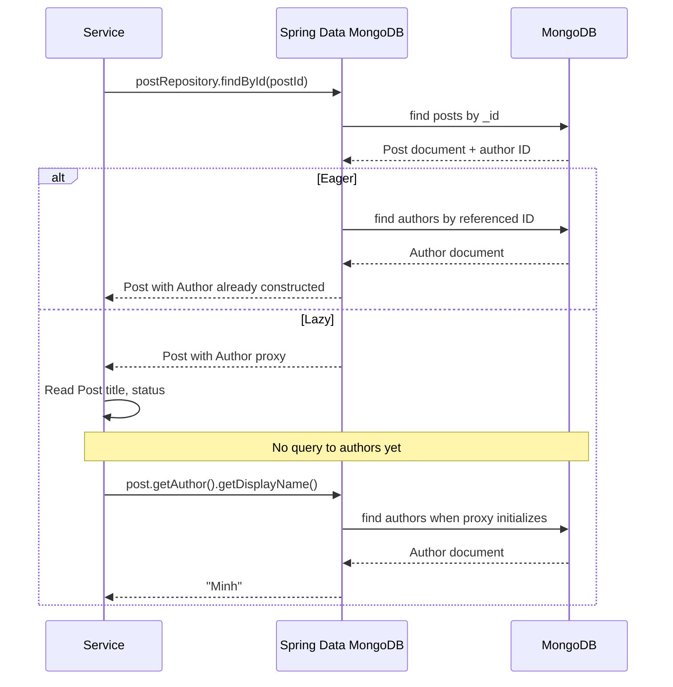
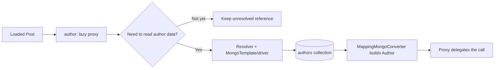

# Eager Loading, Lazy Loading, Proxies, and Session Lifecycle

An order can reference a customer, a post can reference an author, and a project can reference a list of participants. With **Spring Data MongoDB**, we can store another object's identifier key inside a document and let the framework reconstruct the referenced Java object. Whether that object is **constructed immediately when reading the parent** or **deferred until the application uses a property** directly affects query counts, latency, error handling, and transaction boundaries.

Within the **Document References** chapter, this lesson explains the difference between **eager loading** and **lazy loading**, the role of **proxies**, when MongoDB actually receives commands, and what happens when an object is accessed after a session or transaction ends. Examples use synchronous `MongoTemplate` and repositories; the end of the lesson covers applying the same thinking in reactive applications.

## 1. What Is a Document Reference?

Suppose the `authors` collection stores authors and the `posts` collection stores posts. A post can store the author ID instead of embedding all author details:

```javascript
// authors
{
  _id: ObjectId("674000000000000000000101"),
  display_name: "Minh",
  bio: "Writes about Java and MongoDB"
}

// posts
{
  _id: ObjectId("674000000000000000000201"),
  title: "Introduction to Spring Data MongoDB",
  author: ObjectId("674000000000000000000101"),
  status: "PUBLISHED"
}
```

The `posts` document above stores only a **BSON ObjectId** in the `author` field. To read `display_name`, the application or Spring Data must query the `authors` collection. MongoDB does not automatically load related documents simply because two fields share matching IDs, nor does it provide foreign keys or cascade deletes.

Three common modeling options:

| Modeling approach | Data stored in `posts.author` | What happens on read |
| --- | --- | --- |
| Embed `AuthorSnapshot` | Nested document containing name and needed info | Data is immediately present in one document; no query to `authors` |
| Keep `ObjectId authorId` | A plain ID | Service explicitly calls repository/template to fetch author when needed |
| `@DBRef` or `@DocumentReference` | DBRef or reference value per configuration | Spring Data can automatically resolve the related object, immediately or via proxy |

Choosing references over embedding depends on data size, how often fields are read together, cardinality, update lifecycles, and bidirectional query needs. **There is no rule that every Java relationship must use a reference annotation.**

## 2. When Do Eager Loading and Lazy Loading Differ?

Suppose `Post` has a Java property `Author author`.

**Eager loading:** while Spring Data reads and maps `Post`, the framework queries to retrieve the associated `Author`. Once `findById(...)` completes, the referenced object is normally already resolved.

**Lazy loading:** when mapping `Post`, the framework assigns a **proxy** to the `author` property. Only when the application actually accesses the author's data does the proxy ask the resolver to load the target document.



The diagram depicts a **single-reference** case. Actual command counts depend on annotations, reference batching, local caching, already-loaded data, and access paths. Eager **does not mean** a single MongoDB query, and lazy **does not mean** queries are optimized into a server-side JOIN.

| Criterion | Eager | Lazy |
| --- | --- | --- |
| When does reference resolution start? | During parent entity loading | When the proxy is used in a way requiring target data |
| Reading parent without using the relationship | May incur unnecessary I/O | Can avoid I/O for unused relationships |
| `findById` call duration | Can be higher due to fetching references | Can be shorter, shifting cost to access time |
| When referenced target no longer exists | Issue may surface while reading parent | Issue may surface when proxy initializes |
| Predictability of query count | Easier if relationship graph is small | Risk of N+1 when iterating over many parents |
| Object after leaving service | Usually already holds referenced data | May still hold an unresolved proxy needing later DB access |

## 3. Example with `@DocumentReference`

`@DocumentReference` is Spring Data MongoDB's document referencing mechanism. In typical default configuration, the referenced property is stored as the **target document's ID**, and Spring Data locates the target document using that ID. Custom lookups can be defined for special cases, provided stored values and lookup criteria align.

### 3.1. Defining Entities and Repositories

```java
import org.bson.types.ObjectId;
import org.springframework.data.annotation.Id;
import org.springframework.data.mongodb.core.mapping.Document;
import org.springframework.data.mongodb.core.mapping.Field;

@Document("authors")
public class Author {
    @Id
    private ObjectId id;

    @Field("display_name")
    private String displayName;

    private String bio;

    public Author() {}

    public Author(String displayName, String bio) {
        this.displayName = displayName;
        this.bio = bio;
    }

    public ObjectId getId() { return id; }
    public String getDisplayName() { return displayName; }
    public String getBio() { return bio; }
}
```

```java
import org.bson.types.ObjectId;
import org.springframework.data.annotation.Id;
import org.springframework.data.mongodb.core.mapping.Document;
import org.springframework.data.mongodb.core.mapping.DocumentReference;

@Document("posts")
public class Post {
    @Id
    private ObjectId id;

    private String title;
    private String status;

    @DocumentReference(lazy = true)
    private Author author;

    public Post() {}

    public Post(String title, String status, Author author) {
        this.title = title;
        this.status = status;
        this.author = author;
    }

    public ObjectId getId() { return id; }
    public String getTitle() { return title; }
    public String getStatus() { return status; }
    public Author getAuthor() { return author; }
}
```

```java
import org.bson.types.ObjectId;
import org.springframework.data.mongodb.repository.MongoRepository;

interface AuthorRepository extends MongoRepository<Author, ObjectId> {}
interface PostRepository extends MongoRepository<Post, ObjectId> {}
```

The `Author` object in this example is a **separate document**. Spring Data does not cascade-save a non-existent `Author` when `Post` is saved; create the author first, then save the post:

```java
Author author = authorRepository.save(
        new Author("Minh", "Writes about Java and MongoDB"));

Post created = postRepository.save(
        new Post("Introduction to Spring Data MongoDB", "PUBLISHED", author));
```

Under default `@DocumentReference` mapping, the `posts` document stores the `author` value corresponding to `Author`'s **ID**, matching the BSON illustrated in section 1. Saving a `Post` with a reference does not implicitly update other changes to `Author`; updating the author requires saving/updating the `authors` document separately.

### 3.2. Observing Differences When Loading

```java
Post loaded = postRepository.findById(created.getId())
        .orElseThrow();

String title = loaded.getTitle(); // Field inside the posts document.
String name = loaded.getAuthor().getDisplayName();
```

With `@DocumentReference(lazy = true)`, `loaded.getTitle()` does not need to read `authors`. Calling `getDisplayName()` on the `Author` proxy may trigger a query to the `authors` collection and return the value. Proxies normally retain the resolved object for subsequent accesses on **that same proxy instance**; this is not a guarantee of a shared cache across entities or requests.

To switch to eager loading, change the field mapping configuration to:

```java
@DocumentReference(lazy = false)
private Author author;
```

`lazy = false` is the default mode of `@DocumentReference`. Spring Data then attempts to resolve the author while mapping `Post`; the duration of `findById` normally includes this cost. **Choose only one configuration** in a real entity; the two snippets show alternative options.

## 4. Comparison with `@DBRef`

`@DBRef` represents references using the **MongoDB DBRef** structure, containing the collection name, target ID, and optionally database name. Example:

```java
import org.springframework.data.mongodb.core.mapping.DBRef;

// In Post, replace the annotation on the author field:
@DBRef(lazy = true)
private Author author;
```

Typical BSON DBRef shape:

```javascript
{
  _id: ObjectId("674000000000000000000201"),
  title: "Introduction to Spring Data MongoDB",
  author: {
    "$ref": "authors",
    "$id": ObjectId("674000000000000000000101")
  }
}
```

The `author` field now stores **reference metadata**, not the entire `Author`. Both `@DBRef` and `@DocumentReference` offer a `lazy` option; both can require extra I/O to resolve related values. MongoDB Server does not automatically execute JOINs just because a document contains DBRefs.

| Aspect | `@DBRef` | `@DocumentReference` |
| --- | --- | --- |
| Default stored value | BSON DBRef with `$ref`, `$id`, and optional `$db` | Typically target document's ID |
| Target resolution | From DBRef metadata and mapping | From property type, collection, and lookup |
| Lookup criteria | Based on DBRef pointer | By ID by default; lookup expression configurable |
| Lazy | `@DBRef(lazy = true)` | `@DocumentReference(lazy = true)` |
| Cascade save | Not automatic | Not automatic |
| Batch reads | Can optimize when DBRefs target the same collection, though queries must be measured | Resolver grouping/loading depends on query, mapping, and version |
| Referential integrity | Application-managed | Application-managed |

Do not switch `@DBRef` to `@DocumentReference` on an active collection without checking the stored BSON format. One typically stores **DBRef**, while the other typically stores **plain IDs**; changing annotations can break resolution of existing data. A tested migration or compatible mapping is required.

## 5. What Is a Proxy and What Triggers Its Initialization?

A **proxy** is a Java object standing in for the referenced object. At the moment `Post` is read, it lets the `author` property satisfy the Java model's type without forcing the target query right away. When an operation requires real data, the proxy asks Spring Data's resolver to query and construct `Author`.



Common misconceptions:

1. **Having a proxy does not mean target data exists.** Returning `Post` successfully does not prove `Author` still exists in the database.
2. **Not only business getters trigger loading.** Debuggers expanding objects, calling `toString()`, `equals()`, or `hashCode()`, logging, and serializers can touch the proxy. Exact behavior depends on proxy kind and invoked method.
3. **Proxy creation has technical constraints.** Depending on property type, the framework may use interface-based or subclass-based proxies. `final` classes, `record`s, inaccessible constructors, or Java modules blocking reflective access can prevent lazy proxies from being created as desired.
4. **There is no default global identity map like a SQL ORM.** Two parent documents referencing the same author may receive two separate proxies and issue multiple queries as each is used.
5. **Lazy is not a data synchronization mechanism.** A proxy that already loaded an author will not automatically know if `authors` was updated by another request.

For reference collections, declaring by **interface** such as `List<Author>` is usually better than hardcoding `ArrayList<Author>`: a proxy may not be able to substitute a concrete collection class restricted by instantiation or reflection access. On newer Java runtimes with strong encapsulation, proxying JDK classes can hit access errors; prefer fixing field declarations and mapping design before considering JVM module-opening flags.

For relationships returned over REST APIs, **do not pass raw entities containing lazy proxies directly to a JSON serializer**. Serializers can trigger unexpected queries, prolong responses, cause N+1, or hit circular reference loops between entities. Building DTOs with exactly the data the API needs and resolving references inside the service provides much cleaner control.

## 6. Lifecycle of MongoClient, ClientSession, and Transactions

The phrase “session closed so lazy loading failed” is widely known from ORMs like JPA/Hibernate. With Spring Data MongoDB, distinguish **`MongoClient`**, **MongoDB `ClientSession`**, and **transaction context** instead of transplanting JPA's persistence context model verbatim.

### 6.1. MongoClient and Data Access Lifecycle

`MongoClient` holds connection configuration and manages the connection pool. In Spring Boot applications, the client is typically an application-scoped singleton bean shared across operations. A lazy proxy needs access to query infrastructure **at the moment it actually resolves**.

If the client has been closed, the bean/factory destroyed, or the context is no longer usable, queries triggered by the proxy may fail. Conversely, a service method returning **does not automatically mean a lazy proxy can no longer load**: if infrastructure is still alive, it can still run a query later, though that query will not necessarily belong to the original session or transaction.

### 6.2. What Are ClientSession and Transactions Used For?

A MongoDB `ClientSession` carries session context for features like transactions and causal consistency when configured. In synchronous Spring Data MongoDB, `MongoTransactionManager` can bind a session/transaction to the current execution flow via Spring's transaction machinery. In reactive apps, `ReactiveMongoTransactionManager` binds transaction context to the Reactor chain.

When a lazy proxy resolves **after** a transaction boundary:

- Do not assume the reference query still participates in the completed transaction.
- If infrastructure remains open, the query may run in a different context and see newer or different data than when the parent entity was read.
- If resolver logic relies on a closed session or released context, resolution may fail.
- Completing a session/transaction does not turn an unloaded proxy into an immutable snapshot.

### 6.3. Resolving Explicitly Inside Business Boundaries

If an API needs both post and author information, load both while still in the service layer with clear data access boundaries:

```java
public record PostDetail(String id, String title, String authorName) {}

class PostDetailService {
    private final PostRepository posts;

    PostDetailService(PostRepository posts) {
        this.posts = posts;
    }

    PostDetail findDetail(ObjectId postId) {
        Post post = posts.findById(postId).orElseThrow();

        // Access property here to resolve explicitly if lazy.
        String authorName = post.getAuthor().getDisplayName();

        return new PostDetail(
                post.getId().toHexString(), post.getTitle(), authorName);
    }
}
```

The returned DTO contains only resolved values; the JSON layer never needs to know whether `Author` was a proxy or a plain entity. The snippet uses `ObjectId` from earlier examples and can add business exceptions for missing posts or authors.

When **business rules require a consistent snapshot across multiple documents**, design an explicit transaction using `MongoTransactionManager`, `MongoDatabaseFactory`, and supporting MongoDB infrastructure (replica set or appropriate sharded cluster). Example:

```java
import org.springframework.transaction.annotation.Transactional;

@Transactional(readOnly = true)
public PostDetail loadForConsistentBusinessRead(ObjectId postId) {
    Post post = posts.findById(postId).orElseThrow();
    String authorName = post.getAuthor().getDisplayName();
    return new PostDetail(
        post.getId().toHexString(), post.getTitle(), authorName);
}
```

This **illustrates a method in a Spring service with a configured transaction manager**, not code that creates transactions solely from the annotation. Verify read concern/transaction options according to real consistency needs. Never open a multi-document transaction merely to work around lazy proxy serialization in a normal API; explicit batch reads or aggregations can handle that cleanly.

### 6.4. Lifecycle of a Document After Leaving a Transaction

Even if a `Post` object is cached or passed to another thread, lazy references are not guaranteed to auto-refresh, attach to a new session, or carry over permissions from the prior request. Authorization must be checked in the service/API per user, tenant, and purpose—never inferred from the mere existence of a proxy. Avoid storing uninitialized proxies in HTTP sessions, queues, or DTOs and relying on an old transaction to resolve them elsewhere.

## 7. N+1 Queries and Access Costs When Iterating Lists

Suppose you need to return 100 posts with author names:

```java
List<Post> posts = postRepository.findAll();
for (Post post : posts) {
    System.out.println(post.getAuthor().getDisplayName());
}
```

With lazy references, one query fetching `posts` can be followed by many queries reading `authors` as each proxy is touched: an **N+1** scenario. Eager also does not guarantee a single query: the cost may simply shift from the loop into the mapping phase. Actual command counts depend on resolution strategy, same-collection batching, caching, and Spring Data version.

If each post has `m` references and the service reads `n` posts, reference I/O can scale with the size of the data graph. A query that seems fast with 10 posts in a test environment can degrade sharply with 10,000 posts.

### Option A: Fetch Only What Is Needed

If a list screen displays only `title` and `status`, return a DTO/projection of those two properties instead of touching `author`. Lazy is appropriate when most requests **do not need** that relationship.

### Option B: Store Explicit IDs and Query in Batches

For APIs that always need author names, a read model containing `authorId` can be simpler than resolving individual proxies:

```java
import org.bson.types.ObjectId;
import org.springframework.data.annotation.Id;
import org.springframework.data.mongodb.core.mapping.Document;
import org.springframework.data.mongodb.core.mapping.Field;

// Read model for posts documents storing author as a plain ObjectId.
@Document("posts")
class PostListRecord {
    @Id
    private ObjectId id;
    private String title;

    @Field("author")
    private ObjectId authorId;

    public ObjectId getId() { return id; }
    public String getTitle() { return title; }
    public ObjectId getAuthorId() { return authorId; }
}
```

Batch operation (in a service with `MongoTemplate` injected):

```java
import java.util.List;
import java.util.Map;
import java.util.function.Function;
import java.util.stream.Collectors;
import org.springframework.data.mongodb.core.query.Criteria;
import org.springframework.data.mongodb.core.query.Query;

List<PostListRecord> page = mongoTemplate.find(
    Query.query(Criteria.where("status").is("PUBLISHED")).limit(20),
    PostListRecord.class);

List<ObjectId> authorIds = page.stream()
    .map(PostListRecord::getAuthorId)
    .filter(java.util.Objects::nonNull)
    .distinct()
    .toList();

List<Author> authors = authorIds.isEmpty() ? List.of() :
    mongoTemplate.find(
        Query.query(Criteria.where("id").in(authorIds)),
        Author.class);

Map<ObjectId, Author> authorsById = authors.stream()
    .collect(Collectors.toMap(Author::getId, Function.identity()));
```

With default `@DocumentReference` data, `posts.author` is a BSON ObjectId, so `PostListRecord` can read it without a resolver. This is a **read model for querying**, and must not be used to overwrite `posts` documents because it omits other fields. Once you have the ID map, build DTOs by joining the two sets, handling deleted authors explicitly. Consider `$in` size limits and pagination instead of collecting an unbounded set of IDs.

### Option C: Use MongoDB `$lookup` Aggregation

With `@DocumentReference` storing plain IDs, MongoDB can join data server-side:

```javascript
db.posts.aggregate([
  { $match: { status: "PUBLISHED" } },
  { $limit: 20 },
  {
    $lookup: {
      from: "authors",
      localField: "author",
      foreignField: "_id",
      as: "author_data"
    }
  },
  {
    $unwind: {
      path: "$author_data",
      preserveNullAndEmptyArrays: true
    }
  },
  {
    $project: {
      title: 1,
      authorName: "$author_data.display_name"
    }
  }
]);
```

`$lookup` is a server-side join, **distinct from Java-side lazy proxies**. The BSON types of `posts.author` and `authors._id` must be compatible. When using `@DBRef`, the stored field is a DBRef rather than a plain ObjectId so the join path differs; inspect actual BSON before copying pipelines. Design indexes for `$match` and check `explain("executionStats")` to evaluate cost.

## 8. Lazy Loading and JSON Serialization

A controller returning an entity directly can trigger unexpected queries:

```java
// Avoid using directly in APIs when the entity has lazy references:
@GetMapping("/posts/{id}")
Post getPost(@PathVariable ObjectId id) {
    return postRepository.findById(id).orElseThrow();
}
```

If Jackson accesses `getAuthor()` and `Author`'s getters to construct JSON, the proxy may be resolved during response serialization; MongoDB access errors then happen **after** the service has already returned. Bidirectional relationships also risk infinite recursion in JSON.

A clearer approach:

```java
@GetMapping("/posts/{id}")
PostDetail getPostDetail(@PathVariable ObjectId id) {
    return postDetailService.findDetail(id);
}
```

By constructing `PostDetail` inside the service, the application controls exactly which fields are loaded and when queries run. If you want a slimmer response containing only the author ID, build a DTO with `authorId` and do not invoke lazy proxy getters.

## 9. Missing, Modified, or Deleted References

MongoDB does not enforce foreign keys between collections. The following situation can occur:

1. A service reads a `Post` whose `author` points to ID `A`.
2. Document `authors._id = A` is deleted or modified before the lazy proxy is used.
3. When the proxy needs resolution, the resolver either finds no record or reads a newer state than when the post was loaded.

Do not rely on a single assumed default across every reference type and version (such as always returning `null` or always throwing an exception). Test your resolver, how optional relationships are represented, and define how the service handles **orphan references**. If the relationship is mandatory, return a clear business error or enforce integrity on write; if optional, the DTO can allow `authorName = null`.

Changing `Author.displayName` does not automatically refresh an already-initialized proxy in Java. To obtain fresh data, re-read using an appropriate strategy. Deleting `Author` also does not cascade to `Post` unless the application explicitly implements a deletion workflow or transaction.

## 10. Testing Eager, Lazy, and Access Lifecycles

An integration test needs a real MongoDB instance in an isolated environment, such as Testcontainers. The test below verifies that the association is read properly when using `@DocumentReference(lazy = true)`:

```java
import static org.assertj.core.api.Assertions.assertThat;

import org.junit.jupiter.api.Test;
import org.springframework.beans.factory.annotation.Autowired;
import org.springframework.boot.test.autoconfigure.data.mongo.DataMongoTest;

@DataMongoTest
class PostReferenceTest {
    @Autowired AuthorRepository authors;
    @Autowired PostRepository posts;

    @Test
    void shouldResolveAuthorWhenAccessingReference() {
        Author author = authors.save(new Author("Minh", "Java and MongoDB"));
        Post saved = posts.save(new Post("Reference Topic",
                "PUBLISHED", author));

        Post loaded = posts.findById(saved.getId()).orElseThrow();

        assertThat(loaded.getTitle()).isEqualTo("Reference Topic");
        assertThat(loaded.getAuthor().getDisplayName()).isEqualTo("Minh");
    }
}
```

The test above verifies reading the relationship, yet **does not verify the timing** of the `authors` query. To prove laziness, use MongoDB Driver command monitoring or a command counter in your test environment: count `find` commands targeting `authors` **after** fetching `Post`, then call `getAuthor().getDisplayName()` and compare. Avoid calling `toString()`, expanding proxies in a debugger, or serializing the entity between the two measurement points because those can resolve the reference proactively.

Important scenarios:

| Test | What to verify |
| --- | --- |
| Eager with existing target document | Relationship is resolved during parent load; actual command count |
| Lazy reading only `title` | No `authors` query triggered by test accidentally touching the proxy |
| Lazy after calling author getter | Resolution query fires and returns accurate data |
| Author deleted before proxy resolution | Missing-value/error rule is handled cleanly by the application |
| Iterating a list of many posts | Detect N+1 and measure command counts |
| Calling proxy outside transaction boundary | Verify real session/transaction behavior, data state, and failure when infrastructure closes |
| JSON response | No hidden queries or oversized object graphs outside the API contract |
| Legacy DBRef data | No confusion between DBRef and plain ObjectId after changing annotations |

For transactions, you need a supported MongoDB topology (replica set or appropriately configured sharded cluster). A test that closes the Spring context's shared `MongoClient` solely to see a proxy fail can disrupt other tests; prefer an isolated client/context. Do not use mocked repositories to conclude Spring Data proxies work properly, because mocks do not reproduce real resolver behavior.

## 11. Reactive MongoDB: Keeping Queries in the Publisher Chain

In reactive applications, avoiding unexpected I/O is even more critical. Rather than letting a lazy object issue hidden queries when a serializer or another thread touches it, store explicit reference IDs and compose queries with `Mono`/`Flux`.

Example using the `PostListRecord` read model with `authorId`:

```java
import org.bson.types.ObjectId;
import reactor.core.publisher.Mono;

Mono<PostDetail> loadDetail(
        ObjectId postId,
        ReactivePostListRepository posts,
        ReactiveAuthorRepository authors) {
    return posts.findById(postId)
        .flatMap(post -> authors.findById(post.getAuthorId())
            .map(author -> new PostDetail(
                post.getId().toHexString(),
                post.getTitle(),
                author.getDisplayName())));
}
```

Here `ReactivePostListRepository` and `ReactiveAuthorRepository` are two `ReactiveMongoRepository` interfaces declared for their respective entities/IDs. `PostListRecord` maps `author` to `authorId` as in section 7. When a reference is missing, the inner publisher may complete empty; the service should use `switchIfEmpty` if business logic requires an explicit error. Chaining via `flatMap` ensures the author query stays within the same reactive pipeline, making subscriptions, errors, and transaction context manageable.

`ReactiveMongoTransactionManager` propagates context via the Reactor Context; you cannot assume a reference resolved late outside the chain participates in the original transaction. Reference and lazy proxy support can vary across sync/reactive stacks and Spring Data versions; prefer explicit reactive operations for critical relationships and test against the real driver.

## 12. Selection Guide and Common Mistakes

| Need | Option to consider | Reason |
| --- | --- | --- |
| Need both post and author on most detail requests | Eager for small graphs, or batch queries/DTO | Avoid pushing unexpected I/O to serializers |
| Only occasionally need author when reading post | Lazy on small relationships, with controlled access sites | Avoid loading unused references |
| List pages with thousands of posts | Projection + batch query or `$lookup` | Reduce N+1 risk |
| Need bidirectional queries on large relationships | Explicit IDs and appropriate indexes | Easy pagination, query measurement, and clear lifecycles |
| Must process multiple documents in one transaction | Load needed data inside the transaction boundary | Ensure queries join the intended context |
| HTTP API returning data to frontend | DTO resolved inside the service | Limit proxy leaks and JSON circular references |
| Need end-to-end reactive | Compose reactive repositories/templates in `Mono`/`Flux` | Control subscriptions and Reactor Context |

The most frequent mistakes are equating lazy with zero query cost, assuming `@DBRef` triggers automatic JOINs, serializing entities containing proxies, passing unresolved proxies into different transactions, or mistaking `save(parent)` for saving referenced entities. When diagnosing, always identify **what BSON is stored**, **which annotation is used**, **which queries fire at each step**, and **whether the client/session/transaction is still valid at that point**.

## 13. Self-Check

**Scenario A.** `Post.author` is declared `@DocumentReference(lazy = true)`. The service only reads `post.getTitle()`. Is a query to `authors` guaranteed to run? **No**: normally `author` is not resolved yet, though logging/debuggers/serializers can trigger it if they touch the proxy.

**Scenario B.** A service loads 200 posts and loops over `post.getAuthor().getDisplayName()`. Where is the slowdown likely coming from? **Likely from the additional reference-resolution queries**. Measure command counts and consider batch queries or aggregations.

**Scenario C.** A lazy proxy is used after `@Transactional` ends. Will it always throw an error like JPA's `LazyInitializationException`? **You cannot assume that.** Spring Data MongoDB does not share JPA's persistence context model; if infrastructure is still alive, a new query may fire, though it is not guaranteed to belong to the original transaction. If a required client/session is closed, it may fail.

**Scenario D.** Switching `@DBRef(lazy = true)` to `@DocumentReference(lazy = true)` without migrating old data. Is that safe? **Do not assume so**, because DBRef and plain-ID references have different BSON structures; test readbacks and plan migrations.

**Scenario E.** After `postRepository.save(post)`, is an unsaved new `Author` guaranteed to appear in `authors`? **No**: Spring Data MongoDB does not automatically cascade-save association references.

**Scenario F.** Why can returning `Post` directly from a REST controller increase latency? **The serializer may access lazy references**, triggering additional queries outside service boundaries and risking serialization of an unexpectedly large object graph.

With Spring Data MongoDB, **eager** resolves references while reading the entity, whereas **lazy** defers resolution until use via a **proxy**. Latency is only deferred, not eliminated. Understanding the boundaries of `MongoClient`, `ClientSession`, transactions, and the resolver mechanism helps you design consistent references, pick appropriate load timings, and control performance before data leaves the service layer.
