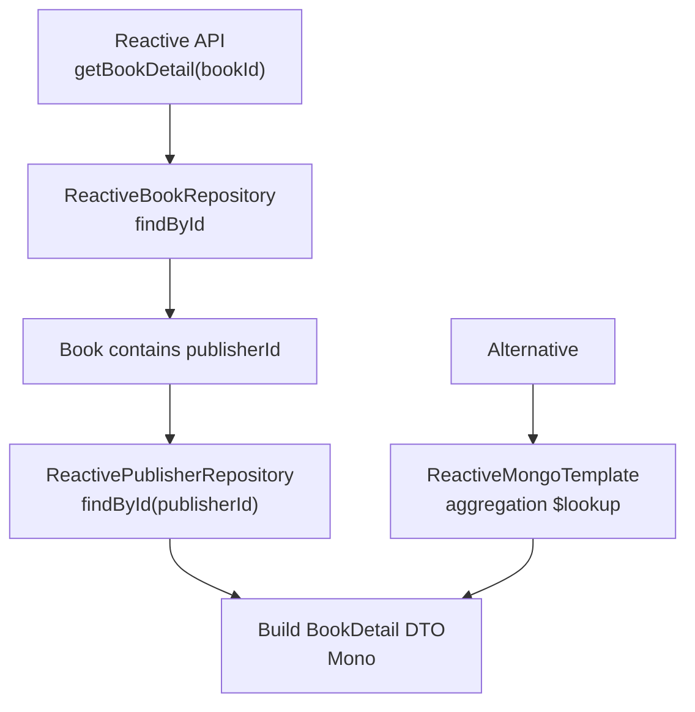

# Reference Limitations in Reactive Access and Derived Queries

## 1. Why Do References Become an Issue in Reactive Queries?

In MongoDB, data is typically organized into **documents** inside **collections**. With Spring Data MongoDB, a Java application can map documents to entities and access them via `MongoTemplate` or repositories. When one business object needs data from another object, developers must choose between **embedding data**, **storing references**, or **running combined queries**.

For example, a book (`Book`) belongs to a publisher (`Publisher`). A publisher can be shared by many books, has an independent lifecycle, and is often updated separately. If books and publishers are stored in two collections, a book document may store only `publisher_id`:

```javascript
// Collection: books
{
  _id: "BOOK-1001",
  title: "Introduction to Spring Data MongoDB",
  language: "vi",
  publisher_id: "PUB-01"
}

// Collection: publishers
{
  _id: "PUB-01",
  name: "Example Publisher",
  country: "VN"
}
```

In this lesson, there are two clear limitations to understand:

1. **Reactive reference resolution:** the Spring Data MongoDB documentation explicitly states that the reactive infrastructure does not support reading and automatically resolving document references declared via mapping mechanisms such as `@DBRef`/`@DocumentReference`. Reactive applications should organize loading related data explicitly.
2. **Derived queries:** derived methods like `findByPublisherId(...)` build criteria against fields of the document being queried. They **do not automatically join** to the `publishers` collection to filter by `Publisher.name`.

Understanding both points prevents building repositories that look reasonable yet fail to execute as intended, while avoiding extra queries, missing reference data, or thread blocking in reactive applications.

## 2. Three Ways to Represent Links Between Documents

To avoid confusing an **application-managed reference** with a **Spring Data auto-resolved reference**, compare them:

| Storage approach | Example field in `books` BSON | How related data is read | Reactive note |
| --- | --- | --- | --- |
| **Explicit ID** | `publisher_id: "PUB-01"` | Application reads `Publisher` via a separate query or `$lookup` | Well suited for `ReactiveMongoRepository` and `ReactiveMongoTemplate` |
| **`@DBRef`** | `publisher: DBRef("publishers", "PUB-01")`, matching `$ref`/`$id` structure | Mapping in synchronous flows resolves the reference | Do not rely on auto-resolution in reactive infrastructure |
| **`@DocumentReference`** | Default stores a pointer, usually the ID value `publisher: "PUB-01"` | Mapping in synchronous flows uses `lookup` to find target document | Do not rely on auto-resolution in reactive infrastructure |
| **Embedding** | `publisher: { name: "...", country: "VN" }` | Read directly along with the book document | Suits small snapshots, though requires a sync policy |

### What Is `@DBRef`?

`@DBRef` marks a property in a synchronous entity to store a **MongoDB DBRef** following the conventional reference format. In BSON, a DBRef normally holds the collection name (`$ref`), ID (`$id`), and optionally database (`$db`). When using synchronous mapping, the framework can resolve DBRefs to the related object, either eagerly or lazily per configuration.

Illustrative example **for the synchronous mapping branch**:

```java
import org.springframework.data.mongodb.core.mapping.DBRef;

@DBRef(lazy = true)
private Publisher publisher;
```

`lazy = true` only defers loading time where proxies are supported; it does not turn a DBRef into a reactive flow and does not eliminate extra queries once the data is accessed.

### How Does `@DocumentReference` Differ?

`@DocumentReference` allows storing pointers in multiple forms, most commonly the target document's ID value. When read in the synchronous mapping infrastructure, Spring Data queries the target collection using the `lookup` rule; custom `lookup` expressions can be configured when not linking by `_id`.

```java
import org.springframework.data.mongodb.core.mapping.DocumentReference;

@DocumentReference
private Publisher publisher;
```

Under default settings, the `publisher` field usually stores a BSON ID, **not the full `Publisher` document**, and unlike the DBRef structure. `@DocumentReference` also **does not cascade-save**: when modifying a publisher, the application must save the publisher separately.

The annotation snippets in this section compare **synchronous** mechanisms. The reactive practice sections below use an **explicit ID field**, without placing either annotation on reactive entities.

## 3. Reactive Infrastructure Limitations to Remember

Spring Data MongoDB provides `ReactiveMongoRepository` and `ReactiveMongoTemplate` to work with the reactive driver, typically returning `Mono<T>` or `Flux<T>`. Data is retrieved only when the stream is subscribed to, and query steps are composed using Reactor operators.

In the *Using Document References* section of the Spring Data MongoDB documentation, the limitation is stated clearly: **reading document references via the reactive infrastructure is not supported**. Therefore, do not write reactive code expecting:

```java
// Example NOT to rely on as an auto-resolving reactive reference contract.
@DocumentReference(lazy = true)
private Publisher publisher;
```

to automatically populate the `publisher` field through a reactive query chain when calling `reactiveBookRepository.findById(...)`. That is not a capability guaranteed by the documentation.

A safe, observable pattern is:

- Store `publisherId` (matching `Publisher`'s `_id`) in `Book`.
- Query books via `ReactiveBookRepository`.
- When publisher details are needed, use `ReactivePublisherRepository` or `ReactiveMongoTemplate` to read explicitly.
- Use `flatMap`, `zip`, `collectList`, and Reactor operators to combine data, or use a MongoDB `$lookup` pipeline when database-side joins are needed.



**Never call `block()` or use synchronous `MongoTemplate` directly inside a reactive request-handling pipeline** as a shortcut to “resolve references quickly.” Blocking threads degrades concurrency and throws errors on non-blocking threads. If integrating a blocking library is unavoidable, isolate it on dedicated schedulers with bounded load; it is not the default solution for MongoDB references.

## 4. Practical Data Model Using Explicit IDs

Continuing the book–publisher example, choose **BSON String IDs** formatted as `BOOK-1001` and `PUB-01` for readability, with `@MongoId(FieldType.STRING)` to avoid ambiguity between String IDs and ObjectIds.

### `Publisher.java`

```java
package com.example.library;

import org.springframework.data.mongodb.core.mapping.Document;
import org.springframework.data.mongodb.core.mapping.FieldType;
import org.springframework.data.mongodb.core.mapping.MongoId;

@Document(collection = "publishers")
public class Publisher {

    @MongoId(FieldType.STRING)
    private String id;
    private String name;
    private String country;

    protected Publisher() {}

    public Publisher(String id, String name, String country) {
        this.id = id;
        this.name = name;
        this.country = country;
    }

    public String getId() { return id; }
    public String getName() { return name; }
    public String getCountry() { return country; }
}
```

### `Book.java`

```java
package com.example.library;

import org.springframework.data.mongodb.core.mapping.Document;
import org.springframework.data.mongodb.core.mapping.Field;
import org.springframework.data.mongodb.core.mapping.FieldType;
import org.springframework.data.mongodb.core.mapping.MongoId;

@Document(collection = "books")
public class Book {

    @MongoId(FieldType.STRING)
    private String id;
    private String title;
    private String language;

    @Field("publisher_id")
    private String publisherId;

    protected Book() {}

    public Book(String id, String title, String language, String publisherId) {
        this.id = id;
        this.title = title;
        this.language = language;
        this.publisherId = publisherId;
    }

    public String getId() { return id; }
    public String getTitle() { return title; }
    public String getLanguage() { return language; }
    public String getPublisherId() { return publisherId; }
}
```

The `publisherId` property only stores the reference key. Spring Data does not look up `Publisher` when mapping `Book`, so the entity behaves like a standard document in reactive access. `@Field("publisher_id")` specifies the BSON field name; derived queries on the entity use the Java property `publisherId`.

### Sample Data in `mongosh`

```javascript
use library_reactive_demo

db.publishers.insertMany([
  { _id: "PUB-01", name: "Example Publisher", country: "VN" },
  { _id: "PUB-02", name: "Open Books", country: "SG" }
])

db.books.insertMany([
  {
    _id: "BOOK-1001",
    title: "Introduction to Spring Data MongoDB",
    language: "vi",
    publisher_id: "PUB-01"
  },
  {
    _id: "BOOK-1002",
    title: "Practical Reactive MongoDB",
    language: "vi",
    publisher_id: "PUB-01"
  },
  {
    _id: "BOOK-1003",
    title: "Data Access Patterns",
    language: "en",
    publisher_id: "PUB-02"
  }
])
```

Run `insertMany` only against an empty practice database, as re-running with the same `_id`s causes duplicate key errors. To connect the application to the right database, Spring Boot 3.x can configure `spring.data.mongodb.uri=mongodb://localhost:27017/library_reactive_demo` with the `spring-boot-starter-data-mongodb-reactive` starter. Dependency or property names may vary by Spring Boot generation; verify your project's framework version before applying examples.

## 5. What Do Derived Queries Actually Query?

Spring Data repositories support **query derivation**: parsing method names from entity properties and building MongoDB filter criteria. This is not equivalent to relational ORM joins.

```java
package com.example.library;

import java.util.Collection;
import reactor.core.publisher.Flux;
import org.springframework.data.mongodb.repository.ReactiveMongoRepository;

public interface ReactiveBookRepository
        extends ReactiveMongoRepository<Book, String> {

    Flux<Book> findByPublisherId(String publisherId);

    Flux<Book> findByPublisherIdIn(Collection<String> publisherIds);

    Flux<Book> findByLanguageOrderByTitleAsc(String language);

    Flux<Book> findByPublisherIdAndLanguageOrderByTitleAsc(
        String publisherId, String language);
}
```

```java
package com.example.library;

import reactor.core.publisher.Flux;
import org.springframework.data.mongodb.repository.ReactiveMongoRepository;

public interface ReactivePublisherRepository
        extends ReactiveMongoRepository<Publisher, String> {

    Flux<Publisher> findByName(String name);
}
```

In this example, `findByPublisherId("PUB-01")` corresponds to querying the `books` collection:

```javascript
db.books.find({ publisher_id: "PUB-01" })
```

Similarly, `findByPublisherIdAndLanguageOrderByTitleAsc(...)` filters by `publisher_id` and `language`, then sorts `title` within **`books`**. Neither needs to read `publishers`, because every filtered field resides in the book document itself.

### What Derived Methods Do Not Automatically Do

Suppose the requirement is “find books whose **publisher name** equals `Example Publisher`.” The `books` collection has only `publisher_id`, not `publisher.name`. Therefore:

- You cannot rename `findByPublisherId` to `findByPublisherName` and expect it to automatically switch to querying `publishers`.
- If `Book` declares no `publisherName` property, query derivation fails to parse the property and errors out during repository initialization.
- Even if a model has an object-typed reference property, property path parsing **does not automatically generate a join across collections**. Execution criteria must still match the source collection's BSON shape.

**Difference with embedded objects:** if `Book` actually stored `publisherSnapshot: { name: "..." }` as an embedded document, a derived query on `publisherSnapshot.name` could be built from the nested property path, because that field lives inside the **same `Book` document**. That is a nested-field query, not a cross-reference query.

| Question | Does `books` BSON have enough data? | Query strategy |
| --- | --- | --- |
| Books with `publisher_id = PUB-01` | Yes | `findByPublisherId` |
| Vietnamese books sorted by title | Yes | `findByLanguageOrderByTitleAsc` |
| Books published by publisher named `X` | No, name is in `publishers` | Query `publishers` then `books`, or `$lookup` |
| Books with embedded `publisherSnapshot.name = X` | Yes, if the field is stored | Derived query on embedded property |

## 6. Approach 1: Combining Data Explicitly with Reactor

With reactive repositories, you can fetch the book and then fetch the publisher by `publisherId`. This is explicit, makes missing-reference error handling straightforward, and keeps the pipeline non-blocking.

### Returning an Assembled DTO

```java
package com.example.library;

public record BookDetail(
    String bookId,
    String title,
    String publisherId,
    String publisherName
) {}
```

```java
package com.example.library;

import java.util.NoSuchElementException;
import org.springframework.stereotype.Service;
import reactor.core.publisher.Mono;

@Service
public class BookDetailService {

    private final ReactiveBookRepository books;
    private final ReactivePublisherRepository publishers;

    public BookDetailService(
            ReactiveBookRepository books,
            ReactivePublisherRepository publishers) {
        this.books = books;
        this.publishers = publishers;
    }

    public Mono<BookDetail> getBookDetail(String bookId) {
        return books.findById(bookId)
            .switchIfEmpty(Mono.error(
                new NoSuchElementException("Book not found: " + bookId)))
            .flatMap(book ->
                publishers.findById(book.getPublisherId())
                    .map(publisher -> new BookDetail(
                        book.getId(),
                        book.getTitle(),
                        publisher.getId(),
                        publisher.getName()
                    ))
                    .switchIfEmpty(Mono.error(
                        new IllegalStateException(
                            "Missing publisher: " + book.getPublisherId()
                        )))
            );
    }
}
```

The flow above performs at most two sequential lookups: read `Book`, then read `Publisher`. It contains no `block()` calls. If `Book` does not exist, it emits a `Mono.error` distinct from the case where `Book` exists yet `publisherId` points to a deleted `Publisher`.

You can choose a different policy for a missing `Publisher`, such as returning a DTO with `publisherName = null`, if business rules allow; what matters is making an **explicit decision** rather than assuming the framework automatically restores references.

### Finding Books by Publisher Name via Two Queries

Suppose a publisher name may match multiple documents, using `Flux<Publisher>`. After reading the publisher IDs, find books whose `publisher_id` is in that list using `$in`:

```java
public Flux<Book> findBooksByPublisherName(String publisherName) {
    return publishers.findByName(publisherName)
        .map(Publisher::getId)
        .collectList()
        .flatMapMany(ids ->
            ids.isEmpty()
                ? Flux.empty()
                : books.findByPublisherIdIn(ids)
        );
}
```

This is an **additional method inside `BookDetailService`**, requiring `import reactor.core.publisher.Flux`. It triggers one publisher query and, if any IDs are found, one book query; it does not run a separate book query per publisher.

For very large ID counts, `collectList()` can consume substantial memory and `$in` has size/cost limits. Consider pagination, `$lookup` pipelines, or alternative search models instead. For large streams, respect memory limits and backpressure; never blindly collect the entire dataset into memory.

### Avoiding N+1 with Many Books

A convenient-looking yet inefficient pattern on a list page is:

```java
// Can trigger one publisher query per Book.
return books.findByLanguageOrderByTitleAsc("vi")
    .flatMap(book ->
        publishers.findById(book.getPublisherId())
            .map(publisher -> new BookDetail(
                book.getId(),
                book.getTitle(),
                publisher.getId(),
                publisher.getName()
            ))
    );
```

For 100 books, this can emit roughly 100 `Publisher` queries (even when many books share the same `Publisher`). That is the **N+1** problem. `flatMap` may execute queries concurrently, but it does not eliminate round trips; it can also increase server load and reorder results relative to the initial book order.

Solution: bound page size, collect **distinct `publisherId`s** for the page, batch-load `Publisher`s with `findAllById`, build an ID map, and assemble DTOs. For large lists or filters requiring joins, server-side `$lookup` can be used. Measure and choose based on real data.

## 7. Approach 2: Joining with `$lookup` in Reactive Aggregation

MongoDB supports the `$lookup` stage to combine data across two collections inside an aggregation pipeline. Spring Data MongoDB provides `ReactiveMongoTemplate.aggregate(...)` to run pipelines and receive a `Flux` without switching to blocking APIs.

First test directly in `mongosh`:

```javascript
db.books.aggregate([
  {
    $lookup: {
      from: "publishers",
      localField: "publisher_id",
      foreignField: "_id",
      as: "publisher"
    }
  },
  { $unwind: "$publisher" },
  { $match: { "publisher.name": "Example Publisher" } },
  {
    $project: {
      _id: 0,
      title: 1,
      publisherName: "$publisher.name"
    }
  }
])
```

Here:

1. `$lookup` matches `books.publisher_id` against `publishers._id`.
2. `$unwind` flattens the `publisher` array produced by `$lookup` into one object per match.
3. `$match` filters by publisher name after joining.
4. `$project` returns only the two DTO fields.

If `Publisher` does not exist, `$unwind` drops that book document by default. To **preserve books without a `Publisher`**, enable `preserveNullAndEmptyArrays` and define how missing fields are emitted.

### Running from Spring Data MongoDB

```java
package com.example.library;

public record BookPublisherRow(
    String title,
    String publisherName
) {}
```

```java
package com.example.library;

import org.springframework.data.mongodb.core.ReactiveMongoTemplate;
import org.springframework.data.mongodb.core.aggregation.Aggregation;
import org.springframework.data.mongodb.core.query.Criteria;
import org.springframework.stereotype.Service;
import reactor.core.publisher.Flux;

import static org.springframework.data.mongodb.core.aggregation.Aggregation.*;

@Service
public class BookJoinQuery {

    private final ReactiveMongoTemplate template;

    public BookJoinQuery(ReactiveMongoTemplate template) {
        this.template = template;
    }

    public Flux<BookPublisherRow> findByPublisherName(String name) {
        Aggregation aggregation = newAggregation(
            lookup("publishers", "publisher_id", "_id", "publisher"),
            unwind("publisher"),
            match(Criteria.where("publisher.name").is(name)),
            project("title")
                .and("publisher.name").as("publisherName")
                .andExclude("_id")
        );

        return template.aggregate(
            aggregation, "books", BookPublisherRow.class);
    }
}
```

When declaring pipelines with **string collection names** as in this example, field names `publisher_id` and `publisher.name` are raw BSON names. To avoid mismatches between Java properties and stored fields, inspect the pipeline sent to the database, especially when using `@Field`, custom converters, or entity-based aggregation mapping.

`$lookup` is a real join on MongoDB, yet it is not free. It carries CPU/memory overhead, and performance depends on record counts, filter conditions, indexes on target collections, and pipeline limits. Do not reach for `$lookup` on every request merely because it looks concise; sometimes reading two collections separately or snapshotting key fields is more suitable.

## 8. Indexes, Consistency, and Reference Risks

### Indexes Supporting Two-Step Reads

For finding `Publisher` by name and then `Book` by `publisherId`, candidate indexes are:

```javascript
db.publishers.createIndex(
  { name: 1 },
  { name: "publishers_name" }
)

db.books.createIndex(
  { publisher_id: 1, language: 1, title: 1 },
  { name: "books_publisher_language_title" }
)
```

An index on `publishers._id` exists by default. The compound index on `books` helps queries filtering by `publisher_id` and `language` and sorting by `title`, though you should verify `explain("executionStats")` on real data. If queries mainly filter `language` without `publisher_id`, this key order may not fit; design around actual access patterns.

For `$lookup`, MongoDB can leverage an index on `foreignField` in the target collection when criteria and pipeline structure allow. Even so, filtering by `publisher.name` only after scanning many books can be costly. Compare execution plans and latency against the two-step query approach.

### No Automatic Foreign Keys or Cascades Like a Relational ORM

With an explicit ID field `publisher_id`, MongoDB does not guarantee the target publisher exists. `@DBRef` and `@DocumentReference` also do not turn saving a `Book` into an automatic cascade-save of `Publisher`.

A production system must decide:

- **Write order:** save `Publisher` first before creating a `Book` referencing that ID when workflows allow.
- **Deleting `Publisher`:** block deletion if books remain, switch to an inactive status, or allow missing references and handle them on read.
- **Renaming `Publisher`:** detail screens can show the live name; invoices or past orders needing the transaction-time name should store a separate **snapshot**.
- **Multi-document consistency:** when a workflow must update both `Book` and `Publisher`, consider transactions if MongoDB infrastructure and driver support them, or compensating/idempotent workflows.
- **Access control:** knowing `publisherId` does not prove the user is authorized to view `Publisher`; verify tenant and access permissions before returning linked data.

References easily trigger data type bugs: `_id` may be a BSON ObjectId while `publisher_id` is a BSON String containing the exact same 24 hex characters. Comparisons in `$lookup` or explicit queries will fail to match. Establish one strict ID rule, check `$type`, and write real read/write tests.

## 9. Derived Queries, Nested Properties, and References: Comparison Table

| Scenario | Property/BSON example | What can a derived query do? | Additional requirement |
| --- | --- | --- | --- |
| Scalar ID in `Book` | `publisherId` → `publisher_id` | `findByPublisherId(...)` | Does not need to read target collection |
| Embedded `PublisherSnapshot` | `publisherSnapshot.name` inside `Book` | Can derive along nested property paths | Field names must match embedded BSON |
| `@DocumentReference` pointing by ID | BSON field `publisher` holds ID | Can query `Book` by stored field value if query is written properly | Does not auto-join to `publishers.name` |
| `@DBRef` in sync branch | BSON field in DBRef format | Query must match actual BSON structure | Does not turn target field queries into joins |
| Filter by `Publisher.name` in another collection | `books.publisher_id` + `publishers.name` | No derived method auto-joins | Two queries, `$lookup`, or intentional denormalization |

Specifically, a method named `findByPublisherName` only makes sense if `Book` has a `publisherName` property or valid nested property path **and** the matching data exists inside the `Book` document. A method that successfully parses at startup does not guarantee cross-reference queries work; inspect generated queries and BSON.

If filtering by publisher details is required on many screens, the design team may denormalize `publisher_name_snapshot` or `publisher_search_name` onto `Book` for fast queries. That is **denormalization**: agree on which field reflects historical names versus live names, and maintain a sync mechanism when `Publisher` renames.

## 10. Testing Reactive Flows and Real Queries

Test against a **real MongoDB** in integration tests, such as a MongoDB test container, because reference bugs depend heavily on BSON types and query shapes. Tests should run with the same Spring Data/driver configuration as the target application.

### Testing a Data-Combining Flow

After inserting `Publisher` `PUB-01` and `Book` `BOOK-1001` as in the sample data, use `StepVerifier` from `reactor-test`:

```java
import reactor.test.StepVerifier;

StepVerifier.create(bookDetailService.getBookDetail("BOOK-1001"))
    .expectNextMatches(detail ->
        detail.bookId().equals("BOOK-1001")
        && detail.publisherId().equals("PUB-01")
        && detail.publisherName().equals("Example Publisher")
    )
    .verifyComplete();
```

This snippet belongs inside a test with `bookDetailService` injected and the `reactor-test` dependency present. It verifies correct composition without setting up or booting a complete test project in this article.

Additional cases to test:

1. **Missing `Book`:** `getBookDetail(...)` returns an error per policy.
2. **Missing `Publisher`:** `Book` has `publisher_id` with no matching target document; application handles it cleanly.
3. **Duplicate publisher names:** `findBooksByPublisherName` handles multiple publisher IDs per business rules.
4. **Mismatched ID types:** `Book` stores String `publisher_id` while `Publisher` `_id` is ObjectId; queries fail to match despite identical text.
5. **List of many books sharing publishers:** measure query counts using `flatMap` versus batching or `$lookup`.
6. **Result ordering:** `flatMap` does not guarantee preserving the original Flux order; if list order matters, use `concatMap`/`flatMapSequential` or sort appropriately while watching load.
7. **End-to-end reactive:** pipeline never calls `block()` on request-handling threads; test across repository, service, and API layers.
8. **Indexes and aggregation:** run `explain("executionStats")` to inspect index scans, examined documents, and actual reads.

### Diagnosing Common Failures

| Symptom | Possible cause | How to check |
| --- | --- | --- |
| Reference field is not auto-resolved in reactive repository | Reactive infrastructure does not support reading mapped document references | Store explicit IDs; query targets with reactive repositories or `$lookup` |
| `findByPublisherName(...)` fails or returns nothing | Property does not exist on `Book`, or BSON lacks publisher name | Inspect entity, `books` documents, and generated repository query |
| Fetching one page of books emits many queries | N+1 when `flatMap` calls `findById` per book | Batch distinct IDs, bound page size, or use `$lookup` |
| `$lookup` yields empty publishers | Wrong collection/field name, or String ID vs. ObjectId mismatch | Inspect `$type` and test aggregation directly in `mongosh` |
| Missing records after `$unwind` | Target reference missing and `$unwind` drops empty arrays by default | Define orphan handling policy; consider `preserveNullAndEmptyArrays` |
| Reactive app stalls / latency spikes | Mixing blocking calls into reactive pipelines | Audit for `block()` and synchronous APIs; use reactive APIs |
| List order scrambles after combining | `flatMap` emits items in completion order | Use order-preserving operators if business logic requires it |
| Saving `Book` does not persist edits to `Publisher` | No default cascading saves | Save `Publisher` separately and define transaction boundaries |

## 11. Choosing a Solution by Goal

| Goal | Typically appropriate approach | Trade-off to measure |
| --- | --- | --- |
| Only need books by publisher ID | `publisherId` field + derived query | Simple, minimal round trips |
| Return one book detail with `Publisher` | Two reactive queries via `flatMap` | One extra round trip |
| Find books by `Publisher` name | Find `Publisher` first then `publisherIdIn`, or `$lookup` | Record counts, indexes, join overhead |
| Display dozens of books with publisher names | Batch publisher IDs per page or aggregation | Memory usage and result ordering |
| Preserve `Publisher` name at transaction time | Embed snapshot inside business document | Intentional duplication; document semantics clearly |
| Blocking-only app needing mapped references | May consider `@DBRef` or `@DocumentReference` | Resolution cost, lazy proxies, no cascades |
| Reactive app needing linked data | Explicit IDs + reactive repository/template | Must design link loading, consistency, and error handling explicitly |

A practical design step is writing down **access patterns first**: whether users filter by ID or name, page sizes, historical versus live data needs, and read/write ratios. From there, choose embedding vs. referencing, indexes, and joining strategies. Reactive programming does not change data modeling fundamentals, yet forces explicit attention to query paths and I/O trips.

## 12. Self-Practice and Knowledge Check

**Exercise 1.** A `Book` has BSON field `publisher_id: "PUB-01"`; `Publisher` has `name: "Example Publisher"` in another collection. Can you simply declare `findByPublisherName("Example Publisher")` so the reactive repository joins automatically?

**Answer:** No. Derived queries do not automatically join across collections. Look up `Publisher` by name to get IDs and then find `Book`s by ID, or use a `$lookup` aggregation.

**Exercise 2.** A reactive entity declares `@DocumentReference(lazy = true) Publisher publisher` and wants to return `publisher.getName()` without executing explicit queries. What is the limitation?

**Answer:** The reactive infrastructure does not support reading/auto-resolving document references via that mapping mechanism. Use an explicit ID and a reactive step to load `Publisher`, or join via `$lookup`.

**Exercise 3.** `$lookup` returns no publishers even though the ID strings look identical. What should you inspect?

**Answer:** The BSON types of `books.publisher_id` and `publishers._id`, collection names, field names, target document existence, and indexes; String and ObjectId are not implicitly equal.

**Exercise 4.** A list of 200 `Book`s calls `findById` once per `Publisher`, even though there are only 5 distinct `Publisher`s. How do you improve it?

**Answer:** Collect distinct `Publisher` IDs for the page, batch-load them, and assemble DTOs; optionally evaluate `$lookup` aggregation and measure real performance.

**Exercise 5.** You must reprint the exact publisher name as of the order date even if the current name has changed. Should you read the live reference or store a snapshot?

**Answer:** Store a snapshot of the name at transaction time inside the historical business document; references to the live `Publisher` serve other needs.

**Key takeaway:** `@DBRef` and `@DocumentReference` describe reference mechanisms in synchronous mapping, whereas **the reactive infrastructure does not support auto-reading document references that way**. Repository derived queries filter on the queried collection's own BSON and do not perform automatic joins. In reactive Spring Data MongoDB, the most controllable pattern is **storing explicit IDs, composing with `Mono`/`Flux` or using `$lookup`**, then verifying BSON types, query counts, indexes, and missing-reference cases.

### Reference Documentation

- Spring Data MongoDB, **Using DBRefs / Using Document References**: https://docs.spring.io/spring-data/mongodb/reference/mongodb/mapping/document-references.html
- Spring Data MongoDB, **Defining Query Methods**: https://docs.spring.io/spring-data/mongodb/reference/repositories/query-methods-details.html
- Spring Data MongoDB, **Aggregation Framework Support**: https://docs.spring.io/spring-data/mongodb/reference/mongodb/aggregation-framework.html
