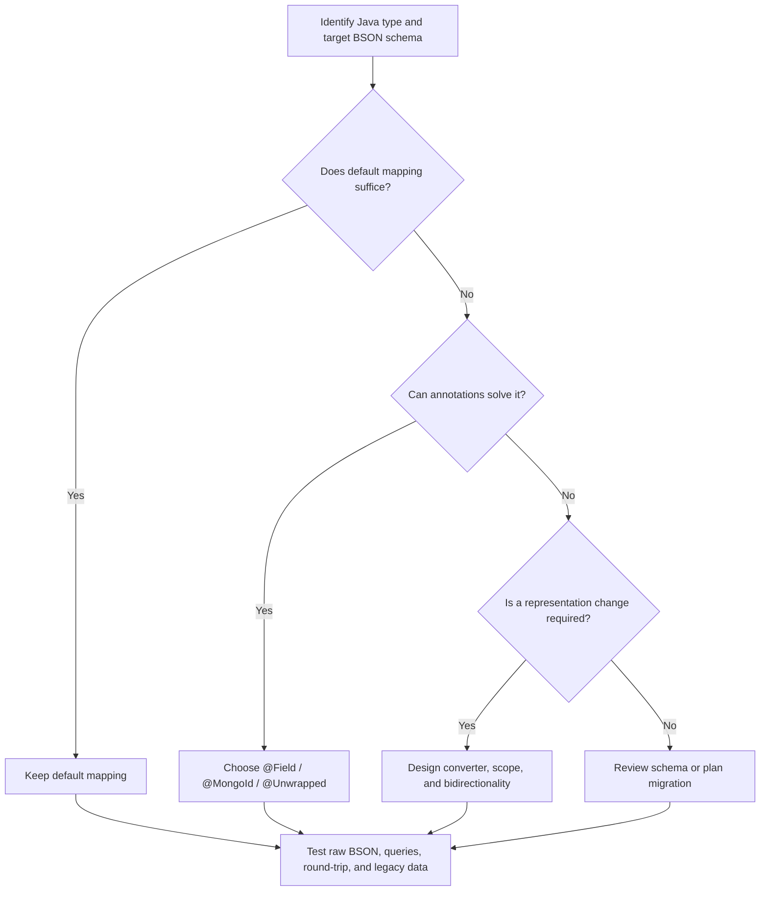

# When to Use a Converter Instead of Default Mapping?

Spring Data MongoDB can convert most Java objects to BSON documents without requiring custom converters. `String` typically becomes a BSON String, Java numbers become BSON numeric types, `Instant` can become a BSON Date, and nested POJOs are usually stored as embedded documents. However, sometimes **the data contract in MongoDB differs from the Java structure**: a value object needs to be stored as a single string, a legacy system uses special codes, or a library provides a type that the mapper does not know how to reconstruct. Those cases are when a custom converter is worth considering.

This lesson in the **Data Conversion** chapter helps you choose between default mapping, metadata such as `@Field`, and custom conversion in Spring Data MongoDB. This decision affects how `MongoRepository` and `MongoTemplate` write, read, construct queries, maintain indexes, and test data compatibility.

After this lesson, you will be able to:

- Explain the roles of `MappingMongoConverter`, `MongoCustomConversions`, `@ReadingConverter`, and `@WritingConverter`.
- Distinguish problems that should be solved with annotations, converters, auditing, callbacks, or migrations.
- Write and register a bidirectional converter for a domain value object.
- Verify the actual BSON, Java–MongoDB round-trip, queries, and impact on legacy data.
- Avoid overly broad converters, lossy conversions, or mixing BSON types on the same field.

## 1. How Does Default Mapping Work?

Normally, Spring Data's `MappingMongoConverter` reads entity metadata and converts Java properties into BSON fields. The MongoDB Java Driver handles codecs and BSON data transmission. For the entity:

```java
import java.time.Instant;
import java.util.List;
import org.bson.types.ObjectId;
import org.springframework.data.annotation.Id;
import org.springframework.data.mongodb.core.mapping.Document;

@Document(collection = "articles")
public class Article {
    @Id
    private ObjectId id;
    private String title;
    private int views;
    private Instant createdAt;
    private List<String> tags;
    private Author author;

    protected Article() {}

    public static class Author {
        private String name;
        private String country;
        protected Author() {}
    }
}
```

A corresponding document might look like this:

```javascript
{
  _id: ObjectId("665f1f2a4b6c7d8e9f001234"),
  title: "Spring Data MongoDB",
  views: 120,
  createdAt: ISODate("2026-11-20T02:00:00Z"),
  tags: ["spring", "mongodb"],
  author: { name: "Minh", country: "VN" }
}
```

The example omits `_class` metadata, which Spring Data may write depending on configuration. With this structure, default mapping usually meets your needs. Creating a converter just to express that a `String` is stored as a String or a List as an array adds unnecessary code.

### Three Different Conversion Layers

| Component | Responsibility | Example |
| --- | --- | --- |
| Jackson/HTTP JSON | Representing Java objects in REST requests and responses | `@JsonProperty`, `ObjectMapper` |
| Spring Data MongoDB mapping | Converting entities and properties to BSON based on metadata | `@Document`, `@Field`, `MappingMongoConverter` |
| MongoDB Java Driver/BSON codec | Representing BSON types and communicating with MongoDB | `ObjectId`, `Decimal128`, `BsonDocument` |

Renaming a JSON field on an API with `@JsonProperty` does not mean the BSON field has been renamed. Likewise, registering a converter with Spring Data MongoDB does not automatically change the JSON sent by a REST API. Test each data path according to its intended purpose.

## 2. Decision Table: When Is a Converter Actually Needed?

| Requirement | First Tool to Consider | When a Converter Is Appropriate |
| --- | --- | --- |
| Rename a BSON field | `@Field("stored_name")` | No converter needed just to rename |
| Choose a collection | `@Document(collection = "...")` | Do not use a converter |
| Choose ObjectId or String identifier | `@Id`, `@MongoId`, appropriate Java type | When a special ID contract requires controlled conversion |
| Store `BigDecimal` as Decimal128 | `@Field(targetType = FieldType.DECIMAL128)` | Only if formatting is more complex than choosing a BSON type |
| Embed a nested POJO | Default mapping | Only when the entire BSON shape must change |
| Flatten a nested value object | `@Unwrapped` when appropriate | No converter needed just to flatten |
| Store a domain value object as a scalar BSON String | Check whether built-in mapping matches the contract | **Appropriate** if bidirectional domain object ↔ String conversion is needed |
| Read a legacy representation different from current | Migration and compatibility strategy | Temporary or long-term reading converter based on policy |
| Sanitize input, validate business rules | Constructor/domain validator/service | Do not assign business decisions beyond conversion to a converter |
| Record `createdAt`, `updatedAt` | Auditing and appropriate callbacks | Not a default reason to write a converter |
| Update multiple documents in one transaction | Transaction/service | A converter does not create transactions |

**Principle:** choose the smallest mechanism that properly solves the requirement. Metadata describes where or how a field is stored; a converter describes how to **transform values** between the domain and BSON.

## 3. When Annotations and Default Mapping Are Sufficient

### 3.1. Field Names

```java
import org.springframework.data.mongodb.core.mapping.Field;

@Field("display_name")
private String displayName;
```

The Java field `displayName` is stored as BSON `display_name`. A `MongoTemplate` query with entity context typically uses the Java property path:

```java
Query query = Query.query(
    Criteria.where("displayName").is("Keyboard")
);
Product product = mongoTemplate.findOne(query, Product.class);
```

In `mongosh`, the query uses the actual BSON name: `{ display_name: "Keyboard" }`. There is no need to create a `Converter<String, String>` to rename a field.

### 3.2. `BigDecimal` and Decimal128

```java
import java.math.BigDecimal;
import org.springframework.data.mongodb.core.mapping.Field;
import org.springframework.data.mongodb.core.mapping.FieldType;

@Field(targetType = FieldType.DECIMAL128)
private BigDecimal unitPrice;
```

In some common configurations, Spring Data MongoDB stores `BigDecimal` as a BSON String by default. `FieldType.DECIMAL128` requests using BSON Decimal128 for this property. When only one field needs Decimal128, a globally registered `BigDecimal -> Decimal128` converter is too broad in scope.

Decimal128 has a precision limit of 34 significant decimal digits. If a `BigDecimal` value exceeds the BSON limit, you must define a rounding rule or reject the data. A converter cannot preserve information beyond the target type's representation capacity.

### 3.3. Embedded Objects and Enums

Spring Data typically maps `Address` to a nested BSON document, a `List` to a BSON array, and an enum to its constant name string. If all of those behaviors fit, no converter is needed. When renaming an enum constant while legacy data still stores the old name, consider stable codes, a converter, or a migration.

### 3.4. Identifiers, Dates/Times, and UUIDs

For `ObjectId`, `String` IDs, and `UUID`, prefer choosing the right Java type, `@Id` or `@MongoId`, and a consistent UUID representation/codec configuration. For `Instant` representing an event point-in-time, BSON Date is already a common representation with millisecond resolution. Do not write a converter just to patch over a schema that related systems are writing inconsistently; investigate the actual BSON first.

## 4. When Custom Converters Add Value

### 4.1. Domain Value Objects Stored as a Scalar

An application uses `CurrencyCode` to prevent the domain from accepting arbitrary `String` values, while the database requires the `currency` field to be a BSON String such as `"VND"`. If normal mapping handles the record or POJO, the result might be a nested document like `{ value: "VND" }`. A bidirectional converter lets the domain keep strong typing while BSON still adheres to the String schema.

### 4.2. Special Storage Formats

A value such as a region code, business code, bit flags, or a third-party library value object might need to be stored as a String, number, or BSON Binary according to an agreed contract. A converter is useful when there is a clear rule and it can be read back completely. If queries frequently need subfields, storing a nested document may be more suitable than packing the entire object into a String.

### 4.3. Legacy Data Compatibility

For example, a legacy DB stores status `"A"` or `"S"` while the new domain uses `ACTIVE` and `SUSPENDED`. A reading converter can translate legacy codes to the enum/domain type, while a writing converter can use the new representation. However, querying by the new type does not automatically find every document using the old format. You must test queries and have a migration plan or a compatible reading phase.

### 4.4. Third-Party Library Types

When an immutable library type lacks a suitable default converter/codec, you can define reading/writing to a supported BSON type. The converter must be deterministic in both directions, avoid uncontrolled library version dependencies, and avoid any side effects.

## 5. Complete Example: `CurrencyCode` Stored as a BSON String

### 5.1. Domain Value Object

```java
import java.util.Objects;

public record CurrencyCode(String value) {
    public CurrencyCode {
        Objects.requireNonNull(value, "currency");
        if (!value.matches("[A-Z]{3}")) {
            throw new IllegalArgumentException(
                "Currency code must consist of three uppercase letters"
            );
        }
    }
}
```

The record only validates format. If you want to check whether a code exists in the ISO 4217 catalog, the domain must add its own rule. Object creation is an invariant-protection step, whereas the converter only transforms the representation.

### 5.2. Writing Converter

```java
import org.springframework.core.convert.converter.Converter;
import org.springframework.data.convert.WritingConverter;

@WritingConverter
public final class CurrencyCodeWriteConverter
        implements Converter<CurrencyCode, String> {

    @Override
    public String convert(CurrencyCode source) {
        return source.value();
    }
}
```

### 5.3. Reading Converter

```java
import org.springframework.core.convert.converter.Converter;
import org.springframework.data.convert.ReadingConverter;

@ReadingConverter
public final class CurrencyCodeReadConverter
        implements Converter<String, CurrencyCode> {

    @Override
    public CurrencyCode convert(String source) {
        return new CurrencyCode(source);
    }
}
```

`@ReadingConverter` and `@WritingConverter` clarify the conversion direction, which is especially important if source/target involve simple types that the framework might treat as native. Invalid data like `"vnd"` is rejected by the constructor: avoid silently turning invalid data into a fake valid value.

### 5.4. Registering with `MongoCustomConversions`

```java
import java.util.List;
import org.springframework.context.annotation.Bean;
import org.springframework.context.annotation.Configuration;
import org.springframework.data.mongodb.core.convert.MongoCustomConversions;

@Configuration
public class MongoConversionConfig {

    @Bean
    MongoCustomConversions mongoCustomConversions() {
        return new MongoCustomConversions(List.of(
            new CurrencyCodeWriteConverter(),
            new CurrencyCodeReadConverter()
        ));
    }
}
```

This is a common converter registration API; different Spring Data versions may offer additional DSLs or configuration mechanisms. When applying this, verify the exact API for your project's version. An application should have only **one consistent conversion configuration** containing all converters in use, to avoid multiple conflicting beans or losing previously registered converters. With Spring Boot, verify the bean is loaded into the application context and used by auto-configuration.

### 5.5. Entity Using the Value Object

```java
import java.math.BigDecimal;
import org.bson.types.ObjectId;
import org.springframework.data.annotation.Id;
import org.springframework.data.mongodb.core.mapping.Document;
import org.springframework.data.mongodb.core.mapping.Field;
import org.springframework.data.mongodb.core.mapping.FieldType;

@Document(collection = "priced_products")
public class PricedProduct {
    @Id
    private ObjectId id;
    private String sku;
    private CurrencyCode currency;

    @Field(targetType = FieldType.DECIMAL128)
    private BigDecimal price;

    protected PricedProduct() {}

    public PricedProduct(
            String sku, CurrencyCode currency, BigDecimal price) {
        this.sku = sku;
        this.currency = currency;
        this.price = price;
    }

    public ObjectId getId() { return id; }
    public String getSku() { return sku; }
    public CurrencyCode getCurrency() { return currency; }
    public BigDecimal getPrice() { return price; }
}
```

When saved successfully through Spring Data mapping, the data might look like this:

```javascript
{
  _id: ObjectId("665f1f2a4b6c7d8e9f001234"),
  sku: "BK-001",
  currency: "VND",
  price: NumberDecimal("129000.00")
}
```

The `currency` field is a BSON String **thanks to the converter**; `price` is Decimal128 **thanks to `@Field` metadata**. The example omits `_class`, which may appear depending on Spring Data configuration. Do not rely on how REST JSON renders the two fields to infer their actual BSON types.

### 5.6. Writing, Reading, and Querying via `MongoTemplate`

```java
import java.math.BigDecimal;
import org.springframework.data.mongodb.core.MongoTemplate;
import org.springframework.data.mongodb.core.query.Criteria;
import org.springframework.data.mongodb.core.query.Query;

public void demonstrate(MongoTemplate template) {
    PricedProduct saved = template.insert(new PricedProduct(
        "BK-001",
        new CurrencyCode("VND"),
        new BigDecimal("129000.00")
    ));

    PricedProduct loaded = template.findById(
        saved.getId(), PricedProduct.class
    );

    if (loaded == null ||
            !"VND".equals(loaded.getCurrency().value())) {
        throw new IllegalStateException("Could not read currency code properly");
    }

    Query query = Query.query(
        Criteria.where("currency").is(new CurrencyCode("VND"))
    );
    template.find(query, PricedProduct.class);
}
```

When Spring Data knows the domain type `PricedProduct.class`, it has the context to process properties and values in the query. However, the entity write path, raw driver, hand-built `Document` pipelines, and JSON `@Query` do not necessarily go through the exact same conversion mechanism. **Testing actual queries** is essential, especially with custom converters that have complex structures.

A corresponding repository can be declared as:

```java
import java.util.List;
import org.bson.types.ObjectId;
import org.springframework.data.mongodb.repository.MongoRepository;

public interface PricedProductRepository
        extends MongoRepository<PricedProduct, ObjectId> {

    List<PricedProduct> findByCurrency(CurrencyCode currency);
}
```

The derived query uses the Java property name `currency`. Test that `findByCurrency(new CurrencyCode("VND"))` returns documents whose stored currency is a BSON String.

## 6. Type-Based Converters vs. Property-Specific Converters

### 6.1. Globally Registered Type-Based Converters

`MongoCustomConversions` holds conversion rules based on source and target types. Once `CurrencyCode -> String` and its reverse are registered, entities with a `CurrencyCode` field generally share the same storage contract.

This is an advantage when the entire application agrees that `CurrencyCode` is always stored as a BSON String. However, it becomes dangerous if the same Java type must have **two different storage representations** in different fields.

For example:

```java
class UserProfile {
    private String displayName;   // Keep as-is
    private String secretNote;    // Has a custom format requirement
}
```

You should not register a global `String -> String` converter solely to transform `secretNote`: it could affect every String being read or written. Instead, use a dedicated value object (if this is a domain concept) or a property-specific conversion mechanism.

### 6.2. Property-Specific Conversion

Spring Data versions support *property conversions* through mechanisms such as `PropertyValueConverter` and corresponding metadata. This approach is useful when logic must be tied to **a specific field**, potentially needing property context, rather than affecting an entire Java type.

Before applying it, verify the API and registration style for the **Spring Data MongoDB version** your project uses. The property converter API differs across versions, so this lesson focuses on type-based converters with a complete example in section 5, rather than providing a configuration snippet that might not compile on your stack.

### 6.3. Avoid Overly Generic Source and Target Types

Declarations that require careful scrutiny:

- `Converter<Object, String>`: can intercept too many unrelated objects.
- `Converter<Document, Object>`: very broad, easily conflicts with domain object construction.
- `Converter<String, String>`: hard to restrict to the right field if registered globally.
- `Converter<Number, Long>`: can lose fractional parts and alter data types across many entities.

It is better to create meaningful domain types, declare explicit source/target types, and register only well-tested converters. If the requirement is converting **the BSON type of a single property** that an annotation can handle, use the annotation.

## 7. Legacy Data: Converters Do Not Automatically Migrate Old Data

Suppose a collection currently has multiple representations:

```javascript
{ sku: "A", currency: "VND" }           // New standard: BSON String
{ sku: "B", currency: { code: "VND" } } // Legacy: embedded document
{ sku: "C", currency: null }            // BSON Null
{ sku: "D" }                            // Missing field
```

The `Converter<String, CurrencyCode>` in section 5 only reads the BSON String case. It does not automatically turn nested documents into Strings, handle missing fields, or update legacy data in MongoDB.

### 7.1. Determine the Current State with `$type`

```javascript
db.priced_products.aggregate([
  {
    $group: {
      _id: { $type: "$currency" },
      documents: { $sum: 1 }
    }
  },
  { $sort: { documents: -1 } }
]);
```

For example, this might return groups `"string"`, `"object"`, `"null"`, or `"missing"`. Each group needs an explicit decision on whether it is supported, whether migration is needed, and how invalid data is handled.

### 7.2. Choosing a Transition Strategy

| Strategy | Suitable When | What Must Be Controlled |
| --- | --- | --- |
| **One-time migration** | Legacy data can be updated within a managed change window | Backup/rollback, idempotency, post-run data verification |
| **Temporarily read both old and new** | Multiple application versions run concurrently during gradual rollout | Converters/read paths actually support all required BSON types |
| **Write new standard, read old format** | Converging toward a fixed target schema | Queries/indexes still need to handle legacy data or legacy data needs backfilling |
| **Keep old format** | Data is shared by multiple systems and the contract cannot change yet | Document the schema clearly; do not accidentally change representations between services |

If a reading converter accepts both `"P"` and `"PAID"` and returns the same domain state `PAID`, a raw query `{ status: "PAID" }` will **not** automatically find documents with `status: "P"`. Test queries against both old and new representations; when necessary, use temporary multi-value queries or migrate before relying on indexes/queries for the new format.

### 7.3. Do Not Use an `Object` Source Converter to Catch All Bad Data

A tempting workaround is creating `Converter<Object, CurrencyCode>` with multiple `if` branches for String, Document, Number, etc. However, the broad scope of `Object` can cause unexpected side effects in the mapper and make it hard to tell when the converter runs. Prefer:

1. Surveying existing BSON types.
2. Designing a migration or reading converters for **each exact source type** supported by the framework.
3. Testing read/write paths and queries after conversion.
4. Removing compatibility logic once no legacy data remains to be supported.

### 7.4. Null and Missing Are Not Empty Strings

MongoDB distinguishes:

```javascript
{ currency: null }  // BSON Null
{ }                 // Missing currency field
{ currency: "" }    // Empty BSON String
```

Conversion pipelines often handle `null` separately; do not rely on a converter always being invoked with `null`. When mapped to a Java reference property, both missing and BSON Null can become `null`. If three distinct states are needed in the domain, design the data contract accordingly and use `$exists` and `$type` to verify.

## 8. Impact of Converters on Queries, Indexes, and Aggregations

### 8.1. Query by Actual BSON

If a converter turns `CurrencyCode("VND")` into BSON String `"VND"`, the corresponding raw query is:

```javascript
db.priced_products.find({
  currency: "VND",
  sku: "BK-001"
});
```

MongoDB does not know about `CurrencyCode` and does not consider String `"VND"` equal to a document `{value:"VND"}`. Indexes are also built on **actual BSON fields and values**, not on Java domain types.

```javascript
db.priced_products.createIndex(
  { currency: 1, sku: 1 },
  { name: "idx_currency_sku" }
);

db.priced_products.find({
  currency: "VND",
  sku: "BK-001"
}).explain("executionStats");
```

To evaluate query performance, inspect `winningPlan`, `totalKeysExamined`, and `totalDocsExamined` with representative data. A new index does not automatically drop or alter an old index on `currency.code` if the legacy schema used a nested document.

### 8.2. Raw Aggregations and Type Information

```javascript
db.priced_products.aggregate([
  { $match: { currency: "VND" } },
  {
    $group: {
      _id: "$currency",
      count: { $sum: 1 }
    }
  }
]);
```

This is a BSON aggregation running on the MongoDB server. There is no step constructing `CurrencyCode` inside `$group`. With Spring Data typed aggregations, some property paths and values may be handled by the mapper, but JSON/raw `Document` stages, aliases, and specialized operators must be verified individually. Avoid assuming converters ensure every expression in a pipeline automatically translates to the domain format.

### 8.3. Converters Can Eliminate Filtering on Subfields

If an `Address` was once stored as:

```javascript
{ address: { city: "Ha Noi", country: "VN" } }
```

but is later converted into a single string like `"Ha Noi|VN"`, queries on `"address.city"` and indexes on subfields no longer apply. Packing an object into a scalar is only appropriate when filtering and updating by subfields are not important requirements. The decision to use a converter must stem from how the application **reads, filters, and updates data**, not just from reducing lines of Java code.

## 9. How Do Converters Differ from Auditing, Callbacks, Jackson, and JPA?

| Mechanism | Used For | Does Not Replace |
| --- | --- | --- |
| **Custom Mongo converter** | Changing Java value ↔ BSON representation | Domain services, migrations, and transactions |
| `@Field`, `@MongoId`, `@Unwrapped` | Metadata for names, types, identifiers, and flattening | Custom transformation logic beyond annotation scope |
| `@CreatedDate`, `@LastModifiedDate` | Auditing creation/modification metadata | Domain scalar conversion |
| `BeforeConvertCallback` or other callbacks | Behavior at entity processing time | A bulk schema migration |
| Jackson `JsonSerializer` / `JsonDeserializer` | JSON APIs or JSON messages | BSON persistence mapping |
| JPA `AttributeConverter` | Mapping JPA values to SQL columns | Spring Data MongoDB conversion |
| MongoDB JSON Schema validator | Enforcing data types and structure in the database | Java reading/writing converters |
| MongoDB transaction | Coordinating multiple writes when atomic commit is needed | Value object mapping |

For example, "every new entity needs `createdAt`" is usually a job for auditing. "When writing an invoice, verify the total amount" is usually a job for the aggregate/service. "Send an email after saving" is an external workflow/service. Stuffing all of these behaviors into a converter creates side effects that are hard to test and can be triggered multiple times unexpectedly.

With reactive access (`ReactiveMongoTemplate` or reactive repositories), mapping still needs consistent converters, but a synchronous converter must not make HTTP calls or wait on I/O. A blocking conversion path can degrade throughput and latency in a reactive application.

## 10. Testing: Object Round-Trip Is Not Enough

Suppose Spring Data stores `CurrencyCode` as a nested document by default and also reads it back successfully. A unit test that only compares `CurrencyCode("VND")` before and after will **fail to detect** a violated BSON String contract. You need to verify all three aspects:

1. **Converter logic:** converts accurately in both directions and rejects invalid data.
2. **Raw BSON:** fields are stored with the expected BSON type and format.
3. **Queries and updates:** domain values passed into filters/updates are converted consistently with stored data.

### 10.1. Unit Test for the Converter

```java
import static org.junit.jupiter.api.Assertions.*;
import org.junit.jupiter.api.Test;

class CurrencyCodeConverterTest {
    private final CurrencyCodeWriteConverter writer =
        new CurrencyCodeWriteConverter();
    private final CurrencyCodeReadConverter reader =
        new CurrencyCodeReadConverter();

    @Test
    void convertsBothDirections() {
        CurrencyCode original = new CurrencyCode("VND");
        String stored = writer.convert(original);

        assertEquals("VND", stored);
        assertEquals(original, reader.convert(stored));
    }

    @Test
    void rejectsInvalidValue() {
        assertThrows(IllegalArgumentException.class,
            () -> reader.convert("vnd"));
    }
}
```

This unit test verifies pure logic; it does not prove the converter has been registered in Spring Data MongoDB.

### 10.2. Integration Test with Real MongoDB

The following example uses JUnit 5 and Spring Boot Test. Configure the test application context to load `MongoConversionConfig` and connect to a **test-only** database:

```java
import static org.junit.jupiter.api.Assertions.*;
import static com.mongodb.client.model.Filters.eq;

import java.math.BigDecimal;
import org.bson.Document;
import org.bson.types.Decimal128;
import org.junit.jupiter.api.Test;
import org.springframework.beans.factory.annotation.Autowired;
import org.springframework.boot.test.context.SpringBootTest;
import org.springframework.data.mongodb.core.MongoTemplate;
import org.springframework.data.mongodb.core.query.Criteria;
import org.springframework.data.mongodb.core.query.Query;

@SpringBootTest
class CurrencyCodeMongoIntegrationTest {
    @Autowired
    MongoTemplate template;

    @Test
    void writesBsonStringAndReadsCurrencyCode() {
        PricedProduct product = template.insert(
            new PricedProduct(
                "BK-IT-001",
                new CurrencyCode("VND"),
                new BigDecimal("129000.00")
            )
        );

        try {
            Document raw = template.getCollection("priced_products")
                .find(eq("_id", product.getId()))
                .first();

            assertNotNull(raw);
            assertEquals("VND", raw.getString("currency"));
            assertTrue(raw.get("price") instanceof Decimal128);

            PricedProduct loaded = template.findById(
                product.getId(), PricedProduct.class
            );
            assertNotNull(loaded);
            assertEquals("VND", loaded.getCurrency().value());

            Query query = Query.query(
                Criteria.where("_id").is(product.getId())
                    .and("currency").is(new CurrencyCode("VND"))
            );
            assertTrue(template.exists(query, PricedProduct.class));
        } finally {
            template.remove(product);
        }
    }
}
```

Real tests should use unique data/IDs and an isolated database to avoid interfering with other tests. This example requires a running MongoDB or Testcontainers MongoDB instance and valid Spring configuration; the code is included for practice and **was not executed during authoring**.

### 10.3. Inspecting with `mongosh`

After the application writes a sample document:

```javascript
db.priced_products.findOne(
  { sku: "BK-IT-001" },
  { _id: 0, sku: 1, currency: 1, price: 1 }
);

db.priced_products.aggregate([
  { $match: { sku: "BK-IT-001" } },
  {
    $project: {
      _id: 0,
      currencyType: { $type: "$currency" },
      priceType: { $type: "$price" }
    }
  }
]);
```

Expected output: `currencyType` is `"string"` and `priceType` is `"decimal"`. If the integration test removed the document in `finally`, the mongosh query will find nothing; proactively create separate test data to observe.

### 10.4. Additional Test Cases to Include

- Null, missing, and empty string: are they distinguished properly according to the contract?
- Does malformed data throw a clear error or get turned into a default value?
- Can legacy data be read, and do queries find all data versions properly?
- Does the converter unintentionally alter any other `String` fields?
- Do repository derived queries, `MongoTemplate` updates, and aggregations share the same BSON convention?
- During a schema change, can an older application version read documents written by the new version?
- Does conversion preserve precision, timezone, and all critical domain values?

## 11. Common Pitfalls and How to Handle Them

| Symptom | Common Cause | Resolution |
| --- | --- | --- |
| `CurrencyCode` stored as nested document | Converter not registered or config not loaded | Check `MongoCustomConversions` and raw BSON |
| Writes fine but fails to read back as value object | Missing `@ReadingConverter` or missing read registration | Check bidirectional unit tests and integration tests |
| Old values cause application read errors | Legacy BSON format differs from new contract | Survey with `$type`, plan a migration |
| `BigDecimal` stored as String instead of Decimal128 | Target type not specified on the field | Use `@Field(targetType = FieldType.DECIMAL128)` and check `$type` |
| Converter affects unrelated fields | Source/target converter types too generic | Create a domain value object or property converter |
| Query by object fails to find documents | Query value not converted properly or old BSON uses another format | Verify BSON and actual queries via integration tests |
| Changed Jackson annotation but BSON did not change | REST JSON and Mongo mapping are two separate layers | Use appropriate Mongo metadata |
| Read converter slow when loading many documents | Heavy parser or external I/O inside converter | Keep converters fast, pure, and side-effect free |
| Registered converter but old data keeps old schema | Converters do not perform database migrations | Run a verified migration with rollback |
| Can no longer query subfields | Packed object into String/Binary | Keep a nested document or add queryable fields |

## 12. Selection Process Before Adding a Converter



Before registering a converter, ask yourself:

1. What are the Java source/target types and the actual BSON type?
2. Must all fields with the same Java type follow the same rule?
3. Is the converter reversible without losing information? Are there precision, timezone, or null limitations?
4. What representations exist in legacy data, and how will reading/migration work?
5. Will queries, indexes, and aggregations work with the new BSON format?
6. Is the rule pure, fast, and clear enough to test independently?
7. When deploying multiple application versions, is backward compatibility required?

## 13. Practice Exercises

**Exercise 1 — Choose the mechanism.** An entity has `displayName` that must be stored as `display_name`, `BigDecimal price` needing Decimal128, and `CurrencyCode currency` needing a BSON String. Classify default mapping, annotation, or custom converter for each field and explain your choice.

**Exercise 2 — Write a converter.** Create a `LanguageCode` record holding a two-letter lowercase language code, stored as a BSON String. Write `@WritingConverter`, `@ReadingConverter`, and register them. Test valid and invalid values.

**Exercise 3 — Legacy data.** Order status is stored in three forms: `"P"`, `"PAID"`, and `{ code: "P" }`. Propose a target schema, a migration strategy, how to query while two versions run concurrently, and the limitations of a read-only converter.

**Exercise 4 — Scope.** Two fields are both `String`, but only one requires a special format. Explain why a global `Converter<String, String>` is dangerous. Propose using a value object or property-specific conversion.

**Exercise 5 — Verify BSON.** Write a `PricedProduct` to a test database. Use `mongosh` to verify `currency` has type `string` and `price` has type `decimal`; try inserting `"vnd"` into currency and predict the outcome when the repository reads it back.

**Exercise 6 — Queries and indexes.** A team proposes using a converter to pack `Address(city,country)` into a String. Analyze the impact on querying by city, indexing on country, and migrating from a nested document.

**Exercise 7 — Assign responsibilities.** A system must auto-populate `createdAt`, validate invoice totals, encrypt a field, send an email, and store `CurrencyCode` as a BSON String. Identify which task belongs to auditing, service, security solution, or converter.

### Key Takeaways

**Default mapping is the first choice** when BSON already fits the Java domain. Use annotations to change storage names/types when the framework supports it. Use a converter when a **value type needs a different BSON representation under an explicit contract**. Limit scope, separate converters from business logic and JSON APIs, and verify both Java ↔ BSON directions, actual BSON types, queries, indexes, and legacy data before rolling out to production.
