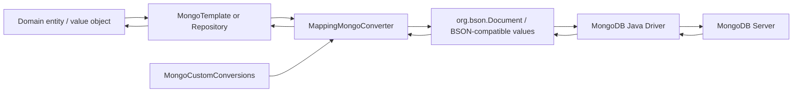

# Registering MongoCustomConversions

When saving a Java object to MongoDB, **Spring Data MongoDB** must convert data between Java types and MongoDB BSON. Familiar types such as `String`, `Integer`, `Date`, and many collections already have built-in conversion rules. Real-world applications, however, frequently use **value objects** like `EmailAddress`, `Money`, specialized identifiers, or legacy data whose BSON format differs from the Java model.

In the **Data Conversion** chapter of the `SPRING_DATA_MONGODB` module, this lesson covers registering converters with `MongoCustomConversions`, distinguishing **reading** and **writing**, integrating with `MappingMongoConverter`, `MongoTemplate`, and repositories, testing BSON formats, handling schema changes, and Spring Data upgrade considerations. Those foundations support subsequent lessons on queries, aggregations, indexes, transactions, reactive access, and data performance diagnostics.

> **Key message:** `MongoCustomConversions` is where **data conversion rules are registered**, not the MongoDB Java Driver or the connection string. Converters directly affect how BSON is stored and read; changing a converter can constitute a **schema change** even when the domain class barely changes.

## 1. Learning Objectives

After completing this lesson, you will be able to:

1. Describe the roles of `MongoCustomConversions` and `MappingMongoConverter` in bidirectional Java ↔ BSON conversion.
2. Write `Converter<JavaType, StoreType>` for the write direction and `Converter<StoreType, JavaType>` for the read direction.
3. Use `@WritingConverter` and `@ReadingConverter` to declare conversion direction unambiguously.
4. Register converters in Spring Boot via a `MongoCustomConversions` bean.
5. Distinguish converter registration under Spring Boot auto-configuration versus manual configuration using `AbstractMongoClientConfiguration`.
6. Verify the actual data stored in a collection, reading back through `MongoTemplate`/repositories, and querying by value objects.
7. Handle scenarios where converters are unregistered, overly broad, asymmetric, or break legacy data.
8. Distinguish type converters, property converters, and `@Field(targetType = …)`; configure `BigDecimal` representation by Spring Data version.
9. Build a testing checklist before deploying conversion changes to a live application.

## 2. Where Does MongoCustomConversions Sit in the Data Path?



When **writing** a document, `MappingMongoConverter` inspects entity metadata (such as `@Document`, `@Id`, and `@Field`), then converts each property to a supported BSON type. For a registered custom type, it can prioritize the matching converter before falling back to standard object mapping.

When **reading**, `MappingMongoConverter` receives values from BSON and instantiates the entity. It can use a reading converter to turn the stored value back into an application value object.

| Component | Practical Role |
| --- | --- |
| `MongoCustomConversions` | Registers/looks up converters and supplies simple-type metadata (`SimpleTypeHolder`) to the mapping system. |
| `MappingMongoConverter` | Performs object mapping and conversion between Java entities, supported values, and BSON documents. |
| `Converter<S, T>` | Function converting a value from source type `S` to target type `T`. |
| `@ReadingConverter` | Explicitly marks a rule for reading a value from the store into the domain. |
| `@WritingConverter` | Explicitly marks a rule for writing a value from the domain to the store. |
| `MongoTemplate` | Synchronous API running queries, updates, aggregations, and inserts/saves; uses the underlying mapping mechanism. |
| `MongoRepository` | Repository API using the corresponding mapping/conversion layer. |
| MongoDB Java Driver | Manages connections, BSON codecs, sessions, and commands; does not replace `MongoCustomConversions`. |

**Distinction:** `MongoCustomConversions` belongs to Spring Data; `CodecRegistry` belongs to the driver. Registering a `Codec` at the driver layer does not mean Spring Data will automatically treat a Java value object as a simple type across all mapping operations.

### When Custom Conversion Is Not Needed

If a nested object has a natural structure:

```java
public record Address(String street, String city) {}
```

Spring Data can usually store it as a BSON object:

```json
{
  "address": {
    "street": "12 Nguyen Trai",
    "city": "Ha Noi"
  }
}
```

You do not need to write a converter just to map ordinary records or classes. A converter is needed when you **want to change the storage representation**, such as storing `EmailAddress` as a **BSON string** instead of `{ "value": "..." }`, or when you need to read legacy data formats.

## 3. Business Example: EmailAddress Stored as a BSON String

Suppose the domain model wants `EmailAddress` to reject blank emails and centralize normalization rules, while the collection stores emails as strings:

```json
{
  "_id": "CUS-101",
  "displayName": "Lan",
  "email": "lan@example.test"
}
```

Without a custom converter, a Java record `EmailAddress(String value)` might be treated as a nested object and written as:

```json
{
  "_id": "CUS-101",
  "displayName": "Lan",
  "email": {
    "value": "lan@example.test"
  }
}
```

The two formats **have different schemas**. Queries like `{"email": "lan@example.test"}` and a unique index on `email` do not mean the same thing when the data turns into an object. We need to register two converters to preserve the scalar BSON string format.

### 3.1. Declaring an Immutable Value Object

```java
package dev.learning.customer;

import java.util.Locale;
import java.util.Objects;

public record EmailAddress(String value) {

    public EmailAddress {
        Objects.requireNonNull(value, "email");
        value = value.trim().toLowerCase(Locale.ROOT);

        // Minimal check for the example; not a full email validator.
        int at = value.indexOf('@');
        if (at <= 0 || at == value.length() - 1 || value.contains(" ")) {
            throw new IllegalArgumentException("Invalid email address");
        }
    }
}
```

A record is immutable at the component level; `String` is also immutable. The constructor normalizes **the value the system has decided to store**. Do not blindly apply lowercasing to all email data without checking business requirements and the application's comparison strategy; this example illustrates one specific policy.

Create the entity containing the value object:

```java
package dev.learning.customer;

import org.springframework.data.annotation.Id;
import org.springframework.data.mongodb.core.mapping.Document;

@Document("customers")
public record Customer(
        @Id String id,
        String displayName,
        EmailAddress email) {
}
```

Goal: use `EmailAddress` in Java, while MongoDB's `email` field is a **BSON string**.

## 4. Writing @WritingConverter: From Domain to BSON

A writing converter takes the Java value object and returns a native value that the MongoDB Java Driver can handle:

```java
package dev.learning.customer;

import org.springframework.core.convert.converter.Converter;
import org.springframework.data.convert.WritingConverter;

@WritingConverter
public final class EmailAddressWriteConverter
        implements Converter<EmailAddress, String> {

    @Override
    public String convert(EmailAddress source) {
        return source.value();
    }
}
```

Flow:

```text
Java                         Spring Data                     MongoDB
EmailAddress("lan@...")  ->   EmailAddressWriteConverter  ->  "lan@..."
```

- `EmailAddress` is a domain-specific type.
- `String` is a type that BSON/the driver can handle directly.
- When mapping the `Customer.email` property, the converter can replace nested document conversion with a string.
- The `@WritingConverter` annotation clarifies that this converter is **for writing only**.

In this example, the converter makes no network API calls and performs no database writes. It simply describes transforming a value.

### Converters Should Be Pure Functions

A good converter typically:

- Does not depend on `MongoTemplate` or repositories to query additional data.
- Does not make HTTP calls, send emails, or produce side effects.
- Does not mutate `source`.
- Does not randomly generate a different value on each write.
- Has deterministic behavior and is easy to test.
- Throws a meaningful error for invalid data instead of silently writing bad data.

If sensitive data must be encrypted, use appropriate encryption mechanisms and standards, separate key management, and consider MongoDB's dedicated field-level encryption solutions. A hand-written converter does not automatically guarantee security or queryability.

## 5. Writing @ReadingConverter: From BSON Back to Domain

The reading converter is the reverse direction:

```java
package dev.learning.customer;

import org.springframework.core.convert.converter.Converter;
import org.springframework.data.convert.ReadingConverter;

@ReadingConverter
public final class EmailAddressReadConverter
        implements Converter<String, EmailAddress> {

    @Override
    public EmailAddress convert(String source) {
        return new EmailAddress(source);
    }
}
```

Flow:

```text
MongoDB                          Spring Data                   Java
"lan@example.test"           ->   EmailAddressReadConverter -> EmailAddress(...)
```

When the entity is read from MongoDB, Spring Data can pass the string to the reading converter and get back an `EmailAddress`.

**Property to test:** for every valid value within the application's scope, reading back must match expectations:

```text
read(write(EmailAddress("lan@example.test")))
    == EmailAddress("lan@example.test")
```

Not every converter has to be strictly invertible: for example, converters that round, normalize, or strip data may be one-way. However, if a transformation makes data unrecoverable, document it clearly and provide appropriate migrations/tests.

## 6. Registering MongoCustomConversions in Spring Boot

The `@ReadingConverter` and `@WritingConverter` annotations **do not cause Spring Data to automatically scan and register converter classes**. You must register their instances.

In a Spring Boot project using `spring-boot-starter-data-mongodb`, the direct approach is declaring a `MongoCustomConversions` bean:

```java
package dev.learning.customer;

import org.springframework.context.annotation.Bean;
import org.springframework.context.annotation.Configuration;
import org.springframework.data.mongodb.core.convert.MongoCustomConversions;

@Configuration(proxyBeanMethods = false)
public class MongoConversionConfiguration {

    @Bean
    MongoCustomConversions mongoCustomConversions() {
        return MongoCustomConversions.create(adapter -> {
            adapter.registerConverter(new EmailAddressWriteConverter());
            adapter.registerConverter(new EmailAddressReadConverter());
        });
    }
}
```

`MongoCustomConversions.create(...)` provides a `MongoConverterConfigurationAdapter` to configure converters and MongoDB-specific options. This approach works well in Spring Data MongoDB 4.5 and 5.x; prefer **a single explicit bean** so other configuration classes do not accidentally provide conflicting sets of converters.

When still using default auto-configuration, Spring Boot picks up the `MongoCustomConversions` bean and wires it into the MongoDB mapping system. Normally you **do not need** to create `MappingMongoConverter` or `MongoTemplate` yourself.

### 6.1. Maven Dependencies

With Spring Boot (parent/BOM already appropriately selected), basic dependencies:

```xml
<dependencies>
    <dependency>
        <groupId>org.springframework.boot</groupId>
        <artifactId>spring-boot-starter-data-mongodb</artifactId>
    </dependency>

    <dependency>
        <groupId>org.springframework.boot</groupId>
        <artifactId>spring-boot-starter-test</artifactId>
        <scope>test</scope>
    </dependency>
</dependencies>
```

Key imports:

| API | Package |
| --- | --- |
| `MongoCustomConversions` | `org.springframework.data.mongodb.core.convert` |
| `@ReadingConverter` / `@WritingConverter` | `org.springframework.data.convert` |
| `Converter<S, T>` | `org.springframework.core.convert.converter` |
| `MongoTemplate` | `org.springframework.data.mongodb.core` |
| `MappingMongoConverter` | `org.springframework.data.mongodb.core.convert` |

Keep Spring Data MongoDB, Spring Data Commons, and Java Driver versions aligned with the Spring Boot BOM; manually adding dependencies with mismatched versions can cause conversion or mapping errors at runtime.

### 6.2. Registering via the List Constructor

A common form in older projects:

```java
@Bean
MongoCustomConversions mongoCustomConversions() {
    return new MongoCustomConversions(java.util.List.of(
            new EmailAddressWriteConverter(),
            new EmailAddressReadConverter()
    ));
}
```

This form is valid on branches that still support that constructor. However, `create(adapter -> …)` is clearer and more convenient when you also need to configure native Java Time, BigDecimal, or property conversions.

### 6.3. Do Not Confuse with Spring MVC ConversionService

A `Converter<EmailAddress, String>` registered in `MongoCustomConversions` serves MongoDB mapping. It **does not automatically** convert Spring MVC HTTP query parameters or Jackson JSON requests/responses using the same rule. Spring MVC has its own conversion service, and Jackson has its own serializers/deserializers.

If the same value object appears at multiple boundaries (REST, messaging, MongoDB), clearly identify where conversion is needed and test each data path.

## 7. Manual Configuration via AbstractMongoClientConfiguration

If the application **does not let Spring Boot manage the full MongoDB configuration** and instead uses `AbstractMongoClientConfiguration`, you can override the converter configuration hook:

```java
package dev.learning.customer;

import org.springframework.context.annotation.Configuration;
import org.springframework.data.mongodb.config.AbstractMongoClientConfiguration;
import org.springframework.data.mongodb.core.convert.MongoCustomConversions
        .MongoConverterConfigurationAdapter;

@Configuration
public class ManualMongoConfiguration
        extends AbstractMongoClientConfiguration {

    @Override
    protected String getDatabaseName() {
        return "customer_lab";
    }

    @Override
    protected void configureConverters(
            MongoConverterConfigurationAdapter adapter) {
        adapter.registerConverter(new EmailAddressWriteConverter());
        adapter.registerConverter(new EmailAddressReadConverter());
    }
}
```

Understand the boundary:

- This is an **alternative configuration path** for applications managing their own MongoDB context.
- `AbstractMongoClientConfiguration` provides `MongoTemplate`, the mapping context, and related beans through its own lifecycle.
- For standard Spring Boot applications, using **the `MongoCustomConversions` bean in section 6** is simpler and avoids unnecessary database/factory configuration.
- Do not put both approaches into the same test application and assume the framework automatically picks the "right" bean when multiple `MongoTemplate`/`MongoDatabaseFactory`/`MongoCustomConversions` beans exist.

Whichever approach you use, the end goal is that **the converters are actually picked up by the `MappingMongoConverter` on the active execution path**.

## 8. Verifying Results with MongoTemplate

After registration, a `MongoTemplate.insert` call converts `EmailAddress` to a BSON string.

```java
package dev.learning.customer;

import org.springframework.data.mongodb.core.MongoTemplate;
import org.springframework.stereotype.Service;

@Service
public class CustomerService {
    private final MongoTemplate mongoTemplate;

    public CustomerService(MongoTemplate mongoTemplate) {
        this.mongoTemplate = mongoTemplate;
    }

    public Customer create(String id, String name, String rawEmail) {
        Customer input = new Customer(
                id, name, new EmailAddress(rawEmail));

        return mongoTemplate.insert(input);
    }

    public Customer getById(String id) {
        Customer found =
                mongoTemplate.findById(id, Customer.class);
        if (found == null) {
            throw new IllegalArgumentException(
                    "Customer does not exist: " + id);
        }
        return found;
    }
}
```

Example invocation:

```java
Customer created = customerService.create(
        "CUS-101", "Lan", " LAN@EXAMPLE.TEST ");
Customer found = customerService.getById("CUS-101");

System.out.println(found.email().value());
// lan@example.test
```

The collection has the expected shape:

```javascript
db.customers.findOne({ _id: "CUS-101" });
```

```json
{
  "_id": "CUS-101",
  "displayName": "Lan",
  "email": "lan@example.test"
}
```

**Inspect actual stored data instead of just printing the entity:** `found.email()` returning an `EmailAddress` alone does not prove BSON was stored as a string. To verify the format, read the raw document via `mongoTemplate.getCollection("customers")` or the appropriate MongoDB tool.

Some mapping configurations may also write `_class`; the JSON sample above focuses only on the fields relevant to conversion.

## 9. MongoRepository and Queries on Value Objects

`MongoRepository` also participates in the same mapping mechanism, provided the repository uses the same `MongoDatabaseFactory`/`MappingMongoConverter`:

```java
package dev.learning.customer;

import java.util.Optional;

import org.springframework.data.mongodb.repository.MongoRepository;

public interface CustomerRepository
        extends MongoRepository<Customer, String> {

    Optional<Customer> findByEmail(EmailAddress email);
}
```

```java
Customer stored = repository.insert(
        new Customer(
                "CUS-102",
                "Minh",
                new EmailAddress("minh@example.test")));

Optional<Customer> hit = repository.findByEmail(
        new EmailAddress("MINH@EXAMPLE.TEST"));
```

Repository queries must express search values compatible with the stored BSON type. For a property of type `EmailAddress`, the mapping system can apply writing conversion when building the query. However, testing **both the input query and actual BSON** is essential, especially when using raw JSON `@Query`, hand-built aggregation stages, `BasicQuery`, or pipelines going through low-level APIs.

### 9.1. Querying with MongoTemplate

```java
import org.springframework.data.mongodb.core.query.Criteria;
import org.springframework.data.mongodb.core.query.Query;

Query query = Query.query(
        Criteria.where("email").is(
                new EmailAddress("lan@example.test")));

Customer result = mongoTemplate.findOne(
        query, Customer.class);
```

Here Java code expresses the domain value object; Spring Data mapping is responsible for representing the value as a BSON string.

Do not mix the two query styles arbitrarily:

```javascript
// Compatible with converter writing EmailAddress -> String:
db.customers.find({ email: "lan@example.test" });

// Does not match documents storing email as a string:
db.customers.find({ "email.value": "lan@example.test" });
```

If the collection has a unique index `{ email: 1 }`, changing the email representation from object to string impacts both indexes and data. You must review the schema and migration plan.

## 10. Converter Disambiguation: Why Are @ReadingConverter / @WritingConverter Needed?

Spring Data typically infers converter direction from the source and target types:

- `EmailAddress → String`: the target is a native type understood by the store, so it is normally treated as a writing conversion.
- `String → EmailAddress`: the source is a native type, so it is normally treated as a reading conversion.

However, if **both ends are native types**, such as:

```java
Converter<String, Long>
```

The framework cannot always infer whether the converter is for reading or writing. If accidentally registered in the wrong direction, a very broad conversion could affect many unrelated properties.

Therefore, annotate explicitly:

```java
@ReadingConverter
final class LegacyIdReadConverter
        implements Converter<String, LegacyId> {
    @Override
    public LegacyId convert(String source) {
        return new LegacyId(source);
    }
}
```

If a rule only applies to **one specific field**, do not register a global converter between two common types like `String` and `String`. See `@ValueConverter` or property conversions (section 12).

### Two Converters with the Same Type Pair

Avoid registering two `Converter<String, EmailAddress>` implementations with different algorithms and relying on "whichever gets picked first." Scope and ordering can make configuration unpredictable. Maintain one clear reading rule tested against old and new data; if special migration handling is needed, solve it via schema/versioning or a converter that distinguishes data sources.

## 11. When to Write a Converter for an Entire Document?

Beyond scalar value objects, converters can also operate on `org.bson.Document`. For example, a legacy collection stores monetary values in an embedded object with fields `minor_units` and `ccy`, and the domain wants to read it into a `Money` record.

```json
{
  "_id": "PAY-101",
  "amount": {
    "minor_units": 12500,
    "ccy": "VND"
  }
}
```

Domain:

```java
package dev.learning.payment;

import java.util.Objects;

public record Money(long minorUnits, String currency) {
    public Money {
        if (minorUnits < 0) {
            throw new IllegalArgumentException("Negative amount");
        }
        Objects.requireNonNull(currency, "currency");
        if (currency.isBlank()) {
            throw new IllegalArgumentException("Missing currency code");
        }
    }
}
```

Writing converter:

```java
package dev.learning.payment;

import org.bson.Document;
import org.springframework.core.convert.converter.Converter;
import org.springframework.data.convert.WritingConverter;

@WritingConverter
public final class MoneyWriteConverter
        implements Converter<Money, Document> {

    @Override
    public Document convert(Money source) {
        return new Document("minor_units", source.minorUnits())
                .append("ccy", source.currency());
    }
}
```

Reading converter:

```java
package dev.learning.payment;

import org.bson.Document;
import org.springframework.core.convert.converter.Converter;
import org.springframework.data.convert.ReadingConverter;

@ReadingConverter
public final class MoneyReadConverter
        implements Converter<Document, Money> {

    @Override
    public Money convert(Document source) {
        Object raw = source.get("minor_units");
        if (!(raw instanceof Long minorUnits)) {
            throw new IllegalArgumentException(
                    "amount.minor_units must be BSON Int64");
        }

        return new Money(
                minorUnits,
                source.getString("ccy"));
    }
}
```

Add those two converters **to the same bean registered in section 6**:

```java
@Bean
MongoCustomConversions mongoCustomConversions() {
    return MongoCustomConversions.create(adapter -> {
        adapter.registerConverter(new EmailAddressWriteConverter());
        adapter.registerConverter(new EmailAddressReadConverter());
        adapter.registerConverter(new MoneyWriteConverter());
        adapter.registerConverter(new MoneyReadConverter());
    });
}
```

**Data warning:** the example intentionally requires BSON Int64 because `Money` uses `long` and the writing converter always writes `Long`. An old document with BSON Int32 or Decimal128 will be rejected; if you need to support them, implement exact per-type migration/conversion branches. Never blindly call `Number.longValue()` because it can silently truncate fractional digits.

With a `Money ↔ Document` converter, Spring Data's awareness that `Money` has a converter can change how it maps every property of type `Money`, including inside nested documents and lists. Evaluate the blast radius before applying globally.

### Why Not Convert Every Entity to Document Using a Converter?

A root-level `Converter<Customer, Document>` can override `MappingMongoConverter`'s default mapping behavior. You would then have to handle `_id`, `_class`, nested properties, versioning, auditing, and formats that the framework already handles out of the box. Use this approach only when you **genuinely need full representation control**, and thoroughly test all read/write paths.

For one or two specific fields, a value object converter or property converter is usually safer and easier to maintain.

## 12. Type Converters, Property Converters, and @Field(targetType)

Not every requirement needs a type-wide custom converter.

| Tool | Scope | When to Use |
| --- | --- | --- |
| `MongoCustomConversions` + `Converter<S,T>` | All properties/values where the type converter applies in the mapping context | Dedicated domain type that must share the same BSON representation across multiple entities. |
| `@Field(targetType = …)` | One property and its desired storage type | Choosing an appropriate BSON type, e.g., `DECIMAL128` for decimal values. |
| `@ValueConverter` | One annotated property | One field requires a custom conversion rule that should not affect the whole type. |
| `PropertyValueConverter` registered via adapter | One specified property in the model | You do not want annotations on the entity or need centralized configuration. |
| MongoDB Driver's custom `CodecRegistry` | Driver BSON codec layer | Using driver APIs directly or requiring codec-level types; does not replace Spring Data type mapping registration. |

Example of a **property converter** dedicated to a single field:

```java
import org.springframework.data.convert.ValueConverter;

// Specific property using the implemented converter:
@ValueConverter(SecretFieldConverter.class)
private String secretToken;
```

`SecretFieldConverter` here is an **illustrative class name** and must be implemented against `PropertyValueConverter` with the appropriate types/context before the code can compile. When encryption is needed, key management, algorithm design, and queryability are part of the problem—not just the annotation.

For programmatic registration, `MongoConverterConfigurationAdapter` offers APIs such as `configurePropertyConversions(...)`. Some method-reference registration styles require proxyable methods; **records or final classes** may prevent that style from working. Nested dot-notation paths in property converter registration APIs also have limitations: do not assume `"address.street"` is directly valid as a property name across all registration APIs.

## 13. BigDecimal and BigInteger: Differences Between Spring Data MongoDB 4.5 and 5.x

This is a very important consideration when upgrading **Spring Boot 3.5 / Spring Data MongoDB 4.5** to **Spring Boot 4.x / Spring Data MongoDB 5.x**.

### 13.1. Why Does the BSON Type Matter?

MongoDB supports `Decimal128` for storing decimal values natively in BSON. For a monetary value `12.50`:

```javascript
// BSON string:
{ amount: "12.50" }

// BSON Decimal128:
{ amount: NumberDecimal("12.50") }
```

The two storage formats have different types. Strings are sorted **lexicographically**, which can be wrong for numeric ordering; Decimal128 supports numeric comparisons and arithmetic within MongoDB's capabilities.

If a collection previously stored `amount` as a string, switching to Decimal128 without migration can leave two BSON types coexisting in the same field, impacting sorting, range queries, indexes, and aggregations.

### 13.2. Version-Specific Rules

| Spring Data MongoDB | `BigDecimal`/`BigInteger` Representation |
| --- | --- |
| **4.5.x** | Had historical default behavior converting big numbers to **String**; `@Field(targetType = DECIMAL128)` or conversion configuration could be used to store Decimal128. |
| **5.0.x / 5.1.x** | **No longer defaults to a single representation** for these big-number types: you must declare a representation when the project stores such values. |

A Spring Data 5.x configuration selecting Decimal128 as the representation:

```java
import org.springframework.context.annotation.Bean;
import org.springframework.context.annotation.Configuration;
import org.springframework.data.mongodb.core.convert.MongoCustomConversions;
import org.springframework.data.mongodb.core.convert.MongoCustomConversions
        .BigDecimalRepresentation;

@Configuration(proxyBeanMethods = false)
class DecimalConversionConfiguration {

    @Bean
    MongoCustomConversions mongoCustomConversions() {
        return MongoCustomConversions.create(adapter -> {
            adapter.bigDecimal(BigDecimalRepresentation.DECIMAL128);
            adapter.registerConverter(new EmailAddressWriteConverter());
            adapter.registerConverter(new EmailAddressReadConverter());
        });
    }
}
```

**In an application, create only one appropriate `MongoCustomConversions` bean**, combining all needed converters into it. The configuration above is an **alternative** to the bean in section 6, not a second bean to copy into the same project.

If you need to stay compatible with legacy String data while allowing specific properties to store Decimal128, Spring Data 5.x documentation describes declaring **multiple representations**, where the first listed representation is the default:

```java
adapter.bigDecimal(
        BigDecimalRepresentation.STRING,
        BigDecimalRepresentation.DECIMAL128);
```

When a property explicitly specifies a target:

```java
import java.math.BigDecimal;

import org.springframework.data.mongodb.core.mapping.Field;
import org.springframework.data.mongodb.core.mapping.FieldType;

public record Payment(
        @Field(targetType = FieldType.DECIMAL128)
        BigDecimal amount) {
}
```

verify the Spring Data MongoDB version in use and test the resulting BSON format. Large numbers can exceed Decimal128's range/precision; never force conversion and silently round money. If requirements call for monetary calculations using integer minor units, `long` can be a suitable option within business amount limits.

### 13.3. Do Not Mix Representations Haphazardly

If a field already contains a mix of strings and Decimal128, range queries can produce unexpected results. During an upgrade:

1. Inventory existing BSON types in the field.
2. Choose the target format based on business requirements.
3. Prepare a migration and test boundary data.
4. Lock in custom conversions and `@Field` matching the target format.
5. Re-run queries, aggregations, indexes, sorting, and arithmetic calculations.

Testing Java objects after a round-trip alone is not enough: two different representations can both map back to `BigDecimal` while behaving differently inside MongoDB.

## 14. Java Time and Time Zones When Configuring Conversions

For `LocalDate`, `LocalTime`, and `LocalDateTime`, Spring Data's historical default converters may use the **system timezone** during conversion. The MongoDB Java Driver has a native Java Time mechanism based on UTC.

When timezone consistency is required, explicitly configure the policy in the adapter:

```java
@Bean
MongoCustomConversions mongoCustomConversions() {
    return MongoCustomConversions.create(adapter -> {
        adapter.useNativeDriverJavaTimeCodecs();
        adapter.registerConverter(new EmailAddressWriteConverter());
        adapter.registerConverter(new EmailAddressReadConverter());
    });
}
```

This is also an **alternative to the main `MongoCustomConversions` bean**; merge it into the application's single bean.

Several notes:

- `Instant` represents a point on the timeline; `LocalDateTime` carries no offset or time zone.
- Changing date/time converters can alter how legacy data is interpreted, especially if the application previously ran in different time zones.
- Storing timestamps in UTC and rendering local time zones at application boundaries is usually easier to control.
- Test before and after migration with timestamps near day boundaries, daylight saving transitions (if applicable), and fields missing zone info.

Do not use arbitrary converters to patch over a missing time zone model. Choose proper domain types and data conventions before configuring serialization.

## 15. Testing Converters: Three Distinct Levels

A good test suite should verify **conversion logic**, **BSON mapping**, and **actual queries**.

### 15.1. Converter Unit Test Without MongoDB

```java
package dev.learning.customer;

import static org.junit.jupiter.api.Assertions.assertEquals;

import org.junit.jupiter.api.Test;

class EmailAddressConvertersTest {

    @Test
    void writeAndReadBack() {
        EmailAddress original =
                new EmailAddress(" LAN@EXAMPLE.TEST ");

        String stored =
                new EmailAddressWriteConverter().convert(original);
        EmailAddress restored =
                new EmailAddressReadConverter().convert(stored);

        assertEquals("lan@example.test", stored);
        assertEquals(original, restored);
    }
}
```

This test is very fast and verifies both directions, but it **does not verify that the converters are registered** in `MappingMongoConverter`.

### 15.2. Integration Test Verifying Actual BSON

With a test MongoDB instance on a dedicated URI and Spring Boot loading the `MongoCustomConversions` bean:

```java
package dev.learning.customer;

import static org.junit.jupiter.api.Assertions.*;

import java.util.UUID;

import org.bson.Document;
import org.junit.jupiter.api.Test;
import org.springframework.beans.factory.annotation.Autowired;
import org.springframework.boot.test.context.SpringBootTest;
import org.springframework.data.mongodb.core.MongoTemplate;

@SpringBootTest
class CustomerConversionIntegrationTest {

    @Autowired MongoTemplate template;

    @Test
    void storesScalarEmailAndReadsValueObject() {
        String id = "CUS-" + UUID.randomUUID();

        Customer customer = new Customer(
                id,
                "Lan",
                new EmailAddress(" LAN@EXAMPLE.TEST "));

        template.insert(customer);

        // Driver reads the raw BSON document without mapping to Customer.
        Document raw = template.getCollection("customers")
                .find(new Document("_id", id))
                .first();

        assertNotNull(raw);
        assertTrue(raw.get("email") instanceof String);
        assertEquals("lan@example.test", raw.getString("email"));

        Customer restored = template.findById(id, Customer.class);

        assertNotNull(restored);
        assertEquals(
                new EmailAddress("lan@example.test"),
                restored.email());
    }
}
```

Test expectation: `email` in BSON is a string, and the data read back into Java is `EmailAddress`. Using a `CUS-` prefix on IDs avoids accidentally converting a 24-character hex `@Id String` into a BSON ObjectId.

Integration tests write real data to a test collection; provision a dedicated database or container, never production. Test against **the same MongoDB Server series** as your target environment when compatibility guarantees are needed.

### 15.3. Testing Queries with Value Objects

```java
@Test
void queryUsesCustomWritingConversion() {
    String id = "CUS-" + java.util.UUID.randomUUID();
    template.insert(new Customer(
            id,
            "Minh",
            new EmailAddress("minh@example.test")));

    var query = org.springframework.data.mongodb.core.query.Query.query(
            org.springframework.data.mongodb.core.query.Criteria
                    .where("email")
                    .is(new EmailAddress("MINH@EXAMPLE.TEST")));

    Customer found = template.findOne(query, Customer.class);

    assertNotNull(found);
    assertEquals(id, found.id());
}
```

This test is important because an application might read and write correctly while queries still carry an object whose BSON type differs from stored data if the query is built through a different mapping path.

### 15.4. Testing Legacy Data

Create two test datasets:

- BSON currently used in production before adding the converter.
- Expected BSON after adding the converter.

If the new converter only reads the new format, rolling it out can render legacy documents unmaterializable. When parallel support is required, you can add a reading converter for a **different source BSON type** (for example, `Document → EmailAddress` for the old schema and `String → EmailAddress` for the new schema), but test thoroughly and avoid converter conflicts.

Do not make converters rewrite schemas by calling the database while reading individual fields. Data migrations are far cleaner when changing formats at scale.

## 16. Impact on Queries, Aggregations, Indexes, Transactions, and Reactive

**Queries and aggregations:** Spring Data APIs can apply mapping when building queries, but raw JSON pipelines, special expressions, and direct driver operations may not convert values the same way `MongoTemplate` object mapping does. If a BSON field is stored under a different type, `$match`, `$sort`, `$group`, or `$sum` expressions can yield different results. Always verify real pipelines.

**Indexes and unique constraints:** a converter changing a BSON type or field path can invalidate existing indexes. For example, moving from `email.value` to `email` requires reviewing unique indexes. If ID or key conversion changes, risks of duplicates or missing records must be addressed deliberately.

**Transactions:** converters run during mapping before or inside read/write operations; they **do not create transactions**. MongoDB transactions still require the proper topology, transaction manager, and session. A conversion error can cause a business operation to fail; rollback behavior depends on the actual transaction boundary.

**Reactive:** `ReactiveMongoTemplate` and `ReactiveMongoRepository` use the same underlying mapping mechanism while returning `Mono`/`Flux`. Synchronous `Converter<S,T>` implementations must be fast and never block on HTTP calls or database access. If a converter performs I/O inside a reactive pipeline, you risk stalling processing threads.

**Performance:** converters are invoked heavily when reading/writing large collections. Avoid expensive formatting/parsing, unnecessary allocations, per-call regex compilation, network calls, or stateful lookups. For large data volumes, measure throughput and memory allocations alongside queries and indexes.

## 17. Common Pitfalls

| Symptom | Cause Worth Checking | Resolution |
| --- | --- | --- |
| Converter has `@ReadingConverter` but never runs | Not registered in `MongoCustomConversions` | Create a single bean registering converters; verify wiring. |
| Object reads fine but BSON stores the wrong type | Missing writing converter or handled by default mapping | Check type pair, annotations, and raw BSON. |
| BSON is right but domain object cannot be constructed | Missing reading converter, legacy data differs in schema, or constructor rejects it | Test old/new data, conversion path, and validation. |
| `findByEmail` returns no records | Query does not use the right value object or stored BSON uses another format | Inspect generated query and actual stored field; test query with MongoTemplate. |
| Every String/Long in the app is affected | Converter between two broad types or unclear direction | Use `@ReadingConverter`/`@WritingConverter` and property converters when needed. |
| On upgrade, `BigDecimal` no longer saves as before | Spring Data 5.x changed representation requirements | Configure `bigDecimal(...)`, test Decimal128/String, and plan migration. |
| Date/time data shifted by several hours | Java Time converter uses a different timezone policy than before | Lock down UTC/local time rules and test legacy data. |
| Mapping errors only in production | BSON has missing/wrong-type data absent from test data | Sample anonymized schemas; write migrations/compatibility tests. |
| Raw `MongoClient` does not see converters | Bypasses Spring Data mapping layer | Use Spring Data APIs or configure driver-level codecs appropriately. |
| Two `MongoCustomConversions` beans created | Competing configurations or unclear bean injection | Merge rules into one bean per application architecture. |
| Converter calls repository causing repeated queries | Violates pure transformation role | Move I/O-dependent logic to services/batch migrations. |

### Quick Diagnostic Workflow

1. Verify actual **Spring Boot/Spring Data MongoDB** versions and dependencies.
2. Verify the `MongoCustomConversions` bean is loaded in the application context.
3. Verify the `MappingMongoConverter` used by `MongoTemplate`/repositories receives that same conversion configuration.
4. Unit test the converters individually with valid and invalid inputs.
5. Write a sample document to a test database and read back the raw BSON.
6. Read the object via `MongoTemplate` and query by the value object.
7. Check legacy data, indexes, aggregations, and any direct driver write paths.

## 18. Practice Exercises

### Exercise 1 — Typed Email Value

Create `EmailAddress` and two converters so `Customer.email` is stored as a BSON string. Register a `MongoCustomConversions` bean. Write tests verifying raw BSON and the Java object read back.

**Completion criteria:** MongoDB stores `email: "lan@example.test"`, Java holds `EmailAddress`, and inputs with whitespace are normalized by the constructor.

### Exercise 2 — Reading Legacy Schema

Suppose legacy data stores:

```json
{ "email": { "value": "lan@example.test" } }
```

Design a `Document → EmailAddress` reading converter to work alongside `String → EmailAddress` for new data. Explain why migration is needed before removing the legacy read path.

### Exercise 3 — Storing Money as an Embedded Object

Create a `Money ↔ Document` converter with BSON fields `minor_units` and `ccy`. Use the `payments` collection to store 2 records, read them back, and verify `minor_units` has the appropriate integer type.

**Completion criteria:** No monetary loss from improper casting; tests cover large numbers, negative numbers, and missing fields.

### Exercise 4 — Choosing BigDecimal Representation

A project uses Spring Data MongoDB 4.5 and has `amount` fields stored as strings. The team wants to upgrade to 5.x and move some fields to Decimal128. Plan the `MongoCustomConversions` configuration, `@Field(targetType = DECIMAL128)`, and migration so sorting and range queries remain accurate.

### Exercise 5 — Queries and Indexes After a Conversion Change

Before changing the converter, MongoDB stored `email.value`. After changing the converter, it stores `email` as a string. List the queries, indexes, unique constraints, and aggregation pipelines that must be reviewed.

### Exercise 6 — Ambiguous Native Type Pairs

A developer registers `Converter<String, Long>` intending for it to apply only when reading one specific field. Explain the risk, which annotation indicates direction, and when to switch to a property converter.

### Suggested Solutions

1. Register `EmailAddressWriteConverter` and `EmailAddressReadConverter` via `MongoCustomConversions.create(adapter -> …)`; test raw BSON and round-trip.
2. Distinguish source BSON as `Document` or `String`, do not prematurely remove legacy read support; combine migration and tests.
3. The converter must handle types and ranges accurately; if fixed to BSON Int64, reject incompatible values.
4. Spring Data MongoDB 5.x requires specifying a representation for `BigDecimal`; prepare a migration instead of changing configuration without inspecting existing data.
5. Changing BSON field names/types affects queries/indexes/pipelines; apply changes in a controlled manner.
6. Use `@ReadingConverter` to specify direction; use a property converter when the rule applies to only one specific field.

## 19. Pre-Production Checklist

- [ ] Identify Java/domain types and **target BSON types** for every converter.
- [ ] Create reading/writing converter pairs or document why only one direction is needed.
- [ ] Mark with `@ReadingConverter` / `@WritingConverter`, especially when native types appear on both sides.
- [ ] Register **explicitly** in a single `MongoCustomConversions` bean and verify wiring with `MappingMongoConverter`.
- [ ] Unit test converters on boundary values, null/missing, and malformed data.
- [ ] Integration test **raw BSON** to confirm the actual stored format.
- [ ] Test round-trip, queries, sorting, range filters, and relevant aggregations.
- [ ] Review indexes, unique constraints, and legacy schema documents.
- [ ] For Spring Data MongoDB 5.x, finalize representations for `BigDecimal`/`BigInteger` if used by the application.
- [ ] Finalize Java Time / time zone policy when writing and reading legacy data.
- [ ] Avoid converter side effects, network I/O, or database lookups.
- [ ] Evaluate conversion impact inside reactive pipelines and transactions.
- [ ] Document migration and rollback plans when changing BSON formats.

## 20. Official References

1. [Spring Data MongoDB 5.1 — Custom Conversions](https://docs.spring.io/spring-data/mongodb/reference/mongodb/mapping/custom-conversions.html): `Converter`, bidirectional read/write, registration, BigDecimal.
2. [Spring Data MongoDB 4.5 — Custom Conversions](https://docs.spring.io/spring-data/mongodb/reference/4.5/mongodb/mapping/custom-conversions.html): default big-number representation prior to 5.x changes.
3. [Spring Data MongoDB — Object Mapping](https://docs.spring.io/spring-data/mongodb/reference/mongodb/mapping/mapping.html): `MappingMongoConverter`, constructors, property mapping.
4. [Spring Data MongoDB — Property Converters](https://docs.spring.io/spring-data/mongodb/reference/mongodb/mapping/property-converters.html): `@ValueConverter`, `PropertyValueConverter`, and adapters.
5. [Spring Data MongoDB — Mapping Configuration](https://docs.spring.io/spring-data/mongodb/reference/mongodb/mapping/mapping.html): mapping context and `MappingMongoConverter` configuration.
6. [Spring Data MongoDB — Saving, Updating, and Removing Documents](https://docs.spring.io/spring-data/mongodb/reference/mongodb/template-crud-operations.html): operations via `MongoTemplate`.
7. [Spring Data MongoDB — MongoCustomConversions API](https://docs.spring.io/spring-data/mongodb/reference/api/java/org/springframework/data/mongodb/core/convert/MongoCustomConversions.html): creation methods and adapter configuration.
8. [MongoDB Manual — BSON Types](https://www.mongodb.com/docs/manual/reference/bson-types/): data types stored by MongoDB.
9. [MongoDB Java Driver — BSON](https://www.mongodb.com/docs/drivers/java/sync/current/data-formats/bson/): Java Driver BSON and codecs.

**Conclusion:** `MongoCustomConversions` lets Spring Data MongoDB convert value objects and BSON under application-controlled rules. Register converters explicitly, keep transformations easy to test, verify actual BSON types, and evaluate the impact of conversion changes on historical data, queries, indexes, and aggregations.
