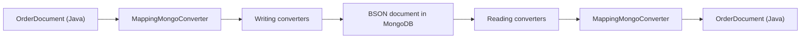

# Converting Domain Types to BSON Values or Documents

## 1. Problem: Domain Objects Do Not Necessarily Match Stored Data

In a Java application, a **domain type** describes a concept with business meaning. For example:

- `Sku`: a format-validated product code, not an arbitrary `String`.
- `Money`: an amount paired with a currency, not simply a `BigDecimal`.
- `Address`: a structured address, rather than a free-form string.
- `OrderStatus`: a status following business codes, which may differ from Java `enum` constant names.

MongoDB stores **BSON**: each field has a name and a value of a BSON type such as `string`, `int`, `long`, `decimal`, `date`, `object`, `array`, or `null`. BSON does not directly understand SKU validation rules or the semantics of a Java `Money` record.

**Spring Data MongoDB** provides a mapping mechanism to convert back and forth between Java objects and BSON. For most types, `MappingMongoConverter` and built-in converters suffice. When an application needs to represent a domain type under a specific storage contract, **custom conversion** can be used:

- `@WritingConverter`: converts a domain type to an appropriate value for writing to MongoDB.
- `@ReadingConverter`: reconstructs the domain type from stored data.
- `MongoCustomConversions`: registers converters for Spring Data to use.

This lesson belongs to the **Data Conversion** chapter of the **SPRING_DATA_MONGODB** module. Beyond document mapping, we will use repositories or `MongoTemplate` to write and read, inspect actual BSON, examine impacts on queries, aggregations, indexes, transactions, and reactive access, and learn how to test/diagnose data mismatches.

The ultimate goal is achieving a **stable storage contract** while Java continues using types with clear meaning.

## 2. Conversion Flow from Java to BSON and Back

When calling `repository.insert(entity)` or `mongoTemplate.save(entity)`, Spring Data converts the object into MongoDB-compatible data before sending it to the driver. On read, Spring Data receives BSON from the driver and reconstructs the Java object.



The diagram simplifies the steps for clarity: Spring Data uses entity info, property types, default converters, and custom converters during mapping; not every field goes through a custom converter.

| Component | Responsibility | Example |
| --- | --- | --- |
| **Domain type** | Expresses business meaning and invariants | `Sku("KB-87")`, `Money(1250000, VND)` |
| **Writing converter** | Defines the persisted output representation | `Sku` → BSON `string` |
| **Reading converter** | Reconstructs the domain object | BSON `string` → `Sku` |
| **BSON scalar** | Single value in MongoDB | `"KB-87"`, `NumberDecimal("1250000")` |
| **BSON subdocument** | Groups related fields | `{ amount: NumberDecimal(...), currency: "VND" }` |
| **Mapping metadata** | Specifies collection, field names, ID, type hints | `@Document`, `@MongoId`, `@Field` |
| **Repository / MongoTemplate** | Mapped data access paths | `insert`, `findById`, `Query` |

Three questions must be kept separate:

1. **What type does Java have?** E.g., `Sku`, `Money`, `Instant`.
2. **What type is BSON storing?** E.g., `string`, `object` containing `decimal`, `date`.
3. **Is meaning preserved on readback?** E.g., do unit price, currency, and SKU keep the exact same values after a write/read cycle?

A single read returning a Java object that "looks right" does not prove the database stores the desired type. A converter may have silently translated a legacy BSON string into the current Java type.

## 3. When Should You Create a Custom Converter?

Before writing a converter, check whether default mapping is already enough.

### 3.1. Cases Where Default Mapping Suffices

For example, `CustomerDocument` has `String`, `boolean`, `Instant` properties and a nested `Address` record:

```java
import java.time.Instant;
import org.springframework.data.mongodb.core.mapping.Document;
import org.springframework.data.mongodb.core.mapping.MongoId;
import org.springframework.data.mongodb.core.mapping.FieldType;

@Document(collection = "customers")
public record CustomerDocument(
    @MongoId(FieldType.STRING) String id,
    String displayName,
    boolean active,
    Instant registeredAt,
    Address address
) {
    public record Address(
        String city,
        String district,
        String street
    ) {}
}
```

Spring Data can map `Address` to a subdocument with matching fields. **No** custom converter is needed just because the application has nested records.

If the only requirement for `BigDecimal` is storing it as BSON Decimal128, you can use:

```java
import java.math.BigDecimal;
import org.springframework.data.mongodb.core.mapping.Field;
import org.springframework.data.mongodb.core.mapping.FieldType;

@Field(targetType = FieldType.DECIMAL128)
BigDecimal amount;
```

The snippet above illustrates declaring a **field inside a class**, not a standalone Java file. The `@Field` annotation controls how a property is mapped, and is usually simpler and safer than registering a global converter just to change one numeric type.

### 3.2. When Custom Converters Are Useful

Custom converters fit when you need to:

- Store a validated **value object** like `Sku` as a BSON `string` instead of a `{ value: "..." }` subdocument.
- Store a composite domain type like `Money` as a subdocument with an **intentional schema**, such as `amount` as Decimal128 and `currency` as string.
- Read/write a BSON format dictated by another system or historical data.
- Centralize an encoding/decoding rule rather than duplicating logic across multiple repositories or services.

Do not create converters for every class. Converters increase code maintenance, can affect query paths, and make data hard to decode if rules change without a migration.

**Selection rule:** if you only need to rename a field, try `@Field`; if you need a standard nested structure, use object mapping; if you need a **specific BSON representation** or **value transformation with a dedicated contract**, consider a custom converter.

## 4. Example 1: Converting `Sku` to a BSON String

### 4.1. Defining the Value Object in Java

Suppose SKU codes in the system follow a rule: uppercase ASCII letters, digits, hyphens, or underscores, length 2 to 40 characters. This is an **illustrative rule** for a storefront, not a universal SKU standard.

```java
import java.util.Locale;
import java.util.Objects;

public record Sku(String value) {

    public Sku {
        Objects.requireNonNull(value, "SKU is required");
        value = value.strip().toUpperCase(Locale.ROOT);

        if (!value.matches("[A-Z0-9][A-Z0-9_-]{1,39}")) {
            throw new IllegalArgumentException(
                "Invalid SKU format: " + value
            );
        }
    }
}
```

`new Sku(" kb-87 ")` yields the canonical value `"KB-87"`. A valid `Sku` cannot hold arbitrary strings without passing through constructor validation.

Some domains treat SKUs as case-sensitive or allow Unicode; in those cases **do not apply the uppercasing rule above**. Domain type design must reflect the rules agreed upon with the source system.

### 4.2. Writing Converter: `Sku` → `String`

```java
import org.springframework.core.convert.converter.Converter;
import org.springframework.data.convert.WritingConverter;

@WritingConverter
public final class SkuToString
        implements Converter<Sku, String> {

    @Override
    public String convert(Sku source) {
        return source.value();
    }
}
```

Once the converter is registered, Spring Data can convert a `Sku` property into a BSON `string` containing the normalized code, e.g., `"KB-87"`.

The `@WritingConverter` annotation explicitly indicates the **write direction**. It is especially helpful when either conversion endpoint involves simple types treated by Spring Data as native values, preventing direction misclassification.

### 4.3. Reading Converter: `String` → `Sku`

```java
import org.springframework.core.convert.converter.Converter;
import org.springframework.data.convert.ReadingConverter;

@ReadingConverter
public final class StringToSku
        implements Converter<String, Sku> {

    @Override
    public Sku convert(String source) {
        return new Sku(source);
    }
}
```

When reading a document into an entity with a `Sku` property, the converter reconstructs the value object and runs constructor validation.

This has an important consequence: if a legacy collection contains an invalid SKU like `"???"`, **reading** can fail directly inside the converter. Depending on business needs, you can fail fast, clean up data prior to deployment, or support the legacy format during a transition period. Avoid silently converting bad codes into a default SKU, as that destroys product traceability.

### 4.4. Expected BSON

If the Java entity declares:

```java
Sku sku;
```

then the BSON written through the converter has the shape:

```javascript
{
  sku: "KB-87"
}
```

This representation differs from default mapping, which might produce a subdocument:

```javascript
{
  sku: { value: "KB-87" }
}
```

**The storage contract must pick one shape.** When adding a converter to a collection that already contains documents in the old shape, do not assume the new reader automatically handles both shapes: `StringToSku` reads a string; it cannot read `{ value: ... }`.

## 5. Example 2: Converting `Money` to a BSON Subdocument

### 5.1. Why Does `Money` Need Both Amount and Currency?

`BigDecimal("1250000")` alone does not tell you whether this is VND, USD, or another unit. For transactions or quotes, you typically want a value object holding both the **amount** and the **currency**.

```java
import java.math.BigDecimal;
import java.util.Currency;
import java.util.Objects;

public record Money(BigDecimal amount, Currency currency) {

    public Money {
        Objects.requireNonNull(amount, "amount is required");
        Objects.requireNonNull(currency, "currency is required");
    }
}
```

Example product price:

```java
Money unitPrice = new Money(
    new BigDecimal("1250000"),
    Currency.getInstance("VND")
);
```

In MongoDB, we choose the structure:

```javascript
{
  amount: NumberDecimal("1250000"),
  currency: "VND"
}
```

This choice guarantees `amount` is **BSON Decimal128** and `currency` is **BSON string**. It enables querying by currency or amount when needed. Rounding rules, allowed decimal digits, and negative-price handling must be defined by business rules; this minimal value object alone is not enough for a complete payment system.

### 5.2. Writing Converter: `Money` → `org.bson.Document`

`org.bson.Document` is a MongoDB Driver Java class commonly used as a map of field-name/value pairs. Here, the writing converter controls **the shape of the subdocument**:

```java
import org.bson.Document;
import org.bson.types.Decimal128;
import org.springframework.core.convert.converter.Converter;
import org.springframework.data.convert.WritingConverter;

@WritingConverter
public final class MoneyToDocument
        implements Converter<Money, Document> {

    @Override
    public Document convert(Money source) {
        return new Document(
            "amount",
            new Decimal128(source.amount())
        ).append(
            "currency",
            source.currency().getCurrencyCode()
        );
    }
}
```

`new Decimal128(BigDecimal)` requires the number to fit within Decimal128's range; excessively large values or unsupported representations can cause conversion errors. Do not catch the error and truncate monetary digits. Agree on precision, scale, and rounding rules at the business layer.

**Note:** `Document` in this example is **the data for one `Money` property**, not the entire `OrderDocument` entity. The converter produces the two fields `amount` and `currency` inside the field holding `Money`.

### 5.3. Reading Converter: `org.bson.Document` → `Money`

The read direction must reconstruct the domain type and verify actual BSON:

```java
import java.util.Currency;

import org.bson.Document;
import org.bson.types.Decimal128;
import org.springframework.core.convert.converter.Converter;
import org.springframework.data.convert.ReadingConverter;

@ReadingConverter
public final class DocumentToMoney
        implements Converter<Document, Money> {

    @Override
    public Money convert(Document source) {
        Object rawAmount = source.get("amount");

        if (!(rawAmount instanceof Decimal128 decimal)) {
            throw new IllegalArgumentException(
                "Money.amount must be BSON Decimal128"
            );
        }

        String currencyCode = source.getString("currency");

        if (currencyCode == null || currencyCode.isBlank()) {
            throw new IllegalArgumentException(
                "Money.currency must not be missing"
            );
        }

        return new Money(
            decimal.bigDecimalValue(),
            Currency.getInstance(currencyCode)
        );
    }
}
```

The converter above **intentionally reads strictly**: a document storing `amount: "1250000"` as a string or `amount: 1250000.0` as a double will be rejected. This is beneficial when enforcing a BSON contract, though it can prevent legacy data from being read.

If historical data uses other types, design a migration or a controlled compatibility reader. Do not treat arbitrary strings or floating-point numbers as Decimal128, as monetary discrepancies can occur.

### 5.4. Why Not Just Convert `Money` into a Single String?

You could encode money as `"VND:1250000"`, but querying by currency or filtering amounts by threshold becomes harder, requiring string parsing and strict formatting rules. A BSON subdocument with two explicit fields provides better type control, indexing, and aggregation support.

However, if you only need to serialize the whole value for display and never query by its components, a scalar format can also fit. Choose based on how the application **reads, writes, and analyzes** data.

## 6. Registering Converters with `MongoCustomConversions`

Simply declaring classes with `@WritingConverter` or `@ReadingConverter` is not enough if they are not registered in the conversion configuration actually used by `MongoTemplate` and repositories.

Example Spring configuration:

```java
import java.util.List;

import org.springframework.context.annotation.Bean;
import org.springframework.context.annotation.Configuration;
import org.springframework.data.mongodb.core.convert.MongoCustomConversions;

@Configuration
public class MongoConversionConfig {

    @Bean
    public MongoCustomConversions mongoCustomConversions() {
        return new MongoCustomConversions(
            List.of(
                new SkuToString(),
                new StringToSku(),
                new MoneyToDocument(),
                new DocumentToMoney()
            )
        );
    }
}
```

This configuration illustrates registering a set of converters in a project using the `MongoCustomConversions` constructor accepting a list of converters. Depending on the Spring Data release line, other creation/registration APIs may be available. When an application already has a `MongoCustomConversions`, **merge the new converters** into the existing bean or configure the active mapper path properly; do not declare two competing beans and assume all converters take effect.

Be sure to distinguish:

- **`@WritingConverter` / `@ReadingConverter`:** describe the converter's conversion direction.
- **`MongoCustomConversions`:** list of conversions registered for MongoDB mapping.
- **`MappingMongoConverter`:** full entity mapper using metadata and custom conversions.
- **`MongoTemplate` / `MongoRepository`:** APIs invoking the mapper when writing/reading documents.

Type-specific converters for `Sku` and `Money` reduce the risk of accidentally altering every `String` or `BigDecimal` field in the application. Avoid registering a generic `String ↔ Document` converter if it could affect other fields without clear boundaries.

**Verify the real configuration:** a project might manually construct its own `MappingMongoConverter`, template, or context; a bean defined in one place is not guaranteed to apply to an independently configured access path.

## 7. Mapping an Entity Using Both Converters

### 7.1. Order Document

Let's create a concise model:

```java
import java.time.Instant;

import org.springframework.data.mongodb.core.mapping.Document;
import org.springframework.data.mongodb.core.mapping.FieldType;
import org.springframework.data.mongodb.core.mapping.MongoId;

@Document(collection = "orders")
public record OrderDocument(
    @MongoId(FieldType.STRING)
    String id,

    Sku sku,

    Money unitPrice,

    int quantity,

    Instant placedAt
) {}
```

We do **not** put `@DBRef` or `@DocumentReference` on `Sku` and `Money`. These are two **values** of an order, not automatic links to another collection.

`@MongoId(FieldType.STRING)` establishes `_id` as a BSON string. Meanwhile, `sku` is turned into a BSON string by its writing converter, and `unitPrice` is turned into a BSON subdocument.

### 7.2. Writing via Repository

```java
import java.math.BigDecimal;
import java.time.Instant;
import java.util.Currency;

import org.springframework.data.mongodb.repository.MongoRepository;

public interface OrderRepository
        extends MongoRepository<OrderDocument, String> {}
```

In a service with `OrderRepository` injected:

```java
OrderDocument created = new OrderDocument(
    "order-1001",
    new Sku("kb-87"),
    new Money(
        new BigDecimal("1250000"),
        Currency.getInstance("VND")
    ),
    2,
    Instant.parse("2026-11-20T02:00:00Z")
);

OrderDocument saved = orderRepository.insert(created);

OrderDocument readBack = orderRepository
    .findById(saved.id())
    .orElseThrow();
```

If registration and mapping behave as expected, the BSON document stored in MongoDB looks like:

```javascript
{
  _id: "order-1001",
  sku: "KB-87",
  unitPrice: {
    amount: NumberDecimal("1250000"),
    currency: "VND"
  },
  quantity: 2,
  placedAt: ISODate("2026-11-20T02:00:00Z")
}
```

The document may also include a `_class` field depending on Spring Data's type-mapping configuration. The sample above focuses on business fields. BSON `date` values have millisecond precision; do not assume all nanosecond precision of `Instant` is preserved.

Inspecting `readBack.unitPrice()` in Java without checking actual BSON does not prove the `amount` field was stored as **Decimal128** as contracted.

### 7.3. Distinguishing Converters from Automatic Record Mapping

If `MoneyToDocument` and `DocumentToMoney` are **not registered**, Spring Data can still automatically map `Money` as a subdocument with `amount` and `currency` fields or another default representation. Automatic mapping **does not guarantee** `amount` is Decimal128 or `currency` is an ISO code string as desired.

Creating a custom converter is an engineering decision to **lock down the data shape**; do so only when that contract is genuinely needed, and add tests whenever converter code changes.

## 8. Verifying Actual BSON in `mongosh` and the Raw Driver

### 8.1. Reading in `mongosh`

Run the following commands against the **test database** written by the service:

```javascript
db.getName();
db.orders.findOne({ _id: "order-1001" });
```

To inspect exact types:

```javascript
const doc = db.orders.findOne({ _id: "order-1001" });

if (doc != null) {
  print(EJSON.stringify(doc, null, 2, { relaxed: false }));
}
```

In canonical Extended JSON, Decimal128 amounts are typically displayed under the `"$numberDecimal"` key. `EJSON` is a way of **rendering** BSON; it does not alter how data is stored.

Inspect using `$type`:

```javascript
db.orders.aggregate([
  { $match: { _id: "order-1001" } },
  {
    $project: {
      _id: 0,
      idType: { $type: "$_id" },
      skuType: { $type: "$sku" },
      unitPriceType: { $type: "$unitPrice" },
      amountType: { $type: "$unitPrice.amount" },
      currencyType: { $type: "$unitPrice.currency" },
      quantityType: { $type: "$quantity" },
      placedAtType: { $type: "$placedAt" }
    }
  }
]);
```

Expected **type** output, depending on how Spring Data encodes `int quantity` and standard configuration:

```json
{
  "idType": "string",
  "skuType": "string",
  "unitPriceType": "object",
  "amountType": "decimal",
  "currencyType": "string",
  "quantityType": "int",
  "placedAtType": "date"
}
```

A `$type` aggregation returns `"missing"` if a field does not exist. If `unitPrice` is a BSON string or `amount` is a BSON double, that is evidence to inspect the active converter, write path, or documents created by an older version.

### 8.2. Reading Raw BSON via `MongoTemplate`

Spring Data MongoDB allows accessing collections at the MongoDB Driver level:

```java
import org.bson.Document;
import org.bson.types.Decimal128;

import static com.mongodb.client.model.Filters.eq;

Document raw = mongoTemplate
    .getCollection("orders")
    .find(eq("_id", "order-1001"))
    .first();

if (raw == null) {
    throw new IllegalStateException("Order not found");
}

String storedSku = raw.getString("sku");
Document storedMoney = raw.get("unitPrice", Document.class);
Decimal128 storedAmount = storedMoney.get(
    "amount", Decimal128.class
);
String storedCurrency = storedMoney.getString("currency");

System.out.println(storedSku);
System.out.println(storedAmount.bigDecimalValue());
System.out.println(storedCurrency);
```

The snippet above assumes `mongoTemplate` is injected. Unlike `mongoTemplate.findById(..., OrderDocument.class)`, `getCollection(...)` returns `org.bson.Document` from the driver and **does not convert it to `Money`**. That is why it is useful for confirming the BSON shape written by converters.

## 9. Querying by Converted Domain Types

### 9.1. Querying `Sku` with `MongoTemplate`

With `sku` stored as a BSON string, the raw query is:

```javascript
db.orders.find({ sku: "KB-87" });
```

On the Java side, when building a query with `OrderDocument` metadata, Spring Data can apply writing conversion to the query value:

```java
import org.springframework.data.mongodb.core.query.Criteria;
import org.springframework.data.mongodb.core.query.Query;

Query query = Query.query(
    Criteria.where("sku").is(new Sku("kb-87"))
);

List<OrderDocument> orders =
    mongoTemplate.find(query, OrderDocument.class);
```

The example assumes `List`, `mongoTemplate`, and imports are present. In a real application, **verify the generated BSON query** or run integration tests; not all driver APIs, raw aggregations, or hand-constructed `Document` queries pass through the same metadata conversion.

If the application uses the MongoDB Java Driver directly, pass the **already-converted value**:

```java
mongoTemplate.getCollection("orders")
    .find(com.mongodb.client.model.Filters.eq("sku", "KB-87"));
```

Do not pass a `Sku` instance into a raw driver filter assuming the driver knows about Spring Data's `SkuToString`.

### 9.2. Querying Components of `Money`

Because `Money` is stored as a subdocument, you can filter by currency and amount using dot notation in `mongosh`:

```javascript
db.orders.find({
  "unitPrice.currency": "VND",
  "unitPrice.amount": { $gte: NumberDecimal("1000000") }
});
```

Never compare monetary values in two different currencies directly. For multi-currency filters or statistics, group separately or apply a well-defined exchange rate rule.

An illustrative index for the query above:

```javascript
db.orders.createIndex({
  "unitPrice.currency": 1,
  "unitPrice.amount": 1
});
```

This is an index on **actual BSON field names**. If a converter later changes `unitPrice.amount` to `unitPrice.value`, all related queries, indexes, and migrations must be re-evaluated. Do not alter the schema just because you renamed the Java `Money` class.

### 9.3. Aggregation on Converted Fields

An aggregation pipeline can sum line-item amounts per currency:

```javascript
db.orders.aggregate([
  {
    $group: {
      _id: "$unitPrice.currency",
      totalAmount: {
        $sum: {
          $multiply: ["$unitPrice.amount", "$quantity"]
        }
      },
      orderCount: { $sum: 1 }
    }
  }
]);
```

The example illustrates **total item value across the sample collection**, not accounting revenue: it ignores discounts, taxes, refunds, canceled orders, and revenue recognition policies. If `unitPrice.amount` was stored as a string in legacy data, the pipeline may produce incorrect results or errors depending on the expression and input; check `$type` distributions before running analytics.

Spring Data supports building pipelines via `MongoTemplate.aggregate(...)`, but you must distinguish Java property names from **converter-produced BSON names**. Fields inside `Money`'s `org.bson.Document` are not necessarily entity properties mapped by Spring Data like a regular subdocument; test real queries when using aggregation builders.

## 10. Converters and the Data Lifecycle During Schema Changes

### 10.1. Changing a Converter Changes the Storage Contract

Suppose the first version stored money as:

```javascript
{ unitPrice: "VND:1250000" }
```

The later version uses:

```javascript
{
  unitPrice: {
    amount: NumberDecimal("1250000"),
    currency: "VND"
  }
}
```

If you only replace `MoneyToDocument` and `DocumentToMoney`, old string-format data remains. On read, Spring Data may fail to select a suitable reader or misread data. **A successful code build is not a data migration.**

A sound plan includes:

1. Inventory BSON shapes in the collection (`$type`, `$exists`) and count affected records.
2. Define the canonical format, conversion rules from legacy data, rounding rules, and unconvertible-error handling.
3. Plan application/reader deployment compatible with both formats when multiple versions must run concurrently.
4. Test the migration on isolated data and verify monetary values before and after.
5. Update writers, migrations, and readers in the planned order; monitor conversion errors.
6. Remove legacy compatibility reading paths only after verifying all historical records have been handled.

Sometimes storing `schemaVersion` or `moneyFormatVersion` helps when multiple formats must coexist intentionally. Avoid creating multiple converters with the same source type hoping the framework guesses the schema.

### 10.2. Finding Existing Data Types

```javascript
db.orders.aggregate([
  {
    $group: {
      _id: {
        unitPriceType: { $type: "$unitPrice" },
        amountType: { $type: "$unitPrice.amount" },
        currencyType: { $type: "$unitPrice.currency" }
      },
      documents: { $sum: 1 }
    }
  },
  { $sort: { documents: -1 } }
]);
```

On large collections, this pipeline can be resource-intensive. Run it on representative sample data, in an appropriate environment, or plan impact checks before running across production.

### 10.3. Null and Missing Fields

Do not assume Spring Data invokes custom converters with `null`. Mapping/conversion mechanisms usually handle null or missing fields at an outer layer; Java record constructors or fields may receive null/defaults depending on mapping and configuration.

For example:

```javascript
{ _id: "a", unitPrice: null }
{ _id: "b" }
{ _id: "c", unitPrice: { amount: NumberDecimal("1250000") } }
```

These three documents differ: explicit null, missing field, and subdocument missing currency. If business rules require `Money` to always have both components, combine API/service validation, converter read checks, and MongoDB schema validation. Never invent `currency="VND"` for missing data without a business contract.

## 11. Bidirectional Integration Testing

### 11.1. What Needs Testing?

There are at least three distinct test categories:

| Category | Question |
| --- | --- |
| **Domain validation** | Does `Sku` reject invalid codes? Does `Money` prevent null values? |
| **BSON write** | Does `Sku` store a string; does `Money` store an object with `Decimal128` and a currency code? |
| **BSON read / round-trip** | Does reading back via repository reconstruct the exact `Sku`, `Money`, amount, and currency? |

Converter unit tests are valuable but do not replace integration tests: a converter can be individually correct yet **unregistered**, or the repository path may actually use another converter.

### 11.2. Converter Unit Test

JUnit 5 example:

```java
import java.math.BigDecimal;
import java.util.Currency;

import org.bson.Document;
import org.bson.types.Decimal128;
import org.junit.jupiter.api.Test;

import static org.junit.jupiter.api.Assertions.*;

class MoneyConversionTest {

    private final MoneyToDocument writer = new MoneyToDocument();
    private final DocumentToMoney reader = new DocumentToMoney();

    @Test
    void preservesAmountAndCurrency() {
        Money input = new Money(
            new BigDecimal("19.95"),
            Currency.getInstance("USD")
        );

        Document stored = writer.convert(input);

        assertInstanceOf(Decimal128.class, stored.get("amount"));
        assertEquals("USD", stored.getString("currency"));
        assertEquals(input, reader.convert(stored));
    }

    @Test
    void rejectsWrongBsonAmountType() {
        Document invalid = new Document(
            "amount", "19.95"
        ).append("currency", "USD");

        assertThrows(
            IllegalArgumentException.class,
            () -> reader.convert(invalid)
        );
    }
}
```

The test above needs no MongoDB; it checks the converters as Java functions. It uses `BigDecimal("19.95")` with USD to illustrate decimals; for each currency, scale and rounding rules must still be specified by business policy.

### 11.3. Integration Test: Write via Repository, Read Raw BSON

The following example assumes the project has `@SpringBootTest` connected to a **dedicated test MongoDB** (such as MongoDB Testcontainers) with repositories and converters configured:

```java
import java.math.BigDecimal;
import java.time.Instant;
import java.util.Currency;

import org.bson.Document;
import org.bson.types.Decimal128;
import org.junit.jupiter.api.Test;
import org.springframework.beans.factory.annotation.Autowired;
import org.springframework.boot.test.context.SpringBootTest;
import org.springframework.data.mongodb.core.MongoTemplate;

import static com.mongodb.client.model.Filters.eq;
import static org.junit.jupiter.api.Assertions.*;

@SpringBootTest
class OrderConversionIntegrationTest {

    @Autowired OrderRepository orders;
    @Autowired MongoTemplate mongoTemplate;

    @Test
    void writesAndReadsDomainValuesUsingExpectedBson() {
        String id = "converter-test-001";

        OrderDocument input = new OrderDocument(
            id,
            new Sku("kb-87"),
            new Money(
                new BigDecimal("1250000"),
                Currency.getInstance("VND")
            ),
            2,
            Instant.parse("2026-11-20T02:00:00Z")
        );

        orders.insert(input);

        Document raw = mongoTemplate.getCollection("orders")
            .find(eq("_id", id))
            .first();

        assertNotNull(raw);
        assertEquals("KB-87", raw.getString("sku"));

        Document moneyDocument =
            raw.get("unitPrice", Document.class);
        assertNotNull(moneyDocument);

        Decimal128 amount =
            moneyDocument.get("amount", Decimal128.class);
        assertNotNull(amount);
        assertEquals(
            new BigDecimal("1250000"),
            amount.bigDecimalValue()
        );
        assertEquals(
            "VND", moneyDocument.getString("currency")
        );

        OrderDocument readBack = orders.findById(id)
            .orElseThrow();

        assertEquals(new Sku("KB-87"), readBack.sku());
        assertEquals(input.unitPrice(), readBack.unitPrice());
        assertEquals(2, readBack.quantity());
    }
}
```

Tests need isolated data; with a fixed ID you may need to clean up the test collection or spin up a fresh database per run. This snippet is an **implementation sample**, not a claim that tests were executed in this repository.

For systems with multi-version data, add tests reading **legacy documents** for every schema that must be supported. When the goal is detecting unexpected BSON types, tests must inspect actual stored values rather than looking only at mapped Java objects.

## 12. Diagnosing When Converters Do Not Run as Expected

| Symptom | Cause to Check | How to Verify |
| --- | --- | --- |
| `Sku` saved as `{value:"KB-87"}` | Writing converter not registered/not applied | Read raw BSON, inspect `MongoCustomConversions` and mapper |
| Repository fails reading `Sku` | Legacy BSON is not a string, invalid code, missing reader | `$type` on `sku`; test reader directly |
| `Money.amount` is double/string | Write path bypassed converter, old converter, or manual document | Canonical EJSON, `$type`, raw driver |
| Unit tests pass but integration fails | Converter bean not in active `MappingMongoConverter` | Check wiring and repository/template instances |
| Query with `new Sku(...)` returns no data | Query value bypassed converter, non-canonical data, or wrong field name | Compare mapped/raw queries and inspect stored BSON |
| Reading `Money` fails due to missing `currency` | Legacy schema/omitted/miswritten field | Use `$exists`, `$type`, inspect historical data |
| After changing converter, new docs work but old docs fail | Missing migration phase or compatible reader | Survey types across collection and test legacy data |
| Query on `unitPrice.amount` is slow | Missing index on right path, wrong-type data, low selectivity | `getIndexes()`, `explain("executionStats")` |
| Decimal128 rejects `BigDecimal` | Out of representation range or wrong rounding rule | Boundary tests on precision, scale, currency |
| Reactive throws different mapping error than imperative | Template/repository path has different conversions config | Write via both paths, read raw BSON, compare converters |

### 12.1. Logging and Query Diagnostics

In test environments, you can enable appropriate logging for Spring Data MongoDB to inspect commands and query paths. However, logs may contain sensitive data like names, emails, or identifiers; do not indiscriminately enable detailed data logging in production.

When queries are slow, run:

```javascript
db.orders.getIndexes();

db.orders.find({
  sku: "KB-87",
  "unitPrice.currency": "VND"
}).explain("executionStats");
```

Inspect `COLLSCAN`/`IXSCAN`, `totalDocsExamined`, `totalKeysExamined`, and execution time. A data-correct converter does not create indexes on its own; index selection must follow actual BSON fields and real query patterns.

## 13. Transactions, Conditional Updates, and Reactive Access

### 13.1. Single-Document Operations Still Follow Atomicity Rules

MongoDB guarantees atomicity for a write operation on **a single document**. When using Spring Data's `MongoTemplate.updateFirst(...)` to change `unitPrice`, conversion must be considered on the update path, and the new field must follow the right BSON structure.

Example inside a service:

```java
import java.math.BigDecimal;
import java.util.Currency;

import org.springframework.data.mongodb.core.query.Criteria;
import org.springframework.data.mongodb.core.query.Query;
import org.springframework.data.mongodb.core.query.Update;

Money nextPrice = new Money(
    new BigDecimal("1290000"),
    Currency.getInstance("VND")
);

Query query = Query.query(
    Criteria.where("_id").is("order-1001")
);

Update update = new Update()
    .set("unitPrice", nextPrice);

mongoTemplate.updateFirst(
    query, update, OrderDocument.class
);
```

When Spring Data maps an update against an entity, property values can be converted by the custom writer; verify the BSON after updating and do not assume every raw `Document` or driver call goes through converters. In real order business logic, modifying an already-confirmed price might be disallowed; this example only illustrates **conversion on the update path**, not a recommendation to mutate historical prices arbitrarily.

If you must update an order together with other documents (inventory, quotes, etc.), use multi-document transactions when business needs and the MongoDB deployment support them, or another synchronization strategy. Converters do not create transactions and do not guarantee consistency across two documents.

### 13.2. Reactive MongoDB

`ReactiveMongoRepository` and `ReactiveMongoTemplate` also use mapping mechanisms matching their converter configuration. Conceptually:

```java
Mono<OrderDocument> created =
    reactiveOrderRepository.insert(input);

Mono<OrderDocument> reloaded =
    reactiveOrderRepository.findById("order-1001");
```

This is a fragment inside a reactive flow where `input` and the repository already exist, not a standalone class example. In real implementations, ensure converters are registered on the active **ReactiveMongoTemplate** and verify BSON with corresponding read queries. Do not call `block()` on a server's reactive processing thread just to inspect data.

When using reactive transactions, you need `ReactiveMongoTransactionManager` and an appropriate transaction context. Do not mistake converting `Money` to `Document` for a synchronization feature or concurrency guard: it is purely value mapping.

## 14. Suggested Practice Exercises

Practice step by step on a test MongoDB instance:

1. Create `Sku` and `Money` following the defined domain rules; write both converter pairs and register them via `MongoCustomConversions`.
2. Create `OrderDocument` and its repository; write an order with `Sku("kb-87")` and `Money(1250000, VND)`.
3. Use `mongosh` to read the document, print canonical EJSON, and inspect `$type` for `sku`, `unitPrice`, `unitPrice.amount`, and `unitPrice.currency`.
4. Read back via repository; compare value objects after round-trip.
5. Query by `sku` via `MongoTemplate`, then compare with the raw query in `mongosh`.
6. Insert an additional test document with a legacy string-format `unitPrice`, and observe how the new reader handles it.
7. Inventory existing BSON types; propose a migration before modifying data.
8. Design indexes if filtering by `sku` or `unitPrice.currency` is needed; evaluate with `explain("executionStats")`.
9. Test edge cases: `Money.amount` beyond Decimal128 range, missing currency, malformed `Sku`, and documents with missing fields.
10. Write integration tests protecting the BSON contract so future converter changes do not break historical data.

## 15. Checklist Before Introducing Custom Converters into a Project

- **Is a custom converter truly needed?** Check default mapping, `@Field`, and nested records first.
- **Is the BSON contract clear?** Specify field names, BSON types, null/missing rules, and data version.
- **Are both write and read directions present?** If only one direction exists, document why.
- **Is the converter registered on the right mapper?** Verify repositories, `MongoTemplate`, and reactive templates if present.
- **Do values round-trip cleanly?** Test amounts, currency, SKU, numeric types, and boundary cases.
- **Does the query path match BSON?** Distinguish mapped queries from raw driver queries; index actual paths.
- **Can legacy data still be read?** Have a migration or compatibility plan when schemas change.
- **Are integration tests in place?** Write via repository, inspect raw BSON, then read the entity back.
- **Has performance been measured?** Analyze aggregations, indexes, and query plans on representative data.
- **Where do business invariants live?** Domain validation, services, and database validators must work together; converters do not replace transactions or business validation.

**Conclusion:** converting domain types to BSON scalars or `org.bson.Document` lets applications retain rich Java models while controlling the data stored in MongoDB. With Spring Data MongoDB, use `@WritingConverter`, `@ReadingConverter`, and `MongoCustomConversions` when a specific BSON representation is needed, then verify with **actual documents**, repository/`MongoTemplate` round-trips, integration tests, and indexed queries. A solid conversion contract is simultaneously clear on **values, BSON types, legacy readability, and query impact**.
