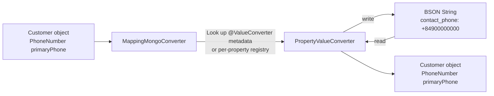

# @ValueConverter and PropertyValueConverter for Individual Properties

## 1. Context and Objectives

In **Spring Data MongoDB**, `MappingMongoConverter` converts Java objects into BSON documents and reconstructs objects on read. Our **Mini Commerce** system has `Product`, `Customer`, and `Order`; these objects do not necessarily have a Java shape identical to the shape stored in MongoDB.

For example: the application wants to use a `PhoneNumber` value object with validation rules, yet in the `customers` collection wants to store the contact phone number as a BSON **String** to match existing data. Another `PhoneNumber` property may still be stored as an embedded document. If you create a converter applying to the *entire* `PhoneNumber` type, both properties change how they are stored. This is when **per-property conversion** is needed.

Spring Data provides two ways to declare this:

- **`@ValueConverter`**: places a converter directly on an entity field.
- **`PropertyValueConverter`**: an interface defining **domain → store (write)** and **store → domain (read)** conversions; can be registered via annotation or programmatic configuration.

After this lesson, you will be able to:

1. Explain when Spring Data MongoDB invokes a property converter and how it differs from a type-level converter.
2. Write a bidirectional `PropertyValueConverter`, attach it with `@ValueConverter`, and handle the expected values on each side.
3. Register converters by property name via `MongoCustomConversions` when you prefer not to annotate the entity.
4. Distinguish between **BSON field name**, **Java property name**, domain type, and store type.
5. Handle null values, malformed data, legacy data, and changes that may affect queries/indexes/aggregations.
6. Test converters, repositories/`MongoTemplate`, and actual BSON; understand boundaries with raw drivers, reactive access, and transactions.

**Prerequisites:** Spring Boot with `spring-boot-starter-data-mongodb` declared, an accessible MongoDB instance, Java 17+, and familiarity with `@Document`, `@Id`, and embedded values. The APIs shown fit Spring Data MongoDB releases supporting property converters; verify against the exact version managed by your Spring Boot BOM.

## 2. Where Do Property Converters Fit in the Mapping Process?



Not all data conversions use a property converter:

| Mechanism | Decision Scope | Example in Mini Commerce |
| --- | --- | --- |
| Default mapping | Based on Java/BSON types and entity metadata | `String` becomes BSON String, objects become embedded documents |
| `@Field(name = "...")` | Stored field name, optionally `targetType` | `unitPrice` stored as `unit_price` of type Decimal128 |
| `@ReadingConverter` / `@WritingConverter` | Conversion rule by registered **type pair** | Convert a value object to `String` everywhere it applies |
| `@ValueConverter` | **One specific field** on an entity | Only `Customer.primaryPhone` stored as String |
| Registering `PropertyValueConverter` per property | One property specified in configuration | `Customer.primaryPhone` converted without annotations on the entity |
| `@Transient` | Exclude field completely from mapping | In-memory-only display label |
| Jackson/DTO | JSON API input/output, does not determine BSON | Omit sensitive fields from HTTP responses |

The key distinction is **scope**. A global converter for `PhoneNumber → String` can affect multiple fields across `Customer`, `Order`, or other entities. A property converter lets two properties with the same Java type be stored in **different ways**, following each property's contract.

## 3. Core APIs: @ValueConverter and PropertyValueConverter

### 3.1. Annotation

```java
import org.springframework.data.convert.ValueConverter;

// Placed on a field:
@ValueConverter(PhoneNumberStringConverter.class)
private PhoneNumber primaryPhone;
```

`@ValueConverter` belongs to **Spring Data Commons** and is placed on a field to specify the converter class. It is a persistence-layer annotation, not a Jackson annotation, MongoDB validator, or authorization mechanism. Once the converter is resolved and instantiated, Spring Data uses it to map **that field's value**.

### 3.2. The PropertyValueConverter Interface

Conceptual API:

```java
public interface PropertyValueConverter<DV, SV, C extends ValueConversionContext<?>> {
    DV read(SV value, C context);
    SV write(DV value, C context);
    // Also provides readNull(context) and writeNull(context).
}
```

*This is a simplified signature to explain semantics; when writing an implementation, full generic bounds also tie to `PersistentProperty` as in the official Javadoc.*

| Parameter | Role |
| --- | --- |
| `DV` (Domain Value) | Java property type, e.g., `PhoneNumber` |
| `SV` (Store Value) | BSON value type the driver can store, e.g., `String` |
| `C` (Conversion Context) | Conversion context; provides property metadata and APIs to convert nested values |
| `read(SV, C)` | Converts **BSON → Java** |
| `write(DV, C)` | Converts **Java → BSON** |
| `readNull(C)` / `writeNull(C)` | Hooks for handling `null`, returning `null` by default |

In MongoDB, there is a convenience interface:

```java
import org.springframework.data.mongodb.core.convert.MongoValueConverter;
```

`MongoValueConverter<DV, SV>` extends `PropertyValueConverter<DV, SV, MongoConversionContext>`, avoiding verbose generic context declarations. If your project uses an older version lacking this convenience interface, implement `PropertyValueConverter` directly with the appropriate `ValueConversionContext<MongoPersistentProperty>` for your version.

### 3.3. Converter Design Principles

- `read(write(value))` should return **the same business value** for all valid inputs. If lossy normalization occurs (e.g., stripping whitespace without rules), define normalization at an explicit boundary.
- `write` must produce a value the driver can store, such as String, Decimal128, BSON Date, Document, or another suitable type; do not blindly return complex objects without knowing how downstream converters handle them.
- `read` must accept **the types actually present** in the collection. Legacy data of a different type may need migration or a compatible reading converter.
- Converters should be pure, lightweight, and hold no per-request mutable state; a converter instance may be **cached and reused**.
- Never perform HTTP calls, queries to other databases, or lengthy blocking operations inside a converter. It can be invoked in many mapping paths, including reactive streams.

## 4. Main Example: Storing Contact Phone Number as a BSON String

### 4.1. PhoneNumber Value Object

In the sample application, phone numbers are normalized to an E.164-like representation: a `+` sign followed by digits with no spaces. This is a **practice model**, not a replacement for country-specific phone validation libraries when products have complex international requirements.

`PhoneNumber.java`:

```java
package com.example.minicommerce.domain;

import java.util.Objects;

public record PhoneNumber(String e164) {
    public PhoneNumber {
        Objects.requireNonNull(e164, "e164");
        if (!e164.matches("\\+[1-9]\\d{7,14}")) {
            throw new IllegalArgumentException(
                "Phone number must use a normalized +digits format");
        }
    }
}
```

The constructor rule ensures the Java object is valid. It does not silently fix invalid input strings. For example, `new PhoneNumber("+84900000000")` is valid; `new PhoneNumber("0900000000")` is invalid under **this lab's policy**.

### 4.2. Bidirectional Converter

`PhoneNumberStringConverter.java`:

```java
package com.example.minicommerce.mapping;

import org.springframework.data.mongodb.core.convert.MongoConversionContext;
import org.springframework.data.mongodb.core.convert.MongoValueConverter;
import com.example.minicommerce.domain.PhoneNumber;

public final class PhoneNumberStringConverter
        implements MongoValueConverter<PhoneNumber, String> {

    @Override
    public PhoneNumber read(
            String storedValue, MongoConversionContext context) {
        return new PhoneNumber(storedValue);
    }

    @Override
    public String write(
            PhoneNumber domainValue, MongoConversionContext context) {
        return domainValue.e164();
    }
}
```

Breakdown:

1. When **writing** `PhoneNumber("+84900000000")`, `write` returns `String "+84900000000"`.
2. When **reading** a BSON String, `read` reconstructs `PhoneNumber` and enforces validation.
3. `MongoConversionContext` is passed in by the framework. This simple example does not yet need metadata or `context.read/write(...)`, though context is useful for conversions containing nested structures.
4. The converter holds no state and has a default no-arg constructor, making default instantiation straightforward.

If the source BSON contains an invalid string like `"0900000000"`, the constructor throws an error. This is intentional to surface unnormalized data; in a system with existing legacy data, prepare a migration or compatible reading policy.

### 4.3. Placing @ValueConverter on Just One Property

`Customer.java`:

```java
package com.example.minicommerce.domain;

import org.springframework.data.annotation.Id;
import org.springframework.data.convert.ValueConverter;
import org.springframework.data.mongodb.core.mapping.Document;
import org.springframework.data.mongodb.core.mapping.Field;
import com.example.minicommerce.mapping.PhoneNumberStringConverter;

@Document(collection = "customers")
public class Customer {
    @Id
    private String id;

    private String fullName;

    @Field("contact_phone")
    @ValueConverter(PhoneNumberStringConverter.class)
    private PhoneNumber primaryPhone;

    // Same Java type, but without @ValueConverter:
    private PhoneNumber backupPhone;

    public Customer() {}

    public Customer(String id, String fullName,
            PhoneNumber primaryPhone, PhoneNumber backupPhone) {
        this.id = id;
        this.fullName = fullName;
        this.primaryPhone = primaryPhone;
        this.backupPhone = backupPhone;
    }

    public String getId() { return id; }
    public void setId(String id) { this.id = id; }

    public String getFullName() { return fullName; }
    public void setFullName(String fullName) {
        this.fullName = fullName;
    }

    public PhoneNumber getPrimaryPhone() { return primaryPhone; }
    public void setPrimaryPhone(PhoneNumber primaryPhone) {
        this.primaryPhone = primaryPhone;
    }

    public PhoneNumber getBackupPhone() { return backupPhone; }
    public void setBackupPhone(PhoneNumber backupPhone) {
        this.backupPhone = backupPhone;
    }
}
```

`@Field("contact_phone")` changes the **BSON key name**, while `@ValueConverter(...)` changes the **BSON value representation**. They solve two independent concerns.

In this example:

| Java property | Java type | BSON key | BSON value |
| --- | --- | --- | --- |
| `id` | `String` | `_id` | String ID |
| `fullName` | `String` | `fullName` | String |
| `primaryPhone` | `PhoneNumber` | `contact_phone` | **String** produced by converter |
| `backupPhone` | `PhoneNumber` | `backupPhone` | **Embedded Document** via default mapping |

### 4.4. Actual Stored Data

Suppose a service creates a customer:

```java
Customer customer = new Customer(
    "customer-001",
    "Nguyen Thi Lan",
    new PhoneNumber("+84900000000"),
    new PhoneNumber("+84911111111")
);

mongoTemplate.save(customer);
```

With typical mapping configuration, the corresponding BSON has the structure:

```json
{
  "_id": "customer-001",
  "fullName": "Nguyen Thi Lan",
  "contact_phone": "+84900000000",
  "backupPhone": {
    "e164": "+84911111111"
  },
  "_class": "com.example.minicommerce.domain.Customer"
}
```

`_class` metadata may vary depending on type-mapping strategy. **Verify the core distinction**: `contact_phone` is a BSON String, while `backupPhone` is a document. This is the clearest proof of **per-property** conversion without globally affecting `PhoneNumber`.

When reading:

```java
Customer loaded = mongoTemplate.findById(
    "customer-001", Customer.class);

if (loaded == null) {
    throw new IllegalStateException("Customer not found");
}

System.out.println(loaded.getPrimaryPhone().e164());
// +84900000000

System.out.println(loaded.getBackupPhone().e164());
// +84911111111
```

Reading via `MongoRepository<Customer, String>` also goes through the mapping converter, so the same rule applies to the declared entity.

## 5. Second Approach: Programmatic PropertyValueConverter Registration

We do not always want domain entities coupled to conversion annotations. When using entities from an unmodifiable library, separating persistence policy from the model, or scoping rules to a single module, you can **register a converter for a property** via configuration.

### 5.1. Configuring MongoCustomConversions

**Alternative approach**: remove `@ValueConverter(PhoneNumberStringConverter.class)` from `Customer.primaryPhone`, keep `@Field("contact_phone")`, and register the converter in the context via `MongoCustomConversions`:

```java
package com.example.minicommerce.config;

import org.springframework.context.annotation.Bean;
import org.springframework.context.annotation.Configuration;
import org.springframework.data.mongodb.core.convert.MongoCustomConversions;

import com.example.minicommerce.domain.Customer;
import com.example.minicommerce.mapping.PhoneNumberStringConverter;

@Configuration
public class CustomerPropertyConversionConfiguration {

    @Bean
    MongoCustomConversions mongoCustomConversions() {
        return MongoCustomConversions.create(adapter -> {
            adapter.configurePropertyConversions(registrar -> {
                registrar.registerConverter(
                    Customer.class,
                    "primaryPhone",
                    new PhoneNumberStringConverter()
                );
            });
        });
    }
}
```

Explanation:

- `Customer.class`: the entity type containing the field.
- `"primaryPhone"`: the **Java property name**, not BSON's `"contact_phone"`.
- `new PhoneNumberStringConverter()`: the instance responsible for bidirectional read/write on that specific property.
- `MongoCustomConversions.create(...)`: supplies converter configuration so Spring Data MongoDB builds the mapping converter.

This pattern targets applications using matching Spring Boot auto-configuration. If your project already has a `MongoCustomConversions` bean or customizes `AbstractMongoClientConfiguration`, **merge this registration into the existing configuration**; do not declare a second bean casually and guess which one Spring picks.

Do not attach both the annotation and programmatic registration to the same property in this lab. Pick one approach, then inspect raw BSON and read results. Duplicate declarations or precedence shifts across configuration styles can cause confusion during upgrades.

### 5.2. PropertyValueConverterRegistrar and Registry

`PropertyValueConverterRegistrar` is the API collecting per-property rules. It supports registration by **field name** or by type-safe property reference in versions supporting it.

A more general configuration snippet:

```java
MongoCustomConversions conversions =
    MongoCustomConversions.create(adapter -> {
        adapter.configurePropertyConversions(registrar ->
            registrar.registerConverter(
                Customer.class,
                "primaryPhone",
                new PhoneNumberStringConverter()
            )
        );
    });
```

If you need to construct `SimplePropertyValueConversions` manually, the framework also provides `PropertyValueConverterRegistrar.buildRegistry()` and `PropertyValueConverterFactory`. For a simple rule, `adapter.configurePropertyConversions(...)` is usually easier to manage than assembling the entire registry/factory manually.

**Watch out for nested paths:** registering `registerConverter(Customer.class, "address.street", ...)` via a dotted path string **is not supported** for traversing nested classes in this registration style. To convert `Address.street`, register on the **property-owning type** `Address.class` with field name `"street"`, or place `@ValueConverter` directly on that field.

### 5.3. Registering Classes/Beans with Dependencies

Some converters need application configuration, such as country-specific normalization policies, codecs, or managed encryption components. `PropertyValueConverterFactory` can support resolving converters from Spring's `ApplicationContext` via a bean-aware factory.

Key points to keep in mind:

1. Do not assume a converter is created by Spring with constructor injection simply because you wrote `@ValueConverter(MyConverter.class)`. Check which factory is active.
2. For converters with dependencies, use an appropriate factory and inspect bean lifecycle/caching rather than accessing beans inside static methods.
3. Converters may be cached and reused across requests; avoid keeping customer data in instance fields.
4. When handling genuinely sensitive data, use algorithms and key management systems designed for that purpose; converting to a string as shown in this lesson **is not encryption**.

## 6. Read and Write Directions Must Be Consistent

With `PhoneNumberStringConverter`:

```text
Java: PhoneNumber("+84900000000")
          |
          | write
          v
BSON: "+84900000000"
          |
          | read
          v
Java: PhoneNumber("+84900000000")
```

The conversion is **symmetric in business value**, even though the Java and MongoDB data types differ.

If a converter implements `write` or `read` using an incompatible format, you may succeed in writing documents yet fail to reconstruct objects after a restart. This is particularly risky for:

- Renamed enums or product codes.
- Monetary fields formatted into Strings without explicit locale rules.
- Phone numbers normalized on write while expecting another format on read.
- Data spanning multiple BSON structural versions.

Note: `@ValueConverter` **does not automatically convert every String value in the collection**. It is looked up via a property's metadata; raw driver operations, shell commands, and hand-written BSON pipelines can still store values of other types.

## 7. Null, Missing Fields, and Malformed Data

`PropertyValueConverter` has four key hooks:

```java
public interface PropertyValueConverter<DV, SV, C> {
    DV read(SV value, C context);
    SV write(DV value, C context);
    DV readNull(C context);
    SV writeNull(C context);
}
```

*The signature above is an abridged diagram explaining the hooks, not the verbatim Java interface.*

In the actual interface, `read` and `write` handle non-null values; `readNull`/`writeNull` have default implementations returning null. Whether null fields are written or omitted also depends on mapping mechanisms and configuration, so verify **actual BSON** instead of assuming.

### 7.1. Do Not Turn Null into a Fake Phone Number

Suppose `backupPhone` is optional. The clean approach is allowing `null` in the domain or using a DTO to express the absence of a phone number, then enforcing business rules before saving.

Avoid doing this by default:

```java
// Illustrative anti-pattern to avoid:
@Override
public String writeNull(MongoConversionContext context) {
    return "UNKNOWN";
}
```

Using a `"UNKNOWN"` sentinel requires corresponding read rules; it can collide with unique indexes, validation, and queries counting valid phone numbers. Only use sentinels when the schema explicitly defines them and bidirectional tests exist.

### 7.2. Legacy Documents Without the Field

Input:

```json
{
  "_id": "customer-legacy-01",
  "fullName": "Legacy Customer"
}
```

On read, `primaryPhone` may be null due to missing data. API code must clearly decide whether this field is optional or required. Converter annotations **do not replace** bean validation, MongoDB schema validation, or service-layer rules.

### 7.3. Legacy Documents Containing the Wrong Type

Suppose older data used an embedded document:

```json
{
  "_id": "customer-legacy-02",
  "contact_phone": {
    "e164": "+84900000000"
  }
}
```

The current converter expects `String` in `read`, so it cannot automatically read this BSON Document. You need a **migration** plan or an intentional temporary compatibility converter handling multiple BSON representations. Do not swallow mapping errors to return an empty phone number: that hides corrupt data.

## 8. How Does @ValueConverter Differ from @ReadingConverter and @WritingConverter?

Spring Data MongoDB also supports **type-pair** converters:

```java
@WritingConverter
class PhoneWriteConverter
        implements Converter<PhoneNumber, String> {
    @Override
    public String convert(PhoneNumber source) {
        return source.e164();
    }
}

@ReadingConverter
class PhoneReadConverter
        implements Converter<String, PhoneNumber> {
    @Override
    public PhoneNumber convert(String source) {
        return new PhoneNumber(source);
    }
}
```

The classes above require importing `org.springframework.core.convert.converter.Converter`, `org.springframework.data.convert.ReadingConverter`, and `WritingConverter`. When registered globally, converters apply wherever that type pair is used by the conversion system; they can affect fields outside `Customer.primaryPhone`. A pair like `String ↔ PhoneNumber` also requires care regarding read/write direction because String is a native BSON type used everywhere.

| Question | Global Type Converter | Property Converter |
| --- | --- | --- |
| Registered by field name? | Not its primary model | Yes |
| Can one domain type store multiple shapes across two properties? | Hard to control with one global rule | Well suited |
| Needs `@ReadingConverter` and `@WritingConverter` annotations? | Used to disambiguate global converters | Not required; `PropertyValueConverter` has both `read` and `write` |
| Can it use per-property conversion context? | No equivalent per-property context by default | Yes |
| Affects other entities? | Potentially, depending on registered type pair | Only the annotated/registered property |

If you want to specify the target BSON type of `BigDecimal` on **one field** such as `Product.price` or `OrderLine.unitPrice`, start with `@Field(targetType = FieldType.DECIMAL128)`. Do not create a new property converter just to turn every price into a String; Strings lack numeric semantics, complicating range queries, sorting, and aggregations.

## 9. Impact on Queries, Indexes, and Aggregations

Property converters control data representation during object mapping, but queries and updates take several execution paths:

- `repository.save(customer)` and `mongoTemplate.insert(customer)` use entity mapping.
- `mongoTemplate.findById(..., Customer.class)` and repositories read entities via mapping.
- `MongoTemplate` with `Query`/`Update` relies on mapping metadata for certain name/value translations; **whether a property converter applies to every operator/method can depend on the Spring Data MongoDB API and version**.
- `mongosh` commands, native driver `getCollection(...).updateOne(...)`, or raw BSON pipelines **do not pass through Java property converters**.

Therefore, never assume a query written with a `PhoneNumber` object will convert to the right String on every code path. Test actual queries—especially `@Query`, `Criteria`, `Update`, and aggregations.

### 9.1. Querying Raw BSON by Stored Field Name

```javascript
db.customers.findOne({
  contact_phone: "+84900000000"
})
```

This command uses the **BSON field name** `contact_phone` and the store-native String value, matching the sample document. When writing a mapped query in Java, the property name is `primaryPhone`; verify which conversion mechanism the mapper applies.

### 9.2. Unique Indexes Based on Actual Representation

If the application must enforce uniqueness on normalized contact numbers, the index must be created on the **BSON field**:

```javascript
db.customers.createIndex(
  { contact_phone: 1 },
  {
    unique: true,
    partialFilterExpression: {
      contact_phone: { $type: "string" }
    }
  }
)
```

This is an example for an optional field: a unique index with a partial filter considers only documents where `contact_phone` is a String. Real business rules must decide whether phone numbers can be reused across accounts, whether duplicates already exist, and whether normalization is consistent. **Property converters do not automatically create unique indexes.**

### 9.3. Aggregations Operate on BSON, Not Java Value Objects

```javascript
db.customers.aggregate([
  { $match: { contact_phone: { $type: "string" } } },
  {
    $group: {
      _id: { $substrCP: ["$contact_phone", 0, 3] },
      customers: { $sum: 1 }
    }
  }
])
```

The pipeline illustrates grouping strings by their first few characters; **do not use this prefix to infer exact country or carrier** in production systems. The point is seeing MongoDB operate on the stored String without runtime knowledge of `PhoneNumber`.

If Java code later changes representation from String to Document, all related queries, indexes, aggregations, and reports must be updated or temporarily kept compatible.

## 10. Single-Field Updates and Mapping Boundaries

Mini Commerce can update customers, products, and orders through multiple operations:

| Operation | Conversion Layer | What to Verify |
| --- | --- | --- |
| `repository.save(customer)` | Entity mapping | `primaryPhone` field written as expected BSON String |
| `mongoTemplate.insert(customer)` | Entity mapping | Actual BSON matches schema |
| `mongoTemplate.findById(..., Customer.class)` | Entity read mapping | `PhoneNumber` reconstructed |
| `mongoTemplate.updateFirst(...)` | Mapped update | Test property-level conversion for your version |
| `mongoTemplate.getCollection("customers").updateOne(...)` | Native driver | Pass properly typed BSON value directly; entity converter is not invoked |
| `db.customers.updateOne(...)` | mongosh | Use BSON schema, not Java property names |

When updating contact details via the raw driver, use the store value:

```javascript
db.customers.updateOne(
  { _id: "customer-001" },
  { $set: { contact_phone: "+84922222222" } }
)
```

If other systems write to the collection, specify the schema and validate inputs across **all write paths**. Never treat `@ValueConverter` as a security barrier against raw updates or invalid data injection.

In the ordering flow, `Order` may snapshot the delivery contact number (`deliveryPhoneSnapshot`) at order creation time. If that property also uses `PhoneNumber` and needs to be stored as a String, attach/register a converter **specifically for the Order property**. Having a converter on `Customer.primaryPhone` does not automatically alter `Order.deliveryPhoneSnapshot`.

## 11. Testing Reliably

Verify **two layers**:

1. **Converter contract**: do `read` and `write` for non-null values restore the exact domain value?
2. **Integration mapping**: when using `MongoTemplate` or a repository, is BSON stored in **the right type** and read back as **the right object**?

### 11.1. Direct Converter Unit Test

```java
import static org.junit.jupiter.api.Assertions.*;

import org.junit.jupiter.api.Test;
import com.example.minicommerce.domain.PhoneNumber;
import com.example.minicommerce.mapping.PhoneNumberStringConverter;

class PhoneNumberStringConverterTest {
    private final PhoneNumberStringConverter converter =
        new PhoneNumberStringConverter();

    @Test
    void roundTrip() {
        PhoneNumber original = new PhoneNumber("+84900000000");

        // Simple converter does not use context;
        // real context is supplied by Spring Data during mapping.
        String stored = converter.write(original, null);
        assertEquals("+84900000000", stored);
        assertEquals(original, converter.read(stored, null));
    }

    @Test
    void rejectsInvalidStoredValue() {
        assertThrows(IllegalArgumentException.class,
            () -> converter.read("not-a-phone", null));
    }
}
```

**Limitation of this test:** it is only valid for converters **that do not access the context**, like this example. `PropertyValueConverter`'s API contract expects Spring Data to supply a conversion context; testing converters that actually rely on context requires building an appropriate context fixture or preferring integration tests. Do not pass a null context to a converter that calls `context.getProperty()` or `context.read/write()`.

### 11.2. Integration Test Inspecting Raw BSON

Example for a dedicated test database, using the annotation setup from section 4:

```java
package com.example.minicommerce;

import static org.junit.jupiter.api.Assertions.*;

import org.bson.Document;
import org.junit.jupiter.api.Test;
import org.springframework.beans.factory.annotation.Autowired;
import org.springframework.boot.test.context.SpringBootTest;
import org.springframework.data.mongodb.core.MongoTemplate;

import com.example.minicommerce.domain.Customer;
import com.example.minicommerce.domain.PhoneNumber;

@SpringBootTest
class CustomerPropertyConversionIntegrationTest {

    @Autowired
    MongoTemplate template;

    @Test
    void usesDifferentStoreShapesForSameDomainType() {
        String id = "property-conversion-test";
        var raw = template.getCollection("customers");
        raw.deleteOne(new Document("_id", id));

        try {
            Customer customer = new Customer(
                id,
                "Nguyen Thi Lan",
                new PhoneNumber("+84900000000"),
                new PhoneNumber("+84911111111")
            );

            template.insert(customer);

            Document bson =
                raw.find(new Document("_id", id)).first();
            assertNotNull(bson);

            assertEquals(
                "+84900000000",
                bson.getString("contact_phone"));

            Object nested = bson.get("backupPhone");
            assertInstanceOf(Document.class, nested);
            assertEquals(
                "+84911111111",
                ((Document) nested).getString("e164"));

            Customer loaded = template.findById(
                id, Customer.class);
            assertNotNull(loaded);
            assertEquals(
                new PhoneNumber("+84900000000"),
                loaded.getPrimaryPhone());
            assertEquals(
                new PhoneNumber("+84911111111"),
                loaded.getBackupPhone());
        } finally {
            raw.deleteOne(new Document("_id", id));
        }
    }
}
```

This test verifies **two properties with the same Java type but two different BSON shapes**. Use a real MongoDB or Testcontainers to validate the actual driver, mapping converter, and running configuration. Fixture cleanup is only for test databases, not production.

If switching from annotations to **programmatic registration**, rerun this exact test after removing the annotation and adding the configuration bean from section 5. This confirms the registry is actually used by Spring Boot.

### 11.3. Test Matrix to Have Before Production

| Scenario | Expectation |
| --- | --- |
| Valid `PhoneNumber` | `write` returns right String, `read` reconstructs value object |
| BSON String violating policy | Defined error/handling path, never silently ignored |
| `primaryPhone = null` | Null/missing behavior verified via real test |
| `backupPhone` without converter | Remains stored as a document as designed |
| Raw BSON missing `contact_phone` | Entity/DTO handles null intentionally |
| Saving via repository | Applies the same rule as MongoTemplate |
| Programmatic registration without annotation | Identical outcome to declarative approach |
| Querying by phone | Query uses right property/BSON name and String type |
| Raw update on phone | Value written matching schema, reads back cleanly |
| Unique index | Two identical normalized numbers blocked per policy |
| Legacy document-shaped data | Detected, migrated, or handled by compatible reader |
| Reactive path (if used) | `StepVerifier` checks read/write with no blocking calls |

## 12. Upgrading or Changing Representation with Existing Data

Suppose the first version stored:

```json
{
  "_id": "customer-001",
  "contact_phone": {
    "e164": "+84900000000"
  }
}
```

After adding `@ValueConverter`, the new version wants to store:

```json
{
  "_id": "customer-001",
  "contact_phone": "+84900000000"
}
```

Changing code does not automatically convert all existing data. Follow this workflow:

1. **Inventory BSON types** currently in `contact_phone` using `$type`; count String, Object, Null, and missing fields.
2. **Audit data sources**: do strings follow the normalized rule, do old objects have complete `e164` fields, are there invalid or duplicate values?
3. **Determine multi-version concurrency**: if old versions still write objects while new versions write Strings, establish a clear transition and compatibility phase.
4. **Back up and test on staging** before touching live documents.
5. **Migrate in batches**, tracking updated counts and errors; do not assume `updateMany` is a transaction across all documents.
6. **Verify post-migration**: readback with the new app, raw BSON, phone queries, unique indexes, and related APIs.

Type inventory:

```javascript
db.customers.aggregate([
  {
    $group: {
      _id: { $type: "$contact_phone" },
      count: { $sum: 1 }
    }
  },
  { $sort: { count: -1 } }
])
```

Only after confirming embedded documents all have a valid `e164` field can you test a migration in a **test/staging** database:

```javascript
db.customers.updateMany(
  {
    contact_phone: { $type: "object" },
    "contact_phone.e164": { $type: "string" }
  },
  [
    {
      $set: {
        contact_phone: "$contact_phone.e164"
      }
    }
  ]
)
```

The pipeline only updates documents matching the filter; it **does not fully validate** phone syntax or uniqueness. Documents with bad data or missing fields require separate handling. If you anticipate changing representations multiple times, store a version/schema policy externally and keep legacy data tests to avoid "a different BSON shape every deploy."

## 13. Reactive Access, Transactions, and Performance

### 13.1. Reactive MongoDB

With `spring-boot-starter-data-mongodb-reactive`, converters remain mapping-layer rules while repositories/templates return `Mono` and `Flux`. Do not place blocking calls such as HTTP requests, other database queries, or `Thread.sleep` inside converters, as conversion can execute directly on reactive threads.

```java
public interface ReactiveCustomerRepository
        extends ReactiveMongoRepository<Customer, String> {
}
```

This interface requires importing `ReactiveMongoRepository`; when testing, subscribe via `StepVerifier`. Verify converters are actually registered on the active **ReactiveMongoTemplate**, especially if the application has both synchronous and reactive MongoDB configurations.

### 13.2. Transactions

Property converters handle **field representation**, not atomicity or isolation. Creating an `Order` while decrementing `Product.stock` may require multi-document transactions on a supporting MongoDB topology, yet transactions will not rescue a document whose converter encoded an invalid format.

If saving a customer fails due to an invalid phone number, handle the error at the service/HTTP boundary with an appropriate message rather than swallowing mapping exceptions. For concurrent updates, you still need unique indexes, atomic updates/optimistic locking, or transactions as required.

### 13.3. Performance

- Property converters are called frequently during reads and writes; keep logic cheap and deterministic.
- Never create expensive network clients or crypto contexts on every `read` or `write`.
- Converter factories and caching must align with dependency/bean lifecycles.
- Indexes are built on **converted BSON values**, not Java value objects. When changing representations, review indexes and query plans.
- Monitor `explain("executionStats")` on real queries if lookups by contact number are high-volume.

## 14. Common Mistakes

| Symptom | Common Cause | Resolution |
| --- | --- | --- |
| `@ValueConverter` has no effect | Wrong import or converter not instantiated by framework | Use `org.springframework.data.convert.ValueConverter`, check factory and raw BSON |
| Converter throws type error on read | Old BSON is a Document while `read` expects String | Inventory and migrate / add read-compatible converter |
| Cannot inject dependencies into converter | Default factory does not use Spring Beans | Configure a bean-aware `PropertyValueConverterFactory` or register an instance |
| Both `primaryPhone` and `backupPhone` became Strings | Registered a global type-based converter | Switch to property-level converter and verify scope |
| Registered converter has no effect | Registry not attached to active `MongoCustomConversions` | Check bean/factory/context and tests |
| Registry does not recognize `"contact_phone"` | Used BSON field name in `registerConverter` | Use the **Java property name** `"primaryPhone"` |
| Registering `"address.street"` fails | Dot paths are not supported in registrar | Register converter on `Address.street` on the owning class |
| Writes fine but cannot read back | Asymmetric `read`/`write` or legacy data uses another format | Test round-trip and cold-start readback |
| Query with Java object returns unexpected results | Query operator/API does not apply conversion as expected | Check mapped query, MongoDB BSON, and version |
| Raw driver update corrupts schema | Driver bypasses entity mapper | Use store-native types; validate/restrict write paths |
| Null written as sentinel causes index duplicates | `writeNull` substituted a special value for null | Define explicit null policy, indexes, and tests |
| REST exposes phone numbers | Confused persistence annotation with JSON security | Control DTOs, Jackson, and API authorization |
| Monetary values stored as Strings | Unnecessary converter applied to BigDecimal | Use `Decimal128` and `@Field(targetType=DECIMAL128)` when appropriate |
| Reactive pipeline stalls | Converter invokes blocking/external operations | Move business logic to services; keep converters pure |

## 15. Exercises and Completion Criteria

**Exercise 1 — Annotation:** create `PhoneNumber`, `PhoneNumberStringConverter`, and attach `@ValueConverter` to `Customer.primaryPhone`. Save and read a customer, verifying the BSON String `contact_phone`.

**Exercise 2 — Same type, different representation:** add `Customer.backupPhone` of type `PhoneNumber` without a converter. Verify it is stored as an embedded document and unaffected by `primaryPhone`'s rule.

**Exercise 3 — Programmatic:** remove the annotation on `primaryPhone`, register the converter via `MongoCustomConversions.create(... configurePropertyConversions(...))` using `"primaryPhone"`. Rerun the integration test; BSON output must remain consistent.

**Exercise 4 — Legacy data:** insert a test document with `contact_phone` as `{"e164": "..."}`. Observe the new converter's read behavior. Inventory `$type`, plan migration to String, and re-verify via repository.

**Exercise 5 — Queries and indexes:** create multiple customers with normalized phone numbers, query by `contact_phone` in raw `mongosh`, create a unique index per policy, and verify duplicate handling.

**Extension exercise:** an `Order` has `deliveryPhoneSnapshot` of type `PhoneNumber`. Configure a converter specifically for this property and explain why it does not automatically inherit the annotation from `Customer.primaryPhone`.

Self-check:

1. What problem do `@ValueConverter` and `PropertyValueConverter` solve that global type converters struggle with?
2. On write and read, what do `DV`, `SV`, and `MongoConversionContext` represent?
3. Why do `@Field("contact_phone")` and `@ValueConverter(...)` not replace each other?
4. With `registerConverter(Customer.class, "primaryPhone", ...)`, can you pass BSON name `"contact_phone"` instead?
5. Why can a converter expecting String not automatically read historical data containing a BSON Document?
6. Why must you still test null handling, raw BSON, queries/indexes, reactive pipelines, and all update paths?

**Expected outcome:** learners implement a bidirectional converter for **one specific property**, prove other fields of the same domain type remain unaffected, inspect exact BSON, and handle legacy data safely. This foundation supports consistent management of Spring Data MongoDB mapping, queries, aggregations, indexes, transactions, reactive access, and testing.

## References

- [Spring Data MongoDB — Property Converters](https://docs.spring.io/spring-data/mongodb/reference/mongodb/mapping/property-converters.html): `@ValueConverter`, `PropertyValueConverter`, programmatic registration, factories, and registries.
- [Spring Data Commons — PropertyValueConverter API](https://docs.spring.io/spring-data/commons/docs/current/api/org/springframework/data/convert/PropertyValueConverter.html): generics, `read`/`write`, and `readNull`/`writeNull`.
- [Spring Data Commons — ValueConverter API](https://docs.spring.io/spring-data/commons/docs/current/api/org/springframework/data/convert/ValueConverter.html): field-level annotation.
- [Spring Data MongoDB — MongoValueConverter API](https://docs.spring.io/spring-data/mongodb/docs/current/api/org/springframework/data/mongodb/core/convert/MongoValueConverter.html): convenience interface with `MongoConversionContext`.
- [Spring Data MongoDB — Custom Conversions](https://docs.spring.io/spring-data/mongodb/reference/mongodb/mapping/custom-conversions.html): type converters and read/write direction rules.
- [Spring Data MongoDB — Object Mapping](https://docs.spring.io/spring-data/mongodb/reference/mongodb/mapping/mapping.html): entity mapping, BSON, and embedded document storage.
