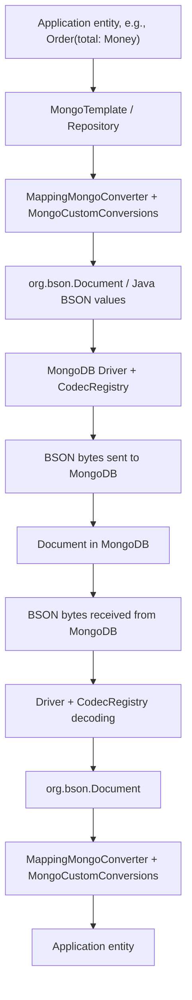
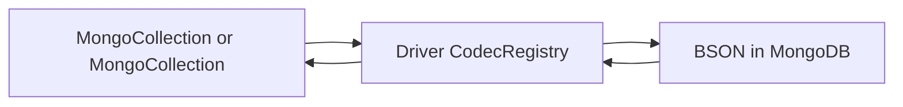
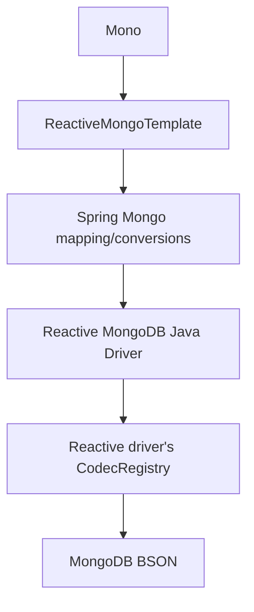

# Distinguishing Spring Data Converters from MongoDB Java Driver CodecRegistry

## 1. Problem: One Document, Two Different Conversion Layers

Spring Data MongoDB provides `MongoTemplate`, repositories, and reactive APIs for Java applications to read, write, and map documents. When an application saves a Java entity to MongoDB, **two distinct conversion layers** typically participate:

1. **Spring Data mapping/conversion** turns objects in the application model into a Spring Data–managed data representation, usually `org.bson.Document`, and converts read data back into objects.
2. **MongoDB Java Driver codecs** encode Java/BSON data received by the driver into BSON bytes sent over the network, and decode returned BSON bytes into the Java types requested from the driver.

Suppose an ordering application has a `Money` type with an amount and currency code. The API wants to work with `Money(BigDecimal amount, String currency)`, while MongoDB stores:

```json
{
  "_id": "ORD-001",
  "total": {
    "amount": { "$numberDecimal": "125000.50" },
    "currency": "VND"
  }
}
```

With `MongoTemplate`, you can register a **Spring Converter** to convert `Money` to a `Document` holding `Decimal128` and back. The driver then uses **CodecRegistry** to encode `Document`, `Decimal128`, and `String` to BSON. If you access `MongoCollection` directly from the driver, Spring Converters are not automatically invoked merely because they exist in the `ApplicationContext`.

This lesson in the **Data Conversion** chapter answers:

- Where are `MappingMongoConverter`, `MongoCustomConversions`, `Converter`, `@ReadingConverter`, and `@WritingConverter` used?
- What do the Java Driver's `Codec<T>`, `CodecProvider`, and `CodecRegistry` do?
- How does access via `MongoTemplate`/repositories differ from direct `MongoCollection<Document>` or `MongoCollection<MyPojo>`?
- Which mechanism should you choose for value objects, special BSON types, POJO codecs, reactive access, and existing schemas?
- How do you prove **which BSON type data is actually stored in**, pinpoint conversion bugs, and check performance?

## 2. Looking at the Full Write/Read Flow



The diagram shows **the common path with Spring Data MongoDB**, not a path every API must take. When using the **raw driver**, `MappingMongoConverter` may not be involved at all:



| Question | Spring Data Converter / `MappingMongoConverter` | Driver `CodecRegistry` |
|---|---|---|
| Owner | Spring Data MongoDB | MongoDB Java Driver |
| Operating layer | Domain object ↔ MongoDB representation mapping | Java type ↔ BSON serialization/deserialization |
| Key APIs | `MongoCustomConversions`, `Converter`, `@ReadingConverter`, `@WritingConverter` | `Codec<T>`, `CodecProvider`, `CodecRegistry` |
| Understands `@Id`, `@Field`, `@Document`? | Yes, per Spring Data mapping metadata | Does not automatically understand Spring Data mapping annotations |
| Registration | Spring `ApplicationContext` / `MongoCustomConversions` | `MongoClientSettings`, `MongoDatabase.withCodecRegistry`, `MongoCollection.withCodecRegistry` |
| Common read/write paths | `MongoTemplate`, `ReactiveMongoTemplate`, Spring repositories | Sync/reactive driver's `MongoCollection<T>` |
| Handling `Document`, `Decimal128`, BSON primitives | Can produce/read those types during mapping | Uses corresponding codecs to read/write BSON |
| Changes data types in MongoDB? | Yes, depending on converter and mapper | Yes, depending on codec, though final BSON types must be checked |
| Automatically replaces the other mechanism? | **No** | **No** |

**Key takeaway:** a Spring Converter converting `Money -> Document` does not mean the driver has a `Codec<Money>`. Conversely, a `Codec<Money>` that works when the driver is handed `Money` does not mean `MappingMongoConverter` bypasses domain metadata and invokes that codec for every field.

## 3. Spring Data MongoDB Mapping Converters

### 3.1. What Does MappingMongoConverter Handle?

`MappingMongoConverter` is the central `MongoConverter` implementation using Spring Data MongoDB mapping metadata. In entity-mapped operations, it understands annotations and rules such as:

- `@Document` specifying collection/type mapping.
- `@Id` and `@MongoId` governing `_id` key mapping, including configured ID conversion rules.
- `@Field` mapping Java property names to BSON names or specifying target types.
- Nested value objects, collections, maps, and type hints like `_class`, handled according to project metadata, converters, and configuration.
- `MongoCustomConversions` registering conversions for application types that default mapping cannot or should not infer.

Example entity:

```java
import org.springframework.data.annotation.Id;
import org.springframework.data.mongodb.core.mapping.Document;

@Document("orders")
public class PurchaseOrder {
    @Id
    private String id;
    private Money total;

    protected PurchaseOrder() {}

    public PurchaseOrder(String id, Money total) {
        this.id = id;
        this.total = total;
    }

    public String getId() { return id; }
    public Money getTotal() { return total; }
}
```

Here `total` is a **domain value object**. Without custom converters, Spring Data may map it based on properties/constructors as a nested object, depending on types and configuration. When BSON `Decimal128` is strictly required for monetary amounts, define the conversion explicitly.

### 3.2. How Converters Differ from Codecs at the API Signature Level

A Spring Converter follows:

```java
import org.springframework.core.convert.converter.Converter;

public interface Converter<S, T> {
    T convert(S source);
}
```

It accepts one object and returns another. For example:

```text
Money                    --> org.bson.Document
org.bson.Document        --> Money
java.time.YearMonth      --> String
String                   --> java.time.YearMonth
```

A MongoDB Driver `Codec<T>` works directly with `BsonReader`/`BsonWriter` and encoding/decoding contexts:

```java
public interface Codec<T> extends Encoder<T>, Decoder<T> {
    Class<T> getEncoderClass();
}
```

Their intended uses differ: **converters** transform between object representations; **codecs** translate between an object representation and a **BSON stream**. Do not write a codec just to rename a field on a Spring Data entity when `@Field` already handles it.

### 3.3. @ReadingConverter and @WritingConverter

When source/target types are custom, annotations tell Spring Data the conversion direction:

- `@WritingConverter`: application value → MongoDB storage form.
- `@ReadingConverter`: value read from MongoDB → application value.

Not every Spring converter used in an application is a Mongo converter. A converter used for MVC binding, Jackson JSON, or another Spring `ConversionService` is not automatically applied to Spring Data MongoDB. Instead, `MongoCustomConversions` is where conversions for MongoDB mapping are explicitly registered.

## 4. Complete Example: Money -> Document Containing Decimal128

### 4.1. Defining the Money Value Object

To avoid monetary rounding errors, use `BigDecimal` in Java and BSON `Decimal128` when decimal precision is required; avoid `double` for monetary data needing exact comparisons.

```java
import java.math.BigDecimal;

public record Money(BigDecimal amount, String currency) {
    public Money {
        if (amount == null || currency == null || currency.isBlank()) {
            throw new IllegalArgumentException("Money is incomplete");
        }
    }
}
```

`BigDecimal` has a broader representation range than `Decimal128` in some cases. Ensure values fit within BSON Decimal128 precision/exponent limits; when unrepresentable, handle errors per business rules rather than silently rounding.

### 4.2. Writing @WritingConverter

```java
import org.bson.Document;
import org.bson.types.Decimal128;
import org.springframework.core.convert.converter.Converter;
import org.springframework.data.convert.WritingConverter;

@WritingConverter
public final class MoneyWritingConverter
        implements Converter<Money, Document> {

    @Override
    public Document convert(Money source) {
        return new Document("amount", new Decimal128(source.amount()))
            .append("currency", source.currency());
    }
}
```

At the Spring Data layer, `convert(...)` returns a `Document` holding `Decimal128` and `String`. No network command or BSON bytes have been generated merely by calling the converter. Once handed to the driver, `DocumentCodec` and corresponding default codecs encode it to BSON.

### 4.3. Writing @ReadingConverter

```java
import org.bson.Document;
import org.bson.types.Decimal128;
import org.springframework.core.convert.converter.Converter;
import org.springframework.data.convert.ReadingConverter;

@ReadingConverter
public final class MoneyReadingConverter
        implements Converter<Document, Money> {

    @Override
    public Money convert(Document source) {
        Decimal128 raw = source.get("amount", Decimal128.class);
        String currency = source.getString("currency");
        if (raw == null || currency == null) {
            throw new IllegalArgumentException("Invalid stored money value");
        }
        return new Money(raw.bigDecimalValue(), currency);
    }
}
```

This reading converter requires stored data to match the schema. If the collection has legacy data storing amounts as `String` or `Double`, do not expect `source.get(..., Decimal128.class)` to convert them automatically; define an explicit migration or multi-version handling with tests.

### 4.4. Registering in MongoCustomConversions

```java
import java.util.List;
import org.springframework.context.annotation.Bean;
import org.springframework.context.annotation.Configuration;
import org.springframework.data.mongodb.core.convert.MongoCustomConversions;

@Configuration
public class MoneyConversionsConfig {
    @Bean
    MongoCustomConversions mongoCustomConversions() {
        return new MongoCustomConversions(List.of(
            new MoneyWritingConverter(),
            new MoneyReadingConverter()
        ));
    }
}
```

When using standard Spring Boot auto-configuration, the `MongoCustomConversions` bean is picked up when configuring `MappingMongoConverter`. In projects that manually build `MongoDatabaseFactory`/`MappingMongoConverter` or have multiple templates, ensure the **exact converter instance** is wired into the templates that need it. Depending on the Spring Data version, other builder/registration APIs also exist; never declare conflicting `MongoCustomConversions` beans without understanding precedence.

### 4.5. Writing and Reading with MongoTemplate

```java
import java.math.BigDecimal;
import org.springframework.data.mongodb.core.MongoTemplate;

PurchaseOrder order = new PurchaseOrder(
    "ORD-001",
    new Money(new BigDecimal("125000.50"), "VND")
);

mongoTemplate.insert(order);

PurchaseOrder loaded = mongoTemplate.findById(
    "ORD-001", PurchaseOrder.class);

Money total = loaded.getTotal();
System.out.println(total.amount());   // 125000.50
System.out.println(total.currency()); // VND
```

The snippet assumes `mongoTemplate` is injected into a service or test. Inspect **raw BSON** to verify the expected types were stored:

```java
import org.bson.Document;
import org.bson.types.Decimal128;

Document stored = mongoTemplate.getCollection("orders")
    .find(new Document("_id", "ORD-001"))
    .first();

Document nested = stored.get("total", Document.class);
Decimal128 amount = nested.get("amount", Decimal128.class);

System.out.println(amount.bigDecimalValue()); // 125000.50
System.out.println(nested.getString("currency")); // VND
```

`mongoTemplate.getCollection(...)` returns the **driver** collection, letting you view the document after BSON is decoded into `org.bson.Document`. It is not the mapped `PurchaseOrder` read path. In `mongosh`, check with:

```javascript
db.orders.findOne({ _id: "ORD-001" });

db.orders.aggregate([
  { $match: { _id: "ORD-001" } },
  {
    $project: {
      bsonType: { $type: "$total.amount" },
      currency: "$total.currency"
    }
  }
]);
// expected bsonType: "decimal"
```

Without other customizations affecting the data, `total` is stored as a nested document, `total.amount` has BSON type Decimal128, and `total.currency` is BSON String. The goal of the two converters is a clear domain model and consistent BSON representation, not creating separate network connections.

## 5. MongoDB Java Driver CodecRegistry

### 5.1. A Codec Is the Unit of BSON Reading/Writing

The MongoDB Java Driver requires a `Codec<T>` to encode a Java data type to BSON and decode BSON back to the Java type expected by the caller. Common codecs built into the driver include:

- `DocumentCodec` for `org.bson.Document`.
- Codecs for `String`, `Integer`, `Long`, `Double`, `Boolean`, and corresponding BSON values.
- `Decimal128Codec` for `org.bson.types.Decimal128`.
- Other codecs included in the default codec set and driver-bundled providers.

`CodecRegistry` is a lookup table **keyed by Java class**: the driver queries the registry for the matching codec. A `CodecProvider` can construct or supply codecs when the registry needs a particular type. A registry is not Spring Data's field-mapping table and does not read `@Field`/`@Id` metadata.

Example BSON containing a decimal value:

```json
{ "amount": { "$numberDecimal": "125000.50" } }
```

When reading into `Document.class` via the driver, `amount` is typically a `Decimal128` instance. When reading into a driver POJO with a configured codec, `amount`'s Java type depends on that codec/model. Spring Data can then continue converting it into `BigDecimal` or `Money` if running through `MappingMongoConverter`.

### 5.2. Writing a Custom Codec for a Dedicated Type

Suppose the raw driver needs to write an `ExternalId` type as a BSON String. You can define:

```java
public record ExternalId(String value) {
    public ExternalId {
        if (value == null || value.isBlank()) {
            throw new IllegalArgumentException("ExternalId must be present");
        }
    }
}
```

```java
import org.bson.BsonReader;
import org.bson.BsonWriter;
import org.bson.codecs.Codec;
import org.bson.codecs.DecoderContext;
import org.bson.codecs.EncoderContext;

public final class ExternalIdCodec implements Codec<ExternalId> {
    @Override
    public Class<ExternalId> getEncoderClass() {
        return ExternalId.class;
    }

    @Override
    public void encode(
            BsonWriter writer, ExternalId value, EncoderContext context) {
        writer.writeString(value.value());
    }

    @Override
    public ExternalId decode(
            BsonReader reader, DecoderContext context) {
        return new ExternalId(reader.readString());
    }
}
```

This codec writes a **BSON String**, not a document with a `value` field. When a driver API asks for `Codec<ExternalId>`, the codec knows how to decode the String back to `ExternalId`. However, a BSON String itself **carries no `ExternalId` class name**. Thus when the raw driver reads into a plain `Document`, `DocumentCodec` returns `String`, because it only sees BSON type String with no original Java domain metadata.

This is a critical distinction: **being able to encode a Java type does not guarantee every raw BSON read path automatically reconstructs that same type.** Decoding into `ExternalId` requires a model/codec with an explicit schema or context specifying the target type.

### 5.3. Registering CodecRegistry on a Raw MongoCollection

Example declaring a registry for the synchronous MongoDB Java Driver:

```java
import com.mongodb.MongoClientSettings;
import com.mongodb.client.MongoClient;
import com.mongodb.client.MongoCollection;
import org.bson.Document;
import org.bson.codecs.configuration.CodecRegistry;

import static org.bson.codecs.configuration.CodecRegistries.fromCodecs;
import static org.bson.codecs.configuration.CodecRegistries.fromRegistries;
import static com.mongodb.client.model.Filters.eq;

// client is a synchronous driver MongoClient owned/injected by the app.
CodecRegistry registry = fromRegistries(
    fromCodecs(new ExternalIdCodec()),
    MongoClientSettings.getDefaultCodecRegistry()
);

MongoCollection<Document> rawCollection = client
    .getDatabase("demo")
    .getCollection("events", Document.class)
    .withCodecRegistry(registry);

rawCollection.insertOne(
    new Document("_id", "EVT-001")
        .append("externalId", new ExternalId("A-42"))
);

Document stored = rawCollection.find(eq("_id", "EVT-001")).first();
Object rawValue = stored.get("externalId");
System.out.println(rawValue);            // A-42
System.out.println(rawValue.getClass()); // java.lang.String
```

On the write path, when `DocumentCodec` needs to encode an `ExternalId` value, the custom registry supplies `ExternalIdCodec`. On the read path into `Document`, the BSON String is decoded as a String. Reading into a class with an `ExternalId` field can use that codec if POJO codecs and the schema are configured accordingly.

The example above only changes the registry for **the collection** returned by `withCodecRegistry(...)`; it does not alter the whole `MongoClient` configuration or Spring Data's `MongoCustomConversions` bean. Avoid creating multiple collection wrappers with differing registries without tracking which code uses which wrapper.

### 5.4. CodecRegistry at Client, Database, and Collection Levels

The driver lets you pass a registry when building `MongoClient`, and also provides APIs returning a `MongoDatabase` or `MongoCollection` with another registry:

```java
MongoClientSettings settings = MongoClientSettings.builder()
    .codecRegistry(registry)
    .build();

// MongoClients.create(settings) creates a client with the specified registry.
// MongoDatabase.withCodecRegistry(registry) and
// MongoCollection.withCodecRegistry(registry) create corresponding views.
```

The snippet illustrates configuration placement; real client creation also requires a connection string, credentials, TLS, and other settings. When replacing the default registry, **combine** the custom registry with the default codecs rather than omitting them, because the driver still needs codecs for `Document` and standard BSON types.

**Registration order can matter:** `fromRegistries(...)` searches registries in order until a codec is found. Place your custom registry before the default registry when you truly want your custom codec to take precedence for a type that already has a default codec. Do not override standard type codecs broadly without evaluating data compatibility.

## 6. Raw POJO Codecs Are Not the Spring Data Entity Mapper

The raw Java Driver provides `PojoCodecProvider` to read/write POJOs using conventions and annotations understood by **the driver**. This is a separate mechanism from Spring Data's `MappingMongoConverter`.

Example POJO specifically for the raw driver:

```java
import org.bson.codecs.pojo.annotations.BsonId;

public class RawEvent {
    @BsonId
    private String id;
    private String title;

    public RawEvent() {}
    public String getId() { return id; }
    public void setId(String id) { this.id = id; }
    public String getTitle() { return title; }
    public void setTitle(String title) { this.title = title; }
}
```

Combining a POJO registry with the default registry:

```java
import com.mongodb.MongoClientSettings;
import com.mongodb.client.MongoCollection;
import org.bson.codecs.configuration.CodecRegistry;
import org.bson.codecs.pojo.PojoCodecProvider;

import static org.bson.codecs.configuration.CodecRegistries.fromProviders;
import static org.bson.codecs.configuration.CodecRegistries.fromRegistries;

CodecRegistry pojoRegistry = fromRegistries(
    MongoClientSettings.getDefaultCodecRegistry(),
    fromProviders(PojoCodecProvider.builder()
        .automatic(true)
        .build())
);

MongoCollection<RawEvent> events = client
    .getDatabase("demo")
    .getCollection("events", RawEvent.class)
    .withCodecRegistry(pojoRegistry);

RawEvent event = new RawEvent();
event.setId("EVT-002");
event.setTitle("Order created");
events.insertOne(event);
```

In this example:

- `@BsonId` is a **driver POJO codec** annotation; distinct from Spring Data's `@Id`.
- `PojoCodecProvider` builds a codec for `RawEvent`, without consulting any `MongoCustomConversions` bean.
- Spring Data `@Document("events")` and `@Field` do not automatically become rules for `PojoCodecProvider`.
- Using the same Java class across both `MongoTemplate` and raw `MongoCollection<MyPojo>` can yield different BSON when the two mapping layers follow different conventions.

Raw driver POJO codecs are useful when an application intentionally uses the driver directly, needs a separate model, or wants low-level BSON serialization control. If an application primarily uses Spring Data repositories and `MongoTemplate`, prefer Spring Data mapping APIs first to avoid running two parallel mapping rule sets against the same collection.

## 7. Special Case: BigDecimal and Decimal128

A frequent source of confusion between the two mechanisms is `BigDecimal` conversion. MongoDB supports BSON `Decimal128`, yet deciding **how Java `BigDecimal` is stored** depends on Spring Data mapping, annotations, and converters.

If you only need a simple `BigDecimal` field, Spring Data MongoDB supports declaring the target type directly:

```java
import java.math.BigDecimal;
import org.springframework.data.annotation.Id;
import org.springframework.data.mongodb.core.mapping.Document;
import org.springframework.data.mongodb.core.mapping.Field;
import org.springframework.data.mongodb.core.mapping.FieldType;

@Document("invoices")
public class Invoice {
    @Id
    private String id;

    @Field(targetType = FieldType.DECIMAL128)
    private BigDecimal amount;

    // Appropriate constructors/getters/setters added in the application.
}
```

With supporting mapping, `@Field(targetType = FieldType.DECIMAL128)` instructs Spring Data to write `amount` as BSON Decimal128. This can be simpler than writing a global custom converter for `BigDecimal`. Spring Data's default for `BigDecimal` may differ from expectations (e.g., storing as string depending on version/configuration), so always inspect the actual BSON type.

If you need to transform **the entire `Money` value object** into a custom document structure, the custom converter in section 4 fits. If you only need to change a **field name**, use `@Field("...")`. If you need to store **`BigDecimal` as Decimal128** on one field, `targetType` can suffice. Do not write a codec handling an entire entity when the requirement is a simple Spring Data mapping rule.

| Requirement | Mechanism to Consider First |
|---|---|
| Rename `postalCode` to BSON `post_code` | Spring `@Field("post_code")` |
| Entity with ID, type hints, nested objects via Spring | `MappingMongoConverter` |
| Value object `Money` ↔ custom BSON document | `@ReadingConverter`/`@WritingConverter` + `MongoCustomConversions` |
| `BigDecimal` on one field needs BSON Decimal128 | `@Field(targetType = FieldType.DECIMAL128)` |
| Raw driver writes/reads special `ExternalId` type | `Codec<ExternalId>` + `CodecRegistry` and compatible model |
| Raw driver serializes POJOs | `PojoCodecProvider` + codec registry |
| Shared schema across Java, Node.js, Python | Define a BSON contract independent of each language's mapping library |

When using `Decimal128` in indexes, queries, and aggregations, consistent BSON types matter in practice: `$sum`, `$gte`, sorting, and indexes depend on data types, not just display strings. If legacy data stores `amount` as String, do not expect raising `maxPoolSize` or changing application codecs to migrate the collection.

## 8. Where Do the Two Layers Interact?

Distinguishing the two layers does not mean they are completely isolated in every scenario. `MongoTemplate` and repositories rely on the driver for I/O, so **values produced by Spring Data must still have matching codecs** for the driver to write BSON. On read, data is decoded by the driver into a Java type before Spring Data converts it into the domain object.

### 8.1. Same `Money` Type, Different Paths

Consider the same `Money` object from section 4:

| Access Path | Who Sees `Money`? | Who Performs Conversion? | Possible Outcome |
|---|---|---|---|
| `mongoTemplate.insert(PurchaseOrder)` with Money converters registered | `MappingMongoConverter` sees `Money` | Spring converts `Money → Document`; driver encodes `Document` | Writes nested document with `amount: Decimal128` |
| `MongoRepository<PurchaseOrder, String>.save(...)` with same mapping context | Spring Data repository/template | Same Mongo conversions and underlying driver | Similar to template path per configuration |
| `MongoCollection<Document>.insertOne(...)` with `Money` embedded in `Document` | Driver sees `Money` directly | Needs a codec for `Money` or compatible driver rules | May throw missing codec error |
| `MongoCollection<RawOrder>.insertOne(...)` | Raw driver sees `RawOrder` | Needs `Codec<RawOrder>`/POJO codec and codecs for its fields | May write BSON differing from Spring mapping |
| `MongoCollection<Document>.find(...)` | Driver returns `Document` | Driver codecs decode BSON types | `amount` may be `Decimal128`; no `Money` yet |
| `mongoTemplate.findOne(..., PurchaseOrder.class)` | Spring converter receives driver-decoded values | Spring reads nested `Document → Money` | Returns domain object containing `Money` |

In the third column, exact behavior depends on registries, collection types, converter setup, custom codecs, and the running version. **The right mental order is "API called → which layer receives the object → which converter/codec does that layer have for the type?"**; do not invent a global precedence order across all converters and codecs.

### 8.2. Having a Codec for Money Does Not Force Spring to Call It

If `MoneyWritingConverter` has already transformed `Money` into a `Document`, the driver receives a `Document`. Thus a custom codec you registered for `Money` may **not be called on that field** along the `MongoTemplate` path.

Conversely, if a Spring custom converter produces an object of an unfamiliar class lacking a codec in the default driver registry, writes can still fail with a codec error at the driver layer. Converters and codecs cooperate; one layer does not automatically fulfill the other's responsibilities.

### 8.3. Writing and Reading Can Be Asymmetric

Suppose an older version only registered `MoneyWritingConverter`, while the new version adds `MoneyReadingConverter`. Inserts may still write valid BSON, but when reading back into domain objects, Spring Data needs to know how to instantiate `Money` from the stored representation. Register and test **both directions** for custom types, especially when objects are immutable or lack a default constructor.

Similarly, a custom codec knowing `ExternalId → BSON String` does not mean every `Document` read back yields `ExternalId`. A BSON String itself carries no Java class name. Design the read-side schema/mapping so type information is not lost.

## 9. Queries, Updates, and Aggregations Also Go Through Mapping Mechanisms

### 9.1. Querying Domain Values via MongoTemplate

Spring Data MongoDB maps queries using metadata and conversions when the entity type is known. When storing `PurchaseOrder.total` as a nested document, a typical query is:

```java
import java.math.BigDecimal;
import org.springframework.data.mongodb.core.query.Criteria;
import org.springframework.data.mongodb.core.query.Query;

Query matchTotal = Query.query(
    Criteria.where("total").is(
        new Money(new BigDecimal("125000.50"), "VND")
    )
);

PurchaseOrder found = mongoTemplate.findOne(
    matchTotal, PurchaseOrder.class
);
```

If the converter applies on the query path without conflicting custom mapping, the `Money` value maps to the matching BSON structure. **Always test actual query conditions**: for equality on **an entire embedded document**, BSON field ordering and present fields can affect matching, so never assume two semantically equivalent documents always match.

When only the amount matters:

```java
Query byAmount = Query.query(
    Criteria.where("total.amount")
        .gte(new org.bson.types.Decimal128(
            new BigDecimal("100000.00")
        ))
);

var matches = mongoTemplate.find(byAmount, PurchaseOrder.class);
```

Here the comparison value is `Decimal128`, matching the chosen BSON type. Passing `BigDecimal` directly in criteria and letting mapping convert it to the expected type **may** work depending on mapping/version, but do not assume it when schemas are heavily customized. Tests must verify both the emitted query and stored MongoDB types.

### 9.2. Updates Must Match the Final Schema

Updating a nested schema correctly from the raw driver:

```javascript
db.orders.updateOne(
  { _id: "ORD-001" },
  { $set: { "total.amount": NumberDecimal("130000.25") } }
);
```

Updating through `MongoTemplate` can use Java property paths when the mapper knows the entity:

```java
import org.springframework.data.mongodb.core.query.Update;

mongoTemplate.updateFirst(
    Query.query(Criteria.where("id").is("ORD-001")),
    new Update().set(
        "total",
        new Money(new BigDecimal("130000.25"), "VND")
    ),
    PurchaseOrder.class
);
```

`Money`'s write converter should produce the exact same structure as an insert. If the raw driver sends a `Money` object without a codec in its registry, or sends a `String` instead of `Decimal128`, the schema can diverge across write paths. Do not use `$set` on `"total.amount"` relying solely on Java domain types without knowing whether that path is mapped by Spring.

### 9.3. Aggregations Operate on BSON Data

Aggregations execute inside MongoDB, so operators like `$sum`, `$multiply`, and `$gte` operate on **the BSON types the server actually stores**:

```javascript
db.orders.aggregate([
  { $match: { "total.currency": "VND" } },
  {
    $group: {
      _id: "$total.currency",
      revenue: { $sum: "$total.amount" }
    }
  }
]);
```

This sums amounts sharing the same currency when `total.amount` has an appropriate numeric type. If the field stores Strings, `$sum` does not automatically parse strings to Decimal128; results may be wrong or skip non-numeric values. Choosing the right BSON storage type directly affects aggregation, indexing, and analytics capabilities.

When using `TypedAggregation`/`MongoTemplate.aggregate(...)`, Spring can map property paths according to the domain type; for `Document`/raw expression stages, verify whether they are mapped. The physical field names in this example are `total.amount` and `total.currency`.

### 9.4. Indexes and Mixed Data Types

An index can be declared as:

```javascript
db.orders.createIndex(
  { "total.currency": 1, "total.amount": 1 },
  { name: "ix_order_currency_amount" }
);
```

Indexes do not unify String, Double, and Decimal128 into the same business value. If the application previously stored `amount` in multiple types, inspect BSON type distributions, clean up data, and run properly typed queries. Changing a Spring converter or CodecRegistry alone **does not convert legacy data** inside the collection.

## 10. Does ReactiveMongoTemplate Have a Different Conversion Mechanism?

Spring Data MongoDB offers both `MongoTemplate` (synchronous) and `ReactiveMongoTemplate` (reactive). When operating via **Spring Data mapping**, the converter model, metadata, and custom conversions remain essentially the same Spring Data mechanism; I/O uses the reactive Java Driver and the codec registry attached to the reactive client.



Example:

```java
import org.springframework.data.mongodb.core.ReactiveMongoTemplate;
import reactor.core.publisher.Mono;

public class ReactiveOrderService {
    private final ReactiveMongoTemplate template;

    public ReactiveOrderService(ReactiveMongoTemplate template) {
        this.template = template;
    }

    public Mono<PurchaseOrder> save(PurchaseOrder order) {
        return template.insert(order);
    }
}
```

When a project uses both sync and reactive paths, verify **both templates** receive the intended `MongoCustomConversions`, Mongo mapping context, and registries. Never assume registering a codec on `com.mongodb.client.MongoClient` also updates the registry on `com.mongodb.reactivestreams.client.MongoClient`; those are two distinct client APIs that may hold separate configurations.

Custom Spring Converters shared across concurrent requests must be thread-safe; avoid mutable shared state and side effects. In reactive pipelines, converters run as part of mapping and are not suitable for blocking network I/O or unbounded slow processing. If conversion is CPU-heavy, measure its impact on throughput and latency before optimizing.

## 11. Troubleshooting: Spring Converter Error or Driver Codec Error?

Conversion errors can occur at several stages. Start from **the API actually invoked** and the error message rather than rushing to register both converters and codecs for the same class.

| Symptom | Suspect Layer | What to Check |
|---|---|---|
| `CodecConfigurationException: Can't find a codec for class ...` | Driver `CodecRegistry` | Which object class is the raw driver receiving? Does the registry have a codec/PojoCodecProvider for it? |
| `ConverterNotFoundException` | Spring ConversionService/`MongoCustomConversions` or another layer's conversion | Which direction is missing; is the conversions bean wired into `MappingMongoConverter`? |
| `MappingInstantiationException` or constructor/property error | Spring Data mapping | Constructor, record components, null, missing fields, custom converter, and field names |
| `ClassCastException` reading `Decimal128` | BSON state or raw `Document` cast | What BSON type does the field actually hold: decimal, string, double, int? |
| `findById` returns nothing after using raw POJO driver | Two different mapping paths | BSON `_id`, field names, how driver POJO maps IDs, Spring `@Id`, and actual values |
| Document contains unexpected `_class` | Spring type hint/mapping | `MappingMongoConverter` config, polymorphic field types, and registered converters |
| Aggregation sums wrong | BSON schema/aggregation | Is `amount` stored as numeric or string; does the pipeline handle missing/null data? |
| Template save succeeds but raw driver fails | Codec only exists for Spring-produced types | Is the raw driver directly receiving a domain class with no codec? |
| Writes succeed but reads return wrong types | Asymmetric conversion directions | Reading converter, codec decode target, discriminator, legacy schema |

### 11.1. Five-Step Error Isolation Workflow

1. **Identify the entry point:** is the operation going through `MongoTemplate`/repository, `ReactiveMongoTemplate`, or directly `MongoCollection<T>`?
2. **Read the raw document:** use `mongosh` or `MongoCollection<Document>` to see actual field names and BSON types instead of inferring from a POJO's `toString()`.
3. **Inspect the mapping layer:** for Spring, check `MongoCustomConversions`, mapping metadata, constructors, and converters; for the raw driver, check `CodecRegistry`, collection type, and POJO provider.
4. **Test both directions:** using the same data, test **domain → BSON** and **BSON → domain**. Sometimes only one direction is configured.
5. **Compare queries and schemas:** verify field paths, `_id` types, `Decimal128`/`String`, type hints, and matching indexes. Audit existing data from prior versions.

Example inspecting amount types in `mongosh`:

```javascript
db.orders.aggregate([
  {
    $project: {
      _id: 1,
      amountType: { $type: "$total.amount" },
      currencyType: { $type: "$total.currency" }
    }
  },
  { $sort: { _id: 1 } }
]);
```

When you see `amountType: "string"` while read code expects `Decimal128`, fix the data schema or add a legacy reading converter; adding a `Codec<Decimal128>` will not magically turn legacy Strings into Decimal128.

### 11.2. Logging and Visibility

In test environments, you can enable Spring Data MongoDB debug logging and MongoDB Driver command monitoring to observe queries/commands and identify which API generates which BSON. Avoid logging every document or all data values in production due to overhead and sensitive data exposure. For hard-to-reproduce issues, compare driver versions, Spring Data versions, and actual converter/registry configurations across instances.

`CodecConfigurationException` typically stems from the driver missing a codec when encoding/decoding a class. Spring's `ConverterNotFoundException` relates to converting objects between types. Both errors can surface in the same business feature, yet each must be fixed **at the right layer**.

## 12. Testing Both Round-Trip and Actual BSON

A test that only asserts `PurchaseOrder` reads back `125000.50` is insufficient; the application could be writing a String and reading it back as `BigDecimal` when the system requires BSON Decimal128 for aggregations and indexes. Check **three things**:

1. **Domain round-trip:** the object before writing and after reading preserves business meaning.
2. **Raw BSON:** fields are stored with the right names, right BSON types, and right null/missing policy.
3. **Compatibility across entry points:** the same schema can be read properly via `MongoTemplate`, repositories, raw driver, or reactive services when required.

Example integration test with JUnit 5/AssertJ, assuming a running test MongoDB, registered conversions bean, and injected `mongoTemplate`:

```java
import java.math.BigDecimal;
import org.bson.Document;
import org.bson.types.Decimal128;
import org.junit.jupiter.api.Test;

import static org.assertj.core.api.Assertions.assertThat;

@Test
void moneyIsStoredAsDecimal128AndReadBack() {
    PurchaseOrder original = new PurchaseOrder(
        "ORD-CONVERT-TEST",
        new Money(new BigDecimal("125000.50"), "VND")
    );

    mongoTemplate.insert(original);

    Document raw = mongoTemplate.getCollection("orders")
        .find(new Document("_id", "ORD-CONVERT-TEST"))
        .first();

    assertThat(raw).isNotNull();
    Document total = raw.get("total", Document.class);
    assertThat(total.get("amount"))
        .isInstanceOf(Decimal128.class);
    assertThat(total.get("currency")).isEqualTo("VND");

    PurchaseOrder loaded = mongoTemplate.findById(
        "ORD-CONVERT-TEST", PurchaseOrder.class);

    assertThat(loaded).isNotNull();
    assertThat(loaded.getTotal().amount())
        .isEqualByComparingTo("125000.50");
    assertThat(loaded.getTotal().currency())
        .isEqualTo("VND");
}
```

This test illustrates the assertion logic; in a real project configure an isolated database, cleanup, and appropriate test annotations. Ensure `_id` is a BSON String as intended; Spring Data has rules converting ObjectId-like String IDs in certain cases, so for ObjectId-shaped IDs check raw `_id` and mapping behavior.

### 12.1. Testing the Raw Driver Path Separately

If your project actually uses `ExternalIdCodec`, also test:

```text
Given: raw MongoCollection<Document> using custom registry
When : writing Document with externalId = new ExternalId("A-42")
Then : raw BSON contains externalId as BSON String
When : reading that document back as Document
Then : externalId is a Java String

Given: MongoCollection<RawEvent> using POJO codec registry
When : writing and reading back RawEvent
Then : _id and title have the right field names, types, and values
```

Observing "raw `Document` returns String" is intentional behavior of the chosen BSON model; do not treat it as a bug merely because the written value was `ExternalId`.

### 12.2. Money Edge Cases

| Input | Expectation to Verify |
|---|---|
| `new BigDecimal("0.00")` | Written/read preserving meaning; know business scale rules |
| Negative value | Valid or rejected by validation depending on monetary field |
| Very large value / precision exceeding Decimal128 | Controlled error, never silently rounded |
| `Money == null` | Missing or BSON null per mapping contract; do not assume converter called with null |
| Only `currency`, missing `amount` | Reading converter detects invalid schema |
| Amount stored as legacy String | Tested migration or multi-format reading converter |
| Amount stored as legacy Double | Conversion handling avoiding precision errors and defining rounding rules |
| Same collection written by both raw driver and template | Consistent BSON types and field names |
| Entities with subtypes | Clear `_class`/discriminator rules without losing subtypes |

In reactive integration tests, verify results via `StepVerifier` or equivalent; do not rely solely on simple converter mocks to conclude the pipeline uses the right registry and BSON serialization.

## 13. Data Migration When Changing Converters or Codecs

Switching from storing money as String to Decimal128 is a **data schema change**, even if Java classes look unchanged:

```javascript
// Old schema
{ _id: "OLD-01", total: { amount: "125000.50", currency: "VND" } }

// New schema
{ _id: "NEW-01", total: {
    amount: NumberDecimal("125000.50"), currency: "VND"
} }
```

If you only deploy the new `MoneyReadingConverter` from section 4, document `OLD-01` can trigger read errors because `amount` is not yet `Decimal128`. You need a rollout plan:

1. **Inventory** BSON types and value distributions: valid Strings, unparseable Strings, Doubles, Decimal128, null, missing.
2. **Lock down target schema** and precision/scale/currency principles, defining how invalid data is handled.
3. **Deploy a compatible read path** if zero-downtime rollout is needed, or pause writes appropriately during migration.
4. **Controlled backfill** to Decimal128 in batches while monitoring cluster impact; address error values rather than silently skipping them.
5. **Switch all write paths** (Spring template, repositories, raw driver, reactive services) to the unified schema.
6. **Verify** BSON types, aggregation results, indexes, and round-trips. Remove the legacy read path only after all data and services have transitioned.

To survey document counts by amount type:

```javascript
db.orders.aggregate([
  {
    $group: {
      _id: { $type: "$total.amount" },
      count: { $sum: 1 }
    }
  },
  { $sort: { _id: 1 } }
]);
```

If legacy data consists of valid decimal strings and you have a backup/rollback plan, you can explore **aggregation pipeline updates** with `$convert` or `$toDecimal` to normalize. Illustrative example on one test record:

```javascript
db.orders.updateOne(
  { _id: "OLD-01", "total.amount": { $type: "string" } },
  [
    {
      $set: {
        "total.amount": {
          $convert: {
            input: "$total.amount",
            to: "decimal",
            onError: "$total.amount",
            onNull: null
          }
        }
      }
    }
  ]
);
```

Leaving a value unchanged when parsing fails (`onError` preserving the old value) **does not mean migration succeeded for that document**. Re-check `$type`, log unparseable values, reconcile data/precision, and handle them explicitly. Before running in production, consider concurrent writes, indexes, and data validation; backfills must never overwrite newer writes.

Changing `CodecRegistry` on the client **does not retroactively re-encode already-stored BSON bytes**. Likewise, changing `MongoCustomConversions` does not fix the collection; it only affects operations passing through converters after the new configuration takes effect.

## 14. Performance, Resources, and Design Decisions

Conversion runs on the application's hot data path. A converter that allocates many intermediate `Document` objects, parses JSON on every record, or calls external services inside `convert(...)` can increase latency and allocations. However, optimizing the conversion layer only makes sense after measuring:

- MongoDB command time, network, pool checkout, server-side queries/indexes.
- Number of deserialized documents and size per document.
- Conversion cost via profiling (CPU, allocations, GC).
- Number of entry points sharing the schema and number of data types supported.

Spring Converters are the natural choice for value objects in Spring Data applications. Driver Codecs are useful when **direct driver code** needs special Java type support or a library needs low-level BSON encoding/decoding control. Never decide based on the assumption that "Codecs are always faster than Converters"; end-to-end benchmarks covering I/O, memory, GC, and maintenance complexity are what matter.

Practical guidelines:

- Use **immutable constructors/value objects** and converters without mutable shared state.
- Avoid heavy conversions when reading millions of documents; use projections, paging/batching, and server-side aggregations when suitable.
- Do not instantiate new `MongoClient` or `CodecRegistry` instances per request; share and configure them via Spring lifecycle or their respective owners.
- If a custom codec looks up other codecs, avoid circular resolution or fragile registry ordering dependencies.
- Do not register overly broad converters like `Object -> String` that may affect unintended domain types; restrict source/target types and read/write directions precisely.
- Consider schema consistency across languages/systems; Java class names are not a required part of BSON.

## 15. Practice: Proving the Two Layers Truly Differ

**Scenario:** build a Spring Data MongoDB service storing orders with `id` and `total: Money`. The goal is JSON/BSON `total.amount` using Decimal128 while Java keeps using `BigDecimal`.

1. Create the `Money` record, `PurchaseOrder` entity, and both converters per section 4. Register via `MongoCustomConversions`.
2. Use `MongoTemplate.insert(...)` to store `ORD-001`, then `findById(...)` to read it back. Verify the Java `Money` type and decimal value.
3. Use `mongoTemplate.getCollection("orders")` to read the raw `Document` and verify `total.amount instanceof Decimal128`.
4. Use `mongosh` to run `$type` and a `$sum` aggregation, recording the actual BSON type.
5. Create a raw `MongoCollection<Document>` containing `Money` **without a custom `Codec<Money>`**. Observe the missing codec error (assuming no other codec is supplied by the registry) and explain why `MoneyWritingConverter` was not invoked.
6. Register `ExternalIdCodec` on the raw collection, write `ExternalId`, then read back as `Document` to observe the field decoding as a String. Explain the role of BSON types.
7. Try `PojoCodecProvider` with `RawEvent`. Compare the driver's `@BsonId` with Spring's `@Id`.
8. Create a legacy document with `total.amount` as a String; try reading it with the converter requiring Decimal128, record the error, and propose a migration.
9. If using a reactive stack, write/read with `ReactiveMongoTemplate` and verify mapping/BSON follow the same schema.

**Completion criteria:** identify which APIs use `MappingMongoConverter` vs. `CodecRegistry`; know where to register converters and codecs properly; inspect BSON types; explain why the raw driver can lack a codec even when Spring repositories work; and design a lossless schema migration plan.

## 16. Quick Summary

| Question | Answer |
|---|---|
| Is a Spring Converter a BSON Codec? | No. Converters translate between objects; codecs read/write BSON. |
| Does `MongoTemplate` use the driver? | Yes. Spring mapping builds data representations, and the driver encodes and sends BSON. |
| Is registering `MongoCustomConversions` enough for raw `MongoCollection<MyPojo>`? | No. The raw driver uses its own codec registry. |
| Does `CodecRegistry` understand Spring's `@Document`, `@Field`, `@Id`? | Not automatically. Those are Spring Data metadata. |
| Does reading a BSON String into `Document` automatically construct a custom Java class? | No, target type/codec context is needed. |
| Want one `BigDecimal` field stored as BSON Decimal128? | Look at `@Field(targetType = FieldType.DECIMAL128)` before writing a global converter. |
| Need domain value object ↔ custom BSON document? | Use `@WritingConverter` + `@ReadingConverter` and register in `MongoCustomConversions`. |
| Does changing a converter or codec fix existing data? | No. Migration or multi-schema read compatibility is required. |
| How do you verify the schema is right? | Inspect raw BSON, run `$type`, and test both writes and reads through actual APIs. |

Distinguishing **Spring Data conversion** from **Java Driver CodecRegistry** helps you extend the right layer, avoid duplicate configuration, and keep MongoDB data types consistent. That foundation ensures repositories, `MongoTemplate`, aggregations, indexes, transactions, and reactive access all operate safely against a single BSON contract.

**Documentation to verify against your active version:** [Spring Data MongoDB — Custom Conversions](https://docs.spring.io/spring-data/mongodb/reference/mongodb/mapping/custom-conversions.html), [MongoDB Java Driver — Codecs](https://www.mongodb.com/docs/drivers/java/sync/current/fundamentals/data-formats/codecs/), [MongoDB Java Driver — POJO data format](https://www.mongodb.com/docs/drivers/java/sync/current/fundamentals/data-formats/document-data-format-pojo/). This content provides lessons and test-environment examples; specific mapping rules, constructors, CodecRegistry behavior, and compatibility must be verified against your project's dependencies.
