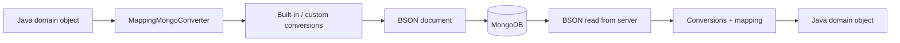

# Converting Dates/Times, Currencies, and Specialized Values

> **Chapter:** Data Conversion  
> **Scope:** `SPRING_DATA_MONGODB` — using Spring Data MongoDB to connect, map documents, and operate on MongoDB via `MongoTemplate` or repositories. In this lesson, learners choose appropriate BSON types for **instants, business calendar dates, currencies, and value objects**, implement custom conversions, and verify raw data via queries, aggregations, and integration tests. Data type choices also affect indexes, transactions, reactive access, and performance diagnostics.

## 1. Why Is Data Conversion a Design Decision?

A field in Java can carry richer semantics than the BSON type holding it. For example:

- `Instant` represents an **absolute point in time**; BSON Date stores milliseconds since the Unix epoch.
- `LocalDate` represents a **calendar date**, with no inherent time of day or timezone. Forcing it into BSON Date can cause off-by-one-day errors across time zones.
- `BigDecimal` represents exact decimal numbers; BSON double uses binary floating-point representation and is unsuitable for many financial calculations.
- `Money(amount, currency)` has **two components and business invariants**, whereas MongoDB only sees a document, string, or number depending on how you design it.
- `UUID`, enums, `Duration`, or custom status markers may require stable storage conventions across application versions.

Spring Data MongoDB uses `MappingMongoConverter`, mapping metadata, and registered conversions to transform Java values to BSON when **writing**, and the reverse when **reading**. The MongoDB Java Driver handles BSON encoding and server communication.



**The goal of conversion is not just getting `save()` to run.** We also need lossless readback, properly typed queries, effective indexing, accurate aggregations, and a way to migrate historical data when schemas change.

## 2. Distinguishing Java Types, BSON Types, and Business Semantics

| Business Data | Recommended Java Type | BSON Type / Storage | Notes |
| --- | --- | --- | --- |
| Point in time an event occurred | `Instant` | **Date** (UTC milliseconds) | Does not store original timezone; millisecond resolution limit. |
| Timestamp in legacy Java code | `java.util.Date` | **Date** | Same epoch millis; avoid mutable APIs in immutable domains. |
| Timestamp needing regional display | `Instant` + `ZoneId` | **Date** + zone string, if preserving zone | Display timezone is a separate concern from the absolute instant. |
| Birthdate / billing cutoff date | `LocalDate` | **ISO string `yyyy-MM-dd`** or BSON Date convention with explicit zone | A calendar date has no single inherent UTC instant. |
| Monetary value with decimals | `BigDecimal` | **Decimal128** or integer minor units | Avoid BSON double; document unit and rounding policy. |
| Money with currency code | `Money` | Document `{ amount, currency }` or integer + code | Do not directly add different currencies. |
| Fixed status | `enum` | Stable code string | Renaming enum constants can affect legacy data. |
| Random identifier | `UUID` or `String` | BSON Binary UUID or string | Standardize representation and subtype before saving. |
| Duration | `Duration` | Milliseconds/seconds number with unit-clear field name | Never treat a duration as a timestamp. |
| Binary file | `byte[]` | BSON Binary, or GridFS for large files | Account for document size limits and retrieval patterns. |

**Distinction:** this table describes **schema choices**, not a guarantee that every Java type listed automatically converts to that choice without configuration. For instance, to reliably store `BigDecimal` as Decimal128, declare `@Field(targetType = FieldType.DECIMAL128)`; other specialized types may require custom converters.

## 3. Date/Time Conversion: BSON Date Stores an Instant, Not a Timezone

### 3.1. BSON Date and `Instant`

MongoDB BSON Date is logically a 64-bit integer representing **milliseconds since 1970-01-01T00:00:00Z**. With BSON Date, the value does not carry the `ZoneId`, timezone name, or offset the user entered. MongoDB may display it in ISO UTC for readability:

```javascript
{
  "_id": "EVT-001",
  "occurredAt": ISODate("2026-11-20T02:15:30.123Z")
}
```

In Java:

```java
import java.time.Instant;

Instant occurredAt =
    Instant.parse("2026-11-20T02:15:30.123Z");
```

`Instant` represents a single point on the timeline. These two strings denote **the exact same instant**:

```text
2026-11-20T02:15:30.123Z
2026-11-20T09:15:30.123+07:00
```

When storing that `Instant` as BSON Date, both representations share the same epoch millis value. To display in Vietnam time:

```java
import java.time.ZoneId;
import java.time.ZonedDateTime;

ZonedDateTime localView =
    occurredAt.atZone(ZoneId.of("Asia/Ho_Chi_Minh"));

// 2026-11-20T09:15:30.123+07:00[Asia/Ho_Chi_Minh]
```

**Precision:** `Instant` can hold sub-second fractions down to nanoseconds, but BSON Date only stores **milliseconds**. If input is `2026-11-20T02:15:30.123456789Z`, all 9 fractional digits cannot be preserved in BSON Date. When higher resolution is required, design an additional nanosecond/epoch-nano field or a tested custom format; do not assume `save/read` keeps every digit.

### 3.2. `LocalDateTime` Is Not an Absolute Instant

`LocalDateTime` only holds date and time, **without timezone or offset**. For instance, `2026-11-20T09:00:00` could be 09:00 in Hanoi, Tokyo, or Paris, corresponding to different `Instant` values.

```java
import java.time.LocalDateTime;
import java.time.ZoneId;
import java.time.Instant;

LocalDateTime wallClock = LocalDateTime.of(2026, 11, 20, 9, 0);
ZoneId businessZone = ZoneId.of("Asia/Ho_Chi_Minh");
Instant instant = wallClock.atZone(businessZone).toInstant();

// instant: 2026-11-20T02:00:00Z
```

Spring Data MongoDB converts `java.time` types; whether Spring's JSR-310 converters or the driver's native Java Time codecs are used **can affect how `LocalDateTime`/`LocalDate` are interpreted with respect to timezones**. When using timezone-less types with BSON Date, exact behavior depends on conversion configuration and version. Never let a container's or host's `ZoneId.systemDefault()` silently decide transaction timestamps.

**Recommendation:** for event timestamps, make the persisted field `Instant` and convert wall-clock inputs to `Instant` at the API boundary using a known `ZoneId`. Only persist `LocalDateTime` when a timezone convention is explicitly documented and tested across multiple JVM timezones.

### 3.3. Calendar Dates: `LocalDate`

Birthdates, invoice due dates, and accounting cutoff dates do not inherently correspond to a single UTC instant. If the business only cares about the **calendar date** and does not need timestamp arithmetic, you can store an ISO string:

```java
import java.time.LocalDate;

LocalDate dueDate = LocalDate.of(2026, 11, 30);
String dueDateIso = dueDate.toString(); // "2026-11-30"

LocalDate restored = LocalDate.parse(dueDateIso);
```

```json
{
  "_id": "BILL-001",
  "dueDate": "2026-11-30"
}
```

ISO `yyyy-MM-dd` strings sort lexicographically in calendar order **when every value uses the exact same canonical format and date representation**. The trade-off is that date aggregation operators behave differently than with BSON Date; explicit type parsing is needed when using date operators.

You can also store `LocalDate` as BSON Date under a fixed convention (such as "00:00 in a documented timezone"), provided reads and writes follow the same rule and everyone understands that changing display timezone can shift the date. **BSON Date has no separate date-only type.**

### 3.4. Offsets, Zones, and Daylight Saving Time

`OffsetDateTime` retains the offset at a moment in time; `ZonedDateTime` retains zone rules as well (e.g., `Europe/Berlin`). Do not assume these types automatically have converters preserving your exact desired semantics across all Spring Data MongoDB versions.

One option for meeting schedules or recurring jobs:

```json
{
  "startAt": { "$date": "2026-11-20T02:00:00Z" },
  "zoneId": "Asia/Ho_Chi_Minh",
  "localStartText": "2026-11-20T09:00:00"
}
```

- `startAt` is used for sorting, timestamp comparisons, and indexing.
- `zoneId` preserves the zone chosen by the user or business.
- `localStartText` is only needed if preserving the exact original wall-clock input, such as for recurring schedules or auditing.

In regions with daylight saving time (DST), a `LocalDateTime` may **not exist** (spring forward gap) or **occur twice** (fall back overlap). When converting local schedules to `Instant`, define a clear policy for gaps/overlaps rather than combining date and time with an arbitrary offset.

## 4. Example Entity Storing Timestamps and Monetary Amounts

To make BSON inspection easy, below we use `Invoice` as a Java record with `@Field` explicitly specifying Decimal128. The project assumes Java 17+ and a Spring Data MongoDB version supporting records.

```java
import java.math.BigDecimal;
import java.time.Instant;
import org.springframework.data.annotation.Id;
import org.springframework.data.mongodb.core.mapping.Document;
import org.springframework.data.mongodb.core.mapping.Field;
import org.springframework.data.mongodb.core.mapping.FieldType;

@Document(collection = "invoices")
public record Invoice(
    @Id String id,
    Instant occurredAt,
    @Field(targetType = FieldType.DECIMAL128) BigDecimal totalAmount,
    String currencyCode,
    String businessDate
) {}
```

Creating an object:

```java
Invoice invoice = new Invoice(
    "INV-001",
    Instant.parse("2026-11-20T02:15:30.123Z"),
    new BigDecimal("1250.50"),
    "USD",
    "2026-11-20"
);

Invoice saved = invoiceRepository.save(invoice);
```

`invoiceRepository` is a bean:

```java
import org.springframework.data.mongodb.repository.MongoRepository;

public interface InvoiceRepository
        extends MongoRepository<Invoice, String> {}
```

**Extended JSON** representation of the saved document (omitting `_class` if present):

```json
{
  "_id": "INV-001",
  "occurredAt": { "$date": "2026-11-20T02:15:30.123Z" },
  "totalAmount": { "$numberDecimal": "1250.50" },
  "currencyCode": "USD",
  "businessDate": "2026-11-20"
}
```

`$date` and `$numberDecimal` are display syntax for BSON types, **not nested business objects** in the actual document. `@Field(targetType = FieldType.DECIMAL128)` instructs writing the `BigDecimal` field as BSON Decimal128; verify the actual stored type against your running framework version.

## 5. Currency: Do Not Use Binary Floating-Point for Money

### 5.1. `double` Introduces Representation Errors

IEEE 754 `double` cannot represent many decimal fractions accurately:

```java
double binary = 0.1d + 0.2d;
System.out.println(binary); // Typically prints 0.30000000000000004

BigDecimal decimal = new BigDecimal("0.1")
    .add(new BigDecimal("0.2"));
System.out.println(decimal); // 0.3
```

For invoices, product prices, and accounting, use `BigDecimal` with clear scale/rounding rules, or **integer minor units** (e.g., cents for USD) when value ranges and rounding rules are well-defined.

**Specifically:** avoid `new BigDecimal(0.1)` because that constructor captures the exact `double` value, which already failed to represent 0.1. Use `new BigDecimal("0.1")`, or `BigDecimal.valueOf(0.1)` when an input is unavoidably a `double`.

### 5.2. Decimal128 and Storage Alternatives

| Storage Choice | BSON Example | When Appropriate | Trade-Offs |
| --- | --- | --- | --- |
| `Decimal128` | `NumberDecimal("1250.50")` | Need server-side summing, range filters, and exact decimal aggregations | Decimal128 format limits; requires driver/tool support. |
| Integer minor units | `125050` cents | App uses a uniform unit and values fit in `long` | Must track/know unit; mixed-scale or fractional-cent currencies add complexity. |
| String decimal | `"1250.50"` | Stored for compatibility or when server-side numeric ops are unneeded | Numeric queries/sorts/aggregations do not work natively like Decimal128. |
| BSON double | `1250.5` | Measurements where binary approximation is acceptable | Generally unsuitable for currency/accounting. |

Semantically, `Decimal128` is decimal floating-point with **34 significant digits**, so it cannot represent every arbitrary `BigDecimal`. When converting values whose precision or magnitude exceeds Decimal128 capacity, handle errors or apply boundary normalization policy—never round silently if business rules forbid it. `Decimal128` also has special decimal floating-point values; financial data typically requires validation allowing only finite numbers.

If the project previously stored `BigDecimal` as strings or doubles, **adding `@Field(targetType = DECIMAL128)` does not migrate old documents**. Plan migrations, dual-read support where needed, and mixed-schema testing before switching completely.

### 5.3. Controlling Currency Codes and Decimal Digits

A bare number `1250.50` does not reveal whether it is USD, EUR, or another currency. Use currency codes following a consistent standard such as ISO 4217:

```java
import java.math.BigDecimal;
import java.math.RoundingMode;
import java.util.Currency;

Currency usd = Currency.getInstance("USD");
int fractionDigits = usd.getDefaultFractionDigits(); // 2

BigDecimal amount = new BigDecimal("1250.50")
    .setScale(fractionDigits, RoundingMode.UNNECESSARY);
```

`RoundingMode.UNNECESSARY` rejects values that would require rounding. Other workflows might require `HALF_UP` or `HALF_EVEN`; accounting and product rules decide which policy is right. Do not assume every currency has two decimal places (e.g., JPY typically has 0), and `Currency.getDefaultFractionDigits()` does not replace full pricing, tax, or promotional rounding rules.

**Never aggregate amounts across currencies without an explicit exchange rate and conversion timestamp.** MongoDB will happily sum two Decimal128 numbers belonging to different currency codes without knowing the result is invalid business-wise.

## 6. Custom Converter for the `Money` Value Object

When a domain has multiple monetary properties, a value object is better than a bare `BigDecimal`:

```java
import java.math.BigDecimal;
import java.util.Currency;
import java.util.Objects;

public record Money(BigDecimal amount, String currencyCode) {
    public Money {
        Objects.requireNonNull(amount, "amount");
        Objects.requireNonNull(currencyCode, "currencyCode");
        Currency.getInstance(currencyCode); // Validates currency code.
    }
}
```

If Spring Data maps it normally, `Money` may be stored as an **embedded document** with matching fields depending on converters/type metadata. However, if you need to enforce `amount` as Decimal128 and `currencyCode` under a strict schema, you can write a **bidirectional converter**.

### 6.1. Writing `Money` to a BSON Document

```java
import org.bson.Document;
import org.bson.types.Decimal128;
import org.springframework.core.convert.converter.Converter;
import org.springframework.data.convert.WritingConverter;

@WritingConverter
public class MoneyWriteConverter implements Converter<Money, Document> {

    @Override
    public Document convert(Money money) {
        return new Document("amount",
                new Decimal128(money.amount()))
            .append("currencyCode", money.currencyCode());
    }
}
```

`new Decimal128(BigDecimal)` converts to BSON decimal when the value is within Decimal128 bounds. Data should be validated (scale, precision, currency) **before** the converter runs. In financial applications, never let a converter silently round an invalid value.

### 6.2. Reading a BSON Document into `Money`

```java
import java.math.BigDecimal;
import org.bson.Document;
import org.bson.types.Decimal128;
import org.springframework.core.convert.converter.Converter;
import org.springframework.data.convert.ReadingConverter;

@ReadingConverter
public class MoneyReadConverter implements Converter<Document, Money> {

    @Override
    public Money convert(Document document) {
        Decimal128 bsonAmount =
            document.get("amount", Decimal128.class);
        BigDecimal amount = bsonAmount.bigDecimalValue();
        String currencyCode = document.getString("currencyCode");
        return new Money(amount, currencyCode);
    }
}
```

This reader intentionally requires `amount` to be Decimal128: if legacy data is string or double, you need a **migration** or a transitional converter explicitly handling each type before entering the domain. Do not cast recklessly or convert double to decimal pretending original precision was recovered.

### 6.3. Registering Conversions

On a Spring Data MongoDB version providing the `MongoCustomConversions(List<?>)` constructor, converters can be registered via a bean:

```java
import java.util.List;
import org.springframework.context.annotation.Bean;
import org.springframework.context.annotation.Configuration;
import org.springframework.data.mongodb.core.convert.MongoCustomConversions;

@Configuration
public class MongoConversionConfiguration {

    @Bean
    MongoCustomConversions mongoCustomConversions() {
        return new MongoCustomConversions(List.of(
            new MoneyWriteConverter(),
            new MoneyReadConverter()
        ));
    }
}
```

Registration APIs may use builders/adapters across Spring Data versions; verify how custom conversions integrate with Boot defaults and `MongoMappingContext` to preserve built-in converters. `@WritingConverter` and `@ReadingConverter` describe **conversion direction** when Spring Data classifies converters; registering one direction does not automatically create the other.

Entity using the value object:

```java
import org.springframework.data.annotation.Id;
import org.springframework.data.mongodb.core.mapping.Document;

@Document(collection = "orders_with_money")
public record OrderWithMoney(
    @Id String id,
    Money total
) {}
```

Expected BSON output:

```json
{
  "_id": "ORD-M-001",
  "total": {
    "amount": { "$numberDecimal": "1250.50" },
    "currencyCode": "USD"
  }
}
```

**A global converter applies to every `Money` property when registered in `MongoCustomConversions`.** If different collections need different money schemas, consider separate value objects or property-level conversion rather than a global change that impacts existing data.

### 6.4. When Is a Custom Converter Unnecessary?

If you only need a standalone `BigDecimal` field, `@Field(targetType = FieldType.DECIMAL128)` as in `Invoice` is usually simpler and expresses intent right on the entity. If `Money` is simply an embedded object with two properties and you control mapping via annotations, writing a converter is optional. Add a converter only when you need **a strict BSON contract and transformation not clearly expressed by built-in mapping**.

## 7. Other Specialized Values: Enums, UUIDs, Durations, ObjectIds, and Binary

### 7.1. Enum Names Change Easily; Stored Data Does Not

```java
public enum PaymentStatus {
    PENDING,
    SETTLED,
    FAILED
}
```

Spring Data MongoDB typically maps enums to their **name string** such as `"SETTLED"` in documents, though you should confirm the BSON type on your project's version. If `SETTLED` is later renamed to `PAID` in code, historical documents still contain `"SETTLED"` and may fail to deserialize under the new enum.

A more stable governance approach for long-lived domains uses **immutable storage codes**, paired with converters or a dedicated property:

```java
public enum PaymentState {
    WAITING("W"),
    SUCCESS("S"),
    REJECTED("R");

    private final String code;

    PaymentState(String code) { this.code = code; }
    public String getCode() { return code; }
}
```

In this example, **merely defining a `code` field is not enough for Spring Data to store the code**. To store `"S"` instead of `"SUCCESS"`, you need a bidirectional mapper/converter or an explicit `String stateCode` model field. In a reading converter, handle unknown values via compatibility policy rather than defaulting to a wrong state.

### 7.2. UUID and BSON Binary Representation

`UUID` can be stored as **BSON Binary subtype UUID** or as a string, depending on codec and storage settings. UUID representation is an important MongoDB Java Driver detail; legacy representations and `STANDARD` must never be mixed casually.

Options:

- Use a `String` in canonical `xxxxxxxx-xxxx-xxxx-xxxx-xxxxxxxxxxxx` form for clear schemas and broad multi-client compatibility, trading off slightly more storage than BSON Binary.
- Use BSON Binary with a consistently configured UUID representation; readers and writers must agree on the representation.
- When migrating from legacy binary UUID to `STANDARD`, perform a migration and verify raw data; changing driver settings does not rewrite already-stored BSON.

`@Id` fields also have special `String`/`ObjectId` conversion rules, so **UUID IDs and ObjectId IDs are separate design decisions**. Before storing real data, finalize the BSON type for `_id` and keep it consistent across environments.

### 7.3. `Duration` and Units of Measurement

A duration is a length of time, not a Date:

```java
import java.time.Duration;

Duration timeout = Duration.ofSeconds(45);
long timeoutMillis = timeout.toMillis(); // 45000
```

You can store `timeoutMillis: 45000` or `timeoutSeconds: 45`; the field name should reflect **the unit**. On read, call `Duration.ofMillis(...)` or `Duration.ofSeconds(...)` accordingly. Never use Date to store a duration, because Date represents a point in time since the epoch.

For other measurements such as temperature, size, distance, or geographic coordinates, apply the same rule: **store values and units in an explicit schema**. When server-side geospatial queries are needed, use GeoJSON/Point types and matching indexes rather than saving an arbitrary `latitude, longitude` record expecting MongoDB to treat it as GeoJSON.

### 7.4. `ObjectId`, Binary, and Large Documents

`ObjectId` is the common BSON type for `_id`; `org.bson.types.ObjectId` in Java represents it directly. If the domain prefers business IDs like `"INV-001"` or UUIDs instead, choose the BSON type based on queries, indexing, and integrating systems.

`byte[]` can be stored as BSON Binary; **do not embed unbounded large files inside documents**. MongoDB enforces a BSON document size limit (typically 16 MiB). For large files, consider GridFS or object storage and store metadata/references in the collection.

## 8. Queries and Aggregations Depend on Chosen BSON Types

A poor conversion choice may not fail on write, yet cause range queries, sorting, and aggregations to return unexpected results.

### 8.1. Range Queries with `Instant`

Querying invoices occurring on 2026-11-20 in Vietnam time requires converting **local day boundaries** to `Instant`:

```java
import java.time.LocalDate;
import java.time.ZoneId;
import java.time.Instant;
import org.springframework.data.mongodb.core.query.Criteria;
import org.springframework.data.mongodb.core.query.Query;

ZoneId zone = ZoneId.of("Asia/Ho_Chi_Minh");
LocalDate day = LocalDate.of(2026, 11, 20);

Instant from = day.atStartOfDay(zone).toInstant();
Instant until = day.plusDays(1).atStartOfDay(zone).toInstant();

Query query = Query.query(
    Criteria.where("occurredAt").gte(from).lt(until)
);
```

The **half-open interval `[from, until)`** avoids end-of-day boundary bugs and works properly on 23-hour or 25-hour days in DST regions. Do not blindly add 24 hours for calendar days globally.

With `Invoice`, Spring Data maps `Instant` to BSON Date in queries and can utilize an index on `occurredAt` if present. Diagnose using `explain("executionStats")` on real queries; inspect scanned document counts and index strategy rather than relying solely on latency from one small run.

### 8.2. Aggregating Money with Decimal128

If `totalAmount` is genuinely Decimal128, MongoDB can sum it using numeric operators:

```javascript
db.invoices.aggregate([
  { $match: { currencyCode: "USD" } },
  {
    $group: {
      _id: "$currencyCode",
      total: { $sum: "$totalAmount" },
      invoiceCount: { $sum: 1 }
    }
  }
])
```

Never sum money across multiple currencies with a pipeline omitting `currencyCode`. If legacy documents stored amounts as strings, `$sum` will not treat them like Decimal128; run a migration or controlled type conversion, and evaluate the performance cost of in-pipeline conversion.

### 8.3. Indexes and Mixed Schemas

```javascript
db.invoices.createIndex({ occurredAt: 1 })
db.invoices.createIndex({ currencyCode: 1, totalAmount: 1 })
```

If `totalAmount` exists simultaneously as Decimal128, String, and double, MongoDB sorts and filters according to BSON type bracketing, producing results that do not match expected numeric comparisons. Unique indexes also depend on values, types, and collation rules. **Normalizing types before evaluating indexes/queries** is a critical step in migration planning.

## 9. Testing Conversions and Raw Data

To be certain of round-trip behavior, use a real test MongoDB (such as Testcontainers), write objects via Spring Data, inspect **raw BSON**, and read back via repository. Do not test only through JSON APIs, since Jackson applies its own serialization rules.

### 9.1. Verifying `Invoice`

```java
Invoice original = new Invoice(
    "INV-T1",
    Instant.parse("2026-11-20T02:15:30.123Z"),
    new BigDecimal("1250.50"),
    "USD",
    "2026-11-20"
);

invoiceRepository.save(original);
Invoice reloaded = invoiceRepository.findById("INV-T1").orElseThrow();

// Assertions to check with your testing framework:
// reloaded.occurredAt().equals(original.occurredAt())
// reloaded.totalAmount().compareTo(original.totalAmount()) == 0
// reloaded.currencyCode().equals("USD")
```

`BigDecimal.compareTo` checks numeric value; `BigDecimal.equals` also checks scale. If business rules require preserving exact scale, assert both `scale()` and raw Decimal128 rather than assuming numeric equality is enough.

Check in `mongosh`:

```javascript
const invoice = db.invoices.findOne({ _id: "INV-T1" });
printjson(invoice);
print(typeof invoice.currencyCode);
print(invoice.totalAmount?._bsontype);
```

On the Java side, read raw `Document` directly and verify types:

```java
import org.bson.Document;
import org.bson.types.Decimal128;
import com.mongodb.client.model.Filters;

Document raw = mongoTemplate.getCollection("invoices")
    .find(Filters.eq("_id", "INV-T1"))
    .first();

// Assertions in test:
// raw != null
// raw.get("totalAmount") instanceof Decimal128
// raw.getDate("occurredAt").toInstant()
//      .equals(Instant.parse("2026-11-20T02:15:30.123Z"))
```

Similarly, when using the `Money` custom converter, confirm `total.amount` (in collection `orders_with_money`) is BSON Decimal128 and the currency code reads back properly. If you only check the `BigDecimal` returned in Java without inspecting BSON, another converter might have stored it as a String while making Java round-trip tests appear to pass.

### 9.2. Essential Edge-Case Matrix

| Category | Test Data | What to Verify |
| --- | --- | --- |
| Timestamp | Epoch, pre/post-epoch, odd milliseconds | Exact instant and BSON Date type. |
| Precision | `.123456789` nanoseconds | Clearly observe precision loss when storing as BSON Date. |
| Timezone | UTC and Asia/Ho_Chi_Minh | Same instant has identical BSON value; local date computed accurately. |
| DST | A gap/overlap day in a DST zone | Policy resolving non-existent or ambiguous local times. |
| Date only | Feb 28, Feb 29, Dec 31, month-end | Date does not shift when read on a JVM with a different timezone. |
| Decimal | `0.1 + 0.2`, negatives, very large numbers, high scale | Never degrades to double; catches Decimal128 overflow. |
| Money | USD, JPY, VND, invalid codes | Scale and currency validation enforced. |
| Legacy schema | String/double previously used for money | Migration or transitional converter works intentionally. |
| Enum | Renamed legacy value | Stable code strategy or migration in place. |
| UUID | String vs. BSON Binary subtype | Consistent representation when filtering by ID. |
| Custom converter | Write/read `Money`, missing/null fields | Clear errors or controlled handling; never swallows corrupt data. |

## 10. Common Pitfalls and How to Diagnose Them

| Symptom | Common Cause | Investigation Path |
| --- | --- | --- |
| Displayed time off by 7 hours | Confusing UTC with `Asia/Ho_Chi_Minh` or treating `LocalDateTime` as `Instant`. | Read raw BSON Date, print epoch millis and display timezone. |
| Birthdate/due date shifts to previous day | Stored calendar date as 00:00 in one timezone, read in another. | Adopt explicit date-only schema and migrate data if needed. |
| `Instant` loses nanoseconds | BSON Date only has millisecond precision. | Test precision; adjust schema if higher resolution is required. |
| Money `0.1 + 0.2` shows trailing fractions | Used `double` or constructed `BigDecimal` from `double`. | Use decimal strings/minor units/Decimal128; audit previously written data. |
| Aggregation `$sum` skips money field | Field is stored as String or mixed types. | Check BSON types; migrate data to Decimal128 or minor units. |
| `Money` converter does not run | Unregistered, wrong direction, or overridden by another config bean. | Check `MongoCustomConversions`, `@ReadingConverter`/`@WritingConverter`, and raw BSON. |
| Decimal128 value out of range | `BigDecimal` has unsupported precision or exponent. | Validate domain range, scale, and precision before saving. |
| Legacy enum fails to deserialize | Enum constant renamed while documents still hold old name. | Use stable storage codes, transitional converters, or migrations. |
| UUID query misses despite matching string | Stored as BSON Binary with different representation or String mismatch. | Inspect raw BSON, UUID representation, and query parameter type. |
| Passes locally on dev machine, fails in CI | Different system timezone/locale, missing conversion config. | Use explicit timezones; test across environments and inspect raw data. |

**Layer-by-layer isolation:** trace input/API → Java domain → MongoDB conversion → server BSON type → query/aggregation → domain after read → JSON response. Diagnosing at each boundary separates converter bugs from presentation or query bugs.

## 11. Migration Scenario for Existing Data

Suppose `invoices.totalAmount` was previously stored as a string:

```json
{ "_id": "INV-OLD", "totalAmount": "1250.50", "currencyCode": "USD" }
```

The new version wants to move to Decimal128. Reasonable steps:

1. **Inventory current BSON types** for `totalAmount` and unparseable values; measure proportions of String, double, Decimal128, and missing fields.
2. **Lock down arithmetic rules**: handling of scale, precision, invalid currencies, and previously rounded values. Double values that already lost precision cannot be restored simply by casting.
3. **Prepare a verifiable migration** with suitable backup/rollback mechanisms; on large datasets measure load and batching speed.
4. **Update the application** to read the transitional schema during migration if multiple versions run concurrently.
5. **Convert data to Decimal128**, verifying BSON values/types and document counts before and after; handle error records separately.
6. **Only after the schema stabilizes**, rely on queries, aggregations, and indexes designed for Decimal128.

**Changing Java annotations is not a MongoDB migration.** Likewise, changing how `LocalDateTime`, enums, or UUIDs are stored requires planning for old documents; persisted data outlives compiled Java classes.

## 12. Practice Lab and Self-Check Questions

### Lab: Multi-Currency Invoices

Build an API managing `Invoice` with fields `id`, `occurredAt`, `totalAmount`, `currencyCode`, and `businessDate`. Requirements:

1. Store `occurredAt` as `Instant`/BSON Date; have the API accept local time with timezone and convert to `Instant` before writing.
2. Store `businessDate` as ISO string `yyyy-MM-dd`, documenting it as a business calendar date independent of instant.
3. Store `totalAmount` as Decimal128 with `@Field(targetType = FieldType.DECIMAL128)`; never accept monetary inputs as `double`.
4. Add an `OrderWithMoney` entity using `Money` and bidirectional converters; confirm nested `total.amount` is Decimal128.
5. Write a repository query for invoices within a single Vietnam calendar day on `occurredAt` using a half-open interval; test with `MongoTemplate` too and verify index usage.
6. Write an aggregation summing totals by `currencyCode`; demonstrate how omitting `currencyCode` from grouping yields business-invalid reports.
7. Insert legacy data with `totalAmount: "1250.50"`, propose a migration strategy, and test reading/writing under the new schema.

### Self-Assessment Questions

- Why do `Instant` and `LocalDateTime` carry different semantics when storing an event?
- Why does BSON Date not remember the original timezone name?
- Why might calendar dates be poorly served by storing Date at 00:00 UTC?
- When should you choose integer minor units versus Decimal128?
- What does `@Field(targetType = FieldType.DECIMAL128)` change on a `BigDecimal` field?
- Why is `new BigDecimal(0.1)` not an accurate way to initialize monetary amounts?
- Why does a converter for `Money` need both read and write directions?
- How does renaming an enum constant or changing UUID representation impact existing documents?
- When an application successfully reads `BigDecimal`, why must you still inspect BSON types with a raw query?

## 13. Key Takeaways and References

- **Timestamps:** `Instant` ties to UTC time and fits BSON Date; Date only retains millisecond precision and drops the original timezone.
- **Calendar dates:** `LocalDate` is distinct from timestamps; pick a transparent date-only storage format and keep it consistent across the system.
- **Currency:** use `BigDecimal`/Decimal128 or integer minor units with clear rules; never use `double` for amounts requiring precision.
- **Decimal128:** declare `@Field(targetType = FieldType.DECIMAL128)` when storing `BigDecimal` as a specific BSON type and verify raw BSON.
- **Value objects:** `Money` must pair `amount` with `currency`; add bidirectional converters only when a dedicated schema is truly needed.
- **Specialized values:** enums, UUIDs, durations, IDs, and binary data all require stable representation decisions and migration plans.
- **Performance and correctness:** queries, indexes, and aggregations must operate on **the actual stored BSON types**, not merely the types declared in Java.

Official documentation to verify against your active version:

- [Spring Data MongoDB — Mapping](https://docs.spring.io/spring-data/mongodb/reference/mongodb/mapping/mapping.html)
- [Spring Data MongoDB — Custom Conversions](https://docs.spring.io/spring-data/mongodb/reference/mongodb/mapping/custom-conversions.html)
- [MongoDB — BSON Types](https://www.mongodb.com/docs/manual/reference/bson-types/)
- [MongoDB — Decimal128](https://www.mongodb.com/docs/manual/tutorial/model-monetary-data/)
