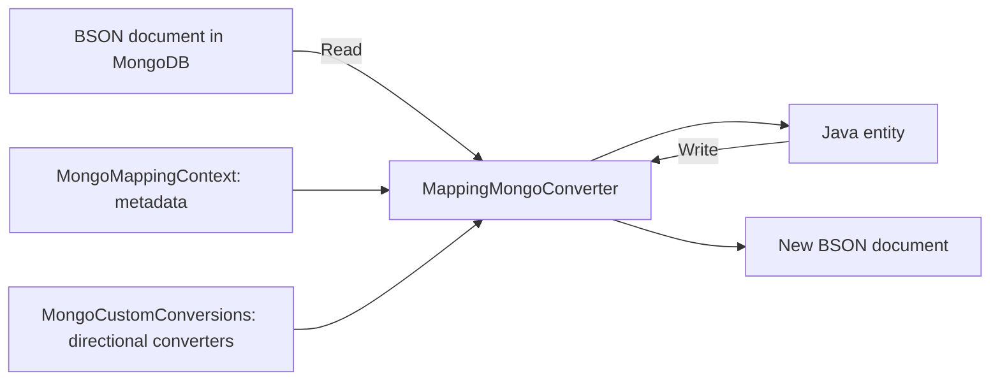

# One-Way Conversion, Nulls, and Invalid Data

## 1. Objectives and Real-World Problem

MongoDB stores data in BSON types, while Java applications work with classes, enums, value objects, and date/time or numeric types. **Spring Data MongoDB** uses data conversion mechanisms to bridge those two worlds. In a running application, the challenge rarely comes from clean documents—it comes from **heterogeneous data**: old records store status code `"A"` while new records store `"ACTIVE"`; some records lack the field entirely, some store `null`, and some hold values the system never intended to allow.

This lesson belongs to the **Data Conversion** chapter of the **SPRING_DATA_MONGODB** module. Its contents apply directly when using `MongoTemplate` or repositories to connect, read/write, and map documents, while also helping with testing, designing migrations, planning queries and indexes, and diagnosing errors that are sometimes mistaken for connection or performance issues.

After this lesson, you will be able to:

1. Distinguish **reading conversion** from **writing conversion** and understand why a converter may apply in only one direction.
2. Use `@ReadingConverter`, `@WritingConverter`, and `MongoCustomConversions` for the intended conversion direction.
3. Explain the difference between a **missing** field, a field with **`null`**, and a field with **wrong-type or out-of-domain values**.
4. Handle legacy data under explicit policies without masking errors via arbitrary default values.
5. Verify read paths, write paths, actual BSON, and queries after normalizing data.

Examples use Java 17+, Spring Data MongoDB, and `mongosh`. When applying them to a project, verify against your Spring Data, Spring Boot, and MongoDB driver versions as well as any existing custom converters.

## 2. Where Does Data Conversion Fit?

An application typically follows this path:



`MongoMappingContext` supplies entity and property metadata, such as `@Document` and `@Field`. `MappingMongoConverter` handles reading and writing objects using built-in conversions and registered converters. `MongoTemplate` and repositories operate on domain entities through these components; the driver and MongoDB server exchange BSON values.

Keep responsibilities distinct:

| Concept | Responsibility |
| --- | --- |
| Metadata mapping | Knows which Java property corresponds to which BSON field |
| Reading converter | Transforms a stored value into a Java type when reading |
| Writing converter | Transforms a Java value into a storage form when writing |
| Validation | Checks whether a value satisfies the data/business contract |
| Migration | Modifies **existing documents** to conform to a new schema |
| Query mapping | Translates field paths and filter/update values when executing queries |

Converters are value-transformation tools. Defining a converter **does not rewrite existing data in the database**, create indexes, or replace business constraints.

## 3. One-Way Reading vs. One-Way Writing

### 3.1. The Two Directions Can Be Independent

Suppose the `orders` collection historically stored:

```javascript
// Legacy record.
{ _id: "order-001", state: "A", amount: NumberDecimal("120000") }

// New record.
{ _id: "order-002", state: "ACTIVE", amount: NumberDecimal("85000") }
```

The current Java domain only wants to work with:

```java
public enum OrderState {
    ACTIVE,
    SUSPENDED
}
```

We can establish a **"read leniently, write canonically"** rule:

```text
READ:   "A"         -> OrderState.ACTIVE
        "ACTIVE"    -> OrderState.ACTIVE
        "S"         -> OrderState.SUSPENDED
        "SUSPENDED" -> OrderState.SUSPENDED

WRITE:  OrderState.ACTIVE    -> "ACTIVE"
        OrderState.SUSPENDED -> "SUSPENDED"
```

Here legacy data remains readable, while **new** records are written in a single canonical format. The read rule does not have to be a one-to-one inverse of the write rule: both `"A"` and `"ACTIVE"` read into the same Java value.

### 3.2. Why Declare Direction Explicitly?

Spring Data MongoDB can infer direction for many conversions from source/target types. However, conversions between two types considered **store-native simple types** (such as `String` ↔ `String` or certain numeric types) can be ambiguous as reading vs. writing. These annotations:

- `@ReadingConverter`: marks a converter used on the **read path**.
- `@WritingConverter`: marks a converter used on the **write path**.

declare intent clearly and help the framework register each converter for the right direction. Both annotations live in `org.springframework.data.convert`; they are not annotations placed on BSON fields.

Declaring a reading converter **does not auto-generate a matching writing converter**, and vice versa. Without a custom writing converter, writes fall back to default mapping for that Java type, which might produce an unintended representation. Always verify both directions.

## 4. Example Reading Converter for Legacy Status Data

### 4.1. Java Model

```java
import org.springframework.data.annotation.Id;
import org.springframework.data.mongodb.core.mapping.Document;

@Document(collection = "orders")
public record Order(
    @Id String id,
    OrderState state
) {}
```

`OrderState` is the enum defined in section 3. BSON `state` in legacy records contains `"A"` or `"S"`, whereas the new enum constants are `ACTIVE` and `SUSPENDED`.

If the framework attempts to resolve `"A"` as an enum constant name without a suitable converter, conversion fails. We define a reading converter accepting **both forms**:

```java
import java.util.Locale;
import org.springframework.core.convert.converter.Converter;
import org.springframework.data.convert.ReadingConverter;

@ReadingConverter
public final class OrderStateReadConverter
    implements Converter<String, OrderState> {

    @Override
    public OrderState convert(String source) {
        String code = source.trim().toUpperCase(Locale.ROOT);
        return switch (code) {
            case "A", "ACTIVE" -> OrderState.ACTIVE;
            case "S", "SUSPENDED" -> OrderState.SUSPENDED;
            default -> throw new IllegalArgumentException(
                "Unknown order state code"
            );
        };
    }
}
```

The converter accepts known legacy codes and new canonical values. For anything else like `"??"`, it **throws an error**. It does not return `OrderState.ACTIVE` as a fallback just to make corrupt data readable.

The method above handles **non-null String values**. Never assume the framework will always call it when a field is missing or `null`: those two cases pass through the mapping layer's binding/null-handling logic and must be handled separately.

### 4.2. Registering in MongoCustomConversions

```java
import java.util.List;
import org.springframework.context.annotation.Bean;
import org.springframework.context.annotation.Configuration;
import org.springframework.data.mongodb.core.convert.MongoCustomConversions;

@Configuration
class MongoConversionConfiguration {

    @Bean
    MongoCustomConversions mongoCustomConversions() {
        return new MongoCustomConversions(
            List.of(new OrderStateReadConverter())
        );
    }
}
```

In a Spring Boot application, auto-configuration picks up this `MongoCustomConversions` bean to configure `MappingMongoConverter`. If the project already defines custom converters or MongoDB configuration, **merge with existing conversions** to avoid accidentally replacing other critical rules.

For an enum like `OrderState`, Spring Data writes enum names by default, such as `ACTIVE`. Thus a reading converter alone may suffice to support legacy aliases. Even so, **verify BSON after writing** because other project configurations or converters could alter the output representation.

### 4.3. When a Dedicated Writing Converter Is Needed

If the storage contract mandates writing short codes `"A"`/`"S"`, you can add:

```java
import org.springframework.core.convert.converter.Converter;
import org.springframework.data.convert.WritingConverter;

@WritingConverter
public final class OrderStateWriteConverter
    implements Converter<OrderState, String> {

    @Override
    public String convert(OrderState source) {
        return switch (source) {
            case ACTIVE -> "A";
            case SUSPENDED -> "S";
        };
    }
}
```

With this strategy, register **both** converters if you need to read old codes and write short codes. This is an **alternative** to the canonical `"ACTIVE"`/`"SUSPENDED"` write policy in section 3; do not mix two conflicting write rules at the same time.

Important note: `Converter<OrderState, String>` applies to that source/target pair wherever custom conversions are consulted. If only one field needs short codes while another uses full enum names, **a global converter may be too broad**. In versions supporting property-level conversion, consider a per-property solution; otherwise use a separate domain type or storage field instead of imposing an ill-fitting global rule.

## 5. A One-Way Converter Can Cause Round-Trip Drift

Suppose the application only registers `OrderStateReadConverter`, reads a document with `state: "A"`, and then calls `save` on the entity. The save operation may write back `state: "ACTIVE"` using default enum mapping. The two BSON representations differ while carrying the same domain meaning.

```text
Document before read: { state: "A" }
                    |
                    | reading conversion
                    v
Entity in Java:      OrderState.ACTIVE
                    |
                    | default writing conversion
                    v
Document on write:   { state: "ACTIVE" }
```

This **may be an intentional migration pattern**, provided you account for:

1. Saving an entity can mutate the field even when business logic did not touch status.
2. Old and new representations continue coexisting until a full migration completes.
3. Equality queries on `"ACTIVE"` do not automatically match BSON `"A"`.
4. Other services, legacy batch jobs, or aggregations might still expect short codes.
5. Full-entity saves must be evaluated carefully to avoid overwriting concurrent updates.

**Round-trip does not always require byte-identical BSON** when normalization rules exist. Specify which invariant is required:

| Requirement | Verification |
| --- | --- |
| Preserve domain meaning | `read(write(entity))` matches the original entity |
| Preserve physical representation | BSON after round-trip is identical to BSON before |
| Gradual normalization | New BSON follows canonical standard while legacy BSON remains readable |
| Cross-service compatibility | Writers, readers, and queries across services share a single contract |

If gradual normalization is intended, explicitly document in migration notes that re-saving old documents can alter field representations.

## 6. Missing Fields, Null, and Invalid Values Are Three Distinct States

Consider the `orders` collection:

```javascript
db.orders.insertMany([
  { _id: "order-101", state: "ACTIVE" },
  { _id: "order-102", state: null },
  { _id: "order-103" },
  { _id: "order-104", state: "UNKNOWN" },
  { _id: "order-105", state: 17 }
]);
```

| Document | Actual BSON | Meaning |
| --- | --- | --- |
| `order-101` | `state: "ACTIVE"` | Valid String value present |
| `order-102` | `state: null` | Field exists with BSON Null |
| `order-103` | No `state` field | Missing field |
| `order-104` | `state: "UNKNOWN"` | Correct String type, outside allowed value domain |
| `order-105` | `state: 17` | Wrong BSON type for a String contract |

These are **five distinct situations**. A reading converter handling String status codes cannot solve all of them alone:

- For `"UNKNOWN"`, the converter receives a String and must decide whether to throw an error or map an approved legacy alias.
- For `17`, the conversion pipeline may find no matching converter or throw an error; do not assume automatic coercion to String will behave properly.
- For `null` and missing, the mapper may assign `null` to the Java property (if nullable) or fail when constructors/validation require a value.

### 6.1. Querying to Distinguish Null and Missing

```javascript
// Field is present: includes state: null.
db.orders.find({ state: { $exists: true } });

// Field is absent.
db.orders.find({ state: { $exists: false } });

// Has BSON Null value; excludes missing.
db.orders.find({ state: { $type: "null" } });

// Standard equality on null can match both null and missing.
db.orders.find({ state: null });
```

When requirements state "find only fields explicitly equal to Null," use a distinguishing filter (such as `$type: "null"`) instead of assuming `{ state: null }` returns only documents where the field exists.

### 6.2. Writing Null May Not Preserve the Field

In Spring Data MongoDB, default mapping typically **omits properties whose value is `null` when writing** rather than always creating a BSON Null field. In supporting versions, you can configure this right on the property:

```java
import org.springframework.data.mongodb.core.mapping.Field;

public record DeliveryNote(
    @Field(write = Field.Write.ALWAYS) String note
) {}
```

`Field.Write.ALWAYS` intends to write `null` values to keep the field present in the document; verify with BSON tests on your exact Spring Data version. Conversely, an optional property without an explicit null-write rule may become **missing** when the entity is saved back.

Also distinguish update commands:

```javascript
// Creates or preserves field with BSON Null.
db.orders.updateOne(
  { _id: "order-101" },
  { $set: { state: null } }
);

// Completely removes the field from the document.
db.orders.updateOne(
  { _id: "order-101" },
  { $unset: { state: "" } }
);
```

These two commands differ in semantics and stored outcome. Do not use `$unset` simply because an API received an empty string if the business contract assigns distinct meaning to `null`.

### 6.3. Null and Optional in the Domain

For optional fields, one strategy is allowing `null` in Java and exposing `Optional` at service/API layers. Do not assume every `Optional<T>` property on a persistent entity shares identical mapping/constructor behavior across all classes; test against your exact version and design.

For required fields like order status, **never use `null` as an implicit valid value**. Decide:

- Should `state` be backfilled for legacy documents?
- Is a valid business default genuinely known?
- When `state` is missing, should reads/operations fail, queue records for data repair, or map to an officially modeled `UNKNOWN` state?

If the true status cannot be determined, substituting `ACTIVE` just to avoid an exception is harmful because it alters business meaning.

## 7. Why Are Converters Usually Not the Place to Handle Null?

Spring Data / Spring ConversionService implementations generally do not invoke `Converter<S,T>.convert(...)` with a `null` source the way direct Java calls might. Missing or null property handling occurs at document reading, entity instantiation, and mapper null-handling levels.

Therefore, a converter like:

```java
@ReadingConverter
final class UnsafeStateConverter
    implements Converter<String, OrderState> {

    public OrderState convert(String source) {
        if (source == null) {
            return OrderState.ACTIVE;
        }
        return OrderState.valueOf(source);
    }
}
```

is **not a reliable way** to ensure every `null` or missing field defaults to `ACTIVE`. This is an example *to avoid*; besides potentially never receiving `null`, it masks bad data.

If the domain truly has a defaulting rule, place it at the proper layer: migration/backfill, explicit constructor/service logic, a domain factory, or a supported and tested mapping mechanism.

Some specialized Spring Data property conversion APIs provide `readNull`/`writeNull` hooks. Availability depends on version and property-converter registration, which **differs** from expecting a standard `Converter<S,T>` to receive `null`.

## 8. Handling Invalid Data: Fail Fast, Bounded Compatibility, and Data Repair

### 8.1. Classify Errors Before Fixing

| Problem Type | BSON Example | Question to Answer |
| --- | --- | --- |
| Missing data | No `state` | Can the true value be derived from another event? |
| Unexpected null | `state: null` | Is null allowed or a schema violation? |
| Wrong type | `state: 17` | Did a legacy system have a numeric status convention? |
| Out-of-domain value | `state: "UNKNOWN"` | Is this an official state or corrupt data? |
| Malformed format | `amount: "12,00,0"` | Is there a reliable legacy parser and locale rule? |
| Precision loss | `amount: 0.1` (BSON Double) | Can monetary values be recovered accurately? |
| Structural mismatch | `items: "BOOK-01"` instead of array | Can it be safely promoted to a list? |

An overly permissive converter can let the application "read successfully" while returning wrong business facts. For instance, treating every unrecognized string as `ACTIVE` corrupts order processing permissions and reporting.

### 8.2. Strict vs. Controlled Tolerant Policies

**Strict conversion:** accept only specified values and raise clear errors for anything else—for example, `OrderStateReadConverter` in section 4.

**Bounded tolerant conversion:** accept a verified set of legacy codes such as `"A"`/`"S"`, normalizing whitespace or letter casing if data policy permits; still reject unrecognized codes.

**Quarantine/repair:** during imports or migrations, log offending document IDs into a separate report for investigation and remediation; business systems must not fabricate values without evidence.

Not every failure has to halt the entire system. An ingestion batch job can separate valid records from invalid ones, whereas a critical state-transition API should fail in a controlled way if underlying data is corrupt.

### 8.3. Exceptions Can Surface at Multiple Layers

A conversion error may surface as an `IllegalArgumentException` from the converter, a Spring conversion/mapping exception, or an exception wrapped by the repository/template layer. Do not couple logic to an exact exception message without verifying against your running version.

When diagnosing:

1. Record the collection, document ID (redacted per logging policy), property, and observed **BSON type**.
2. Identify which converters are registered, their kinds, and conversion path order.
3. Reproduce reading a minimal sample document via `MongoConverter.read(...)`.
4. Confirm whether the source data is valid legacy data or genuinely corrupt.
5. Fix conversion rules or data according to the agreed contract.

Never dump full documents or sensitive values blindly into production logs. Error categorization should rely on appropriate metrics/traces with minimal safe context.

## 9. Currency Example: Preserving BSON Types and Precision

Monetary fields usually require `BigDecimal` in Java and BSON Decimal128 in MongoDB:

```java
import java.math.BigDecimal;
import org.springframework.data.mongodb.core.mapping.Document;
import org.springframework.data.mongodb.core.mapping.Field;
import org.springframework.data.mongodb.core.mapping.FieldType;

@Document("invoices")
public record Invoice(
    @org.springframework.data.annotation.Id String id,
    @Field(name = "amount", targetType = FieldType.DECIMAL128)
    BigDecimal amount
) {}
```

Expected document:

```javascript
{
  _id: "inv-001",
  amount: NumberDecimal("129.50")
}
```

Examples of problematic data:

```javascript
{ _id: "inv-002", amount: "129.50" }  // Legacy String.
{ _id: "inv-003", amount: "N/A" }     // Not a valid number.
{ _id: "inv-004", amount: 129.5 }     // BSON Double.
{ _id: "inv-005", amount: null }      // Missing real monetary value.
```

`@Field(targetType = FieldType.DECIMAL128)` specifies **the target write type**. It does not guarantee every legacy String or Double reads back accurately and validly. When converting legacy data, specify explicitly:

- Are decimal strings with dots accepted? Are locale commas or grouping separators present?
- Did previous BSON Double values lose precision?
- Must trailing decimal places or rounding rules be preserved?
- Is `null`/missing valid, or must it be backfilled from source records?

For financially critical data, prefer database schema validation to block new invalid BSON types at write time rather than relying solely on read-side converters. A global `String → BigDecimal` converter can affect many fields; evaluate scope carefully and test corresponding queries.

## 10. Queries and Indexes Are Affected by Conversion

### 10.1. Java Reading Legacy Codes Does Not Mean Queries Find Everything

Suppose the reading converter supports both `"A"` and `"ACTIVE"`. A direct query:

```javascript
db.orders.find({ state: "ACTIVE" });
```

only matches documents storing the string `"ACTIVE"`; it does not automatically match documents with `state: "A"`. MongoDB's query planner knows nothing about Java converter aliases.

During a transition period, you can query explicitly:

```javascript
db.orders.find({
  state: { $in: ["A", "ACTIVE"] }
});
```

This is a transitional workaround that must live cleanly in the query-building layer and be tested. When the application runs `Criteria.where("state").is(OrderState.ACTIVE)`, query mapping encodes the enum using the active **write/query** conversion rule; do not assume it automatically expands into `$in` across every alias accepted by the reading converter.

### 10.2. Null, Missing, and Indexes

Documents with `state: null` and missing fields can both match certain null queries while being structurally distinct. When designing indexes or partial indexes, inspect the exact filters your application executes.

```javascript
db.orders.createIndex(
  { state: 1 },
  { name: "ix_orders_state" }
);

db.orders.find({
  state: { $in: ["A", "ACTIVE"] }
}).explain("executionStats");
```

Indexes help MongoDB locate stored BSON values, but they cannot fix invalid status codes. If data mixes String and Number types, the index holds keys of multiple BSON types; whether scans match properly still depends on query filters.

### 10.3. Direct Updates Can Bypass Entity Logic

```java
mongoTemplate.updateFirst(
    Query.query(Criteria.where("id").is("order-001")),
    new Update().set("state", "ACTIVE"),
    Order.class
);
```

This snippet updates a single field with a String value. It is not equivalent to loading an `Order`, running all constructors/domain validation, and saving it back. Verify query/update mapping and converters, especially when business validation, auditing, or entity lifecycle callbacks are present.

## 11. Normalizing Data via Controlled Migration

When the end goal is storing only `"ACTIVE"`/`"SUSPENDED"`, an illustrative migration is:

```javascript
db.orders.updateMany(
  { state: "A" },
  { $set: { state: "ACTIVE" } }
);

db.orders.updateMany(
  { state: "S" },
  { $set: { state: "SUSPENDED" } }
);
```

These commands **only handle the two known legacy codes** and can be re-run without altering already-migrated documents. They do not fix `state: 17`, `null`, missing fields, or `"UNKNOWN"`.

Before running a production migration:

1. Inventory actual BSON values and types via aggregation/sample counts, identifying all writers.
2. Define business-approved conversion rules, especially for missing or invalid data.
3. Write tests for old records, new records, and errors; verify unconvertible-data reporting.
4. Dry-run on a copy of the data; measure modified document counts and execution time.
5. Coordinate deploying new writers so legacy codes stop being generated.
6. Run the migration in controlled batches/processes; save checkpoints and verify post-run results.
7. Validate queries/indexes, analytics, integrating services, and the rollback plan.

MongoDB guarantees **per-document atomicity** for a single-document update, but `updateMany` does not wrap thousands of documents into one multi-document atomic transaction. Handle partial failures mid-run and avoid updates relying on concurrently changing state.

### 11.1. Inventorying Status Codes in MongoDB

```javascript
db.orders.aggregate([
  {
    $group: {
      _id: {
        type: { $type: "$state" },
        value: "$state"
      },
      count: { $sum: 1 }
    }
  },
  { $sort: { count: -1 } }
]);
```

On large datasets, grouping by every distinct value can be expensive; inspect BSON types first, narrow scope, or use appropriate analysis tools. Never run heavy inventory aggregations on production without assessing load.

### 11.2. Bidirectional Compatibility During Transition

A typical rollout path:

```text
Phase 1: Reader supports old and new codes; writer is standardized.
Phase 2: Migration converts known legacy codes; track invalid records.
Phase 3: Queries and reports need only canonical codes.
Phase 4: Remove legacy code support once reconciled and old writers are retired.
```

In multi-service systems, never drop the reading converter before legacy records and all legacy writers are decommissioned. Conversely, keeping legacy converters indefinitely can mask an old batch job still emitting outdated codes.

## 12. Testing Conversions with a Data Matrix

### 12.1. Unit Testing Converter Logic Alone

```java
import static org.junit.jupiter.api.Assertions.*;
import org.junit.jupiter.api.Test;

class OrderStateReadConverterTest {
    private final OrderStateReadConverter converter =
        new OrderStateReadConverter();

    @Test
    void supportsLegacyAndCanonicalCodes() {
        assertEquals(OrderState.ACTIVE, converter.convert("A"));
        assertEquals(OrderState.ACTIVE, converter.convert("ACTIVE"));
        assertEquals(OrderState.SUSPENDED, converter.convert("S"));
        assertEquals(OrderState.SUSPENDED, converter.convert("SUSPENDED"));
    }

    @Test
    void rejectsUnknownCode() {
        assertThrows(
            IllegalArgumentException.class,
            () -> converter.convert("UNKNOWN")
        );
    }
}
```

This test verifies **String reading logic**; it does not prove Spring Data registered the converter or invokes it when reading entities.

### 12.2. Testing MappingMongoConverter Directly

With `MongoConverter` configured in the application/test context:

```java
import org.bson.Document;
import org.springframework.data.mongodb.core.convert.MongoConverter;

public final class MappingExamples {
    public static void inspect(MongoConverter converter) {
        Document legacy = new Document("_id", "order-legacy")
            .append("state", "A");

        Order loaded = converter.read(Order.class, legacy);
        if (loaded.state() != OrderState.ACTIVE) {
            throw new AssertionError("Legacy code was not converted");
        }

        Document written = new Document();
        converter.write(
            new Order("order-new", OrderState.ACTIVE),
            written
        );
        System.out.println(written.get("state")); // Expects ACTIVE.
    }
}
```

This snippet exercises in-memory reading/writing and checks default enum writing. Verify **actual BSON values** rather than inspecting Java objects alone. If the written output is `"A"`, check whether another writing converter is registered.

### 12.3. Testing Null, Missing, and Type Errors

| Input Data | Expected Behavior to Confirm |
| --- | --- |
| `state: "A"` | Reads as `ACTIVE` |
| `state: "ACTIVE"` | Reads as `ACTIVE` |
| `state: "S"` | Reads as `SUSPENDED` |
| `state: "UNKNOWN"` | Fails cleanly rather than turning into ACTIVE |
| `state: 17` | Not silently accepted if contract requires String |
| `state: null` | Mapping/validation handles per contract without wrong defaults |
| Missing `state` | Explicit policy to detect/recover/reject |
| Java `state == null` on write | Verify whether BSON omits field or writes Null per annotation/config |

In integration tests, also test queries across both legacy and canonical values; test reading a malformed document via repository and confirm exceptions map cleanly to business responses or error handlers. When using reactive repositories, test `Mono`/`Flux` error signals when a document fails mapping; one bad read can terminate the stream rather than being skipped automatically.

## 13. Troubleshooting and Data Quality Criteria

### 13.1. Short Investigation Chain

```text
Actual MongoDB document
    ↓  is the field present? Which BSON type?
MongoMappingContext / @Field / targetType
    ↓  mapped to the right Java property?
MongoCustomConversions
    ↓  which read/write converters are active?
Java entity after read
    ↓  null, exception, or right value?
Emitted BSON query/update
    ↓  finds both legacy + canonical as intended?
Validation + migration + tests
```

### 13.2. Common Mistakes

| Symptom | Possible Cause | Resolution |
| --- | --- | --- |
| Reading legacy code throws enum error | Only standard enum names supported | Add bounded reading converter |
| Re-saving turns `"A"` into `"ACTIVE"` | Lenient read, canonical write | Confirm whether gradual migration is intended |
| Query for `ACTIVE` misses documents | Legacy BSON still holds `"A"` | Transitional query or migration |
| Converter fails to intercept null field | Nulls handled by mapping/binding | Handle nulls at the right layer; test missing and null |
| Blank data becomes ACTIVE | Arbitrary fallback in converter | Never assign defaults without business rules |
| Converter runs on unexpected fields | Global custom converter registered | Narrow scope or use appropriate model/property conversion |
| Encountered Number when expecting String | Wrong BSON type or inconsistent ETL writes | Inventory types; reject or convert under explicit rules |
| `BigDecimal` loses precision | Old data is Double or inconsistent money types | Check precision and Decimal128 conventions |
| Changed annotation but old data unchanged | Metadata is not migration | Run controlled data-repair workflow |
| Converter test passes but queries fail | Query mapping/BSON filter untested | Integration test with DB and legacy data |

### 13.3. Do Not Mistake Data Errors for Performance Errors

Even with a matching index, a query returns nothing if the filter sends `"ACTIVE"` while documents store `"A"`. Start from **actual BSON types and values**, then use `explain("executionStats")` to inspect `IXSCAN`, `COLLSCAN`, `totalKeysExamined`, and `totalDocsExamined`.

Track metrics for legacy document count, schema-violating document count, conversion error count, read/write success rates, and migration duration. Those metrics tell you when legacy support can be retired and catch any writer still emitting malformed data.

## 14. Practice Exercises with Solutions

### Exercise 1 — Which Direction Needs a Converter?

**Prompt:** Legacy data stores `"A"`, Java code uses `OrderState.ACTIVE`, and new data must store `"ACTIVE"`. Which converter is needed?

**Solution:** Use a `@ReadingConverter Converter<String, OrderState>` accepting `"A"` and `"ACTIVE"`. Default enum writing can write `"ACTIVE"`, then **test** newly written BSON. Do not register a writing converter outputting `"A"` if the goal is standardizing codes.

### Exercise 2 — Distinguishing Null and Missing

**Prompt:** Write a query finding documents where `state` exists and equals BSON Null, and a query finding documents missing the field.

**Solution:**

```javascript
db.orders.find({ state: { $type: "null" } });
db.orders.find({ state: { $exists: false } });
```

A plain `{ state: null }` filter can match both groups; use explicit operators when business logic must distinguish them.

### Exercise 3 — Should Wrong-Type Data Be Defaulted?

**Prompt:** A document has `state: 17`, yet the legacy code list only contains `"A"`/`"S"`. Should 17 be converted to `ACTIVE` so the screen keeps working?

**Solution:** There is no business basis to do so. Trace the source of `17`, review legacy schemas and any documented mapping rules. If unverified, mark the data invalid and handle the error cleanly or route it to data remediation.

### Exercise 4 — Querying Properly During Transition

**Prompt:** A collection contains both `"A"` and `"ACTIVE"`. Write a `mongosh` query fetching all logically active orders.

**Solution:**

```javascript
db.orders.find({
  state: { $in: ["A", "ACTIVE"] }
});
```

This is a transitional query. Once migration completes and legacy writers stop, you can use only the canonical `"ACTIVE"` value.

### Exercise 5 — Choosing Null Handling on Write

**Prompt:** The system distinguishes "no note field" from "note explicitly confirmed empty and stored as null." Can you assume every null is written as BSON Null by default?

**Solution:** Do not assume. Check mapping's null-write policy. On supporting versions, use `@Field(write = Field.Write.ALWAYS)` on properties that must store null; when omitting fields, use the corresponding write policy. Write integration tests verifying BSON after `save` and updates, and distinguish `$set: {note: null}` from `$unset`.

### Exercise 6 — Why Test Both Reading and Writing?

**Prompt:** A unit test confirms `"A"` reads as `ACTIVE`. Is that enough to conclude the system is compatible?

**Solution:** No. You must still verify the converter is registered in the actual `MappingMongoConverter`, what representation the enum is written in, how queries filter both codes, how null/missing/wrong-type records behave, and whether other services can read the new data.

## 15. Handover Checklist

| Question | Completion Criteria |
| --- | --- |
| Which legacy data is supported? | Documented list of legacy codes, BSON types, and verified sources |
| Which converter runs on read? | `@ReadingConverter` registered and tested |
| Which converter runs on write? | Default or `@WritingConverter` defined consistently |
| Do null and missing carry distinct semantics? | Tested `$exists`/`$type` and BSON after write |
| Can wrong-type data be misread? | Contract-enforced checks/exceptions |
| Are there business-altering fallbacks? | Never auto-fills ACTIVE/0/current date without basis |
| Do queries find both old and new data? | Transitional queries, indexes, and integration tests |
| Are migration and rollback plans ready? | Dry-run, checkpoints, writer cutover, and reconciliation |
| Has actual BSON been inspected? | `MongoConverter` tests and reads from MongoDB |
| Has reactive/batch impact been checked? | Read-stream error handling and other write sources verified |

**Key takeaway:** data conversion is part of a long-term storage contract. **One-way reading** preserves legacy compatibility, **one-way writing** enforces the new standard, while **null**, **missing**, and **invalid values** require explicit policies. Decide on the desired BSON representation, test both directions thoroughly, and use controlled migrations whenever stored data itself must change.
