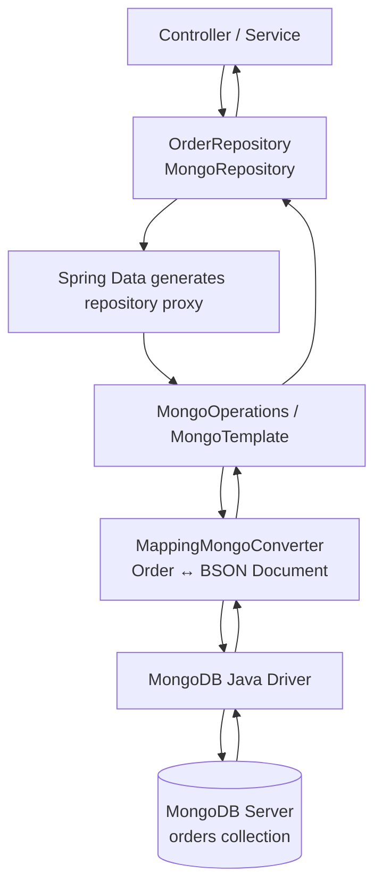
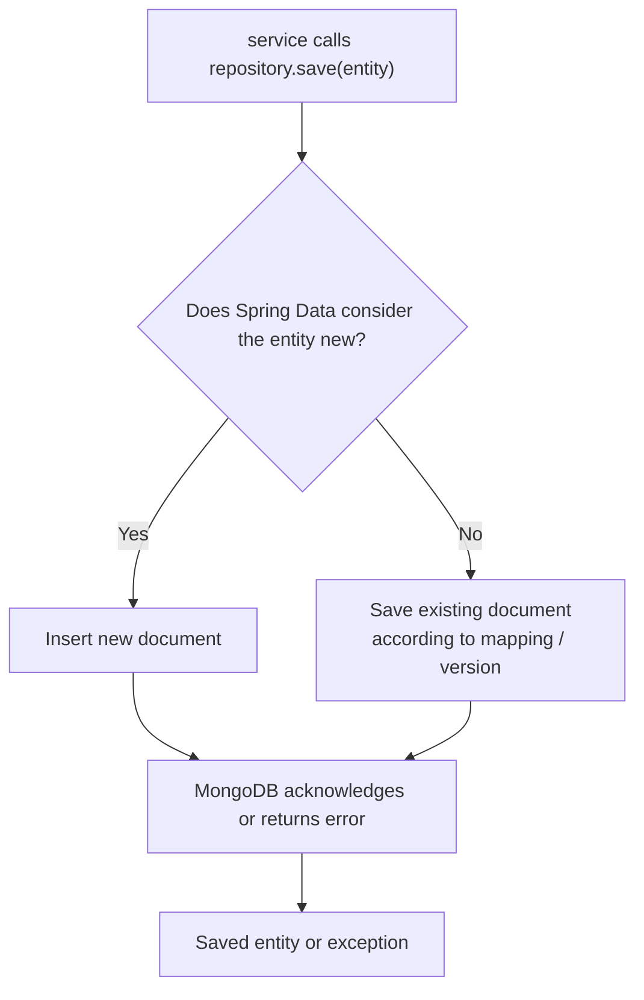

# Declaring a MongoRepository with Entity and ID Type

In Spring Data MongoDB, a repository allows a service to interact with documents through a Java interface: `save`, `insert`, `findById`, `findAll`, `deleteById`, and custom query methods. For Spring Data to generate the correct implementation, you must declare the **entity** representing the document and an **ID type** consistent with the identifier property in the entity.

This lesson belongs to the **Repository CRUD** chapter of the **SPRING_DATA_MONGODB** module. The focus is on understanding what the two types passed to `MongoRepository<T, ID>` represent, how to declare them, when to use `ObjectId` versus `String`, and how to verify that the repository actually reads and writes the intended MongoDB collection. Topics on indexes, queries, transactions, reactive access, and testing are included where they affect repository design.

## 1. Where does MongoRepository fit in the architecture?



The diagram illustrates the main responsibilities; it does not imply that every step is a separate network call. Spring Data provides the repository implementation when the application context starts up; you usually only write an **interface**. CRUD methods are implemented by the framework based on mapping metadata and `MongoTemplate`. If fine-grained control over queries, aggregations, or field-level updates is needed, the service can use `MongoTemplate` directly.

Basic definition:

```java
public interface OrderRepository
        extends MongoRepository<Order, ObjectId> {
}
```

The two generic parameters have specific meanings:

| Symbol | In the example | Meaning |
| --- | --- | --- |
| `T` | `Order` | The Java entity type that the repository stores, reads, and maps |
| `ID` | `ObjectId` | The type of the **Java entity's ID property** used in `findById`, `deleteById`, `existsById`, etc. |

**Note:** `ID` is the Java-side type, not the collection name, the `_id` field name, or the data type of all business keys. The collection name and how the `_id` field is mapped are determined by entity metadata.

## 2. Declaring an entity with `@Document` and `@Id`

Suppose the application has an `orders` collection. Each order includes a customer ID, status, total amount, and creation timestamp.

```java
import java.time.Instant;
import org.bson.types.ObjectId;
import org.springframework.data.annotation.Id;
import org.springframework.data.annotation.Version;
import org.springframework.data.mongodb.core.mapping.Document;
import org.springframework.data.mongodb.core.mapping.Field;

@Document(collection = "orders")
public class Order {
    @Id
    private ObjectId id;

    @Field("customer_id")
    private String customerId;

    private String status;

    @Field("total_vnd")
    private long totalVnd;

    private Instant createdAt;

    @Version
    private Long version;

    public Order() {}

    public Order(
            String customerId,
            String status,
            long totalVnd,
            Instant createdAt) {
        this.customerId = customerId;
        this.status = status;
        this.totalVnd = totalVnd;
        this.createdAt = createdAt;
    }

    public ObjectId getId() { return id; }
    public String getCustomerId() { return customerId; }
    public String getStatus() { return status; }
    public long getTotalVnd() { return totalVnd; }
    public Instant getCreatedAt() { return createdAt; }
    public Long getVersion() { return version; }

    public void markPaid() {
        this.status = "PAID";
    }
}
```

Main annotations:

| Annotation | Role |
| --- | --- |
| `@Document(collection = "orders")` | Associates the entity with the `orders` collection. |
| `@Id` | Marks the Java property used as the `_id` field in MongoDB. |
| `@Field("customer_id")` | Maps Java `customerId` to the BSON field `customer_id`. |
| `@Field("total_vnd")` | Maps `totalVnd` to `total_vnd`. |
| `@Version` | Participates in optimistic locking when saving/updating the entity through versioning-aware paths. |

Not every entity is required to have public setters: Spring Data supports field/property access and constructor binding. The no-arg constructor here keeps the example easy to follow; for immutable entities, design an appropriate constructor. `@Document` indicates that this is an aggregate root stored in its own collection; an embedded value object typically does not need `@Document`.

An actual document might look like this in `mongosh`:

```javascript
{
  _id: ObjectId("674000000000000000000501"),
  customer_id: "KH-101",
  status: "NEW",
  total_vnd: NumberLong("1250000"),
  createdAt: ISODate("2026-11-20T02:00:00Z"),
  version: NumberLong("0"),
  _class: "com.example.orders.Order"
}
```

This is an **illustration**, not a fixed execution output. The ID, timestamp, numeric type of `version`, package name, and presence of `_class` depend on the data and configuration. `_class` may be written by the default type mapper as type metadata; do not treat it as a business field.

## 3. Declaring `MongoRepository<Order, ObjectId>`

Import the right interface:

```java
import java.util.List;
import org.bson.types.ObjectId;
import org.springframework.data.domain.Page;
import org.springframework.data.domain.Pageable;
import org.springframework.data.mongodb.repository.MongoRepository;

public interface OrderRepository
        extends MongoRepository<Order, ObjectId> {

    List<Order> findByCustomerIdAndStatus(
            String customerId, String status);

    Page<Order> findByCustomerId(
            String customerId, Pageable pageable);

    long countByStatus(String status);
}
```

The most important point is in the `extends` clause:

- `Order` is the entity annotated with `@Document` and having the `@Id ObjectId id` property.
- `ObjectId` matches the **Java type of `Order.id`**.
- `OrderRepository` is an interface; Spring Data creates a bean implementing the inherited methods and derived query methods.
- Methods like `findByCustomerIdAndStatus` use **Java property names**, even when the BSON field name is changed via `@Field`.

With the `Order` entity above, declaring `MongoRepository<Order, String>` might look convenient because an HTTP path variable is a `String`, but it causes the **Java type contract to mismatch**. Some ID conversions may occur at the framework layer, yet you should not rely on implicit conversion to mask a mismatch between the entity and repository.

If you want the API to accept a string ID, parse it in the service and then call the repository with `ObjectId`, as shown in section 6.

## 4. How does Spring create the repository bean?

In a Spring Boot application using the synchronous MongoDB starter:

```text
org.springframework.boot:spring-boot-starter-data-mongodb
```

Typically, auto-configuration initializes the client, converter, `MongoTemplate`, and repository infrastructure from application configuration. When the `OrderRepository` interface is within the scanned package scope, a service can inject it via its constructor:

```java
import org.springframework.stereotype.Service;

@Service
public class OrderService {
    private final OrderRepository orders;

    public OrderService(OrderRepository orders) {
        this.orders = orders;
    }

    public Order create(String customerId, long totalVnd) {
        return orders.insert(new Order(
            customerId, "NEW", totalVnd, java.time.Instant.now()));
    }
}
```

You do not instantiate `new OrderRepository()` yourself because the repository is an interface implemented by Spring Data. If the interface is outside the default scan scope, you can configure it explicitly:

```java
import org.springframework.context.annotation.Configuration;
import org.springframework.data.mongodb.repository.config.EnableMongoRepositories;

@Configuration
@EnableMongoRepositories(basePackageClasses = OrderRepository.class)
class MongoRepositoryConfiguration {
}
```

`@EnableMongoRepositories` demonstrates **explicit configuration when needed**; in a Boot application that already scans the right packages, adding the annotation unnecessarily can complicate configuration. Make sure the repository uses the right `MongoTemplate`/database when the system has multiple MongoDB connections.

**Practical prerequisites to run:** the application has the appropriate MongoDB dependency, a valid connection URI/database, the entity/repository are within mapping and repository scanning scope, and the MongoDB Server is reachable. Simply writing a Java interface does not grant server access.

## 5. Inherited CRUD methods

`MongoRepository` provides CRUD operations that you can call right away:

| Method | Typical Java result | Meaning |
| --- | --- | --- |
| `insert(entity)` | Inserted entity | Adds a new document; duplicate key can cause an error. |
| `save(entity)` | Saved entity | Saves a new entity or the state of an existing entity, according to entity-detection rules. |
| `saveAll(entities)` | List of saved entities | Saves multiple entities; not an atomic transaction across all documents by default. |
| `findById(id)` | `Optional<Order>` | Reads one document by ID. |
| `existsById(id)` | `boolean` | Checks existence by ID. |
| `findAll()` | `List<Order>` | Reads all documents; be careful with large collections. |
| `findAllById(ids)` | `List<Order>` | Reads documents for a set of IDs. |
| `count()` | `long` | Counts documents in the repository scope. |
| `deleteById(id)` | `void` | Deletes by ID; does not necessarily fail if no document is found. |
| `delete(entity)` | `void` | Deletes the entity; with `@Version`, can check optimistic locking. |

The actual API may have additional overloads and methods depending on the Spring Data version, but the goal is to recognize the **type contract** and CRUD behavior.

### 5.1. Inserting a new order

```java
Order draft = new Order(
    "KH-101", "NEW", 1_250_000L, java.time.Instant.now());

Order inserted = orderRepository.insert(draft);
ObjectId newId = inserted.getId();
```

With `id == null`, a new ID is usually generated during insert, and the returned entity contains the ID. `insert` is used when business logic expects to create a new document; violating a unique index (including `_id`) can cause the operation to fail.

### 5.2. Reading by ID

```java
Optional<Order> found = orderRepository.findById(newId);

Order order = found.orElseThrow(() ->
    new IllegalArgumentException("Order not found"));
```

`Optional.empty()` is a valid state when no matching document exists. Do not turn every not-found case into a MongoDB connection error; in HTTP APIs, separate 404 (no data) from system errors (failed query).

### 5.3. Modifying and saving again

```java
Order order = orderRepository.findById(newId).orElseThrow();
order.markPaid();

Order saved = orderRepository.save(order);
```

`save` uses the current entity state to write the document back. On an entity with `@Version`, Spring Data uses the version mechanism to detect certain stale overwrites. However, calling `save` on an entity loaded through a projection (missing fields) can cause data loss; if you only need to modify a few fields, consider `MongoTemplate.updateFirst` with `$set` and appropriate criteria.

### 5.4. Deleting by ID

```java
orderRepository.deleteById(newId);
boolean stillExists = orderRepository.existsById(newId);
```

In many cases, `deleteById` completes normally even if there is no document to delete. If business logic requires knowing **how many documents were deleted** or needs conditional deletion by status, `MongoTemplate.remove(query, Order.class)` returns a `DeleteResult` to observe the deleted count when write acknowledgement is enabled.

## 6. Choosing the right ID type: `ObjectId`, `String`, and `@MongoId`

In MongoDB, the `_id` field does not have to be an ObjectId; an application can use a string, number, or other MongoDB-supported ID type. For a Java repository, it is critical that the **entity's ID strategy and the repository generic type match**.

### 6.1. Case A: `@Id ObjectId`

```java
@Document("orders")
class OrderByObjectId {
    @Id
    private ObjectId id;
}

interface OrderByObjectIdRepository
        extends MongoRepository<OrderByObjectId, ObjectId> {}
```

Java uses `ObjectId`, and MongoDB typically stores a BSON ObjectId. This is a straightforward choice if there is no custom business ID requirement.

### 6.2. Case B: `@Id String`

```java
@Document("orders")
class OrderByStringId {
    @Id
    private String id;
}

interface OrderByStringIdRepository
        extends MongoRepository<OrderByStringId, String> {}
```

With `@Id String`, Spring Data MongoDB by default has a rule that tries to convert valid ObjectId-formatted strings into **BSON ObjectId**; values that cannot be converted may be stored as BSON String. This is why the Java `String` type **does not guarantee** that the collection stores all `_id` values as BSON String.

A string like `"674000000000000000000501"` and a corresponding BSON ObjectId look nearly identical when displayed, but MongoDB compares values by BSON type. If data in the collection contains both String and ObjectId, a seemingly correct query may still fail to find the document.

### 6.3. Case C: needing the ID as an unmodified string

If the order code is `"ORDER-2026-0001"`, you can require keeping the String type using `@MongoId`:

```java
import org.springframework.data.mongodb.core.mapping.Document;
import org.springframework.data.mongodb.core.mapping.FieldType;
import org.springframework.data.mongodb.core.mapping.MongoId;

@Document("external_orders")
class ExternalOrder {
    @MongoId(FieldType.STRING)
    private String id;

    private String customerId;
}

interface ExternalOrderRepository
        extends MongoRepository<ExternalOrder, String> {}
```

`@MongoId(FieldType.STRING)` clearly expresses the intent to store `_id` as a BSON String. In addition, `@MongoId` without a specified `FieldType` generally preserves the identifier type according to the Java property, avoiding `@Id`'s default String → ObjectId conversion. If choosing `@MongoId(FieldType.OBJECT_ID)` with a String property, ensure the string is a valid ObjectId format and test the conversion rules for your Spring Data version.

| Entity ID declaration | Repository generic | Intended BSON type | Notes |
| --- | --- | --- | --- |
| `@Id ObjectId id` | `MongoRepository<T, ObjectId>` | ObjectId | Suitable for standard MongoDB keys |
| `@Id String id` | `MongoRepository<T, String>` | Can be ObjectId or String | Depends on value and conversion rules |
| `@MongoId(FieldType.STRING) String id` | `MongoRepository<T, String>` | String | Suitable for business/external IDs |
| `@MongoId(FieldType.OBJECT_ID) String id` | `MongoRepository<T, String>` | ObjectId when conversion is valid | Must validate input IDs |

**Do not switch the strategy from `@Id` to `@MongoId` on an existing collection with data without checking actual BSON types.** Changing the mapping can prevent `findById` from matching previous `_id` types; changing ID types requires a migration plan.

## 7. HTTP boundary: accepting a string while calling the repository with ObjectId

REST APIs commonly receive IDs from paths such as `/orders/674000000000000000000501`. That is not a reason to declare the repository with `String` if the entity uses `ObjectId`.

```java
import java.util.Optional;
import org.bson.types.ObjectId;
import org.springframework.stereotype.Service;

@Service
class OrderLookupService {
    private final OrderRepository orders;

    OrderLookupService(OrderRepository orders) {
        this.orders = orders;
    }

    Optional<Order> findByExternalId(String rawId) {
        if (rawId == null || !ObjectId.isValid(rawId)) {
            throw new IllegalArgumentException(
                "ID must be a valid ObjectId string");
        }
        return orders.findById(new ObjectId(rawId));
    }
}
```

To return the ID in JSON, you can put `order.getId().toHexString()` into a DTO. If the ID has an invalid format, the HTTP layer can return **400 Bad Request**; a validly formatted ID with no matching document usually maps to **404 Not Found**; MongoDB execution failures belong to another category of system errors.

`ObjectId.isValid(rawId)` only verifies a valid string format—it does not prove the document exists or that the user has read permission. The service layer must still enforce tenant checks, access control, and business rules.

## 8. Repository methods using Java property names

Beyond inherited CRUD, Spring Data can parse method names to build queries.

```java
List<Order> newOrders = orderRepository
    .findByCustomerIdAndStatus("KH-101", "NEW");
```

Because the entity declares `@Field("customer_id")`, Spring Data interprets `findByCustomerIdAndStatus` using the properties `customerId` and `status`, then maps them to the BSON field names. The semantically equivalent query is:

```javascript
db.orders.find({
  customer_id: "KH-101",
  status: "NEW"
});
```

**Do not name methods after BSON fields** such as `findByCustomer_id` and expect Spring Data to infer underscore conventions; in derived queries, underscores also act as property path separators. Use Java property names or `@Query` when special control is needed.

Pagination example:

```java
import org.springframework.data.domain.Page;
import org.springframework.data.domain.PageRequest;
import org.springframework.data.domain.Sort;

Page<Order> page = orderRepository.findByCustomerId(
    "KH-101",
    PageRequest.of(
        0,
        20,
        Sort.by(Sort.Direction.DESC, "createdAt"))
);
```

A `Page<Order>` return type may require an extra query to count the total number of elements. Under heavy load when totals are not needed, consider `Slice`-based APIs or keyset pagination strategies to reduce overhead. Indexes on `customer_id` and matching sort orders can improve read speed; verify query plans with `explain("executionStats")` in MongoDB.

When a method is expected to return multiple documents, use `List<Order>` or `Page<Order>`. Only use `Optional<Order>` when the query **by contract** returns at most one result; if data can have multiple matches while the query is designed for a single object, revisit the limits and uniqueness constraints.

## 9. Entity lifecycle: `isNew`, `insert`, `save`, and `@Version`

A repository needs to know whether an entity is considered **new** or **existing** to decide the right write path. This does not always mean simply checking `id == null`.

Mechanisms used to detect a new entity include:

1. If the entity has an eligible `@Version` property, its initial version value (for example `null` for `Long`) usually participates in deciding whether the entity is still new.
2. If no version participates, an unassigned ID value generally signals a new entity.
3. If the entity implements `Persistable<ID>`, its `isNew()` method can provide custom logic.

For `Order` with `@Version Long version` shown earlier, a new `Order` has `version == null`. The first save usually takes the insert path, after which the version is managed across the persistence lifecycle. When calling `save` for an existing document, Spring Data can use the version to detect concurrent update conflicts.



Notes:

- `insert(entity)` expresses the intent to add a new document; if the ID collides with an existing document, the operation can be rejected.
- `save(entity)` fits persisting the full state of an entity, but **does not replace field-level updates** in every scenario.
- `@Version` helps prevent overwrites on code paths supporting optimistic locking, requiring acknowledged write concern to detect conflicts.
- A write workflow spanning multiple documents **does not automatically become a transaction** just by calling multiple repository methods sequentially.

If two requests read the same `Order` and both change its status, versioning can cause the second save to fail with `OptimisticLockingFailureException` instead of silently overwriting. The service layer must decide whether to retry with fresh data, return a conflict error, or execute another business workflow.

## 10. Indexes and uniqueness related to repositories

MongoDB maintains a unique index on `_id` for standard collections, but business fields like `customer_id` or `orderNumber` need their own indexes if queried frequently or required to be unique.

For example, to require `orderNumber` to be unique:

```java
import org.springframework.data.mongodb.core.index.Indexed;

@Indexed(unique = true)
private String orderNumber;
```

This snippet illustrates an additional property **inside the entity**, not complete code replacing the `Order` class. `@Indexed(unique = true)` declares the intent to create a unique index, but the constraint only takes effect when the **index actually exists in MongoDB**. Auto-index creation depends on configuration and version; production environments should manage indexes through explicit migrations or deployment workflows.

```javascript
// Illustrative command if your organization manages indexes directly:
db.orders.createIndex({ orderNumber: 1 }, { unique: true });
```

Choose indexes based on real access patterns. If you frequently filter by `customer_id` and sort by `createdAt`, a compound index such as `{ customer_id: 1, createdAt: -1 }` may be worth considering. Check `totalDocsExamined`, `totalKeysExamined`, `nReturned`, and `winningPlan` using `explain`, while balancing write overhead and index storage size.

## 11. Error handling: distinguishing "not found" from "operation failed"

| Scenario | Observable behavior | How to handle |
| --- | --- | --- |
| `findById` finds no document | `Optional.empty()` | Return 404 or business not-found response |
| `insert` duplicates `_id`/unique index | Usually raises `DuplicateKeyException` | Handle ID collision or business constraint |
| `save` version conflict | `OptimisticLockingFailureException` | Re-read, retry under control, or report conflict |
| HTTP string is not a valid ObjectId | `IllegalArgumentException` when parsing | Return 400; do not send an invalid query |
| MongoDB timeout/connection loss | Exception via driver and Spring Data stack | Monitor system errors, timeouts, pools, and server health |
| Calling an unscanned repository | Spring has no bean to inject | Check package scan, starter, and configuration |
| Empty query result despite existing document | Wrong database/collection, field name, or BSON ID type | Inspect raw document and query mapping |

Do not wrap every exception as "Order not found". An `Optional.empty()` is fundamentally different from a timeout or a BSON conversion error. When troubleshooting, start from the entity, ID type, connection path, and actual document.

## 12. ReactiveMongoRepository is a different repository type

If the application uses **Reactive Spring Data MongoDB**, the corresponding interface is `ReactiveMongoRepository<T, ID>`, for example:

```java
import org.bson.types.ObjectId;
import org.springframework.data.mongodb.repository.ReactiveMongoRepository;
import reactor.core.publisher.Flux;
import reactor.core.publisher.Mono;

interface ReactiveOrderRepository
        extends ReactiveMongoRepository<Order, ObjectId> {

    Flux<Order> findByCustomerId(String customerId);
    Mono<Order> findFirstByStatus(String status);
}
```

`ReactiveMongoRepository` returns `Mono<T>` and `Flux<T>`; MongoDB operations execute according to the publisher lifecycle upon subscription. Do not use `MongoRepository` in WebFlux, wrap results with `Mono.just(...)`, and assume the driver has become non-blocking. Choosing synchronous versus reactive must be consistent across the driver, template, I/O handling, and transaction manager.

**The generic ID type follows the same rule:** the `Order` entity has `@Id ObjectId`, so both `MongoRepository<Order, ObjectId>` and `ReactiveMongoRepository<Order, ObjectId>` use `ObjectId` in the `ID` position.

## 13. Testing repositories with a real MongoDB

Testing repository declarations requires verifying more than just that the interface compiles. Mocking `OrderRepository` tests that the service calls the methods, but does not prove Spring Data generates the right query, maps `_id` properly, or stores fields under the expected BSON names.

Integration test example (assuming a dedicated test MongoDB and repository/template beans are configured):

```java
import static org.assertj.core.api.Assertions.assertThat;

import java.time.Instant;
import org.bson.Document;
import org.bson.types.ObjectId;
import org.junit.jupiter.api.Test;
import org.springframework.beans.factory.annotation.Autowired;
import org.springframework.boot.test.autoconfigure.data.mongo.DataMongoTest;

import static com.mongodb.client.model.Filters.eq;

@DataMongoTest
class OrderRepositoryIntegrationTest {
    @Autowired OrderRepository orders;
    @Autowired org.springframework.data.mongodb.core.MongoTemplate template;

    @Test
    void shouldInsertAndFindByObjectId() {
        Order created = orders.insert(
            new Order("KH-101", "NEW", 1_250_000L, Instant.now()));

        ObjectId id = created.getId();
        assertThat(id).isNotNull();
        assertThat(orders.findById(id)).isPresent();

        Document raw = template.getCollection("orders")
            .find(eq("_id", id)).first();

        assertThat(raw).isNotNull();
        assertThat(raw.get("_id")).isInstanceOf(ObjectId.class);
        assertThat(raw.getString("customer_id"))
            .isEqualTo("KH-101");
        assertThat(raw.getLong("total_vnd"))
            .isEqualTo(1_250_000L);
    }
}
```

The test reads the **raw document via the MongoDB driver** to verify field names and BSON types, then uses the repository to read it back by `ObjectId`. The test assumes the test suite uses an appropriate MongoDB instance, such as Testcontainers; depending on the Spring Boot version, test slice packages and connection configuration may vary. Do not run this test against a production database.

Additional scenarios worth testing:

- Save an entity with `@Id ObjectId` and query by ObjectId; also try a native query with a BSON String of the same hex value to observe the type difference.
- Entity with `@MongoId(FieldType.STRING)`: verify `_id` is actually stored as BSON String, even when the string has 24 hex characters.
- `findByCustomerIdAndStatus` maps `customer_id` properly after `@Field`.
- Writing a duplicate unique index value actually fails; do not only inspect the annotation.
- Two competing `save` calls on an entity with `@Version` produce the designed optimistic locking behavior.
- Paginated queries over sufficiently large datasets to measure command counts and verify index suitability.

## 14. Common declaration mistakes

1. **Wrong generic ID:** declaring `MongoRepository<Order, String>` when the entity has `@Id ObjectId`; the API contract is misaligned and prone to type conversion issues.
2. **Missing `@Id` or misplacing the identifier:** Spring Data has conventions for a property named `id`, but writing `@Id` explicitly makes intent clear and easier to verify.
3. **Confusing Java properties and BSON fields:** writing derived queries using `customer_id` instead of `customerId`.
4. **Repository does not become a bean:** the interface lies outside scanning scope or MongoDB repository configuration is missing/incorrect.
5. **Treating `save` as a partial update:** saving an entity missing fields causes data loss; use field-level updates when modifying only part of a document.
6. **Ignoring `@Version`:** concurrent read-then-write requests can cause lost updates; choose optimistic locking, conditional updates, or appropriate transactions.
7. **Assuming `@Indexed(unique = true)` enforces data integrity by itself:** the unique index must actually exist on the server.
8. **Mixing String and ObjectId in the same collection:** identical-looking values do not match across different BSON type queries.
9. **Calling `findAll()` on large collections:** can load many documents and put pressure on RAM; paginate or use conditional queries instead.
10. **Mixing sync/reactive APIs:** changing return types to `Mono` does not replace a synchronous `MongoClient` with a reactive client.

## 15. Practice exercises and self-check

**Practice exercise:** create the `Order` entity and `OrderRepository` above, using a development MongoDB to:

1. `insert` an order and inspect `getId()`; check `_id` in `mongosh`.
2. Call `findById(ObjectId)` and `findByCustomerIdAndStatus(...)`; compare results with the raw document stored in `orders`.
3. Update status with `save`, then try `MongoTemplate.updateFirst` to see the difference between saving an entity and updating individual fields.
4. Create two reads of the same entity with `@Version`, modify both copies, and observe the conflict on save.
5. Write an entity with a string ID `@MongoId(FieldType.STRING)`, check the BSON `_id` type, and compare it with `@Id String`.
6. Create an index matching a common query and inspect `explain("executionStats")` before and after.

**Question 1.** With `@Id ObjectId id`, what should the second generic parameter of the repository be? **Answer:** `ObjectId`, because `ID` represents the Java-side ID property type.

**Question 2.** Why does `findByCustomerIdAndStatus` still work even though MongoDB stores `customer_id`? **Answer:** Spring Data parses Java property names and uses `@Field` to map to BSON fields.

**Question 3.** Does `@Id String id` guarantee `_id` in MongoDB is a BSON String? **Answer:** No; a valid ObjectId-formatted string may be converted to BSON ObjectId under default rules.

**Question 4.** After `repository.findById(id)`, is `Optional.empty()` a connection error? **Answer:** No; it is the query result when no matching document exists.

**Question 5.** Does `saveAll` automatically guarantee that all documents commit or roll back together? **Answer:** No; if business logic requires multi-document atomicity, you must design a transaction with supporting infrastructure and a transaction manager.

**Question 6.** If an API receives the ID as a string, must the repository also use `String`? **Answer:** No; you can convert the string to an `ObjectId` at the API boundary and keep the repository using `ObjectId` to match the entity.

The key decision when declaring a repository is **choosing the right `<Entity, ID>` pair**: the entity maps the document and `ID` is the Java identifier property type. From that contract, Spring Data MongoDB provides CRUD and derived queries, while data quality still depends on the BSON ID strategy, indexes, update rules, and tests against a real MongoDB.
