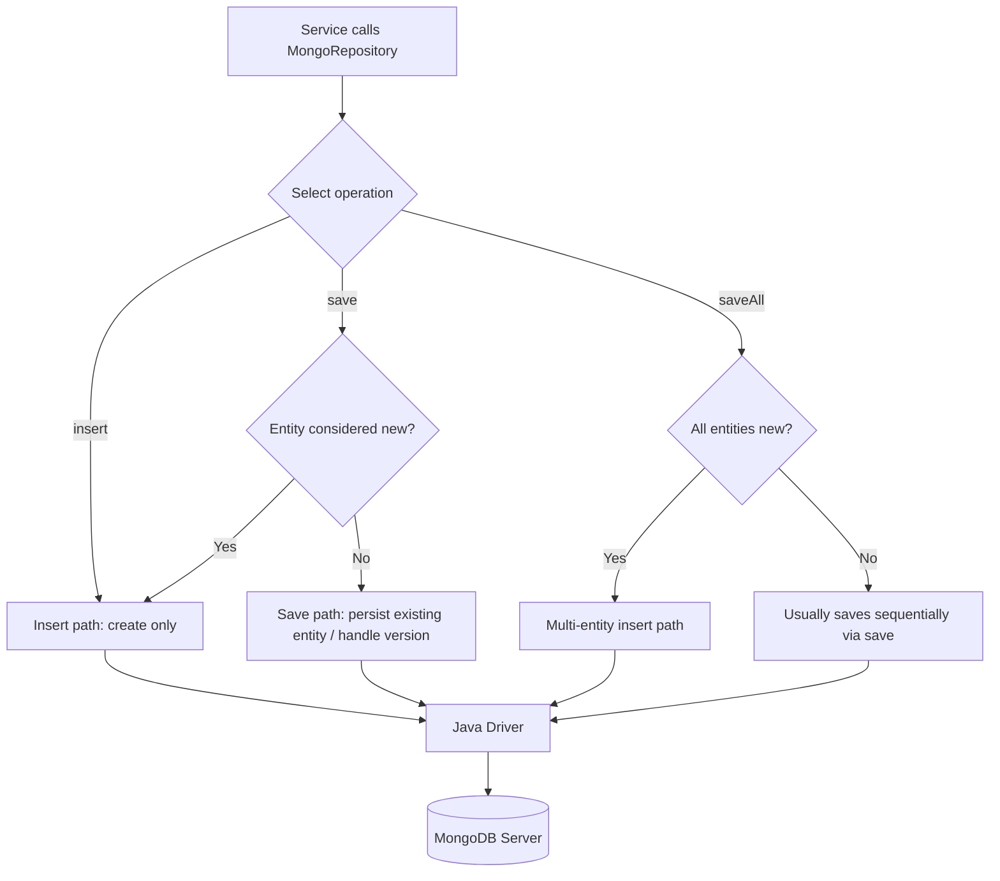
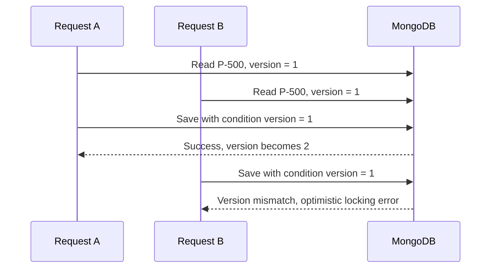

# Distinguishing `insert`, `save`, and `saveAll`

When performing CRUD operations with **Spring Data MongoDB**, the three calls `insert`, `save`, and `saveAll` can all cause data to appear in a collection, yet **their business semantics and execution paths are not the same**. Picking the wrong API can cause a "create" operation to overwrite existing data, an update to fail with a duplicate key error, or a multi-product batch write to succeed only partially.

This lesson belongs to the **Repository CRUD** chapter of the `SPRING_DATA_MONGODB` module. It focuses on `MongoRepository`, contrasting it with `MongoTemplate` and MongoDB Server to explain ID mechanisms, new-entity detection (`isNew`), document mapping, indexes, optimistic locking, testing, and performance diagnostics. Document design rules, transactions, and reactive access also directly affect how these three operations are used.

After this lesson, you will be able to:

- Choose `insert` when **only creation is allowed**, `save` when **either creating or persisting an entity** based on its state is acceptable, and `saveAll` to save multiple entities.
- Explain why `save` can take the insert path for a new entity and a different write path for an existing entity.
- Predict behavior when an ID is null, already exists, is pre-assigned, has `@Version`, or violates a unique index.
- Understand why `saveAll` **is not a bulk update or an atomic transaction by default**.
- Choose conditional updates / `$set` / `$inc` when only a few fields need updating, and test against a real MongoDB.

## 1. Quick comparison of the three operations

| Method | Primary intent | With a new entity | With an existing document sharing `_id` | Key point to remember |
| --- | --- | --- | --- | --- |
| `repository.insert(entity)` | Create a **new document** | Inserts document | Typically fails with duplicate key; never used to overwrite | Ideal for create APIs and first-time-only fixtures |
| `repository.save(entity)` | Persist **one entity** | Usually takes the insert path if `isNew` is true | For an entity recognized as existing, persists via save semantics; may replace content | Behavior depends on `isNew`, ID, and `@Version` |
| `repository.saveAll(entities)` | Persist **multiple entities** | May optimize to batch insert if **all** are new | When existing entities are present, usually loops through `save` per entity | Not atomic by default; does not promise a single bulk update command |

All three map Java objects to BSON through Spring Data MongoDB, dispatch commands via the MongoDB Java Driver, and write to MongoDB Server. `MongoRepository` simplifies CRUD, while **unique indexes, the 16 MiB maximum BSON document size, single-document atomicity, and transaction handling** remain governed by MongoDB.



The diagram describes the typical **Spring Data MongoDB repository** implementation; optimization details are implementation details and may vary across versions. In particular, **`save` does not mean every call becomes an update**, and **`saveAll` does not mean every call becomes an atomic batch**.

## 2. Preparing an illustrative entity and repository

Suppose an inventory system has a `products` collection. We use a string ID prefixed with `P-` to deliberately avoid interpreting a 24-character hex string as a BSON `ObjectId`. `@MongoId` ensures consistent `String` storage:

```java
import org.springframework.data.mongodb.core.mapping.Document;
import org.springframework.data.mongodb.core.mapping.MongoId;

@Document(collection = "products")
public class Product {

    @MongoId
    private String id;

    private String sku;
    private String name;
    private long priceVnd;
    private int stock;
    private String description;

    protected Product() {}

    public Product(String id, String sku, String name,
                   long priceVnd, int stock, String description) {
        this.id = id;
        this.sku = sku;
        this.name = name;
        this.priceVnd = priceVnd;
        this.stock = stock;
        this.description = description;
    }

    public String getId() { return id; }
    public String getSku() { return sku; }
    public String getName() { return name; }
    public long getPriceVnd() { return priceVnd; }
    public int getStock() { return stock; }
    public String getDescription() { return description; }

    public void setName(String name) { this.name = name; }
    public void setPriceVnd(long priceVnd) { this.priceVnd = priceVnd; }
    public void setStock(int stock) { this.stock = stock; }
    public void setDescription(String description) {
        this.description = description;
    }
}
```

Repository declaration:

```java
import java.util.Optional;
import org.springframework.data.mongodb.repository.MongoRepository;

public interface ProductRepository
        extends MongoRepository<Product, String> {
    Optional<Product> findBySku(String sku);
}
```

The following snippets assume `ProductRepository productRepository` is Spring-injected into a service and a local/test MongoDB is configured. Create collections/indexes according to your project's workflow when needed. For instance, if each SKU must be unique:

```javascript
db.products.createIndex({ sku: 1 }, { unique: true });
```

MongoDB already has a unique index on `_id`; the `sku` index above is an **additional constraint**, so ensure existing data has no duplicates before creating it. Simply placing `@Indexed` in Java does not guarantee the index exists if auto-index creation is disabled.

## 3. `insert`: create new, never overwrite

### 3.1. Successful insert example

```java
Product book = new Product(
        "P-001", "BK-001", "Notebook",
        85_000L, 50, "Hardcover"
);

Product created = productRepository.insert(book);
System.out.println(created.getId());  // P-001
```

MongoDB contains an equivalent document:

```javascript
{
  _id: "P-001",
  sku: "BK-001",
  name: "Notebook",
  priceVnd: NumberLong("85000"),
  stock: 50,
  description: "Hardcover"
}
```

`insert` explicitly states the intent to **only create a new document**. If the collection already has `_id = "P-001"`, inserting with the same `_id` is typically rejected by MongoDB with a duplicate key error (`E11000`), which Spring Data translates into an appropriate exception such as `DuplicateKeyException`. Likewise, if the `sku` index is unique and the SKU collides, insert fails as well.

**Example re-run intentionally triggering an error:**

```java
productRepository.insert(
        new Product("P-001", "BK-001", "Another Notebook Edition",
                    99_000L, 30, null)
);
// Duplicate key error if P-001 already exists;
// the existing P-001 document is not overwritten by insert.
```

In a `POST /products` API, this is the desired behavior when a user tries to create a product code that is already taken: return a meaningful conflict error rather than silently changing price/stock.

### 3.2. Inserting with an unassigned ID

If an entity has a `null` ID and the ID property supports MongoDB ID generation, Spring Data/driver can generate an identifier, typically an `ObjectId` or corresponding string form depending on mapping. Do not rely on a blanket rule that "null ID always produces ObjectId" for every Java type; the result depends on the ID type, annotations, and converters.

For business-managed IDs such as `"P-001"`, assign the ID explicitly **before inserting**. If an API accepts IDs from clients, validate format, authorization to use the ID, and uniqueness constraints. Do not rely on hard-to-guess IDs as a substitute for authorization.

### 3.3. Inserting multiple entities with `insert(Iterable)`

`MongoRepository` also supports `insert(Iterable<S>)`:

```java
import java.util.List;

List<Product> initialProducts = List.of(
        new Product("P-101", "BK-101", "Notebook A",
                50_000L, 20, null),
        new Product("P-102", "PN-102", "Pen A",
                15_000L, 100, null)
);

Iterable<Product> created = productRepository.insert(initialProducts);
```

This method means **inserting multiple new documents**. It does not convert elements with colliding IDs into updates. If one element triggers a unique index error, other elements may **already have been written** depending on ordering and execution mode; do not assume every multi-document insert in a collection is automatically an atomic transaction.

## 4. `save`: one method, two execution paths

`repository.save(entity)` is the general-purpose operation to persist an entity's state. In a typical Spring Data MongoDB repository implementation:

1. Spring Data determines whether the entity is **new** via `EntityInformation.isNew`.
2. If **new**, the repository takes the **insert** path.
3. If considered **existing**, the repository invokes `MongoOperations.save`; for an entity without a version, this can write with replace/upsert semantics.
4. If `@Version` is present, Spring Data also applies version checking during the write to support optimistic locking.

### 4.1. Saving a new entity

```java
Product created = productRepository.save(
        new Product(null, "BK-201", "New Notebook",
                    65_000L, 40, null)
);
```

Because the ID is `null` and there is no `@Version`, the entity is typically considered new and the repository takes the **insert path**. The return value is the persisted entity (potentially with a generated ID). Callers should use **the return value** rather than assuming every immutable/record entity mutates the input instance in place.

### 4.2. Saving an entity loaded from the database

```java
Product product = productRepository.findById("P-001")
        .orElseThrow();

product.setName("Premium Notebook");
product.setPriceVnd(95_000L);

Product updated = productRepository.save(product);
```

This is the standard edit flow: load the existing entity, mutate fields, and save it back. For an entity **without `@Version`**, the MongoDB-level save has semantics that **rewrite the document contents**; do not treat it as a `$set` command updating only the fields whose setters were just called.

For example, if you construct an instance containing only an ID and name while leaving other fields empty and call `save`, you risk losing or resetting data for the fields omitted from the object. Exact behavior also depends on mapping, converters, and how null values are serialized, so use **field-level updates** when you only want to modify a few attributes.

### 4.3. When an ID is present yet the repository behaves differently

A pre-assigned ID `"P-999"` **does not prove the document already exists**. For an entity without `@Version`, Spring Data generally uses the ID value to evaluate `isNew`. An entity with a non-null ID can enter the existing-entity save path, and if MongoDB does not yet have a matching document, saving with upsert semantics can **create a new document**.

```java
Product p = new Product(
        "P-999", "BK-999", "Notebook not yet in DB",
        75_000L, 10, null
);

productRepository.save(p);
// Can create document P-999 if it does not exist yet,
// following the non-versioned entity save path.
```

If business logic requires **"must already exist to be updated"**, you cannot rely solely on `save` to enforce that condition. You must include an existence or version condition in the update command, or handle it appropriately in the service while accounting for race conditions between reading and writing.

### 4.4. `save` is not equivalent to "update only one field"

Suppose the service only needs to increment stock by 5 units. Reading the whole document, incrementing `stock` in Java, and calling `save` can lose updates from another request if both read the same stale snapshot. Instead, MongoDB supports atomic single-document updates:

```java
import org.springframework.data.mongodb.core.MongoTemplate;
import org.springframework.data.mongodb.core.query.Criteria;
import org.springframework.data.mongodb.core.query.Query;
import org.springframework.data.mongodb.core.query.Update;

// Illustrative snippet inside a service with mongoTemplate injected.
Query query = Query.query(Criteria.where("_id").is("P-001"));
Update update = new Update().inc("stock", 5);

mongoTemplate.updateFirst(query, update, Product.class);
```

`$inc` is applied by the server onto the current value, avoiding the read–modify–save pattern for simple increments. To set a new price, use `new Update().set("priceVnd", 95_000L)`; to update only when existing, inspect `UpdateResult.getMatchedCount()` or use `findAndModify` if you need the document returned.

**Note:** a direct `MongoTemplate.updateFirst` call like this does not automatically provide `@Version`-style optimistic locking like `save`. If data requires version protection, include the version condition in the query and increment the version consistently.

## 5. `saveAll`: saving multiple entities and what not to assume

`saveAll(Iterable<S>)` lets callers pass multiple entities at once and receive the saved collection. However, **its behavior differs from an explicitly designed bulk update command**. In the common `SimpleMongoRepository` implementation, the repository checks `isNew` for the entities:

- If **all** are new, the repository may optimize to **batch-insert multiple entities** via `MongoOperations.insertAll`.
- If **at least one entity is not new**, the implementation usually invokes `save` for each element, processing each according to its own state.

That is the behavior of the common Spring Data MongoDB implementation, **not a guarantee that every future version always dispatches that exact number of commands**. Check version-specific source/docs and measure actual queries when optimizing performance.

### 5.1. All entities are new

```java
import java.util.List;

List<Product> sample = List.of(
        new Product(null, "BK-301", "Notebook A",
                30_000L, 20, null),
        new Product(null, "BK-302", "Notebook B",
                35_000L, 25, null),
        new Product(null, "BK-303", "Notebook C",
                40_000L, 30, null)
);

Iterable<Product> savedProducts = productRepository.saveAll(sample);
```

Because all three entities have `null` IDs (and the example does not use `@Version`), the repository usually treats them as new and may take the **batch insert path**. When used for seeding, remember that auto-generated IDs will **differ on every seed run**, creating duplicate data if called again; idempotent seeding requires stable keys and a dedicated `upsert`/`setOnInsert` mechanism.

### 5.2. Mixed collection of new and existing entities

```java
Product existing = productRepository.findById("P-001")
        .orElseThrow();
existing.setPriceVnd(100_000L);

Product brandNew = new Product(
        null, "BK-304", "Notebook D", 55_000L, 20, null
);

Iterable<Product> result = productRepository.saveAll(
        List.of(existing, brandNew)
);
```

Because the dataset is not entirely new, the common execution path **calls `save` one by one**, where `existing` takes the existing-entity save path and `brandNew` takes the insert path. Hence `saveAll` **does not guarantee collapsing into a single round-trip**. With large lists, network requests, BSON conversions, index checks, and latency can become significant.

### 5.3. Three things `saveAll` does not guarantee by itself

**Not atomic by default.** MongoDB guarantees atomicity for **a single write operation on a single document**; a list of multiple documents does not automatically form a transaction. If the third element fails, the first and second elements may already have been written.

**Not a bulk replace/update by default.** Collections containing existing entities are usually processed via individual `save` calls. When thousands of uniform updates are needed, `MongoTemplate`'s `BulkOperations` may be more appropriate after analyzing business requirements.

**Does not guarantee identical success ordering across all modes.** Batch inserts or bulk operations have ordered/unordered behavior depending on the API/driver; do not use `saveAll` as a mechanism to guarantee business ordering or roll back the entire set.

For example, suppose `sku` has a unique index and a batch contains three products:

| Record | Situation | Possible outcome |
| --- | --- | --- |
| `P-401` | New, SKU unused | Inserted |
| `P-402` | New, SKU duplicates unique index | Write fails |
| `P-403` | New, SKU unused | May or may not be written, depending on batch handling |

Do not write business logic assuming "catching the exception guarantees no products were created". Handle **partial success**, idempotent retries, or properly scoped transactions when all-or-nothing execution is truly mandatory.

## 6. `isNew`, ID, and `@Version` determine the write path

A common source of confusion with `save` and `saveAll` is how Spring Data detects whether an entity is new. Normally:

1. If an entity has a wrapper-type `@Version` property, `version == null` typically indicates a **new entity**; a non-null version indicates an existing entity.
2. Without a version property, Spring Data generally relies on the ID: `id == null` is new; a non-null ID is usually not new.
3. For entities implementing `Persistable`, the entity-provided `isNew()` method can override this decision.
4. Exact details can depend on `EntityInformation`/mapping and Spring Data version; do not infer persistence state solely from whether an ID has been assigned.

### 6.1. When an ID is assigned yet the entity is still new

Example with `@Version Long version`:

```java
import org.springframework.data.annotation.Version;
import org.springframework.data.mongodb.core.mapping.Document;
import org.springframework.data.mongodb.core.mapping.MongoId;

@Document(collection = "versionedProducts")
public class VersionedProduct {
    @MongoId
    private String id;
    private String sku;
    private long priceVnd;

    @Version
    private Long version;

    protected VersionedProduct() {}

    public VersionedProduct(String id, String sku, long priceVnd) {
        this.id = id;
        this.sku = sku;
        this.priceVnd = priceVnd;
    }

    public String getId() { return id; }
    public Long getVersion() { return version; }
    public long getPriceVnd() { return priceVnd; }
    public void setPriceVnd(long priceVnd) { this.priceVnd = priceVnd; }
}
```

For a new object `new VersionedProduct("P-500", "BK-500", 60_000L)`, `version == null`. The repository typically considers this object **new**, and `save` takes the insert path **even though the ID already has a value**.

If the collection already has `_id = "P-500"`, the insert can fail with a duplicate key error. This differs from an entity **without `@Version`** and a non-null ID, which can take the upsert path. Therefore, the rule "`save` always overwrites on duplicate ID" is **false**.

### 6.2. Optimistic locking helps detect concurrent overwrites

For an existing entity with `@Version`, each successful `save` updates the version according to Spring Data's mechanism. A basic flow:



If two requests read an older version and both modify it, the later request will not silently overwrite the earlier request's changes. Spring Data can raise `OptimisticLockingFailureException` when a write fails due to a version mismatch, provided mapping/versioning and write concern are configured appropriately. Upon handling this error, the application can return HTTP 409, prompt a reload, or retry under controlled business rules.

**Do not confuse with transactions:** `@Version` protects concurrency on a single entity, whereas transactions address atomicity across multiple-document operations on supported MongoDB deployments. Calling `saveAll` on multiple entities with `@Version` still **does not automatically become a transaction**.

### 6.3. Be cautious with `Persistable.isNew()`

In projects with externally assigned IDs, Spring Data lets entities implement `Persistable<ID>` to provide custom `isNew()` logic. This is useful but easy to misuse:

- Returning `true` for an existing document can cause `save` to pick the insert path and trigger duplicate key errors.
- Returning `false` for a non-existent entity can lead to an unintended save/upsert path.
- If an entity uses transient state to compute `isNew()`, control field mapping so that state is not accidentally persisted into BSON.

Only use `Persistable` when custom new-entity detection rules are necessary and verified by tests. For most straightforward CRUD, stable IDs and proper `@Version` usage are sufficient.

## 7. Creating and editing: building intentional APIs

E-commerce applications typically have two distinct requirements: **creating a new product** and **editing an existing product**. Even if both return an entity, the data protection strategies must differ.

### 7.1. Create: `insert` to prevent overwriting

```java
import org.springframework.dao.DuplicateKeyException;
import org.springframework.stereotype.Service;

@Service
public class ProductCommandService {
    private final ProductRepository repository;

    public ProductCommandService(ProductRepository repository) {
        this.repository = repository;
    }

    public Product create(
            String id, String sku, String name, long priceVnd
    ) {
        if (priceVnd < 0) {
            throw new IllegalArgumentException("Price must be non-negative");
        }

        Product product = new Product(
                id, sku, name, priceVnd, 0, null);

        // May throw DuplicateKeyException:
        // service/controller should map this to HTTP 409 when appropriate.
        return repository.insert(product);
    }
}
```

Do not rely solely on calling `existsById` followed by `save` to guarantee uniqueness: between the two calls, another request can still create the document. **A server-side unique index** combined with `insert` provides the ultimate safeguard; the service catches and maps errors into appropriate responses.

### 7.2. Update: modify only allowed fields

Suppose a `PATCH /products/{id}` API only allows changing name and price. Instead of constructing a `Product` object missing all other fields and calling `save`, use `MongoTemplate.updateFirst`:

```java
import org.springframework.data.mongodb.core.MongoTemplate;
import org.springframework.data.mongodb.core.query.Criteria;
import org.springframework.data.mongodb.core.query.Query;
import org.springframework.data.mongodb.core.query.Update;
import com.mongodb.client.result.UpdateResult;

public class ProductPatchService {
    private final MongoTemplate template;

    public ProductPatchService(MongoTemplate template) {
        this.template = template;
    }

    public boolean changeNameAndPrice(
            String id, String name, long priceVnd
    ) {
        Query query = Query.query(Criteria.where("_id").is(id));
        Update update = new Update()
                .set("name", name)
                .set("priceVnd", priceVnd);

        UpdateResult result = template.updateFirst(
                query, update, Product.class);
        return result.getMatchedCount() == 1;
    }
}
```

`updateFirst` does not create a new document when there is no match, and preserves untouched fields. Validate `name`, `priceVnd`, and update permissions before executing. If you need the updated document back, `findAndModify` with `FindAndModifyOptions.returnNew(true)` is an option.

For highly contended data such as stock levels, account balances, or order limits, prefer **server-side conditional updates** or an appropriate versioning strategy. Do not arbitrarily call `save` on stale snapshots.

### 7.3. When many conditional updates are needed

When thousands of products need stock updates, `saveAll` can be inefficient because it may save entities individually and risk overwriting unrelated fields. `BulkOperations` supports batching conditional updates:

```java
import org.springframework.data.mongodb.core.BulkOperations;
import org.springframework.data.mongodb.core.MongoTemplate;
import org.springframework.data.mongodb.core.query.Criteria;
import org.springframework.data.mongodb.core.query.Query;
import org.springframework.data.mongodb.core.query.Update;

BulkOperations operations = mongoTemplate.bulkOps(
        BulkOperations.BulkMode.ORDERED, Product.class);

operations.updateOne(
        Query.query(Criteria.where("_id").is("P-001")),
        new Update().inc("stock", 5));
operations.updateOne(
        Query.query(Criteria.where("_id").is("P-002")),
        new Update().inc("stock", -2));

operations.execute();
```

This is an **illustrative code snippet inside a service that has `mongoTemplate`**. `BulkOperations` supports multiple operations in a batch, but **does not automatically provide rollback across all documents** and may bypass mechanisms like entity lifecycle events or optimistic locking offered by `repository.save`. Design `ordered/unordered` behavior, per-operation error handling, and appropriate tests before replacing existing code.

## 8. Consistency, transactions, and retries

### 8.1. Single document vs. multiple documents have different guarantees

MongoDB guarantees that **a write operation on a single document is atomic**, even when the command updates multiple fields within that document. This does not mean the three repository methods share the same guarantees:

- `insert(product)`: single-document write; succeeds or fails for that document.
- `save(product)`: single-document write via Spring Data's path; may include a version condition.
- `saveAll(products)`: multiple documents; can stop on an error after previous documents have already succeeded.

If business rules require **all writes across multiple documents to commit or roll back together**, you must use **MongoDB transactions** on a supported topology (e.g., replica set or sharded cluster per version requirements), an appropriate transaction manager, and an effective `@Transactional` boundary. Transactions carry overhead; do not treat them as a default wrapper for every import batch.

### 8.2. Retries must be paired with idempotency

Suppose the application sends an `insert`, and the connection drops before receiving a response: the client may **not know for sure whether the server wrote the document**. Re-sending `insert` with the same ID can trigger a duplicate key error if the first attempt succeeded. For create workflows, you can use an **idempotency key** or stable request ID and verify state before deciding whether to retry or return an error.

With unversioned `save`, re-writing an older entity can overwrite another request's changes; blind retries are dangerous if data has changed. With `saveAll`, retrying the entire list after a failure can re-write completed items or cause duplicate key errors on the insert path. Record IDs, outcomes, and per-item states so re-runs can be designed safely.

| Scenario | Suitable approach |
| --- | --- |
| Request to create a single new product | `insert` with a unique index, or a workflow with an idempotency key |
| Updating name/price of an existing product | Conditional `updateFirst`, or `save` on a loaded entity with `@Version` |
| Incrementing/decrementing stock | `$inc` combined with balance/stock conditions as needed |
| Loading a completely new list allowing partial writes | `insert(Iterable)` or `saveAll` on new entities with error handling |
| Batch loading that may be re-run multiple times | `upsert` by stable key; clearly define `$set`/`$setOnInsert` |
| Multiple operations requiring strict all-or-nothing consistency | Configured MongoDB transactions tested on a supported deployment |

### 8.3. Reactive repositories have the same semantics but different return types

If the application uses `ReactiveMongoRepository`, corresponding operations work with `Mono`/`Flux` and the reactive driver. The business semantics—**`insert` creates only new documents**, **`save` depends on entity state**, and **`saveAll` handles multiple entities**—remain the basis of design. However, understand that execution occurs upon subscription and through publisher composition; do not mechanically copy blocking `SimpleMongoRepository` batching assumptions to reactive code.

Reactive access does not turn a multi-write `Flux` into a transaction, does not handle duplicate keys automatically, and does not eliminate the need for indexes or optimistic locking.

## 9. Testing CRUD behavior against a real MongoDB

A mock repository can confirm whether a service called `save` or `insert`, but cannot verify **which documents MongoDB created, replaced, or rejected**. For rules around duplicate keys, IDs, versioning, and updates, use an isolated MongoDB test instance (e.g., Testcontainers) and Spring Boot's `@DataMongoTest` slice.

Example for **Spring Boot 3.x**, using the entity/repository from section 2 and a dedicated empty MongoDB test database:

```java
import static org.assertj.core.api.Assertions.assertThat;
import static org.assertj.core.api.Assertions.assertThatThrownBy;

import java.util.List;
import org.junit.jupiter.api.Test;
import org.springframework.beans.factory.annotation.Autowired;
import org.springframework.boot.test.autoconfigure.data.mongo.DataMongoTest;
import org.springframework.dao.DuplicateKeyException;

@DataMongoTest
class ProductRepositoryCrudTest {

    @Autowired
    ProductRepository repository;

    @Test
    void insertRejectsDuplicateIdWithoutReplacingOldDocument() {
        repository.insert(new Product(
                "TEST-INS-1", "TEST-SKU-1", "Original Product",
                50_000L, 5, "Original description"));

        assertThatThrownBy(() -> repository.insert(new Product(
                "TEST-INS-1", "TEST-SKU-2", "Another Version",
                90_000L, 10, null)))
                .isInstanceOf(DuplicateKeyException.class);

        Product stored = repository.findById("TEST-INS-1")
                .orElseThrow();
        assertThat(stored.getName()).isEqualTo("Original Product");
        assertThat(stored.getPriceVnd()).isEqualTo(50_000L);
    }

    @Test
    void saveLoadedEntityChangesItsStoredValues() {
        repository.insert(new Product(
                "TEST-SAVE-1", "TEST-SKU-3", "Before",
                60_000L, 8, "Keep description"));

        Product loaded = repository.findById("TEST-SAVE-1")
                .orElseThrow();
        loaded.setName("After");
        repository.save(loaded);

        Product stored = repository.findById("TEST-SAVE-1")
                .orElseThrow();
        assertThat(stored.getName()).isEqualTo("After");
        assertThat(stored.getDescription())
                .isEqualTo("Keep description");
    }

    @Test
    void saveAllHandlesExistingAndNewEntities() {
        repository.insert(new Product(
                "TEST-ALL-1", "TEST-SKU-4", "Existing",
                40_000L, 4, null));

        Product existing = repository.findById("TEST-ALL-1")
                .orElseThrow();
        existing.setPriceVnd(45_000L);

        Product newcomer = new Product(
                null, "TEST-SKU-5", "New",
                55_000L, 9, null);

        Iterable<Product> written = repository.saveAll(
                List.of(existing, newcomer));

        assertThat(written).hasSize(2);
        assertThat(repository.findById("TEST-ALL-1")
                .orElseThrow().getPriceVnd()).isEqualTo(45_000L);
        assertThat(repository.findBySku("TEST-SKU-5")).isPresent();
    }
}
```

**Note when adopting in a project:** `@DataMongoTest` does not mean a MongoDB Server automatically exists on every machine; you must provide a suitable test MongoDB instance and isolate data per test. Never run tests against a production database. The tests above prove data outcomes, while verifying round-trip counts and `saveAll` strategies requires driver/command log inspection or dedicated profiling when needed.

Other cases worth adding for business coverage:

| Test case | Expectation |
| --- | --- |
| `insert` with duplicate `_id` | Raises duplicate key; old document is not replaced |
| `insert` with duplicate `sku` having a unique index | Server rejects data violating the constraint |
| `save` new entity, null ID | New document created with valid mapped ID |
| `save` non-null ID that does not exist, unversioned | Verify create/upsert behavior under current implementation |
| `save` with stale version | Detects concurrency and raises optimistic locking error when configured properly |
| `saveAll` where one item fails | Do not assume rollback of preceding items; design reconciliation |
| Concurrent stock update via `$inc` | No valid increments/decrements are lost |
| Writing a document exceeding the 16 MiB limit | Receives error from BSON/driver/server pipeline; service handles explicitly |

## 10. Common errors and diagnostics

| Symptom | Possible cause | Resolution |
| --- | --- | --- |
| `insert` reports `E11000` | Duplicate `_id` or another unique index | Check keys/indexes; return conflict error or fix input data |
| `save` creates a new document instead of updating | ID/`isNew`/BSON type mismatch against existing data | Check actual `_id`, `@MongoId`/`@Id`, version, and query |
| `save` reports duplicate key despite assigned ID | Null `@Version` or `Persistable.isNew()` returning true sends repository down insert path | Review new-entity detection and version lifecycle |
| Fields disappear after `save` | Object passed to `save` lacks full data; saved with document-replace semantics | Load full entity or use `Update` for specific fields |
| `saveAll` partially succeeds | One element fails while others have been written | Reconcile by ID; design retry/idempotency or transactions |
| `saveAll` is slow on mixed new/existing sets | Repository may invoke individual `save` per entity | Measure commands/round-trips; consider bulk updates or batching |
| Overwriting another request's update | Read–modify–save without version/conditions | Use `@Version` or server-side atomic updates |
| `save` throws optimistic locking failure | Stale version, deleted document, or mismatched write condition | Return conflict, reload, apply controlled retry rules |
| Query by ID finds no data | BSON `String` differs from BSON `ObjectId` even with identical hex chars | Inspect with `$type` and unify mapping |
| API recreates fixtures after every startup | Null ID generates new values when re-calling `saveAll` | Seed with fixed IDs/`setOnInsert` and environment flags |

You can inspect directly with `mongosh`:

```javascript
db.products.findOne({ _id: "P-001" });
db.products.getIndexes();
db.products.find({ sku: "BK-001" }).explain("executionStats");

// Inspect BSON types of ID and price:
db.products.aggregate([
  {
    $project: {
      _id: 1,
      idType: { $type: "$_id" },
      priceType: { $type: "$priceVnd" }
    }
  },
  { $limit: 10 }
]);
```

`explain` shows the query plan and scanned counts, not the full network/serialization cost of `saveAll`. To evaluate write performance, monitor the number of driver commands, batch sizes, total duration, write concern, and server load. Avoid printing secrets or full documents containing sensitive data in logs.

## 11. Scenario exercise

A course management system has a `courses` collection with `_id`, `code`, `title`, `studentCount`, and `version`. Every day there are three flows:

1. An administrator creates a new course and must not overwrite an existing `code`.
2. An editor changes the `title` of an existing course without losing concurrent updates from others.
3. A statistics worker increments `studentCount` from enrollments, potentially receiving thousands of events.

Choose the APIs and explain:

| Flow | Recommended choice | Why |
| --- | --- | --- |
| Create a new course | `insert` and a unique index on `code` | Clear creation semantics; does not overwrite data sharing the code |
| Change title from a versioned entity | `save` with `@Version` or version-conditional update | Guards against concurrent overwrites |
| Increment student counter | `updateFirst` with `$inc` and business conditions | Computed on server without loading/rewriting the whole document |
| Process many increment events | `BulkOperations` with conditional updates and idempotency mechanism | Optimizes write commands, while still handling retries/partial failures |

**Open question:** if a job creates 1,000 courses with `saveAll` and one document in the middle collides on unique `code`, what happens? Your answer should state clearly: `saveAll` does not guarantee all 1,000 documents roll back; you must inspect what was written, separate duplicate items, and build a retry strategy with stable keys—or use a transaction if business requirements truly demand it.

## 12. Checklist before choosing a method

1. **Is the goal creating new data or persisting an entity?** If creation only, prefer `insert`.
2. **Does the entity already have an ID?** A non-null ID does not automatically mean the document exists; is `@Version` or `Persistable.isNew()` in use?
3. **Must changes be rejected if the document does not exist?** `save` can upsert; consider conditional updates and checking matched count.
4. **Are you changing a few fields or the whole entity?** If only a few fields, use `Update`/`$set`/`$inc`.
5. **Can concurrent requests write simultaneously?** Consider optimistic locking, version conditions, or server-side atomic operations.
6. **Can a multi-entity list partially fail?** `saveAll` is not transactional by default; define retry/idempotency.
7. **Are there uniqueness constraints to enforce?** Create/verify real indexes on the MongoDB Server.
8. **Have you verified mapping and BSON types on real data?** String IDs differ from ObjectId.
9. **Do you need high-throughput bulk writes or reactive access?** Choose the appropriate API and benchmark on your target version.
10. **Have you tested against an isolated MongoDB?** Cover duplicate keys, saving new/existing entities, versioning, and partial failures.

**Rule to remember:** **`insert` protects creation semantics; `save` picks its write path from entity state and can rewrite document contents; `saveAll` persists multiple entities without promising a bulk update or an atomic transaction.** Pick the API according to create/update requirements, use `@Version` or conditional updates to control concurrency, and verify behavior with real BSON data in MongoDB.
