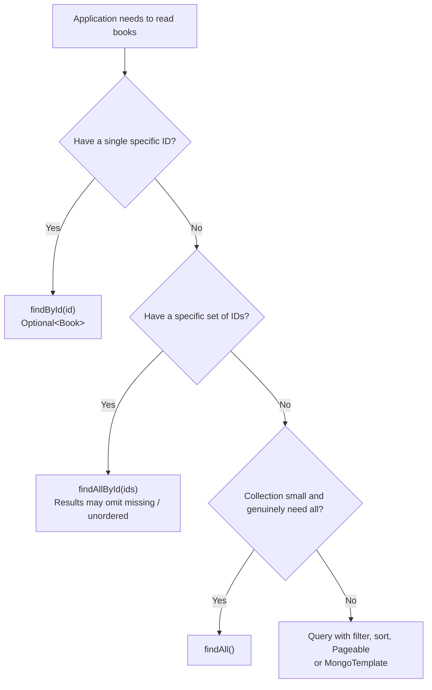

# findById, findAllById, and findAll

## 1. Three basic read methods in Repository CRUD

When using **Spring Data MongoDB**, we map a MongoDB document to a Java entity, then read and write data through `MongoRepository` or `MongoTemplate`. Among CRUD operations, the three most common methods for reading data are:

- **`findById(id)`**: finds **one** document with the matching `_id` identifier.
- **`findAllById(ids)`**: finds **multiple** documents whose `_id` belongs to a supplied set of IDs.
- **`findAll()`**: retrieves **all** documents in the collection managed by the repository.

They are all available immediately once you declare a repository, without writing MongoDB queries manually. However, the three methods have different semantics regarding **result count**, **ordering**, **missing IDs**, and **query cost**.

| Method | Input | Result with `MongoRepository<Book, String>` in Spring Data MongoDB 3.x | Key notes |
| --- | --- | --- | --- |
| `findById(String id)` | A non-null ID | `Optional<Book>` | Not found → `Optional.empty()` |
| `findAllById(Iterable<String> ids)` | Non-null list or set of IDs with no null elements | `List<Book>` | May omit missing IDs; no guarantee to preserve input ID order |
| `findAll()` | No arguments | `List<Book>` | Can load the entire collection; no guaranteed default order |

The exact return type can vary by repository interface and Spring Data generation. The table above uses `MongoRepository` from Spring Data MongoDB 3.x, where multi-read methods return `List`. On the generic `CrudRepository`, multi-read signatures typically return `Iterable<T>`; check the API signatures of your project's version.

## 2. Example model: storing books in MongoDB

To keep demonstrations easy to verify, suppose the application has a `library_demo` database and a `books` collection. Each document stores the book ID, ISBN, title, category, and creation timestamp.

```javascript
// Collection: books
{
  _id: "BOOK-1001",
  isbn: "978-604-001-001-0",
  title: "Introduction to Spring Data MongoDB",
  category: "backend",
  created_at: ISODate("2026-11-01T08:00:00Z")
}
```

In this example, `_id` is a **BSON String** prefixed with `BOOK-`, assigned by the application. In practice MongoDB also commonly uses `ObjectId`; whichever type you choose determines the repository's second type parameter and what you pass into `findById`.

### The `Book` entity

Create the `Book` class in a Spring Boot application with the `spring-boot-starter-data-mongodb` starter:

```java
package com.example.library;

import java.time.Instant;
import org.springframework.data.mongodb.core.mapping.Document;
import org.springframework.data.mongodb.core.mapping.Field;
import org.springframework.data.mongodb.core.mapping.FieldType;
import org.springframework.data.mongodb.core.mapping.MongoId;

@Document(collection = "books")
public class Book {

    @MongoId(FieldType.STRING)
    private String id;

    private String isbn;
    private String title;
    private String category;

    @Field("created_at")
    private Instant createdAt;

    protected Book() {
        // For instantiation during document mapping.
    }

    public Book(String id, String isbn, String title,
                String category, Instant createdAt) {
        this.id = id;
        this.isbn = isbn;
        this.title = title;
        this.category = category;
        this.createdAt = createdAt;
    }

    public String getId() { return id; }
    public String getIsbn() { return isbn; }
    public String getTitle() { return title; }
    public String getCategory() { return category; }
    public Instant getCreatedAt() { return createdAt; }
}
```

Inside the entity:

| Component | Meaning |
| --- | --- |
| `@Document(collection = "books")` | Repository manages documents in the `books` collection |
| `@MongoId(FieldType.STRING)` | Property `id` is the identifier and is stored as BSON String |
| `@Field("created_at")` | Java property `createdAt` maps to the BSON field `created_at` |
| `Instant` | Java type representing a point in time; MongoDB typically stores it as BSON Date via converter |

In the examples below, `BOOK-1001` is the **ID**, whereas `978-604-001-001-0` is the **ISBN**. Calling `findById("978-604-001-001-0")` will not automatically search the `isbn` field.

### Declaring `BookRepository`

```java
package com.example.library;

import org.springframework.data.mongodb.repository.MongoRepository;

public interface BookRepository extends MongoRepository<Book, String> {
}
```

The `Book` parameter specifies the entity, and `String` is the type of the identifier property `Book.id`. Spring Data generates the repository implementation at startup when the repository is within Spring's scan scope.

You do not need to declare `findById`, `findAllById`, or `findAll` in the interface: they are already inherited from the repository API.

### Sample data for hands-on practice

With a local MongoDB, you can connect to `library_demo` and insert three documents using `mongosh`:

```javascript
use library_demo

db.books.insertMany([
  {
    _id: "BOOK-1001",
    isbn: "978-604-001-001-0",
    title: "Introduction to Spring Data MongoDB",
    category: "backend",
    created_at: ISODate("2026-11-01T08:00:00Z")
  },
  {
    _id: "BOOK-1002",
    isbn: "978-604-001-002-7",
    title: "MongoDB for Beginners",
    category: "database",
    created_at: ISODate("2026-11-02T08:00:00Z")
  },
  {
    _id: "BOOK-1003",
    isbn: "978-604-001-003-4",
    title: "Querying Data with Spring",
    category: "backend",
    created_at: ISODate("2026-11-03T08:00:00Z")
  }
])
```

Run `insertMany` above **only once in an empty demo collection**. Running it again with the same `_id` values will produce a duplicate key error. Spring Boot 3.x can connect with the following illustrative configuration:

```properties
spring.data.mongodb.uri=mongodb://localhost:27017/library_demo
```

When using another MongoDB environment, replace the URI with your permitted configuration and verify that you are reading from the intended database before comparing results.

## 3. `findById`: finding exactly one document by `_id`

Suppose `bookRepository` has been injected into a service:

```java
import java.util.Optional;

Optional<Book> result =
    bookRepository.findById("BOOK-1001");

result.ifPresent(book ->
    System.out.println("Book title: " + book.getTitle())
);
```

The semantically equivalent MongoDB query is:

```javascript
db.books.findOne({ _id: "BOOK-1001" })
```

From the BSON document, Spring Data maps `_id` to `Book.id` and `created_at` to `Book.createdAt`. The result is wrapped in `Optional<Book>` so callers handle the case where the book does not exist.

### Found vs. not found results

```java
Optional<Book> existing =
    bookRepository.findById("BOOK-1001");
// existing.isPresent() == true, if sample data was inserted.

Optional<Book> missing =
    bookRepository.findById("BOOK-9999");
// missing.isEmpty() == true, if this ID has not been created.
```

**Data not found is not a connection error.** A valid ID that does not exist returns `Optional.empty()`. Meanwhile, network errors, timeouts, authentication failures, or BSON conversion errors cause the repository to throw an exception.

### Handling `Optional` in a service

In a book lookup API, a clean approach is to explicitly define what happens when data is absent:

```java
import java.util.NoSuchElementException;

public Book getRequiredBook(String id) {
    return bookRepository.findById(id)
        .orElseThrow(() -> new NoSuchElementException(
            "Book not found: " + id
        ));
}
```

This is a method inside a service that has a `bookRepository` field. The HTTP controller layer can translate the not-found exception into a `404 Not Found` response according to application policy. Avoid calling `optional.get()` without being certain a value exists; `get()` on an empty Optional throws an exception lacking business context.

### Things to check

- **ID must not be `null`**. `findById(null)` violates the repository API contract and can throw `IllegalArgumentException`; validate inputs before calling.
- **`findById` searches by `_id`**, not `isbn` or `title`. If you need to search by ISBN, declare `findByIsbn` or use `MongoTemplate`.
- **BSON ID types must match**. A `"507f..."` string and a BSON ObjectId with the same displayed characters are not the same BSON value. `@MongoId(FieldType.STRING)` in the example explicitly enforces the String type.
- **An ID is not an access right**. In multi-tenant systems, looking up solely by `_id` does not prove the caller is allowed to read the document.

## 4. `findAllById`: reading a set of IDs in one repository call

When displaying multiple books selected from a favorites list, the program may already hold their IDs:

```java
List<String> requestedIds = List.of(
    "BOOK-1003",
    "BOOK-9999",
    "BOOK-1001"
);

List<Book> books = bookRepository.findAllById(requestedIds);
```

The MongoDB query semantics can be expressed as:

```javascript
db.books.find({
  _id: { $in: ["BOOK-1003", "BOOK-9999", "BOOK-1001"] }
})
```

Typically a single `$in` query on `_id` performs much better than calling `findById` in a loop for each ID, avoiding unnecessary round trips. Exact implementation details may depend on Spring Data version and configuration; when performance matters, inspect the actual command sent to MongoDB.

### When an ID does not exist

In the sample dataset, `BOOK-9999` has no matching document. Therefore, `findAllById` returns only the `Book` objects found, which might contain just `BOOK-1001` and `BOOK-1003`:

```text
Input IDs:   BOOK-1003, BOOK-9999, BOOK-1001
Output IDs:  BOOK-1001, BOOK-1003  (one possible order)
Missing:     BOOK-9999
```

**There is no `null` placeholder for missing IDs.** The result is not a positional array keeping one slot per input ID. Calling `findAllById` with IDs that match no documents returns an empty list.

### No guarantee of preserving input order

By the contract of `findAllById`, **result ordering is not guaranteed**. Never write code assuming:

```java
// Invalid assumption: books.get(0) always corresponds to requestedIds.get(0).
Book first = books.get(0);
```

An `$in` query specifies a set of matching values, not a directive to sort by the element order inside the `$in` array. If the UI needs to preserve the user's selected ID order, you must **re-align the results by ID yourself**.

### Explicitly restoring the requested order

The following example preserves **only the first occurrence of each distinct ID** in the input list; non-existent IDs are skipped:

```java
import java.util.List;
import java.util.Map;
import java.util.Objects;
import java.util.function.Function;
import java.util.stream.Collectors;

List<String> requestedIds = List.of(
    "BOOK-1003", "BOOK-9999", "BOOK-1001", "BOOK-1003"
);

Map<String, Book> byId = bookRepository.findAllById(requestedIds)
    .stream()
    .collect(Collectors.toMap(
        Book::getId,
        Function.identity()
    ));

List<Book> ordered = requestedIds.stream()
    .distinct()
    .map(byId::get)
    .filter(Objects::nonNull)
    .toList();
```

Here `ordered` follows `BOOK-1003` then `BOOK-1001`, skipping `BOOK-9999` and the duplicate `BOOK-1003`. If business logic needs to **keep duplicate occurrences**, omit `distinct()` and define clearly how repeated items are handled.

### Duplicate IDs and invalid inputs

- A `null` input or an iterable containing `null` ID elements violates `findAllById`'s contract; do not rely on out-of-contract behavior.
- Duplicate IDs do not guarantee the result will repeat entries the same number of times, because each MongoDB document has a unique `_id`. If selection counts matter, track that metadata in application logic.
- An empty list usually yields an empty result; you can also proactively return `List.of()` without hitting the database when you know nothing was requested.
- With tens of thousands or millions of IDs, avoid constructing a massive `$in` query. Enforce request size limits, chunk into batches as needed, and measure performance/memory. MongoDB imposes BSON command size limits and query execution resource limits.

## 5. `findAll`: reading the entire collection and its risks

```java
List<Book> allBooks = bookRepository.findAll();

System.out.println("Currently there are " + allBooks.size() + " books");
allBooks.forEach(book ->
    System.out.println(book.getId() + ": " + book.getTitle())
);
```

Semantically, this is:

```javascript
db.books.find({})
```

**`findAll()` applies no filter, limit, or pagination by default.** When a collection has three demo documents, it is convenient. When it has millions of documents, loading everything into a Java list can cause:

1. **Transferring far more data than needed**: shipping BSON over the network, mapping entities, and holding objects in memory.
2. **Higher request latency**: the screen only needs 20 records, yet the program reads the whole collection.
3. **Memory pressure**: a large `List<Book>` can spike JVM heap usage or trigger out-of-memory errors.
4. **Out-of-scope data exposure**: multi-tenant APIs accidentally returning all records if tenant/permission filters are omitted.
5. **Unstable display order**: results without `sort` are not guaranteed to follow ID or creation time order.

Use `findAll()` only when all data is genuinely needed and **dataset size is bounded**, such as a small configuration catalog. For product lists, admin dashboards, or time-growing datasets, use filtering, sorting, and limits.

### `findAll` on an empty collection

If the collection has no documents yet, `findAll()` returns an empty list, not `null`. This differs from `findById(...)` returning `Optional.empty()`; each API's return type reflects its expected cardinality.

## 6. Sorting and pagination instead of reading everything

Repositories offer overloads for sorting and pagination; you do not need custom `MongoTemplate` code for simple needs.

### Sorting with `findAll(Sort)`

```java
import org.springframework.data.domain.Sort;

Sort newestFirst = Sort.by(
    Sort.Order.desc("createdAt"),
    Sort.Order.desc("id")
);

List<Book> orderedBooks = bookRepository.findAll(newestFirst);
```

In Spring Data, write the **Java property name** `createdAt`; `@Field("created_at")` metadata maps it to the BSON field `created_at`. Adding `id` as a secondary criterion keeps the ordering deterministic when two documents share the same `createdAt`.

However, `findAll(Sort)` only **sorts**—it does not limit the number of documents. For large collections, combine it with pagination.

### `findAll(Pageable)`

```java
import org.springframework.data.domain.Page;
import org.springframework.data.domain.PageRequest;
import org.springframework.data.domain.Pageable;
import org.springframework.data.domain.Sort;

Pageable firstPage = PageRequest.of(
    0,
    20,
    Sort.by(
        Sort.Order.desc("createdAt"),
        Sort.Order.desc("id")
    )
);

Page<Book> page = bookRepository.findAll(firstPage);

List<Book> currentBooks = page.getContent();
long totalBooks = page.getTotalElements();
boolean hasNext = page.hasNext();
```

`PageRequest.of(0, 20, ...)` requests the first page (**0-indexed**) with at most 20 documents. `Page<Book>` provides the page content, total element count, total pages, and whether a next page exists.

Computing totals for `Page` can require an extra count query, depending on the framework version and optimizations. If the UI only needs to know "is there a next page?", consider `Slice`-returning APIs or appropriate limit mechanisms to avoid counting totals unnecessarily.

When navigating to very deep pages, `skip`-based pagination may have to discard many results. **Keyset pagination** (a cursor based on the sort key tuple, such as `created_at` and `_id`) can be more suitable for infinite-scroll lists. Align on cursor extraction, filters, and ordering when data changes concurrently.

### When business filtering is required

`findAll(Pageable)` still reads from the entire collection, merely adding pagination and sorting. If an API should only view books in the `backend` category, declare a conditional method:

```java
import org.springframework.data.domain.Page;
import org.springframework.data.domain.Pageable;

public interface BookRepository extends MongoRepository<Book, String> {

    Page<Book> findByCategory(String category, Pageable pageable);
}
```

This is an **expanded version of the previously declared repository interface**, not a duplicate interface in the same project. Calling:

```java
Page<Book> backendBooks =
    bookRepository.findByCategory("backend", firstPage);
```

lets MongoDB filter by `category` before paginating. In multi-tenant systems, list queries typically need a `tenantId` or authorization filter as well rather than relying on `findAll()`.

## 7. Decision flowchart for choosing the right method



Decision examples:

| Use case | Method | Why |
| --- | --- | --- |
| Open book details from URL with ID | `findById` | Exact single `_id` is known |
| Fetch books in a favorites list | `findAllById` | A specific set of IDs is known |
| Read a configuration lookup table of a few entries | `findAll` | Small, bounded size |
| Display the 20 newest books | `findAll(PageRequest...)` | Bounded count with sorting |
| Display books by category | `findByCategory(..., Pageable)` | Needs filtering before pagination |
| Dynamic queries, complex aggregations | `MongoTemplate` | Flexible Criteria, aggregations, and projections |

## 8. Understanding the MongoDB queries and indexes underneath

A repository reduces boilerplate in Java, yet you still need to understand the MongoDB commands executed. The three methods act on the `books` collection as follows:

| Repository | Semantically corresponding MongoDB query | Uses the `_id` index? |
| --- | --- | --- |
| `findById("BOOK-1001")` | `{ _id: "BOOK-1001" }` | Usually yes, as MongoDB maintains a unique index on `_id` |
| `findAllById(List.of(...))` | `{ _id: { $in: [...] } }` | Can leverage the `_id` index for matching values |
| `findAll()` | `{}` | No key condition; may read many or all documents |

The default `_id` index does not make `findAll()` lightweight. Without a filter, the database still has to return all requested data. For pagination sorted by `created_at`, consider an index supporting the filter and sort order:

```javascript
db.books.createIndex(
  { created_at: -1, _id: -1 },
  { name: "books_created_at_id_desc" }
)
```

Choose indexes based on access patterns: if you frequently filter by `category` and sort by time, another candidate index could be `{ category: 1, created_at: -1, _id: -1 }`. Indexes consume memory/storage and add write overhead, so do not create every conceivable index.

### Inspecting execution plans with `explain`

In `mongosh`:

```javascript
// Lookup by single ID.
db.books.find({ _id: "BOOK-1001" })
  .explain("executionStats")

// Lookup by set of IDs.
db.books.find({
  _id: { $in: ["BOOK-1001", "BOOK-1003"] }
}).explain("executionStats")

// Limited newest list.
db.books.find({})
  .sort({ created_at: -1, _id: -1 })
  .limit(20)
  .explain("executionStats")
```

Metrics to inspect:

- `winningPlan` / `IXSCAN` / `COLLSCAN`: is MongoDB using an index or scanning the collection?
- `totalKeysExamined`: how many index keys were scanned?
- `totalDocsExamined`: how many documents were examined?
- `nReturned`: how many results were returned?
- `executionTimeMillis`: how long did the measured execution take?

Never draw conclusions from a single run on a three-document collection. Test with representative document counts, ID distributions, document sizes, and concurrent load. For very large lists, beyond MongoDB itself, also measure BSON decoding time, network bytes, heap allocation, and Java entity mapping time.

## 9. Organizing service code to separate read scenarios

To avoid scattering `Optional` handling, ID-list alignment, and pagination validation across controllers, group them in a service. The following example uses the declared entity and repository:

```java
package com.example.library;

import java.util.List;
import java.util.Map;
import java.util.NoSuchElementException;
import java.util.Objects;
import java.util.function.Function;
import java.util.stream.Collectors;
import org.springframework.data.domain.Page;
import org.springframework.data.domain.PageRequest;
import org.springframework.data.domain.Sort;
import org.springframework.stereotype.Service;

@Service
public class BookReadService {

    private final BookRepository bookRepository;

    public BookReadService(BookRepository bookRepository) {
        this.bookRepository = bookRepository;
    }

    public Book getById(String id) {
        if (id == null || id.isBlank()) {
            throw new IllegalArgumentException("Book ID must not be blank");
        }
        return bookRepository.findById(id)
            .orElseThrow(() -> new NoSuchElementException(
                "Book not found: " + id
            ));
    }

    public List<Book> getSelectedInRequestedOrder(List<String> ids) {
        if (ids == null || ids.stream()
                .anyMatch(id -> id == null || id.isBlank())) {
            throw new IllegalArgumentException(
                "Invalid ID list"
            );
        }

        if (ids.isEmpty()) {
            return List.of();
        }

        Map<String, Book> foundById = bookRepository.findAllById(ids)
            .stream()
            .collect(Collectors.toMap(
                Book::getId,
                Function.identity()
            ));

        return ids.stream()
            .distinct()
            .map(foundById::get)
            .filter(Objects::nonNull)
            .toList();
    }

    public Page<Book> getRecentBooks(int pageNumber, int pageSize) {
        if (pageNumber < 0 || pageSize < 1 || pageSize > 100) {
            throw new IllegalArgumentException(
                "Invalid pagination parameters"
            );
        }

        Sort sort = Sort.by(
            Sort.Order.desc("createdAt"),
            Sort.Order.desc("id")
        );

        return bookRepository.findAll(
            PageRequest.of(pageNumber, pageSize, sort)
        );
    }
}
```

This service clarifies three contracts:

1. `getById` must receive a valid ID and returns a `Book`; if absent, it throws a business exception.
2. `getSelectedInRequestedOrder` fetches multiple IDs and **reorders them to match the caller's request**, dropping missing IDs and keeping each ID once.
3. `getRecentBooks` avoids loading the full collection, caps page size between 1 and 100, and sorts by two fields for deterministic ordering.

For public APIs, limiting the size of `ids` and enforcing access checks are even more critical. If documents reside in a multi-tenant space, tenant filtering or authorization checks must be built into the query/service design so out-of-scope data is never returned.

## 10. Using `MongoTemplate` or Reactive Repositories

These three read patterns are not confined to synchronous repositories. Spring Data MongoDB also provides `MongoTemplate` for fine-grained queries, aggregations, and updates, while reactive applications can use `ReactiveMongoRepository` or `ReactiveMongoTemplate`.

### Equivalent examples with synchronous `MongoTemplate`

```java
import java.util.List;
import org.springframework.data.mongodb.core.MongoTemplate;
import org.springframework.data.mongodb.core.query.Criteria;
import org.springframework.data.mongodb.core.query.Query;

Book one = mongoTemplate.findById(
    "BOOK-1001", Book.class);

List<Book> selected = mongoTemplate.find(
    Query.query(Criteria.where("id").in(
        List.of("BOOK-1001", "BOOK-1003")
    )),
    Book.class
);

List<Book> all = mongoTemplate.findAll(Book.class);
```

`MongoTemplate.findById` returns the `Book` object or `null` when not found, whereas repository `findById` returns `Optional<Book>`. When using `Criteria.where("id")` with `Book.class`, mapping metadata resolves the MongoDB field to `_id`. With `findAll(Book.class)`, be mindful of the same full-collection read risks as `bookRepository.findAll()`.

These snippets are examples placed inside a component that already has an injected `mongoTemplate` field; they are not a standalone Java file. When dynamic criteria, projections, or aggregations are needed, `MongoTemplate` can express the query more clearly.

### Reactive API

An illustrative reactive repository:

```java
package com.example.library;

import org.springframework.data.mongodb.repository.ReactiveMongoRepository;

public interface ReactiveBookRepository
        extends ReactiveMongoRepository<Book, String> {
}
```

| Operation | Synchronous repository | Reactive repository |
| --- | --- | --- |
| By single ID | `Optional<Book> findById(id)` | `Mono<Book> findById(id)` |
| By list of IDs | `List<Book> findAllById(ids)` | `Flux<Book> findAllById(ids)` |
| Read all | `List<Book> findAll()` | `Flux<Book> findAll()` |

`Mono.empty()` in reactive streams corresponds to `Optional.empty()` ("no document"), and `Flux.empty()` represents zero elements. Reactor publishers execute only when subscribed to. Reactive APIs do not automatically add sorting, filters, or record limits: `findAll()` can still traverse the entire collection when consumed completely.

Never call `block()` to turn reactive methods into synchronous calls on a reactive request thread. If bounded results are needed, construct a **bounded query** rather than calling `findAll().collectList()` on the entire dataset.

## 11. Common errors and how to handle them

| Symptom | Explanation or common cause | How to handle |
| --- | --- | --- |
| `findById` returns empty despite a book sharing the ISBN | `findById` searches `_id`, not `isbn` | Pass the right ID or define `findByIsbn` |
| `findById(null)` throws an exception | Null input violates the contract | Validate input before calling the repository |
| `findAllById` returns fewer items than input IDs | Some IDs do not exist or input has duplicate IDs | Define a policy for missing IDs and check distinct ID counts |
| Favorites list is out of order | `findAllById` does not guarantee result order | Re-order by input IDs or use a dedicated query/sort |
| `findAll()` is slow and consumes high RAM | Reads too many documents and maps them into a Java list | Use filtering, `Pageable`, projections, and limits |
| `findAll()` returns different order across runs | Without `sort`, ordering is not guaranteed | Sort explicitly by business fields and a secondary tie-breaker key |
| Cannot find a 24-hex-character ID | BSON stores String while query uses ObjectId, or vice versa | Inspect `$type` and `@Id`/`@MongoId` rules |
| Page 2 has duplicate or missing items when new data arrives | Dataset shifts between pagination requests | Design cursor/keyset pagination or an appropriate consistency policy |
| ID lookup returns data from the wrong tenant | Querying `_id` without checking tenant/permissions | Add business filters and enforce authorization checks |
| Repository query is correct but performance is poor | Unsuitable indexes, data distribution, or document sizes | Inspect the actual query and `explain` |

MongoDB connection errors or BSON mapping failures are distinct from "document not found". Never catch all exceptions and convert them into an empty list: doing so hides database outages or corrupted data.

## 12. Testing semantics against real MongoDB data

When testing repositories, use a real MongoDB in an integration environment, such as Testcontainers, to verify field names, BSON types, actual results, and indexes. `@DataMongoTest` helps initialize Spring Data MongoDB components for tests; the project must configure a connection to a dedicated test MongoDB.

The test sample below assumes an **isolated test database** where clearing data before each test is safe; never run this cleanup against a real database with user data:

```java
package com.example.library;

import java.time.Instant;
import java.util.List;
import org.junit.jupiter.api.BeforeEach;
import org.junit.jupiter.api.Test;
import org.springframework.beans.factory.annotation.Autowired;
import org.springframework.boot.test.autoconfigure.data.mongo.DataMongoTest;

import static org.assertj.core.api.Assertions.assertThat;

@DataMongoTest
class BookRepositoryReadTest {

    @Autowired
    BookRepository books;

    @BeforeEach
    void seedIsolatedTestDatabase() {
        books.deleteAll();
        books.insert(List.of(
            new Book("BOOK-1001", "ISBN-1", "Book One",
                "backend", Instant.parse("2026-11-01T08:00:00Z")),
            new Book("BOOK-1002", "ISBN-2", "Book Two",
                "database", Instant.parse("2026-11-02T08:00:00Z"))
        ));
    }

    @Test
    void findByIdReturnsOptional() {
        assertThat(books.findById("BOOK-1001")).isPresent();
        assertThat(books.findById("BOOK-NOT-FOUND")).isEmpty();
    }

    @Test
    void findAllByIdOmitsMissingIdsWithoutAssumingOrder() {
        List<Book> found = books.findAllById(
            List.of("BOOK-1002", "BOOK-MISSING", "BOOK-1001")
        );

        assertThat(found)
            .extracting(Book::getId)
            .containsExactlyInAnyOrder("BOOK-1001", "BOOK-1002");
    }

    @Test
    void findAllReturnsAllSeededBooks() {
        assertThat(books.findAll())
            .extracting(Book::getId)
            .containsExactlyInAnyOrder("BOOK-1001", "BOOK-1002");
    }
}
```

Notably, the `containsExactlyInAnyOrder` assertion verifies the **correct result set** without enforcing an order that the method does not promise. The tests avoid random IDs by assigning fixed String IDs explicitly.

Beyond the example above, also test: empty ID lists, duplicate IDs, mismatched BSON ID types, pagination with sorting, large collections, connection failures, and access control in multi-tenant setups.

## 13. Self-check exercises

**Exercise 1.** A collection has three books `BOOK-1001`, `BOOK-1002`, `BOOK-1003`. What does `bookRepository.findById("BOOK-9999")` return?

**Answer:** `Optional.empty()` if no matching document exists. That is a normal outcome for a valid query, not automatically an exception.

**Exercise 2.** Is `findAllById(List.of("BOOK-1003", "BOOK-1001"))` required to return `BOOK-1003` before `BOOK-1001`?

**Answer:** No. You must sort/re-order by the input order yourself if the UI requires it.

**Exercise 3.** A user submits 100 IDs, 10 of which have been deleted. Does `findAllById` return `null` in those 10 missing positions?

**Answer:** There is no contract preserving per-ID positions. The repository returns only the entities found; the application decides how to report missing IDs.

**Exercise 4.** An admin page needs to show the 20 newest books in a collection of 2 million records. Should you call `findAll()` followed by `stream().limit(20)`?

**Answer:** No. That can load the entire collection before limiting in Java. Use a MongoDB query with `sort` and `limit`, or repository `findAll(PageRequest.of(0, 20, sort))`.

**Exercise 5.** There is already a default index on `_id`. Does that make `findAll()` always fast?

**Answer:** No. A full collection query still has to read and transfer many documents; performance depends on data size, indexes, and how results are fetched.

**Exercise 6.** A document has `_id: "BOOK-1001"` and `isbn: "ISBN-1"`. Are `findById("BOOK-1001")` and `findById("ISBN-1")` equivalent?

**Answer:** No. `findById` only searches by the `_id` identifier; querying by ISBN is a separate query requirement.

**Key takeaway:** **`findById`** returns an `Optional`, **`findAllById`** returns the documents found within the ID set without guaranteeing order, and **`findAll`** returns the entire collection and requires caution on large datasets. When building Spring Data MongoDB applications, use matching ID types, apply appropriate sorting/pagination and filtering, inspect indexes, and verify results against real data.
