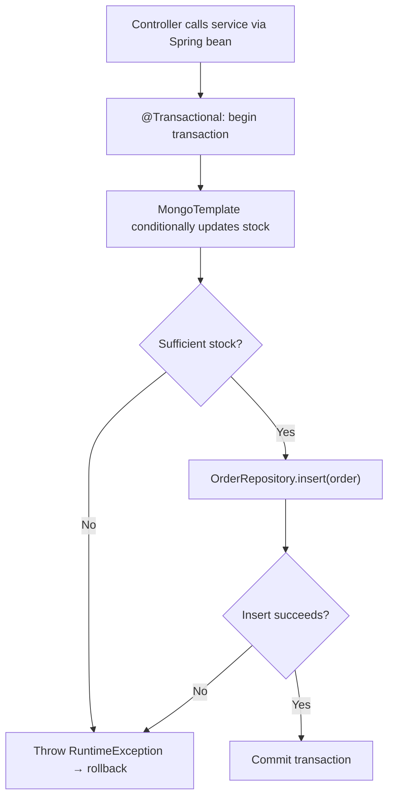

# Transaction Scope of Repositories in MongoDB

## 1. Does Repository CRUD equal a transaction?

When building applications with **Spring Data MongoDB**, we often start with `MongoRepository` to create, read, update, and delete documents. These operations look similar to repositories in other database technologies, yet **atomicity and transaction boundaries must be understood in MongoDB's terms**.

Consider an order placement workflow:

1. Check and deduct 2 units from inventory.
2. Create the order document.
3. Record payment status.
4. Send a confirmation notification.

If step 1 succeeds and step 2 fails, inventory may have decreased while no order exists. If step 2 succeeds and step 3 fails, the order may exist in an unpaid state. Calling two or more repository methods sequentially **does not automatically create a shared transaction**.

We must distinguish three scopes:

| Scope | What is guaranteed or must be designed |
| --- | --- |
| **A single write operation on a single document** | MongoDB executes the write atomically at the document level, including nested fields within that document. |
| **Multiple read/write operations or multiple documents** | Requiring all of them to commit/roll back together needs a proper transaction or another business coordination mechanism. |
| **Multiple systems**: MongoDB, payment gateway, queue, email | MongoDB transactions do not cover services outside MongoDB; you must handle idempotency, messaging, and intermediate states. |

In the **SPRING_DATA_MONGODB** module, repositories and `MongoTemplate` are the two APIs for accessing MongoDB. This lesson belongs to the **Repository CRUD** chapter and focuses on knowing **which operations are atomic, which operations can participate in a transaction, how to define transaction boundaries in the service layer**, and the implications for aggregations, indexes, reactive access, testing, and performance diagnostics.

## 2. Understanding single-document atomicity

MongoDB guarantees that a write operation to a **single document** is atomic. Example document:

```javascript
{
  _id: "order-1001",
  status: "PLACED",
  items: [
    { productId: "p-01", quantity: 2, unitPrice: NumberDecimal("500000") }
  ],
  total: NumberDecimal("1000000")
}
```

If you send one command updating both `status` and `total` on the same document:

```javascript
db.orders.updateOne(
  { _id: "order-1001", status: "PLACED" },
  {
    $set: {
      status: "PAID",
      total: NumberDecimal("1000000")
    }
  }
);
```

Modifications belonging to **the same write operation on this document** are applied atomically. The `status: "PLACED"` filter also protects the state transition condition: if the status already changed before the command executes, the operation matches no document.

This does **not** mean the following sequence of separate commands is a transaction:

```javascript
db.orders.updateOne({ _id: "order-1001" }, { $set: { status: "PAID" } });
db.orders.updateOne({ _id: "order-1001" }, { $set: { receiptIssued: true } });
```

Between the two commands, the process could crash or another process could read/update the document. When two fields must change together in one operation, combine them in a single `updateOne`. If business rules require coordinating multiple operations or multiple documents, consider a transaction.

### 2.1. A single command affecting multiple documents

```javascript
db.orders.updateMany(
  { status: "PLACED", expired: true },
  { $set: { status: "EXPIRED" } }
);
```

With `updateMany`, **each document is updated atomically**, but the set of documents as a whole does not become a single atomic unit outside a transaction. If an error or concurrent update occurs, some documents may have changed while others have not. Similarly, never assume `deleteMany`, `insertMany`, or a multi-record repository method rolls back the whole group by default.

Do not confuse **one API call** with **one transaction**. Check how many write operations MongoDB executes and whether consistency requirements span multiple documents.

## 3. The true scope of `MongoRepository`

A repository exposes APIs such as:

```java
import org.springframework.data.mongodb.repository.MongoRepository;

public interface OrderRepository
        extends MongoRepository<OrderDocument, String> {}
```

Common methods:

| Method | Meaning | Transaction considerations |
| --- | --- | --- |
| `insert(entity)` | Add a new document | Writing one document is atomic; duplicate `_id` is rejected. |
| `save(entity)` | Persist an entity by identifier; may update/replace existing document | Does not make a *read → edit in Java → save* sequence safe against concurrent updates. |
| `findById(id)` | Read a document by ID | This read does not automatically open a transaction covering subsequent operations. |
| `findAllById(ids)` | Read a set of documents | Not a consistent snapshot across concurrent updates by default. |
| `deleteById(id)` | Delete the identified document | Deleting a single document is atomic on that document. |
| `deleteAll(...)` or conditional delete | May affect multiple documents | Not atomic across the whole set by default. |
| Custom query methods | Find by criteria, projections, sorting, etc. | Does not wrap the surrounding business flow in a transaction. |

**MongoDB repositories should not be assumed to wrap every method in a transaction by default.** Differences between Spring Data modules are also why Spring Data JPA transaction assumptions must never be copied mechanically to MongoDB. When transactions are needed, configure a transaction manager and declare explicit boundaries.

### 3.1. `save` and lost updates

Suppose two requests read the same order with `status="PLACED"`:

```text
T1: Request A findById("order-1001") → status=PLACED
T2: Request B findById("order-1001") → status=PLACED
T3: Request A sets status=PAID, save()
T4: Request B edits a note and calls save() on the stale object
```

If entity-replacement saving is used without conflict control, request B can accidentally overwrite the status A just updated. **Reading and saving are two separate operations**, and are not protected merely because each individual operation is atomic.

There are two primary approaches:

- Use `@Version` for **optimistic locking**, detecting when a saved entity is based on a stale version.
- Use `MongoTemplate.updateFirst(...)` or `findAndModify(...)` with conditional filters and `$set` on only the fields that need changing, then inspect the result.

Multi-document transactions do not replace concurrency logic design. For invariants local to a single document, conditional updates are usually simpler and have lower overhead.

## 4. Modeling orders and inventory

To illustrate multi-document transactions, we use two collections: `inventory` and `orders`. Each product has an inventory document; each order has its own independent document.

### 4.1. Inventory entity

```java
import org.springframework.data.mongodb.core.mapping.Document;
import org.springframework.data.mongodb.core.mapping.FieldType;
import org.springframework.data.mongodb.core.mapping.MongoId;

@Document(collection = "inventory")
public record StockDocument(
    @MongoId(FieldType.STRING) String id,
    long available
) {}
```

`id` is the product code, e.g., `"p-01"`. Here `@MongoId(FieldType.STRING)` fixes `_id` in MongoDB as BSON string to avoid confusion between strings and ObjectIds.

### 4.2. Order entity

```java
import java.time.Instant;

import org.springframework.data.mongodb.core.mapping.Document;
import org.springframework.data.mongodb.core.mapping.FieldType;
import org.springframework.data.mongodb.core.mapping.MongoId;

@Document(collection = "orders")
public record OrderDocument(
    @MongoId(FieldType.STRING) String id,
    String customerId,
    String productId,
    int quantity,
    Instant placedAt,
    String status
) {}
```

In real business domains, an order may embed multiple `items`, totals, shipping address, and price snapshots. Here we deliberately use **one product per order** to highlight transaction boundaries. Production designs need validation, pricing, idempotency, duplicate-order protection, and other business rules.

### 4.3. Order repository

```java
import org.springframework.data.mongodb.repository.MongoRepository;

public interface OrderRepository
        extends MongoRepository<OrderDocument, String> {}
```

Creating an order and deducting inventory modifies **two documents across two collections**, so a successful `orders.insert(...)` does not guarantee `inventory` was updated and vice versa.

## 5. Updating only inventory: a single conditional command suffices

Before choosing a multi-document transaction, examine an invariant involving **only one document**: inventory must never go negative.

Never read the current stock, subtract in Java, and call `save` when concurrent purchases occur. Two requests can both read `available=2` and both conclude they can sell 2.

Put the condition directly inside the update operation:

```java
import com.mongodb.client.result.UpdateResult;

import org.springframework.data.mongodb.core.MongoTemplate;
import org.springframework.data.mongodb.core.query.Criteria;
import org.springframework.data.mongodb.core.query.Query;
import org.springframework.data.mongodb.core.query.Update;

public boolean reserveStock(
    MongoTemplate mongoTemplate,
    String productId,
    int quantity
) {
    if (quantity <= 0) {
        throw new IllegalArgumentException("Quantity must be positive");
    }

    Query query = Query.query(
        Criteria.where("_id").is(productId)
            .and("available").gte(quantity)
    );
    Update update = new Update().inc("available", -quantity);

    UpdateResult result = mongoTemplate.updateFirst(
        query,
        update,
        StockDocument.class
    );

    return result.getModifiedCount() == 1;
}
```

MongoDB evaluates `available >= quantity` while updating the document. If two requests both try to deduct 2 from an available count of 2, **they cannot both succeed against the same stock condition**: once the first decrements to 0, the second no longer matches. Checking `getModifiedCount()` tells the service whether stock was actually decremented (in this example, always subtracting a positive amount when matched).

You do not need a multi-document transaction just to guard a deduction on **one document**. However, if you also need to create an order, you must address consistency between inventory and orders.

## 6. When is a multi-document transaction needed?

Suppose a service executes:

```java
boolean reserved = reserveStock(mongoTemplate, "p-01", 2);
if (!reserved) {
    throw new IllegalStateException("Insufficient stock");
}
orderRepository.insert(order);
```

If `insert(order)` fails due to a duplicate `_id` or connection drop, inventory may already be reduced. Both operations live in the **same Java method** yet are not necessarily inside the **same MongoDB transaction**.

The goal of a transaction is:

> When both steps form a single business unit, commit only if both succeed; if either fails, roll back the changes belonging to that transaction.

Scenarios that may call for transactions:

- Creating an order and deducting inventory in two separate documents when policy demands they commit/roll back together.
- Transferring loyalty points between two accounts when both balances must update atomically.
- Creating an accounting record and updating a mandatory related business document's status.
- Moving data across collections without exposing a half-updated state.

Still, avoid putting everything into long-lived transactions: multi-document transactions incur session, resource, contention, and duration-limit overhead. Sometimes an **embedded data model**, conditional updates, or an idempotent compensating workflow is a better fit.

## 7. Configuring `MongoTransactionManager`

### 7.1. MongoDB prerequisites for transactions

Multi-document transactions require a supporting MongoDB deployment, such as a properly configured **replica set** or **sharded cluster**. A standard **standalone** MongoDB does not support multi-document transactions. Locally or in tests, run MongoDB as a replica set properly if you want to exercise commit/rollback.

In a Spring application, configure a `MongoTransactionManager` sharing the same `MongoDatabaseFactory` as the participating `MongoTemplate` and repositories:

```java
import org.springframework.context.annotation.Bean;
import org.springframework.context.annotation.Configuration;
import org.springframework.data.mongodb.MongoDatabaseFactory;
import org.springframework.data.mongodb.MongoTransactionManager;

@Configuration
public class MongoTransactionConfig {

    @Bean
    public MongoTransactionManager transactionManager(
        MongoDatabaseFactory databaseFactory
    ) {
        return new MongoTransactionManager(databaseFactory);
    }
}
```

This bean lets Spring manage `ClientSession` and transactions for MongoDB operations participating in the **same transaction context**. Spring Data MongoDB should not be assumed to enable transactions automatically without configuring an appropriate manager.

**Ensure:**

- Repositories and `MongoTemplate` actually share the configured MongoDB factory/transaction manager.
- Operations are invoked **inside** the Spring-managed transaction scope, not through an arbitrary uncoordinated MongoDB driver call outside context.
- Required collections and indexes are created before running business flows. Creating collections/indexes inside transactions has restrictions and conditions depending on MongoDB version, so avoid letting application code auto-create them mid-checkout.
- Connection settings and timeouts fit your deployment environment, especially on clusters or sharded topologies.

Some applications have multiple transaction managers (JPA, MongoDB, messaging, etc.). Specify the **exact manager** in `@Transactional`. A MongoDB manager does not manage transactions in external systems.

### 7.2. Boundaries in the service layer

In Spring, placing `@Transactional` on a public service method called **through a Spring proxy** is the standard way to define a business boundary. Do not rely on annotating private methods or **self-invocation** (one method inside the same bean calling an annotated method), because default proxy mode can bypass interception.



Repository methods invoked inside the service can join the transaction opened by the service, provided they use the right connection/factory and do not escape the context.

## 8. Transaction example: placing an order and deducting inventory together

### 8.1. Service using repository and `MongoTemplate`

```java
import java.time.Clock;
import java.time.Instant;

import com.mongodb.client.result.UpdateResult;

import org.springframework.data.mongodb.core.MongoTemplate;
import org.springframework.data.mongodb.core.query.Criteria;
import org.springframework.data.mongodb.core.query.Query;
import org.springframework.data.mongodb.core.query.Update;
import org.springframework.stereotype.Service;
import org.springframework.transaction.annotation.Transactional;

@Service
public class CheckoutService {

    private final MongoTemplate mongoTemplate;
    private final OrderRepository orders;
    private final Clock clock;

    public CheckoutService(
        MongoTemplate mongoTemplate,
        OrderRepository orders,
        Clock clock
    ) {
        this.mongoTemplate = mongoTemplate;
        this.orders = orders;
        this.clock = clock;
    }

    @Transactional(transactionManager = "transactionManager")
    public OrderDocument placeOrder(
        String orderId,
        String customerId,
        String productId,
        int quantity
    ) {
        if (quantity <= 0) {
            throw new IllegalArgumentException("Invalid quantity");
        }

        Query query = Query.query(
            Criteria.where("_id").is(productId)
                .and("available").gte(quantity)
        );

        Update update = new Update()
            .inc("available", -quantity);

        UpdateResult result = mongoTemplate.updateFirst(
            query,
            update,
            StockDocument.class
        );

        if (result.getModifiedCount() != 1) {
            throw new IllegalStateException("Insufficient stock");
        }

        OrderDocument order = new OrderDocument(
            orderId,
            customerId,
            productId,
            quantity,
            Instant.now(clock),
            "PLACED"
        );

        // If insert fails, the transaction is marked for rollback.
        return orders.insert(order);
    }
}
```

This code expects a `Clock` bean in the application and `OrderRepository` alongside `MongoTemplate` using the configured MongoDB transaction manager. This is a **single-product-per-order** example and does not cover external payment processing.

Key properties:

1. `updateFirst` deducts stock conditionally. If stock is insufficient, the service throws `IllegalStateException`.
2. `orders.insert(order)` writes one order document.
3. If either step throws an **unchecked exception** inside the transaction, Spring normally rolls back the transaction under default rules.
4. If both steps succeed and commit succeeds, changes belonging to the transaction are persisted together.
5. **Do not** catch the exception and return normally inside the method without marking rollback, as Spring may then attempt to commit.
6. If commit or connection fails with an unknown outcome, handle retries and idempotency at the business layer rather than assuming the order definitely failed.

### 8.2. What happens when inserting a duplicate order ID?

Suppose `orders` already contains `_id = "order-1001"`. When calling `placeOrder("order-1001", ...)`:

- The stock deduction may execute **inside the uncommitted transaction**.
- `insert` fails with a duplicate key error.
- With proper transaction configuration, the exception escapes the method, causing the transaction to roll back; inventory is not reduced by the failed transaction.

Without a transaction, the earlier stock deduction would already be an independent committed write and would not undo automatically. This distinction should be verified by integration tests.

### 8.3. Why should you not call a payment gateway inside a transaction?

The following pattern is risky:

```text
BEGIN MongoDB transaction
  update inventory
  create order
  call HTTP payment gateway (may take several seconds)
COMMIT MongoDB transaction
```

A MongoDB transaction cannot roll back a payment that already succeeded on an external gateway. Slow HTTP calls inside an open transaction also extend lock/resource hold times and increase conflict probability.

Instead, use an intermediate state such as `PENDING_PAYMENT`, idempotency keys when calling payment APIs, webhooks or confirmation polling, and compensation/inventory-release steps when payment is canceled. A **transactional outbox** can write an event into a MongoDB collection in the same transaction as business changes for a worker to publish; even then, consumers still need duplicate-message protection.

## 9. Spring `@Transactional`: commonly misunderstood rules

### 9.1. An annotation does not automatically wrap every call

`@Transactional` works when an appropriate transaction manager exists and the call passes through Spring's interception mechanism. Common mistakes:

- Placing the annotation on a class instantiated with `new`, rather than a Spring bean.
- Calling an annotated method from another method **on the same object** via `this.method(...)` in standard proxy mode.
- Opening a transaction with the MongoDB manager while performing operations on a client/factory not participating in that transaction.
- Having two transaction managers and letting Spring pick the wrong one.
- Returning early or offloading asynchronous work to another thread without propagating the transaction context.
- Swallowing an exception inside the transaction, causing Spring to commit even though business logic failed.

When debugging, verify that the transaction **actually starts and commits/rolls back**, rather than trusting the presence of the annotation in source code.

### 9.2. Runtime exceptions vs. checked exceptions

By default, Spring's transaction interceptor typically rolls back on `RuntimeException` or `Error`. A **checked exception** does not trigger rollback under default rules. When business rules require rolling back on checked exceptions, configure:

```java
@Transactional(
    transactionManager = "transactionManager",
    rollbackFor = Exception.class
)
public void performBusinessOperation() throws Exception {
    // Write MongoDB data within the same transaction.
}
```

Rollback rules should reflect business requirements; catching every exception is not always right. Also avoid swallowing exceptions and returning a success value.

### 9.3. `readOnly=true` does not replace a read-consistency policy

`@Transactional(readOnly = true)` is a transaction configuration hint, not a guarantee that every read in a service automatically has **serializable isolation**. MongoDB has `read concern`, `write concern`, and snapshot semantics; actual visibility depends on transaction/session configuration and deployment setup.

If you need a consistent point-in-time snapshot across multiple documents, design and verify appropriate **read concern/transaction options**. Never infer that calling two consecutive `findById` methods in a repository automatically observes the same data snapshot.

### 9.4. Transactions do not automatically retry the whole flow

MongoDB can return write conflicts, connection errors, or errors labeled `TransientTransactionError` and `UnknownTransactionCommitResult`. Not every Spring `@Transactional` setup automatically retries the entire method safely in those cases.

A sound retry strategy distinguishes:

- **Errors guaranteed aborted:** the entire transaction can be retried if the business operation is idempotent and still valid.
- **Uncertain whether commit succeeded:** check state or use an idempotency key before re-sending to avoid creating duplicate orders or double-charging.
- **Business logic errors:** insufficient stock, invalid input, invalid state—blind retries are futile.
- **Repeated infrastructure failures:** apply retry caps, backoff, and system metrics monitoring.

Never retry a transaction containing non-idempotent payment gateway calls or email sends as if everything rolled back automatically.

## 10. Optimistic locking with `@Version`

Multi-document transactions protect atomicity across a scope, whereas **optimistic locking** detects when a document is written based on a stale version.

Example adding `@Version` to a document with an update lifecycle:

```java
import org.springframework.data.annotation.Version;
import org.springframework.data.mongodb.core.mapping.Document;
import org.springframework.data.mongodb.core.mapping.FieldType;
import org.springframework.data.mongodb.core.mapping.MongoId;

@Document(collection = "profiles")
public record ProfileDocument(
    @MongoId(FieldType.STRING)
    String id,
    String displayName,
    @Version Long version
) {}
```

When an entity is read and saved through Spring Data's version-aware path, the converter/repository uses the version to guard updates. If the document was modified by another request, saving based on the old version can throw `OptimisticLockingFailureException`.

Benefits:

- Detects `read → modify → save` based on stale data.
- Lets the application ask the user to reload or run an intentional merge strategy.
- Reduces **lost update** bugs when two requests edit the same document concurrently.

Limitations:

- Must use write paths that actually **respect version**; raw driver calls or arbitrary updates can bypass version checks.
- Requires proper write acknowledgement to detect write outcomes; never disable acknowledgement and expect all optimistic locking errors to surface.
- `@Version` does not turn a chain of multiple repository calls into a multi-document transaction.
- For conditional single-field updates, `MongoTemplate.updateFirst` with `_id`/state/`version` criteria can be better than loading and saving the whole entity.

### 10.1. Comparing mechanisms

| Requirement | Usually suitable mechanism |
| --- | --- |
| Change order status if currently `PAID` | `updateFirst` with `status=PAID` and `$set` |
| Deduct inventory without going negative | `updateFirst` with `available >= quantity` and `$inc` |
| Detect user editing a profile from stale state | `@Version` or version-filtered update |
| Create order **and** deduct stock as one commit unit | Multi-document transaction when appropriate |
| Sync MongoDB with payment gateway or broker | Idempotency, outbox/saga, retries, and compensation |
| Update multiple fields on the same document | Single update command leveraging single-document atomicity |

No single annotation solves every consistency problem.

## 11. Reactive repositories and transaction scope

If the application uses Spring WebFlux, `ReactiveMongoRepository` and `ReactiveMongoTemplate` support non-blocking data flows. However, reactive transactions **do not store context the same way imperative code does**: Reactor propagates transaction context via subscriber context rather than ThreadLocal alone.

### 11.1. Configuring a reactive transaction manager

Example with a transaction-capable MongoDB deployment:

```java
import org.springframework.context.annotation.Bean;
import org.springframework.context.annotation.Configuration;
import org.springframework.data.mongodb.ReactiveMongoDatabaseFactory;
import org.springframework.data.mongodb.ReactiveMongoTransactionManager;

@Configuration
public class ReactiveMongoTxConfig {

    @Bean
    public ReactiveMongoTransactionManager reactiveTransactionManager(
        ReactiveMongoDatabaseFactory factory
    ) {
        return new ReactiveMongoTransactionManager(factory);
    }
}
```

If an application has both imperative and reactive managers, pick the manager matching the API and return types. A reactive repository cannot be paired with an imperative manager and expected to join its transaction by default.

### 11.2. `TransactionalOperator` wrapping a `Mono` pipeline

Reactive order placement example with two operations:

```java
import java.time.Clock;
import java.time.Instant;

import org.springframework.data.mongodb.core.ReactiveMongoTemplate;
import org.springframework.data.mongodb.core.query.Criteria;
import org.springframework.data.mongodb.core.query.Query;
import org.springframework.data.mongodb.core.query.Update;
import org.springframework.transaction.reactive.TransactionalOperator;

import reactor.core.publisher.Mono;

public class ReactiveCheckoutService {

    private final ReactiveMongoTemplate template;
    private final ReactiveOrderRepository orders;
    private final TransactionalOperator tx;
    private final Clock clock;

    public ReactiveCheckoutService(
        ReactiveMongoTemplate template,
        ReactiveOrderRepository orders,
        TransactionalOperator tx,
        Clock clock
    ) {
        this.template = template;
        this.orders = orders;
        this.tx = tx;
        this.clock = clock;
    }

    public Mono<OrderDocument> placeOrder(
        String orderId,
        String customerId,
        String productId,
        int quantity
    ) {
        if (quantity <= 0) {
            return Mono.error(
                new IllegalArgumentException("Invalid quantity")
            );
        }

        Query query = Query.query(
            Criteria.where("_id").is(productId)
                .and("available").gte(quantity)
        );

        Update update = new Update()
            .inc("available", -quantity);

        return template.updateFirst(
                query, update, StockDocument.class
            )
            .flatMap(result -> {
                if (result.getModifiedCount() != 1) {
                    return Mono.error(
                        new IllegalStateException("Insufficient stock")
                    );
                }

                OrderDocument order = new OrderDocument(
                    orderId,
                    customerId,
                    productId,
                    quantity,
                    Instant.now(clock),
                    "PLACED"
                );
                return orders.insert(order);
            })
            .as(tx::transactional);
    }
}
```

This snippet assumes `ReactiveOrderRepository extends ReactiveMongoRepository<OrderDocument, String>` and `TransactionalOperator` configured from an appropriate `ReactiveMongoTransactionManager`. Both `ReactiveMongoTemplate` and the repository must share the same MongoDB reactive transaction context. Calling `block()` inside a reactive web pipeline breaks non-blocking characteristics and must never be used to "force" a transaction to run.

Just like imperative code, handle unknown commit outcomes, retries, and idempotency. Reactive execution does not make MongoDB transactions faster or eliminate write conflicts.

## 12. How to test that transactions actually work

A unit test mocking repositories does not prove MongoDB rolled back; it only proves the service invoked stubbed methods. You need **integration tests** running against a transaction-capable MongoDB, such as a MongoDB replica set in Testcontainers.

### 12.1. Testing rollback on duplicate ID insert

Test plan:

1. Create `StockDocument` with `available=5`.
2. Pre-insert an `OrderDocument` with ID `"order-duplicate"`.
3. Call `checkoutService.placeOrder("order-duplicate", ..., quantity=2)`.
4. Verify insert fails due to duplicate key.
5. **Re-read inventory and verify `available=5`**, because the transaction must roll back the deduction.

JUnit 5 and Spring Boot example:

```java
import static org.junit.jupiter.api.Assertions.*;

import java.time.Instant;

import org.junit.jupiter.api.Test;
import org.springframework.beans.factory.annotation.Autowired;
import org.springframework.boot.test.context.SpringBootTest;
import org.springframework.dao.DuplicateKeyException;
import org.springframework.data.mongodb.core.MongoTemplate;

@SpringBootTest
class CheckoutTransactionIntegrationTest {

    @Autowired MongoTemplate template;
    @Autowired CheckoutService checkoutService;

    @Test
    void duplicateOrderRollsBackInventoryChange() {
        String productId = "product-test-rollback-01";
        String orderId = "order-test-duplicate-01";

        template.insert(new StockDocument(productId, 5L));

        template.insert(new OrderDocument(
            orderId,
            "customer-test",
            productId,
            1,
            Instant.parse("2026-11-20T01:00:00Z"),
            "PLACED"
        ));

        assertThrows(
            DuplicateKeyException.class,
            () -> checkoutService.placeOrder(
                orderId, "customer-test", productId, 2
            )
        );

        StockDocument current = template.findById(
            productId, StockDocument.class
        );

        assertNotNull(current);
        assertEquals(5L, current.available());
    }
}
```

The test assumes an **isolated database**, pre-created collections/indexes, a registered `MongoTransactionManager`, and calling the service through a Spring bean so the proxy applies `@Transactional`. With fixed IDs, clean up test data between runs or use unique namespaces. Do not place `@Transactional` on the test method itself when observing business transaction commits/rollbacks after the call completes; an outer test transaction alters verification behavior.

The example expects `DuplicateKeyException` via Spring's exception translation on duplicate `_id`. Across environments/versions, underlying error wrapping may differ; if the test catches a different wrapper type, inspect the actual cause chain, while **still verifying the rollback**.

### 12.2. Testing the success case

An additional test should verify:

- Before placing: `inventory.available=5`.
- Call `placeOrder(..., quantity=2)`.
- After commit: `inventory.available=3` and `orders` contains the new order.
- `OrderDocument.productId` and `StockDocument._id` share the BSON string type per ID convention.
- Placing another order with `quantity=4` fails stock deduction and creates **no** new order.

### 12.3. Testing concurrency contention

With `available=1`, send two concurrent requests for 1 unit using distinct order IDs. Expected business outcome: never oversell stock. Inside multi-document transactions, a **write conflict** may occur rather than a plain "insufficient stock" result; the service must handle retries appropriately and re-evaluate stock conditions.

A concurrency test is meaningful only when two threads genuinely hit the database and verify **final invariants**; mocking two pre-built numeric responses is insufficient.

## 13. Indexes, aggregation, and performance in transactions

### 13.1. Indexes

Inventory updates by `_id` can use the default `_id` index in `inventory`. Listing customer orders typically needs an index on `orders`:

```javascript
db.orders.createIndex({
  customerId: 1,
  placedAt: -1
});

db.orders.find({ customerId: "customer-01" })
  .sort({ placedAt: -1 })
  .limit(20)
  .explain("executionStats");
```

Create indexes during proper administration/migration phases **before** business transactions query them. Running inside a transaction does not make an unindexed query fast. Slow queries prolong transaction lifetimes and increase contention.

### 13.2. Do aggregations need transactions?

`MongoTemplate.aggregate(...)` and aggregation pipelines do not require transactions by default. For example, counting orders by status:

```javascript
db.orders.aggregate([
  {
    $group: {
      _id: "$status",
      count: { $sum: 1 }
    }
  },
  { $sort: { count: -1 } }
]);
```

Reports are typically read-only, so pick matching read concern and consistency strategies instead of opening multi-document transactions for every analytical query. If a consistent multi-collection snapshot is needed, evaluate exact read requirements, settings, and cost.

### 13.3. Monitoring transaction cost

| Metric | Diagnostic meaning |
| --- | --- |
| Transaction duration | Long-lived transactions hold resources longer and raise conflict probability |
| Commit/abort ratio | Are many transactions rolling back or hitting contention errors? |
| Write conflicts and retry counts | Are there hotspots like a single inventory document updated by many requests? |
| Query plans inside transactions | Are filters leveraging proper indexes? |
| Connection wait time | Are pools/sessions bottlenecked under concurrent transactions? |
| Batch sizes and documents touched | Is too much work packed into one transaction? |
| `DuplicateKeyException` rate | Are there idempotency gaps or duplicate order submissions? |
| Unknown commit result frequency | Do result-lookup/deduplication strategies need improvement? |

For heavily contended inventory documents, multi-document transactions can experience write conflicts. Keep work inside transactions short, use conditional updates, bound retry counts, and evaluate partitioning data if true hotspots emerge.

## 14. Misconceptions to avoid

**"Every repository method automatically runs in a transaction."** False if taken to mean a default multi-document transaction. Configure a MongoDB transaction manager and define boundaries, or rely on single-document write atomicity where appropriate.

**"`save` guarantees safe updates when two requests edit concurrently."** A `save` can overwrite based on a stale object. Consider `@Version`, conditional updates, or appropriately scoped transactions.

**"One `updateMany` command is atomic across the whole collection."** MongoDB guarantees per-document atomicity unless wrapped in a multi-document transaction.

**"`@Transactional` covers HTTP payment calls too."** No. A MongoDB transaction only governs operations participating in that MongoDB transaction—it cannot roll back an external payment gateway call.

**"With transactions, race conditions disappear."** Transactions provide specific atomicity and snapshot guarantees, yet you still must design conditional checks, handle write conflicts, set isolation/read-write concerns, and enforce invariants.

**"`@Transactional(readOnly = true)` guarantees absolute read consistency."** Consistency depends on read concern, transaction options, and MongoDB deployment setup.

**"Reactive repositories don't need transactions because they use `Mono`."** Reactive only changes the execution model. Multi-document transactions still require a reactive transaction manager and appropriate context.

**"Mock tests prove rollback."** Mocks do not execute MongoDB transactions. You need integration tests on a supporting replica set or sharded cluster that verify post-rollback database state.

## 15. Workflow for choosing transaction scope

When designing a new repository or service method, evaluate in order:

1. **List the data operations:** which documents in which collections are read/written?
2. **Identify business invariants:** what must never break on mid-way errors or concurrent requests?
3. **Co-locate in one document when natural:** use a single conditional `$set`/`$inc` to leverage document atomicity.
4. **Need multiple documents to commit together?** Consider a MongoDB transaction manager, deployment support, and overhead.
5. **External systems involved?** Design idempotency, intermediate states, outbox, or compensation.
6. **Need concurrent update protection?** Filter by status/quantity/version, use optimistic locking, and control retries.
7. **Verify runtime wiring:** repository/template share the same factory, transaction proxy is active, collections/indexes exist.
8. **Test success, rollback, and contention** against a real MongoDB; never rely solely on repository mocks.
9. **Measure performance:** indexes, latency, conflicts, abort/retry counts, and transaction duration.

**Conclusion:** `MongoRepository` provides a convenient CRUD API, yet **it does not define the transaction boundary of an entire business workflow**. With Spring Data MongoDB, leverage single-document atomicity where possible; use `MongoTemplate` for conditional updates; and configure `MongoTransactionManager` or `ReactiveMongoTransactionManager` with service-layer boundaries when multiple documents must commit or roll back together. Keep clear boundaries around external systems, manage conflicts and idempotency, and verify with integration tests and real query measurements.
