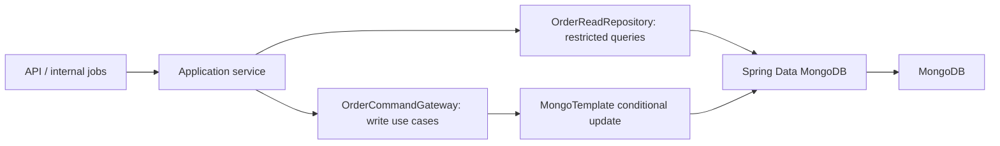

# Restricting Public Repository Methods by Business Need

## 1. Why shouldn't repositories expose full CRUD by default?

Spring Data MongoDB lets you save, find, update, and delete documents with minimal boilerplate. For example, simply extending `MongoRepository<OrderDocument, String>` immediately exposes `save(...)`, `findById(...)`, `findAll(...)`, `deleteById(...)`, `deleteAll()`, and many other methods. That is helpful for prototypes, yet not every operation fits a production business contract.

Suppose an order management service requires:

- Customers may view only orders belonging to their tenant.
- Warehouse staff may only transition orders from `READY_TO_SHIP` to `SHIPPED`.
- Shipped orders must never be deleted through an ordinary CRUD command.
- There is no business case for "fetch all orders across all tenants" or "delete all orders".

If a repository interface exposes `findAll()`, `deleteAll()`, and `save()`, another developer can accidentally call a method that is **technically valid yet violates business rules**. Restricting public methods reduces misuse surface area and clarifies module intent.

This lesson belongs to the **Repository CRUD** chapter in the **SPRING_DATA_MONGODB** module. You will apply this principle when using repositories or `MongoTemplate` to interact with MongoDB, designing queries/indexes around access patterns, handling state transitions, and testing access boundaries. Topics such as transactions, aggregations, reactive access, and performance tuning still must obey the chosen business contract.

After this lesson, you will be able to:

1. Distinguish an interface inheriting full CRUD from an interface declaring only genuinely needed methods.
2. Build selective repositories with `Repository<T, ID>` or `@RepositoryDefinition`.
3. Separate read queries from **business commands** such as confirming, shipping, or canceling orders rather than allowing arbitrary updates.
4. Understand the limits of an interface contract: it **does not enforce authorization by itself**, does not stop other code from accessing the database, and does not replace service-layer invariants.
5. Test both *allowed* and *disallowed* capabilities, including concurrency and multi-tenancy.

## 2. From access patterns to repository contracts

Before writing an interface, document how each actor uses the data.

| Actor / task | Actual need | Operations not to expose |
| --- | --- | --- |
| Customer viewing order details | Lookup by `tenantId + id` with ownership check | `findAll()`, tenant-less `findById(id)` |
| Staff viewing shipping queue | List by `tenantId + status`, sorted/bounded | Fetching the entire collection unpaginated |
| Order placement service | Create a new order with a valid initial status | Arbitrary `save(...)` exposed to controllers |
| Warehouse staff confirming shipment | Transition exact status and timestamp conditionally | Overwriting the entire document with arbitrary objects |
| Customer support | View status, never edit or delete | `deleteAll()`, `deleteById()` |
| Data retention job | Enforce retention under approved policy | Unrestricted deletion via shared repository |

From there, the team can build a *use case → method* table:

| Use case | Planned interface/port | Return value |
| --- | --- | --- |
| View order by tenant and ID | `findByTenantIdAndId(...)` | `Optional<OrderDocument>` |
| View order list by status | `findByTenantIdAndStatus(..., Pageable)` | `Slice<OrderListView>` |
| Place order | `placeOrder(command, authenticatedTenant)` on application service | Created order ID |
| Ship order | `markShipped(tenantId, orderId)` on command adapter/service | Success or conflict outcome |
| Delete data per retention | Dedicated controlled admin job | Deleted count / reconciliation report |

Names like `placeOrder` and `markShipped` communicate **business intent** far better than `save`. `OrderDocument` is an internal persistence model; it does not have to be exposed directly in HTTP APIs.

## 3. Understanding Spring Data's base interfaces

Spring Data provides multiple interfaces with different capability sets. In modern versions, `PagingAndSortingRepository` no longer includes all `CrudRepository` methods by default as some older versions did; check the inheritance hierarchy for your project's version.

| Interface | Purpose | Effect when extended |
| --- | --- | --- |
| `Repository<T, ID>` | Foundational marker interface | Does not automatically expose the full CRUD suite |
| `CrudRepository<T, ID>` | General CRUD | Exposes broad read/write/delete methods, including batch operations |
| `ListCrudRepository<T, ID>` | CRUD variant returning `List` for collection results | Still a broad CRUD API |
| `PagingAndSortingRepository<T, ID>` | Pagination and sorting methods | Extend only when that contract is wanted |
| `MongoRepository<T, ID>` | MongoDB-specific repository with CRUD and extras | Convenient but presents a large method surface |
| `@RepositoryDefinition` | Marks a repository interface without `extends Repository` | Allows declaring only desired methods directly |

**Key takeaway:** To avoid unwanted methods, start from `Repository<T, ID>` and **declare only** the operations needed, rather than extending `MongoRepository` and trying to "disable" unwanted methods.

### 3.1. Why can't you "hide" inherited methods?

Example:

```java
import org.springframework.data.mongodb.repository.MongoRepository;

public interface OrderRepository
    extends MongoRepository<OrderDocument, String> {
    // Declaring extra methods here does not remove deleteAll().
}
```

Every inherited public method remains part of `OrderRepository`'s type. Adding a comment "do not use deleteAll" or declaring extra methods does not remove `deleteAll()` from the API. Overriding unwanted methods to throw exceptions is hard to maintain and still exposes them in IDE autocomplete and via supertype references.

A **narrow contract from the start** is clearer than a broad contract accompanied by a "do not call" list.

### 3.2. A repository is only one boundary in the system

`Repository<T, ID>` restricts what callers of **that interface** can invoke directly, yet:

- It does not stop another bean from injecting `MongoTemplate` or the driver.
- It does not replace security at the HTTP/controller/service layers.
- It does not automatically apply `tenantId` to every query.
- It does not ensure the MongoDB account follows least privilege.
- It does not turn a public Java method into an HTTP endpoint unless the application exposes it explicitly.

Thus, "restricting public repository methods" is **internal API design and mistake prevention**, not a standalone sandbox or authorization mechanism.

## 4. Running example: multi-tenant order domain

We use a document with string ID, tenant, status, and order timestamps:

```java
import java.time.Instant;
import org.springframework.data.mongodb.core.mapping.Document;
import org.springframework.data.mongodb.core.mapping.FieldType;
import org.springframework.data.mongodb.core.mapping.MongoId;

@Document(collection = "orders")
public record OrderDocument(
    @MongoId(FieldType.STRING) String id,
    String tenantId,
    String customerId,
    OrderStatus status,
    Instant createdAt,
    Instant updatedAt,
    long totalAmountVnd
) {}

enum OrderStatus {
    NEW,
    PAID,
    READY_TO_SHIP,
    SHIPPED,
    CANCELLED
}
```

Example MongoDB document:

```javascript
{
  "_id": "order-2026-0042",
  "tenantId": "tenant-a",
  "customerId": "customer-15",
  "status": "READY_TO_SHIP",
  "createdAt": ISODate("2026-11-19T08:15:00Z"),
  "updatedAt": ISODate("2026-11-19T08:15:00Z"),
  "totalAmountVnd": NumberLong("530000")
}
```

Here `@MongoId(FieldType.STRING)` declares the intent to store IDs as BSON String, avoiding ObjectId conversion if codes happen to have 24 hex characters. Amounts in VND use integer units. The lesson focuses on repository contracts; real models also enforce total calculations, ownership, stock checks, and other constraints.

## 5. Writing a read-only repository with Repository<T, ID>

### 5.1. Minimal declaration

```java
import java.util.Optional;
import org.springframework.data.domain.Pageable;
import org.springframework.data.domain.Slice;
import org.springframework.data.repository.Repository;

public interface OrderReadRepository
    extends Repository<OrderDocument, String> {

    Optional<OrderDocument> findByTenantIdAndId(
        String tenantId,
        String id
    );

    Slice<OrderDocument> findByTenantIdAndStatus(
        String tenantId,
        OrderStatus status,
        Pageable pageable
    );
}
```

This interface **does not declare** `save`, `deleteById`, `deleteAll`, or `findAll`. Spring Data can still create the repository implementation via repository infrastructure and derive queries from method names, provided scanning and entity configuration are valid.

`findByTenantIdAndId` expresses the requirement: only return the document if both tenant and ID match. `findByTenantIdAndStatus` models a tenant- and status-scoped listing, requiring the caller to supply pagination.

**Security warning:** Having a `tenantId` parameter does not verify that it belongs to the currently authenticated user. The value must come from a trusted authentication/authorization context, never accepted blindly from client input.

### 5.2. Calling the repository with pagination

```java
import org.springframework.data.domain.PageRequest;
import org.springframework.data.domain.Sort;

PageRequest firstPage = PageRequest.of(
    0,
    20,
    Sort.by(
        Sort.Order.desc("createdAt"),
        Sort.Order.desc("id")
    )
);

var page = orderReadRepository.findByTenantIdAndStatus(
    authenticatedTenantId,
    OrderStatus.READY_TO_SHIP,
    firstPage
);
```

This assumes `orderReadRepository` is injected and `authenticatedTenantId` comes from trusted authentication state.

`Slice<T>` fits when the UI only needs to know whether a next page exists without needing total page counts. In many cases, `Page<T>` runs an extra count query to populate pagination metadata; when totals are unnecessary, `Slice<T>` avoids that overhead. Still, for deep offsets, `Pageable` usually relies on `skip` and can slow down; consider keyset/cursor pagination for large datasets.

Sorting by `createdAt DESC, id DESC` stabilizes results when multiple documents share the same timestamp. For `tenantId + status` queries, an expected index is:

```javascript
db.orders.createIndex(
  { tenantId: 1, status: 1, createdAt: -1, _id: -1 },
  { name: "ix_orders_tenant_status_recent" }
);
```

Java property `id` maps to BSON `_id`. Check real queries and `explain("executionStats")` to confirm the index serves both filtering and sorting. Never add an index solely because a method exists if workload does not warrant it.

### 5.3. Limiting returned fields with projections

A shipping queue screen might only need ID, status, and timestamp rather than the entire document:

```java
import java.time.Instant;

public interface OrderListView {
    String getId();
    OrderStatus getStatus();
    Instant getCreatedAt();
}
```

A repository can declare a separate method returning a projection:

```java
Slice<OrderListView> findByTenantIdAndStatus(
    String tenantId,
    OrderStatus status,
    Pageable pageable
);
```

**Do not declare both methods in the same interface** differing only by return type. Java does not allow return-type-only overloading. If choosing the projection, **replace** the `Slice<OrderDocument>` method from section 5.1 or use distinct method names compatible with query derivation.

Projections reduce the data transferred to Java when the framework generates appropriate field selection. However, projections do not replace authorization, index checks, or API serialization controls.

## 6. @RepositoryDefinition: an option without extending Repository

Spring Data also supports annotating an interface directly with `@RepositoryDefinition`:

```java
import java.util.Optional;
import org.springframework.data.repository.RepositoryDefinition;

@RepositoryDefinition(
    domainClass = OrderDocument.class,
    idClass = String.class
)
public interface OrderLookupRepository {
    Optional<OrderDocument> findByTenantIdAndId(
        String tenantId,
        String id
    );
}
```

Meaning: this is a Spring Data-managed repository for the given domain type and ID type; the interface lists only desired methods. You do not have to extend `MongoRepository` to get query derivation.

**Pick one consistent style:** most projects find `extends Repository<OrderDocument, String>` easier to spot, while `@RepositoryDefinition` helps when teams prefer controlling interface inheritance via annotations. Avoid creating two repository beans serving the same role just to demonstrate both styles in a production app.

## 7. Using @NoRepositoryBean when a shared contract is needed

A multi-module system may want a parent interface for operations genuinely shared across domains:

```java
import java.util.Optional;
import org.springframework.data.repository.NoRepositoryBean;
import org.springframework.data.repository.Repository;

@NoRepositoryBean
public interface BasicReadRepository<T, ID>
    extends Repository<T, ID> {

    Optional<T> findById(ID id);
}
```

`@NoRepositoryBean` stops Spring Data from attempting to instantiate a standalone repository bean for an unbound base interface.

A concrete repository can extend it:

```java
public interface PublicCatalogRepository
    extends BasicReadRepository<ProductDocument, String> {
    // Only appropriate if reading by public ID is a valid use case.
}
```

This assumes `ProductDocument` exists in another catalog module; the purpose is solely to illustrate base interface usage, **not to require creating another file**.

However, `findById(ID id)` does not constrain tenant. Therefore, **do not** use `BasicReadRepository` for `OrderDocument` where tenant isolation is mandatory. Reusability of a generic base interface must never override business invariants.

A good base repository holds only methods that are **genuinely valid for every inheriting domain type**. When entities have differing access rules and invariants, repeating a couple of narrow repository declarations is safer and easier to review than an overly broad generic interface.

## 8. Separating write commands from read repositories

### 8.1. Why not use save for every business operation?

The `save(entity)` signature states "persist an entity", yet does not express:

- Who is allowed to change the status?
- Is the transition `READY_TO_SHIP -> SHIPPED` valid?
- Should current status be checked to prevent concurrent updates?
- Must an audit event be written or inventory updated alongside?
- Is overwriting the entire document with a stale object allowed?

Consequently, application services should expose intentional **commands**. The read-only repository in section 5 has no `save`; a separate adapter using `MongoTemplate` performs the exact permitted write operation.



These components can live in the same application where appropriate; this is **contract separation by role**, not a requirement to split into microservices.

### 8.2. Command gateway with business naming

```java
public interface OrderCommandGateway {
    boolean markShipped(String tenantId, String orderId);
}
```

This interface prevents callers from setting `status` to arbitrary values. It exposes only the operation supported by business rules.

### 8.3. Implementation using MongoTemplate and atomic conditions

```java
import java.time.Instant;
import org.springframework.data.mongodb.core.MongoTemplate;
import org.springframework.data.mongodb.core.query.Criteria;
import org.springframework.data.mongodb.core.query.Query;
import org.springframework.data.mongodb.core.query.Update;

public final class MongoOrderCommandGateway
    implements OrderCommandGateway {

    private final MongoTemplate template;

    public MongoOrderCommandGateway(MongoTemplate template) {
        this.template = template;
    }

    @Override
    public boolean markShipped(String tenantId, String orderId) {
        Query query = Query.query(
            Criteria.where("id").is(orderId)
                .and("tenantId").is(tenantId)
                .and("status").is(OrderStatus.READY_TO_SHIP)
        );

        Update update = new Update()
            .set("status", OrderStatus.SHIPPED)
            .set("updatedAt", Instant.now());

        return template.updateFirst(
            query, update, OrderDocument.class
        ).getModifiedCount() == 1;
    }
}
```

This is **illustrative code in an application that provides a `MongoTemplate` bean**. For Spring to inject the gateway, register the implementation as a bean via `@Component` or `@Bean`.

The update command locates a document matching ID, tenant, and current status **simultaneously**, then updates one document. This reduces the risk of two threads racing to change state via "read then overwrite". In MongoDB, an update on a single document is atomic.

A `false` return value can have multiple causes: missing ID, wrong tenant, already transitioned status, or no change applied. APIs should avoid leaking whether an order exists in another tenant when reporting errors to users.

### 8.4. Keep creation separate from general saving

Another command could be `placeOrder(...)`. It should:

1. Determine tenant and user from trusted context.
2. Validate inputs, totals, and invariants.
3. Generate the ID per chosen contract.
4. Persist the new order in a valid initial status.
5. Handle duplicate key errors when ID or order number collides.

When intent is **create new**, `MongoTemplate.insert(...)` expresses intent better than `save(...)`. `save` carries save/replace or upsert semantics depending on state, and at the repository layer uses ID/`@Version`/`Persistable` to decide newness. Thus, `save` does not promise "create-only and never replace".

## 9. If save is still needed, scope it properly

Not every module needs a command gateway. A small internal configuration collection may genuinely have a "save edited settings" use case. You can declare `save(...)` inside a selective repository:

```java
import org.springframework.data.repository.Repository;

interface InternalSettingRepository
    extends Repository<InternalSetting, String> {

    <S extends InternalSetting> S save(S entity);
}
```

This assumes an `InternalSetting` entity in the corresponding module; it is an illustrative signature only. Declaring `save` does not open full CRUD, yet it grants **write capability** to callers holding that repository.

For sensitive data, consider optimistic locking with `@Version`, edit permission checks, validation, and limiting which services inject the repository. Having `@Version` takes effect only on write paths that honor versioning; direct driver operations do not automatically inherit entity concurrency checks.

### 9.1. Method names do not replace invariants

A `saveOrder(...)` method that blindly calls `repository.save(entity)` is no safer than `save(...)`. What matters is the **conditions checked and enforced** before or during the write:

- The current tenant has permission on the order.
- Which status transitions are permitted.
- Which fields may change.
- Whether version or update timestamps must be checked.
- How re-submitted commands behave (idempotency).

Clear names help API users understand intent; implementation, indexes, and tests guarantee real runtime behavior.

## 10. Do not expose delete and bulk APIs unless required

### 10.1. Why is deleteAll a risk signal?

For order data, an accidental `deleteAll()` call can wipe records across multiple tenants. Even a tenant-less `deleteById(id)` can delete the wrong customer's record.

The `OrderReadRepository` contract in section 5 **omits** these methods, so code depending only on that interface cannot invoke them. This catches misuse at compile time rather than relying solely on code reviews.

When deletion is required, name it specifically: "delete unpaid drafts", "hide from UI", "purge past retention period", or "anonymize per legal request". Each carries very different semantics and risks from a generic `deleteById`.

### 10.2. Bulk operations also need boundaries

`saveAll`, `deleteAllById`, `deleteAll`, or bulk updates can serve backfills/migrations, yet rarely belong on regular order-handling APIs.

Instead of exposing them on shared repositories, isolate operational jobs with:

- Explicit tenant/scope filters.
- Batch limits, dry-run modes, and before/after counts.
- Designed retry/idempotency handling.
- Mid-run failure monitoring and rollback/recovery plans.
- Separate execution privileges from end-user paths.

This does not forbid `MongoTemplate` or bulk APIs; it insists on **placing powerful capabilities behind appropriate boundaries**.

## 11. Multi-tenant authorization principles

### 11.1. Dangerous query pattern

```java
// Insufficient for business rules requiring tenant isolation.
Optional<OrderDocument> findById(String id);
```

If someone learns an order ID belonging to another tenant, calling `findById(id)` returns that document unless another layer blocks it. If an application service checks tenant only **after loading data**, bugs, distinct error messages, or side effects can occur before rejection.

### 11.2. Better: tenant-scoped queries

```java
Optional<OrderDocument> findByTenantIdAndId(
    String tenantId,
    String id
);
```

When customer-level ownership also applies, consider:

```java
Optional<OrderDocument> findByTenantIdAndCustomerIdAndId(
    String tenantId,
    String customerId,
    String id
);
```

**Note:** These are query-layer filters, not a substitute for verifying roles/ownership. `tenantId` and `customerId` must originate from an authenticated context or service authorization decision, never directly from unverified client request parameters.

### 11.3. Indexes and tenant filters

MongoDB indexes `_id` by default (on standard collections), so `_id + tenantId` queries can look up `_id` quickly and check tenant. There is no need to mechanically create an `{ _id: 1, tenantId: 1 }` index just because `findByTenantIdAndId` exists.

Conversely, a **list** query by tenant, status, and timestamp as in section 5 may require a dedicated compound index. Choose indexes based on query shape and `explain` output rather than repository method counts.

## 12. Selective methods and query derivation require careful review

### 12.1. Not every method name is safe

Spring Data can derive many queries from method names. While this reduces boilerplate, developers remain responsible for semantics:

```java
// Reasonable if there is an approved use case:
Slice<OrderDocument> findByTenantIdAndStatus(
    String tenantId,
    OrderStatus status,
    Pageable pageable
);

// Do not add casually without need and authorization:
// List<OrderDocument> findAllByStatus(OrderStatus status);
// long deleteByStatus(OrderStatus status);
```

Derived delete queries still delete data; a concise signature does not reduce risk. For multi-document updates/deletes, verify how Spring Data executes them, affected counts, callbacks/optimistic locking, and atomicity.

### 12.2. @Query is also part of the API

When explicit queries are needed, `@Query` can be used:

```java
import java.util.Optional;
import org.springframework.data.mongodb.repository.Query;

@Query("{ 'tenantId': ?0, '_id': ?1 }")
Optional<OrderDocument> loadWithinTenant(String tenantId, String id);
```

This example places the method inside `OrderDocument`'s repository using a BSON String ID contract. With other ID setups, verify how parameters and BSON queries map. `@Query` does not automatically validate the tenant parameter, and you should never concatenate raw user input to construct manual queries.

Between `findByTenantIdAndId(...)` and `@Query`, favor whichever is simpler, easier to test, and consistent across the codebase. Narrow repository contracts can still use query derivation, `@Query`, or custom implementations for harder queries.

### 12.3. Do not use projections as a shortcut around authorization

Returning only a few fields via a projection shrinks payloads, yet **does not** justify reading unauthorized documents. A projection over `findAll()` can still leak IDs, statuses, or timestamps across tenants.

Always decide **who may see which documents** first, and only then optimize **which fields to fetch**.

## 13. Repository fragments when specialized operations need reuse

If a team prefers write operations to remain exposed through the Spring Data repository bean rather than directly exposing `save/deleteAll`, create a custom repository fragment.

### 13.1. Declaring a fragment

```java
public interface OrderTransitionOperations {
    boolean markShipped(String tenantId, String orderId);
}
```

Repository combining selective queries and custom operations:

```java
import java.util.Optional;
import org.springframework.data.repository.Repository;

public interface OrderRepository
    extends Repository<OrderDocument, String>,
            OrderTransitionOperations {

    Optional<OrderDocument> findByTenantIdAndId(
        String tenantId,
        String id
    );
}
```

The idea is to implement `markShipped` in a custom fragment implementation using `MongoTemplate` as in section 8. Spring Data discovers and composes fragments by naming convention, typically matching the interface name plus the `Impl` suffix, such as `OrderTransitionOperationsImpl`; verify repository scanning settings and configured postfix.

### 13.2. When to choose a fragment vs. a separate gateway?

| Option | Advantage | Trade-off |
| --- | --- | --- |
| Narrow repository + separate `OrderCommandGateway` | Clear query/command separation; easy injection review | Adds an extra interface/adapter |
| Narrow repository + custom fragment | Callers inject one bean; convenient when operations share the same persistence boundary | Requires knowing fragment composition rules; can overload repository responsibilities |
| Broad `MongoRepository` in every service | Fast for small prototypes | Easily spreads disallowed methods |

No single pattern fits every project. The invariant goal remains: **public methods must reflect permitted use cases and enforce proper invariants**.

## 14. Testing narrow repository contracts

### 14.1. Essential tests

| Scenario | Expectation |
| --- | --- |
| Lookup with matching ID and tenant | Returns the matching document |
| Lookup with matching ID but wrong tenant | Returns empty |
| Listing orders by status | Restricted to tenant, exact status, stable pagination/sort |
| Creating with duplicate ID | Does not silently overwrite; handles duplicate per contract |
| Transition `READY_TO_SHIP -> SHIPPED` | Transitions only one document |
| Attempt `CANCELLED -> SHIPPED` | Rejected; data unchanged |
| Two threads concurrently transitioning status | Only one conditional operation succeeds |
| Another tenant knowing an order ID | Cannot read or modify out-of-scope data |
| Code calling `deleteAll()` on `OrderReadRepository` | Fails to compile because the API does not expose it |

Integration tests against MongoDB should use representative data rather than mocks alone. Mocks confirm the service called a method, yet cannot verify that derived queries enforce tenant filters or serialize BSON enums/IDs properly.

### 14.2. Example database-backed repository test

The JUnit 5 illustration below assumes the test context supplies the repository and `MongoTemplate`; Testcontainers MongoDB can be used in a real project, though tests **do not need to be executed** while authoring documentation.

```java
import static org.junit.jupiter.api.Assertions.*;
import java.time.Instant;
import org.junit.jupiter.api.Test;

class OrderRepositoryIntegrationTest {

    // Inject orderReadRepository and mongoTemplate from the test context.
    OrderReadRepository orderReadRepository;
    MongoTemplate mongoTemplate;

    @Test
    void readMustRespectTenant() {
        Instant now = Instant.parse("2026-11-19T00:00:00Z");
        OrderDocument order = new OrderDocument(
            "test-order-1", "tenant-a", "customer-a",
            OrderStatus.NEW, now, now, 200000L
        );
        mongoTemplate.insert(order);

        assertTrue(
            orderReadRepository
                .findByTenantIdAndId("tenant-a", "test-order-1")
                .isPresent()
        );
        assertTrue(
            orderReadRepository
                .findByTenantIdAndId("tenant-b", "test-order-1")
                .isEmpty()
        );
    }
}
```

This is a learning test skeleton, **not a directly runnable standalone class**: executing it requires test context annotations, dependency injection, test database setup, and cleanup between runs. Avoid mechanically adding `@Autowired` to fields without managing test lifecycle or sharing collections across tests.

### 14.3. Checking unwanted APIs at compile time

For a variable typed as `OrderReadRepository`:

```java
// The following calls fail to compile:
// orderReadRepository.deleteAll();
// orderReadRepository.save(order);
// orderReadRepository.findAll();
```

The strength of a narrow interface is immediate IDE/compiler feedback whenever someone attempts to call an omitted method. Still, **code using `MongoTemplate` or another bean can access the database**. Therefore, module boundaries, service responsibilities, and database privileges remain necessary.

## 15. Common design mistakes

| Mistake | Consequence | Adjustment |
| --- | --- | --- |
| Every repository `extends MongoRepository` | Exposes unnecessary methods, inviting accidental calls | Use `Repository<T, ID>` and declare methods selectively |
| Adding `deleteAll` "for tests" to production APIs | Risk of wiping data leaks into production paths | Test via dedicated fixtures/adapters; never expose broadly |
| Using `findById(id)` on multi-tenant data | Query lacks tenant filter | Use tenant-scoped methods with verified context |
| Injecting repositories straight into controllers | Bypasses service invariants and authorization | Let application services orchestrate use cases |
| Using `save` for arbitrary state transitions | Can overwrite fields and permit invalid transitions | Use commands with preconditions/expected state |
| Overly broad generic base repository | Domains inherit unsuitable methods | Keep bases small; share only what holds for every entity |
| Assuming `@NoRepositoryBean` enforces authorization | Annotation only prevents instantiating base bean | Enforce authorization explicitly |
| Omitting `Pageable` on list queries | Unbounded result loading | Bound and sort according to use case |
| Returning `Page` when UI does not need totals | Can trigger unnecessary count queries | Consider `Slice` |
| Testing only with mocks | Misses query derivation and BSON mismatches | Write integration tests with MongoDB |
| Creating an index for every method | Raises write and storage overhead | Pick indexes by access patterns and `explain` |

## 16. Practice exercises with solutions

### Exercise 1 — Narrowing an overly broad repository

**Problem:** Current repository:

```java
interface OrderRepository
    extends MongoRepository<OrderDocument, String> {}
```

The UI only needs to view one order by tenant + ID and list orders by tenant + status. Rewrite the interface.

**Solution:**

```java
interface OrderReadRepository
    extends Repository<OrderDocument, String> {

    Optional<OrderDocument> findByTenantIdAndId(
        String tenantId, String id
    );

    Slice<OrderDocument> findByTenantIdAndStatus(
        String tenantId, OrderStatus status, Pageable pageable
    );
}
```

No `save`, `findAll`, or `deleteAll`. When adding to a project, supply imports and test Spring Data repository scanning/query derivation.

### Exercise 2 — Should you create a generic findById base?

**Problem:** A teammate suggests every repository should inherit `BasicReadRepository<T, ID>` containing `findById(ID)` to reduce boilerplate. Is this sensible for multi-tenant order data?

**Solution:** Unsuitable if order lookups must enforce tenant isolation. `findById` by ID alone makes the contract broader than the use case allows. That base may fit a public catalog, whereas orders should declare `findByTenantIdAndId(...)` on the concrete repository.

### Exercise 3 — Separating status updates

**Problem:** Warehouse staff need to ship orders without picking arbitrary statuses. Should you expose `save(OrderDocument)` or `markShipped(tenantId, orderId)`?

**Solution:** Prefer `markShipped` on a command gateway/fragment. Its implementation must filter by ID, tenant, and `READY_TO_SHIP` status, update to `SHIPPED` atomically, and handle zero-modified cases explicitly.

### Exercise 4 — Explaining why the _id index is not enough

**Problem:** `findByTenantIdAndId` is fast, yet listing `findByTenantIdAndStatus` sorted by newest first is slow. Can you rely solely on the default `_id_` index?

**Solution:** Do not expect it to suffice. The `_id` index accelerates ID lookups, whereas listing filtered by tenant/status and sorted by timestamp has a different query shape. Consider `{ tenantId: 1, status: 1, createdAt: -1, _id: -1 }` and measure with `explain("executionStats")`.

### Exercise 5 — Does method restriction replace authorization?

**Problem:** A repository exposes `findByTenantIdAndId(tenantId, id)`, yet the controller passes `tenantId` straight from an unauthenticated user's query parameter. Is the interface safe now?

**Solution:** No. Callers can supply someone else's tenant ID. The service must obtain the valid tenant from the authentication context or authorization decision before passing trusted values to the repository. Narrow interfaces reduce API misuse; they do not authenticate or authorize callers.

### Exercise 6 — Distinguishing create from save

**Problem:** A "create new order" API calls `save(entity)` with a client-provided ID. Does that guarantee an error if the ID already exists?

**Solution:** You cannot rely on the name `save` for that guarantee. For insert-only intent, use `insert` or an equivalent mechanism with clear duplicate-key semantics, apply validation, and restrict who can assign IDs. Test duplicate IDs and idempotency when requests may retry.

## 17. Checklist before handing off a module repository

| Review question | Required evidence |
| --- | --- |
| Which use case maps to each method? | Access pattern and actor table |
| Are there unused CRUD methods exposed? | Absent from public interface |
| Does the repository enforce required tenant/owner filters? | Queries and wrong-tenant tests |
| Are tenant inputs trustworthy? | Authentication/authorization in service |
| Do write commands express business intent? | Gateway/fragment and transition tests |
| Does anything rely on `deleteAll`, `saveAll`? | Clear operational job scope |
| Does any component inject `MongoTemplate` to bypass contracts? | Module/adapter boundary review |
| Are list queries properly bounded and sorted? | `Pageable`/cursor and planned indexes |
| Could sensitive fields leak unnecessarily? | Projections/DTOs and security tests |
| Are there integration tests? | MongoDB tests for queries, updates, concurrency |
| Do indexes serve real queries? | `explain` on representative data |
| Is the versioning/idempotency strategy clear? | Tests for repeated commands and concurrent writes |

### Key takeaways

1. `MongoRepository` is convenient but exposes a wide CRUD surface; **do not extend it out of habit** when business logic only needs a few operations.
2. `Repository<T, ID>` or `@RepositoryDefinition` allows **selective declaration** of genuinely needed methods; `@NoRepositoryBean` prevents base interfaces from generating standalone beans.
3. Tenant-scoped reads and conditional updates express invariants far better than generic `findById`/`save`, though true authentication and authorization remain essential.
4. Commands like `markShipped`, `cancelDraft`, and `placeOrder` belong behind a rule-enforcing command boundary instead of exposing `deleteAll` or whole-document overwrites unnecessarily.
5. API restriction is one piece of design: combine it with integration tests, proper indexes, query monitoring, and safe operational practices to guarantee real-world behavior.
