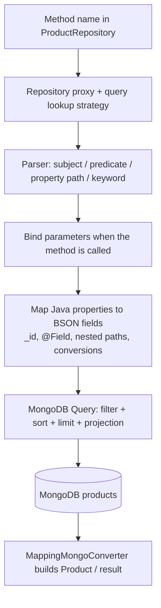

# Method Name Structure and BSON Query Derivation Mechanism

## 1. Lesson Objectives

In **Spring Data MongoDB**, you can declare methods in an interface extending `MongoRepository` and let the framework **derive queries** from the method name. For example, instead of writing a MongoDB filter directly, you declare `findBySku(String sku)`; Spring Data parses the name, maps the Java property to the BSON field name, and executes the query on the corresponding collection.

This lesson belongs to the **Derived Queries** chapter and uses the **Mini Commerce** model with `Product`, `Customer`, and `Order`. From this model, we practice finding active products, filtering by price, looking up a customer's orders, and querying orders by fields of an embedded shipping address. This knowledge serves as the foundation for `MongoTemplate`, complex queries, aggregation, indexes, transactions, reactive access, testing, and data performance diagnostics.

Upon completing this lesson, you will be able to:

1. Split a method name into **subject**, `By`, **predicate**, operators, and ordering clauses.
2. Explain how the repository infrastructure validates property paths, binds parameters, and builds BSON filters.
3. Correctly use common keywords such as `And`, `Or`, `GreaterThanEqual`, `In`, `Between`, `IsNull`, `Exists`, `Containing`, and `OrderBy`.
4. Distinguish between **Java property names** and **MongoDB field names** when using `@Id`, `@Field`, and embedded objects.
5. Choose appropriate return types and pagination: `Optional`, `List`, `Page`, `Slice`, `Top`/`First`, `countBy`, and `existsBy`.
6. Know when to switch to `@Query`, `MongoTemplate`, or aggregation, while verifying performance with `explain("executionStats")`.

**Prerequisites:** Java interfaces and generics, Spring Boot with `spring-boot-starter-data-mongodb`, MongoDB/BSON, `@Document`, `@Id`, repositories, `BigDecimal`, and `Instant`. The illustrative examples use the synchronous API. For the reactive branch, the name-parsing principles are similar, but return types and execution use Reactor `Mono`/`Flux`.

## 2. Mini Commerce Data Model

Fields used in this lesson:

| Collection | Java entity | Java property | BSON field and meaning |
| --- | --- | --- | --- |
| `products` | `Product` | `id` | `_id` – technical ID |
| `products` | `Product` | `sku`, `name` | `sku`, `name` – product code and name |
| `products` | `Product` | `category`, `active` | `category`, `active` – category and active status |
| `products` | `Product` | `price` | `unit_price` – Decimal128 price (aliased via `@Field`) |
| `products` | `Product` | `stock` | `stock` – stock quantity |
| `customers` | `Customer` | `id`, `email` | `_id`, `email` |
| `orders` | `Order` | `customerId`, `status` | `customerId`, `status` |
| `orders` | `Order` | `placedAt` | `placedAt` – order placement timestamp |
| `orders` | `Order` | `shippingAddressSnapshot.city` | `shippingAddressSnapshot.city` – city in embedded document |
| `orders` | `Order` | `lines` | `lines` – array of embedded order lines |

In this lesson, `price` is the **Java property name**, while `unit_price` is the **BSON field name** intentionally named differently so learners can clearly see the mapping step. If a real project uses the BSON name `price`, adjust `@Field` and the `mongosh` commands consistently.

Example BSON of a product:

```json
{
  "_id": "prod-001",
  "sku": "LAP-001",
  "name": "Mini Mechanical Keyboard",
  "category": "phu-kien",
  "active": true,
  "unit_price": { "$numberDecimal": "129900.00" },
  "stock": 20
}
```

And an order:

```json
{
  "_id": "order-001",
  "customerId": "customer-001",
  "status": "PLACED",
  "placedAt": { "$date": "2026-11-20T02:00:00Z" },
  "shippingAddressSnapshot": {
    "recipient": "Nguyen Thi Lan",
    "city": "TP Ho Chi Minh",
    "country": "VN"
  },
  "lines": [
    {
      "productId": "prod-001",
      "sku": "LAP-001",
      "quantity": 2,
      "unitPrice": { "$numberDecimal": "129900.00" }
    }
  ]
}
```

This is **MongoDB Extended JSON**: `$numberDecimal` indicates BSON Decimal128, and `$date` indicates BSON Date. The `mongosh` query examples below use `NumberDecimal(...)` and `ISODate(...)` to pass the proper BSON types.

## 3. General Structure of a Derived Query

Method names typically follow this form:

```text
<prefix> [descriptive text / Distinct / Top / First] By
<Property><Operator> [And / Or <Property><Operator> ...]
[OrderBy<Property>Asc|Desc ...]
```

Example:

```java
List<Product> findTop5ByActiveTrueAndCategoryOrderByPriceAsc(
    String category);
```

Reading from left to right:

| Component | Meaning |
| --- | --- |
| `find` | Subject indicating finding entities |
| `Top5` | Limits to a maximum of 5 results |
| `By` | Delimiter between subject and predicate |
| `ActiveTrue` | Condition `active = true`; takes no parameter for `True` |
| `And` | Combines conditions with logical AND |
| `Category` | Condition `category = ?`, takes the `category` parameter |
| `OrderByPriceAsc` | Sorts ascending by the **Java property** `price` |

Corresponding logical BSON (accounting for the `price → unit_price` alias):

```javascript
db.products.find({
  active: true,
  category: "phu-kien"
})
.sort({ unit_price: 1 })
.limit(5)
```

This is a logical representation for explanation. The driver may send filter, sort, and limit as options on the `find` command rather than the exact `mongosh` command chain above. Spring Data also applies mapping converters, actual BSON types, and repository settings before execution.



A method whose name resembles keywords **is not parsed by arbitrary string matching**: Spring Data uses a structured name parser and the **entity's actual property paths**.

## 4. Declaring the Foundational Entity and Repository

To illustrate renaming the `price` field to `unit_price`, create a minimal entity. In a full project, constructors, validation, indexes, and other business properties can be added.

```java
package com.example.minicommerce.domain;

import java.math.BigDecimal;
import org.springframework.data.annotation.Id;
import org.springframework.data.mongodb.core.mapping.Document;
import org.springframework.data.mongodb.core.mapping.Field;
import org.springframework.data.mongodb.core.mapping.FieldType;

@Document(collection = "products")
public class Product {
    @Id
    private String id;

    private String sku;
    private String name;
    private String category;
    private boolean active;

    @Field(name = "unit_price", targetType = FieldType.DECIMAL128)
    private BigDecimal price;

    private int stock;

    public Product() {}

    public String getId() { return id; }
    public void setId(String id) { this.id = id; }
    public String getSku() { return sku; }
    public void setSku(String sku) { this.sku = sku; }
    public String getName() { return name; }
    public void setName(String name) { this.name = name; }
    public String getCategory() { return category; }
    public void setCategory(String category) {
        this.category = category;
    }
    public boolean isActive() { return active; }
    public void setActive(boolean active) { this.active = active; }
    public BigDecimal getPrice() { return price; }
    public void setPrice(BigDecimal price) { this.price = price; }
    public int getStock() { return stock; }
    public void setStock(int stock) { this.stock = stock; }
}
```

Initial repository:

```java
package com.example.minicommerce.repository;

import java.math.BigDecimal;
import java.util.List;
import java.util.Optional;

import org.springframework.data.domain.Page;
import org.springframework.data.domain.Pageable;
import org.springframework.data.mongodb.repository.MongoRepository;

import com.example.minicommerce.domain.Product;

public interface ProductRepository
        extends MongoRepository<Product, String> {

    Optional<Product> findBySku(String sku);

    List<Product> findByActiveTrueAndCategory(String category);

    List<Product> findByPriceGreaterThanEqual(
        BigDecimal minimumPrice);

    Page<Product> findByActiveTrueAndCategory(
        String category, Pageable pageable);
}
```

The interface has two overloads with the same prefix `findByActiveTrueAndCategory` but different parameters: one returns `List`, and one accepts `Pageable` and returns `Page`. Both use the **same filter condition**, but have different pagination contracts. In a real application, name methods clearly at the service layer to avoid misusing them.

When the application context starts, Spring Data creates the repository proxy. For derived methods, it parses the name and validates the properties. When invoked, it binds parameter values, applies mapping, and sends the query to MongoDB.

## 5. Subject: Finding, Counting, Existence, Deleting, and Limiting

Common prefixes:

| Method | Common return type | Meaning |
| --- | --- | --- |
| `findBySku(String sku)` | `Optional<Product>` | Find the product with the matching SKU |
| `readBySku(String sku)` / `getBySku(String sku)` | Depends on declared type | Also acts as a finder query method |
| `existsBySku(String sku)` | `boolean` | Check whether a matching document exists |
| `countByCategory(String category)` | `long` | Count matching documents |
| `deleteBySku(String sku)` | `long` or `void` depending on method | Delete matching documents |
| `findFirstByOrderByPriceAsc()` | `Optional<Product>` | Fetch one product with the lowest price according to the defined sort |
| `findTop5ByCategoryOrderByPriceDesc(String category)` | `List<Product>` | Fetch at most 5 highest-priced products in the category |

Notes:

- `find`, `read`, `get`, `query`, and several similar prefixes are **introducer keywords**. The exact supported set depends on the version and store module.
- Descriptive text between the prefix and `By` generally **does not affect the filter**, except for special keywords such as `Distinct`, `Top`, or `First`.
- `Top`/`First` limits the **number of results**, and does not guarantee the "latest" result without a sort. Always specify an ordering when the business requirement asks for "highest", "latest", or "lowest".
- `Distinct` and how distinct results are represented vary by store and return type. For requirements requiring distinct values across multiple fields, test the actual query or use an explicit aggregation.
- `deleteBy...` is a **write/delete operation**. Enforce validation, authorization, and dedicated tests; do not let a concise method name mislead readers into treating it as a read-only query.

### 5.1. Distinguishing from Built-in Methods

`findById(id)`, `existsById(id)`, and `deleteById(id)` are inherited from `CrudRepository` and have **reserved semantics for the identifier**. They target the property annotated with `@Id` (BSON `_id`), even when the entity happens to have another regular field named `id` in some models.

Example:

```java
@Document(collection = "products")
class LegacyProduct {
    @Id
    private String pk;

    private String id; // Legacy business code, not @Id.

    // Constructor/getters/setters...
}

interface LegacyProductRepository
        extends MongoRepository<LegacyProduct, String> {

    // Inherited findById(String): queries by @Id pk -> _id.

    // Use descriptive word "Product" to avoid colliding with the reserved method:
    Optional<LegacyProduct> findProductById(String id);
}
```

Here `findProductById` is derived against the **Java property `id`**, whereas the base repository's `findById` queries against `pk` marked with `@Id`. This is an important exception when parsing query methods.

## 6. Predicate: Keywords and BSON Filters

The `Predicate` after `By` describes the conditions. Property names must match the Java model. The table below uses `Product` and `Order` from Mini Commerce; the illustrative BSON excludes extra conditions (such as tenant isolation) if applied separately by the service.

| Derived query | Logical BSON filter | Explanation |
| --- | --- | --- |
| `findBySku("LAP-001")` | `{ sku: "LAP-001" }` | Equality comparison (`Equals` not required) |
| `findBySkuNot("LAP-001")` | `{ sku: { $ne: "LAP-001" } }` | Not equal to value |
| `findByActiveTrue()` | `{ active: true }` | No parameter required |
| `findByActiveFalse()` | `{ active: false }` | No parameter required |
| `findByPriceGreaterThan(x)` | `{ unit_price: { $gt: x } }` | Greater than, using BSON Decimal128 per mapping |
| `findByPriceGreaterThanEqual(x)` | `{ unit_price: { $gte: x } }` | Greater than or equal to |
| `findByPriceLessThan(x)` | `{ unit_price: { $lt: x } }` | Less than |
| `findByPriceLessThanEqual(x)` | `{ unit_price: { $lte: x } }` | Less than or equal to |
| `findByCategoryIn(categories)` | `{ category: { $in: [...] } }` | In list |
| `findByCategoryNotIn(categories)` | `{ category: { $nin: [...] } }` | Not in list |
| `findByPlacedAtAfter(time)` | `{ placedAt: { $gt: time } }` | After timestamp, exclusive |
| `findByPlacedAtBefore(time)` | `{ placedAt: { $lt: time } }` | Before timestamp, exclusive |
| `findByNameNull()` | `{ name: null }` | Matches null **or missing field** per MongoDB semantics |
| `findByNameNotNull()` | `{ name: { $ne: null } }` | Not null per MongoDB semantics |
| `findByNameExists(flag)` | `{ name: { $exists: flag } }` | Checks field existence (may be null) |

### 6.1. Examples of And and Or

```java
List<Product> findByActiveTrueAndCategory(String category);

List<Product> findByCategoryOrSku(
    String category, String sku);
```

Logical filters:

```javascript
// findByActiveTrueAndCategory("phu-kien")
{ active: true, category: "phu-kien" }

// findByCategoryOrSku("phu-kien", "LAP-001")
{
  $or: [
    { category: "phu-kien" },
    { sku: "LAP-001" }
  ]
}
```

For expressions mixing multiple `And` and `Or` operators, method names can become hard to read and easy to misinterpret regarding grouping. If the goal is `active AND (category OR sku)`, use `@Query` or `MongoTemplate` to express parentheses explicitly and write tests with data that distinguishes each branch. Do not infer operator precedence by reading the sentence in natural language.

### 6.2. Which Boundaries Does Between Use?

MongoDB-specific query methods support:

```java
List<Product> findByStockBetween(int min, int max);
```

According to the MongoDB keyword table, the two-value form typically uses **open boundaries**:

```javascript
{ stock: { $gt: 5, $lt: 20 } }
```

`findByStockBetween(5, 20)` does not automatically include the exact values `5` and `20`. If inclusive boundaries on both ends are required, you can use a `Range` with appropriate bounds when supported by the API, or write explicitly:

```java
List<Product> findByStockGreaterThanEqualAndStockLessThanEqual(
    int min, int max);
```

When reading or writing time-related code, prefer **half-open** intervals `[from, to)` so records at reporting period boundaries are not double-counted. Using `GreaterThanEqual` and `LessThan` expresses the intent more clearly than guessing the boundary semantics of `Between`.

### 6.3. How IsNull and Exists Differ

MongoDB treats the filter `{ field: null }` as matching documents where `field` equals null **or does not exist**.

Example dataset:

```javascript
{ _id: "a", name: null }
{ _id: "b" }
{ _id: "c", name: "Keyboard" }
```

Results:

- `findByNameNull()`: typically returns `a` and `b`.
- `findByNameExists(true)`: returns `a` and `c` because the field is present.
- `findByNameExists(false)`: returns `b` because the field does not exist.
- `findByNameNotNull()`: follows MongoDB's `$ne: null` expression; verify the exact missing-field case if your system needs to distinguish null from missing.

When you need to distinguish BSON types or require a field to exist and be non-null, write an explicit query with `MongoTemplate`/`@Query` and test against legacy data. Java `null`, BSON Null, and a **missing field** are three cases that require clear schema conventions.

## 7. String Queries: Like, Containing, Regex, IgnoreCase

Methods for searching product names:

```java
List<Product> findByNameContaining(String fragment);

List<Product> findByNameStartingWith(String prefix);

List<Product> findByNameEndingWith(String suffix);

List<Product> findByNameIgnoreCase(String exactName);

List<Product> findByNameContainingIgnoreCase(String fragment);

List<Product> findByNameRegex(String pattern);
```

Spring Data MongoDB represents many of the string queries above using **regular expressions** in the filter. Logical examples:

```javascript
// Containing("Mini") — illustrates substring regex:
{ name: { $regex: "Mini" } }

// StartingWith("Mini"):
{ name: { $regex: "^Mini" } }

// EndingWith("Keyboard"):
{ name: { $regex: "Keyboard$" } }

// IgnoreCase("Mini Mechanical Keyboard") — case-insensitive match:
{
  name: {
    $regex: "^Mini Mechanical Keyboard$",
    $options: "i"
  }
}
```

This is **logical BSON** for learning, not a guarantee of the exact pattern string Spring Data generates across all versions; some keywords escape special characters or wrap the regex in a `Pattern`. `Regex` intentionally accepts a regular expression pattern, unlike literal string matching. Therefore:

- For user text searches, choose `Containing`/`StartingWith` when appropriate and verify escaping.
- Do not let users pass an arbitrary regex into `findByNameRegex` without bounding its length/structure; resource-intensive patterns pose a performance risk.
- `IgnoreCase` does not automatically mean a collation index will be used. A case-insensitive regex query may not use a standard index as effectively as an equality query with a matching collation.
- For ranked search, diacritic-insensitive search, stemming, or autocomplete, consider MongoDB Search, text indexes, or a dedicated design; derived queries are not a complete full-text search engine.

## 8. Property Paths: Going from Java Names to Nested BSON

### 8.1. Order Entity with Embedded Shipping Address

Abbreviated model example:

```java
package com.example.minicommerce.domain;

import java.time.Instant;
import org.springframework.data.annotation.Id;
import org.springframework.data.mongodb.core.mapping.Document;

@Document(collection = "orders")
public class Order {
    @Id
    private String id;

    private String customerId;
    private String status;
    private Instant placedAt;
    private ShippingAddress shippingAddressSnapshot;

    public Order() {}

    public String getId() { return id; }
    public void setId(String id) { this.id = id; }
    public String getCustomerId() { return customerId; }
    public void setCustomerId(String customerId) {
        this.customerId = customerId;
    }
    public String getStatus() { return status; }
    public void setStatus(String status) { this.status = status; }
    public Instant getPlacedAt() { return placedAt; }
    public void setPlacedAt(Instant placedAt) {
        this.placedAt = placedAt;
    }
    public ShippingAddress getShippingAddressSnapshot() {
        return shippingAddressSnapshot;
    }
    public void setShippingAddressSnapshot(ShippingAddress address) {
        this.shippingAddressSnapshot = address;
    }
}

class ShippingAddress {
    private String recipient;
    private String city;
    private String country;

    public ShippingAddress() {}
    public String getRecipient() { return recipient; }
    public void setRecipient(String recipient) {
        this.recipient = recipient;
    }
    public String getCity() { return city; }
    public void setCity(String city) { this.city = city; }
    public String getCountry() { return country; }
    public void setCountry(String country) { this.country = country; }
}
```

`ShippingAddress` is an embedded object inside `orders`, requiring no separate collection. When turning these classes into actual Java files, you can make `ShippingAddress` a separate public class or a nested class matching your package organization.

### 8.2. Querying by Embedded Properties

```java
List<Order> findByShippingAddressSnapshot_City(String city);
```

In the method name, the underscore `_` is a **property path delimiter**, instructing the parser to traverse from `shippingAddressSnapshot` to `city`. Corresponding BSON filter:

```javascript
{
  "shippingAddressSnapshot.city": "TP Ho Chi Minh"
}
```

Writing it without an underscore, `findByShippingAddressSnapshotCity(...)`, may also be split correctly by the parser if the entity has no competing property. However, Spring Data tries to resolve properties along CamelCase boundaries; if the entity also has a direct `shippingAddressSnapshotCity` property, it becomes ambiguous. Use `_` to indicate traversal explicitly.

### 8.3. Avoid Confusing Underscores with BSON Field Names

Suppose the Java field is `shippingAddressSnapshot` but the BSON field is renamed:

```java
@Field("ship_to")
private ShippingAddress shippingAddressSnapshot;
```

The repository method must still be based on the **Java property path**:

```java
List<Order> findByShippingAddressSnapshot_City(String city);
```

BSON filter after mapping:

```javascript
{ "ship_to.city": "TP Ho Chi Minh" }
```

Do not name the method `findByShip_toCity` just because BSON uses `ship_to`. The `_` in a method name is Spring Data parser syntax, not a mechanism for copying raw MongoDB key names. Prefer camelCase in Java entities to avoid conflicting with the parser's special delimiter.

### 8.4. Querying into Embedded Document Arrays

If `Order` has `List<OrderLine> lines`, where each line has `sku`:

```java
List<Order> findByLines_Sku(String sku);
```

Logical BSON:

```javascript
{ "lines.sku": "LAP-001" }
```

MongoDB finds orders where **at least one element** of the `lines` array contains the matching SKU. However, if you need **two conditions on the same array element**, such as SKU and quantity on the exact same line, two independent conditions on dotted paths can match **two different elements**. In that case, use `$elemMatch` via `@Query` or `MongoTemplate`:

```javascript
{
  lines: {
    $elemMatch: {
      sku: "LAP-001",
      quantity: { $gte: 2 }
    }
  }
}
```

This is a classic example of the limits of derived method names. Short method names matter less than **correct BSON filter semantics**.

## 9. Mapping Java Properties and Data Types to BSON

Derived queries have two independent layers:

1. **Method name parsing**: identifies properties, operators, nested paths, and parameter positions.
2. **Store mapping**: translates property paths, values, and domain types into BSON understood by MongoDB.

Example:

```java
List<Product> findByPriceGreaterThanEqual(
    BigDecimal minimumPrice);
```

In `Product`, `price` has:

```java
@Field(name = "unit_price", targetType = FieldType.DECIMAL128)
private BigDecimal price;
```

When called:

```java
List<Product> products = repository.findByPriceGreaterThanEqual(
    new BigDecimal("100000.00"));
```

Logical filter in MongoDB:

```javascript
{
  unit_price: {
    $gte: NumberDecimal("100000.00")
  }
}
```

`@Field` changes the **name** and `targetType` specifies the **storage type**. Do not pass a JavaScript numeric literal `100000.00` in a raw query and assume MongoDB will treat it as Decimal128. For monetary data, always verify the actual BSON and standardize on `BigDecimal`/`Decimal128` across repositories, `MongoTemplate`, migrations, and aggregations.

### 9.1. Identifier Mapping

With `@Id private String id`, `findById("prod-001")` targets `_id`. If a string ID is a valid 24-character hexadecimal ObjectId string, Spring Data's ID conversion rules may convert it to BSON ObjectId when saving/querying. This lesson uses IDs like `"prod-001"` to avoid confusion; real projects should define a consistent ID type across entities and reference fields (`customerId`, `productId`).

### 9.2. Impact of Custom Conversions

If `Customer` has a property using `@ValueConverter` or `MongoCustomConversions`, the derived query is still parsed from the **Java property**; however, how the parameter is converted to BSON should be verified against your Spring Data version, especially when a converter applies per property.

For example, a Java field `primaryPhone` stored under the BSON key `contact_phone` as a String. When filtering by phone number, write an integration test verifying that the query actually uses `contact_phone` with a String value. With the raw driver or `mongosh`, pass the **store-native value**; write/query paths that bypass entity mapping may not invoke converters.

## 10. Sorting, Limiting, and Pagination

### 10.1. Static Sorting with OrderBy

```java
List<Product> findByActiveTrueOrderByPriceAsc();

List<Order> findByCustomerIdOrderByPlacedAtDesc(
    String customerId);
```

Logical BSON:

```javascript
db.products.find({ active: true })
  .sort({ unit_price: 1 });

db.orders.find({ customerId: "customer-001" })
  .sort({ placedAt: -1 });
```

In MongoDB, `1` is ascending and `-1` is descending. If multiple documents share the same `placedAt` or `unit_price`, the order among them may be unstable; for pagination, add a unique tie-breaker key (such as `_id`) for deterministic ordering.

### 10.2. Dynamic Sorting and Pagination

```java
Page<Order> findByCustomerId(
    String customerId, Pageable pageable);

List<Product> findByActiveTrue(
    Sort sort);
```

Calling from a service:

```java
import org.springframework.data.domain.Page;
import org.springframework.data.domain.PageRequest;
import org.springframework.data.domain.Sort;

PageRequest page = PageRequest.of(
    0, 20,
    Sort.by(Sort.Order.desc("placedAt"), Sort.Order.desc("id"))
);

Page<Order> orders = orderRepository.findByCustomerId(
    "customer-001", page);
```

`PageRequest.of(0, 20, ...)` fetches the first page (**0-indexed**). `Page` carries data plus total-element/total-page metadata; computing the total can trigger an extra **count query**. If you only need to know whether a next page exists without the total count, `Slice` may be more suitable:

```java
Slice<Order> findByCustomerId(String customerId, Pageable pageable);
```

When applying `Sort` or `Pageable` from an HTTP request, **whitelist allowed sort properties** (e.g., `placedAt`, `id`, `price`), bound page sizes, and use appropriate indexes. Do not let clients arbitrarily sort on sensitive fields or trigger overly expensive queries.

### 10.3. Combining First and Top with Sorting

```java
Optional<Order> findFirstByCustomerIdOrderByPlacedAtDesc(
    String customerId);

List<Product> findTop3ByActiveTrueOrderByPriceDesc();
```

These methods limit the number of results; with `Top3`, include a sort to define what "top" means. If combining `Top` with `Pageable`, pagination semantics operate within the capped result set; carefully verify totals and cases exceeding the limit.

## 11. Query Lookup Strategy: When Does Spring Data Use the Method Name?

Not every repository method is derived from its name. Spring Data uses a **query lookup strategy**:

| Strategy | How it works | When to use |
| --- | --- | --- |
| `CREATE` | Attempts to build a query from the method name | When you want all methods to follow derivation conventions |
| `USE_DECLARED_QUERY` | Requires a declared query, failing if missing | Projects wanting all queries explicitly declared |
| `CREATE_IF_NOT_FOUND` | Looks for a declared query first; derives if absent | **Default** for Spring Data repositories |

Example:

```java
@Query("{ 'status': ?0, 'customerId': ?1 }")
List<Order> loadOrdersByStatusAndCustomer(
    String status, String customerId);
```

Because this method is annotated with `@Query`, it has a **declared query**, so the parser does not need to derive a filter from `loadOrdersByStatusAndCustomer`. Under `CREATE_IF_NOT_FOUND`, declared queries take precedence over naming conventions. In real code, `@Query` is imported from `org.springframework.data.mongodb.repository.Query`.

You can configure the strategy via `@EnableMongoRepositories(queryLookupStrategy = ...)`. Before changing the strategy of an existing project, audit all repository methods, because a strategy that only accepts declared queries will cause derived methods without `@Query` to fail at startup.

### 11.1. When a Method Name Is Invalid

Example:

```java
// Product has no Java property "productCategory":
List<Product> findByProductCategory(String category);
```

Spring Data will not guess `category` just because the name is similar. During query method initialization, a `PropertyReferenceException`, `QueryCreationException`, or repository bean creation error may occur depending on the version and context. The error message usually identifies the missing property.

Fix it to:

```java
List<Product> findByCategory(String category);
```

**Do not alter the BSON schema by guessing method names.** Check the Java property, `@Field` alias, and embedded path first.

## 12. How Do Derived Queries Differ from @Query, MongoTemplate, and Aggregation?

| Requirement | Suitable approach | Example |
| --- | --- | --- |
| Simple equality, range, boolean, in-list | Derived method | `findByActiveTrueAndCategory(...)` |
| Paginated order history per customer | Derived + `Pageable`/`Slice` | `findByCustomerId(...)` |
| Multi-branch conditions needing clear parentheses | `@Query` or `MongoTemplate` | `active AND (category OR sku)` |
| Conditions on the same array element | `@Query`/`MongoTemplate` + `$elemMatch` | Order line matching both SKU and quantity |
| Optional filters composed dynamically | `MongoTemplate` with `Query`/`Criteria` | Product search across optional inputs |
| Revenue statistics / best-selling products | Aggregation | `$unwind`, `$group`, `$sum` |
| Conditional stock decrement | `MongoTemplate.updateFirst` or explicit update | `$inc` when stock is sufficient |
| Consistent multi-document writes | Transaction when required | Create Order and decrement stock |

### 12.1. Comparing the Same Query

Derived repository:

```java
List<Product> findByActiveTrueAndCategory(String category);
```

With `MongoTemplate`:

```java
Query query = Query.query(
    Criteria.where("active").is(true)
        .and("category").is("phu-kien")
);

List<Product> products =
    mongoTemplate.find(query, Product.class);
```

Import `org.springframework.data.mongodb.core.query.Query`, `Criteria`, and `MongoTemplate`. Both approaches can produce equivalent BSON filters, but `MongoTemplate` makes dynamic criteria and complex combinations easier to read.

### 12.2. Combining Multiple Branches with Explicit Parentheses

Example `active AND (category = ? OR sku = ?)`:

```java
Query query = Query.query(
    new Criteria().andOperator(
        Criteria.where("active").is(true),
        new Criteria().orOperator(
            Criteria.where("category").is(category),
            Criteria.where("sku").is(sku)
        )
    )
);
```

Logical BSON:

```javascript
{
  $and: [
    { active: true },
    {
      $or: [
        { category: "phu-kien" },
        { sku: "LAP-001" }
      ]
    }
  ]
}
```

Here, `category` and `sku` are parameters validated beforehand by the service. In a real system, if multi-tenancy, authorization, or soft-delete rules apply, those filters must always be included; derived queries **do not automatically inject security rules** unless explicitly configured by the application.

## 13. How Are Queries Executed and Verified?

### 13.1. From Java Call to MongoDB

When the service calls:

```java
List<Product> result =
    productRepository.findByPriceGreaterThanEqual(
        new BigDecimal("100000.00"));
```

Conceptual flow:

1. The repository proxy looks up the query definition for the method. For derived methods, the name parser (such as Spring Data's `PartTree`/query creator) has already resolved the predicates and property paths.
2. The `minimumPrice` argument is bound to its corresponding condition.
3. The query is mapped via `Product` metadata to use the `unit_price` field and Decimal128 type.
4. The MongoDB driver executes the filter on the `products` collection.
5. BSON results are materialized into `Product` instances by the converter, and the declared return wrapper (`List<Product>` or another type) is returned.

Do not think of the parser as concatenating JSON strings on every service call; the repository infrastructure manages query metadata/definitions, while **parameter values vary per invocation**.

### 13.2. Using mongosh to Verify BSON Filters

```javascript
db.products.find({
  unit_price: { $gte: NumberDecimal("100000.00") }
})
```

If the repository returns different results than `mongosh`, check:

- Does the connection point to the same **database** and `products` collection?
- Does Java `price` have `@Field(name = "unit_price", targetType = DECIMAL128)`?
- Do legacy documents store prices as BSON String/Double instead of Decimal128?
- Was the `minimumPrice` input properly scaled and validated?
- Does the repository method declare additional sort, limit, `Pageable`, or query annotations?

### 13.3. Checking Indexes with explain

Two key queries in Mini Commerce:

```javascript
// Active catalog page sorted by price:
db.products.createIndex({
  active: 1,
  category: 1,
  unit_price: 1
})

db.products
  .find({ active: true, category: "phu-kien" })
  .sort({ unit_price: 1 })
  .explain("executionStats")

// Customer order history, newest first:
db.orders.createIndex({
  customerId: 1,
  placedAt: -1
})

db.orders
  .find({ customerId: "customer-001" })
  .sort({ placedAt: -1 })
  .explain("executionStats")
```

These are suggested indexes for the lesson's query shapes, **not automatically optimal for every workload**. In real environments, inspect `winningPlan`, `totalKeysExamined`, `totalDocsExamined`, `nReturned`, and latency before/after. For pagination requiring stable sorting, consider adding `_id` as a secondary key and adjusting compound indexes accordingly.

**Remember:** derived queries reduce boilerplate for describing filters, but they do not automatically create indexes, eliminate full collection scans, or replace query plan diagnostics.

## 14. Testing Against Real MongoDB

An integration test should run against real MongoDB or Testcontainers to verify parsing, alias mapping, BSON types, and query results. Example using `@DataMongoTest`; tests must be configured against an isolated test MongoDB instance.

```java
package com.example.minicommerce;

import static org.junit.jupiter.api.Assertions.*;

import java.math.BigDecimal;
import org.bson.Document;
import org.junit.jupiter.api.Test;
import org.springframework.beans.factory.annotation.Autowired;
import org.springframework.boot.test.autoconfigure.data.mongo.DataMongoTest;
import org.springframework.data.mongodb.core.MongoTemplate;

import com.example.minicommerce.domain.Product;
import com.example.minicommerce.repository.ProductRepository;

@DataMongoTest
class ProductDerivedQueryTest {
    @Autowired
    ProductRepository repository;

    @Autowired
    MongoTemplate template;

    @Test
    void derivesRangeQueryAndMapsBsonFieldAlias() {
        var raw = template.getCollection("products");
        String lowId = "derived-low-test";
        String highId = "derived-high-test";

        raw.deleteMany(new Document("_id",
            new Document("$in", java.util.List.of(lowId, highId))));

        try {
            raw.insertOne(new Document("_id", lowId)
                .append("sku", "DER-LOW")
                .append("name", "Low-priced item")
                .append("active", true)
                .append("category", "test")
                .append("unit_price",
                    new org.bson.types.Decimal128(
                        new BigDecimal("90000.00")))
                .append("stock", 5));

            raw.insertOne(new Document("_id", highId)
                .append("sku", "DER-HIGH")
                .append("name", "High-priced item")
                .append("active", true)
                .append("category", "test")
                .append("unit_price",
                    new org.bson.types.Decimal128(
                        new BigDecimal("129900.00")))
                .append("stock", 3));

            var result = repository.findByPriceGreaterThanEqual(
                new BigDecimal("100000.00"));

            assertTrue(result.stream()
                .anyMatch(p -> highId.equals(p.getId())));
            assertFalse(result.stream()
                .anyMatch(p -> lowId.equals(p.getId())));
        } finally {
            raw.deleteMany(new Document("_id",
                new Document("$in",
                    java.util.List.of(lowId, highId))));
        }
    }
}
```

The test inserts data using **raw BSON Decimal128**, truly verifying that the derived query uses the `unit_price` alias and the right numeric threshold. Use an isolated test database; fixture cleanup examples are **not intended for production environments**.

Note: the test above is written for a Spring Boot environment supporting `@DataMongoTest` in the imported package; some newer Boot versions reorganize test modules and annotation packages. When migrating across versions, adjust imports/auto-configuration according to your Boot version's reference documentation while preserving the verification goal.

### 14.1. Minimum Cases to Include in Tests

| Test | Data to create | Expected outcome |
| --- | --- | --- |
| `findBySku` | 1 document with SKU, 1 without | `Optional` present/empty as expected |
| `findByActiveTrueAndCategory` | Both `active` states | Returns only active products in the category |
| `findByPriceGreaterThanEqual` | Price at boundary and below boundary | `$gte` includes exact boundary price |
| `findByStockBetween` | `stock` equal to min, between, equal to max | Accurately detects boundary semantics |
| `findByNameNull` / `Exists` | Null, missing field, String present | Distinguishes null from missing |
| `findByShippingAddressSnapshot_City` | Two orders with different cities | Queries the correct BSON nested path |
| `findByCustomerId` + `Pageable` | Multiple orders on the same date | Pagination, sort, and stable secondary order |
| `findByLines_Sku` | Multiple order lines | Matches documents containing the SKU |
| `$elemMatch` | Two array elements satisfying two different conditions | Does not false-match like two independent dotted predicates |
| `@Field` mapping | Java `price`, BSON `unit_price` | Method name uses Java property and query uses BSON field |
| Invalid property query | Test interface with `findByProductCategory` | Context detects query creation error |
| Performance test | Dataset larger than sample data | Compares query plans, indexes, and scanned document counts |

## 15. Common Pitfalls with Derived Queries

| Symptom | Common cause | Solution |
| --- | --- | --- |
| Startup error `No property 'X' found` | Method name does not match Java property | Check entity and property path; rename method |
| Query does not target expected BSON field | Method named after field alias instead of Java property | Use Java name; let `@Field` handle mapping |
| Nested path query picks wrong property | Ambiguity between direct property and nested property | Use `_` as explicit traversal delimiter |
| `findById` filters wrong business ID | Collides with reserved identifier method | Distinguish `@Id` from regular field; use descriptive method like `findProductById` |
| Range excludes boundary values | Used `GreaterThan` or default open-bound `Between` | Choose `GreaterThanEqual`/`LessThanEqual` as needed |
| `IsNull` returns documents missing the field | MongoDB null equality matches null or missing | Use `Exists` and explicit queries when distinction matters |
| `IgnoreCase` query is slow | Case-insensitive regex does not leverage indexes as expected | Measure with `explain`, consider normalization/collation/indexes |
| `Containing` does not match search needs | Regex query rather than full-text ranking | Choose an appropriate text search tool |
| "Latest order" query returns changing results | Missing sort or sort lacks a tie-breaker | Use `OrderByPlacedAtDesc` + secondary key sort |
| `Page` is slow despite returning few records | Extra count query or deep skip | Consider `Slice`, keyset/cursor pagination, indexes |
| Long derived query hard to maintain | Too many `And`/`Or` or optional conditions | Switch to `@Query`/`MongoTemplate` and add tests |
| Two array conditions match different elements | Dotted paths do not enforce same element | Use `$elemMatch` |
| Price query gives wrong results | Field mixes BSON String/Double with Decimal128 | Audit `$type`, migrate, and keep consistent types |
| Reactive repository misuses `Optional`/`Page` | Mixing blocking and non-blocking APIs | Use `Mono`/`Flux` and reactive-compatible pagination |
| Query works but is very slow | Missing index or overly broad regex/scan | Inspect `explain` and bound result sizes |

## 16. Connection to Reactive, Transactions, and Aggregation

If using `spring-boot-starter-data-mongodb-reactive`, derived methods still rely on **method name structure and entity mapping**, but the interface extends `ReactiveMongoRepository` and returns publishers:

```java
import reactor.core.publisher.Flux;
import reactor.core.publisher.Mono;
import org.springframework.data.mongodb.repository.ReactiveMongoRepository;

public interface ReactiveProductRepository
        extends ReactiveMongoRepository<Product, String> {

    Mono<Product> findBySku(String sku);

    Flux<Product> findByActiveTrueAndCategory(
        String category);
}
```

A reactive query runs only when the publisher is subscribed to; do not call `block()` on non-blocking HTTP threads. For reactive pagination, typically use `Flux` accepting `Pageable` or an appropriate pagination pattern; do not assume `Page<T>` is supported as a return type like in the synchronous branch.

Derived queries are mainly suited for **simple read/find/delete operations by conditions**. They do not generate multi-step aggregations for revenue reporting, do not automatically create multi-document transactions, and do not prevent negative stock. Mini Commerce workflows such as conditional stock deduction via `$inc` or creating an order while updating multiple products require `MongoTemplate`/transaction managers according to business rules. Revenue reports should use aggregation with `$match`, `$unwind`, `$group`, and `$sum`.

When designing indexes, base decisions on actual BSON filters, sorts, and query frequency. Method names may change while producing equivalent BSON filters; conversely, changing only `@Field` or storage types can alter query shape and index usability.

## 17. Hands-on Exercises and Completion Criteria

**Exercise 1 — Parsing method names:** Break down `findTop5ByActiveTrueAndCategoryOrderByPriceAsc` into subject, predicate, parameters, sort, and limit. Write the corresponding BSON filter using the `unit_price` alias.

**Exercise 2 — CRUD lookups:** Declare a repository to find products by SKU, check existence, count by category, and filter active items. Seed sample data and verify using both the repository and `mongosh`.

**Exercise 3 — Price and time ranges:** Write a method filtering products with `price ≥ 100000.00` and `price < 200000.00`; compare with `Between`. Write a method filtering orders in `[from, to)`.

**Exercise 4 — Embedded documents:** Add `Order.shippingAddressSnapshot.city` and declare `findByShippingAddressSnapshot_City`. Try adding a competing property named like the concatenated path to see the role of `_`.

**Exercise 5 — Line item arrays:** Find orders containing SKU `LAP-001` via a derived query. Then create an order with two lines where each line satisfies only one of the SKU/quantity conditions; write `$elemMatch` to avoid false positives.

**Exercise 6 — Pagination and performance:** Fetch customer order history sorted newest first, bound page size, and add an index on `customerId` and `placedAt`. Compare `Page` and `Slice`; inspect `explain("executionStats")`.

**Extension Exercise — Debugging broken queries:** Intentionally write `findByProductCategory` when the entity only has `category`, read the query creation failure, and fix it. Then add `@Field(name = "unit_price")`, ensuring the Java method still uses `Price` in its name while BSON uses `unit_price`.

Self-check questions:

1. Why does `findByActiveTrueAndCategory` take one parameter even though the name contains two conditions?
2. Which token separates the subject and the predicate? How do `Top5` and `OrderBy` differ in role?
3. Why must the method use `price` instead of `unit_price` when Java has `@Field`?
4. How does `findById` differ from a custom-named `findProductById` when the entity has both `@Id pk` and a regular `id` field?
5. Does `Between` include or exclude both boundaries by default in Spring Data MongoDB? How should you write the method name when `[from, to)` is required?
6. Do `IsNull` and `Exists(false)` return the same results on documents with missing fields vs. null fields?
7. Why are there cases where `$elemMatch` is needed instead of joining two conditions on `lines`?
8. When should you choose a derived method vs. `@Query`, `MongoTemplate`, or aggregation?

**Expected outcome:** learners can look at a repository method name and predict the BSON predicate, verify actual post-mapping fields, avoid pitfalls with nested paths, null, arrays, and range boundaries, and choose pagination/indexes and tests to validate both correctness and performance.

## References

- [Spring Data MongoDB — Defining Query Methods](https://docs.spring.io/spring-data/mongodb/reference/repositories/query-methods-details.html): query lookup strategy, subject/predicate, property traversal, sort, and limit.
- [Spring Data MongoDB — MongoDB-specific Query Methods](https://docs.spring.io/spring-data/mongodb/reference/mongodb/repositories/query-methods.html): operator table and logical BSON for each keyword.
- [Spring Data MongoDB — Repository Query Keywords](https://docs.spring.io/spring-data/mongodb/reference/repositories/query-keywords-reference.html): subject/predicate keywords, modifiers, and reserved methods.
- [Spring Data Commons — Defining Query Methods](https://docs.spring.io/spring-data/commons/reference/repositories/query-methods-details.html): property path ambiguity, `_`, return types, and pagination.
- [MongoDB — Query Documents](https://www.mongodb.com/docs/manual/tutorial/query-documents/): filter syntax, comparisons, querying arrays, and null.
- [MongoDB — Explain Results](https://www.mongodb.com/docs/manual/reference/explain-results/): reading query plans and `executionStats`.
