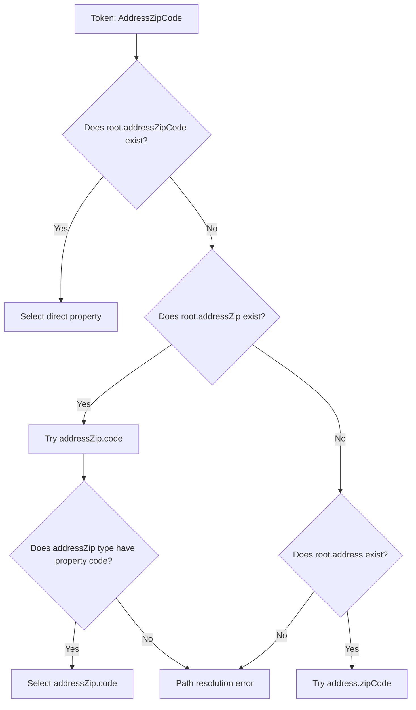

# Direct Properties, Nested Paths, and Underscores

> **Chapter:** Derived Queries  
> **Module:** `SPRING_DATA_MONGODB` — using Spring Data MongoDB to connect, map documents, and operate on MongoDB via `MongoTemplate` or repositories. This lesson focuses on how repository method names are parsed into **direct Java properties**, **nested property paths**, and how **underscores (`_`)** resolve ambiguity. Mastering this helps write accurate queries, design indexes, build aggregations, test effectively, and diagnose performance; the same principles apply to reactive applications.

## 1. Why Can a Method Name Query the Wrong Field?

Spring Data can generate MongoDB queries from repository method names without writing raw BSON:

```java
List<PurchaseOrder> findByCustomerCode(String customerCode);
```

Looking at the name, we know the method compares a **Java property** named `customerCode`. If the entity declares `@Field("customer_code")`, Spring Data uses mapping metadata to build the condition against the BSON field `customer_code`.

However, when the method name gets longer:

```java
List<PurchaseOrder> findByShippingAddressCity(String city);
```

The method-name parser must determine whether `ShippingAddressCity` means:

1. A **direct property** named `shippingAddressCity` on `PurchaseOrder`; or
2. `shippingAddress` is an embedded object and `city` is a property inside it.

If **both paths** could exist, the form above no longer expresses intent unambiguously. The underscore `_` is the tool to specify the exact traversal point into an embedded object:

```java
List<PurchaseOrder> findByShippingAddress_City(String city);
```

**Core takeaway:** a derived query method name describes a **Java property path**, which does not necessarily match the stored BSON field name verbatim. Path resolution occurs before Spring Data translates it into a BSON query.

## 2. Creating a Domain Model to Observe the Difference

To avoid purely theoretical examples, we use an entity containing both a direct property and an embedded object. Below is a Java file `PurchaseOrder.java`; non-`public` helper types can reside in the same file:

```java
package demo.orders;

import java.math.BigDecimal;
import java.time.Instant;
import org.springframework.data.annotation.Id;
import org.springframework.data.mongodb.core.mapping.Document;
import org.springframework.data.mongodb.core.mapping.Field;
import org.springframework.data.mongodb.core.mapping.FieldType;

@Document(collection = "purchase_orders")
public record PurchaseOrder(
    @Id String id,
    @Field("customer_code") String customerCode,
    OrderStatus status,
    Instant createdAt,
    ShippingAddress shippingAddress,
    @Field("shipping_address_city_flat") String shippingAddressCity,
    @Field(targetType = FieldType.DECIMAL128) BigDecimal totalAmount
) {}

record ShippingAddress(
    String city,
    @Field("postal_code") String postalCode,
    Country country
) {}

record Country(String code) {}

enum OrderStatus { PENDING, PAID, CANCELLED }
```

The `shippingAddressCity` property is **intentionally added to demonstrate a name collision**. In a production model, avoid overlapping meanings between a flat field and a nested field unless there is a clear business reason.

A corresponding document, represented in Extended JSON:

```json
{
  "_id": "ORDER-001",
  "customer_code": "CUS-42",
  "status": "PAID",
  "createdAt": { "$date": "2026-11-20T03:00:00Z" },
  "shippingAddress": {
    "city": "Da Nang",
    "postal_code": "550000",
    "country": { "code": "VN" }
  },
  "shipping_address_city_flat": "Hue",
  "totalAmount": { "$numberDecimal": "1250.50" }
}
```

Notice the two **different** values:

- `shippingAddress.city` is **`Da Nang`**, inside the embedded object.
- `shipping_address_city_flat` is **`Hue`**, mapped from the direct property `shippingAddressCity`.

These two fields allow us to verify which path the parser selects. A `_class` field may appear depending on type mapper configuration; it is omitted here to focus on property paths.

## 3. Direct Properties: Always Tried First by the Parser

### 3.1. `findByCustomerCode` Selects a Root Entity Property

Simple repository:

```java
package demo.orders;

import java.util.List;
import org.springframework.data.mongodb.repository.MongoRepository;

public interface PurchaseOrderRepository
        extends MongoRepository<PurchaseOrder, String> {

    List<PurchaseOrder> findByCustomerCode(String customerCode);
}
```

Spring Data performs these logical steps:

1. Recognizes `find...By` as a derived finder.
2. Reads the condition segment `CustomerCode`.
3. Checks whether `PurchaseOrder` has a Java property `customerCode`.
4. Uses `@Field("customer_code")` metadata to translate to the BSON field.
5. Binds the parameter value to the query and converts types if needed.

The MongoDB query is semantically equivalent to:

```javascript
db.purchase_orders.find({ customer_code: "CUS-42" })
```

**Do not** declare `findByCustomer_code(…)` just because MongoDB uses snake_case. In a derived query, `_` carries meaning **for Java path parsing**, not simply as a stand-in for BSON field names.

### 3.2. Parser Prioritizes Direct Properties Over Nested Paths

With the entity in Section 2:

```java
// Direct property: PurchaseOrder.shippingAddressCity
List<PurchaseOrder> findByShippingAddressCity(String city);
```

Spring Data finds `shippingAddressCity` directly on `PurchaseOrder`, so it does not need to guess the nested path `shippingAddress.city`. Equivalent query:

```javascript
db.purchase_orders.find({
  shipping_address_city_flat: "Hue"
})
```

Calling `findByShippingAddressCity("Da Nang")` on the sample document **will not match** because the flat field holds `Hue`. A long method name that looks like a nested path is actually resolved as a direct property.

**Refactoring consequence:** if the class previously only had `shippingAddress.city`, `findByShippingAddressCity` could work as a nested query. Later, if someone adds a `shippingAddressCity` property, the parser can prefer the new property and **change the query target without modifying the repository method name**. Therefore, paths with ambiguity risk should use `_` from the start.

## 4. Nested Paths: Splitting CamelCase to Traverse Objects

When no direct property matches the entire expression segment, Spring Data attempts to split the name along camelCase boundaries. For example, suppose the entity has:

```text
PurchaseOrder
  └── shippingAddress : ShippingAddress
        ├── city : String
        ├── postalCode : String
        └── country : Country
              └── code : String
```

### 4.1. One Level of Nesting

Assuming there is no root property named `shippingAddressPostalCode`, the method:

```java
List<PurchaseOrder> findByShippingAddressPostalCode(String postalCode);
```

can be parsed into:

```text
shippingAddress.postalCode
```

Because `postalCode` is annotated with `@Field("postal_code")`, the corresponding BSON query is:

```javascript
db.purchase_orders.find({
  "shippingAddress.postal_code": "550000"
})
```

Distinguish the dot in the BSON path from the underscore in the method name: `shippingAddress.postal_code` is the **BSON path on the server**, whereas `ShippingAddressPostalCode` is the Java token sequence interpreted by the parser.

### 4.2. Multiple Levels of Nesting

If `ShippingAddress` has `country` and `Country` has `code`:

```java
List<PurchaseOrder> findByShippingAddressCountryCode(String countryCode);
```

Java path:

```text
shippingAddress.country.code
```

BSON query:

```javascript
db.purchase_orders.find({
  "shippingAddress.country.code": "VN"
})
```

If multiple camelCase combinations could be interpreted in different ways, **specify every boundary explicitly**:

```java
List<PurchaseOrder> findByShippingAddress_Country_Code(String code);
```

Both methods target the same BSON path in the **current model**, but the version with `_` is far less likely to break if someone adds a flat property matching the concatenated tokens.

### 4.3. Right-to-Left Path Resolution Algorithm

Suppose we want to resolve `AddressZipCode` on a `Person` class with property `address`, where `Address` has `zipCode`:

1. Try finding a direct property `addressZipCode` on `Person`.
2. If not found, split at camelCase boundaries **from right to left**: `AddressZip` + `Code`.
3. If the root has `addressZip`, the parser tries looking up `code` on **the type of `addressZip`**.
4. If no valid head is found, try `Address` + `ZipCode`.
5. If `address` exists and that object has `zipCode`, the path `address.zipCode` is valid.



A trap arising directly from this rule: `Person` has both `addressZip` (e.g., a String) and `address` (of type `Address` containing `zipCode`). The parser may pick the `addressZip` head on the first split and fail because `String` has no `code`, **instead of continuing to resolve `address.zipCode` as the author expected**. Using `_` resolves this situation.

## 5. Using Underscore `_` to Specify Traversal Boundaries Explicitly

### 5.1. Most Important Case: Separating Direct from Nested

Add a method to `PurchaseOrderRepository`:

```java
// Forces traversal through shippingAddress, then to city:
List<PurchaseOrder> findByShippingAddress_City(String city);
```

Equivalent query:

```javascript
db.purchase_orders.find({
  "shippingAddress.city": "Da Nang"
})
```

Side by side with the method without `_`:

| Repository method | Selected property path | BSON field | Value in sample document |
| --- | --- | --- | --- |
| `findByShippingAddressCity(…)` | `shippingAddressCity` | `shipping_address_city_flat` | `Hue` |
| `findByShippingAddress_City(…)` | `shippingAddress.city` | `shippingAddress.city` | `Da Nang` |
| `findByShippingAddressPostalCode(…)` | `shippingAddress.postalCode` | `shippingAddress.postal_code` | `550000` |
| `findByShippingAddress_PostalCode(…)` | `shippingAddress.postalCode` | `shippingAddress.postal_code` | `550000` |
| `findByShippingAddress_Country_Code(…)` | `shippingAddress.country.code` | `shippingAddress.country.code` | `VN` |

**The `_` is not sent literally as part of the BSON field name** in these examples. It is a **parser control character** telling it to split the property path at that position.

### 5.2. Why Avoid `_` in Regular Java Property Names?

Java allows underscores in variable names in certain positions, such as `customer_code`, but Spring Data reserves this character for traversal parsing. Thus, a guessed method like `findByCustomer_code(…)` may be interpreted as traversing property `customer` and then property `code`.

A maintainable approach:

```java
// Java property in camelCase, MongoDB name in snake_case:
@Field("customer_code")
private String customerCode;

// Derived method still follows the Java property:
List<PurchaseOrder> findByCustomerCode(String value);
```

This **illustrates a field inside a mutable class** and a repository signature, rather than adding `private` fields directly into the Java record from Section 2. The benefit is keeping Java code idiomatic while allowing the BSON schema to use snake_case.

### 5.3. Edge Case: Java Properties Starting with `_`

According to Spring Data Commons rules for property expressions, if a Java property name genuinely starts with `_`, that character must be preserved in the expression. Illustrative structure:

```java
public class AuditRecord {
    private String _token;
    private AuditUser user;
}

class AuditUser {
    private String _name;
}
```

In a matching repository, this is typically expressed as:

```java
// Direct property named _token:
List<AuditRecord> findBy_token(String token);

// Path user._name: one _ to delimit, one _ belonging to the property name:
List<AuditRecord> findByUser__name(String name);
```

The double underscore `__` in `User__name` signifies the boundary plus the leading `_` of `_name`. This is an **exceptional case**, not a recommendation to name fields that way in new entities. Property names containing mid-identifier underscores, such as `first_name`, have escaping conventions and documentation differences across Spring Data generations; prefer refactoring to `firstName` with `@Field("first_name")`, and **verify with tests on your actual version** if forced to maintain a legacy Java model.

### 5.4. Edge Case: Capitalization and `qCode`-Style Collisions

Spring Data Commons also documents ambiguity between a direct property starting with lowercase + uppercase and a nested property:

```java
record Code(String code) {}
record Container(String qCode, Code q) {}
```

With this domain:

- `findByQCode(…)` prioritizes the direct property `qCode`.
- `findByQ_Code(…)` explicitly specifies the path `q.code`.

The key takeaway is not memorizing the letter `Q`, but recognizing that **if the parser can find a direct property first, it prefers that property**; `_` expresses explicit traversal intent. Property names with unusual capitalization call even more strongly for tests and consistent naming conventions.

## 6. How to Read a Derived Query Method Name Accurately

A derived finder name can contain multiple components; not the entire name is a field name:

```text
findTop5ByCustomerCodeAndStatusOrderByCreatedAtDesc
│   │  │        │         │      │         └ direction
│   │  │        │         │      └ sort property: createdAt
│   │  │        │         └ keyword AND
│   │  │        └ property: customerCode
│   │  └ predicate start
│   └ limit: 5
└ derived finder
```

Repository example:

```java
import java.time.Instant;
import java.util.List;
import org.springframework.data.domain.Page;
import org.springframework.data.domain.Pageable;
import org.springframework.data.mongodb.repository.MongoRepository;

public interface PurchaseOrderRepository
        extends MongoRepository<PurchaseOrder, String> {

    // Direct property, with @Field("customer_code").
    List<PurchaseOrder> findByCustomerCode(String customerCode);

    // Two AND conditions, sorted by createdAt.
    List<PurchaseOrder> findByCustomerCodeAndStatusOrderByCreatedAtDesc(
        String customerCode, OrderStatus status
    );

    // Nested path (prevents ambiguity with shippingAddressCity).
    List<PurchaseOrder> findByShippingAddress_City(String city);

    // Explicit nested path to property with @Field("postal_code").
    List<PurchaseOrder> findByShippingAddress_PostalCode(String postalCode);

    // Three-level path.
    List<PurchaseOrder> findByShippingAddress_Country_Code(String code);

    // Instant range comparison.
    List<PurchaseOrder> findByCreatedAtGreaterThanEqualAndCreatedAtLessThan(
        Instant fromInclusive, Instant untilExclusive
    );

    // Limit to at most five results.
    List<PurchaseOrder> findTop5ByStatusOrderByCreatedAtDesc(
        OrderStatus status
    );

    // Dynamic pagination and sorting.
    Page<PurchaseOrder> findByStatus(
        OrderStatus status, Pageable pageable
    );
}
```

**Reading in order:** the part before `By` specifies query type/limit; the part after `By` splits conditions on `And`/`Or` keywords, reading property paths and operators; `OrderBy` is the static sorting clause. Each property is still resolved using the direct → nested → underscore rules learned above.

### 6.1. Useful Keywords

| Method keyword | Example | Logical MongoDB meaning |
| --- | --- | --- |
| `And` | `findByCustomerCodeAndStatus` | Both conditions must be true. |
| `Or` | `findByStatusOrCustomerCode` | At least one condition is true. |
| `GreaterThan` / `GreaterThanEqual` | `findByTotalAmountGreaterThanEqual` | `$gt` / `$gte`. |
| `LessThan` / `LessThanEqual` | `findByCreatedAtLessThan` | `$lt` / `$lte`. |
| `In` / `NotIn` | `findByStatusIn` | `$in` / `$nin`. |
| `IsNull` / `NotNull` | `findByCustomerCodeIsNull` | Comparison against `null`; remember to distinguish missing fields. |
| `Exists` | `findByCustomerCodeExists` | Uses `$exists` to check field presence/absence. |
| `IgnoreCase` | `findByCustomerCodeIgnoreCase` | For Strings, MongoDB may use a case-insensitive regular expression. |
| `Top` / `First` | `findTop5ByStatus` | Limits result count. |
| `OrderBy...Asc/Desc` | `findByStatusOrderByCreatedAtDesc` | Static sort by the specified property. |

This is a **reference overview**, not an exhaustive list of all Spring Data MongoDB keywords. For instance, `Between` applies bounds differently depending on argument type (`Range` vs. two values), so if exact date boundaries are required, use explicit `GreaterThanEqual` and `LessThan` or a tested `Range`. For `IsNull`, MongoDB query `{field: null}` matches both missing fields and null values; when distinction is needed, specify `$exists` explicitly.

### 6.2. Illustrative MongoDB Query Form

With the call:

```java
repository.findByCustomerCodeAndStatusOrderByCreatedAtDesc(
    "CUS-42", OrderStatus.PAID
);
```

Semantically equivalent to:

```javascript
db.purchase_orders.find({
  customer_code: "CUS-42",
  status: "PAID"
}).sort({
  createdAt: -1
})
```

This example assumes enums are stored as their string names under default mapping behavior. If the system uses a custom enum converter, BSON values must match that converter. `@Field("customer_code")` affects the filter field, **not** the sort property `createdAt`.

### 6.3. Static Sort, Dynamic Sort, and Pagination

```java
import org.springframework.data.domain.Page;
import org.springframework.data.domain.PageRequest;
import org.springframework.data.domain.Sort;

PageRequest page = PageRequest.of(
    0, 20,
    Sort.by(Sort.Direction.DESC, "createdAt")
        .and(Sort.by("id"))
);

Page<PurchaseOrder> result =
    repository.findByStatus(OrderStatus.PAID, page);
```

In `Sort.by(...)` processed by Spring Data with domain metadata, `"createdAt"`/`"id"` are Java property names. The secondary `id` sort stabilizes ordering when multiple documents share the same `createdAt`.

`Page` generally requires knowing the total record count and may trigger a count query alongside the page read; for flows that only need to know if a next page exists, consider `Slice`. On very large datasets, offset-based paging also incurs growing cost with deeper offsets; evaluate keyset/cursor paging based on API requirements and library version.

## 7. Nested Paths in Lists and Maps: Understanding MongoDB Semantics

### 7.1. Lists of Embedded Documents

Add an embedded collection to the domain:

```java
// Example property added to PurchaseOrder in another model version:
private List<OrderLine> lines;

record OrderLine(String sku, int quantity) {}
```

Derived query:

```java
List<PurchaseOrder> findByLinesSku(String sku);
```

semantically equivalent to:

```javascript
db.purchase_orders.find({ "lines.sku": "BOOK-01" })
```

If `lines` is an array of objects, this query matches documents where **at least one element** in the array has the matching `sku`. This is not a join across collections.

### 7.2. Two Conditions Can Match Two Different Elements

Be careful when writing:

```java
List<PurchaseOrder> findByLinesSkuAndLinesQuantityGreaterThanEqual(
    String sku, int minQuantity
);
```

MongoDB can evaluate the two conditions against **two different elements** of the same array:

```json
{
  "lines": [
    { "sku": "BOOK-01", "quantity": 1 },
    { "sku": "PEN-02", "quantity": 20 }
  ]
}
```

With `sku = "BOOK-01"` and `minQuantity = 10`, this document can match the two-dotted-path query even though **no single element** has both `BOOK-01` and `quantity >= 10`.

If the business rule requires **the same element**, use `$elemMatch`. Example with `MongoTemplate`:

```java
import org.springframework.data.mongodb.core.query.Criteria;
import org.springframework.data.mongodb.core.query.Query;

Query query = Query.query(
    Criteria.where("lines").elemMatch(
        Criteria.where("sku").is("BOOK-01")
            .and("quantity").gte(10)
    )
);

List<PurchaseOrder> orders =
    mongoTemplate.find(query, PurchaseOrder.class);
```

Key distinction: **derived queries automatically resolve property paths**, but they do not infer "two conditions must apply to the same array element" unless the query actually expresses `$elemMatch`. For different data structures or complex conditions, `MongoTemplate`/`@Query` is generally clearer.

### 7.3. Maps, Arbitrary Keys, and Dynamic Schemas

A `Map<String, Object>` can hold keys unknown at compile time. The derived query method parser works best with **statically structured Java properties**, not arbitrary user-supplied key names. If you must query dynamic keys, design a `MongoTemplate` API combined with field-name validation, or refactor the schema into a document structure that is easier to index.

Never build MongoDB paths directly from untrusted input. Dots, special characters, and query operators must be controlled; restrict queryable fields to prevent unintended data exposure.

## 8. Underscores in BSON Differ from Underscores in Method Names

Keep this table in mind to avoid mixing three naming layers:

| Layer | Example | Meaning |
| --- | --- | --- |
| Java root property | `customerCode` | Property name on `PurchaseOrder`. |
| Mapped BSON field | `customer_code` | Field name stored in MongoDB via `@Field`. |
| Derived method | `findByCustomerCode` | Parser resolves Java property `customerCode`. |
| Java nested path | `shippingAddress.postalCode` | Traverses through `ShippingAddress` object. |
| BSON nested path | `shippingAddress.postal_code` | Actual field queried in MongoDB. |
| Delimited derived method | `findByShippingAddress_PostalCode` | `_` marks the boundary between two Java properties. |

**Do not blindly replace every dot with `_`.** In Spring Data, `_` assists specific method-name parsing, whereas dots appear in BSON paths in MongoDB queries. Annotations like `@Field("postal_code")` determine the target field without changing the Java property name.

Direct comparison:

```java
// Repository, using Java properties:
repository.findByShippingAddress_PostalCode("550000");
```

```javascript
// Mongo shell, using BSON fields:
db.purchase_orders.find({
  "shippingAddress.postal_code": "550000"
})
```

With `MongoTemplate` and `Criteria` given a domain type, Spring Data can translate Java paths to BSON:

```java
Query query = Query.query(
    Criteria.where("shippingAddress.postalCode").is("550000")
);
List<PurchaseOrder> orders =
    mongoTemplate.find(query, PurchaseOrder.class);
```

When using `mongoTemplate.getCollection("purchase_orders")`, you are closer to the Java Driver: raw BSON filters must use the stored field name `shippingAddress.postal_code` unless you translate it yourself.

## 9. Key Limitations of Derived Queries

### 9.1. Not Every Path Through a Reference Works Like an Embedded Object

When `shippingAddress` is an embedded object, MongoDB has `shippingAddress.city` inside the same document. If that field is changed to `@DocumentReference Customer customer` or `@DBRef`, the root BSON **typically stores only a reference or ID value**, not all properties of the customer.

Therefore, you cannot assume `findByCustomerName(…)` will join across the customer collection just because the Java property is `Customer customer`. Spring Data MongoDB repository derived queries **do not perform arbitrary joins across references** to filter by fields on target documents. Some reference types like DBRef also have explicit limitations in query method parameters. When filtering by data in another collection, choose an appropriate storage model, perform a two-step query, or use `$lookup` aggregation where server capabilities allow.

### 9.2. Derived Queries Do Not Manage Transactions or Consistency

Finding by a nested path is an ordinary read query. It does not automatically:

- Create indexes.
- Provide multi-document transactions.
- Eliminate secondary lag when using non-primary read preferences.
- Pick a suitable shard key.
- Guarantee that documents in a referenced collection stay synchronized.

These belong to MongoDB configuration, driver settings, transaction managers, and schema design. The repository abstraction generates queries, but it does not remove underlying storage constraints.

### 9.3. Special `findById` Methods and ID Paths

Certain names such as `findById`, `existsById`, and `deleteById` inherited from base repositories are **reserved for the entity identifier**, not simply a Java property named `id` if the entity marks a different property with `@Id`.

Example:

```java
class ExternalRecord {
    @Id String pk;
    String id;
}
```

With the corresponding repository, the base API `findById(…)` looks up `pk` — the BSON `_id` field. If you want to query the regular Java property named `id`, you can use a **descriptive token** to avoid collision, such as `findExternalRecordById(…)`, and verify the parser against your actual domain. This differs from using `_` for nested paths, but follows the same principle: **method names have their own grammar, not just concatenated field names**.

## 10. Performance: Right Path Is Not Enough Without the Right Index

Suppose most API calls fetch paid customer orders sorted by creation date:

```java
List<PurchaseOrder> findByCustomerCodeAndStatusOrderByCreatedAtDesc(
    String customerCode, OrderStatus status
);
```

The BSON query uses `customer_code`, `status`, and `createdAt`. A candidate index based on equality conditions and sort order:

```javascript
db.purchase_orders.createIndex({
  customer_code: 1,
  status: 1,
  createdAt: -1
});
```

To inspect the query:

```javascript
db.purchase_orders.find({
  customer_code: "CUS-42",
  status: "PAID"
}).sort({ createdAt: -1 })
  .explain("executionStats");
```

For queries on nested properties:

```javascript
db.purchase_orders.createIndex({
  "shippingAddress.postal_code": 1
});
```

Do not create an index on `shippingAddressPostalCode` or `shippingAddress_postalCode` just because the Java method name looks like that: **indexes must reference actual BSON field names**.

When analyzing `explain("executionStats")`, check `winningPlan`, keys/documents examined, documents returned, and any non-indexed sort stage. Do not conclude an index is effective based solely on a single query over a tiny dataset.

If the collection is sharded, queries lacking the shard key may scatter across multiple shards; per-shard indexes still help, but cannot replace routing keys. For large list endpoints, constrain `Pageable`, limits, and payload sizes rather than merely increasing the connection pool.

## 11. Verifying Parser and Mapping with Integration Tests

Property path errors sometimes surface immediately when Spring initializes repositories, such as `PropertyReferenceException` when no valid property is found. More subtle bugs occur when **a query is valid but targets the wrong field**, so checking only that the application context starts is insufficient.

### 11.1. Test Dataset Distinguishing Direct and Nested

Save a `PurchaseOrder` with:

- `customerCode = "CUS-42"`;
- `shippingAddress.city = "Da Nang"`;
- `shippingAddress.postalCode = "550000"`;
- `shippingAddress.country.code = "VN"`;
- `shippingAddressCity = "Hue"`.

Then test (e.g., with AssertJ/JUnit):

```java
// Repository must declare both methods.
var flat = repository.findByShippingAddressCity("Hue");
var nested = repository.findByShippingAddress_City("Da Nang");

// Expect each query to find the test order.
// repository.findByShippingAddressCity("Da Nang")
// will not match if the flat field only holds "Hue".

var postal = repository.findByShippingAddress_PostalCode("550000");
var country = repository.findByShippingAddress_Country_Code("VN");
```

These snippets assume an injected repository in the test; to make concrete assertions, add `containsExactly(...)` or check IDs against an isolated test dataset. Beyond Java results, inspect BSON directly via `mongosh`/Java Driver to confirm which property path was used.

### 11.2. Verifying Ordering and Pagination

Create multiple orders with different `createdAt` values, including two orders sharing a timestamp. Run `findByCustomerCodeAndStatusOrderByCreatedAtDesc` and verify the order. If the API requires fully deterministic ordering, add a secondary sort on ID (in the method or via a supported `Sort`) and a matching index.

When using `Page<PurchaseOrder>`, verify `page.getContent()`, `page.getTotalElements()`, and the actual number of queries executed on MongoDB. On large datasets, benchmark deep offsets as well. Correct results on page one do not prove deep pages perform acceptably.

### 11.3. Testing Schema Changes During Refactoring

Keep a test using historical BSON. If you rename Java `postalCode` → `zipCode` while keeping storage at `postal_code` via `@Field`, the derived method name must change from `findByShippingAddress_PostalCode` to `findByShippingAddress_ZipCode`; the BSON field can remain unchanged. This is why **testing mapping at both the Java and raw-data levels** must go together.

## 12. Reactive Repositories and Derived Property Paths

In reactive Spring Data MongoDB, the property path parser follows the same concepts; the main difference is `Flux`/`Mono` return types and asynchronous execution.

```java
import org.springframework.data.mongodb.repository.ReactiveMongoRepository;
import reactor.core.publisher.Flux;
import reactor.core.publisher.Mono;

public interface ReactivePurchaseOrderRepository
        extends ReactiveMongoRepository<PurchaseOrder, String> {

    Flux<PurchaseOrder> findByShippingAddress_City(String city);

    Flux<PurchaseOrder> findByCustomerCodeAndStatus(
        String customerCode, OrderStatus status
    );

    Mono<Boolean> existsByCustomerCode(String customerCode);
}
```

For instance, `findByShippingAddress_City` still targets the BSON field `shippingAddress.city`, not `shipping_address_city_flat`. To reduce transferred data, reactive queries can pass `Pageable` with `Flux`, but do not assume `Mono<Page<T>>` is supported like in imperative repositories; Spring Data MongoDB documentation notes that `Page` return types are not supported in reactive repositories.

Reactive does not fix property path mistakes, materialize indexes, or change MongoDB atomicity. When using nested expressions on arrays, `$elemMatch` semantics apply just as in the imperative stack.

## 13. Common Errors

| Symptom | Cause | Resolution |
| --- | --- | --- |
| `findByShippingAddressCity` returns flat field data instead of embedded field | Name collision between direct `shippingAddressCity` and nested `shippingAddress.city`. | Use `findByShippingAddress_City` to lock in traversal. |
| `PropertyReferenceException` when creating repository | Parser picked wrong head (e.g., `addressZip`) and found no tail property; or typo. | Disambiguate with `Address_ZipCode` and check properties on each type. |
| `findByCustomer_code` fails even though BSON has `customer_code` | Copied BSON field name into Java method name and misused `_`. | Use `findByCustomerCode` with `@Field("customer_code")`. |
| Repository nested query returns empty while shell sees data | Wrong BSON path/`@Field`, database, or test data; method likely parsed differently. | Cross-check Java names, mapping metadata, raw BSON, and actual query. |
| Query on `lines` misses "no line satisfies both conditions" | Dotted-path conditions can match two different array elements. | Use `$elemMatch` when requiring the same element. |
| Pagination slow on large datasets | Count query, large offset, unsuitable index. | Run `explain`, use `Slice`/cursor paging where appropriate. |
| Querying nested field of referenced document fails | MongoDB root stores only reference ID, not embedded target object. | Query target collection or use `$lookup` aggregation. |
| Query is accurate but slow | Index built on Java name instead of BSON field, or missing shard key. | Create index on exact BSON path and inspect query plan. |
| Repository fails to start after Java property refactor | Derived method still references old property. | Rename method to match new Java property and keep `@Field` for BSON compatibility. |

**Step-by-step debugging:** (1) identify the Java root name; (2) draw the object graph and nested properties; (3) check for direct/nested collisions; (4) insert `_` where needed; (5) verify `@Field` against BSON; (6) run tests on distinguishable data; (7) inspect `explain` and indexes if performance issues arise.

## 14. Practice Exercise and Review Questions

### Practice Exercise: Catalog with Shipping Destination

Create a `Shipment` entity with `id`, `customerCode`, `state`, `createdAt`, `destination` as a record `Destination(city, postalCode, region)`, and a direct property `destinationCity` to simulate a collision.

Requirements:

1. Use `@Document(collection = "shipments")`; store `customerCode` under BSON field `customer_code` and `destination.postalCode` under `destination.postal_code`.
2. Write `findByCustomerCode` and verify the query filters on `customer_code`.
3. Write **both** `findByDestinationCity` and `findByDestination_City`; insert documents with two distinct values and prove they query two different BSON fields.
4. Write `findByDestination_PostalCode` and `findByDestination_Region`; explain why `_` helps when adding new properties in the future.
5. Write `findByCustomerCodeAndStateOrderByCreatedAtDesc`; create a suitable compound index using actual BSON field names.
6. Use `MongoTemplate` to write an equivalent query for a nested path; compare Java property names with BSON fields.
7. Add an embedded list of `ShipmentEvent` items. Test a condition that can match across two different events, then rewrite it using `elemMatch`.
8. Build an integration test that writes entities and inspects raw BSON; verify content, paths, and the query plan of frequent queries.

### Self-Check

- Why is `findByShippingAddressCity` not necessarily equivalent to `findByShippingAddress_City`?
- How does the parser prioritize direct properties vs. nested paths?
- In `AddressZipCode`, why can an `addressZip` property break resolution of `address.zipCode`?
- Which name does `@Field("postal_code")` change? Why does the repository still keep `findByShippingAddress_PostalCode`?
- What does the double underscore `__` mean in the `_name` Java property example?
- Is `_` in a method name stored as `_` in MongoDB?
- Why can two conditions on `lines.sku` and `lines.quantity` both be satisfied without belonging to the same element?
- When should you use `@Query`/`MongoTemplate` instead of lengthening a derived method name?
- How does changing the model from an embedded object to `@DocumentReference` affect nested-property queries?

## 15. Summary and Reference Sources

- **Derived queries start from Java properties**, which Spring Data then maps to BSON fields using metadata.
- The parser **prioritizes direct properties** on an exact match; only when needed does it split camelCase to locate nested paths.
- **`_`** is a tool for **explicit traversal boundaries**, such as `findByShippingAddress_City`.
- For `snake_case` BSON fields, keep Java properties in camelCase and use `@Field`; **do not** turn method names into snake_case.
- Watch out for Java names starting with `_` and unusual capitalization; prefer readable Java conventions and add integration tests for your specific Spring Data version.
- Nested queries on arrays **do not automatically enforce** multiple conditions on the same element: use `$elemMatch` when required.
- **Indexes must use BSON names**, while repository methods use Java property names; correct queries also require reviewing query plans, pagination, topology, and ordering.

Official documentation for reference:

- [Spring Data MongoDB — Defining Query Methods & Property Expressions](https://docs.spring.io/spring-data/mongodb/reference/repositories/query-methods-details.html)
- [Spring Data MongoDB — MongoDB-specific Query Methods](https://docs.spring.io/spring-data/mongodb/reference/mongodb/repositories/query-methods.html)
- [Spring Data MongoDB — Object Mapping](https://docs.spring.io/spring-data/mongodb/reference/mongodb/mapping/mapping.html)
- [Spring Data Commons — Defining Query Methods](https://docs.spring.io/spring-data/commons/reference/repositories/query-methods-details.html)
