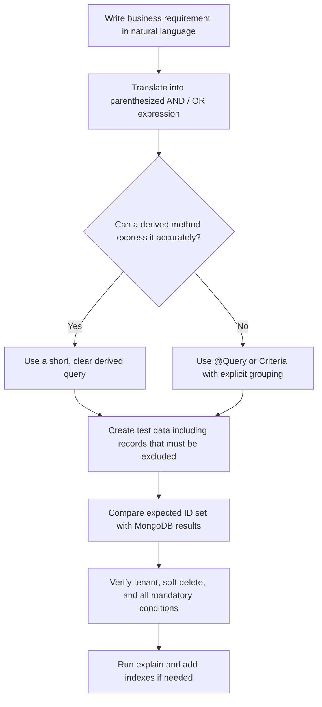

# Combining And, Or, and Verifying Condition Grouping

With Spring Data MongoDB, you can define queries via method names in an interface extending `MongoRepository`, such as `findByStatusAndStockGreaterThan(...)`. Spring Data parses the method name, identifies Java properties and operators, and generates the corresponding BSON filter. This mechanism is called a **derived query** (a query derived from the method name).

When combining `And` and `Or`, a query that looks reasonable can still return wrong results because **the condition grouping differs from business intent**. This is especially critical in multi-tenant systems: if one `Or` branch lacks the `tenantId` filter, the method can leak another tenant's data. This lesson in the **Derived Queries** chapter focuses on reading logical expressions accurately, verifying results, and choosing among method names, `@Query`, and `MongoTemplate`.

After this lesson, you will be able to:

- Explain how Spring Data splits `Or` into groups and gives `And` higher precedence within each group.
- Write out the logical expression and corresponding MongoDB filter before using a derived method.
- Spot the difference between `(A AND B) OR C` and `A AND (B OR C)`.
- Choose `@Query` or `Criteria.andOperator`/`orOperator` when condition grouping needs explicit parentheses.
- Test negative cases, cross-tenant data, boundary conditions, and generated queries.
- Evaluate indexes, `explain`, and maintainable query patterns in Spring Data MongoDB applications.

## 1. Foundation: How Are Derived Queries Parsed?

In Spring Data, a method name such as:

```java
List<CatalogItem> findByStatusAndStockGreaterThan(
    String status, int minStock);
```

has two main parts: `findBy` indicates a read operation; the part after `By` defines search criteria using **Java property names** and supported keywords. In this example:

- `Status` targets the `status` property, defaulting to equality against the first parameter.
- `And` is logical conjunction.
- `StockGreaterThan` targets the `stock` property with the greater-than operator `$gt`, accepting the second parameter.

The equivalent MongoDB filter can be expressed as:

```javascript
{
  status: "ACTIVE",
  stock: { $gt: 0 }
}
```

Two top-level conditions in MongoDB are combined with an **implicit AND**. Spring Data MongoDB maps Java property names to BSON field names when metadata like `@Field("...")` is present; therefore, do not assume the Java field name always equals the stored field name.

### Condition Grouping Rules

In Spring Data's derived query parser, the predicate is split into **`Or` groups**; within each group, clauses are joined by `And`. This is equivalent to **`And` having higher precedence than `Or`**.

Examples:

```text
findByAAndBOrCAndD
          ↓
(A AND B) OR (C AND D)

findByAOrBAndC
          ↓
A OR (B AND C)

findByAAndBOrC
          ↓
(A AND B) OR C
```

There is no syntax for placing parentheses inside a **derived method name** to directly write `AAnd(BOrC)`. The method name `findByAAndBOrC` cannot be interpreted as `A AND (B OR C)` merely because the author intended it.

This is a Spring Data method-name parsing rule and **does not depend** on the order of fields inside a document. Field ordering in ordinary JSON is not a logical grouping mechanism either.

## 2. Preparing the Illustrative Model and Dataset

Suppose an application manages a product catalog across multiple organizations. Each item has `tenantId`, `status`, `category`, `active`, and `stock`.

```java
import org.springframework.data.mongodb.core.mapping.Document;
import org.springframework.data.mongodb.core.mapping.MongoId;

@Document(collection = "catalog_items_query_lab")
public class CatalogItem {
    @MongoId
    private String id;
    private String runId;
    private String tenantId;
    private String status;
    private String category;
    private boolean active;
    private int stock;

    protected CatalogItem() {}

    public CatalogItem(
            String id, String runId, String tenantId,
            String status, String category,
            boolean active, int stock) {
        this.id = id;
        this.runId = runId;
        this.tenantId = tenantId;
        this.status = status;
        this.category = category;
        this.active = active;
        this.stock = stock;
    }

    public String getId() { return id; }
    public String getTenantId() { return tenantId; }
    public String getStatus() { return status; }
    public String getCategory() { return category; }
}
```

`@MongoId String id` keeps the Java String identifier according to MongoDB's corresponding mapping. In this lesson, IDs are pre-assigned and need not be assumed to be BSON ObjectIds. The `runId` property isolates repeated lab runs inside the same collection; in a real system, this field can be omitted.

### Dataset for Tracing Results by Hand

| Label | Tenant | Status | Category | Active | Stock |
| --- | --- | --- | --- | --- | ---: |
| A | T1 | ACTIVE | book | true | 5 |
| B | T1 | DRAFT | office | true | 2 |
| C | T1 | ACTIVE | office | true | 0 |
| D | T1 | DRAFT | book | false | 0 |
| E | T2 | DRAFT | office | true | 6 |
| F | T2 | ACTIVE | book | true | 6 |
| G | T1 | ARCHIVED | book | false | 8 |

Labels A–G are just table labels. The `mongosh` exercise below creates a unique `_id` per test run to avoid collisions with other sessions.

## 3. Combining `And` and `Or`: Reading the Expression Properly

Repository declaration:

```java
import java.util.List;
import org.springframework.data.mongodb.repository.MongoRepository;

public interface CatalogItemRepository
        extends MongoRepository<CatalogItem, String> {

    List<CatalogItem> findByStatusAndStockGreaterThanOrCategoryAndActiveTrue(
        String status, int minStock, String category);
}
```

When invoked:

```java
repository.findByStatusAndStockGreaterThanOrCategoryAndActiveTrue(
    "ACTIVE", 0, "office"
);
```

Spring Data interprets the condition as:

```text
(status = "ACTIVE" AND stock > 0)
    OR
(category = "office" AND active = true)
```

Equivalent BSON filter:

```javascript
{
  $or: [
    { status: "ACTIVE", stock: { $gt: 0 } },
    { category: "office", active: true }
  ]
}
```

The result on the illustrative dataset is **A, B, C, E, F**:

| Label | Branch 1: ACTIVE and stock > 0 | Branch 2: office and active | Included? |
| --- | --- | --- | --- |
| A | True | False | Yes |
| B | False | True | Yes |
| C | False because stock = 0 | True | Yes |
| D | False | False | No |
| E | False | True | Yes |
| F | True | False | Yes |
| G | False | False | No |

Notably, **C is still included even though `stock = 0`**, because C satisfies `category = office AND active = true`. If the business rule requires all results to be in stock, you must write the conditions with different grouping.

### 3.1. Changing Keyword Order Changes Meaning

Compare:

```text
findByStatusOrCategoryAndActiveTrue
    = status OR (category AND active)

findByStatusAndActiveTrueOrCategory
    = (status AND active) OR category
```

These two expressions are **not equivalent**. For a record with `status = ACTIVE` and `active = false`, the first query can return the record whereas the second only returns it if `category` matches. Reordering method segments for "readability" can silently alter behavior.

### 3.2. Underscores Do Not Create Parentheses

In derived query names, underscores can delimit **nested property paths** in some cases, such as `findByPublisher_Country(...)`. They are not grouping syntax for `And`/`Or` expressions. Never try using `_`, casing tricks, or `AndOr` sequences to simulate parentheses.

## 4. Real-World Bug: Losing the Tenant Filter on an `Or` Branch

Suppose an API may only return data for tenant `T1` when items satisfy one of two criteria:

> The item belongs to tenant T1 and (**is ACTIVE** or **is in category office**).

**Intended** expression:

```text
tenantId = T1 AND (status = ACTIVE OR category = office)
```

A plausible-looking method with **wrong grouping**:

```java
List<CatalogItem> findByTenantIdAndStatusOrCategory(
    String tenantId, String status, String category);
```

When calling `findByTenantIdAndStatusOrCategory("T1", "ACTIVE", "office")`, the actual expression is:

```text
(tenantId = T1 AND status = ACTIVE)
    OR
(category = office)
```

The `category = office` branch is not restricted by tenant. Results will include **A, B, C, E**; record **E belonging to T2** slips through. This is a severe business bug when `tenantId` is an authorization boundary.

### 4.1. Fixing via Logical Distribution

Using the distributive law of logic:

```text
A AND (B OR C)
    is equivalent to
(A AND B) OR (A AND C)
```

we can rewrite the derived method:

```java
List<CatalogItem> findByTenantIdAndStatusOrTenantIdAndCategory(
    String firstTenantId,
    String status,
    String secondTenantId,
    String category);
```

Invocation:

```java
repository.findByTenantIdAndStatusOrTenantIdAndCategory(
    "T1", "ACTIVE", "T1", "office"
);
```

The condition becomes:

```text
(tenantId = T1 AND status = ACTIVE)
    OR
(tenantId = T1 AND category = office)
```

The correct result is **A, B, C**. However, `tenantId` must be passed **twice**. If a caller accidentally passes `T1` and `T2`, you reintroduce a data-scope bug. When requirements need parenthesized grouping or enforce security invariants, explicit approaches via `@Query` or `MongoTemplate` are usually easier to read and audit.

### 4.2. Reading the Result Table with the Tenant Condition

| Label | T1? | ACTIVE? | office? | `T1 AND (ACTIVE OR office)` | `(T1 AND ACTIVE) OR office` |
| --- | --- | --- | --- | --- | --- |
| A | Yes | Yes | No | **Yes** | **Yes** |
| B | Yes | No | Yes | **Yes** | **Yes** |
| C | Yes | Yes | Yes | **Yes** | **Yes** |
| D | Yes | No | No | No | No |
| E | No | No | Yes | **No** | **Yes — scope violation** |
| F | No | Yes | No | No | No |
| G | Yes | No | No | No | No |

When reviewing a method containing `Or`, ask: **Are all mandatory criteria for every result (tenant, permissions, soft delete, public status, etc.) present in every branch?** If not, fix the grouping before shipping to production.

## 5. Using `@Query` to Express Parentheses Clearly

`@Query` lets you define a MongoDB filter as a JSON query string, convenient when nested `$and` and `$or` are needed:

```java
import java.util.List;
import org.springframework.data.mongodb.repository.Query;

// Method placed inside CatalogItemRepository:
@Query("{ 'tenantId': ?0, '$or': [ " +
       "{ 'status': ?1 }, { 'category': ?2 } ] }")
List<CatalogItem> findByTenantWithStatusOrCategory(
    String tenantId, String status, String category);
```

Here `?0`, `?1`, `?2` correspond to the three method parameters. The top-level `tenantId` condition is **implicitly ANDed** with `$or`; thus every result branch must satisfy the tenant constraint:

```javascript
{
  tenantId: "T1",
  $or: [
    { status: "ACTIVE" },
    { category: "office" }
  ]
}
```

To emphasize precedence, you can also write `$and` explicitly:

```javascript
{
  $and: [
    { tenantId: "T1" },
    {
      $or: [
        { status: "ACTIVE" },
        { category: "office" }
      ]
    }
  ]
}
```

These two filters are equivalent for the example above. Use explicit `$and` when expressions grow complex or when you want grouping crystal clear to readers. With `@Query`, avoid manually concatenating user-supplied values into JSON strings; use **parameter binding** (`?0`, `?1`, ...) so the framework serializes values with proper types.

**Mapping note:** Repository JSON queries can be processed by Spring Data based on entity metadata. When writing raw `mongosh` or MongoDB Driver queries, you must use the actual BSON field names. If `@Field("...")` is present, verify the query maps as intended.

## 6. `MongoTemplate` and `Criteria`: Structuring Condition Groups

When expressions are built from dynamic conditions (such as an API with multiple optional filters), a long derived method is no longer practical. `MongoTemplate` lets you build explicit groups:

```java
import java.util.List;
import org.springframework.data.mongodb.core.MongoTemplate;
import org.springframework.data.mongodb.core.query.Criteria;
import org.springframework.data.mongodb.core.query.Query;

public List<CatalogItem> findTenantItems(
        MongoTemplate template,
        String tenantId,
        String status,
        String category) {

    Criteria anyMatch = new Criteria().orOperator(
        Criteria.where("status").is(status),
        Criteria.where("category").is(category)
    );

    Criteria scoped = new Criteria().andOperator(
        Criteria.where("tenantId").is(tenantId),
        anyMatch
    );

    return template.find(
        new Query(scoped),
        CatalogItem.class
    );
}
```

Passing `CatalogItem.class` gives Spring Data's mapper the context of Java property names and BSON fields. The `andOperator(tenant, orOperator(...))` structure expresses `tenant AND (status OR category)` cleanly without repeating the tenant parameter.

### 6.1. Dynamic Filters and Grouping When Parameters Are Absent

Never insert an "always true" `OR` branch when a user omits a filter, because that turns the entire `OR` group true. Distinguish clearly:

- If **neither** status nor category is provided, filter only by `tenantId` or return a validation error, per the API contract.
- If **only status** is provided, filter `tenantId AND status`.
- If **only category** is provided, filter `tenantId AND category`.
- If **both** are provided, filter `tenantId AND (status OR category)`.

Example of controlled construction:

```java
import java.util.ArrayList;
import java.util.List;

public Query buildQuery(
        String tenantId, String status, String category) {

    List<Criteria> branches = new ArrayList<>();
    if (status != null && !status.isBlank()) {
        branches.add(Criteria.where("status").is(status));
    }
    if (category != null && !category.isBlank()) {
        branches.add(Criteria.where("category").is(category));
    }

    Criteria tenant = Criteria.where("tenantId").is(tenantId);

    if (branches.isEmpty()) {
        return Query.query(tenant);
    }
    if (branches.size() == 1) {
        return new Query(new Criteria().andOperator(
            tenant, branches.get(0)
        ));
    }
    Criteria alternatives = new Criteria().orOperator(
        branches.toArray(Criteria[]::new)
    );
    return new Query(new Criteria().andOperator(
        tenant, alternatives
    ));
}
```

This code assumes `tenantId` has already been authenticated and extracted from a **trusted authorization context**. `status` and `category` are treated strictly as optional filters; if the product requires at least one criterion, replace the `branches.isEmpty()` branch with a validation error. For more complex filter criteria, create a filter specification class and test every combination.

## 7. When to Use `In` Instead of Multiple `Or` Branches?

When multiple options **compare against the same property**, such as status being either `ACTIVE` or `DRAFT`, the filter:

```javascript
{
  tenantId: "T1",
  $or: [
    { status: "ACTIVE" },
    { status: "DRAFT" }
  ]
}
```

can usually be expressed more concisely as:

```javascript
{
  tenantId: "T1",
  status: { $in: ["ACTIVE", "DRAFT"] }
}
```

And in the repository:

```java
List<CatalogItem> findByTenantIdAndStatusIn(
    String tenantId, java.util.Collection<String> statuses);
```

`In` is clearer when selecting multiple **values of a single field**. However, `In` cannot replace `Or` across **two different fields** such as `status` and `category`. Also check behavior with empty collections, `null` values, and invalid inputs according to your API contract.

## 8. Hands-on with `mongosh`: Proving Results per Group

Before putting a derived query into a service, run the equivalent BSON filter on a small dataset and **compute expected results by hand**. This section creates seven documents matching the table in Section 2 and isolates them via `runId`. Only use a practice database/collection, and never run commands that wipe an entire collection.

### 8.1. Creating the Test Dataset

Open `mongosh` connected to a test MongoDB instance and run within the same shell session:

```javascript
use spring_data_training

const lab = db.getCollection("catalog_items_query_lab");
const runId = "derived-queries-003-" + new ObjectId().toHexString();
const t1 = runId + "-T1";
const t2 = runId + "-T2";

lab.insertMany([
  {
    _id: runId + "-A", runId: runId, tenantId: t1,
    status: "ACTIVE", category: "book", active: true, stock: 5
  },
  {
    _id: runId + "-B", runId: runId, tenantId: t1,
    status: "DRAFT", category: "office", active: true, stock: 2
  },
  {
    _id: runId + "-C", runId: runId, tenantId: t1,
    status: "ACTIVE", category: "office", active: true, stock: 0
  },
  {
    _id: runId + "-D", runId: runId, tenantId: t1,
    status: "DRAFT", category: "book", active: false, stock: 0
  },
  {
    _id: runId + "-E", runId: runId, tenantId: t2,
    status: "DRAFT", category: "office", active: true, stock: 6
  },
  {
    _id: runId + "-F", runId: runId, tenantId: t2,
    status: "ACTIVE", category: "book", active: true, stock: 6
  },
  {
    _id: runId + "-G", runId: runId, tenantId: t1,
    status: "ARCHIVED", category: "book", active: false, stock: 8
  }
]);

print("runId = " + runId);
print("t1 = " + t1);
print("t2 = " + t2);
print(lab.countDocuments({ runId: runId })); // Expected: 7
```

`runId` and both tenant IDs change on every run, preventing interference with previous sessions. `_id` values are BSON Strings ending in `-A` through `-G`. Run the commands below **in the same shell session** so `lab`, `runId`, `t1`, and `t2` stay in scope.

Helper function to display labels A–G of matched documents:

```javascript
function labelsFor(filter) {
  return lab.find(filter, { _id: 1 })
    .toArray()
    .map(d => d._id.substring(d._id.lastIndexOf("-") + 1))
    .sort();
}
```

### 8.2. Demonstrating `(A AND B) OR (C AND D)`

```javascript
labelsFor({
  runId: runId,
  $or: [
    { status: "ACTIVE", stock: { $gt: 0 } },
    { category: "office", active: true }
  ]
});
// Expected: ["A", "B", "C", "E", "F"]
```

Document C reminds us that the overall query **does not require** `stock > 0`. That condition only applies to the first branch.

### 8.3. Comparing Correct vs. Leaky Tenant Queries

**Wrong** query: one `Or` branch fails to check `tenantId`.

```javascript
const leaky = labelsFor({
  runId: runId,
  $or: [
    { tenantId: t1, status: "ACTIVE" },
    { category: "office" }
  ]
});
printjson(leaky);
// Expected: ["A", "B", "C", "E"]
```

**Correct** query: `tenantId` sits outside `$or` and applies to both branches.

```javascript
const scoped = labelsFor({
  runId: runId,
  tenantId: t1,
  $or: [
    { status: "ACTIVE" },
    { category: "office" }
  ]
});
printjson(scoped);
// Expected: ["A", "B", "C"]
```

Record E only appears in `leaky` because it belongs to `t2` yet has `category = office`. In a real API, the tenant condition should come from **server-side authentication/authorization context**, rather than blindly trusting an arbitrary `tenantId` request parameter without authorization checks.

### 8.4. Verifying Equivalence of Distribution

```javascript
const distributed = labelsFor({
  runId: runId,
  $or: [
    { tenantId: t1, status: "ACTIVE" },
    { tenantId: t1, category: "office" }
  ]
});
printjson(distributed);
// Expected: ["A", "B", "C"] — matches scoped.
```

Here `distributed` and `scoped` return the same list. An application can use a derived method repeating the tenant parameter if the expression is simple enough; as conditions grow more complex, `@Query` or `Criteria` keeps grouping much more readable.

### 8.5. Cleaning Up This Session's Data

After observing the results, run:

```javascript
const countBefore = lab.countDocuments({ runId: runId });
print("Documents to delete: " + countBefore);

const cleanup = lab.deleteMany({ runId: runId });
printjson({ deletedCount: cleanup.deletedCount });
// Expected: 7 if no documents were added/removed earlier.
```

Do not replace `{ runId: runId }` with an empty filter `{}`; if you want to continue inspecting in Compass or Java, clean up once verification is done.

## 9. Repository Testing: Condition Grouping Must Be Verified with Data

`And`/`Or` grouping bugs rarely cause compile errors or startup failures. The method name is completely valid; it simply **returns the wrong documents**. Thus, unit tests that only check method names or assert counts against single-tenant fixtures are insufficient. You need to test directly against MongoDB in an isolated environment.

### 9.1. Test Case Matrix

| Test category | Scenario | What to prove |
| --- | --- | --- |
| Both branches true | Same document matches both `status` and `category` | Document appears **once**, not duplicated by `Or` |
| Left branch only true | ACTIVE with different category | Document is still returned |
| Right branch only true | DRAFT with category office | Document is still returned |
| Both false | DRAFT and category book | Not returned |
| Different tenant, right branch true | T2 and category office | **Excluded** when query is scoped to T1 |
| Boundary condition | `stock = 0` with `GreaterThan(0)` | Fails stock branch; may still match other branch |
| Parameter pairing | Tenant repeated twice in derived method | Both tenant arguments must match if using distribution |
| Missing/null data | `status` or `category` missing | Does not unexpectedly match due to unclear null rules |

For example, integration tests need at least one document from another tenant **that matches one of the `Or` branches**. If all fixtures belong to T1, a query missing the tenant condition on one branch will still pass every assertion.

### 9.2. JUnit 5 and Spring Boot Data Mongo Test Example

The `findByTenantIdAndStatusOrCategory` and `findByTenantWithStatusOrCategory` methods from Sections 4–5 must be declared in `CatalogItemRepository` alongside the methods from Section 3:

```java
import static org.junit.jupiter.api.Assertions.*;

import java.util.List;
import java.util.Set;
import java.util.UUID;
import java.util.stream.Collectors;
import org.junit.jupiter.api.Test;
import org.springframework.beans.factory.annotation.Autowired;
import org.springframework.boot.test.autoconfigure.data.mongo.DataMongoTest;

@DataMongoTest
class CatalogItemQueryTest {
    @Autowired
    CatalogItemRepository repository;

    @Test
    void orConditionMustRemainInsideTenantBoundary() {
        String run = "test-" + UUID.randomUUID();
        String t1 = run + "-T1";
        String t2 = run + "-T2";

        CatalogItem a = new CatalogItem(
            run + "-A", run, t1, "ACTIVE", "book", true, 5
        );
        CatalogItem b = new CatalogItem(
            run + "-B", run, t1, "DRAFT", "office", true, 2
        );
        CatalogItem e = new CatalogItem(
            run + "-E", run, t2, "DRAFT", "office", true, 6
        );

        repository.insert(List.of(a, b, e));
        try {
            List<CatalogItem> correct =
                repository.findByTenantWithStatusOrCategory(
                    t1, "ACTIVE", "office"
                );

            Set<String> resultIds = correct.stream()
                .map(CatalogItem::getId)
                .collect(Collectors.toSet());

            assertEquals(Set.of(a.getId(), b.getId()), resultIds);
            assertFalse(resultIds.contains(e.getId()));

            List<CatalogItem> leaky =
                repository.findByTenantIdAndStatusOrCategory(
                    t1, "ACTIVE", "office"
                );
            assertTrue(leaky.stream().anyMatch(
                item -> e.getId().equals(item.getId())
            ));
        } finally {
            repository.deleteAllById(
                List.of(a.getId(), b.getId(), e.getId())
            );
        }
    }
}
```

The final assertion intentionally demonstrates that the **broken** method returns document E; it does not imply that method should be used in production. This is sample code for practicing with your own test MongoDB; per STEP 4, the lesson **has not executed these tests**. A `@DataMongoTest` setup may require a running test MongoDB instance or Testcontainers depending on project configuration.

### 9.3. Inspect the Actual Query, Not Only Returned Results

When results are unexpected, check:

1. Method name and how `Or`/`And` are split.
2. Parameter order at the call site; operators like `GreaterThan`, `Between`, and `In` consume different parameter counts.
3. BSON field names after `@Field` or converters (if any).
4. Mandatory conditions required across **every `Or` branch**, especially `tenantId` and `deleted`.
5. Executed query in debug logs or an equivalent BSON query run directly in `mongosh`.
6. Test assertions covering records that **must be excluded**, not only expected matches.

You can enable Spring Data MongoDB query logging at DEBUG level in test environments according to your version's logging configuration. Avoid logging sensitive data or query values unnecessarily in production. Observing raw BSON and query plans separates parser/mapping bugs from data bugs.

## 10. Indexes and Performance of Filters Containing `$or`

Being logically right does not mean being fast. A query of the form:

```javascript
{
  tenantId: "T1",
  $or: [
    { status: "ACTIVE" },
    { category: "office" }
  ]
}
```

has two branches on different fields. Depending on data distribution and call frequency, consider indexes such as:

```javascript
db.catalog_items_query_lab.createIndex(
  { tenantId: 1, status: 1 },
  { name: "idx_tenant_status" }
);

db.catalog_items_query_lab.createIndex(
  { tenantId: 1, category: 1 },
  { name: "idx_tenant_category" }
);
```

These are **candidates to evaluate**, not a universally optimal formula. MongoDB can use indexes for `$or` branches when conditions and plans align, or it may choose `COLLSCAN`, especially when a collection is small or selectivity is low. If the query sorts or paginates, index design must also account for `sort`, field order, and actual filters.

Inspect with:

```javascript
db.catalog_items_query_lab.find({
  tenantId: "ACTUAL_TENANT",
  $or: [
    { status: "ACTIVE" },
    { category: "office" }
  ]
}).explain("executionStats");
```

Replace `ACTUAL_TENANT` with a valid tenant value and run on a representative dataset. Inspect `winningPlan`, `totalKeysExamined`, `totalDocsExamined`, and `nReturned`. With the seven-document lab dataset, you cannot conclude which index performs best in production.

### 10.1. Never Change Logic for Speed Without Proving Equivalence

Do not turn `tenant AND (status OR category)` into `(tenant AND status) OR category` just because the second expression has a shorter method name. It changes the result set and can leak data. When optimizing, first prove two expressions are **logically equivalent**, then measure query plans and latency.

### 10.2. Pagination and Sorting

A repository method can accept `Pageable` to limit and sort results:

```java
import org.springframework.data.domain.Page;
import org.springframework.data.domain.Pageable;

@Query("{ 'tenantId': ?0, '$or': [ " +
       "{ 'status': ?1 }, { 'category': ?2 } ] }")
Page<CatalogItem> pageByTenantWithStatusOrCategory(
    String tenantId,
    String status,
    String category,
    Pageable pageable);
```

When a method accepts `Pageable`, give it a clear name and return type. `Page` may issue an extra count query; when you only need "is there a next page?", `Slice` or a suitable limiting method may reduce work depending on the case.

For stable pagination results, sort by deterministic fields and add a tie-breaker such as `_id` when necessary. Data can change between requests, so offset pagination does not guarantee a consistent snapshot.

## 11. Common Pitfalls When Combining Operators in Method Names

| Symptom | Cause | Solution |
| --- | --- | --- |
| Method with `And`/`Or` returns more results than expected | `And` grouped before `Or` | Rewrite expression with parentheses and compare against BSON filter |
| Leaks another tenant's data | One `Or` branch lacks `tenantId` | Move tenant outside `$or` via `@Query`/`Criteria` or distribute tenant to all branches |
| `findByAOrBAndC` returns record A even though C is false | Actual condition is `A OR (B AND C)` | Use `@Query` if `(A OR B) AND C` is needed |
| Method too long or repeats tenant multiple times | Trying to simulate parentheses via method name | Switch to `@Query` or `MongoTemplate` |
| `active` or `deleted` flag does not apply to all results | Condition placed inside only one `Or` branch | Move mandatory conditions outside `$or` |
| Tests pass but production returns wrong results | Fixtures only test positive cases or a single tenant | Include true, false, and cross-tenant fixtures |
| Adding `Sort`/`Top` still leaks records | Sort/limit does not fix condition grouping | Fix the predicate first, then limit/sort |
| Query fails after renaming field | `@Field` or raw query out of sync | Check property paths and actual BSON field names |
| Wrong results on `null` or missing fields | `null` equality has special behavior; missing differs from values | Define missing/null policy and check `$exists`/`$type` |
| Slow when adding multiple `Or` branches | Poor query plan/index or large result sets | Run `explain`, review indexes and query patterns |

### Soft Delete Case

Suppose every query must only return `deleted = false`. The derived method:

```java
findByTenantIdAndDeletedFalseAndStatusOrCategory(...)
```

is parsed as:

```text
(tenantId AND deleted = false AND status) OR category
```

The category branch is unrestricted by both tenant and soft delete. Replace it with `@Query` keeping both mandatory filters outside `$or`:

```javascript
{
  tenantId: "T1",
  deleted: false,
  $or: [
    { status: "ACTIVE" },
    { category: "office" }
  ]
}
```

Note that `deleted: false` differs from a missing `deleted` field; if legacy data omits the field, define an explicit rule instead of assuming missing is treated as false. Access control checks at the service/API layer are still required even when queries filter by tenant.

## 12. Workflow for Designing and Verifying Condition Grouping



During code review, focus on four concrete questions: which conditions are **mandatory for all results**; which conditions are **alternatives**; how does the derived method group them; and which test proves invalid documents are excluded. Whenever an expression is hard to read from the method name alone, choose an API with explicit grouping.

## 13. Self-Practice Exercises

**Exercise 1 — Reading expressions.** Convert these method names into parenthesized logical expressions, then write the equivalent BSON filter:

- `findByAAndBOrC`
- `findByAOrBAndC`
- `findByAAndBOrCAndD`
- `findByTenantIdAndActiveTrueOrCategoryAndStockGreaterThan`

**Exercise 2 — Predicting results.** Using table A–G in Section 2, identify the IDs returned by `findByStatusAndStockGreaterThanOrCategoryAndActiveTrue("ACTIVE", 0, "office")`. Explain why C is included.

**Exercise 3 — Fixing the tenant bug.** Given `findByTenantIdAndStatusOrCategory`, rewrite it in two ways: using distribution in a derived method and using `@Query` with `$or` nested under the tenant condition. Prove with record E that the old method is wrong.

**Exercise 4 — Soft delete.** An API must only return records with `tenantId = T1`, `deleted = false`, and (`status = ACTIVE` or `category = office`). Write `Criteria` with the right grouping. Create test data with one T2 record and one `deleted = true` record to confirm neither is returned.

**Exercise 5 — Dynamic filters.** Create a method accepting a mandatory tenant and optional status and category. Define behavior when both filters are absent; write code that never builds an always-true `Or` branch.

**Exercise 6 — Choosing `In` vs. `Or`.** Write a repository method to find T1 records with status `ACTIVE` or `DRAFT`. Compare `findByTenantIdAndStatusIn` with `@Query` using `$or` and explain why `In` cannot replace an alternative between status and category.

**Exercise 7 — Regression test.** Write an integration test with at least two tenants, two statuses, two categories, and boundary cases. Assert the exact `_id` set of the correct query, then prove the broken query returns record E.

**Exercise 8 — Performance diagnostics.** Create compound indexes matching the query branches on a representative dataset, and use `explain("executionStats")` to compare before and after. Do not alter logical grouping to improve performance.

### Summary

Spring Data MongoDB groups derived queries by the rule **`And` takes precedence over `Or`**: `findByAAndBOrC` means `(A AND B) OR C`. To express `A AND (B OR C)`, **distribute A across both branches** or use `@Query`/`MongoTemplate` with explicit condition grouping. Always verify with BSON and datasets containing negative cases, especially for `tenantId`, authorization, and soft deletes. Only after confirming the exact result set should you evaluate indexes, sorting, and pagination with real metrics.
