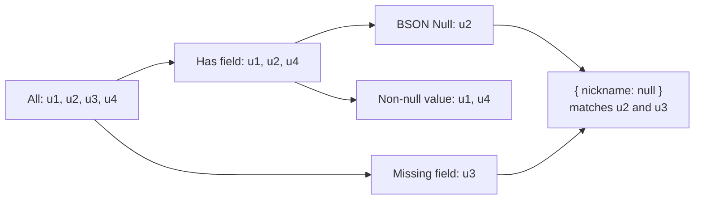

# IsNull, IsNotNull, Exists, and the Difference Between Null and Missing Fields

In **Spring Data MongoDB**, derived queries let you declare methods such as `findByNicknameIsNull()`, `findByNicknameIsNotNull()`, or `findByNicknameExists(boolean exists)` directly on a repository. Spring Data reads the method name, uses entity metadata, and builds the corresponding MongoDB query.

A common source of confusion is that MongoDB distinguishes **a field holding BSON `null`** from **a field completely absent from the document**. On Java objects, both situations usually map to the same `null` reference, but at the query layer, `$exists`, `$ne`, and `$type` allow checking distinct states. This lesson belongs to the **Derived Queries** chapter and focuses on the exact semantics of `IsNull`, `IsNotNull`, and `Exists`.

## 1. Three States to Distinguish in BSON

Consider a `users` collection with four documents. For convenience, `_id` values below are BSON Strings, not ObjectIds:

```javascript
db.users.insertMany([
  { _id: "u1", nickname: "Minh",  active: true },
  { _id: "u2", nickname: null,    active: true },
  { _id: "u3",                    active: false },
  { _id: "u4", nickname: "",      active: true }
]);
```

The `nickname` field exhibits four cases:

| Document | `nickname` field in BSON | Interpretation |
| --- | --- | --- |
| `u1` | `"Minh"` | Field present with non-null value |
| `u2` | `null` | **Field present**, but value is BSON Null |
| `u3` | No `nickname` key | **Missing field** (*missing / absent*) |
| `u4` | `""` | Field present, empty string; **not** null |

Never equate `null`, missing fields, empty strings, `false`, `0`, or empty arrays. Each state carries its own data meaning and query behavior.

For instance, a user who has never entered a nickname might be stored by **omitting the field**. A user who explicitly deleted their nickname might be stored with **BSON Null** if business logic wants to record that distinction. If an application does not need to separate those two states, standardize on a single write convention so multiple representations do not mean "no nickname".

## 2. How MongoDB Interprets `null`, `$ne: null`, and `$exists`

For a scalar field like `nickname` in this example, the queries yield:

| MongoDB condition | Meaning | Matching documents |
| --- | --- | --- |
| `{ nickname: null }` | Field is BSON Null **or missing** | `u2`, `u3` |
| `{ nickname: { $ne: null } }` | Field **exists** and value is **not null** | `u1`, `u4` |
| `{ nickname: { $exists: true } }` | Field key exists, regardless of value | `u1`, `u2`, `u4` |
| `{ nickname: { $exists: false } }` | Field key does not exist at all | `u3` |
| `{ nickname: { $type: 10 } }` | Field has BSON Null type | `u2` |

Key points to remember: **`{ field: null }` does not search only for BSON Null**, and **`$exists: true` does not mean the field is non-null**. For `$ne: null`, MongoDB has special semantics matching fields that exist and are non-null; do not mechanically apply general assumptions about `$ne` to every case.

Test directly in the MongoDB Shell:

```javascript
// null or missing field:
db.users.find({ nickname: null });

// Field exists and is non-null:
db.users.find({ nickname: { $ne: null } });

// Field exists, including BSON Null values:
db.users.find({ nickname: { $exists: true } });

// Missing field only:
db.users.find({ nickname: { $exists: false } });

// BSON Null only (for the scalar field in this example):
db.users.find({ nickname: { $type: 10 } });
```

In the BSON type system, code `10` represents **Null**. You can also use `$type: "null"` when supported by syntax and MongoDB version. The explanations above focus on scalar fields; for **arrays or paths traversing arrays**, matching rules add element-matching semantics, so test against your actual schema.

### Visualizing the Result Sets



The diagram shows that `{ nickname: null }` returns the union of **BSON Null** and **missing field**. When designing data validation rules, this difference determines whether you should use `IsNull` or combine `Exists` with another condition.

## 3. Declaring the Entity and `MongoRepository` for Derived Queries

Create an entity matching the sample collection. Because `_id` values are strings `"u1"`, `"u2"`, ..., use `@MongoId(FieldType.STRING)` to declare the identifier type explicitly:

```java
import org.springframework.data.mongodb.core.mapping.Document;
import org.springframework.data.mongodb.core.mapping.FieldType;
import org.springframework.data.mongodb.core.mapping.MongoId;

@Document("users")
public class UserAccount {
    @MongoId(FieldType.STRING)
    private String id;

    private String nickname;
    private boolean active;

    public UserAccount() {}

    public String getId() { return id; }
    public String getNickname() { return nickname; }
    public boolean isActive() { return active; }
}
```

Repository:

```java
import java.util.List;
import org.springframework.data.mongodb.repository.MongoRepository;

public interface UserAccountRepository
        extends MongoRepository<UserAccount, String> {

    List<UserAccount> findByNicknameIsNull();

    List<UserAccount> findByNicknameIsNotNull();

    List<UserAccount> findByNicknameExists(boolean exists);

    boolean existsByNickname(String nickname);
}
```

The methods above illustrate **four distinct questions**. `List<UserAccount>` is appropriate because multiple documents may match; do not use `Optional<UserAccount>` when the filter does not guarantee uniqueness.

### 3.1. `findByNicknameIsNull()`

```java
List<UserAccount> result = users.findByNicknameIsNull();
// On sample data: u2 and u3.
```

Semantically equivalent to:

```javascript
db.users.find({ nickname: null });
```

`IsNull` (or the equivalent `Null` keyword when supported by the parser) compares against `null`, and therefore **includes missing fields**. It fits the question "does the user lack a non-null nickname?", but does not fit if business logic must separate "explicitly set to null" from "field never saved".

### 3.2. `findByNicknameIsNotNull()`

```java
List<UserAccount> result = users.findByNicknameIsNotNull();
// On sample data: u1 and u4.
```

Equivalent to:

```javascript
db.users.find({ nickname: { $ne: null } });
```

In this scalar example, `IsNotNull` requires a present, non-null value. **Empty strings are still returned** because `""` is a string, not BSON Null. If business rules require a nickname with at least one non-whitespace character, add validation and/or extra filters; `IsNotNull` alone is not enough.

### 3.3. `findByNicknameExists(boolean exists)`

```java
List<UserAccount> storedField = users.findByNicknameExists(true);
// u1, u2, u4: field exists, even though u2 is null.

List<UserAccount> missingField = users.findByNicknameExists(false);
// u3: field is completely missing.
```

Spring Data uses the `Exists` suffix in the **property predicate** and a `boolean` argument to generate `$exists`:

```javascript
db.users.find({ nickname: { $exists: true } });
db.users.find({ nickname: { $exists: false } });
```

`$exists: true` does not inspect the contents of `nickname`, so `u2` with `nickname: null` still matches. Conversely, `$exists: false` excludes `u2`.

### 3.4. `existsByNickname(String nickname)` **Differs from** `findByNicknameExists(...)`

```java
boolean hasMinh = users.existsByNickname("Minh");
// true if at least one document has nickname == "Minh".
```

`existsBy...` is the **subject** of the repository query, asking whether any document satisfies the *predicate*. It does not check field key presence. By contrast, `findByNicknameExists(boolean)` uses the **predicate keyword `Exists`** to generate `$exists`.

| Method | Question answered |
| --- | --- |
| `existsByNickname("Minh")` | Is there any user with `nickname = "Minh"`? |
| `findByNicknameExists(true)` | Which users have the `nickname` key in BSON? |
| `findByNicknameExists(false)` | Which users lack the `nickname` key in BSON? |

Similar-looking tokens appearing in different positions in derived-query grammar produce completely different queries.

## 4. Quick Comparison of Keywords and Results

| Repository method | MongoDB filter (meaning) | `u1` | `u2` | `u3` | `u4` |
| --- | --- | :---: | :---: | :---: | :---: |
| `findByNicknameIsNull()` | `{nickname: null}` | — | ✓ | ✓ | — |
| `findByNicknameIsNotNull()` | `{nickname: {$ne: null}}` | ✓ | — | — | ✓ |
| `findByNicknameExists(true)` | `{nickname: {$exists: true}}` | ✓ | ✓ | — | ✓ |
| `findByNicknameExists(false)` | `{nickname: {$exists: false}}` | — | — | ✓ | — |
| Explicit BSON Null query | `{nickname: {$type: 10}}` | — | ✓ | — | — |

When you need **only one specific state**, ask the exact question: "no value", "has key", "missing key", or "key stored as Null type"? Never pick a method solely because its English name includes `Null` or `Exists`.

## 5. Finding **Only BSON Null**, Excluding Missing Fields

`findByNicknameIsNull()` does not separate `u2` from `u3`. To find only documents **explicitly storing** `nickname` with BSON Null, write a more explicit query.

### 5.1. Using `$type: 10`

```javascript
db.users.find({
  nickname: { $type: 10 }
});
// u2
```

In `MongoTemplate`, you can use `BasicQuery`:

```java
import java.util.List;
import org.springframework.data.mongodb.core.MongoTemplate;
import org.springframework.data.mongodb.core.query.BasicQuery;

List<UserAccount> explicitlyNull = mongoTemplate.find(
    new BasicQuery("{ \"nickname\": { \"$type\": 10 } }"),
    UserAccount.class
);
```

This checks for the **BSON Null type**; for scalar fields, it excludes documents missing the field. Another option combines `null` equality with `$exists: true`.

### 5.2. Combining `{ field: null }` with `$exists: true`

```javascript
db.users.find({
  $and: [
    { nickname: null },
    { nickname: { $exists: true } }
  ]
});
// u2
```

Note that you cannot place two duplicate `nickname` keys inside the same JSON object to merge conditions; parsers may keep only one of them. Using `$and`, `$type`, or `Criteria` expresses it unambiguously.

A repository can declare an explicit query with `@Query` when derived method names cannot express exact semantics:

```java
import org.springframework.data.mongodb.repository.Query;

// Add inside UserAccountRepository:
@Query("{ 'nickname': { '$type': 10 } }")
List<UserAccount> findWithExplicitNullNickname();
```

This `@Query` example uses MongoDB JSON syntax as supported by Spring Data MongoDB. If the Java field is renamed via `@Field`, verify how the query maps to the entity and actual field name.

## 6. Writing Equivalent Conditions with MongoTemplate

Repository methods fit stable, concise criteria. For dynamic filters, `MongoTemplate` and `Criteria` allow clear construction:

```java
import org.springframework.data.mongodb.core.query.Criteria;
import org.springframework.data.mongodb.core.query.Query;

List<UserAccount> nullOrMissing = mongoTemplate.find(
    Query.query(Criteria.where("nickname").is(null)),
    UserAccount.class
);

List<UserAccount> nonNull = mongoTemplate.find(
    Query.query(Criteria.where("nickname").ne(null)),
    UserAccount.class
);

List<UserAccount> hasField = mongoTemplate.find(
    Query.query(Criteria.where("nickname").exists(true)),
    UserAccount.class
);

List<UserAccount> noField = mongoTemplate.find(
    Query.query(Criteria.where("nickname").exists(false)),
    UserAccount.class
);
```

Semantically on the sample data, these four expressions correspond exactly to `IsNull`, `IsNotNull`, `Exists(true)`, and `Exists(false)`.

You can combine field state with other conditions:

```java
Query activeWithoutNicknameValue = Query.query(
    Criteria.where("active").is(true)
            .and("nickname").is(null)
);

List<UserAccount> result =
    mongoTemplate.find(activeWithoutNicknameValue, UserAccount.class);
```

In the sample data, `u2` is selected because `active=true` and `nickname=null`. Even though `u3` lacks `nickname`, `active=false`, so it is excluded. Always test business filters alongside null operators rather than testing null operators in isolation.

## 7. Why Do Two Different Documents Become the Same Java `null`?

When `MappingMongoConverter` reads a document into `UserAccount`, the `String nickname` property is mapped from its BSON field:

```text
Document u2: { nickname: null }   → UserAccount.nickname == null
Document u3: { /* absent */ }     → UserAccount.nickname == null
```

In this example with a no-arg constructor and an initially `null` reference field, both states produce `getNickname() == null`. **From a materialized Java object alone, inspecting the property value cannot tell you whether the key existed in BSON.**

If distinguishing *absent* from *explicit null* is a business requirement, store or read that fact explicitly: use `Document`, query with `$exists`, add a separate status field, or use a specialized DTO with a presence flag. Do not infer it from a Java `String` being `null`.

### 7.1. Write Policy for Null Properties

Under typical mapping settings, Spring Data MongoDB **omits fields whose Java value is `null`** when saving an entity. Hence:

```java
UserAccount user = new UserAccount();
// If nickname == null, the new document may omit the nickname field
// under the default null write policy.
```

If saving a Java `null` must write an explicit **BSON Null field**, Spring Data supports explicit write policies, such as annotating the field on the entity:

```java
import org.springframework.data.mongodb.core.mapping.Field;

// Replace the nickname declaration in UserAccount with:
@Field(write = Field.Write.ALWAYS)
private String nickname;
```

This instructs the converter to write `nickname: null` even when the Java property is `null`. Depending on your Spring Data version, test this policy against raw BSON, especially with legacy data or custom conversions. The annotation does not make `null` and missing become two distinct Java values on read.

### 7.2. `$set: null` Differs from `$unset`

When updating an existing document:

```javascript
// Keep the key, set value to BSON Null:
db.users.updateOne(
  { _id: "u1" },
  { $set: { nickname: null } }
);

// Remove the key entirely from the document:
db.users.updateOne(
  { _id: "u1" },
  { $unset: { nickname: "" } }
);
```

Equivalent with `MongoTemplate`:

```java
import org.springframework.data.mongodb.core.query.Update;

Query byId = Query.query(Criteria.where("id").is("u1"));

mongoTemplate.updateFirst(
    byId,
    new Update().set("nickname", null),
    UserAccount.class
);

mongoTemplate.updateFirst(
    byId,
    new Update().unset("nickname"),
    UserAccount.class
);
```

These two statements are **two independent illustrative operations**, not a sequence to run back-to-back in production. After `$set`, `findByNicknameExists(true)` matches the document; after `$unset`, `findByNicknameExists(false)` matches it.

**Important point:** `save(entity)` may rewrite multiple properties according to entity mapping, so never call `save` on an entity loaded with partial projections just to change a null state. When updating a single field, `$set`/`$unset` provide exact control.

## 8. Nested Fields and `@Field`: Querying by Java Property Name

Suppose MongoDB stores display names under `profile.display_name`:

```javascript
{
  _id: "u5",
  profile: {
    display_name: null
  }
}
```

Corresponding Java model:

```java
import org.springframework.data.mongodb.core.mapping.Field;

record Profile(@Field("display_name") String displayName) {}

@Document("users")
class UserWithProfile {
    @MongoId(FieldType.STRING)
    private String id;

    private Profile profile;
}
```

Derived queries use **Java property names**:

```java
interface UserWithProfileRepository
        extends MongoRepository<UserWithProfile, String> {
    List<UserWithProfile> findByProfileDisplayNameIsNull();
    List<UserWithProfile> findByProfileDisplayNameExists(boolean exists);
}
```

Spring Data resolves `profile.displayName` and maps `@Field("display_name")` to `profile.display_name`. An `IsNull` query on a nested path matches when **`profile` itself is missing**, when `display_name` is missing, or when `display_name` is Null. An `Exists` query checks whether that path exists in BSON as stored, not merely whether the Java object has a `profile` instance.

With complex nesting, `@Field`, maps, arrays, or subtypes, inspect the actual executed query and BSON documents. Method-name parsing rules do not replace understanding document paths.

## 9. Null Conditions on Arrays and Other Data Types

Earlier examples used `nickname` as a **scalar field**. With arrays:

```javascript
{
  _id: "u6",
  tags: ["java", null, "mongodb"]
}
```

MongoDB applies array-element matching semantics to several operators. Thus `{tags: null}` can match an array containing a null element even though `tags` itself is not BSON Null at the field level. Checking for an empty array field, a missing array field, a null element, or a populated element are **different requirements**.

When business logic needs "contains a null element", "array exists", "array is empty", or "field is missing", write queries tailored to the actual BSON schema and test boundary cases. For nested objects in arrays, operators like `$elemMatch`, `$size`, `$exists`, and dotted paths may need deliberate combination; a simple `IsNull` rarely expresses that fully.

The same applies when a property has Boolean `false`, number `0`, string `""`, or an empty object: these are **present values**, neither null nor missing fields.

## 10. Performance, Indexes, Sparse Indexes, and Partial Indexes

Queries checking field existence often appear in migrations, classifying incomplete profiles, or cleaning up legacy records. Evaluate performance against real data.

| Query type | Considerations |
| --- | --- |
| `{nickname: {$exists: true}}` | Can benefit from an appropriate index; includes documents storing BSON Null |
| `{nickname: {$exists: false}}` | May scan/inspect many documents; do not assume efficient index usage |
| `{nickname: null}` | Includes both null and missing; selectivity may be low on unnormalized data |
| `{nickname: {$ne: null}}` | Matches populated fields; still measure because `$ne` often has low selectivity |
| `{nickname: {$type: 10}}` | Matches BSON Null type; evaluate execution plans and index support |

A **sparse index** indexes only documents **containing the field**, yet a document containing the field with value `null` is still considered to have the field. Example:

```javascript
db.users.createIndex(
  { nickname: 1 },
  { sparse: true }
);
```

This index does not treat `null` as "absent". In particular, a unique sparse index permits multiple documents **missing the field**, but still enforces uniqueness across documents **having the field set to Null**. If you only want to index valid string nicknames, consider a **partial index** with a type filter and verify your business value types:

```javascript
db.users.createIndex(
  { nickname: 1 },
  {
    name: "nickname_strings",
    partialFilterExpression: {
      nickname: { $type: "string" }
    }
  }
);
```

A partial index only serves queries where MongoDB can prove the query implies the index's filter expression; do not expect it to cover arbitrary `IsNull` or `Exists` queries.

Diagnose with:

```javascript
db.users.find({ nickname: { $exists: false } })
  .explain("executionStats");
```

Check `winningPlan`, `nReturned`, `totalDocsExamined`, `totalKeysExamined`, and latency on representative data. Creating extra indexes just to speed up rare maintenance queries increases write overhead, disk usage, and maintenance cost.

## 11. Testing Against Real MongoDB: Preserving the Missing vs. Null Difference

A key testing practice is **inserting raw BSON directly** rather than saving only Java entities. The reason is that the converter may omit null fields on write, erasing `nickname: null` from your test fixture.

Integration test example using a Spring Boot test slice, an isolated test MongoDB, and AssertJ:

```java
import static org.assertj.core.api.Assertions.assertThat;

import java.util.List;
import org.bson.Document;
import org.junit.jupiter.api.Test;
import org.springframework.beans.factory.annotation.Autowired;
import org.springframework.boot.test.autoconfigure.data.mongo.DataMongoTest;
import org.springframework.data.mongodb.core.MongoTemplate;

@DataMongoTest
class UserNullQueryIntegrationTest {
    @Autowired MongoTemplate template;
    @Autowired UserAccountRepository users;

    @Test
    void shouldDifferentiateNullFromMissingFields() {
        var collection = template.getCollection("users");
        collection.deleteMany(new Document());

        collection.insertMany(List.of(
            new Document("_id", "u1").append("nickname", "Minh")
                .append("active", true),
            new Document("_id", "u2").append("nickname", null)
                .append("active", true),
            new Document("_id", "u3").append("active", false),
            new Document("_id", "u4").append("nickname", "")
                .append("active", true)
        ));

        assertThat(users.findByNicknameIsNull())
            .extracting(UserAccount::getId)
            .containsExactlyInAnyOrder("u2", "u3");

        assertThat(users.findByNicknameIsNotNull())
            .extracting(UserAccount::getId)
            .containsExactlyInAnyOrder("u1", "u4");

        assertThat(users.findByNicknameExists(true))
            .extracting(UserAccount::getId)
            .containsExactlyInAnyOrder("u1", "u2", "u4");

        assertThat(users.findByNicknameExists(false))
            .extracting(UserAccount::getId)
            .containsExactly("u3");

        assertThat(users.existsByNickname("Minh")).isTrue();
        assertThat(users.existsByNickname("NotPresent")).isFalse();
    }
}
```

This test must run against an **isolated** database (e.g., Testcontainers); `deleteMany(new Document())` is strictly for test collections and must never touch production collections. Actual behavior should always be verified against your specific Spring Data MongoDB and Spring Boot versions.

To test the null write policy:

1. Create an entity with `nickname == null` under the default policy; save it, read the **raw document**, and check whether the `nickname` key exists.
2. Try `@Field(write = Field.Write.ALWAYS)`; save to a separate test collection or clean up appropriately, and verify the key actually exists with BSON Null.
3. Run `$set: {nickname: null}` and `$unset: {nickname: ""}` on two separate documents; verify `Exists(true/false)`.
4. Add tests for empty strings, `false`, `0`, nested fields, and arrays if used in your schema.

If a mocked repository is stubbed to return "expected" results, the test only checks the service and never proves that the **derived query parser** or MongoDB executes `$exists` properly. For data-type, query, and mapping bugs, integration tests provide much higher value.

## 12. Business Scenario: Representing Data States Explicitly

Suppose an onboarding flow asks for a nickname. There are two interpretations for a document lacking a value:

- **Not yet collected**: the `nickname` field does not exist.
- **Cleared/declined by the user**: the `nickname` field holds BSON Null.

If the workflow truly needs to separate these two cases, `IsNull` is **not enough**. Use `Exists(false)` to find users who have not been asked yet and `$type: 10` to find users who explicitly cleared it. Ensure every write path follows the same convention; if `save` drops null fields by default, the "cleared" meaning will be lost.

If this state is queried frequently or controls permissions/business flows, a more durable design is an explicit status field:

```javascript
{
  _id: "u10",
  nickname: null,
  nickname_state: "DECLINED"
}
```

States like `NOT_PROVIDED`, `DECLINED`, and `PROVIDED` can be checked via validation and equality queries, avoiding overloading the absence of a BSON key with multiple meanings. Only add such a field when the business distinction genuinely exists, not for every optional attribute.

## 13. Common Mistakes and How to Avoid Them

| Mistake | Why it is wrong | Proper approach |
| --- | --- | --- |
| Using `IsNull` to find **only** BSON Null | MongoDB also matches missing fields | Use `$type: 10` or combine with `$exists: true` |
| Using `Exists(true)` to mean "has a value" | Field may be present with `null` | Use `IsNotNull` for non-null; add validation for non-empty |
| Using `IsNotNull` to filter non-empty strings | `""` is not null | Add rules for blank/empty strings |
| Confusing `existsByNickname("Minh")` with `NicknameExists(true)` | One checks documents matching a value; the other checks key presence | Read the full derived method structure |
| Seeing `getNickname() == null` and assuming the key is missing | Entities map both BSON Null and missing to Java null | Inspect raw BSON or query `$exists` |
| Calling `save` with null and assuming BSON Null was stored | Default converter may omit null fields | Check write policy, `@Field(write = ALWAYS)`, `$set` |
| Using a sparse index expecting BSON Null to be excluded | Sparse distinguishes **missing**, not all nulls | Define a partial filter matching your requirement |
| Writing derived queries with snake_case BSON names | Derived parser reads Java property names | Use `findByPreferredNameIsNull()` with `@Field` |
| Testing only via entity write-then-read | Same mapper hides missing vs. null differences | Insert raw `Document`s covering both states |

## 14. Self-Check Questions

**1.** `nickname` is absent from a document. Does `findByNicknameIsNull()` select it?  
**Answer:** Yes, because null equality in MongoDB matches missing fields as well.

**2.** Is `nickname: null` returned by `findByNicknameExists(true)`?  
**Answer:** Yes, because the key exists.

**3.** Does `nickname: ""` match `IsNotNull`?  
**Answer:** Yes; an empty string is not BSON Null.

**4.** To find **only documents lacking the `nickname` key**, what should you use?  
**Answer:** `findByNicknameExists(false)` or `Criteria.where("nickname").exists(false)`.

**5.** How do you find **only documents containing BSON Null** on scalar `nickname`?  
**Answer:** `{nickname: {$type: 10}}` or combine `{nickname: null}` with `$exists: true`.

**6.** Why is `getNickname() == null` on a Java object insufficient to conclude the stored document had `nickname: null`?  
**Answer:** Missing fields are typically also mapped to Java `null` on that property.

**7.** Is `existsByNickname("Minh")` equivalent to `findByNicknameExists(true)`?  
**Answer:** No. The first checks if any document has value `"Minh"`; the second returns all documents having the `nickname` field.

**8.** Should a business flow distinguishing "not entered yet" from "declined to provide" rely solely on a nullable `String nickname` property?  
**Answer:** Only if you enforce strict BSON/write-path conventions and queries; when this distinction matters to business logic, an explicit status field is usually clearer.

**Conclusion:** in Spring Data MongoDB, `IsNull` matches **null or missing**, `IsNotNull` matches **fields with non-null values**, and `Exists` checks **key presence only**. Cross-check derived method names against real BSON documents, converter null-write policies, and business goals before using results for authorization, profile classification, or data updates. An integration test containing both `null` and missing fields is the shortest path to avoiding deployment surprises.
