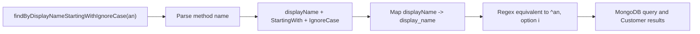

# Containing, StartingWith, EndingWith, Regex, and IgnoreCase in Spring Data MongoDB Derived Queries

## 1. What Problem Do Derived Queries Solve?

Spring Data MongoDB can generate MongoDB queries from method names on a `MongoRepository`. This is the **derived query** (*query derivation*) mechanism: instead of writing BSON for every simple condition, you specify the **property**, **operator**, and **combination** in the method name, while Spring Data parses the name, maps Java properties to BSON fields, and builds the query.

In a customer management system, users may need to:

- Find names **containing** a text fragment: `Containing`.
- Find names **starting with** a prefix: `StartingWith`.
- Find names **ending with** a suffix: `EndingWith`.
- Match an intentional **regular expression**: `Regex`.
- Match **case-insensitively**: `IgnoreCase` or `AllIgnoreCase`.

These keywords suit basic string filtering in `SPRING_DATA_MONGODB`, yet you must understand that they usually generate **`$regex` queries**, not natural-language search. Accuracy, index usability, and safety differ markedly between literal text matching and accepting an external regex.

The goal of this lesson in the **Derived Queries** chapter is to understand repository syntax, query outputs, keyword combinations, field mapping, input safety, performance, and testing against real MongoDB. BSON representations in the tables are **semantic descriptions**; exact `Pattern` or regex string construction in Spring Data may vary across versions.

## 2. Sample Data and Java Entity

First, create a small dataset in `mongosh` inside a practice database:

```javascript
db.customers.insertMany([
  { _id: "C001", display_name: "An",       email: "an@example.com",    active: true },
  { _id: "C002", display_name: "Anh",      email: "anh@example.com",   active: true },
  { _id: "C003", display_name: "Lan Anh",  email: "lan@example.com",   active: false },
  { _id: "C004", display_name: "anna",     email: "anna@example.com",  active: true },
  { _id: "C005", display_name: "ANNA",     email: "anna2@example.com", active: true },
  { _id: "C006", display_name: "A.B",      email: "ab@example.com",    active: true },
  { _id: "C007", display_name: "A0B",      email: "a0b@example.com",   active: true },
  { _id: "C008", display_name: "Đà Nẵng",  email: "dn@example.com",    active: true }
]);

db.customers.find({}, { display_name: 1, email: 1 }).sort({ _id: 1 });
```

Intentional details in the dataset:

- `"An"`, `"Anh"`, `"anna"`, and `"ANNA"` separate **prefix** matching from **case sensitivity**.
- `"Lan Anh"` separates **contains** from **ends with**.
- `"A.B"` and `"A0B"` show that `.` is a **literal character** in literal string matching but a **wildcard** in regex.
- `"Đà Nẵng"` reminds us that case-insensitive **does not mean** accent-insensitive or natural-language search.

Mapping in Spring Data MongoDB:

```java
import org.springframework.data.annotation.Id;
import org.springframework.data.mongodb.core.mapping.Document;
import org.springframework.data.mongodb.core.mapping.Field;

@Document(collection = "customers")
public class Customer {
    @Id
    private String id;

    @Field("display_name")
    private String displayName;

    private String email;
    private boolean active;

    protected Customer() {
        // Required for Spring Data materialization.
    }

    public Customer(String id, String displayName, String email, boolean active) {
        this.id = id;
        this.displayName = displayName;
        this.email = email;
        this.active = active;
    }

    public String getId() { return id; }
    public String getDisplayName() { return displayName; }
    public String getEmail() { return email; }
    public boolean isActive() { return active; }
}
```

In the repository, methods must use the **Java property name `displayName`**, even though documents store the BSON field `display_name`. Spring Data uses `@Field` mapping metadata to translate the query. When writing queries directly in `mongosh` or the raw Java Driver, use **`display_name`**.

## 3. Defining Derived Query Methods

Repository example:

```java
import java.util.List;
import java.util.Optional;
import java.util.regex.Pattern;

import org.springframework.data.domain.Page;
import org.springframework.data.domain.Pageable;
import org.springframework.data.mongodb.repository.MongoRepository;

public interface CustomerRepository
        extends MongoRepository<Customer, String> {

    List<Customer> findByDisplayNameContaining(String fragment);

    List<Customer> findByDisplayNameStartingWith(String prefix);

    List<Customer> findByDisplayNameEndingWith(String suffix);

    List<Customer> findByDisplayNameRegex(String expression);

    List<Customer> findByDisplayNameRegex(Pattern expression);

    List<Customer> findByDisplayNameContainingIgnoreCase(String fragment);

    List<Customer> findByDisplayNameStartingWithIgnoreCase(String prefix);

    List<Customer> findByDisplayNameEndingWithIgnoreCase(String suffix);

    Optional<Customer> findByEmailIgnoreCase(String email);

    List<Customer> findByDisplayNameContainingAndActiveTrue(String fragment);

    List<Customer> findByDisplayNameAndEmailAllIgnoreCase(
        String displayName, String email);

    Page<Customer> findByDisplayNameContainingIgnoreCase(
        String fragment, Pageable pageable);
}
```

`findByDisplayNameRegex(String)` and `findByDisplayNameRegex(Pattern)` are declared as overloads to compare both ways of passing expressions. In real projects, choose **one clear signature** matching your needs to avoid mixing literal strings with runnable regexes. Methods using `IgnoreCase` can combine with other string operators in the method name.

Flow of a repository call:



Spring Data parses method structure when creating the repository proxy and binds parameter values on invocation. A long method name does not make a query fast; inspect the generated conditions and matching indexes.

## 4. Comparison Table of Five Keyword Groups

Assuming Java property `displayName` and BSON field `display_name`:

| Repository method | Meaning | Logically equivalent MongoDB query | Sample dataset result |
|---|---|---|---|
| `findByDisplayNameContaining("Anh")` | Contains literal string `Anh` anywhere | `{ display_name: { $regex: "Anh" } }` | `C002, C003` |
| `findByDisplayNameStartingWith("An")` | Starts with `An` | `{ display_name: { $regex: "^An" } }` | `C001, C002` |
| `findByDisplayNameEndingWith("Anh")` | Ends with `Anh` | `{ display_name: { $regex: "Anh$" } }` | `C002, C003` |
| `findByDisplayNameRegex("^A.B$")` | Evaluates regex where `.` matches any single character | `{ display_name: { $regex: "^A.B$" } }` | `C006, C007` |
| `findByEmailIgnoreCase("AN@EXAMPLE.COM")` | Case-insensitive equality | Regex anchored at start/end, option `i` | `C001` |
| `findByDisplayNameContainingIgnoreCase("ann")` | Contains `ann`, ignoring case | `{ display_name: { $regex: "ann", $options: "i" } }` | `C004, C005` |
| `findByDisplayNameStartingWithIgnoreCase("an")` | Prefix `an`, ignoring case | `{ display_name: { $regex: "^an", $options: "i" } }` | `C001, C002, C004, C005` |
| `findByDisplayNameContaining("A.B")` | Matches **literal dot** | Escaped regex for `.` | `C006` |

**Note:** the table shows concise regex examples for clarity; Spring Data may wrap user parameters with escapes such as `\Q...\E` to treat them as literal regex segments. With `Containing`, `StartingWith`, and `EndingWith`, parameters must be treated as **literal text**, whereas `Regex` expects a **regular expression pattern**.

### 4.1. Containing: Substring Anywhere in the String

```java
List<Customer> result =
    repository.findByDisplayNameContaining("Anh");
// C002 ("Anh"), C003 ("Lan Anh")
```

Equivalent in `mongosh`:

```javascript
db.customers.find({ display_name: /Anh/ });
```

Neither `^` nor `$` is present, so position is unconstrained. For a `String` field, `Containing` searches for a substring. Avoid extrapolating directly to array fields: collection keywords like `Contains`/`Containing` can map differently depending on property type; this lesson focuses on **strings**.

### 4.2. StartingWith: Prefix Matching

```java
List<Customer> result =
    repository.findByDisplayNameStartingWith("An");
// C001 ("An"), C002 ("Anh")
```

Equivalent:

```javascript
db.customers.find({ display_name: /^An/ });
```

In regex, `^` anchors the start of the string (under standard non-multiline semantics). This is the regex category with the **best chance of using an index effectively** when the pattern is literal, case-sensitive, and anchored at the start. Actual usage depends on the query, collation, index type, and execution plan.

### 4.3. EndingWith: Suffix Matching

```java
List<Customer> result =
    repository.findByDisplayNameEndingWith("Anh");
// C002 ("Anh"), C003 ("Lan Anh")
```

Equivalent:

```javascript
db.customers.find({ display_name: /Anh$/ });
```

Suffixes are not anchored at the start of the string. With ordinary B-tree indexes, finding every string **ending with** a suffix generally cannot perform an efficient index range scan. If this is a high-traffic feature, reconsider index/data design or use a dedicated search engine instead of bumping `maxPoolSize`.

### 4.4. Regex: Caller Supplies the Expression Pattern

```java
List<Customer> result =
    repository.findByDisplayNameRegex("^A.B$");
// C006 ("A.B") and C007 ("A0B")
```

Equivalent:

```javascript
db.customers.find({ display_name: /^A.B$/ });
```

In regex syntax:

- `^` anchors start of string, `$` anchors end of string per regex semantics.
- `.` matches any single character (aside from flag-specific exceptions).
- `.*` matches arbitrary character sequences.
- `[0-9]` is a digit character class; `(foo|bar)` denotes alternation.

`Regex` fits when business logic **truly requires regex syntax**, such as controlled internal rules. It is not a safe way to simulate `Containing` over arbitrary search-box input. For literal inputs containing `.`, `*`, `?`, `[`, `]`, etc., use `Containing`/`StartingWith` or escape properly.

### 4.5. IgnoreCase: Ignoring Case Differences

```java
Customer result = repository
    .findByEmailIgnoreCase("AN@EXAMPLE.COM")
    .orElseThrow();
// C001 has email "an@example.com"
```

For String equality, the behavior corresponds to a regex **anchored at both start and end** with case-insensitive mode; conceptually:

```javascript
db.customers.find({
  email: { $regex: "^an@example\\.com$", $options: "i" }
});
```

Inside the JavaScript regex string, the `.` in the email domain is escaped to match a literal dot. Note that `IgnoreCase` folds letter case, **does not strip Vietnamese diacritics**, does not trim whitespace, and does not normalize Unicode or email formatting. If your application needs canonical email or identifier rules, normalize on write/input according to the business contract before storing or querying.

`IgnoreCase` combines with other keywords, for example:

```java
repository.findByDisplayNameContainingIgnoreCase("ann");
repository.findByDisplayNameStartingWithIgnoreCase("an");
repository.findByDisplayNameEndingWithIgnoreCase("ANH");
```

When compiled into a regex, case-insensitivity typically adds the `i` flag. Do not assume how accented characters, Unicode normalization, and collation behave from the method name alone; test against real Vietnamese data.

## 5. Distinguishing Literal Strings from Caller-Provided Regexes

### 5.1. Why Is the Dot in `A.B` a Mandatory Test Case?

Suppose a search form receives `"A.B"`. These two calls have **different meanings**:

```java
List<Customer> literal =
    repository.findByDisplayNameContaining("A.B");

List<Customer> regex =
    repository.findByDisplayNameRegex("^A.B$");
```

Results on sample data:

| Call | `C006: "A.B"` | `C007: "A0B"` | Explanation |
|---|---|---|---|
| `Containing("A.B")` | Yes | No | `.` is treated as a literal character |
| `Regex("^A.B$")` | Yes | Yes | `.` in regex matches any single character |
| `Regex("^A\\.B$")` | Yes | No | Dot is escaped inside the regex pattern |

In the last row, `^A\\.B$` is a **Java string literal requiring an escaped `\`**. When written as a `mongosh` regex literal, the pattern is:

```javascript
db.customers.find({ display_name: /^A\.B$/ }); // C006
db.customers.find({ display_name: /^A.B$/ });  // C006 and C007
```

In Java, you can write:

```java
repository.findByDisplayNameRegex("^A\\.B$");
repository.findByDisplayNameRegex(
    Pattern.compile("^A\\.B$"));
```

**Do not lose the escaping step:** Java string `"^A\\.B$"` passes the regex pattern `^A\.B$` to the regex engine. Writing `"^A.B$"` without escaping will also match `"A0B"`.

### 5.2. Spring Data String Keywords Safely Escape Regex Metacharacters

In modern Spring Data MongoDB versions, literal-text keywords such as `Containing`, `StartingWith`, and `EndingWith` **escape regex metacharacters** inside argument values. Thus, entering `".*"` into `Containing` does not grant wildcard matching via regex `.*`.

For example:

```java
repository.findByDisplayNameContaining(".*");
// Targets the literal characters "." followed by "*".
// On the sample dataset, no name contains literal ".*".
```

By contrast:

```java
repository.findByDisplayNameRegex(".*");
// This regex pattern matches virtually any string value, very broad.
```

If an application uses an older Spring Data release or custom queries/criteria, verify the exact escaping behavior of that version. Never assume that manually interpolating input into `$regex` inside `@Query` or the raw driver provides the same protection as derived `Containing`.

### 5.3. When Building Regexes in Java

`Pattern.quote` turns a value into a **literal** regex segment. For example, turning a user-supplied prefix into a start-anchored pattern:

```java
import java.util.List;
import java.util.regex.Pattern;
import org.springframework.data.mongodb.core.MongoTemplate;
import org.springframework.data.mongodb.core.query.Criteria;
import org.springframework.data.mongodb.core.query.Query;

public final class CustomerTextSearch {
    private final MongoTemplate mongoTemplate;

    public CustomerTextSearch(MongoTemplate mongoTemplate) {
        this.mongoTemplate = mongoTemplate;
    }

    public List<Customer> byLiteralPrefix(String prefix) {
        if (prefix == null || prefix.isBlank() || prefix.length() > 80) {
            throw new IllegalArgumentException("Invalid prefix");
        }

        Pattern safePattern =
            Pattern.compile("^" + Pattern.quote(prefix));

        Query query = Query.query(
            Criteria.where("displayName").regex(safePattern));

        return mongoTemplate.find(query, Customer.class);
    }
}
```

`Criteria.where("displayName")` uses the entity's **Java property**; when calling `mongoTemplate.find(query, Customer.class)`, Spring Data maps it to BSON field `display_name`. `Pattern.quote` prevents user-supplied `.`, `[`, `*`, etc. from acting as regex syntax.

For a basic prefix search, derived `findByDisplayNameStartingWith(...)` is usually simpler and more maintainable. `Pattern.quote` is helpful when building complex regexes combining fixed structure with literal user text.

### 5.4. Complex Regexes Need Cost Bounds

Regexes are not harmless if users can supply arbitrary patterns. Certain patterns scan many documents or consume excessive engine CPU. For public APIs:

- Prefer **literal search** (`Containing`/`StartingWith`/`EndingWith`) unless users truly need regex syntax.
- If regexes are genuinely required, bound input length, reject disallowed patterns per policy, and apply authorization/rate limits.
- Enforce **paging/limits**, set appropriate timeouts, and monitor latency, `docsExamined`, and timeout errors.
- Never allow clients to send arbitrary patterns into sensitive queries or rely on regex for authorization/authentication.
- Watch for engine differences between Java regexes and MongoDB server's regex engine; do not assume every feature of `java.util.regex.Pattern` behaves identically in MongoDB.

A simple `^prefix` regex typically has more predictable cost than unanchored patterns or heavy alternation. Still, having an anchor does not guarantee index use or fast execution, especially when paired with `IgnoreCase`.

## 6. IgnoreCase, AllIgnoreCase, and Combining Conditions

### 6.1. IgnoreCase Applies Only to Its Target Condition

```java
List<Customer> result = repository
    .findByDisplayNameContainingIgnoreCase("ann");
// C004 ("anna"), C005 ("ANNA")
```

Letter case is ignored for the name condition. If a method has multiple criteria, the position of `IgnoreCase` specifies which String condition receives it. For example, you could declare:

```java
// Can be added to CustomerRepository:
List<Customer> findByDisplayNameIgnoreCaseAndEmail(
    String displayName, String email);
```

Here `displayName` matches case-insensitively while `email` uses default matching. To make both case-insensitive, append `IgnoreCase` to each or use `AllIgnoreCase`.

### 6.2. AllIgnoreCase Applies to All Eligible String Conditions

```java
List<Customer> result = repository
    .findByDisplayNameAndEmailAllIgnoreCase(
        "AN", "AN@EXAMPLE.COM");
// C001
```

`AllIgnoreCase` instructs all String conditions **that support case-insensitivity** in the method to ignore case. Boolean or numeric properties do not become case-insensitive. Do not assume placing `AllIgnoreCase` at the end changes non-string types.

When method names combine many `And`, `Or`, `Containing`, and `IgnoreCase` tokens, they become hard to read and error-prone. For complex criteria, switch to `@Query` or `MongoTemplate` with `Criteria` to express clear structure and inspect the generated BSON.

### 6.3. Combining with Boolean Conditions

```java
List<Customer> result = repository
    .findByDisplayNameContainingAndActiveTrue("Anh");
// C002 ("Anh"); C003 ("Lan Anh") excluded because active=false
```

Equivalent semantics:

```javascript
db.customers.find({
  display_name: { $regex: "Anh" },
  active: true
});
```

`ActiveTrue` takes no parameter; Spring Data treats `True` as a fixed condition. Likewise, repositories support keywords like `False`, `Not`, and `IsNull` for appropriate types, though you should avoid chaining so many tokens that parser behavior becomes hard to verify.

### 6.4. Distinguishing IgnoreCase from MongoDB Collation

MongoDB supports **collation** to compare and sort strings according to locale and case/diacritic strength. This differs from `IgnoreCase`, which typically uses regex flag `i`:

| Mechanism | Example | Characteristics |
|---|---|---|
| Derived query `IgnoreCase` | `findByEmailIgnoreCase("AN@EXAMPLE.COM")` | Usually uses case-insensitive regex |
| Case-insensitive collation | Equality with `collation({ locale: "en", strength: 2 })` | Can leverage an index built with matching collation for equality/sort |
| Canonical lookup field | `emailLookup = lower/normalized email` | Standard equality query when normalized on write |
| Text search / Search index | Word/phrase/relevance queries | Different mechanism from substring regex; design per requirements |

Example in `mongosh` for **equality + collation**:

```javascript
db.customers.createIndex(
  { email: 1 },
  {
    name: "ix_email_collation",
    collation: { locale: "en", strength: 2 }
  }
);

db.customers.find({
  email: "AN@EXAMPLE.COM"
}).collation({ locale: "en", strength: 2 });
// C001
```

`$regex` queries are **not collation-aware** in the same way as equality/sort, so having a case-insensitive collation index does not mean `/pattern/i` will use that index effectively. If a feature primarily does case-insensitive exact lookups of emails or codes, prefer a canonical field or matching collation rather than running regexes on every request.

Vietnamese introduces edge cases around casing, diacritics, composed/decomposed Unicode, and sorting. `IgnoreCase` is not a solution for **accent-insensitive** search; define product requirements clearly, normalize data, or use an appropriate search engine.

## 7. Derived Queries on Property Paths and Data Types

### 7.1. Use Java Property Names; Let the Mapper Resolve BSON Fields

Entity `Customer` has `displayName`, whereas MongoDB stores `display_name`. Thus:

```java
repository.findByDisplayNameStartingWith("An");
```

does not require renaming the method to `findByDisplay_nameStartingWith(...)`. When defining methods, the parser reads the **entity's property names**, and Spring Data mapping resolves physical field names.

With a nested value object:

```java
public class Address {
    private String city;
    // Constructor/getter or appropriate mapping mechanism.
}

// When Customer entity has field:
private Address address;
```

The repository can express the property path:

```java
List<Customer> findByAddress_CityContainingIgnoreCase(String text);
```

This method can be declared whenever the entity actually has `address.city`. The underscore delimits the nested path and removes parser ambiguity. Under default embedded document mapping, the BSON path is `address.city`; custom mapping such as `@Field` or `@Unwrapped` changes the physical path. Inspect the actual executed query when models use custom mapping.

### 7.2. Do Not Confuse Strings with Arrays or BSON Null

This lesson focuses on `String` properties. MongoDB also permits a field to hold an array of Strings, in which case a regex filter on that field can match **any element of the array**. In collections with mixed schemas, string queries can match documents where the BSON field is an array, causing conversion issues when Spring Data maps back to a `String` field.

Therefore:

- Enforce schema/validation ensuring `display_name` is a String per contract.
- Check missing or null `display_name` cases; regexes generally do not match those as string literals.
- For arrays, use collection/array-specific keywords and queries instead of assuming String semantics.
- Never apply `Containing` to a field without verifying its BSON type and query behavior.

### 7.3. What Do Optional, List, and Page Return Types Mean?

| Return type | When to use | Notes |
|---|---|---|
| `Optional<Customer>` | Expect at most one result, e.g., unique email by policy | Does not enforce uniqueness; database should have a constraint |
| `List<Customer>` | Small, bounded result sets | Ordering is not guaranteed without a sort |
| `Page<Customer>` | UI needs total pages/elements | Usually runs an extra count query, costly with regex |
| `Slice<Customer>` | UI only needs to know if a next page exists | Can avoid total count overhead where supported |

**Return types do not replace indexes, limits, or schema integrity.** For example, `Optional<Customer> findByEmailIgnoreCase` does not prevent two documents from having emails differing only by case; if more than one matches, single-result reads can throw an unexpected result-count error.

If case-insensitive uniqueness is required, design indexes/normalization around real data and MongoDB deployment rules rather than relying on repository method names.

## 8. Combining Pagination, Sorting, and Result Limits

Never let an endpoint return tens of thousands of documents just because `findBy...Containing(...)` returns `List`. On real datasets, enforce pagination and explicit sorting:

```java
import org.springframework.data.domain.Page;
import org.springframework.data.domain.PageRequest;
import org.springframework.data.domain.Pageable;
import org.springframework.data.domain.Sort;

Pageable firstPage = PageRequest.of(
    0,
    10,
    Sort.by(
        Sort.Order.asc("displayName"),
        Sort.Order.asc("id")
    )
);

Page<Customer> page = repository
    .findByDisplayNameContainingIgnoreCase("an", firstPage);

System.out.println(page.getContent());
System.out.println(page.getTotalElements());
```

`Sort.by("displayName")` uses the **Java property**, which Spring Data maps to `display_name`. Add `id` as a secondary key for deterministic order when customers share names. For methods without `Sort` or `Pageable`, returned order is **not guaranteed**, even if examples list IDs in readable order.

`Page` requires total element and page counts, which can trigger an extra **count query** alongside data retrieval. With substring regexes on large collections, counting can also be expensive. If the UI only needs "is there a next page?", consider `Slice` or an alternative paging pattern instead of counting everything.

`StartingWith` queries can be capped:

```java
// Can be declared additionally in CustomerRepository:
List<Customer> findTop10ByDisplayNameStartingWithOrderByDisplayNameAsc(
    String prefix);
```

`Top10` caps the number of results; `OrderByDisplayNameAsc` specifies sorting by property. Limiting results **does not eliminate scan cost** if the regex cannot use an index. To prevent overly broad form searches, require minimum input length, cap query string length, and bound page sizes.

## 9. Indexes and Performance of Each Regex Pattern

### 9.1. Creating an Index on the Physical Field

On the sample data, to optimize name lookups, try creating an index:

```javascript
db.customers.createIndex(
  { display_name: 1 },
  { name: "ix_customers_display_name" }
);
```

In a benchmark, compare three queries:

```javascript
// Case-sensitive prefix
db.customers.find({ display_name: /^An/ })
  .explain("executionStats");

// Unanchored substring
db.customers.find({ display_name: /Anh/ })
  .explain("executionStats");

// Case-insensitive prefix
db.customers.find({ display_name: /^an/i })
  .explain("executionStats");
```

With a standard B-tree index, a **case-sensitive, start-anchored literal prefix regex** such as `/^An/` can leverage an efficient index range scan. Unanchored regexes like `/Anh/` or regexes using the `i` flag generally lose that advantage. MongoDB might still scan index entries in some plans, but a broad scan is far from optimal.

**Do not expect `IXSCAN` to appear on an 8-document dataset.** The query planner may choose `COLLSCAN` simply because the collection is tiny. Base performance conclusions on realistic data volumes, distributions, keys/documents examined, and query latency.

### 9.2. How to Read `explain` Output

Inspect:

| Field / concept | Interpretation |
|---|---|
| `winningPlan` | Execution plan chosen by MongoDB |
| `IXSCAN` | Index scan used; inspect how wide the scan bounds are |
| `COLLSCAN` | Full collection scan; may be reasonable only for tiny datasets |
| `totalKeysExamined` | Number of index keys inspected |
| `totalDocsExamined` | Number of documents inspected |
| `nReturned` | Number of documents returned |
| `executionTimeMillis` | Measured execution duration; compare across multiple runs and realistic loads |

If `nReturned` is small while `totalDocsExamined` is large, the regex is unselective or lacks a suitable index. For autocomplete, design a **bounded prefix search with proper indexing**. If users need to match phrases anywhere inside millions of records, simple `Containing` will likely fail performance targets.

### 9.3. Why Adding IgnoreCase Can Slow Queries Down

MongoDB `$regex` is not collation-aware like ordinary equality or sort operations. Thus a case-insensitive regex like `/^an/i` will not effectively leverage a case-insensitive collation index simply because that index exists. In particular, `ContainingIgnoreCase` combines **substring + case-insensitive**, so always benchmark on real data rather than assuming it is index-friendly.

Design alternatives depending on product needs:

1. **Canonical field:** store `displayNameNormalized` or `emailLookup` using a well-defined normalization rule, then run case-sensitive equality/prefix queries against that field. Ensure legacy records are migrated and canonical fields stay synchronized.
2. **Collation:** apply matching collation to equality queries and indexes when you need case-insensitive comparison/uniqueness without substring regexes.
3. **Dedicated search index:** when full-text search, typo tolerance, linguistic analysis, tokenization, or substring matching at scale is required, evaluate MongoDB Search/Atlas Search or a dedicated search engine.
4. **UX refinements:** enforce minimum autocomplete character counts, limit result counts, debounce requests, and cache appropriately to reduce load.

Never lowercase data unconditionally when the business needs original display casing, diacritics, or case distinctions. Usually you store the **original display value** separately from a **normalized search key**.

### 9.4. Do Not Confuse `$regex` with `$text` and `$in`

`$text` relies on text indexes and tokenization, which does not share the "contains contiguous character substring" semantics of `Containing`. `$in` checks set membership rather than substring matching. Other query mechanisms can outperform `$regex` for their intended workloads, but do not treat them as drop-in replacements when exact matching behavior differs.

## 10. When to Write `@Query` or `MongoTemplate` Instead of Long Method Names

For basic requirements, derived queries keep code concise:

```java
repository.findByDisplayNameStartingWithIgnoreCase("an");
```

When logic needs multiple `$and`/`$or` branches, optional filters, `$elemMatch`, complex regex flags, or custom behavior, `MongoTemplate` is easier to control:

```java
import java.util.List;
import java.util.regex.Pattern;
import org.springframework.data.mongodb.core.query.Criteria;
import org.springframework.data.mongodb.core.query.Query;

String fragment = "Anh";
Pattern escaped = Pattern.compile(
    Pattern.quote(fragment), Pattern.CASE_INSENSITIVE);

Query query = Query.query(
    new Criteria().andOperator(
        Criteria.where("displayName").regex(escaped),
        Criteria.where("active").is(true)
    )
);

List<Customer> customers =
    mongoTemplate.find(query, Customer.class);
```

This snippet preserves "contains literal Anh, case-insensitive, and active" via `Criteria`; Spring's mapper translates `displayName` to `display_name` via `Customer.class`. If the application already uses `findByDisplayNameContainingIgnoreCaseAndActiveTrue(...)`, you do not have to switch to template. Choose based on **readability and testability**.

`@Query` also lets you write BSON explicitly on repository methods, e.g.:

```java
import java.util.List;
import org.springframework.data.mongodb.repository.Query;

// Inside interface CustomerRepository:
@Query("{ 'active': true, 'display_name': { $regex: ?0, $options: 'i' } }")
List<Customer> findActiveByTrustedNameRegex(String trustedPattern);
```

Here `?0` binds the first method argument into the expression. **This is an intentional regex**, so use it only with controlled patterns. Never pass raw arbitrary search-box text into this method: parameter binding does not turn regex syntax into literal matching.

If a query depends on `@Field` mapping, nested objects, or custom converters, test that explicit `@Query` strings use the actual BSON field names and behave as expected. For intricate syntax, building `Query` via `Criteria` is easier to review than inline JSON strings.

## 11. Integration Testing Expected Results

Using the sample dataset from Section 2, run tests against real MongoDB (such as a dedicated integration-test instance or Testcontainers); mocked repositories cannot verify how Spring Data translates methods into `$regex`.

### 11.1. Minimum Test Cases

| Input / method | Expected IDs | Why this case is required |
|---|---|---|
| `Containing("Anh")` | `C002, C003` | Matches substring anywhere in string |
| `StartingWith("An")` | `C001, C002` | Start-anchored, case-sensitive |
| `EndingWith("Anh")` | `C002, C003` | End-anchored |
| `ContainingIgnoreCase("ann")` | `C004, C005` | Case-insensitive |
| `StartingWithIgnoreCase("an")` | `C001, C002, C004, C005` | Combines prefix and IgnoreCase |
| `Regex("^A.B$")` | `C006, C007` | Dot acts as metacharacter |
| `Containing("A.B")` | `C006` | Literal dot must be escaped |
| `Containing(".*")` | None | Input with regex characters must not act as wildcard |
| `EmailIgnoreCase("AN@EXAMPLE.COM")` | `C001` | Case-insensitive equality |
| `ContainingAndActiveTrue("Anh")` | `C002` | Combines String and boolean |
| `DisplayNameAndEmailAllIgnoreCase("AN", "AN@EXAMPLE.COM")` | `C001` | Ignores case on both String properties |

All ID lists represent **result sets**, not required ordering, because the `List`-returning methods specify no sort.

### 11.2. JUnit 5 + AssertJ Example

This example assumes a `@DataMongoTest` or equivalent integration environment with an isolated test database:

```java
import java.util.List;
import org.junit.jupiter.api.BeforeEach;
import org.junit.jupiter.api.Test;
import org.springframework.beans.factory.annotation.Autowired;
import org.springframework.boot.test.autoconfigure.data.mongo.DataMongoTest;

import static org.assertj.core.api.Assertions.assertThat;

@DataMongoTest
class CustomerRepositoryDerivedQueryTest {
    @Autowired
    CustomerRepository repository;

    @BeforeEach
    void seed() {
        repository.deleteAll(); // Run only on isolated test database.
        repository.saveAll(List.of(
            new Customer("C001", "An", "an@example.com", true),
            new Customer("C002", "Anh", "anh@example.com", true),
            new Customer("C003", "Lan Anh", "lan@example.com", false),
            new Customer("C004", "anna", "anna@example.com", true),
            new Customer("C005", "ANNA", "anna2@example.com", true),
            new Customer("C006", "A.B", "ab@example.com", true),
            new Customer("C007", "A0B", "a0b@example.com", true),
            new Customer("C008", "Đà Nẵng", "dn@example.com", true)
        ));
    }

    @Test
    void containingMatchesLiteralText() {
        assertThat(repository.findByDisplayNameContaining("A.B"))
            .extracting(Customer::getId)
            .containsExactlyInAnyOrder("C006");

        assertThat(repository.findByDisplayNameContaining(".*"))
            .isEmpty();
    }

    @Test
    void regexTreatsDotAsWildcard() {
        assertThat(repository.findByDisplayNameRegex("^A.B$"))
            .extracting(Customer::getId)
            .containsExactlyInAnyOrder("C006", "C007");
    }

    @Test
    void prefixAndIgnoreCaseAreDifferentConditions() {
        assertThat(repository.findByDisplayNameStartingWith("An"))
            .extracting(Customer::getId)
            .containsExactlyInAnyOrder("C001", "C002");

        assertThat(repository.findByDisplayNameStartingWithIgnoreCase("an"))
            .extracting(Customer::getId)
            .containsExactlyInAnyOrder("C001", "C002", "C004", "C005");
    }

    @Test
    void caseInsensitiveEmailLookupMatches() {
        assertThat(repository.findByEmailIgnoreCase("AN@EXAMPLE.COM"))
            .map(Customer::getId)
            .contains("C001");
    }
}
```

This example only illustrates test structure; across Spring Boot versions, `@DataMongoTest` package locations and context/Testcontainers setup may vary. Never call `deleteAll()` on shared development or production databases. On newer Spring Data releases with renamed classes or bootstrap mechanisms, verify against your actual dependencies.

### 11.3. Additional Boundary Cases to Add

Add test cases for:

- Empty, whitespace-only, and very long inputs; endpoints must **enforce explicit policies** instead of returning every document by default.
- Special regex characters such as `.`, `*`, `[`, `(`, backslashes, and Unicode; separate literal inputs from patterns.
- Accented characters, casing, and differently normalized Unicode forms in Vietnamese names.
- Documents where `display_name` is missing, null, or an unexpected type (if mixed schemas exist).
- Duplicate names, multi-page pagination, and deterministic sorting by `displayName` then `id`.
- Large datasets: verify whether the query planner uses indexes, `docsExamined`, and P95/P99 latency.

If the application combines derived queries with projections, reactive repositories, or tenant authorization, verify that mandatory filters are always enforced and never bypassed by overly broad user strings.

## 12. Diagnosing Incorrect Results or Slow Queries

| Symptom | Possible cause | How to check |
|---|---|---|
| `findByDisplayNameContaining("A.B")` matches `A0B` too | Unescaped raw regex or custom `@Query` differing from derived literal search | Inspect BSON query and metacharacter test cases |
| `findByDisplayNameRegex(...)` matches more than intended | `.`, `*`, `^`, `$`, or groups acted as regex syntax | Log controlled pattern and test regex against fixed fixtures |
| `IgnoreCase` fails to match unaccented text | Case-insensitive does not mean accent-insensitive | Check Unicode/collation/normalization and search requirements |
| Query finds nothing despite data visible in DB | Wrong Java/BSON field name or wrong database/collection | Check `@Field`, raw `display_name`, and executed query |
| Results shift across sorts/pages | Missing stable tie-breaker or huge pages | Add secondary ID sort and bounded pagination |
| `Optional<Customer>` fails with multiple results | Lack of case-insensitive uniqueness | Check indexes, duplicate data, and canonical keys |
| `ContainingIgnoreCase` slow on large collection | Substring/case-insensitive regex scans many keys/docs | Run `explain("executionStats")`, review indexes, bound input, or use search indexes |
| `StartingWith` slow despite index | Regex no longer simple prefix, mismatched collation, or skewed data | Check `winningPlan`, filter, sort, and keys/docs examined |
| API overloaded by very short inputs | Query matches most of the collection or count is expensive | Enforce minimum input length, limits, rate controls, and monitoring |
| Query throws regex syntax error | User input interpreted as a regex pattern | Use literal keywords or validate intentional regexes |

Practical troubleshooting workflow:

1. Record the **repository method**, parameters, and expected outcome.
2. Check the Java field, `@Field`, and BSON field, then capture the actual command sent in a test environment.
3. Run the equivalent query in `mongosh` to rule out mapping or data discrepancies.
4. Use `explain("executionStats")` and metrics to separate matching-logic bugs from performance bottlenecks.
5. Adjust the query, index, schema, or search strategy; add a regression test for the problematic input.

Do not try to fix slow regex queries by bumping connection pools or timeouts. If most of the latency comes from scanning data in MongoDB, address the query type, indexes, and data structure first.

## 13. Self-Assessment Practice Exercise

**Context:** build a customer search endpoint for a Spring Data MongoDB application. The form includes a name input and a case-insensitive toggle.

1. Seed the dataset from Section 2 and create the `Customer` entity with `@Field("display_name")`.
2. Build `CustomerRepository` with `Containing`, `StartingWith`, `EndingWith`, `Regex`, `IgnoreCase`, and an `AllIgnoreCase` method.
3. Run each method against the sample data and record matched IDs. Specifically compare `Containing("A.B")` vs. `Regex("^A.B$")`.
4. Test `Containing(".*")` to verify the parameter is treated literally; explain how this differs from `Regex(".*")`.
5. Add `Pageable` sorting by `displayName` then `id`, with API-enforced maximum page size.
6. Create an index on `display_name`, run `explain("executionStats")` for prefix, substring, and case-insensitive prefix queries. Compare `totalKeysExamined`, `totalDocsExamined`, and execution plans.
7. Test a Vietnamese accented name and decide whether the product needs **case-insensitive**, **accent-insensitive**, or **word/phrase search**; pick technology matching real requirements.
8. Write integration tests covering literal metacharacters, intentional regexes, case-insensitive equality, and `ActiveTrue`.

**Completion criteria:** explain why each method generates a different query, prove `Containing` does not treat dots as wildcards, distinguish `IgnoreCase` from collation, target the right BSON fields, bound inputs, and evaluate index costs on real MongoDB.

## 14. Quick Reference Table

| Keyword / mechanism | Key takeaway |
|---|---|
| `Containing` | Literal substring anywhere; rarely uses prefix indexes effectively |
| `StartingWith` | Literal prefix; start-anchored, case-sensitive regex can leverage an index |
| `EndingWith` | Literal suffix; typically cannot perform efficient range scans on standard B-tree indexes |
| `Regex` | Caller supplies regex pattern; carries metacharacter, security, and performance considerations |
| `IgnoreCase` | Ignores letter case for that condition; commonly uses regex flag `i` |
| `AllIgnoreCase` | Applies ignore-case to all eligible String conditions in the method |
| `@Field` | Repository methods use Java property names; Spring maps them to BSON names |
| `Pageable` and `Sort` | Bounds and orders results; include ID for deterministic tie-breaking |
| Collation | Used for locale-aware equality/sorting; does not replace `$regex` behavior |
| `explain("executionStats")` | Verifies whether an index helps and reveals actual scan counts |

**Design principle:** choose derived queries when filter intent is simple and clear; choose `Regex` only when regular expression syntax is genuinely required; switch to `MongoTemplate` or `@Query` when query structure outgrows readable method names. Under heavy load, performance is governed by data modeling, indexes, result bounds, and suitable search architecture — not by repository method naming tricks.

**References:** [Spring Data MongoDB — Query Methods](https://docs.spring.io/spring-data/mongodb/reference/mongodb/repositories/query-methods.html), [Spring Data Commons — Query Keywords](https://docs.spring.io/spring-data/commons/reference/repositories/query-keywords-reference.html), [MongoDB — $regex](https://www.mongodb.com/docs/manual/reference/operator/query/regex/), [MongoDB — Case-Insensitive Indexes](https://www.mongodb.com/docs/manual/core/index-case-insensitive/). When implementing, check keywords and APIs against your project's Spring Data MongoDB and Java Driver versions.
