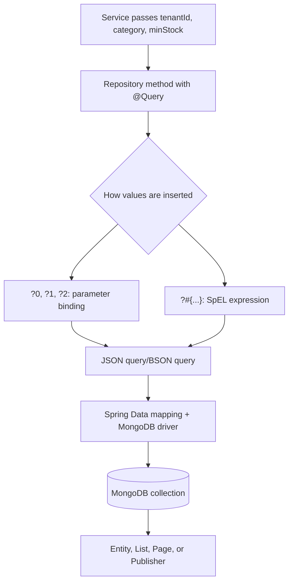

# Positional Parameter Binding ?0 and SpEL Expressions

## 1. Why Bind Parameters in JSON Queries?

In **Spring Data MongoDB**, repositories can derive queries from method names such as `findBySku`, but some situations require describing specific MongoDB conditions: `$gte`, `$in`, `$elemMatch`, combining multiple criteria, or computing a value before executing the query. The `@Query` annotation lets you write **JSON queries directly in Java code** and pass parameters into the needed positions.

Suppose a product management service needs to find:

- Products belonging to the **authenticated tenant**;
- Products in a specific category;
- Products with `stock` at or above a threshold passed by the service;
- When the threshold is missing, apply a business default value.

Two mechanisms to distinguish:

1. **`?0`, `?1`, `?2`...**: binds values from repository method parameters in positional order, starting at index 0.
2. **`?#{...}`**: evaluates a **Spring Expression Language (SpEL)** expression in the query context; it can read parameters such as `[0]`, `[1]` and compute values for conditions.

Basic example:

```java
@Query("{ 'tenantId': ?0, 'category': ?1 }")
List<CatalogProduct> findProducts(String tenantId, String category);
```

When passed `("tenant-42", "books")`, the equivalent MongoDB query is:

```javascript
db.catalog_products.find({
  tenantId: "tenant-42",
  category: "books"
});
```

With the **SPRING_DATA_MONGODB** module, these queries still use Spring Data MongoDB's connection infrastructure, document mapping, driver, indexes, and testing conventions. `@Query` changes how **conditions are declared**; it does not automatically create indexes, improve query algorithms, or guarantee data uniqueness.

## 2. Where Does @Query Fit in Spring Data Architecture?



A `@Query` expression has two kinds of components:

| Component | Example | Meaning |
| --- | --- | --- |
| Field name | `'tenantId'`, `'stock'` | Defines the field to filter; must match actual schema/mapping |
| MongoDB operator | `'$gte'`, `'$in'` | Expresses comparison, combination, or filtering operation |
| Constant value | `true`, `'ACTIVE'` | Data declared statically inside the query |
| Positional parameter | `?0`, `?1` | Value passed from the method by position |
| SpEL expression | `?#{[1] == null ? 0 : [1]}` | Value computed from context/method arguments |

**Contract to remember:** Binding is part of the framework. Never concatenate user input into a JSON query via string concatenation, and never turn user-supplied text into SpEL code for evaluation.

## 3. Preparing the Sample Entity and Repository

### 3.1. Product Entity

The example uses a simple entity to keep the focus on querying:

```java
package example.catalog;

import java.time.Instant;
import org.springframework.data.annotation.Id;
import org.springframework.data.mongodb.core.mapping.Document;

@Document(collection = "catalog_products")
public record CatalogProduct(
    @Id String id,
    String tenantId,
    String category,
    String sku,
    int stock,
    boolean active,
    Instant createdAt
) {}
```

Corresponding document:

```javascript
{
  _id: "p-101",
  tenantId: "tenant-42",
  category: "books",
  sku: "BOOK-101",
  stock: NumberInt("12"),
  active: true,
  createdAt: ISODate("2026-11-20T02:00:00Z")
}
```

In a multi-tenant environment, `tenantId` separates data across tenants. The tenant value must be determined **from server-side authentication/authorization information**, never trusting a tenant value chosen by the client.

### 3.2. Repository

```java
package example.catalog;

import java.util.Collection;
import java.util.List;
import java.util.Optional;
import org.springframework.data.mongodb.repository.MongoRepository;
import org.springframework.data.mongodb.repository.Query;

public interface CatalogProductRepository
        extends MongoRepository<CatalogProduct, String> {

    @Query("{ 'tenantId': ?0, 'sku': ?1 }")
    Optional<CatalogProduct> findByTenantAndSku(
        String tenantId, String sku
    );

    @Query(
        "{ 'tenantId': ?0, 'category': ?1, " +
        "'stock': { '$gte': ?2 } }"
    )
    List<CatalogProduct> findAvailableByCategory(
        String tenantId, String category, int minStock
    );

    @Query("{ 'tenantId': ?0, 'category': { '$in': ?1 } }")
    List<CatalogProduct> findInCategories(
        String tenantId, Collection<String> categories
    );
}
```

These three methods demonstrate three common patterns: lookup by business key, comparison with an operator, and passing a collection into `$in`. They only take regular Java arguments; Spring Data is responsible for binding the values into the appropriate query representation.

## 4. Syntax ?0, ?1 and How Spring Binds Parameters

### 4.1. Zero-Based Indexing

```java
@Query("{ 'tenantId': ?0, 'category': ?1, 'stock': { '$gte': ?2 } }")
List<CatalogProduct> findAvailableByCategory(
    String tenantId,  // ?0
    String category,  // ?1
    int minStock      // ?2
);
```

Example call:

```java
List<CatalogProduct> result = repository.findAvailableByCategory(
    "tenant-42",
    "books",
    10
);
```

Semantically equivalent MongoDB query:

```javascript
db.catalog_products.find({
  tenantId: "tenant-42",
  category: "books",
  stock: { $gte: 10 }
});
```

The first argument is `?0`, not `?1`. When changing parameter order in the method signature, update positions in the `@Query` string to match. A positional mix-up may not cause a syntax error if parameters share the `String` type, yet the filter results will be wrong.

### 4.2. Do Not Add Quotes Around Placeholders Yourself

Write:

```java
@Query("{ 'sku': ?0 }")
Optional<CatalogProduct> findBySkuExact(String sku);
```

The value `?0` is already bound by Spring Data with the appropriate type. Do not manually add string quotes around the placeholder or concatenate `"'" + sku + "'"`. Likewise, numeric, boolean, temporal, and collection values should retain their proper Java parameter types rather than forcing everything into strings.

The `@Query` snippet can use JSON-like syntax with quoted field names and operators as shown. `?0` is not valid standalone JSON in `mongosh`; it is Spring Data template syntax resolved by the framework before sending the MongoDB command.

### 4.3. Value Binding and Escaping Input Data

Spring Data MongoDB **escapes `String` parameters during binding** to prevent string data from turning into MongoDB operators when placed in a value position.

Suppose a client tries searching for an SKU containing characters that resemble a JSON query:

```java
String suspiciousSku = "{ '$ne': null }";

Optional<CatalogProduct> product =
    repository.findByTenantAndSku("tenant-42", suspiciousSku);
```

In this example, `suspiciousSku` is treated as a **string value** to match, rather than becoming a `$ne` operator. That is completely different from an application literally concatenating a user string into a query:

```java
// DO NOT use this approach to build JSON queries:
String unsafe = "{ 'sku': " + userInput + " }";
```

The `unsafe` pattern is an anti-pattern example, not runnable method code. Use binding for values and control query structure using static code or a safe DSL. Escaping does not replace authorization, input limits, or controls on expensive operations like regex.

### 4.4. Null Is Still a Value

```java
@Query("{ 'category': ?0 }")
List<CatalogProduct> findByCategoryRaw(String category);
```

If `null` is passed, the query semantically filters for `category: null`, rather than **implicitly dropping the category condition**. In MongoDB, matching against `null` can also match documents missing the field, depending on the query and operator.

If the requirement is "omit the filter when category is not provided", build a controlled dynamic query (for example with `MongoTemplate`) or define a different condition contract. Do not interpret `null` in `?0` as asking the framework to delete part of the JSON query.

## 5. SpEL Expressions in @Query: ?#{...}

Spring Expression Language (**SpEL**) is an expression language provided by Spring. In Spring Data MongoDB `@Query`, the `?#{...}` syntax lets you compute values from parameters and context before finalizing the query.

A common expression uses **arguments by index**:

```java
@Query("{ 'stock': { '$gte': ?#{[0] == null ? 0 : [0]} } }")
List<CatalogProduct> findStockAtLeastOrZero(Integer minStock);
```

If `minStock = 10`, the expression yields 10. If `minStock = null`, it yields 0. This is an **explicit convention**: default to filtering `stock >= 0`, not dropping the filter when `null`.

### 5.1. Why Use [0] Instead of ?0 in SpEL?

Compare the two forms:

```java
// Standard binding: passes the first parameter value directly.
@Query("{ 'sku': ?0 }")
Optional<CatalogProduct> findDirectly(String sku);

// SpEL: evaluates an expression to read the first parameter.
@Query("{ 'sku': ?#{[0]} }")
Optional<CatalogProduct> findThroughSpel(String sku);
```

`?0` is a Spring Data placeholder. Inside `?#{...}`, `[0]` accesses the first method argument within the **SpEL evaluation context**. Both examples target the same SKU value, but the second adds complexity with no benefit. Therefore, **prefer `?0` when you only need value binding**.

### 5.2. Arithmetic Expressions

Suppose a requirement asks for stock **strictly greater than** a passed threshold:

```java
@Query(
    "{ 'tenantId': ?0, " +
    "'stock': { '$gte': ?#{[1] + 1} } }"
)
List<CatalogProduct> findStockStrictlyGreaterThan(
    String tenantId, int threshold
);
```

With `threshold = 10`, SpEL computes 11, so the query becomes `stock >= 11`, equivalent to `stock > 10` for integer fields.

This example is only to illustrate computation. In a real application, write `'$gt': ?1` for conciseness and to avoid overflow risks if `threshold == Integer.MAX_VALUE`. **Do not use SpEL just because you can** when a MongoDB operator expresses the requirement directly.

### 5.3. Conditional Expressions

A query applying a minimum stock of 0 when the parameter is omitted:

```java
@Query(
    "{ 'tenantId': ?0, 'category': ?1, " +
    "'stock': { '$gte': ?#{[2] == null ? 0 : [2]} } }"
)
List<CatalogProduct> findWithOptionalMinimum(
    String tenantId,
    String category,
    Integer minStock
);
```

| `minStock` from service | Value after SpEL | Executed filter |
| --- | --- | --- |
| `null` | `0` | `stock >= 0` |
| `5` | `5` | `stock >= 5` |
| `20` | `20` | `stock >= 20` |

If business rules disallow negative stock, the service can validate inputs and agree on `null` handling. If the business genuinely needs to **omit the stock condition altogether**, a dynamic query with `MongoTemplate` is usually much clearer than building deeply nested SpEL maps.

### 5.4. SpEL Can Produce Structure, but Scope Must Be Controlled

In Spring Data MongoDB, SpEL expressions can produce complex values for use in the query. This allows logical branches such as a condition using `$exists` or a direct value.

Example illustrating an expression returning an object instead of a scalar:

```java
// When checkExistence=true: condition that id exists.
// When false: compare id with expectedId.
@Query("{ 'externalId': ?#{[0] ? {'$exists': true} : [1]} }")
List<CatalogProduct> queryWithConditionalOperator(
    boolean checkExistence,
    String expectedId
);
```

This example shows that SpEL can alter the **value structure** behind a field. Use this technique very cautiously: an `$exists` branch is not equivalent to an equality branch; both must be clearly documented in the method contract and covered by dedicated tests. As queries grow more complex, switch to `Criteria` and `Query` so conditions remain explicit.

**Regarding security:** SpEL expressions can represent more complex structures than ordinary string binding. Only feed validated data into allowed positions; never let user input dictate **the text of a SpEL expression**, operator names, field names, or the entire JSON query. Avoid using SpEL to assemble query strings from untrusted data.

## 6. Comparing ?0, ?#{[0]}, and MongoTemplate

| Approach | Advantages | Limitations / Caveats |
| --- | --- | --- |
| `@Query("{ 'sku': ?0 }")` | Short, readable, positional binding | Reordering parameters easily introduces bugs if query isn't updated |
| `@Query("{ 'stock': { '$gte': ?#{[0] ?: 0} } }")` | Can apply fallback or calculation right in annotation | Complex expressions are hard to review and test |
| `MongoTemplate` + `Criteria` | Easy to build optional filters per branch and control query structure | More code for simple queries |
| Query derivation `findBy...` | No JSON needed for basic CRUD cases | Method names get long/hard to express complex logic |

A practical rule of thumb: **direct values -> `?0`; simple value transforms -> consider SpEL; multiple optional conditions/dynamic operators -> `MongoTemplate` or a custom repository**.

### 6.1. Example Dropping Optional Conditions with MongoTemplate

Suppose the requirement is: always filter by tenant, filter category if provided, filter stock if provided:

```java
package example.catalog;

import java.util.ArrayList;
import java.util.List;
import org.springframework.data.mongodb.core.MongoTemplate;
import org.springframework.data.mongodb.core.query.Criteria;
import org.springframework.data.mongodb.core.query.Query;

public class ProductSearchService {
    private final MongoTemplate mongoTemplate;

    public ProductSearchService(MongoTemplate mongoTemplate) {
        this.mongoTemplate = mongoTemplate;
    }

    public List<CatalogProduct> search(
            String tenantId,
            String category,
            Integer minStock) {

        List<Criteria> filters = new ArrayList<>();
        filters.add(Criteria.where("tenantId").is(tenantId));

        if (category != null && !category.isBlank()) {
            filters.add(Criteria.where("category").is(category));
        }
        if (minStock != null) {
            filters.add(Criteria.where("stock").gte(minStock));
        }

        Query query = new Query(new Criteria().andOperator(
            filters.toArray(new Criteria[0])
        ));
        query.limit(100);
        return mongoTemplate.find(query, CatalogProduct.class);
    }
}
```

Here, when `category == null`, the category filter **is not added**. When `minStock == null`, the stock filter **is not added**. This is a different contract from the `?#{[2] == null ? 0 : [2]}` example. The call includes `limit(100)` to cap returned results; a real system also needs sorting/pagination and matching indexes.

The service must receive `tenantId` from an authenticated source. If a client passes tenantId directly, this code does not automatically block cross-tenant access.

### 6.2. When Is a Custom Repository Needed?

When conditions vary across many fields, combine `$or`, use aggregation, cursor pagination, dynamic projections, or need complex query tuning, you can place `MongoTemplate` logic in a custom repository implementation. This keeps the repository interface clean to call while centralizing query logic in one place.

## 7. Data Types in Parameter Binding

Values passed to `@Query` must match the stored BSON type. For example:

| Java Parameter Type | Example Input | What to Check |
| --- | --- | --- |
| `String` | `"books"` | Collation, case normalization, escaping |
| `int`/`Integer` | `10` | Integer value and range bounds |
| `boolean`/`Boolean` | `true` | Distinguish boolean from string `"true"` |
| `Instant` | `Instant.parse(...)` | Time conversion path and timezone/UTC |
| `Collection<String>` | `List.of("books", "tools")` | Binding into `$in` and handling empty collections |
| `BigDecimal` | `new BigDecimal("19.99")` | BSON String or Decimal128 depending on mapping/converter |
| Java `String` ID | `"..."` | `@Id` mapping rule to BSON `_id`, ObjectId or String |

### 7.1. Binding a Collection into $in

```java
@Query("{ 'tenantId': ?0, 'category': { '$in': ?1 } }")
List<CatalogProduct> findInCategories(
    String tenantId, Collection<String> categories
);
```

```java
repository.findInCategories(
    "tenant-42",
    List.of("books", "tools")
);
```

Equivalent query:

```javascript
db.catalog_products.find({
  tenantId: "tenant-42",
  category: { $in: ["books", "tools"] }
});
```

If `categories` is empty, `$in: []` matches no documents. For `null`, specify clearly whether it causes a validation error or omits the condition; do not assume null means "all categories".

### 7.2. Nested Field Paths

For a document containing `supplier: { country: "VN" }`, raw queries use dot notation:

```java
@Query("{ 'supplier.country': ?0 }")
List<CatalogProduct> findBySupplierCountry(String country);
```

This method illustrates syntax; the `CatalogProduct` entity above does not have `supplier` yet. In a real implementation, add the property mapping or write queries against the actual schema, checking `@Field`/`@Unwrapped` annotations if present. Do not take a raw path example as a guarantee that every field name will automatically translate across all custom mappings.

### 7.3. Monetary Amounts Need Consistent BSON Types

If the `price` field is stored as BSON Decimal128 while a method accepts a `String` and filters:

```java
@Query("{ 'price': { '$gte': ?0 } }")
List<CatalogProduct> findPriceAtLeast(String minimum);
```

this is a mismatched contract: `minimum` is a string, whereas `price` is numeric. Use the appropriate Java type/converter and mapping for Decimal128, and verify raw BSON. For instance, `BigDecimal` may be stored by Spring Data MongoDB as a String if no target type is configured; therefore you cannot assume choosing `BigDecimal` in the method signature alone is always enough.

## 8. Null, Missing, $exists, and Tricky Conditions

### 8.1. Null in MongoDB Queries

```javascript
db.catalog_products.find({ category: null });
```

MongoDB may return both documents with `category: null` and documents missing the `category` key. If business logic must distinguish them, use `$exists` or check the BSON type explicitly:

```javascript
// Only documents without the category field:
db.catalog_products.find({
  category: { $exists: false }
});

// Only documents with the field and BSON null value:
db.catalog_products.find({
  category: { $exists: true, $eq: null }
});
```

When passing `null` into `?0`, remember these MongoDB rules still apply; binding does not rewrite `null` semantics into optional filtering.

### 8.2. Conditions on Arrays

Suppose a document contains:

```javascript
{
  _id: "p-bundle-1",
  tenantId: "tenant-42",
  tags: ["featured", "winter"]
}
```

Query:

```java
@Query("{ 'tenantId': ?0, 'tags': ?1 }")
List<CatalogProduct> findTagged(String tenantId, String tag);
```

In MongoDB, comparing a value against an array field finds documents where the array contains an element equal to that value. Like the `supplier.country` example, this queries an extended schema; the sample entity needs a `tags` field if used in a real project.

For arrays of objects where multiple conditions must match **the same element**, consider `$elemMatch`. Do not confuse `@Query` with automatically solving all array modeling issues.

### 8.3. Regex Is a Case Requiring Dedicated Protection

```java
@Query("{ 'sku': { '$regex': ?0, '$options': 'i' } }")
List<CatalogProduct> findBySkuPattern(String pattern);
```

Parameter binding ensures data enters the value position, yet **a regex string is still a regex pattern** when used with `$regex`. Users can submit patterns with special characters or trigger costly scans. Enforce length limits, build patterns from application code or escape characters for literal searches, select appropriate indexes, and avoid exposing arbitrary regex features when unnecessary.

## 9. Return Types, Projection, and Pagination

The return type does not alter the meaning of `?0` or SpEL; it affects how the application consumes results:

```java
@Query("{ 'tenantId': ?0, 'sku': ?1 }")
Optional<CatalogProduct> findByTenantAndSku(
    String tenantId, String sku
);

@Query("{ 'tenantId': ?0, 'category': ?1 }")
List<CatalogProduct> findInCategory(
    String tenantId, String category
);
```

`Optional` fits when business rules guarantee at most one product per (`tenantId`, `sku`) pair; this constraint should be backed by a **unique index** on the collection. `List` fits when multiple products share the same category; when nothing matches, an empty list is returned.

### 9.1. Pageable

```java
import org.springframework.data.domain.Page;
import org.springframework.data.domain.Pageable;

@Query("{ 'tenantId': ?0, 'category': ?1 }")
Page<CatalogProduct> findPageInCategory(
    String tenantId, String category, Pageable pageable
);
```

This declaration goes **inside the repository interface**. `Pageable` is a special pagination parameter; it does not shift the `?0` and `?1` indices of the two regular query parameters.

Service call:

```java
import org.springframework.data.domain.PageRequest;
import org.springframework.data.domain.Sort;

var page = repository.findPageInCategory(
    "tenant-42",
    "books",
    PageRequest.of(0, 20, Sort.by("sku").ascending())
);
```

`Page` carries metadata on total elements/pages and may trigger a count query. For large datasets, ensure stable sorting, control count costs, and consider `Slice` or cursor-based pagination where appropriate.

### 9.2. Projection with fields

`@Query` lets you declare which fields to return:

```java
@Query(
    value = "{ 'tenantId': ?0, 'active': true }",
    fields = "{ 'sku': 1, 'category': 1 }"
)
List<CatalogProduct> findActiveSummaries(String tenantId);
```

The query returns partial documents, so an entity constructed from a projection may lack the remaining fields. Never call `save` on an entity containing only a subset of fields and accidentally lose the original data. For summary APIs, using a dedicated DTO or projection interface is usually clearer.

## 10. Reactive Repositories: @Query Syntax Still Works

Reactive Spring Data MongoDB uses a similar `@Query` declaration. Replace `MongoRepository` with `ReactiveMongoRepository`; multi-document return types are usually `Flux<T>`, and single-document return types are `Mono<T>`:

```java
package example.catalog;

import org.springframework.data.mongodb.repository.Query;
import org.springframework.data.mongodb.repository.ReactiveMongoRepository;
import reactor.core.publisher.Flux;
import reactor.core.publisher.Mono;

public interface ReactiveCatalogProductRepository
        extends ReactiveMongoRepository<CatalogProduct, String> {

    @Query("{ 'tenantId': ?0, 'sku': ?1 }")
    Mono<CatalogProduct> findByTenantAndSku(
        String tenantId, String sku
    );

    @Query(
        "{ 'tenantId': ?0, 'stock': " +
        "{ '$gte': ?#{[1] == null ? 0 : [1]} } }"
    )
    Flux<CatalogProduct> findWithMinimum(
        String tenantId, Integer minimum
    );
}
```

SpEL/binding determines the generated query; reactive access determines how the query is **executed and consumed** via publishers. When a `Flux` finds nothing, it completes without emitting elements. When a `Mono` finds nothing, it completes empty. In a WebFlux pipeline, normally return the publisher to the controller instead of calling `block()`.

**Reactive does not increase query correctness or automatically add indexes.** For the same filter, MongoDB still needs suitable indexes and data modeling.

## 11. Indexes and Performance: Clean Queries Are Not Guaranteed Fast

### 11.1. Indexing by tenant, category, stock

For a repeated query:

```javascript
db.catalog_products.find({
  tenantId: "tenant-42",
  category: "books",
  stock: { $gte: 10 }
});
```

you can evaluate a compound index:

```javascript
db.catalog_products.createIndex({
  tenantId: 1,
  category: 1,
  stock: 1
});
```

Having the two equality fields (`tenantId` and `category`) before the range field (`stock`) is a reasonable starting point for this illustrative workload. Still, real-world indexing must factor in selectivity, sorting, other queries, and write/index overhead. Inspect the execution plan:

```javascript
db.catalog_products.find({
  tenantId: "tenant-42",
  category: "books",
  stock: { $gte: 10 }
}).explain("executionStats");
```

Monitor `totalDocsExamined`, `totalKeysExamined`, execution time, and the chosen index. `@Query` only describes conditions; it does not ensure MongoDB will use a suitable index.

### 11.2. Unique Index for Queries Returning Optional

If each tenant has at most one product per SKU:

```javascript
db.catalog_products.createIndex(
  { tenantId: 1, sku: 1 },
  { unique: true, name: "uk_tenant_sku" }
);
```

This index supports `findByTenantAndSku` and protects data against duplicate key pairs under concurrent writes. `Optional<CatalogProduct>` **does not create uniqueness on its own**. Without the index, a query expecting a single result may throw a non-unique result error if multiple documents match.

### 11.3. SpEL Is Not a Query Optimization Tool

For the same resulting condition after binding, `?0` and `?#{[0]}` offer no query performance advantage solely from notation. Optimize using indexes, projections, result limits, document modeling, aggregation, and measurement. If a SpEL expression has too many branches, hard-to-observe generated queries make diagnostics more difficult.

## 12. Testing: Verify Both Results and Parameter Types

Tests must verify **result data**, **binding rules**, and **empty-result contracts**. For JSON queries using SpEL, every conditional branch must be tested.

### 12.1. A Test Suite with Spring Data MongoDB

JUnit 5 + Spring Boot Mongo test slice example (assuming a test MongoDB instance can be reached):

```java
package example.catalog;

import static org.junit.jupiter.api.Assertions.*;

import java.time.Instant;
import java.util.List;
import java.util.UUID;
import org.junit.jupiter.api.BeforeEach;
import org.junit.jupiter.api.Test;
import org.springframework.beans.factory.annotation.Autowired;
import org.springframework.boot.test.autoconfigure.data.mongo.DataMongoTest;

@DataMongoTest
class CatalogProductQueryTest {

    @Autowired
    CatalogProductRepository repository;

    private String tenant;

    @BeforeEach
    void insertSamples() {
        String suffix = UUID.randomUUID().toString();
        tenant = "tenant-" + suffix;

        repository.saveAll(List.of(
            new CatalogProduct("a-" + suffix, tenant,
                "books", "BOOK-A", 12, true, Instant.EPOCH),
            new CatalogProduct("b-" + suffix, tenant,
                "books", "BOOK-B", 3, true, Instant.EPOCH),
            new CatalogProduct("c-" + suffix, tenant,
                "tools", "TOOL-C", 20, false, Instant.EPOCH)
        ));
    }

    @Test
    void bindsPositionalParametersInCorrectOrder() {
        var found = repository.findByTenantAndSku(
            tenant, "BOOK-A"
        );

        assertTrue(found.isPresent());
        assertEquals(12, found.orElseThrow().stock());
        assertTrue(
            repository.findByTenantAndSku(
                "another-tenant", "BOOK-A"
            ).isEmpty()
        );
    }

    @Test
    void bindsRangeAndCollectionParameters() {
        assertEquals(1, repository.findAvailableByCategory(
            tenant, "books", 10
        ).size());

        assertEquals(3, repository.findInCategories(
            tenant, List.of("books", "tools")
        ).size());

        assertTrue(repository.findInCategories(
            tenant, List.of()
        ).isEmpty());
    }
}
```

The sample test class uses UUIDs so each run has a distinct tenant and IDs. It still requires a configured test MongoDB environment: `@DataMongoTest` scopes the Spring context, which does not automatically mean a MongoDB server is already running.

### 12.2. Testing SpEL with Null and Non-Null Values

In the repository, add the method:

```java
@Query(
    "{ 'tenantId': ?0, 'category': ?1, " +
    "'stock': { '$gte': ?#{[2] == null ? 0 : [2]} } }"
)
List<CatalogProduct> findWithOptionalMinimum(
    String tenantId, String category, Integer minStock
);
```

In the test class:

```java
@Test
void spelUsesDefaultWhenMinimumIsNull() {
    assertEquals(2, repository.findWithOptionalMinimum(
        tenant, "books", null
    ).size());

    assertEquals(1, repository.findWithOptionalMinimum(
        tenant, "books", 10
    ).size());
}
```

This example **adds the method to the declared repository and the test to the existing class**, rather than being standalone top-level Java statements. In a real service, also test negative inputs if business rules forbid them.

### 12.3. Proving String Input Does Not Become an Operator

```java
@Test
void stringParameterIsNotInterpretedAsMongoOperator() {
    String looksLikeOperator = "{ '$ne': null }";

    var found = repository.findByTenantAndSku(
        tenant, looksLikeOperator
    );

    assertTrue(found.isEmpty());
}
```

This test is meaningful because the test collection already contains multiple non-null SKUs; if a string value were misinterpreted as a `$ne` operator, the query could match unexpectedly. However, safe binding does not replace tenant authorization checks.

### 12.4. Inspecting the Query Actually Sent

For hard-to-reproduce query bugs, you can use:

- Integration tests against real MongoDB/Testcontainers asserting concrete result sets.
- Controlled driver command monitoring/logging to observe BSON filters, while avoiding logging sensitive data.
- `explain("executionStats")` of the equivalent query in mongosh to inspect indexes and cost.
- Checking the root cause of exceptions when mapping, type conversion, or SpEL expression evaluation fails.

Do not merely inspect whether the annotation string "looks right". A query can be syntactically valid yet have swapped `?0`/`?1`, mismatched BSON types, or overly broad filtering.

## 13. Common Mistakes

| Symptom | Possible Cause | How to Handle |
| --- | --- | --- |
| Query returns empty even though document exists | Swapped `?0` and `?1`; wrong field name or BSON type | Cross-check method parameter order, raw BSON, and generated filter |
| Query with null does not return "all" as expected | `?0 = null` is still a condition, not an omitted filter | Build a dynamic query or declare an explicit fallback |
| Returns more tenants than intended | Missing/wrong tenant condition or tenant taken from client input | Enforce tenant filter from server-side authorization; test tenant isolation |
| String input treated as regex | Query uses `$regex`, where value has regex meaning | Escape literals or control patterns and indexes |
| Error evaluating SpEL | Invalid expression syntax, wrong index access, or null argument | Reduce complexity, test every branch, consider MongoTemplate |
| Monetary amount query fails | BSON `Decimal128` but parameter bound as String/Double | Standardize mapping and test BSON types |
| Query too slow | Missing index, unselective conditions, broad regex | `explain`, design indexes, pagination |
| Dynamic query too long and hard to review | Packing many operators/branches into SpEL | Use `Criteria` and a custom repository |
| Runs in Java but mongosh errors on `?0` | Placeholder is Spring Data syntax, not pure JSON | Substitute actual BSON values when testing in mongosh |
| Projection results lose fields when saved back | Data read lacked fields due to projection | Use dedicated DTO/projection and avoid saving partial entities |

### Diagnostic Workflow

1. Review the `@Query` annotation and method parameter list in exact order.
2. Distinguish positions using `?0` from `?#{[0]}` expressions and the meaning of each branch.
3. Inspect raw documents, BSON field names, actual data types, and null/missing conditions.
4. Reproduce the filter against sample data in mongosh (replacing placeholders with bound values).
5. Observe the actual query/command if needed, protecting sensitive data in logs.
6. Verify indexes, sort, result limits, and edge cases such as Vietnamese diacritics, empty strings, and empty collections.
7. Add tests for valid values, null, empty, wrong types, and cross-tenant cases.

## 14. Practice Exercises

### Exercise 1 — Positional Parameter Binding

Create a repository for the `products` collection with `tenantId`, `category`, `price`, and `active`. Write a `@Query` accepting:

1. `tenantId` at `?0`;
2. `category` at `?1`;
3. `minPrice` at `?2`;
4. `active = true` fixed in the JSON query.

Call the method with sample data and explain why swapping `tenantId` and `category` can break the query even though both are Strings.

### Exercise 2 — Comparing ?0 and SpEL

Write two methods searching products by stock: one using `?0` for the directly passed threshold; one using `?#{[0] == null ? 0 : [0]}` to set default 0. Test with `null`, 0, 5, and 20; describe the actual query, then propose a `MongoTemplate` approach if `null` must mean "omit the stock condition".

### Exercise 3 — Safe Binding

Pass the string `"{ '$ne': null }"` into an exact-SKU lookup method. Verify that the query does not become an operator. Then write a regex search method with a length limit and special-character handling suited to user needs.

### Exercise 4 — Indexes and Large Datasets

For queries by `tenantId`, `category`, and `stock >= minimum`, propose a compound index, run `explain("executionStats")`, and measure the difference with and without the index on a representative test workload. Also check index overhead when inserting/updating products.

### Exercise 5 — Synchronous and Reactive Repositories

Implement the same JSON filter in `MongoRepository` and `ReactiveMongoRepository`. Compare return types `List` vs. `Flux`, the empty-data case, and testing with JUnit/`StepVerifier`. Explain why the reactive model does not change parameter binding correctness.

### Self-Check Questions

- Which method parameter does `?0` point to? What happens when parameter order changes?
- When does `?#{[0]}` yield the same value as `?0`, and why should SpEL generally be avoided in that case?
- Why does passing `null` not mean omitting a `@Query` condition?
- Does Spring Data escaping Strings during binding mean a string like `$ne` turns into an operator?
- Why must user-supplied regex still be restricted even when the query uses binding?
- When should complex SpEL be replaced with `MongoTemplate`/`Criteria`?
- Why are indexes and unique constraints still necessary even when the repository declares `@Query` correctly?

## Key Takeaways

In **Spring Data MongoDB**, `@Query` lets you declare MongoDB conditions using JSON-like syntax. **`?0`, `?1`...** are placeholders bound positionally to Java parameters starting at 0; Spring Data processes string data during binding so it does not turn into query operators. **`?#{...}`** evaluates **SpEL** expressions, reading parameters via `[0]`, `[1]` and applying calculations/conditionals only when genuinely needed. Prefer direct binding for values; use `MongoTemplate` when filter structure must vary significantly; never treat user input as query or SpEL structure. Finally, test null data, parameter order, BSON types, tenant isolation, and indexes to ensure queries are both functionally correct and performant.

## References

- [Spring Data MongoDB Reference — JSON-based Queries](https://docs.spring.io/spring-data/mongodb/reference/mongodb/repositories/query-methods.html#mongodb.repositories.queries.json-based)
- [Spring Data MongoDB Reference — MongoDB Repositories](https://docs.spring.io/spring-data/mongodb/reference/mongodb/repositories/repositories.html)
- [Spring Framework Reference — Spring Expression Language](https://docs.spring.io/spring-framework/reference/core/expressions.html)
- [MongoDB Manual — Query Documents](https://www.mongodb.com/docs/manual/tutorial/query-documents/)
