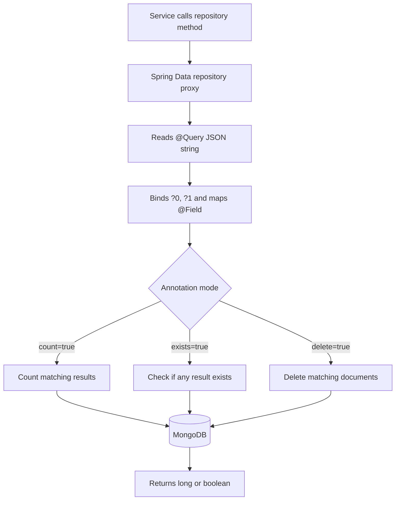

# Count, Exists, and Delete Queries via Annotations

In **Spring Data MongoDB**, repositories do more than find and return entities. When you need to **count documents**, **check whether at least one document matches a condition**, or **delete matching documents**, you can write a JSON filter on the `@Query` annotation and choose the `count = true`, `exists = true`, or `delete = true` modes.

This lesson belongs to the **JSON Queries** chapter of the **SPRING_DATA_MONGODB** module. The focus is on declaration syntax, return types, parameter binding, the difference between `exists = true` and the MongoDB `$exists` operator, as well as performance and data-integrity risks when deleting data. Examples use `MongoRepository`, while `MongoTemplate`, reactive repositories, and testing are covered to clarify the full execution path from Java to MongoDB.

## 1. Three Needs, Three Modes of @Query

Suppose a multi-tenant application stores notifications. The service needs to answer:

1. How **many** `EXPIRED` notifications does tenant `T1` have?
2. Does tenant `T1` have **at least one** `PENDING` notification?
3. How many `EXPIRED` notifications belonging to `T1` with `expiresAt` before a given timestamp can be **deleted**?

| Operation | Annotation | Typical Return Type | Meaning |
| --- | --- | --- | --- |
| Count | `@Query(value = "...", count = true)` | `long` | Count documents matching the filter |
| Exists | `@Query(value = "...", exists = true)` | `boolean` | Check whether any document matches the filter |
| Delete | `@Query(value = "...", delete = true)` | `long` | Delete documents matching the filter and return deleted count |

**Each method should express only one operation type.** Do not combine the `count`, `exists`, and `delete` flags expecting a single method to both count and delete. Unlike count and exists, delete is a **destructive write operation**.

## 2. Sample Data and Entity

The following documents illustrate the `notifications` collection. `_id` is generated by MongoDB if omitted on insert; timestamps use UTC.

```javascript
db.notifications.insertMany([
  {
    tenant_id: "T1", status: "PENDING",
    expires_at: ISODate("2026-12-01T00:00:00Z"),
    message: "Pending processing"
  },
  {
    tenant_id: "T1", status: "EXPIRED",
    expires_at: ISODate("2026-11-01T00:00:00Z"),
    message: "Expired notification"
  },
  {
    tenant_id: "T1", status: "EXPIRED",
    expires_at: ISODate("2026-12-05T00:00:00Z"),
    message: "Not yet due for cleanup"
  },
  {
    tenant_id: "T1", status: "DONE",
    message: "Completed"
  },
  {
    tenant_id: "T2", status: "EXPIRED",
    expires_at: ISODate("2026-11-01T00:00:00Z"),
    message: "Other tenant data"
  }
]);
```

With cutoff `2026-11-20T00:00:00Z`, the expected results are: counting `T1/EXPIRED` notifications gives **2**, checking `T1/PENDING` gives **true**, and deleting `T1/EXPIRED` notifications before the cutoff removes **1** document. Tenant `T2`'s document must remain untouched.

Corresponding mapped Java entity:

```java
import java.time.Instant;
import org.bson.types.ObjectId;
import org.springframework.data.annotation.Id;
import org.springframework.data.mongodb.core.mapping.Document;
import org.springframework.data.mongodb.core.mapping.Field;

@Document(collection = "notifications")
public class Notification {
    @Id
    private ObjectId id;

    @Field("tenant_id")
    private String tenantId;

    private String status;

    @Field("expires_at")
    private Instant expiresAt;

    private String message;

    public Notification() {}

    public ObjectId getId() { return id; }
    public String getTenantId() { return tenantId; }
    public String getStatus() { return status; }
    public Instant getExpiresAt() { return expiresAt; }
    public String getMessage() { return message; }
}
```

`@Id ObjectId` corresponds to BSON `_id`. `@Field("tenant_id")` and `@Field("expires_at")` map the Java properties `tenantId` and `expiresAt` to the actual field names. Spring Data uses this metadata when processing repository queries.

## 3. Declaring @Query(count/exists/delete)

```java
import java.time.Instant;
import org.bson.types.ObjectId;
import org.springframework.data.mongodb.repository.MongoRepository;
import org.springframework.data.mongodb.repository.Query;

public interface NotificationRepository
        extends MongoRepository<Notification, ObjectId> {

    @Query(
        value = "{ 'tenantId': ?0, 'status': ?1 }",
        count = true
    )
    long countForTenantAndStatus(String tenantId, String status);

    @Query(
        value = "{ 'tenantId': ?0, 'status': 'PENDING' }",
        exists = true
    )
    boolean hasPendingForTenant(String tenantId);

    @Query(
        value = "{ 'tenantId': ?0, 'status': 'EXPIRED', " +
                "'expiresAt': { '$lt': ?1 } }",
        delete = true
    )
    long deleteExpiredBefore(String tenantId, Instant cutoff);
}
```

These methods do not require a manual implementation: Spring Data MongoDB creates a repository proxy, parses `@Query`, binds `?0` and `?1`, maps fields, and selects the MongoDB operation. The generic `ObjectId` type parameter must still match `Notification.id`, even though the three methods filter by tenant/status/timestamp rather than ID.



This diagram illustrates the **flow of responsibilities**, not a guarantee of wire-protocol command names or round-trip counts. Spring Data and the MongoDB Java Driver may select suitable optimizations; all three still depend on filters, indexes, and actual data.

## 4. Count: Getting the Count Instead of All Entities

```java
long expired = notifications.countForTenantAndStatus("T1", "EXPIRED");
// Sample data: expired == 2
```

Semantically equivalent filter in MongoDB Shell:

```javascript
db.notifications.countDocuments({
  tenant_id: "T1",
  status: "EXPIRED"
});
```

With `count = true`, the method returns the number of matching documents. If no documents match, the result is **0**, not `null`. Never call `find...` followed by `list.size()` on a large collection just to count: doing so transfers documents over the network and materializes Java entities needlessly.

An equivalent **derived query** can be declared for simple conditions:

```java
long countByTenantIdAndStatus(String tenantId, String status);
```

Choose `@Query(count = true)` when a JSON filter is easier to read than a long method name or when specific MongoDB operators are required. If you only need to know whether **at least one** matching document exists, `exists` expresses intent better than `count > 0` and can avoid computing the full count.

The count reflects the state at execution time. A count query and a subsequent find/delete query do not inherently read the same snapshot when other writers are modifying data.

## 5. Exists: Checking Whether at Least One Document Matches

```java
boolean hasPending = notifications.hasPendingForTenant("T1");
// Sample data: true.
```

This can be interpreted in mongosh as:

```javascript
const found = db.notifications.findOne({
  tenant_id: "T1",
  status: "PENDING"
});
const exists = found !== null;
```

This is a **semantic illustration**, not a claim that Spring Data always issues `findOne` verbatim. `@Query(exists = true)` returns a boolean: finding a single matching document is enough to answer `true`.

### 5.1. Annotation Exists Differs from Filter $exists

```java
// Does at least one document with status PENDING exist?
@Query(value = "{ 'status': 'PENDING' }", exists = true)
boolean anyPending();
```

Meanwhile, the following MongoDB operator asks **which documents possess a field**:

```javascript
db.notifications.find({
  expires_at: { $exists: true }
});
```

| Syntax | What Question Does It Answer? |
| --- | --- |
| `@Query(exists = true)` | Does any document match the *entire filter*? |
| `{ expires_at: { $exists: true } }` | Which documents contain the `expires_at` key (including BSON Null)? |
| `existsByStatus("PENDING")` | Does any document have `status = PENDING`? |

Both meanings can be combined at once:

```java
@Query(
    value = "{ 'tenantId': ?0, 'expiresAt': { '$exists': true } }",
    exists = true
)
boolean tenantHasAnyExpiryField(String tenantId);
```

This method only returns `true` if **at least one** notification for the tenant has the `expires_at` key. `$exists: true` does not itself require the value to be non-null; if non-null is required, add another schema-appropriate condition.

## 6. Delete: Deleting Matching Documents

```java
import java.time.Instant;

Instant cutoff = Instant.parse("2026-11-20T00:00:00Z");
long removed = notifications.deleteExpiredBefore("T1", cutoff);
// Sample data: removed == 1.
```

Filter equivalent to the operation:

```javascript
db.notifications.deleteMany({
  tenant_id: "T1",
  status: "EXPIRED",
  expires_at: { $lt: ISODate("2026-11-20T00:00:00Z") }
});
```

Here `$lt` is **strictly less than**: a document with `expires_at == cutoff` does not match. The tenant condition is mandatory in this multi-tenant example. Omitting `tenant_id` could cause a single delete to wipe out expired notifications belonging to other organizations.

For a method returning `long`, the result is the number of deleted documents acknowledged by MongoDB. When none match, it returns **0**. Spring Data MongoDB also supports other repository delete signatures that return deleted entities; however, when you only need **the count**, declaring an integer return type and testing against your version avoids loading objects.

**`@Query(delete = true)` deletes entire documents**, not a single property. To remove only the `expires_at` field, use an `$unset` update via `MongoTemplate` or an appropriate update mechanism.

### 6.1. Why Does Delete Require Special Safeguards?

- **Scope:** the filter must include the tenant and all required business conditions.
- **Authorization:** only authorized workflows may execute delete commands.
- **Concurrency:** a count beforehand and a delete afterward can yield different numbers due to concurrent writers.
- **Atomicity:** MongoDB writes are atomic **per document**; a multi-document delete does not implicitly wrap the entire set in one transaction.
- **Recovery:** if audit trails or recovery are needed, enforce retention policies, soft deletes, or snapshots prior to physical deletion.
- **Retries:** re-running delete with the same filter may return 0, yet new writers might insert matching records between runs.

Never expose a **tenant-wide** delete method in a repository used by ordinary business flows without explicit safeguards. The count returned by delete reflects the acknowledged operation; a prior count is no guarantee of how many records will actually be deleted.

## 7. Dedicated Annotations: @CountQuery, @ExistsQuery, @DeleteQuery

Spring Data MongoDB provides shorthand annotations equivalent to `@Query` when you want to convey a single purpose:

```java
import java.time.Instant;
import org.springframework.data.mongodb.repository.CountQuery;
import org.springframework.data.mongodb.repository.ExistsQuery;
import org.springframework.data.mongodb.repository.DeleteQuery;

// Place these illustrative declarations inside a repository interface.
@CountQuery("{ 'tenantId': ?0, 'status': ?1 }")
long countViaShortcut(String tenantId, String status);

@ExistsQuery("{ 'tenantId': ?0, 'status': 'PENDING' }")
boolean existsPendingViaShortcut(String tenantId);

@DeleteQuery(
    "{ 'tenantId': ?0, 'status': 'EXPIRED', " +
    "'expiresAt': { '$lt': ?1 } }"
)
long deleteExpiredViaShortcut(String tenantId, Instant cutoff);
```

| Shorthand Form | Equivalent @Query Form |
| --- | --- |
| `@CountQuery("...")` | `@Query(value = "...", count = true)` |
| `@ExistsQuery("...")` | `@Query(value = "...", exists = true)` |
| `@DeleteQuery("...")` | `@Query(value = "...", delete = true)` |

These are **alternatives**, not steps to run sequentially. Certain API details may vary across Spring Data MongoDB versions: in a real project, use the exact annotation and signature supported by your active dependency, and never stack both a shorthand annotation and the full `@Query` on the same method.

## 8. Parameter Binding and Field Mapping

In the delete example:

```java
@Query(
    value = "{ 'tenantId': ?0, 'status': 'EXPIRED', " +
            "'expiresAt': { '$lt': ?1 } }",
    delete = true
)
long deleteExpiredBefore(String tenantId, Instant cutoff);
```

`?0` is the **first** parameter and `?1` is the **second** parameter. Spring Data performs value- and converter-based binding instead of splicing an input string into the JSON query structure. Thus `"T1"` becomes a BSON String value, `Instant` converts to the appropriate BSON date representation, and an `ObjectId` if used in a filter stays a BSON identifier.

Never construct a filter by arbitrarily concatenating input:

```java
// Discouraged because it builds JSON directly from user data:
// String filter = "{ 'tenant_id': '" + tenantIdFromRequest + "' }";
```

Use `?0`, `?1` placeholders or `Criteria` to bind values. If callers are permitted to specify field names, sort keys, or query operators, use an **allowlist**: those are *structural* elements, not plain parameter values.

### Java Property Names and BSON Field Names

In the annotation, `tenantId` and `expiresAt` are Java properties. Because of `@Field("tenant_id")` and `@Field("expires_at")`, Spring Data maps them to the actual fields when querying `Notification`:

```java
@Query(value = "{ 'tenantId': ?0 }", count = true)
long countAllForTenant(String tenantId);
```

In mongosh or the native driver, use MongoDB field names:

```javascript
db.notifications.countDocuments({ tenant_id: "T1" });
```

For nested properties, custom converters, or legacy schemas, verify the actual MongoDB filter sent by the driver instead of guessing.

## 9. MongoTemplate as an Alternative for Dynamic Queries

All three operations can also be run via `MongoTemplate`, suited when the service constructs filters from varying conditions:

```java
import java.time.Instant;
import com.mongodb.client.result.DeleteResult;
import org.springframework.data.mongodb.core.query.Criteria;
import org.springframework.data.mongodb.core.query.Query;

Query expired = Query.query(
    Criteria.where("tenantId").is("T1")
            .and("status").is("EXPIRED")
);
long count = mongoTemplate.count(expired, Notification.class);

Query pending = Query.query(
    Criteria.where("tenantId").is("T1")
            .and("status").is("PENDING")
);
boolean exists = mongoTemplate.exists(pending, Notification.class);

Query expiredBefore = Query.query(
    Criteria.where("tenantId").is("T1")
            .and("status").is("EXPIRED")
            .and("expiresAt")
            .lt(Instant.parse("2026-11-20T00:00:00Z"))
);
DeleteResult result =
    mongoTemplate.remove(expiredBefore, Notification.class);
long deleted = result.getDeletedCount();
```

These variables illustrate a snippet inside a service with an injected `MongoTemplate`. The `count`, `exists`, and `remove` APIs represent the three distinct operations and share the same entity mapping rules. When more delete details are needed, `DeleteResult` exposes `getDeletedCount()` (under acknowledged write concern).

| Choose repository annotations when… | Choose MongoTemplate when… |
| --- | --- |
| Filters are stable, concise, and carry clear business intent | Filters are built dynamically across multiple conditional branches |
| You want simple `long`/`boolean` return types | You need fine-grained control over `Query`, result objects, or options |
| Keeping query declarations compact inside an interface | Writing complex queries, aggregations, or field-level updates |

## 10. Indexes and Performance Diagnostics

When queries primarily filter by tenant, status, and expiration, consider a compound index:

```javascript
db.notifications.createIndex(
  { tenant_id: 1, status: 1, expires_at: 1 },
  { name: "tenant_status_expiry" }
);
```

This index is a candidate for equality conditions on `tenant_id` and `status` plus a range condition on `expires_at`. Choosing well requires balancing write frequency, selectivity, and index size; one index does not guarantee every query runs fast.

Before running delete, you can inspect the query plan of an equivalent filter:

```javascript
db.notifications.find({
  tenant_id: "T1",
  status: "EXPIRED",
  expires_at: { $lt: ISODate("2026-11-20T00:00:00Z") }
}).explain("executionStats");
```

Read `winningPlan`, `nReturned`, `totalDocsExamined`, and `totalKeysExamined`. An `explain` on an equivalent `find` helps understand record-lookup cost, yet **does not replace** measuring the actual count/exists/delete commands, write impact, and latency in a realistic environment.

If records only need automatic time-based expiration, a **TTL index** may fit better than a cleanup job. However, TTL deletion runs asynchronously, does not guarantee immediate removal, and requires careful review if business conditions also depend on tenant or status. `@Query(delete = true)` remains valuable when explicit scoping, auditing, or returning deleted counts is needed.

## 11. Consistency, Errors, and Transactions

- **Count then delete can yield different counts:** records may be inserted, modified, or deleted between the two calls. Never treat a prior count as a guarantee of the delete outcome.
- **One delete can touch many documents:** document-level atomicity does not imply the entire batch commits or rolls back as one unit.
- **Transactions:** when multi-document consistency is required, configure `MongoTransactionManager` and a transaction-capable MongoDB topology; adding `@Transactional` alone is not enough.
- **Write concern:** require appropriate acknowledgment to evaluate delete counts and detect failures.
- **Retries:** a delete may have executed on the server before the client observes a network error. Retries must consider idempotency, filters, and newly arrived records.
- **Authorization:** resolve the tenant from a trusted context, restrict deletable targets, and avoid writing sensitive data to logs.

A repository method returning `long` does not expose full details about cluster behavior, transactions, or auditing. If the system requires recovery, legal retention, and deletion verification, design dedicated business workflows.

## 12. Integration Tests: Verifying Real Filters and Counts

Mocking the repository does not prove `@Query` was parsed or BSON fields were mapped accurately. To verify count/exists/delete, use real MongoDB in an **isolated** environment (such as Testcontainers).

```java
import static org.assertj.core.api.Assertions.assertThat;

import java.time.Instant;
import java.util.Date;
import java.util.List;
import java.util.UUID;
import org.bson.Document;
import org.junit.jupiter.api.Test;
import org.springframework.beans.factory.annotation.Autowired;
import org.springframework.boot.test.autoconfigure.data.mongo.DataMongoTest;
import org.springframework.data.mongodb.core.MongoTemplate;

@DataMongoTest
class NotificationQueryTest {
    @Autowired MongoTemplate template;
    @Autowired NotificationRepository notifications;

    @Test
    void shouldCountExistAndDeleteWithinTenant() {
        String t1 = "test-" + UUID.randomUUID();
        String t2 = "test-" + UUID.randomUUID();
        Instant cutoff = Instant.parse("2026-11-20T00:00:00Z");
        Date oldDate = Date.from(Instant.parse("2026-11-01T00:00:00Z"));
        Date laterDate = Date.from(Instant.parse("2026-12-05T00:00:00Z"));

        template.getCollection("notifications").insertMany(List.of(
            new Document("tenant_id", t1)
                .append("status", "PENDING").append("expires_at", laterDate),
            new Document("tenant_id", t1)
                .append("status", "EXPIRED").append("expires_at", oldDate),
            new Document("tenant_id", t1)
                .append("status", "EXPIRED").append("expires_at", laterDate),
            new Document("tenant_id", t2)
                .append("status", "EXPIRED").append("expires_at", oldDate)
        ));

        assertThat(notifications.countForTenantAndStatus(t1, "EXPIRED"))
            .isEqualTo(2);
        assertThat(notifications.hasPendingForTenant(t1)).isTrue();

        long deleted = notifications.deleteExpiredBefore(t1, cutoff);
        assertThat(deleted).isEqualTo(1);

        assertThat(notifications.countForTenantAndStatus(t1, "EXPIRED"))
            .isEqualTo(1);
        assertThat(notifications.countForTenantAndStatus(t2, "EXPIRED"))
            .isEqualTo(1);
    }
}
```

Using random tenant IDs prevents collisions with existing test data. Never run write/delete tests like this against production. Across different Spring Boot versions, align the test-slice package and test MongoDB setup with your active dependencies.

Additional tests to include: zero matching documents (`count = 0`, `exists = false`, `delete = 0`); documents with `expires_at == cutoff` are not deleted under `$lt`; missing date fields do not match unintentionally; special characters in inputs bind as literal values; and tenant `T2` always stays protected. Inspecting raw documents also confirms `tenant_id` and `expires_at` map accurately.

## 13. Reactive Repositories: Mono<Long> and Mono<Boolean>

When using the Reactive MongoDB Driver, the repository declares reactive return types:

```java
import java.time.Instant;
import org.bson.types.ObjectId;
import org.springframework.data.mongodb.repository.Query;
import org.springframework.data.mongodb.repository.ReactiveMongoRepository;
import reactor.core.publisher.Mono;

interface ReactiveNotificationRepository
        extends ReactiveMongoRepository<Notification, ObjectId> {

    @Query(value = "{ 'tenantId': ?0, 'status': ?1 }", count = true)
    Mono<Long> countForTenantAndStatus(String tenantId, String status);

    @Query(value = "{ 'tenantId': ?0, 'status': 'PENDING' }", exists = true)
    Mono<Boolean> hasPendingForTenant(String tenantId);

    @Query(
        value = "{ 'tenantId': ?0, 'status': 'EXPIRED', " +
                "'expiresAt': { '$lt': ?1 } }",
        delete = true
    )
    Mono<Long> deleteExpiredBefore(String tenantId, Instant cutoff);
}
```

These `Mono` instances describe operations executed upon **subscription**; constructing the publisher does not read or delete data yet. In WebFlux, return the publisher to the framework or compose with `flatMap`/`then`; avoid standalone `subscribe()` inside services when error handling and transactions are required. If reactive transactions are needed, configure `ReactiveMongoTransactionManager` with Reactor Context and a compatible driver. Changing the return type to `Mono` does not turn a synchronous `MongoClient` into a reactive one.

## 14. Common Mistakes

| Mistake | Consequence | Fix |
| --- | --- | --- |
| `@Query` without `count = true` when expecting a count | Method does not express the right operation type | Use `count = true` or `@CountQuery` |
| Confusing `exists = true` with `$exists: true` | Checks the wrong condition | Separate operation mode from BSON field existence operator |
| Delete method missing `delete = true` | Lacks expected delete semantics | Use `@Query(delete = true)` or `@DeleteQuery` |
| Wrong return type | Mapping or query-method initialization failure | Count/delete return `long`, exists returns `boolean` |
| Omitting tenant filter | Can delete other tenants' data | Always scope by tenant and write cross-tenant tests |
| Concatenating input straight into JSON | Invalid syntax, wrong types, or query injection | Use `?0`/`?1` or `Criteria` |
| Assuming prior count equals deleted count | Race conditions | Inspect delete result and use transactions if required |
| Thinking delete removes only a field | Deletes entire documents | Use an `$unset` update to remove a field |
| Missing suitable indexes | Count, exists, and delete create heavy load | Measure explain and optimize access patterns |
| Using only mocks in tests | Fails to verify actual MongoDB queries | Run integration tests with raw BSON |

## 15. Self-Check Questions

**1.** To count `EXPIRED` notifications for one tenant without loading entities, what do you use?  
**Answer:** `@Query(value = "{ 'tenantId': ?0, 'status': 'EXPIRED' }", count = true)` returning `long`.

**2.** Is `@Query(exists = true)` the same as `{ field: { $exists: true } }`?  
**Answer:** no. The annotation flag returns a boolean indicating whether any document matches the filter; the `$exists` operator checks whether a field is present in a document.

**3.** Does `@Query(delete = true)` automatically delete only the first document?  
**Answer:** never assume that; filter-based delete methods in this lesson can delete multiple documents and return the deleted count. Always verify on a test database.

**4.** With `'$lt': cutoff`, is a document with `expires_at == cutoff` deleted?  
**Answer:** no, because `$lt` means strictly less than.

**5.** Why must a delete filter include `tenantId`?  
**Answer:** to restrict impact to the authorized tenant's data and avoid deleting another organization's records.

**6.** Why doesn't counting before deleting guarantee the number of deleted documents?  
**Answer:** because the two operations occur at different times and data can change in between; use appropriate transactions/constraints if consistency is required.

**7.** When should you use `MongoTemplate.remove()`?  
**Answer:** when you need to build dynamic filters, control `Query` directly, or inspect `DeleteResult` in detail.

**8.** Has a reactive `Mono<Long> deleteExpiredBefore(...)` deleted data as soon as the method is called?  
**Answer:** normally no; the publisher executes when subscribed.

## 16. Practice Lab

Create `Notification` and `NotificationRepository`, then practice on a dev/test MongoDB instance:

1. Insert the five sample documents and inspect BSON field names using mongosh.
2. Call `countForTenantAndStatus("T1", "EXPIRED")` and confirm the result is **2**.
3. Call `hasPendingForTenant("T1")`, then test a tenant without `PENDING`; verify `true`/`false`.
4. Call `deleteExpiredBefore("T1", cutoff)`; expect **1** document deleted while `T2` remains intact.
5. Try the three shorthand annotations `@CountQuery`, `@ExistsQuery`, and `@DeleteQuery` on freshly seeded data.
6. Add a `@Query(exists = true)` containing a BSON `$exists` operator inside the filter to see the two distinct levels in action.
7. Compare calls against `MongoTemplate.count`, `exists`, and `remove`; evaluate query plans and indexes.

**Conclusion:** `@Query(count = true)` returns the **count of matching documents**, `@Query(exists = true)` returns **whether any document matches**, and `@Query(delete = true)` actually **deletes documents matching the filter**. They share the same JSON filter syntax, yet differ drastically in operation type, return type, and risk. Always verify parameters, field mappings, tenant scoping, indexes, and delete safety before deploying code to production.
