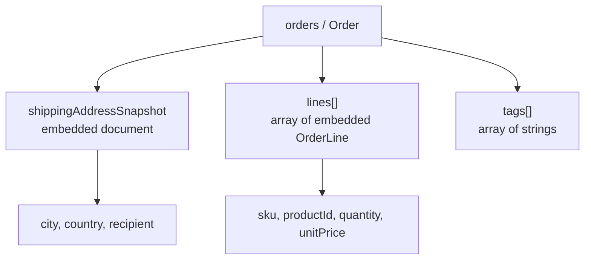
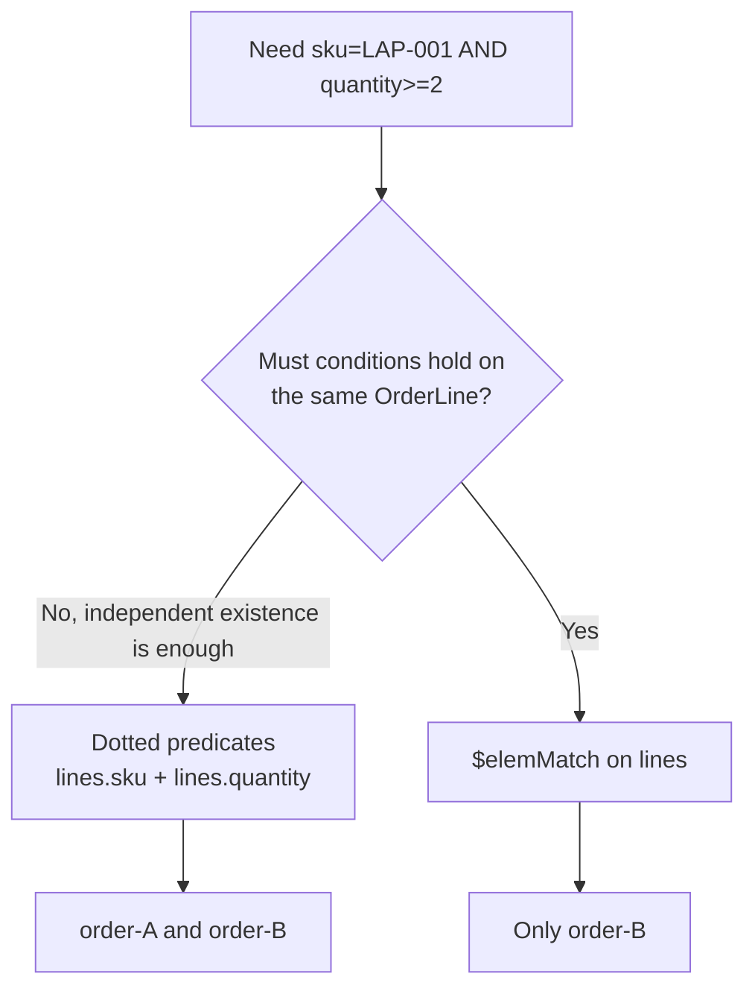

# Querying Nested Documents and Arrays with MongoDB Operators

## 1. Context and Objectives

In **Spring Data MongoDB**, documents commonly contain embedded objects and arrays rather than only flat fields. The **Mini Commerce** e-commerce application used throughout this track has three main entities: `Product`, `Customer`, and `Order`. Each `Order` stores a snapshot of the shipping address in `shippingAddressSnapshot`, a list of line items `lines`, and optionally an array of `tags`. Several business questions require reaching deep into these structures:

- Find orders delivered to a specific city.
- Find orders containing **at least one** product with SKU `LAP-001`.
- Find orders with **a single line item** that both has SKU `LAP-001` and `quantity >= 2`.
- Find orders tagged with **both** `priority` and `gift`.
- Find orders missing a shipping address to backfill historical data.
- Optimize array queries using **multikey indexes** and `explain("executionStats")`.

This lesson belongs to the **JSON Queries** section: the focus is expressing MongoDB conditions in `mongosh` and in Spring Data MongoDB's `@Query` annotation, then understanding the BSON results executed by the driver. `MongoTemplate` is used to compare equivalent programmatic queries. These ideas also support dynamic queries, aggregation, indexes, transactions, reactive access, testing, and data-performance diagnostics.

By the end of this lesson, you will be able to:

1. Use **dotted paths** such as `"shippingAddressSnapshot.city"` and `"lines.sku"`.
2. Distinguish matching **an entire embedded document** from filtering on **a nested field**.
3. Choose the right operator among `$in`, `$all`, `$size`, `$elemMatch`, `$exists`, `$type`, `$and`, `$or`, `$not`, and `$nor`.
4. Write `@Query` methods with safe parameter binding, pagination, sorting, and projection.
5. Spot common bugs where two array conditions match **two different elements**.
6. Verify semantics against real MongoDB and identify helpful indexes from query plans.

**Prerequisites:** Java/Spring Boot, `spring-boot-starter-data-mongodb`, `@Document`, `@Id`, `MongoRepository`, BSON/JSON, embedded objects and arrays. Examples use the synchronous MongoDB driver; when using reactive access, BSON condition semantics remain unchanged.

## 2. Mini Commerce Dataset Used in This Lesson

We use the `orders` collection. Each order has a customer, status, timestamp, shipping address, line items, and tags.



The following two sample documents are crafted to create an **easy-to-misquery edge case**.

### 2.1. Order A: Conditions Spread Across Two Different Line Items

```json
{
  "_id": "order-A",
  "customerId": "customer-001",
  "status": "PLACED",
  "placedAt": { "$date": "2026-11-20T02:00:00Z" },
  "shippingAddressSnapshot": {
    "recipient": "Nguyen Thi Lan",
    "city": "TP Ho Chi Minh",
    "country": "VN"
  },
  "lines": [
    {
      "productId": "prod-lap",
      "sku": "LAP-001",
      "quantity": 1,
      "unitPrice": { "$numberDecimal": "129900.00" }
    },
    {
      "productId": "prod-mou",
      "sku": "MOU-001",
      "quantity": 5,
      "unitPrice": { "$numberDecimal": "49000.00" }
    }
  ],
  "tags": ["priority", "gift"]
}
```

### 2.2. Order B: A Single Line Item Satisfying Both Conditions

```json
{
  "_id": "order-B",
  "customerId": "customer-002",
  "status": "PLACED",
  "placedAt": { "$date": "2026-11-20T03:00:00Z" },
  "shippingAddressSnapshot": {
    "recipient": "Tran Minh An",
    "city": "Da Nang",
    "country": "VN"
  },
  "lines": [
    {
      "productId": "prod-lap",
      "sku": "LAP-001",
      "quantity": 3,
      "unitPrice": { "$numberDecimal": "129900.00" }
    }
  ],
  "tags": ["priority"]
}
```

In `mongosh`, equivalent documents can be inserted via:

```javascript
use mini_commerce

db.orders.insertMany([
  {
    _id: "order-A",
    customerId: "customer-001",
    status: "PLACED",
    placedAt: ISODate("2026-11-20T02:00:00Z"),
    shippingAddressSnapshot: {
      recipient: "Nguyen Thi Lan",
      city: "TP Ho Chi Minh",
      country: "VN"
    },
    lines: [
      {
        productId: "prod-lap",
        sku: "LAP-001",
        quantity: 1,
        unitPrice: NumberDecimal("129900.00")
      },
      {
        productId: "prod-mou",
        sku: "MOU-001",
        quantity: 5,
        unitPrice: NumberDecimal("49000.00")
      }
    ],
    tags: ["priority", "gift"]
  },
  {
    _id: "order-B",
    customerId: "customer-002",
    status: "PLACED",
    placedAt: ISODate("2026-11-20T03:00:00Z"),
    shippingAddressSnapshot: {
      recipient: "Tran Minh An",
      city: "Da Nang",
      country: "VN"
    },
    lines: [
      {
        productId: "prod-lap",
        sku: "LAP-001",
        quantity: 3,
        unitPrice: NumberDecimal("129900.00")
      }
    ],
    tags: ["priority"]
  }
]);
```

Run `insertMany` only on a dedicated practice database when these IDs do not already exist. Re-running it triggers a duplicate `_id` error. Never use this fixture example against production data.

In Java, `Instant` is a sound choice for `placedAt`, and `BigDecimal` combined with `@Field(targetType = FieldType.DECIMAL128)` works for `unitPrice`. Regardless of BSON type options, keep `Customer` and `Product` IDs consistent with reference fields in `Order` across the system.

## 3. Querying Embedded Document Fields via Dotted Path

To find orders delivered to TP Ho Chi Minh:

```javascript
db.orders.find({
  "shippingAddressSnapshot.city": "TP Ho Chi Minh"
});
```

Result from the two fixtures: **order-A**. The dot in the key describes the path from the embedded document to the target field. Wrap the full path in **quotes** so `mongosh` treats it as a single field name.

Other path examples:

| Business Condition | BSON Filter |
| --- | --- |
| Orders delivered in Vietnam | `{ "shippingAddressSnapshot.country": "VN" }` |
| Specific recipient name | `{ "shippingAddressSnapshot.recipient": "Nguyen Thi Lan" }` |
| Orders with any line having SKU `LAP-001` | `{ "lines.sku": "LAP-001" }` |
| Orders with a line quantity of at least 3 | `{ "lines.quantity": { $gte: 3 } }` |

### 3.1. Avoid Confusing with Full Embedded Document Equality

These two queries are **different**:

```javascript
// Checks only the city field inside the object:
db.orders.find({
  "shippingAddressSnapshot.city": "TP Ho Chi Minh"
});

// Matches the embedded document against a specific document value:
db.orders.find({
  shippingAddressSnapshot: {
    city: "TP Ho Chi Minh"
  }
});
```

The second query **does not match order-A**, because `shippingAddressSnapshot` also contains `recipient` and `country`. MongoDB compares embedded documents as whole BSON structures including field set and field order; it does not mean "an object containing at least field city". To filter on one or more embedded fields, normally use a **dotted path**.

### 3.2. Dotted Paths Can Span Multiple Levels

Suppose `Customer` stores:

```json
{
  "_id": "customer-001",
  "preferences": {
    "notification": {
      "email": true
    }
  }
}
```

Query:

```javascript
db.customers.find({
  "preferences.notification.email": true
});
```

Multi-level path syntax works the same way. If legacy field names contain *literal* dots or start with `$`, use special field-handling APIs suited to that case rather than assuming every dot implies nesting. For new schemas, favor simple field names for easy querying and indexing.

## 4. Arrays: Matching Values and Embedded Elements

MongoDB lets you check whether a value exists inside an array without iterating in Java. With `tags`:

```javascript
db.orders.find({ tags: "gift" });
```

This query matches **order-A** because the array contains `"gift"`. With `lines` as an array of documents:

```javascript
db.orders.find({ "lines.sku": "LAP-001" });
```

Result: **order-A and order-B**. MongoDB inspects elements of `lines` to find any element with a matching `sku` field.

### 4.1. $in: At Least One Value in a List

```javascript
db.orders.find({
  tags: { $in: ["gift", "promotion"] }
});
```

Result: **order-A**. On an array field, `$in` checks whether at least one element belongs to the given list. On a scalar field, `$in` checks whether the field equals one of the listed values.

### 4.2. $all: Array Contains All Required Values

```javascript
db.orders.find({
  tags: { $all: ["priority", "gift"] }
});
```

Result: **order-A**. `$all` behaves like **AND over value presence in an array**; it does not require matching argument order and does not require the array to contain only those two elements.

Comparison:

| Filter | Result on the Two Fixtures | Meaning |
| --- | --- | --- |
| `{ tags: "gift" }` | A | Contains at least `"gift"` |
| `{ tags: { $in: ["gift", "priority"] } }` | A, B | Contains at least one listed tag |
| `{ tags: { $all: ["gift", "priority"] } }` | A | Contains **both** tags |
| `{ tags: { $size: 1 } }` | B | Array has exactly one element |

### 4.3. $size: Exact Element Count

```javascript
db.orders.find({
  lines: { $size: 1 }
});
```

Result: **order-B**. `$size` accepts an **exact count**, not nested `$gte` or `$lt` expressions:

```javascript
// Invalid for finding length >= 2:
// { lines: { $size: { $gte: 2 } } }
```

If you frequently filter by line-item count, consider maintaining a validated count field or using `$expr`/aggregation. Standard `$size` queries cannot directly use indexes for length comparisons, so benchmark performance on representative data.

### 4.4. $nin and Negation Conditions

```javascript
db.orders.find({
  tags: { $nin: ["gift"] }
});
```

Result: **order-B**. Note that `$nin` also matches documents **missing the queried field**; if the array must exist, add explicit `$exists`/`$type` checks. Do not equate "does not contain value" with "field definitely exists and does not contain value".

## 5. The Most Common Pitfall: Do Two Conditions Apply to the Same Array Element?

Business requirement: **find orders containing a single line item with SKU `LAP-001` and quantity at least 2**.

### 5.1. Two Dotted Predicates Can Match Two Different Elements

```javascript
db.orders.find({
  "lines.sku": "LAP-001",
  "lines.quantity": { $gte: 2 }
});
```

Result: **order-A and order-B**.

- In **order-A**, the first line has `sku = LAP-001` with only `quantity = 1`; the second line has `quantity = 5` but SKU `MOU-001`. The two conditions are satisfied by **two different elements**.
- In **order-B**, the same `LAP-001` line has `quantity = 3`, meeting the requirement.

If the query above is interpreted as "one line item having both SKU and enough quantity", **order-A is a false positive**.

### 5.2. Use $elemMatch to Constrain the Same Element

```javascript
db.orders.find({
  lines: {
    $elemMatch: {
      sku: "LAP-001",
      quantity: { $gte: 2 }
    }
  }
});
```

Result: **only order-B**.

`$elemMatch` requires **at least one array element** to satisfy **all** conditions inside it. This is the core distinction from placing multiple dotted-path conditions side by side.



### 5.3. $elemMatch with Arrays of Numbers or Strings

`$elemMatch` also works on scalar arrays when multiple conditions must hold on **a single value**:

```javascript
// Another example: document { scores: [6, 12, 30] }
db.assessments.find({
  scores: {
    $elemMatch: { $gte: 10, $lt: 20 }
  }
});
```

The query looks for a single value within `[10, 20)`, not one element `>= 10` and a different element `< 20`. The `assessments` collection is only a syntax example, not part of Mini Commerce.

### 5.4. Single-Condition Cases

For a single condition like `"lines.sku": "LAP-001"`, a dotted path is usually simpler and sufficient. Do not wrap single predicates in `$elemMatch` unnecessarily. However, `$elemMatch` clarifies intent and influences compound multikey index usage on multi-condition queries.

### 5.5. $all on Object Arrays Does Not Replace $elemMatch

`$all` is best suited for asking whether an array contains multiple required values. When conditions span **multiple fields within the same embedded document**, `$elemMatch` usually expresses business intent better. Never write `$all: ["LAP-001", 2]` on `lines`: each element of `lines` is a **document**, not a SKU string or quantity number.

## 6. Combining Conditions: $and, $or, $not, $nor

You can combine root conditions with object and array conditions:

```javascript
db.orders.find({
  status: "PLACED",
  "shippingAddressSnapshot.country": "VN",
  lines: {
    $elemMatch: {
      sku: "LAP-001",
      quantity: { $gte: 2 }
    }
  }
});
```

Top-level keys implicitly combine with **AND**; here the result is only **order-B**.

### 6.1. $or: At Least One Branch Holds

```javascript
db.orders.find({
  $or: [
    { "shippingAddressSnapshot.city": "Da Nang" },
    { tags: "gift" }
  ]
});
```

Result: **order-A and order-B**. Adding a `status` filter outside `$or` ANDs it with the entire OR group:

```javascript
db.orders.find({
  status: "PLACED",
  $or: [
    { "shippingAddressSnapshot.city": "Da Nang" },
    { tags: "gift" }
  ]
});
```

### 6.2. $not and $nor: Read Semantics Carefully

`$not` negates a **field-level condition expression**, for example:

```javascript
db.orders.find({
  "lines.quantity": { $not: { $gte: 5 } }
});
```

This negates `lines.quantity >= 5` on the path; **missing field/array cases** must also be accounted for. For problems asking "no line item matches condition X", it is often easier to express the negation of `$elemMatch` explicitly and test fixtures with empty arrays and missing fields.

`$nor` requires that **none of the branches** in the condition list evaluate to true:

```javascript
db.orders.find({
  $nor: [
    { tags: "gift" },
    { "shippingAddressSnapshot.city": "Da Nang" }
  ]
});
```

On the two fixtures, this query returns **0 orders**. Whenever writing negation conditions, test null fields, missing fields, empty arrays, and multi-element arrays explicitly: MongoDB query negation does not always match informal English phrasing.

## 7. Distinguishing Null, Missing, Empty Arrays, and BSON Types

Schema consistency matters because historical data can be incomplete. These four cases mean different things:

```javascript
{ _id: "x1", shippingAddressSnapshot: { city: null } }
{ _id: "x2", shippingAddressSnapshot: {} }
{ _id: "x3" }
{ _id: "x4", lines: [] }
```

### 7.1. Equality with Null Can Match Missing Fields

```javascript
db.orders.find({
  "shippingAddressSnapshot.city": null
});
```

MongoDB lets `{ field: null }` match **fields containing BSON Null or fields that do not exist** along the path. Thus it can match `x1`, `x2`, and `x3`.

If you only want to check that the path **exists**:

```javascript
db.orders.find({
  "shippingAddressSnapshot.city": { $exists: true }
});
```

That condition still matches `x1` even though `city` is null. When you genuinely need fields whose BSON type is Null:

```javascript
db.orders.find({
  "shippingAddressSnapshot.city": { $type: "null" }
});
```

When the field **does not exist**:

```javascript
db.orders.find({
  "shippingAddressSnapshot.city": { $exists: false }
});
```

### 7.2. Empty Arrays Differ from Missing Arrays

```javascript
// Has lines with exactly 0 elements:
{ lines: { $size: 0 } }

// Does not have the lines field at all:
{ lines: { $exists: false } }

// lines is a BSON array, whether empty or populated:
{ lines: { $type: "array" } }
```

`$size: 0` is not the same as `$exists: false`. For placed orders, enforce non-empty `lines` in business validation rather than expecting reporting queries to fix malformed data.

### 7.3. Negation Conditions and Missing Data

For example, `{ "shippingAddressSnapshot.city": { $ne: "Da Nang" } }` can match documents **missing city**. If you truly want "city is known and differs from Da Nang", add existence and/or type checks. Similarly, `$nin` can include missing fields.

## 8. Bringing JSON Queries into Spring Data MongoDB with @Query

Spring Data MongoDB supports the annotation:

```java
import org.springframework.data.mongodb.repository.Query;
```

`@Query` lets you declare JSON filters directly on repository methods. With positional parameters:

- `?0` is the first parameter (0-indexed).
- `?1` is the second parameter, and so on.
- **Do not wrap `?0` in quotes** when placing a JSON value. The framework binds and escapes values via query binding; wrapping in quotes can turn the placeholder into a string literal.
- For JSON inside Java annotations, write a valid Java String; using single quotes for JSON keys and string literals inside `@Query` reduces double-quote escaping.

### 8.1. Order Entity with Embedded Documents and Arrays

A minimal complete Java entity so the repository methods below have well-defined property paths:

```java
package com.example.minicommerce.domain;

import java.math.BigDecimal;
import java.time.Instant;
import java.util.List;

import org.springframework.data.annotation.Id;
import org.springframework.data.mongodb.core.mapping.Document;
import org.springframework.data.mongodb.core.mapping.Field;
import org.springframework.data.mongodb.core.mapping.FieldType;

@Document(collection = "orders")
public class Order {
    @Id
    private String id;
    private String customerId;
    private String status;
    private Instant placedAt;
    private ShippingAddress shippingAddressSnapshot;
    private List<OrderLine> lines;
    private List<String> tags;

    public Order() {}

    public String getId() { return id; }
    public void setId(String id) { this.id = id; }
    public String getCustomerId() { return customerId; }
    public void setCustomerId(String customerId) { this.customerId = customerId; }
    public String getStatus() { return status; }
    public void setStatus(String status) { this.status = status; }
    public Instant getPlacedAt() { return placedAt; }
    public void setPlacedAt(Instant placedAt) { this.placedAt = placedAt; }
    public ShippingAddress getShippingAddressSnapshot() {
        return shippingAddressSnapshot;
    }
    public void setShippingAddressSnapshot(ShippingAddress value) {
        this.shippingAddressSnapshot = value;
    }
    public List<OrderLine> getLines() { return lines; }
    public void setLines(List<OrderLine> lines) { this.lines = lines; }
    public List<String> getTags() { return tags; }
    public void setTags(List<String> tags) { this.tags = tags; }

    public static class ShippingAddress {
        private String recipient;
        private String city;
        private String country;

        public ShippingAddress() {}

        public String getRecipient() { return recipient; }
        public void setRecipient(String value) { recipient = value; }
        public String getCity() { return city; }
        public void setCity(String value) { city = value; }
        public String getCountry() { return country; }
        public void setCountry(String value) { country = value; }
    }

    public static class OrderLine {
        private String productId;
        private String sku;
        private int quantity;

        @Field(targetType = FieldType.DECIMAL128)
        private BigDecimal unitPrice;

        public OrderLine() {}

        public String getProductId() { return productId; }
        public void setProductId(String value) { productId = value; }
        public String getSku() { return sku; }
        public void setSku(String value) { sku = value; }
        public int getQuantity() { return quantity; }
        public void setQuantity(int value) { quantity = value; }
        public BigDecimal getUnitPrice() { return unitPrice; }
        public void setUnitPrice(BigDecimal value) { unitPrice = value; }
    }
}
```

`ShippingAddress` and `OrderLine` are nested static classes so the example stays self-contained in one file. In a real project they can be separate classes or records. `OrderLine` is embedded inside `Order`, without needing its own collection. You can add snapshots like `productName`, `lineTotal`, and full `shippingAddressSnapshot` fields when implementing real checkout flows.

### 8.2. Repository with Expressive JSON Queries

```java
package com.example.minicommerce.repository;

import java.util.Collection;
import java.util.List;

import org.springframework.data.domain.Page;
import org.springframework.data.domain.Pageable;
import org.springframework.data.mongodb.repository.MongoRepository;
import org.springframework.data.mongodb.repository.Query;

import com.example.minicommerce.domain.Order;

public interface OrderRepository extends MongoRepository<Order, String> {

    @Query("{ 'shippingAddressSnapshot.city': ?0 }")
    List<Order> findOrdersDeliveredTo(String city);

    @Query("{ 'lines.sku': ?0 }")
    List<Order> findOrdersContainingSku(String sku);

    @Query("{ 'lines': { '$elemMatch': " +
           "{ 'sku': ?0, 'quantity': { '$gte': ?1 } } } }")
    List<Order> findOrdersWithEnoughOfSku(
        String sku, int minimumQuantity);

    @Query("{ 'tags': { '$all': ?0 } }")
    List<Order> findOrdersWithEveryTag(Collection<String> tags);

    @Query("{ 'lines': { '$size': ?0 } }")
    List<Order> findOrdersWithLineCount(int count);

    @Query("{ 'shippingAddressSnapshot.city': { '$exists': false } }")
    List<Order> findOrdersMissingShippingCity();

    @Query("{ 'status': ?0, 'lines.sku': ?1 }")
    Page<Order> findByStatusAndSku(
        String status, String sku, Pageable pageable);
}
```

These method names **do not need** to follow derived-query naming rules because `@Query` supplies the filter. `@Query` is also handy when `$elemMatch` or operator combinations cannot be expressed cleanly in a method name.

When a method accepts `Pageable`, enforce a maximum page size at the API/service layer, allow only vetted sort fields, and provide deterministic ordering. Returning `Page<Order>` may trigger an extra count query; use `Slice` if the business does not need total record counts.

### 8.3. Call Examples and Expected Results

```java
List<Order> allLap =
    repository.findOrdersContainingSku("LAP-001");
// Fixture: order-A and order-B.

List<Order> enoughLap =
    repository.findOrdersWithEnoughOfSku("LAP-001", 2);
// Fixture: only order-B.

List<Order> bothTags =
    repository.findOrdersWithEveryTag(List.of("priority", "gift"));
// Fixture: only order-A.

List<Order> oneLine =
    repository.findOrdersWithLineCount(1);
// Fixture: only order-B.
```

These results assume the collection contains only the two lesson fixtures. If other orders exist in the database, queries may return additional matching documents.

## 9. Mapping Java Property Names to BSON Field Names in @Query

In the initial example, the Java and BSON names of `shippingAddressSnapshot` match. However, an entity might declare:

```java
@Field("ship_to")
private ShippingAddress shippingAddressSnapshot;
```

Then BSON stores:

```json
{
  "_id": "order-C",
  "ship_to": {
    "city": "Hue",
    "country": "VN"
  }
}
```

Raw `mongosh` queries must use the **BSON** name:

```javascript
db.orders.find({
  "ship_to.city": "Hue"
});
```

In `@Query` on an entity-typed repository, Spring Data applies query-mapping infrastructure honoring `@Field`; you can typically write the Java name `shippingAddressSnapshot.city` and let the framework map it to `ship_to.city`. Still, with **custom conversions, special field names, or differing library versions**, write integration tests to verify the executed filter and stored BSON.

Notably, writing complex JSON queries with the raw driver or `mongosh` skips Java property-name mapping. Consistent rule: **Java APIs use entity metadata; raw BSON uses BSON names**.

## 10. MongoTemplate: Writing Equivalent Conditions with Criteria

`MongoTemplate` fits when conditions are assembled from optional inputs or when a JSON query becomes hard to read. The same condition—"an OrderLine with matching SKU and quantity":

```java
import org.springframework.data.mongodb.core.MongoTemplate;
import org.springframework.data.mongodb.core.query.Criteria;
import org.springframework.data.mongodb.core.query.Query;

Query query = Query.query(
    Criteria.where("lines").elemMatch(
        Criteria.where("sku").is("LAP-001")
            .and("quantity").gte(2)
    )
);

List<Order> result = mongoTemplate.find(query, Order.class);
```

Logical BSON filter:

```javascript
{
  lines: {
    $elemMatch: {
      sku: "LAP-001",
      quantity: { $gte: 2 }
    }
  }
}
```

For simpler conditions:

```java
Query byCity = Query.query(
    Criteria.where("shippingAddressSnapshot.city")
        .is("TP Ho Chi Minh")
);

Query byTags = Query.query(
    Criteria.where("tags").all("priority", "gift")
);
```

`Criteria` constructs conditions, `Query` holds filters and options, and `MongoTemplate` executes against the collection mapped for `Order.class`. When `$or`, `$and`, or request-dependent optional criteria are needed, this programmatic style is usually easier to maintain than a long JSON annotation.

## 11. Filters Are Not Projections: Which Fields Are Returned?

MongoDB separates:

- **Filter**: which documents are selected.
- **Projection**: within each selected document, which fields are returned.

Raw `mongosh` example:

```javascript
db.orders.find(
  { "lines.sku": "LAP-001" },
  { customerId: 1, status: 1, placedAt: 1 }
);
```

By default, `_id` is still returned in an inclusion projection unless explicitly excluded. Because `lines` is omitted from this projection, the application **cannot** infer that it received all line items.

In Spring Data MongoDB, `@Query` has the `fields` attribute:

```java
@Query(
    value = "{ 'lines.sku': ?0 }",
    fields = "{ 'customerId': 1, 'status': 1, 'placedAt': 1 }"
)
List<Order> findOrderSummariesContainingSku(String sku);
```

When returning `Order`, properties excluded by projection may receive `null`/default values; those objects **are not complete entities**. Avoid calling `save()` on partially loaded objects, which can erase unread fields if the operation replaces the whole document. For list-read APIs, consider a dedicated summary DTO or interface projection.

### 11.1. $elemMatch in Projection Differs from $elemMatch in Filter

MongoDB also provides `$elemMatch` in projection to **limit which array element is returned**:

```javascript
db.orders.find(
  { "lines.sku": "LAP-001" },
  {
    customerId: 1,
    lines: {
      $elemMatch: {
        sku: "LAP-001",
        quantity: { $gte: 2 }
      }
    }
  }
);
```

Key difference:

- `$elemMatch` in a **filter** decides whether the document is selected.
- `$elemMatch` in a **projection** picks **the first matching array element** to return inside a matched document; it does not return **all** matching elements.

If you need all matching line items returned, use aggregation with `$filter` or shape results per API contract. Do not confuse document-filtering queries with array-content transformations.

## 12. Aggregation When You Need to Filter or Aggregate Array Elements

A `find` with `$elemMatch` selects **orders**, without splitting line items into separate rows. To report total units of `LAP-001` sold:

```javascript
db.orders.aggregate([
  { $match: { status: "PLACED" } },
  { $unwind: "$lines" },
  { $match: { "lines.sku": "LAP-001" } },
  {
    $group: {
      _id: "$lines.sku",
      unitsSold: { $sum: "$lines.quantity" }
    }
  }
]);
```

Across fixtures A and B, total `LAP-001` units sold is **1 + 3 = 4**. `$unwind` expands each array line into an intermediate record; the `$match` after `$unwind` selects only the line items to count. If you only `$match` on `lines.sku` at the Order level and `$sum` all `lines.quantity`, you would accidentally sum quantities of other SKUs too.

### 12.1. $filter Returns All Matching Line Items Within One Document

```javascript
db.orders.aggregate([
  {
    $project: {
      customerId: 1,
      matchingLines: {
        $filter: {
          input: "$lines",
          as: "line",
          cond: {
            $and: [
              { $eq: ["$$line.sku", "LAP-001"] },
              { $gte: ["$$line.quantity", 2] }
            ]
          }
        }
      }
    }
  }
]);
```

`$filter` keeps one document per order and builds a `matchingLines` array containing **all** valid elements. In the fixtures, order-A gets an empty array and order-B gets one line. If you only want orders with non-empty results, add a `$match` on the array after projection.

**Tool-selection rule:** `$elemMatch` selects documents based on one element matching multiple criteria; `$filter` filters which elements are **returned**; `$unwind` emits separate rows for aggregation.

## 13. Indexing Embedded Fields and Arrays: Multikey Indexes

MongoDB supports indexes on dotted paths. For example:

```javascript
db.orders.createIndex({
  "shippingAddressSnapshot.city": 1,
  placedAt: -1
});

db.orders.createIndex({
  "lines.sku": 1
});
```

When an indexed field holds an array, MongoDB creates a **multikey index**. With `"lines.sku"`, SKUs across each element of `lines` are indexed to support `{ "lines.sku": "LAP-001" }`.

### 13.1. Compound Indexes and $elemMatch

An index covering SKU and quantity in the **same array subdocument**:

```javascript
db.orders.createIndex({
  "lines.sku": 1,
  "lines.quantity": 1
});
```

When a query uses:

```javascript
db.orders.find({
  lines: {
    $elemMatch: {
      sku: "LAP-001",
      quantity: { $gte: 2 }
    }
  }
});
```

MongoDB can combine bounds on the **same element** more effectively than with two dotted predicates lacking `$elemMatch`. Actual plan choice still depends on data distribution, selectivity, and competing indexes.

**Limit to remember:** compound multikey indexes enforce restrictions on simultaneous array fields. You cannot arbitrarily build a compound index across **two independent arrays** in the same document; `"lines.sku"` and `"lines.quantity"` in this example belong to **the same `lines` array**, making it a valid case to examine.

### 13.2. Inspecting the Query Plan

```javascript
db.orders.find({
  lines: {
    $elemMatch: {
      sku: "LAP-001",
      quantity: { $gte: 2 }
    }
  }
}).explain("executionStats");
```

Watch `winningPlan`, `totalKeysExamined`, `totalDocsExamined`, and `nReturned`. Never assume "having an index means always fast": overly broad queries, poorly ordered index keys for filter/sort, huge arrays, or low-cardinality repeated values can still be costly.

For customer order history, another index is often more important:

```javascript
db.orders.createIndex({
  customerId: 1,
  placedAt: -1
});
```

Choose indexes based on **actual queries and execution frequency** rather than pushing every lesson example into production. Indexes increase write cost and consume memory and disk.

## 14. Query Safety and Common Design Mistakes

### 14.1. Parameter Binding Instead of Manual JSON String Concatenation

In `@Query`:

```java
@Query("{ 'shippingAddressSnapshot.city': ?0 }")
List<Order> findOrdersDeliveredTo(String city);
```

This is **parameterized**. Avoid concatenating HTTP input into a JSON string to build a query—such as assembling `"{" + userInput + "}"` and parsing it. Doing so complicates escaping, type checking, and auditing.

However, parameter binding **does not replace validation**: enforce string length caps, element count limits in `$in`/`$all`, page size caps, and allow only API-exposed fields/operators. Allowing clients to submit arbitrary BSON filters increases the risk of expensive queries and out-of-scope data access.

### 14.2. Array Queries and Multi-Tenant Data

If Mini Commerce serves multiple stores/tenants, every query on `orders` must include the tenant condition in the same filter. `@Query` on a repository does not automatically enforce row-level authorization or read permissions. If soft-delete exists, likewise include the status/deleted condition.

### 14.3. Reading Large Arrays

A document with a huge `lines` array consumes bandwidth even when filtering on a single SKU. Consider projections, aggregation `$filter`, appropriate pagination, or rethinking the storage model when arrays grow unbounded. MongoDB imposes a document size limit; embedding unbounded history in one document is not always appropriate.

### 14.4. Updating Array Elements Differs from Read Queries

`$elemMatch` **selects documents**. When updating a specific `OrderLine` element, MongoDB offers specialized update mechanisms such as positional `$` and `arrayFilters` with `$[identifier]`. Never replace an entire `Order` just to update one field without accounting for concurrency, snapshots, and fields owned by other services.

In Mini Commerce, finalized line items must be protected by business rules; post-checkout changes to unit price or quantity affect revenue, inventory, and transactions. Multi-document transactions do not turn a flawed BSON filter into a right one; you must still identify the target element accurately.

## 15. Practical Testing with MongoDB and Spring Data

To accurately verify the difference between dotted predicates and `$elemMatch`, use **real MongoDB or Testcontainers**. A mocked repository returning canned lists will not test MongoDB semantics.

### 15.1. Testing with Raw BSON Fixtures

The `@SpringBootTest` example below assumes the project already defines `OrderRepository`, a dedicated test MongoDB, and Spring repository scanning. It inserts raw documents directly to test queries independently of mapping write logic.

```java
package com.example.minicommerce;

import static org.junit.jupiter.api.Assertions.*;

import java.util.List;

import org.bson.Document;
import org.junit.jupiter.api.Test;
import org.springframework.beans.factory.annotation.Autowired;
import org.springframework.boot.test.context.SpringBootTest;
import org.springframework.data.mongodb.core.MongoTemplate;

import com.example.minicommerce.domain.Order;
import com.example.minicommerce.repository.OrderRepository;

@SpringBootTest
class NestedArrayJsonQueryTest {

    @Autowired MongoTemplate template;
    @Autowired OrderRepository repository;

    @Test
    void elemMatchBindsSkuAndQuantityToSameLine() {
        var raw = template.getCollection("orders");
        List<String> ids = List.of("json-array-test-A", "json-array-test-B");

        Document idFilter =
            new Document("_id", new Document("$in", ids));
        raw.deleteMany(idFilter);

        try {
            raw.insertMany(List.of(
                new Document("_id", ids.get(0))
                    .append("customerId", "test-customer-1")
                    .append("status", "PLACED")
                    .append("lines", List.of(
                        new Document("sku", "LAP-001")
                            .append("quantity", 1),
                        new Document("sku", "MOU-001")
                            .append("quantity", 5)))
                    .append("tags", List.of("priority", "gift")),
                new Document("_id", ids.get(1))
                    .append("customerId", "test-customer-2")
                    .append("status", "PLACED")
                    .append("lines", List.of(
                        new Document("sku", "LAP-001")
                            .append("quantity", 3)))
                    .append("tags", List.of("priority"))
            ));

            var dotted = raw.find(new Document("lines.sku", "LAP-001")
                .append("lines.quantity", new Document("$gte", 2)))
                .into(new java.util.ArrayList<>());
            assertEquals(2, dotted.size());

            List<Order> correct =
                repository.findOrdersWithEnoughOfSku("LAP-001", 2);
            assertEquals(1, correct.size());
            assertEquals(ids.get(1), correct.get(0).getId());

            List<Order> withBothTags =
                repository.findOrdersWithEveryTag(
                    List.of("priority", "gift"));
            assertEquals(1, withBothTags.size());
            assertEquals(ids.get(0), withBothTags.get(0).getId());
        } finally {
            raw.deleteMany(idFilter);
        }
    }
}
```

Because test fixtures only write fields needed by the filters, omitted properties receive null/defaults when Spring Data materializes `Order`. That suffices for query verification; never use partial fixture entities to test full checkout workflows. Clean up fixed-ID fixtures **only in a dedicated test database**.

### 15.2. Recommended Additional Test Matrix

| Case | Expectation |
| --- | --- |
| Address with city and other fields | Dotted query matches; whole-document equality does not if structure differs |
| Empty `lines` array | Does not match SKU; `$size: 0` matches |
| Missing `lines` field | Does not match `$size: 0`, matches `$exists: false` |
| SKU and quantity on two different lines | Two dotted predicates match; `$elemMatch` does not |
| SKU and quantity on the same line | `$elemMatch` matches |
| `tags` containing one of two tags | `$in` matches; `$all` does not |
| `city = null`, missing city, missing address | Verify `null`, `$exists`, `$type` behavior |
| Projection selecting only a few fields | Returned object omits excluded properties; never passed to `save` |
| Decimal128 values in `lines.unitPrice` | Price queries use the right BSON type |
| Mapped Java property with `@Field("ship_to")` | `@Query` and `MongoTemplate` target the real stored field name |
| Query executed on large dataset | `explain` shows useful index usage without unexpected full scans |
| Reactive repository | `StepVerifier` checks emitted results without blocking |

## 16. Common Mistakes

| Symptom | Cause | Resolution |
| --- | --- | --- |
| City query returns no results | Used whole-document equality instead of dotted path | Write `"shippingAddressSnapshot.city"` |
| Query with dot triggers JavaScript syntax error | Forgot to quote dotted-path key | Quote as `"lines.sku"` |
| Order A counted as having 2 units of LAP-001 | Two dotted predicates matched two different elements | Use `$elemMatch` on `lines` |
| `$all` returns more/fewer results than expected | Confused "contains all values" with "contains at least one value" | Pick `$all` or `$in` per requirement |
| `$size` does not accept `$gte` | `$size` only takes an exact integer count | Use `$expr`/aggregation or a maintained count field |
| Query for `null` returns docs missing the field | MongoDB null equality matches null and missing | Use `$exists` or `$type` to distinguish |
| `@Query` fails after BSON rename | Changed schema/`@Field` without mapping tests | Verify raw BSON and mapped queries |
| `?0` parameter treated as literal string | Wrapped placeholder in quotes improperly | Use bare `?0` in value position |
| Decimal128 prices fail threshold match | Mixed String/Double/Decimal128 in data | Audit `$type`, normalize data, pass matching type |
| Array query is slow | Missing multikey index, mismatched index, or huge arrays | Run `explain` and consider document redesign |
| Compound index errors on two arrays | Violated parallel-arrays restriction | Design index aligned with structure and workload |
| Projection loses fields on save | Loaded partial entity then called `save()` | Return read DTOs or use partial updates |
| Miscounted SKU units in aggregation | Matched Order then summed every OrderLine | `$unwind` and re-filter line items before `$group` |
| Query works functionally but lacks access checks | Missing tenant/authorization filter | Add enforcement in service/repository |
| Reactive reads succeed but block event loop | Introduced blocking I/O or `block()` | Use the reactive driver and non-blocking pipeline consistently |

## 17. Connection to Reactive, Transactions, and Performance Diagnostics

In the reactive stack, `ReactiveMongoRepository` and `ReactiveMongoTemplate` also support these conditions. For example:

```java
import org.springframework.data.mongodb.repository.Query;
import org.springframework.data.mongodb.repository.ReactiveMongoRepository;
import reactor.core.publisher.Flux;

public interface ReactiveOrderRepository
        extends ReactiveMongoRepository<Order, String> {

    @Query("{ 'lines': { '$elemMatch': " +
           "{ 'sku': ?0, 'quantity': { '$gte': ?1 } } } }")
    Flux<Order> findOrdersWithEnoughOfSku(
        String sku, int minimumQuantity);
}
```

`Flux<Order>` executes upon subscription. When testing, use `StepVerifier` or an appropriate subscriber; never call `block()` inside a reactive request pipeline.

During order placement, updating `Product.stock` and inserting `Order` may require a multi-document transaction if consistency demands it; MongoDB must run on a transaction-capable topology. Even then, filtering on `lines` follows standard BSON semantics. Transactions do not fix incorrect `$elemMatch` usage or missing indexes.

To diagnose performance, inspect **filter**, **projection**, **sort**, **array sizes**, and **indexes** together, comparing `explain("executionStats")` on representative data. Do not turn every JSON query into an aggregation pipeline: pick the simplest tool that expresses business semantics accurately and remains testable.

## 18. Practice Exercises and Completion Criteria

**Exercise 1 — Dotted paths:** Insert the two sample orders and write a query finding `shippingAddressSnapshot.city = "TP Ho Chi Minh"`. Compare with whole-document equality containing only `city` and explain why results differ.

**Exercise 2 — Primitive arrays:** Write queries finding orders with `gift`, orders with either `gift` or `promotion`, orders with both `priority` and `gift`, and orders with exactly one line item. Predict A/B outcomes before running.

**Exercise 3 — Same-element pitfall:** Query SKU `LAP-001` and quantity at least 2 using two dotted predicates, then replace with `$elemMatch`. Show why order-A is a false positive of the first query.

**Exercise 4 — Repository @Query:** Define `findOrdersWithEnoughOfSku`, `findOrdersWithEveryTag`, `findOrdersMissingShippingCity`, and `findByStatusAndSku` accepting `Pageable`. Write integration tests and cross-check in `mongosh`.

**Exercise 5 — Projection and aggregation:** Use projection to return only ID/status/customerId. Then use `$filter` to return matching line items and `$unwind + $group` to sum total `LAP-001` units across both fixtures.

**Exercise 6 — Multikey indexes:** Create an index on `"lines.sku"`, test compound index `"lines.sku", "lines.quantity"`, and run `explain` to inspect the query plan. Explain the limitation on indexing two independent arrays.

**Extension Exercise — Legacy data:** Insert a document with `shippingAddressSnapshot.city = null`, one missing `city`, one missing the entire address, and one with `lines: []`. Write queries distinguishing each case and explain the impact on reporting and APIs.

Answer for yourself:

1. When should you use a dotted path, and when is embedded-document equality right?
2. How do `$in` and `$all` differ on a string array?
3. Why can two dotted predicates on `lines` match two different line items?
4. How does `$elemMatch` in a **filter** differ from `$elemMatch` in a **projection**?
5. How do you distinguish `null`, missing fields, and empty arrays?
6. How should `@Query` with `?0`, `?1` be written so Spring Data binds parameters properly?
7. When do you need `$filter`/`$unwind` instead of a single `find`?
8. What do multikey indexes accelerate, and what restriction applies when combining multiple array fields?

**Expected outcome:** learners can write and verify accurate JSON filters for embedded documents and arrays, choose `$elemMatch` to bind conditions to a single element, bring filters into repositories with `@Query`, understand projection and aggregation boundaries, and validate performance using multikey indexes and `explain`.

## References

- [MongoDB Manual — Query on Embedded/Nested Documents](https://www.mongodb.com/docs/manual/tutorial/query-embedded-documents/): dotted notation and embedded document matching.
- [MongoDB Manual — Query an Array](https://www.mongodb.com/docs/manual/tutorial/query-arrays/): array membership, `$all`, `$size`, and array conditions.
- [MongoDB Manual — Query an Array of Documents](https://www.mongodb.com/docs/manual/tutorial/query-array-of-documents/): `$elemMatch` and same-element conditions.
- [MongoDB Manual — Query for Null or Missing Fields](https://www.mongodb.com/docs/manual/tutorial/query-for-null-fields/): null, missing, `$exists`, and `$type`.
- [MongoDB Manual — Multikey Indexes](https://www.mongodb.com/docs/manual/core/indexes/index-types/index-multikey/): indexing arrays and compound multikey restrictions.
- [Spring Data MongoDB — JSON-based Queries](https://docs.spring.io/spring-data/mongodb/reference/mongodb/repositories/query-methods.html): `@Query`, positional parameters, projections, and method return types.
- [Spring Data MongoDB — MongoTemplate Querying](https://docs.spring.io/spring-data/mongodb/reference/mongodb/template-query-operations.html): `Query`, `Criteria`, `elemMatch`, and query mapping.
- [MongoDB Manual — Explain Results](https://www.mongodb.com/docs/manual/reference/explain-results/): reading `winningPlan` and `executionStats`.
