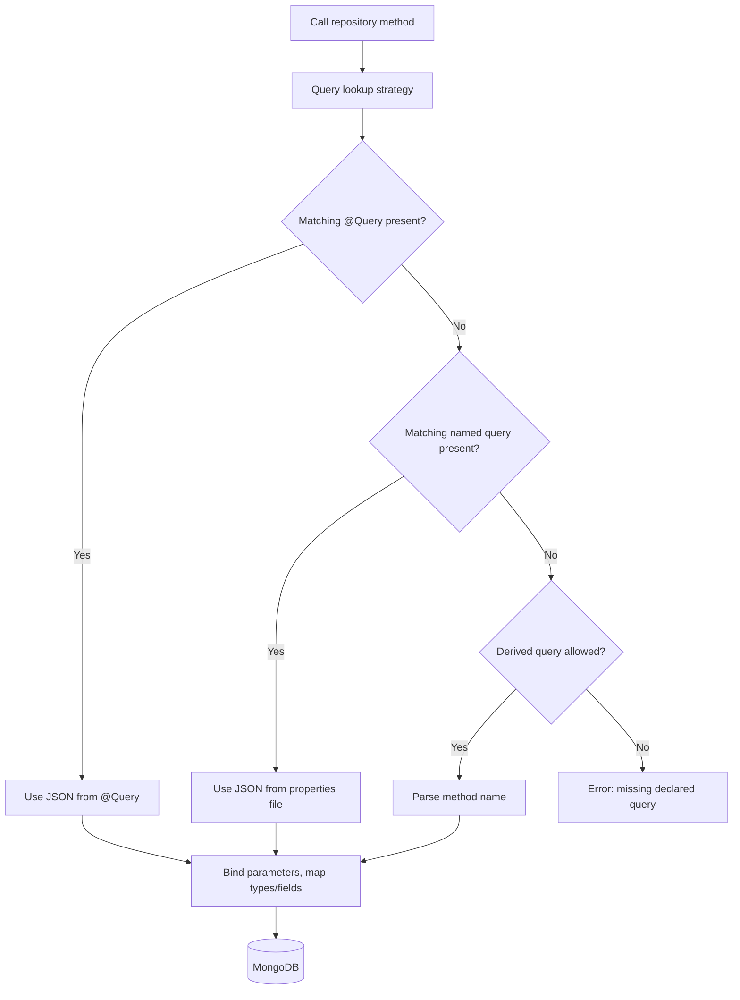

# Named Queries and Declared Query Lookup Rules

> **Chapter:** JSON Queries  
> **Module:** `SPRING_DATA_MONGODB` — using Spring Data MongoDB to connect, map documents, and work with data via `MongoTemplate` or repositories; from there practicing query design, aggregation, indexes, transactions, reactive access, testing, and performance diagnostics. This lesson focuses on **named queries stored as JSON** and the mechanism Spring Data MongoDB uses to choose between declared queries and queries derived from method names.

## 1. Why Use Named Queries When Derived Queries Exist?

Spring Data MongoDB allows repositories to generate queries directly from method names:

```java
List<PurchaseOrder> findByBuyerCode(String buyerCode);
```

When filtering by a single property, a derived query is concise and easy to maintain. However, in certain cases a team wants to **explicitly define a JSON filter** without lengthening method names:

- Queries with fixed business rules such as `archived: false` for active orders.
- Needing operators like `$gte`, `$lt`, `$in`, or combinations of `$and`/`$or` that are hard to read in a method name.
- Keeping **stable method names** while managing declared queries in a version-controlled resource file.
- Protecting the repository API from accidentally changing query semantics when refactoring domain properties.

A **named query** is a query declared outside the method, identified by a **name key**, and resolved by the framework to bind to a repository method at repository initialization time. For Spring Data MongoDB, the standard format is `META-INF/mongo-named-queries.properties` on the classpath, where values are JSON query strings.

The single most important point of this lesson:

> Under the default lookup strategy, Spring Data **prefers an existing declared query**, falling back to deriving from the method name only if none is found. Among declared options, `@Query` placed directly on the method takes precedence over a named query in a properties file.

Named queries **are not** stored procedures or queries saved and executed independently on the MongoDB server. The properties file is read by the Spring Data application when configuring repositories; MongoDB simply receives the query sent to it.

## 2. Comparing Three Ways to Write Repository Queries

| Approach | Where Does the Query Live? | When Is It Appropriate? |
| --- | --- | --- |
| **Derived query** | Inside the Java method name, e.g. `findByStatus` | Simple filters clearly expressible via properties and keywords. |
| **JSON `@Query`** | In an annotation directly on the repository method | Keeping JSON right next to the method signature for easy review. |
| **Named JSON query** | In `mongo-named-queries.properties` with key `DomainType.methodName` | Managing a collection of named queries centrally outside the interface. |

All three approaches execute through Spring Data's repository infrastructure without opening a separate type of MongoDB connection. Collection names, Java/BSON property mappings, converters, and `MongoClient` still follow the application's Spring Data MongoDB configuration.



This diagram illustrates the **common `CREATE_IF_NOT_FOUND` case**, not a mandatory rule for every lookup mode. Specific strategies are explained in section 5.

## 3. Domain Model Used Throughout the Lesson

Suppose a system stores purchase orders:

```java
package demo.orders;

import java.math.BigDecimal;
import java.time.Instant;
import org.springframework.data.annotation.Id;
import org.springframework.data.mongodb.core.mapping.Document;
import org.springframework.data.mongodb.core.mapping.Field;
import org.springframework.data.mongodb.core.mapping.FieldType;

@Document(collection = "purchase_orders")
public record PurchaseOrder(
    @Id String id,
    @Field("buyer_code") String buyerCode,
    String status,
    boolean archived,
    Instant createdAt,
    @Field(targetType = FieldType.DECIMAL128) BigDecimal totalAmount,
    ShippingAddress shippingAddress
) {}

record ShippingAddress(String city, String postalCode) {}
```

BSON document represented in Extended JSON:

```json
{
  "_id": "ORD-001",
  "buyer_code": "CUS-42",
  "status": "PAID",
  "archived": false,
  "createdAt": { "$date": "2026-11-20T03:00:00Z" },
  "totalAmount": { "$numberDecimal": "1250.50" },
  "shippingAddress": {
    "city": "Da Nang",
    "postalCode": "550000"
  }
}
```

Omitting `_class` if present. Key points to remember:

- The collection is `purchase_orders` due to `@Document(collection = "...")`.
- Java property `buyerCode` is stored as BSON field `buyer_code`.
- `createdAt` is a BSON Date; a named query comparing timestamps must pass compatible values.
- `totalAmount` is Decimal128, not double or string.
- `shippingAddress.city` is a path into an **embedded document**, not a reference to another collection.

In `@Query` and named queries, we will intentionally write **actual BSON names** so filters sent to MongoDB are crystal clear. On typed operations, Spring Data can also apply mapping metadata to queries; do not rely on that automation to hide a broken schema or mismatches between Java properties and server field names.

## 4. Declaring Named Queries in a Properties File

### 4.1. Default Location and Directory Layout

In a standard Maven/Gradle project layout:

```text
src/
  main/
    java/
      demo/orders/PurchaseOrder.java
      demo/orders/PurchaseOrderRepository.java
    resources/
      META-INF/
        mongo-named-queries.properties
```

When packaging the application, the resource must reside **on the classpath**. For a typical Java application, the built path corresponds to `META-INF/mongo-named-queries.properties` inside the classpath, **not** an arbitrary file next to the JAR.

Sample file:

```properties
# src/main/resources/META-INF/mongo-named-queries.properties

# Key = simple name of domain type + "." + repository method name.
PurchaseOrder.findByBuyerCode={ 'buyer_code' : ?0, 'archived' : false }
PurchaseOrder.findWithinWindow={ 'createdAt' : { '$gte' : ?0, '$lt' : ?1 } }
PurchaseOrder.findByShippingAddress_City={ 'shippingAddress.city' : ?0 }

# This key will be overridden by @Query on the same-named method in the next example.
PurchaseOrder.findByStatus={ 'status' : ?0 }
```

In a `.properties` file, `=` separates the **key** and the **value**. The value is a JSON query string in Spring Data MongoDB syntax (allowing JavaScript-like JSON with single quotes). Colons inside JSON are part of the **value**, not new property definitions.

The key naming convention is critical:

```text
PurchaseOrder.findByBuyerCode
└───────────┘ └──────────────┘
 Domain type    Method name
```

- `PurchaseOrder` is the **simple name of the domain class**, not the `purchase_orders` collection name and not the repository interface name.
- `findByBuyerCode` is the **exact method name**, case-sensitive.
- Java parameter types are not included in the key, so overloaded methods with the same name cannot be distinguished easily via this named query mechanism.
- If the domain class is renamed, keys in the properties file must be updated; if only `@Document(collection = "...")` changes, keys do not change with the collection.

### 4.2. Corresponding Repository

```java
package demo.orders;

import java.time.Instant;
import java.util.List;
import org.springframework.data.mongodb.repository.MongoRepository;
import org.springframework.data.mongodb.repository.Query;

public interface PurchaseOrderRepository
        extends MongoRepository<PurchaseOrder, String> {

    // Has named query: filters buyer_code and archived=false.
    List<PurchaseOrder> findByBuyerCode(String buyerCode);

    // Method not easily derived; named query defines [from, until).
    List<PurchaseOrder> findWithinWindow(
        Instant fromInclusive, Instant untilExclusive
    );

    // Named query on a nested field.
    List<PurchaseOrder> findByShippingAddress_City(String city);

    // Has both @Query and named query with the same key.
    @Query("{ 'status' : ?0, 'archived' : false }")
    List<PurchaseOrder> findByStatus(String status);

    // No named query or @Query: falls back to derived query.
    List<PurchaseOrder> findByStatusOrderByCreatedAtDesc(String status);
}
```

Expected resolution under default lookup:

| Method | Selected Query Source | Logical Filter |
| --- | --- | --- |
| `findByBuyerCode` | Named query | `buyer_code = ?0` **and** `archived = false` |
| `findWithinWindow` | Named query | `from <= createdAt < until` |
| `findByShippingAddress_City` | Named query | `shippingAddress.city = ?0` |
| `findByStatus` | `@Query` | `status = ?0` **and** `archived = false` |
| `findByStatusOrderByCreatedAtDesc` | Derived query | `status = ?0`, sorted by `createdAt` descending |

If there were no named query for `findByBuyerCode`, that method could still be derived as `buyerCode = ?0`, yet it would **not automatically add** `archived = false`. That semantic difference needs explicit tests.

### 4.3. Why Keep Queries and Method Names Easy to Cross-Reference?

A named query can "rescue" a non-derivable method name like `findWithinWindow`. However, if a name is overly generic or `findByBuyerCode` silently adds `archived: false`, readers looking only at the interface may be misled. You should:

1. Give methods business-descriptive names (such as `findActiveByBuyerCode`) where appropriate.
2. Add short comments or tests documenting implicit filters.
3. Avoid critical safety filters existing solely in a properties file without tests.
4. Prefer `@Query` if placing the declaration directly beside the method improves code reviews.

## 5. Query Lookup Rules: QueryLookupStrategy

Spring Data repositories use a **query lookup strategy** to resolve the query for each method. Three options to know:

| Strategy | How Queries Are Resolved | Behavior When No Match Exists |
| --- | --- | --- |
| `CREATE` | Derives query from method name per store module capabilities. | Fails if method/properties cannot be parsed. |
| `USE_DECLARED_QUERY` | Looks up a declared query (`@Query` or matching named query). | Fails if no declared query is found. |
| `CREATE_IF_NOT_FOUND` | Tries declared query first; falls back to deriving from method name. | Fails if neither declared nor derived query works. |

**`CREATE_IF_NOT_FOUND` is the common default strategy.** Thus, `findByStatusOrderByCreatedAtDesc` works without JSON properties, while `findWithinWindow` requires a declaration since it is not a standard derived-query name structure.

### 5.1. Precedence Among Declared Queries

When a repository method has **both `@Query` and a named query with the same key**, `@Query` takes higher precedence. Example:

```properties
PurchaseOrder.findByStatus={ 'status' : ?0 }
```

```java
@Query("{ 'status' : ?0, 'archived' : false }")
List<PurchaseOrder> findByStatus(String status);
```

When the right query is picked, only non-archived orders are returned. Never assume the two queries are merged together, or that the named query appends extra conditions after `@Query` is selected.

Because `CREATE_IF_NOT_FOUND` has fallback behavior, a **misnamed key in a named query** can be silently ignored whenever the method name is still a valid derived query. This is why tests must verify the actual conditions applied by the query, not just that the repository context boots.

### 5.2. Enforcing Declared Queries Only

In annotation-based repository configurations on Spring Data MongoDB versions supporting this attribute, you can choose `USE_DECLARED_QUERY`:

```java
import org.springframework.context.annotation.Configuration;
import org.springframework.data.repository.query.QueryLookupStrategy;
import org.springframework.data.mongodb.repository.config.EnableMongoRepositories;

@Configuration
@EnableMongoRepositories(
    basePackages = "demo.orders",
    queryLookupStrategy = QueryLookupStrategy.Key.USE_DECLARED_QUERY
)
public class MongoRepositoryConfiguration {}
```

With this setting, query methods such as `findByStatusOrderByCreatedAtDesc` **require a declared query** rather than falling back; methods inherited from base repositories remain handled by the repository base implementation. This setting helps teams strictly govern all queries, at the cost of higher maintenance, and should be adopted intentionally.

Note: **apply only one `@EnableMongoRepositories` configuration compatible** with Spring Boot's auto-configuration and package scanning. Depending on the Spring Data/Spring Boot version, manual annotation can alter repository scan scopes or configuration beans; check your exact version's docs before copying into production.

### 5.3. Moving the Named Queries File to Another Location

When an application wants a custom file instead of `META-INF/mongo-named-queries.properties`, `@EnableMongoRepositories` versions supporting `namedQueriesLocation` can configure the resource path:

```java
@EnableMongoRepositories(
    basePackages = "demo.orders",
    namedQueriesLocation = "classpath:queries/orders-named-queries.properties"
)
public class MongoRepositoryConfiguration {}
```

When using this approach, verify the file is packaged onto the classpath properly. Do not relocate the file and forget to update module packaging, integration tests, or repository configuration. Check the exact `@EnableMongoRepositories` attribute name against your Spring Data MongoDB version, as configuration options can vary across release lines.

## 6. Binding JSON Query Parameters: Do Not Concatenate Input Strings

Named queries and `@Query` use **positional parameter placeholders** such as `?0`, `?1`:

```properties
PurchaseOrder.findWithinWindow={ 'createdAt' : { '$gte' : ?0, '$lt' : ?1 } }
```

```java
Instant from = Instant.parse("2026-11-20T00:00:00Z");
Instant until = Instant.parse("2026-11-21T00:00:00Z");

List<PurchaseOrder> orders =
    repository.findWithinWindow(from, until);
```

Query semantics:

```javascript
db.purchase_orders.find({
  createdAt: {
    $gte: ISODate("2026-11-20T00:00:00Z"),
    $lt: ISODate("2026-11-21T00:00:00Z")
  }
})
```

Thanks to Spring Data and MongoDB Driver binding/conversion, Java `Instant` arguments are sent as compatible BSON Date values. For `BigDecimal`, UUID, enum, or value objects with custom converters, inspect the actual BSON type used in the filter instead of guessing from the Java signature.

### 6.1. Safe Usage

```java
@Query("{ 'buyer_code' : ?0 }")
List<PurchaseOrder> findByBuyerCodeExplicit(String buyerCode);
```

Pass `buyerCode` via a placeholder; **never** build a JSON query by concatenating user-submitted strings:

```java
// ANTI-PATTERN: do not do this.
String unsafeQuery = "{ 'buyer_code' : '" + untrustedInput + "' }";
```

String concatenation breaks escaping on quotes and opens query injection risks. Spring Data positional binding treats values as data; still, the application must enforce user authorization and prevent callers from supplying arbitrary fields or operators.

### 6.2. Distinguish Placeholders from Literal Quotes

```java
// Correct: ?0 is bound as a value by the framework.
@Query("{ 'buyer_code' : ?0 }")
List<PurchaseOrder> lookup(String code);

// Quotes around ?0 create a string literal in some parsers;
// avoid this ambiguous style.
@Query("{ 'buyer_code' : '?0' }")
List<PurchaseOrder> avoidLiteralPlaceholder(String code);
```

Practice: place `?0` without hard quotes, then verify the actual executed query. For advanced queries—especially SpEL or parameter expressions inside JSON—consult your exact version's API docs and test inputs with special characters.

### 6.3. Arrays, $in, $or, and Nested Fields

```java
@Query("{ 'status' : { '$in' : ?0 }, 'archived' : false }")
List<PurchaseOrder> findActiveWithStatusIn(List<String> statuses);

@Query("{ '$or' : [ { 'buyer_code' : ?0 }, { 'status' : ?1 } ] }")
List<PurchaseOrder> findMatchingBuyerOrStatus(
    String buyerCode, String status
);

@Query("{ 'shippingAddress.city' : ?0 }")
List<PurchaseOrder> findForShippingCity(String city);
```

These filters can likewise be declared in named-queries properties under `PurchaseOrder.<methodName>`. If a method takes `Sort` or `Pageable`, Spring Data can apply sorting/pagination alongside the JSON filter, subject to repository API and return-type support.

**When queries grow more complex:** for `$elemMatch`, multi-field array criteria, dynamic filters, or aggregation, `MongoTemplate` or `@Aggregation` may be easier to read than a long JSON string. Named queries are a way to declare a filter, not a one-size-fits-all solution for every MongoDB query.

## 7. How Do Named Queries Map Field Names and Collections?

This is one of the subtlest sources of bugs:

| Concept | Example | Where It Is Used |
| --- | --- | --- |
| Java domain class | `PurchaseOrder` | Prefix of the named query key. |
| Repository method | `findByBuyerCode` | Suffix of the named query key. |
| Java property | `buyerCode` | Derived queries, DTOs, service code. |
| BSON field | `buyer_code` | Raw MongoDB queries; explicitly written in example JSON. |
| MongoDB collection | `purchase_orders` | Target collection receiving the command. |

If `@Document(collection = "purchase_orders")` points to another collection, Spring Data executes queries against the entity's configured collection. **The named query key still uses the domain class name**, not the collection name. Conversely, if you rename the Java class while keeping the collection, update the named query key to match the new domain type.

### 7.1. JSON Filters and @Field

With `@Field("buyer_code") String buyerCode`, the executed query must target BSON field `buyer_code`. Example declaration:

```properties
PurchaseOrder.findByBuyerCode={ 'buyer_code' : ?0, 'archived' : false }
```

Query layers backed by domain metadata can map Java property names to BSON per configuration, yet the easiest-to-verify practice with **raw JSON queries** is stating exact **stored field names** and testing against raw documents.

If nested property `shippingAddress.city` is renamed via `@Field("town")` on `ShippingAddress.city`, the target BSON path becomes `shippingAddress.town`. Derived Spring Data repository queries using property paths still write `shippingAddress.city` at the Java layer; do not conflate the two layers.

### 7.2. Queries Return Real Documents, Not Auto-Joined References

If an entity has `@DocumentReference Customer customer`, the root BSON typically stores a scalar ID. A JSON query like `{ 'customer.name' : ?0 }` **does not automatically join** into the `customers` collection just because Java models a `Customer` object. To filter by data in another collection, consider two-step ID lookups, controlled denormalized fields, or `$lookup` aggregation.

### 7.3. JSON Null, Field Existence, and Legacy Schemas

In MongoDB, `{ 'field' : null }` can match both documents containing the field with value null **and** documents lacking the field. To test field existence, declare `$exists` explicitly:

```properties
PurchaseOrder.findWithStatusField={ 'status' : { '$exists' : true } }
```

Never assume a JSON query with `null` distinguishes missing fields from explicit nulls. When schemas evolve and older documents lack fields, design semantics upfront before writing named queries.

## 8. Projection, Sort, Pageable, Count, and Exists

### 8.1. Named Queries Typically Declare Filter Conditions

A standard entry in `mongo-named-queries.properties` defines a **JSON filter**. More specialized features such as field projection, update queries, aggregation pipelines, or count semantics may require dedicated annotations or APIs; **do not assume the syntax of a full shell command works as a named query value**.

Projection example using `@Query`:

```java
@Query(
    value = "{ 'status' : ?0 }",
    fields = "{ '_id' : 1, 'buyer_code' : 1, 'status' : 1 }"
)
List<PurchaseOrder> findBriefByStatus(String status);
```

Important note: returning `PurchaseOrder` directly from a projection missing `createdAt`, `totalAmount`, `shippingAddress`, and `archived` can yield an **incomplete** entity or fail immutable constructor/record expectations. In production APIs, define a separate DTO/projection exposing only needed fields rather than treating a trimmed entity as a complete aggregate safe to `save` back.

### 8.2. Sort and Pageable

```java
import java.util.List;
import org.springframework.data.domain.Page;
import org.springframework.data.domain.Pageable;
import org.springframework.data.domain.Sort;

// Distinct method name: avoids overloading findByBuyerCode from earlier example.
List<PurchaseOrder> findActiveByBuyerCode(String buyerCode, Sort sort);

// Named query key distinguishes method name only, not signature.
Page<PurchaseOrder> findPageByBuyerCode(
    String buyerCode, Pageable pageable
);
```

In a real repository, choose unambiguous method names and avoid overloading a method name used earlier. These signatures illustrate **option parameters**: when using `Sort`/`Pageable`, query-control parameters should not appear as business-filter placeholders.

Example named queries for paginated/sorted methods:

```properties
PurchaseOrder.findActiveByBuyerCode={ 'buyer_code' : ?0, 'archived' : false }
PurchaseOrder.findPageByBuyerCode={ 'buyer_code' : ?0, 'archived' : false }
```

When total count is required, `Page` typically triggers an extra count query via repository mechanics. If you only need to know whether a next page exists, `Slice` avoids some count overhead. On large datasets, high offsets remain expensive; consider cursor/keyset pagination with stable sorting and matching indexes.

### 8.3. Derived vs. Explicitly Declared Count/Exists?

Spring Data MongoDB can derive `countBy...` and `existsBy...` from method names, or use the corresponding `@Query` attributes depending on version:

```java
long countByStatus(String status);

boolean existsByBuyerCode(String buyerCode);

@Query(value = "{ 'status' : ?0, 'archived' : false }", count = true)
long countActiveByStatus(String status);

@Query(value = "{ 'buyer_code' : ?0 }", exists = true)
boolean existsForBuyer(String buyerCode);
```

For critical count/exists queries, verify whether the query is derived, annotation-defined, or resolved from a named query. Never guess that a named query filter inherits projection/count behavior written elsewhere; test both **returned values and real filtering**.

## 9. Diagnosing When a Named Query Is Not Picked Up

An especially dangerous bug occurs when **the properties file holds the right query yet the application ignores it and uses a derived query**. Because the derived query still runs, users only notice missing filters or unexpectedly broad results.

### 9.1. Checklist

1. **Is the file on the classpath?** Check `META-INF/mongo-named-queries.properties` inside the actual built artifact.
2. **Is the key exact?** `PurchaseOrder.findByBuyerCode` must match the simple domain type name and method name, case-sensitively.
3. **Is `@Query` also on the method?** If present, the annotation normally takes precedence over a same-named query.
4. **What is the lookup strategy?** Under `CREATE_IF_NOT_FOUND`, a missing named query falls back to a derived query. Under `USE_DECLARED_QUERY`, an undeclared method fails at repository creation time.
5. **Is the repository method overloaded?** The named-queries file identifies method names only, not parameter signatures; avoid overloading with different semantics.
6. **Is the resource duplicated across modules/JARs?** Confirm which resource instance is loaded, avoiding same-path files with conflicting contents.
7. **Is the JSON value valid?** Check quotes, braces, `?0`/`?1` placeholders, and MongoDB operators; syntax errors usually surface when the query is created or executed.
8. **What is the real BSON schema?** Confirm collection, field names, BSON types (especially `_id`, Date, Decimal128), and stored values.
9. **Are sorting/pagination handled outside the filter?** Check `Sort`/`Pageable` parameters and return types.
10. **Do tests distinguish named vs. derived?** Include a document that a derived query would return but the named query excludes, such as `archived = true`.

### 9.2. Typical Failure Symptoms

| Symptom | Likely Cause | Fix |
| --- | --- | --- |
| `findByBuyerCode` returns archived orders too | Named query not found; derived fallback lacks `archived=false`. | Check file/classpath/key; add discriminating integration test. |
| Application context fails on `findWithinWindow` | Named query missing/wrong key and method cannot be derived. | Fix resource/key or use `@Query`; inspect root exception. |
| JSON query returns unsorted results | Filter alone does not define `Sort`. | Add `Sort`/`Pageable` or `OrderBy`/`@Query(sort=...)` as supported. |
| Buyer filter returns empty | Wrong BSON field `buyer_code` or mismatched value type. | Compare raw BSON and test query in `mongosh`. |
| Query still returns archived orders despite `@Query` | Annotation JSON lacks expected filter, or wrong method called. | Test the selected annotation; do not expect named query merging. |
| Query matches `?0` as a literal string | Placeholder wrapped in quotes improperly. | Use bare `?0` binding without literal quotes. |
| `Page` is slower than `List` for same filter | Count query plus offset or unindexed sort. | Inspect query plan; switch pagination strategy if needed. |
| Domain rename breaks named query | Key depends on domain class name, not collection name. | Rename key and add startup/query tests. |

When debugging, enable appropriate Spring Data MongoDB and MongoDB Java Driver log levels in a **controlled test environment**, avoiding logging passwords, personal info, or sensitive query payloads. You can use driver command monitoring per driver docs to observe sent commands, restricting access and redacting logged data.

## 10. Integration Tests Proving Which Query Was Selected

A unit test checking only method names or reading properties contents **does not prove** Spring Data used the named query. Use a real repository, real BSON data, and records that distinguish the branches.

### 10.1. Small but Discriminating Dataset

Create at least three orders:

| ID | buyer_code | status | archived | Role |
| --- | --- | --- | --- | --- |
| `ORD-A` | `CUS-42` | `PAID` | `false` | Must appear in the named query. |
| `ORD-B` | `CUS-42` | `PAID` | `true` | **Must be excluded by the named query**, whereas derived `findByBuyerCode` would return it. |
| `ORD-C` | `CUS-99` | `PENDING` | `false` | Does not match buyer code. |

When calling:

```java
List<PurchaseOrder> found =
    repository.findByBuyerCode("CUS-42");

// Named query selected properly => only ORD-A.
// If derived fallback occurred => both ORD-A and ORD-B could appear.
```

This tests **semantics**, not merely connectivity. Assert the exact set of IDs without relying on default ordering when no sort is specified.

### 10.2. Spring Boot Integration Test Sample

Example test snippet using JUnit 5 and AssertJ, assuming the app has a dedicated test MongoDB or Testcontainers configured:

```java
import static org.assertj.core.api.Assertions.assertThat;

import java.math.BigDecimal;
import java.time.Instant;
import java.util.List;
import org.junit.jupiter.api.BeforeEach;
import org.junit.jupiter.api.Test;
import org.springframework.beans.factory.annotation.Autowired;
import org.springframework.boot.test.autoconfigure.data.mongo.DataMongoTest;
import org.springframework.data.mongodb.core.MongoTemplate;

@DataMongoTest
class PurchaseOrderNamedQueryTest {

    @Autowired PurchaseOrderRepository repository;
    @Autowired MongoTemplate mongoTemplate;

    @BeforeEach
    void prepare() {
        mongoTemplate.dropCollection(PurchaseOrder.class);
        Instant t = Instant.parse("2026-11-20T03:00:00Z");
        repository.saveAll(List.of(
            new PurchaseOrder("ORD-A", "CUS-42", "PAID", false,
                t, new BigDecimal("10.00"), new ShippingAddress("Hue", "530000")),
            new PurchaseOrder("ORD-B", "CUS-42", "PAID", true,
                t, new BigDecimal("20.00"), new ShippingAddress("Hue", "530000")),
            new PurchaseOrder("ORD-C", "CUS-99", "PENDING", false,
                t, new BigDecimal("30.00"), new ShippingAddress("Da Nang", "550000"))
        ));
    }

    @Test
    void namedQueryFiltersArchivedOrders() {
        assertThat(repository.findByBuyerCode("CUS-42"))
            .extracting(PurchaseOrder::id)
            .containsExactly("ORD-A");
    }

    @Test
    void queryAnnotationOverridesNamedQuery() {
        assertThat(repository.findByStatus("PAID"))
            .extracting(PurchaseOrder::id)
            .containsExactly("ORD-A");
    }
}
```

**Version note:** `@DataMongoTest` and test auto-configuration modules may live in different packages across Spring Boot generations; the imports above follow Spring Boot 3.x conventions. Check your project dependencies when using Boot 4.x. Also, `@DataMongoTest` only configures the MongoDB test slice and **does not start a MongoDB server by itself**: you must still supply a test MongoDB instance, e.g. via Testcontainers and suitable Boot connection properties.

Tests must use a database/collection **completely isolated from production** because `dropCollection` deletes all data. Alternatively, clean up specific documents by test ID instead of dropping the whole collection.

### 10.3. Verifying Annotation Overrides Named Query

In the properties file, `PurchaseOrder.findByStatus` filters only `status`, while on repository method `findByStatus` we placed `@Query` adding `archived: false`. The test above expects only `ORD-A`. If `ORD-B` also appears, inspect the repository method, annotation configuration, or assumptions about query selection.

To test **`USE_DECLARED_QUERY` lookup strategy** separately, configure it in an isolated test context without altering production configuration; verify that undeclared query methods are rejected. Under `CREATE_IF_NOT_FOUND`, test that `findByStatusOrderByCreatedAtDesc` runs via derived query when no named entry exists.

### 10.4. Testing Range Queries and Type Mapping

```java
Instant from = Instant.parse("2026-11-20T00:00:00Z");
Instant until = Instant.parse("2026-11-21T00:00:00Z");

List<PurchaseOrder> inWindow =
    repository.findWithinWindow(from, until);
```

Compare against `mongosh` queries using BSON Date. For amounts stored as Decimal128, inspect raw BSON before writing numeric comparison queries; if older records store Strings, a numeric named query may not behave as expected.

## 11. Optimizing Performance with Named Queries

Storing a query in a properties file **does not make MongoDB execute it any faster** than the identical filter declared with `@Query` or derived from a method name. Performance depends on the **actual BSON query, indexes, documents scanned, sorting, pagination, and topology**.

Frequently called query example:

```properties
PurchaseOrder.findByBuyerCode={ 'buyer_code' : ?0, 'archived' : false }
```

Candidate index if workload often filters on these two fields:

```javascript
db.purchase_orders.createIndex({
  buyer_code: 1,
  archived: 1
});

db.purchase_orders.find({
  buyer_code: "CUS-42",
  archived: false
}).explain("executionStats");
```

If the API also sorts descending by `createdAt`, a compound index may need `createdAt: -1`, depending on query shape and other queries. Measure representative data—checking `totalDocsExamined`/`totalKeysExamined`, result counts, and sort stages—rather than blindly creating an index per named query.

In a sharded cluster, queries lacking the shard key can scatter across shards. In a replica set, read preference, write concern, and secondary lag affect result freshness. None of these factors **are solved merely by moving JSON into a named queries file**.

## 12. When to Use Named Queries, @Query, or MongoTemplate?

| Need | Usually Suitable Choice | Reason |
| --- | --- | --- |
| Simple `findByStatus` | Derived query | Minimal config; clear from method name. |
| Moderately complex filter tied closely to one method | `@Query` | JSON sits right next to signature and return type. |
| Many declared queries managed in resources | Named query properties | Centralized JSON with explicit key identifiers. |
| Filter varying heavily by inputs/optional criteria | `MongoTemplate` and `Criteria`/`Query` | Structured API for criteria; avoids JSON string concatenation. |
| Pipelines with `$group`, `$lookup`, `$project` | Aggregation API or `@Aggregation` | Single named query filter cannot express a whole pipeline. |
| Conditional updates, upserts, atomic updates | `MongoTemplate` update API or appropriate update annotation | Clear operators, modified counts, and semantics. |
| Reactive access | Reactive repository/`ReactiveMongoTemplate` | Same query principles, returning `Flux`/`Mono`. |

With **reactive MongoDB repositories**, declared/derived lookup and JSON filter concepts still apply, though verify version/API rules for pagination or projection: reactive repositories normally return `Flux`/`Mono` and do not support `Page<T>` out of the box like imperative repositories. A JSON named query also does not turn multi-document operations into a transaction.

## 13. Practice Lab: Implementing Lookup and Detecting Fallback

Build a `PurchaseOrder` service and complete these steps:

1. Declare the entity with `buyerCode` mapped via `@Field("buyer_code")`, `status`, `archived`, `createdAt`, and `shippingAddress.city`.
2. Create `META-INF/mongo-named-queries.properties` with `PurchaseOrder.findByBuyerCode` adding `archived = false`.
3. Create `findByBuyerCode` and test data with two orders for the same buyer, one having `archived = true`. Confirm only the non-archived order is returned.
4. Create named query `findWithinWindow` using `$gte` and `$lt`; test timestamps with `Instant` and a half-open interval.
5. Add `@Query` on a method matching a key in named-queries properties with different filter criteria, and prove `@Query` wins.
6. Intentionally misspell a named query key (in test only). On a derivable method, observe fallback; on a non-derivable method, observe repository startup failure.
7. Write derived query `findByStatusOrderByCreatedAtDesc` with no declared entry and verify `CREATE_IF_NOT_FOUND` fallback.
8. Set up a separate test context enabling `USE_DECLARED_QUERY` to observe the stricter behavior.
9. Run `explain("executionStats")` on the equivalent BSON query and propose indexes based on workload.
10. Compare readability across derived methods, `@Query`, and named query properties. Explain which option your team would choose in a codebase.

### Self-Check Questions

- Where do MongoDB named queries reside on the classpath by default?
- Does key `PurchaseOrder.findByBuyerCode` take `PurchaseOrder` from the **domain type**, repository interface, or collection?
- When both `@Query` and a named query exist for a method, which declaration takes precedence?
- Under `CREATE_IF_NOT_FOUND`, what happens if the key in the properties file is wrong while the method name is still derivable?
- Why is `USE_DECLARED_QUERY` useful for catching missing declarations, and what is its trade-off?
- How do `?0`, `?1` parameters differ from concatenating input strings into JSON?
- When `@Field("buyer_code")` is used, how do method names and BSON field names differ?
- Why can a derived query keep working if a named query goes missing, yet return business-incorrect data?
- What does a named query help with in source management, and what **does it not solve** regarding indexes/sharding/transactions?
- How must test data be constructed to prove which query was actually selected?

## 14. Key Takeaways and Reference Links

- **Named queries are JSON queries declared by name keys**, typically in `META-INF/mongo-named-queries.properties`.
- Keys follow **`DomainType.methodName`**, not the collection name and not the repository interface name.
- `@Query` placed directly on a method **takes precedence** over a named query with the same key under supported lookup mechanisms.
- `CREATE_IF_NOT_FOUND` tries declared queries first then derives from method names; `USE_DECLARED_QUERY` requires declared queries; `CREATE` focuses on derivation.
- Named queries should bind data via **`?0`, `?1`** and match the BSON schema; never concatenate arbitrary JSON from input.
- **Fallback can mask configuration mistakes**: a runnable method alone does not prove the named query was loaded.
- Integration tests should include **data distinguishing named filters from derived filters**, while also verifying actual queries and indexes.
- `MongoTemplate`, aggregation, and update APIs remain essential for highly dynamic queries or needs beyond single JSON finders.

Official documentation to cross-check for your active version:

- [Spring Data MongoDB — Defining Query Methods / Query Lookup Strategies](https://docs.spring.io/spring-data/mongodb/reference/repositories/query-methods-details.html)
- [Spring Data MongoDB — MongoDB-specific Query Methods](https://docs.spring.io/spring-data/mongodb/reference/mongodb/repositories/query-methods.html)
- [Spring Data MongoDB — Reference Documentation](https://docs.spring.io/spring-data/mongodb/reference/)
- [Spring Data Commons — Query Lookup Strategies](https://docs.spring.io/spring-data/commons/reference/repositories/query-methods-details.html)
