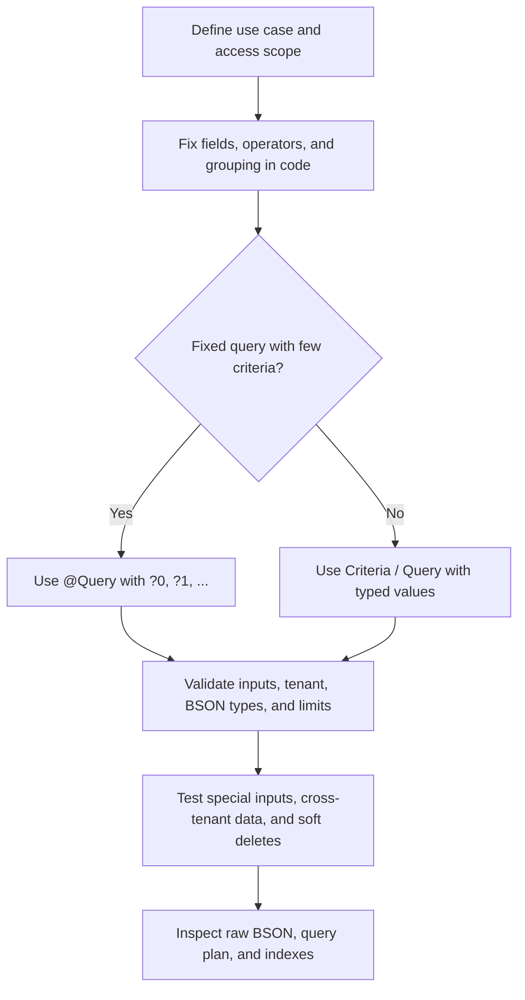

# Safe Parameter Passing Instead of Concatenating JSON Strings from Input

Spring Data MongoDB lets you write MongoDB queries in JSON via `@Query`, or build queries using `Criteria` and `MongoTemplate`. Both are useful when queries outgrow a repository method derived from its name. A common mistake, however, is **concatenating JSON strings directly from user data**. If an application splices raw client-supplied fragments into a query structure, MongoDB can interpret those fragments as **operators** rather than comparison values.

For example, suppose an API specifies finding orders with `status = "ACTIVE"`. If the server concatenates input into a JSON query string, a client could send `{"$ne": "ARCHIVED"}`, turning an equality filter into a **not-equal** filter. In a multi-tenant system, an improperly constructed query can even bypass tenant data-isolation filters.

Within the **JSON Queries** chapter, this lesson focuses on **keeping query structure controlled by the application while binding inputs as typed data values**. That forms the foundation before building complex queries, aggregations, indexes, and tests with `MongoRepository` or `MongoTemplate` in Spring Data MongoDB.

After this lesson, you will be able to:

- Explain the risk of **MongoDB query/operator injection** when concatenating raw input into JSON queries.
- Bind parameters in `@Query` using `?0`, `?1` and pass proper Java types.
- Build dynamic queries using `Criteria`, `Query`, and `MongoTemplate` without string-assembled JSON.
- Guard parts that cannot be bound—such as field names, operators, sorts, projections, and SpEL expressions.
- Distinguish literal text search from user-supplied regular expressions.
- Test queries against adversarial inputs, tenant boundaries, soft-deleted records, and BSON types.

## 1. JSON Queries Are Meaningful Structures, Not Plain Strings

In MongoDB, these two filters are **logically different**:

```javascript
// Equality comparison: returns only documents with status = "ACTIVE".
db.orders.find({
  status: "ACTIVE"
});

// Inequality comparison: returns documents with status != "ARCHIVED"
// (and in many cases documents missing the status field).
db.orders.find({
  status: { $ne: "ARCHIVED" }
});
```

`"ACTIVE"` is a **BSON String value**. `{ "$ne": "ARCHIVED" }` is a **condition document** containing a MongoDB operator. If an application lets client input decide whether the `status` position holds a String or an operator document, the client has gained control over query semantics.

That is the root cause of **operator injection**: untrusted data gets interpreted as query structure. Using MongoDB does not eliminate injection risks; it simply takes a different shape from familiar SQL injection.

### Two Boundaries to Protect

| Query Component | Who Should Decide It? | Examples |
| --- | --- | --- |
| **Collection/field name** | Application code or allowlisted fields | `tenantId`, `status` |
| **Operators and grouping** | Application code | `$eq`, `$in`, `$and`, `$or` |
| **Comparison values** | May come from client after API contract validation | `"ACTIVE"`, `50000L` |
| **Access scope** | Trusted authentication/authorization context | Current tenant, order read permission |
| **Sort, projection, limit** | Code or bounded valid choices | Sort by `createdAt`, cap at 50 results |

**Principle:** clients may supply **values** in predefined slots; they must never write arbitrary MongoDB filters, unrestricted field names, or uncontrolled operators.

## 2. Dangerous Pattern: Concatenating JSON Strings into a Query

Suppose an API accepts a `rawStatusJson` string and splices it into JSON:

```java
import org.springframework.data.mongodb.core.MongoTemplate;
import org.springframework.data.mongodb.core.query.BasicQuery;

// DANGEROUS EXAMPLE: strictly to illustrate a design flaw.
public List<OrderRecord> unsafeSearch(
        MongoTemplate template, String rawStatusJson) {

    String json = "{\"status\":" + rawStatusJson + "}";
    return template.find(new BasicQuery(json), OrderRecord.class);
}
```

This snippet accepts **a client-written JSON fragment** in a spot intended solely for a status value. If the client sends:

```text
"ACTIVE"
```

the generated query is `{"status":"ACTIVE"}`. Yet if the client sends:

```json
{"$ne":"ARCHIVED"}
```

the generated query becomes:

```json
{"status":{"$ne":"ARCHIVED"}}
```

The operator has been altered silently without the code noticing. String concatenation also breaks JSON syntax when strings contain double quotes, backslashes, or escape sequences. Testing only normal inputs in unit tests usually misses this flaw.

**The same flaw in another form:**

```java
// DANGEROUS: letting the client supply a complete JSON filter.
Document filter = Document.parse(untrustedRequestBody);
mongoTemplate.getCollection("orders").find(filter);
```

`Document.parse` turns text into a BSON document, which **does not make an arbitrary query expression safe**. Successful parsing only means valid syntax. When an API's goal is "filter by status only", letting a client pass an entire `Document` expands query capabilities beyond the contract.

### 2.1. Are Manual Quotes and Escaping Enough?

Some code attempts to patch this by adding quotes around the value:

```java
// Still discouraged: data may contain characters needing escaping and is error-prone.
String json = "{\"status\":\"" + statusFromRequest + "\"}";
```

This breaks on inputs like `A"B` or strings containing backslashes; writing a complete, bug-free JSON escaper by hand is unnecessary effort when the framework provides binding. Even after escaping values, if an application still lets clients pick **field names** or **operators** arbitrarily, query-semantics tampering remains possible.

To fix the problem at its root, **do not construct JSON syntax from input**. Use Spring Data binding or a typed query builder.

## 3. Solution One: Binding Parameters with `@Query`

### 3.1. Entity and Repository

Suppose collection `json_query_orders` has `tenantId`, `status`, `totalMinor`, `deleted`, and `createdAt`:

```java
import java.time.Instant;
import org.bson.types.ObjectId;
import org.springframework.data.annotation.Id;
import org.springframework.data.mongodb.core.mapping.Document;

@Document(collection = "json_query_orders")
public class OrderRecord {
    @Id
    private ObjectId id;
    private String tenantId;
    private String status;
    private long totalMinor;
    private boolean deleted;
    private Instant createdAt;

    protected OrderRecord() {}

    public OrderRecord(
            String tenantId, String status,
            long totalMinor, boolean deleted) {
        this.tenantId = tenantId;
        this.status = status;
        this.totalMinor = totalMinor;
        this.deleted = deleted;
        this.createdAt = Instant.now();
    }

    public ObjectId getId() { return id; }
    public String getTenantId() { return tenantId; }
    public String getStatus() { return status; }
    public long getTotalMinor() { return totalMinor; }
    public boolean isDeleted() { return deleted; }
}
```

The repository declares a **fixed** JSON query using placeholders:

```java
import java.util.List;
import org.bson.types.ObjectId;
import org.springframework.data.mongodb.repository.MongoRepository;
import org.springframework.data.mongodb.repository.Query;

public interface OrderRecordRepository
        extends MongoRepository<OrderRecord, ObjectId> {

    @Query("{ 'tenantId': ?0, 'status': ?1, 'deleted': false }")
    List<OrderRecord> findVisibleByTenantAndStatus(
        String tenantId, String status);
}
```

`?0` and `?1` reference method parameters **positionally, starting at 0**. Spring Data binds them as values instead of copying raw client text into JSON syntax. Given Java `String` input `"{\"$ne\":\"ARCHIVED\"}"`, the system looks for **a status String containing those exact characters**; the string does not become a `$ne` operator.

| Component | Controlled By | Effect |
| --- | --- | --- |
| `'tenantId'` | Static query in source code | Field scoping the tenant |
| `?0` | First Java parameter | Bound tenant value |
| `'status'` | Static query | Field filtering status |
| `?1` | Second Java parameter | Bound status value |
| `'deleted': false` | Static query | Excludes soft-deleted documents |

Safe binding **does not automatically verify authorization**. `tenantId` must be obtained or validated from the server's authorization context. If a client can pass any tenant ID and the server trusts it, the query will still read unauthorized data even without injection.

### 3.2. Use Proper Java Types Instead of Serializing to JSON Manually

Example retrieving a tenant's orders with total amount at or above a threshold:

```java
@Query("{ 'tenantId': ?0, 'totalMinor': { '$gte': ?1 }, 'deleted': false }")
List<OrderRecord> findVisibleWithMinimumTotal(
    String tenantId, long minimumMinor);
```

`minimumMinor` is a `long`, so it binds with the matching numeric type; there is no need to turn it into `"50000"` and splice it into JSON. MongoDB distinguishes BSON Strings from BSON numbers in filters, so type mismatches can silently miss expected documents.

To filter by a set of statuses, define the `$in` operator in source code:

```java
import java.util.Collection;

@Query("{ 'tenantId': ?0, 'status': { '$in': ?1 }, 'deleted': false }")
List<OrderRecord> findVisibleWithStatuses(
    String tenantId, Collection<String> statuses);
```

The client submits a list of **status values**; the application validates each value and binds the collection. The client never decides operator names via arbitrary JSON strings.

### 3.3. Binding and Validating Status Parameters

Suppose business rules support only `ACTIVE`, `DRAFT`, and `ARCHIVED`. You can constrain inputs at the service boundary:

```java
import java.util.Set;

private static final Set<String> ALLOWED_STATUSES =
    Set.of("ACTIVE", "DRAFT", "ARCHIVED");

public List<OrderRecord> searchOrders(
        String trustedTenantId, String requestedStatus) {

    if (requestedStatus == null
            || !ALLOWED_STATUSES.contains(requestedStatus)) {
        throw new IllegalArgumentException("Invalid status");
    }

    return orderRepository.findVisibleByTenantAndStatus(
        trustedTenantId, requestedStatus
    );
}
```

This snippet **sketches a service method** assuming `orderRepository` is injected and `trustedTenantId` is server-resolved. Validation enforces the business contract; binding preserves the boundary between **values** and **query syntax**. The two layers complement each other rather than replacing one another.

### 3.4. Where Not to Feed Raw Input into `@Query`

Never concatenate input into query annotations, never replace placeholders via manual `String.replace` on JSON, and never attempt to construct `@Query` contents from request data. Annotations are built for **developer-defined static query structures**. For dynamic criteria, use `MongoTemplate` and `Criteria` covered next.

## 4. Solution Two: `Criteria` and `MongoTemplate`

`MongoTemplate` builds queries programmatically, keeping operators and field names in Java code:

```java
import java.util.List;
import org.springframework.data.mongodb.core.MongoTemplate;
import org.springframework.data.mongodb.core.query.Criteria;
import org.springframework.data.mongodb.core.query.Query;

public List<OrderRecord> findWithStatus(
        MongoTemplate template, String trustedTenantId, String status) {

    Query query = Query.query(
        Criteria.where("tenantId").is(trustedTenantId)
            .and("status").is(status)
            .and("deleted").is(false)
    );
    return template.find(query, OrderRecord.class);
}
```

`Criteria.where(...).is(status)` takes a **Java value**. It does not parse `status` as JSON query fragments. Thanks to `OrderRecord.class`, Spring Data also applies entity mapping metadata such as `@Field("...")` renames.

### 4.1. Optional Filters

If clients may optionally filter by status, minimum total, and maximum total, assemble the query from **predefined** branches:

```java
import org.springframework.data.mongodb.core.query.Criteria;
import org.springframework.data.mongodb.core.query.Query;

public Query buildOrderQuery(
        String trustedTenantId,
        String status,
        Long minimumMinor,
        Long maximumMinor) {

    if (minimumMinor != null && minimumMinor < 0) {
        throw new IllegalArgumentException("Minimum value is negative");
    }
    if (maximumMinor != null && maximumMinor < 0) {
        throw new IllegalArgumentException("Maximum value is negative");
    }
    if (minimumMinor != null && maximumMinor != null
            && minimumMinor > maximumMinor) {
        throw new IllegalArgumentException("Invalid value range");
    }

    Criteria base = Criteria.where("tenantId").is(trustedTenantId)
        .and("deleted").is(false);

    if (status != null && !status.isBlank()) {
        base.and("status").is(status);
    }

    if (minimumMinor != null || maximumMinor != null) {
        Criteria amount = base.and("totalMinor");
        if (minimumMinor != null) {
            amount.gte(minimumMinor);
        }
        if (maximumMinor != null) {
            amount.lte(maximumMinor);
        }
    }

    return Query.query(base);
}
```

Status validation can live in the service or input DTO; this example focuses on **building typed criteria safely**. When an optional parameter is absent, you simply **do not add** that criterion. The `$gte`/`$lte` operators are fixed in code while the client supplies only `Long` values.

### 4.2. Safe `AND` / `OR` Grouping

Suppose we want orders belonging to the current tenant that satisfy either `status = ACTIVE` **or** `totalMinor >= 50000`:

```java
Criteria alternatives = new Criteria().orOperator(
    Criteria.where("status").is("ACTIVE"),
    Criteria.where("totalMinor").gte(50000L)
);

Criteria scoped = new Criteria().andOperator(
    Criteria.where("tenantId").is(trustedTenantId),
    Criteria.where("deleted").is(false),
    alternatives
);

Query query = new Query(scoped);
List<OrderRecord> result =
    template.find(query, OrderRecord.class);
```

Equivalent BSON:

```javascript
{
  tenantId: "T1",
  deleted: false,
  $or: [
    { status: "ACTIVE" },
    { totalMinor: { $gte: 50000 } }
  ]
}
```

In queries using `$or`, tenant/authorization and soft-delete conditions must apply to **every branch**. Combining `andOperator` with `orOperator` keeps grouping unambiguous as expressions grow.

## 5. Input Data Types: Strings, Numbers, ObjectIds, and Lists

**Parameter binding** protects the boundary between query syntax and values, yet you must still pick the **right data types** so MongoDB matches documents accurately.

| Filtered Data | Java Type to Consider | Notes |
| --- | --- | --- |
| `status`, `sku`, `tenantId` | `String` or controlled enum | Validate against allowed values and tenant permissions |
| Money in smallest currency unit | `long` / `Long` | Never turn numbers into Strings and concatenate JSON |
| `_id` BSON ObjectId | `ObjectId` | Validate string format before converting |
| List of statuses | `Collection<String>` | Cap element count and validate values |
| BSON Date timestamps | `Instant` or supported time type | Standardize timezone/resolution; use clear instant semantics |
| Regex search | Server-built `Pattern` | Escape literal inputs; enforce length limits |

### 5.1. Parsing ObjectId at the API Boundary

When `OrderRecord.id` is an `ObjectId`, accept the path ID string and parse it once:

```java
import org.bson.types.ObjectId;

public ObjectId parseOrderId(String rawId) {
    if (rawId == null || !ObjectId.isValid(rawId)) {
        throw new IllegalArgumentException("Invalid ID format");
    }
    return new ObjectId(rawId);
}
```

Then query using the proper ID type:

```java
Query query = Query.query(
    Criteria.where("_id").is(parseOrderId(rawId))
        .and("tenantId").is(trustedTenantId)
        .and("deleted").is(false)
);

OrderRecord order = template.findOne(query, OrderRecord.class);
```

`ObjectId.isValid` only checks **format**, not whether the document exists or the user has access. At the API layer, malformed IDs can map to HTTP 400; valid IDs that are missing or unauthorized must follow the system's error policy without leaking sensitive existence info.

### 5.2. Do Not Let Clients Send Operators Instead of Values

Never design an API like:

```json
{
  "field": "totalMinor",
  "operator": "$gte",
  "value": 50000
}
```

and feed every piece directly into MongoDB when the endpoint's goal is merely searching by a predefined price range. Flexible query APIs **can** support allowlisted operators, but the server must strictly validate fields, operators, value types, access scope, condition counts, and complexity. In typical cases, explicit DTOs like `minimumMinor` and `maximumMinor` are safer and easier to maintain.

**Never convert a request `Map<String, Object>` straight into a `Document` filter** when clients are not authorized to write MongoDB queries. The fact that a library can serialize a map to BSON does not render embedded operators harmless.

## 6. Literal Search: Avoid Turning Input into Arbitrary Regex

Suppose a user enters `"C++"` wanting product names **containing those exact characters**. In regex, `+` has special meaning; inputs like `.*` can match huge numbers of documents if treated as regular expressions.

Error-prone pattern:

```java
// Unsuitable for a "literal substring" requirement.
Query query = Query.query(
    Criteria.where("title").regex(userKeyword, "i")
);
```

When `userKeyword` is evaluated as regex, users can accidentally or deliberately alter **search pattern semantics**. Complex or long patterns can also consume substantial CPU.

If the API only intends **literal string matching**, escape metacharacters and cap length first:

```java
import java.util.regex.Pattern;
import org.springframework.data.mongodb.core.query.Criteria;
import org.springframework.data.mongodb.core.query.Query;

public Query titleContainsLiteral(
        String trustedTenantId, String input) {

    if (input == null || input.isBlank()
            || input.length() > 80) {
        throw new IllegalArgumentException("Invalid keyword");
    }

    Pattern literal = Pattern.compile(
        Pattern.quote(input.trim()),
        Pattern.CASE_INSENSITIVE
    );

    return Query.query(
        Criteria.where("tenantId").is(trustedTenantId)
            .and("deleted").is(false)
            .and("title").regex(literal)
    );
}
```

`Pattern.quote(...)` ensures `C++`, `.*`, and `(x)` are treated as **literal characters**, not regex operators. Verify Java `Pattern` translation and BSON regex options with integration tests on your MongoDB stack.

**Performance consideration:** unanchored substring regexes or case-insensitive regexes struggle to use B-tree indexes efficiently. When large-scale text search is needed, consider dedicated search indexes or search engines; cap keyword length, cap results, and inspect `explain`. Escaping regex preserves **correctness**, not speed.

## 7. Field Names, Sorts, and Operations Cannot Be Bound Like Values

In `@Query("{ 'status': ?0 }")`, `?0` is a **value**. It is not a mechanism for users to swap the field name to `totalMinor` or swap `$eq` to `$ne`.

A search API may allow sorting by one of several fields. Use an **allowlist mapping public names to Java properties**:

```java
import java.util.Map;
import org.springframework.data.domain.Sort;
import org.springframework.data.mongodb.core.query.Query;

private static final Map<String, String> SORT_FIELDS = Map.of(
    "created", "createdAt",
    "amount", "totalMinor",
    "status", "status"
);

public Query applySortAndLimit(
        Query query, String requestedSort, int requestedLimit) {

    String property = SORT_FIELDS.get(requestedSort);
    if (property == null) {
        throw new IllegalArgumentException("Unsupported sort");
    }

    int limit = Math.min(Math.max(requestedLimit, 1), 100);
    return query
        .with(Sort.by(Sort.Direction.DESC, property))
        .limit(limit);
}
```

Here `"amount"` from the API maps to Java property `totalMinor` on the entity; the client never names arbitrary BSON fields. For paginated endpoints, add a deterministic tie-breaker (such as `_id` where appropriate) to avoid page drift.

Likewise, if an API allows selecting **projection** or filter fields, define an explicit allowlist of exposed fields. Never pass client-provided paths directly into `Criteria.where(userField)`, `Sort.by(userField)`, or `query.fields().include(userField)` unless the API intentionally governs those paths.

## 8. Be Cautious with SpEL in `@Query`

Spring Data MongoDB supports SpEL expressions inside queries to compute values or build flexible expressions. Because SpEL is powerful, distinguish three cases:

- **Simple value binding** with `?0`, `?1`: suitable for most cases, easy to review and test.
- **Developer-written SpEL where inputs act strictly as values**: valid when specific expressions are needed; verify exact Spring Data evaluation and BSON conversion.
- **Client-supplied SpEL expressions executed on the server**: never allow. Clients must never dictate expression code evaluated by the server.

A common SpEL syntax in repository queries is `?#{[0]}` referencing the first parameter. It is unnecessary if you only want to bind `status`; `?0` is clearer:

```java
@Query("{ 'status': ?0 }")
List<OrderRecord> findByStatusSafely(String status);
```

When using advanced SpEL to shape query structure, audit any expression that touches untrusted inputs and verify the resulting query. Never use SpEL, template engines, or string concatenation as a backdoor allowing clients to inject raw JSON operators.

## 9. Access Scoping Is Just as Critical as Binding

Suppose a multi-tenant platform has an authenticated user from tenant `T1` requesting status `ACTIVE`. The right query is:

```javascript
{
  tenantId: "T1",
  status: "ACTIVE",
  deleted: false
}
```

**Binding prevents `status` from turning into an operator**, yet it does not guard `tenantId` by itself. Tenant identity must come from authenticated session/token claims and server-side access checks, never blindly from URL/body parameters.

Pay special attention to `$or` queries:

```javascript
// WRONG: the second branch can return other tenants' records.
{
  $or: [
    { tenantId: "T1", status: "ACTIVE" },
    { totalMinor: { $gte: 50000 } }
  ]
}

// RIGHT: tenant scope applies to every branch.
{
  tenantId: "T1",
  deleted: false,
  $or: [
    { status: "ACTIVE" },
    { totalMinor: { $gte: 50000 } }
  ]
}
```

Both queries can bind parameters safely yet differ drastically in **access scope**. Always test injection resistance alongside logical grouping, soft-delete filters, authorization, and cross-tenant data.

### 9.1. Read APIs vs. Write APIs

Securing read queries does not automatically secure updates or deletes. For instance, when advancing an order's status, include tenant and current state in the update filter:

```java
Query query = Query.query(
    Criteria.where("_id").is(orderId)
        .and("tenantId").is(trustedTenantId)
        .and("status").is("DRAFT")
        .and("deleted").is(false)
);

Update update = new Update().set("status", "CONFIRMED");
long changed = template.updateFirst(
    query, update, OrderRecord.class
).getModifiedCount();
```

On a single document, the filter and `$set` execute atomically. Enforce allowed state transitions in the service/domain layer and check `changed` to handle concurrent modifications. `@Query` on repositories handles queries; update commands need their own explicit safeguards.

## 10. Hands-on with `mongosh`: String Values vs. Operators Yield Different Results

To verify query behavior, create an isolated dataset and run equivalent filters. This example uses `json_query_orders` in the **test** database `spring_data_training`, tagging each session with `runId` to avoid colliding with other runs.

### 10.1. Creating Isolated Data

```javascript
use spring_data_training

const lab = db.getCollection("json_query_orders");
const runId = "json-queries-008-" + new ObjectId().toHexString();
const t1 = runId + "-T1";
const t2 = runId + "-T2";

const inserted = lab.insertMany([
  {
    runId: runId, tenantId: t1, status: "ACTIVE",
    totalMinor: NumberLong("40000"), deleted: false
  },
  {
    runId: runId, tenantId: t1, status: "DRAFT",
    totalMinor: NumberLong("60000"), deleted: false
  },
  {
    runId: runId, tenantId: t1, status: "ARCHIVED",
    totalMinor: NumberLong("70000"), deleted: false
  },
  {
    runId: runId, tenantId: t2, status: "ACTIVE",
    totalMinor: NumberLong("80000"), deleted: false
  },
  {
    runId: runId, tenantId: t1, status: "ACTIVE",
    totalMinor: NumberLong("90000"), deleted: true
  }
]);

printjson(inserted.insertedIds);
print(lab.countDocuments({ runId: runId })); // Expected: 5
```

Run the remaining steps **in the same `mongosh` session** to reuse `lab`, `runId`, `t1`, and `t2`.

### 10.2. Searching a Normal Value

```javascript
lab.find({
  runId: runId,
  tenantId: t1,
  status: "ACTIVE",
  deleted: false
}).toArray();
// Expected: one ACTIVE document, 40000.
```

### 10.3. JSON-Like String Remains a Literal String

```javascript
const typedAsString = '{"$ne":"ARCHIVED"}';

lab.find({
  runId: runId,
  tenantId: t1,
  status: typedAsString,
  deleted: false
}).toArray();
// Expected: [] — no document has this literal string as status.
```

This matches binding a `String` through `@Query` or `Criteria.is(...)`. The value contains `{`, `}`, and `$ne` characters yet **is not turned into an operator**.

### 10.4. Comparing Against an Operator Filter

```javascript
lab.find({
  runId: runId,
  tenantId: t1,
  status: { $ne: "ARCHIVED" },
  deleted: false
}).toArray();
// Expected: two documents, ACTIVE and DRAFT.
```

On the same dataset, literal String matching returns **0** while the `$ne` expression returns **2**. That demonstrates clearly why request input must never dictate query structure.

### 10.5. Checking Tenant and Soft-Delete Conditions

```javascript
lab.find({
  runId: runId,
  tenantId: t1,
  deleted: false,
  $or: [
    { status: "ACTIVE" },
    { totalMinor: { $gte: NumberLong("50000") } }
  ]
}).toArray();
// Expected: ACTIVE 40000, DRAFT 60000, and ARCHIVED 70000.
// No documents from t2 or with deleted = true.
```

Logic check: the `ARCHIVED` record appears because its total exceeds the threshold in the second branch. If business rules require excluding `ARCHIVED` unconditionally, add that condition to the **outer AND group outside `$or`**. Injection-free queries do not guarantee business-logic correctness.

### 10.6. Cleaning Up Practice Session Data

```javascript
const countToDelete = lab.countDocuments({ runId: runId });
print("Number of documents in this run: " + countToDelete);

const cleanup = lab.deleteMany({ runId: runId });
printjson({ deletedCount: cleanup.deletedCount });
```

Delete only documents matching `runId`. Never run `deleteMany({})` or `drop()` on a shared collection. If you want to inspect the data in Compass, run cleanup after inspecting.

## 11. Integration Testing `@Query` with Special Inputs

A unit test asserting only that the service calls the repository with expected arguments **does not prove** the final query is safe and returns the right documents. Integration tests must insert documents into real MongoDB or Testcontainers and assert **returned document sets**.

### 11.1. Cases to Test

| Input Group | Example | Expected Outcome |
| --- | --- | --- |
| Valid value | `"ACTIVE"` | Returns only ACTIVE records in the authorized tenant |
| Operator-looking string | `{"$ne":"ARCHIVED"}` as String | Literal comparison; not interpreted as `$ne` |
| String with quotes | `A"B` | No syntax errors from string concatenation |
| String with backslashes | `a\\b` | Bound as data without altering JSON structure |
| Non-enum value | `"ACTIVE_OR_ANYTHING"` | Rejected by validation if API restricts statuses |
| Different tenant | Record with same status in T2 | Never returned when caller belongs to T1 |
| Soft-deleted | `deleted = true` | Never returned |
| Boundary numbers | `minimumMinor = 0`, `-1` | Enforces validation rules and numeric types |
| Special regex characters | `.*`, `C++` | Literal match if API is designed for literal text search |
| Invalid sort | `"__unknown__"` | Rejected by allowlist; never becomes an arbitrary field |

### 11.2. Spring Boot Test and JUnit 5 Example

This example uses the repository from section 3 and a **test-only** MongoDB instance. `@DataMongoTest` needs test connection settings matching your Spring Boot version.

```java
import static org.junit.jupiter.api.Assertions.*;

import java.util.List;
import java.util.UUID;
import org.junit.jupiter.api.Test;
import org.springframework.beans.factory.annotation.Autowired;
import org.springframework.boot.test.autoconfigure.data.mongo.DataMongoTest;

@DataMongoTest
class SafeJsonQueryTest {
    @Autowired
    private OrderRecordRepository repository;

    @Test
    void bindsClientStatusAsLiteralAndKeepsTenantBoundary() {
        String tenant1 = "T1-" + UUID.randomUUID();
        String tenant2 = "T2-" + UUID.randomUUID();

        List<OrderRecord> saved = repository.insert(List.of(
            new OrderRecord(tenant1, "ACTIVE", 40000L, false),
            new OrderRecord(tenant1, "DRAFT", 60000L, false),
            new OrderRecord(tenant2, "ACTIVE", 80000L, false),
            new OrderRecord(tenant1, "ACTIVE", 90000L, true)
        ));

        try {
            List<OrderRecord> visible =
                repository.findVisibleByTenantAndStatus(
                    tenant1, "ACTIVE"
                );
            assertEquals(1, visible.size());
            assertEquals(tenant1, visible.get(0).getTenantId());
            assertFalse(visible.get(0).isDeleted());

            String operatorLookingString =
                "{\"$ne\":\"ARCHIVED\"}";
            List<OrderRecord> noInjection =
                repository.findVisibleByTenantAndStatus(
                    tenant1, operatorLookingString
                );

            assertTrue(noInjection.isEmpty());
        } finally {
            repository.deleteAllById(
                saved.stream().map(OrderRecord::getId).toList()
            );
        }
    }
}
```

In this example, the test creates same-tenant records with other statuses, a cross-tenant record, and a soft-deleted record. If binding ever turned the String into an operator, `noInjection.isEmpty()` would fail. Tests must run with your application's actual conversion/mapping configuration; the snippet above is instructional material and **was not executed during authoring**.

When querying by ID, timestamp, list, or custom converters, add tests verifying **exact BSON types**. Do not rely solely on how values look as JSON: ObjectId and String can look identical as hex yet are distinct BSON types.

### 11.3. Inspecting JSON Queries at the MongoDB Layer

When tests fail, use test data and `mongosh` to run the equivalent query. Compare:

1. **Filter structure**: do fields and operators match expectations?
2. **BSON value types**: is status a String, are numbers Long/Int32 per contract, and are IDs ObjectId if designed that way?
3. **Condition grouping**: do tenant and soft-delete filters apply to all `$or` branches?
4. **Negative cases**: did any unauthorized or excluded documents slip through?

To view actual application queries, enable Spring Data MongoDB query logging at an appropriate level in **test environments**. Avoid logging sensitive data and never enable verbose query logging indiscriminately in production.

## 12. Indexes and Performance with Parameter Binding

Binding does not slow queries down by any fixed overhead, nor does it solve indexing on its own. A safe, valid query still scans many documents if it lacks a matching index.

For a frequent query pattern:

```javascript
{
  tenantId: "T1",
  status: "ACTIVE",
  deleted: false
}
```

consider a compound index (on a test collection):

```javascript
db.json_query_orders.createIndex(
  { tenantId: 1, deleted: 1, status: 1 },
  { name: "idx_tenant_deleted_status" }
);
```

Evaluate with:

```javascript
db.json_query_orders.find({
  tenantId: "ACTUAL_TENANT",
  deleted: false,
  status: "ACTIVE"
}).explain("executionStats");
```

Substitute an actual tenant present in your test dataset. Check `winningPlan`, `totalKeysExamined`, `totalDocsExamined`, and returned counts. With only a handful of documents, MongoDB may choose a collection scan because it is cheaper; never draw performance conclusions from tiny datasets.

For large `$in` filters, unanchored regexes, or unindexed sorts, cap condition sizes, cap results, and benchmark under realistic load. **Query structure safety**, **business correctness**, and **performance** are three distinct properties that must each be verified independently.

## 13. Common Mistakes and How to Handle Them

| Symptom | Cause | Resolution |
| --- | --- | --- |
| Input containing `$ne` returns extra data | Parsed raw JSON/Map from client as a filter | Accept only scalar/list DTO fields; use `@Query` binding or `Criteria` |
| Quotes in input cause query error | Manual JSON string concatenation | Pass parameters as values; eliminate string concatenation |
| `@Query` returns another tenant's data | Client tenant unchecked or misplaced in `$or` | Use server-trusted tenant and verify logical grouping |
| Invalid statuses still queried | Missing business validation | Enforce enum/allowlist and fail with clear input errors |
| ObjectId lookup finds nothing | Matching BSON ObjectId with String or vice versa | Parse IDs explicitly and verify BSON types |
| Numeric query misses records | Sent String instead of number, or mixed DB types | Use Java numeric types and standardize BSON schema |
| Input `.*` matches every name | Passed input directly as regex | `Pattern.quote` for literal search; enforce length caps |
| Sort by arbitrary field | Passed client field name directly | Use allowlist mapped to Java properties |
| Legacy records have different format | Reading converter works, but query misses legacy representation | Check `$type`, migrate data, and test both representations |
| Query is safe yet slow | Missing index, expensive regex, huge `$in` list | Run `explain`, cap results, and verify indexes |
| Using SpEL on client expressions | Letting untrusted data shape evaluated expressions | Never evaluate client-supplied expressions; prefer `?0`/`Criteria` |

## 14. Workflow for Designing a Safe JSON Query



Follow in order:

1. **Define the API contract**: which values and types may clients send, and what determines access scope?
2. **Keep query structure on the server**: fields, operators, and `AND`/`OR` grouping never come directly from raw input.
3. **Bind values**: use `?0`/`?1` in `@Query` or `Criteria`/`Query` with matching Java types.
4. **Validate and bound**: status allowlists, collection size caps, string lengths, regex, sorts, and result limits.
5. **Preserve access scope**: tenant/soft-delete criteria apply to every branch; object IDs never replace authorization.
6. **Test negative cases**: operator-like JSON inputs, quotes, regex metacharacters, cross-tenant records, and soft-deleted documents.
7. **Measure and observe**: inspect actual BSON outputs, indexes, and `explain("executionStats")` for performance-sensitive paths.

## 15. Self-Practice Exercises

**Exercise 1 — Spot the injection point.** Given `new BasicQuery("{\"status\":" + request.getStatus() + "}")`, explain why the String `"{\"$ne\":\"ARCHIVED\"}"` alters query meaning when spliced as a JSON fragment. Rewrite using `@Query` and `?0`.

**Exercise 2 — Bind multiple parameters.** Write a repository query finding orders by tenant, `status`, `minimumMinor`, and `deleted = false`. Use `?0`, `?1`, `?2`; do not turn the monetary amount into a JSON string.

**Exercise 3 — Dynamic filters.** Build a `MongoTemplate` query taking a trusted tenant, optional status, optional total range, and a limit of 50 results. Validate the case where minimum exceeds maximum.

**Exercise 4 — Filter multiple statuses.** Write a `@Query` with `$in` accepting `Collection<String>`. Restrict allowed statuses and input element count; explain why the client should never send `{"$in":[...]}`.

**Exercise 5 — Literal string search.** An API must find product names containing literal `"C++"` or `".*"`. Write a query using `Pattern.quote` and analyze performance at millions of documents.

**Exercise 6 — Sort allowlist.** Let clients pick `created` or `amount`, mapping to `createdAt` or `totalMinor`. Throw an error for any other value. Clamp limit to 1–100.

**Exercise 7 — Tenant and OR.** A query filters `(tenant=T1 AND status=ACTIVE) OR (totalMinor >= 50000)`. Show how it can leak T2 records. Rewrite using `Criteria.andOperator`/`orOperator` so tenant applies to all branches.

**Exercise 8 — Integration test.** Seed ACTIVE, DRAFT, cross-tenant, and soft-deleted orders. Call `@Query` with `status = "{\"$ne\":\"ARCHIVED\"}"` as a String; assert empty results. Then pass ACTIVE and assert only valid tenant orders return.

**Exercise 9 — Verify mapping.** An entity declares `@Field("order_status") String status`. Compare a `MongoTemplate` query using the Java property against a raw `mongosh` filter using the BSON field. Explain why safe binding does not compensate for wrong field names.

### Key Takeaways

**Keep MongoDB query syntax in code and pass inputs as typed values.** `@Query` with `?0`/`?1` and `MongoTemplate` with `Criteria` prevent user data from becoming JSON operators. At the same time, constrain fields, sorts, regexes, query sizes, verify BSON types, and enforce tenant/authorization filters. A query is only trustworthy when it has **the right structure, the right access scope, the right types, and tests covering adversarial inputs**.
