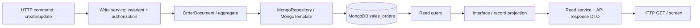

# Separating the Read Model from the Write Entity

A MongoDB document designed to support **persisting and updating business state** often contains more data than a screen or GET API needs to return. For example, an order document has line items, a shipping address, status, version, internal notes, and payment information; an order list screen only needs the **ID, status, total amount, and creation date**.

In **Spring Data MongoDB**, **projection** and **DTO (Data Transfer Object)** allow you to separate the **read model** from the entity used for writing. Instead of fetching the entire aggregate and returning it directly over the API, you describe a data structure tailored to each read requirement. Spring Data can help optimize the queried fields, reduce the payload from MongoDB, and lower the risk of accidentally exposing internal fields.

This lesson belongs to the **Projection and DTO** chapter of the `SPRING_DATA_MONGODB` module: connecting, document mapping, operating with `MongoTemplate` or repositories; designing queries, aggregations, indexes, transactions, reactive access, testing, and performance diagnostics. The goal is to build a clean read flow **without breaking the update semantics of the aggregate**.

> **Rule:** A projection/DTO is a **read-result model**, not an entity "missing a few fields" to be passed back to `save` in the database. Field selection helps performance, while **authorization and data protection** must still be enforced at the service and API layers.

## 1. Learning Objectives

After this lesson, you will be able to:

1. Distinguish between **write model/aggregate**, **read projection**, **API response DTO**, and **the BSON structure retrieved from the server**.
2. Choose closed interface projection, open projection, class/record DTO, or manual mapping according to your needs.
3. Write repository methods returning projections, use `@Query(fields = …)`, dynamic projections, and projections with `Pageable`.
4. Use `MongoTemplate.query(DomainType.class).as(ReadType.class)` to select a read model independent of the entity.
5. Understand field inclusion/exclusion, `@Field` aliases, `_id`, nested objects, and query optimization limits.
6. Explain why you must not call `save` on a partially loaded entity.
7. Design projections for lists, details, aggregation reports, and multi-user APIs.
8. Test mapping, inspect raw BSON, measure `explain` and latency, and avoid leaking internal data.

## 2. Why Not Use a Single Entity for Both Reading and Writing?

Suppose you have an order management application. The write entity contains all the information needed to validate state transitions, complete payment, or change the shipping address. However, a list screen only displays a few columns.



When **reusing the write entity as the response**, you easily run into three groups of problems:

| Aspect | Using the same entity everywhere | Separating the read model |
| --- | --- | --- |
| **Performance** | May load large embedded objects, long arrays, and unused fields. | Can request MongoDB to return only the required fields. |
| **API contract** | Changing internal fields alters JSON if a control layer is missing. | The API is defined by a dedicated DTO that can be versioned. |
| **Security** | Easy to accidentally serialize internal notes or tokens. | Field whitelisting on the DTO, combined with authorization and response tests. |
| **Write correctness** | Partial entities can easily be written back, causing data loss. | The read model has no `save` path; a separate write model enforces invariants. |
| **Maintainability** | Every list/detail requirement pulls more fields into the aggregate. | Each read view serves its exact use case. |
| **Schema evolution** | The UI is coupled to the storage structure. | There is a conversion/adapter layer between BSON and the public response. |

This is an **application-level read/write model separation** (sometimes called *CQRS-lite*). It does **not** mean you have to create two databases, a message broker, or event sourcing. Both flows can still read from and write to **the same collection** with Spring Data MongoDB.

## 3. Data Example: One Write Entity, Multiple Read Models

### 3.1. The Write Model Is an Aggregate with Full State

```java
package dev.learning.orders;

import java.time.Instant;
import java.util.List;

import org.springframework.data.annotation.Id;
import org.springframework.data.annotation.Version;
import org.springframework.data.mongodb.core.mapping.Document;
import org.springframework.data.mongodb.core.mapping.Field;

@Document("sales_orders")
public record OrderDocument(
        @Id String id,
        String customerId,
        String status,
        @Field("total_cents") long totalCents,
        Instant createdAt,
        ShippingAddress shippingAddress,
        List<OrderLine> lines,
        @Version Long version,
        String internalNote,
        String paymentToken) {

    public OrderDocument withStatus(String nextStatus) {
        return new OrderDocument(
                id, customerId, nextStatus, totalCents, createdAt,
                shippingAddress, lines, version, internalNote, paymentToken);
    }
}
```

The embedded value objects (each `public record` placed in **a separate Java file** matching the class name):

```java
package dev.learning.orders;

public record ShippingAddress(String city, String street) {}

public record OrderLine(String sku, int quantity, long unitPriceCents) {}
```

This is an instructional example: in a real system, **do not store sensitive payment information or usable tokens without an appropriate security design**. The `paymentToken` field here merely simulates a field that must never be exposed in regular read APIs.

A corresponding BSON document might look like:

```javascript
{
  _id: "ORD-1001",
  customerId: "CUS-9",
  status: "PAID",
  total_cents: NumberLong("159900"),
  createdAt: ISODate("2026-11-01T09:00:00Z"),
  shippingAddress: { city: "Da Nang", street: "12 Tran Phu" },
  lines: [
    { sku: "SKU-A", quantity: 2, unitPriceCents: NumberLong("79950") }
  ],
  version: NumberLong("0"),
  internalNote: "Internal business note",
  paymentToken: "REDACTED-DEMO-VALUE"
}
```

For the list screen, `lines`, `shippingAddress`, `internalNote`, and `paymentToken` are all unnecessary.

### 3.2. Read Model for the List Screen

We only fetch four fields:

```java
package dev.learning.orders;

import java.time.Instant;
import org.springframework.data.annotation.Id;
import org.springframework.data.mongodb.core.mapping.Field;

public record OrderSummary(
        @Id String id,
        String status,
        @Field("total_cents") long totalCents,
        Instant createdAt) {
}
```

`OrderSummary` is a read-only DTO and is **not** annotated with `@Document("sales_orders")`, has no state-mutating methods, and is not used for `save`. A record provides a canonical constructor, immutable components, and generated `equals/hashCode/toString`.

### 3.3. Read Model for the Detail Screen

The buyer's detail screen may need the shipping address and line items, while still not needing internal notes.

```java
package dev.learning.orders;

import java.time.Instant;
import java.util.List;

public record OrderDetail(
        String id,
        String status,
        long totalCents,
        Instant createdAt,
        ShippingAddress shippingAddress,
        List<OrderLine> lines) {
}
```

If using this record projection directly, you must verify the `total_cents` BSON alias and the source domain mapping. You can place `@Field("total_cents")` on the DTO component similarly to `OrderSummary` or use an explicit mapping step to the DTO after fetching the data.

**Do not assume that list and detail views always differ only in the number of fields.** Authorization rules, currency formatting, time zones, address visibility permissions, and data-masking policies can all differ. Therefore, it is sometimes worthwhile to have both a **repository projection** and an **API response DTO**.

Snippets that redefine `OrderRepository`, `OrderHeadline`, or `OrderSummary` in later sections are intended to illustrate **alternative options or additional methods**. In a real application, merge them into **one definition per type** and avoid copying duplicate declarations into the same package.

## 4. Distinguishing the Layers of "Projection"

A major source of confusion is that everything is called a projection, yet each operates at a different layer.

| Type | Example | Effect |
| --- | --- | --- |
| **MongoDB field projection** | `{status: 1, total_cents: 1}` | Limits the fields MongoDB returns in a `find` command. |
| **Spring Data interface projection** | `interface OrderHeadline { … }` | Creates a proxy providing the declared getters; with a closed projection, fields can be optimized. |
| **Spring Data class/record DTO projection** | `record OrderSummary(…)` | Maps results directly to a value type without an interface proxy. |
| **Aggregation projection** | `$project` / `$group` | Changes the **shape or values** of output documents in a pipeline. |
| **API DTO** | `OrderListResponse` | The data contract allowed to be returned over the API, which can apply custom formatting and policies. |

A DTO at the HTTP layer does not automatically cause the database to send fewer fields. If the service fetches the full `OrderDocument` and then calls `new OrderListResponse(...)`, the API has the right shape, yet **MongoDB may still have sent the entire document**.

Conversely, selecting fields on the MongoDB side does not mean the data has been **authorized**. If the query is missing the condition checking which customer owns the order, you can still return someone else's data even if the DTO only contains four fields.

## 5. Closed Interface Projection: Getters Determine the Read Fields

Define an interface outside the entity's type hierarchy:

```java
package dev.learning.orders;

import java.time.Instant;

public interface OrderHeadline {
    String getId();
    String getStatus();
    long getTotalCents();
    Instant getCreatedAt();
}
```

When all accessors map directly to properties of `OrderDocument`, this is a **closed projection**.

A repository method:

```java
package dev.learning.orders;

import java.util.List;
import org.springframework.data.mongodb.repository.MongoRepository;

public interface OrderRepository
        extends MongoRepository<OrderDocument, String> {

    List<OrderHeadline> findByCustomerId(String customerId);
}
```

Invocation:

```java
List<OrderHeadline> cards =
        orderRepository.findByCustomerId("CUS-9");

for (OrderHeadline card : cards) {
    System.out.println(card.getId() + " / " + card.getStatus());
}
```

Spring Data creates a projection proxy and can optimize the query by retrieving only the required properties. The `getTotalCents` getter still references the **Java property `totalCents`**, while MongoDB stores the `total_cents` field due to `@Field` on the entity.

### 5.1. Getter Naming Rules

Property names on the projection must match the managed domain model:

- `getStatus()` ↔ `status`.
- `getTotalCents()` ↔ `totalCents`.
- `getCreatedAt()` ↔ `createdAt`.

If the interface defines `getTotalAmount()` while the entity only has `totalCents`, Spring Data cannot guess that the two names mean the same thing. You need to compute it via a default method from exposed properties, use a mapper, or build an aggregation-based projection with an appropriate alias.

### 5.2. Default Methods Can Still Keep a Projection Closed

```java
public interface OrderHeadline {
    String getId();
    String getStatus();
    long getTotalCents();

    default String getLabel() {
        return getId() + " / " + getStatus();
    }
}
```

`getLabel()` uses only the accessors already present in the projection and does not directly request other properties of the aggregate. This is a way to compute simple values without having to switch to an open projection using SpEL.

Avoid placing complex business logic, database queries, or service calls inside a projection getter; a read model should be predictable and cheap when invoked repeatedly.

### 5.3. Optional Getters

For fields that might be missing, Spring Data supports wrappers like `Optional` in interface projections:

```java
import java.util.Optional;

public interface OrderOptionalNoteView {
    String getId();
    Optional<String> getInternalNote();
}
```

This example only illustrates null-safety; do **not** use `OrderOptionalNoteView` as a public response because `internalNote` is internal data. `Optional.empty()` represents an absent value and does not replace authorization policies.

## 6. Open Projection with @Value: Flexible but Hard to Optimize

You can compute fields using Spring Expression Language (SpEL):

```java
package dev.learning.orders;

import org.springframework.beans.factory.annotation.Value;

public interface OrderOpenView {
    String getId();
    String getStatus();

    @Value("#{target.customerId + ' / ' + target.status}")
    String getDisplayTitle();
}
```

`target` references the aggregate backing the projection. This is an **open projection**: because the expression can access any property of the aggregate, Spring Data cannot know in advance the complete set of fields to fetch and **does not apply the same field-retrieval optimization** as a closed projection.

Comparison:

| Criterion | Closed projection | Open projection |
| --- | --- | --- |
| Getters | Point directly to properties | Can use `@Value`/SpEL |
| Required fields known upfront | Usually yes | Cannot be guaranteed |
| Ability to reduce returned fields | Can be optimized | Should not expect this optimization |
| Testing | Easy to test getters | Requires testing SpEL and target |
| Risk of reading excess data | Lower when mapping matches | Higher, especially for large aggregates |

If you only need to concatenate two getters, prefer a **default method**; if you need complex business calculations, it is usually better to map from a read projection to an API DTO in the service, or use an appropriate MongoDB aggregation when you want server-side processing.

## 7. Class-Based and Java Record DTO Projections

DTO projections do not use proxies; Spring Data instantiates the object directly from the query data.

```java
public record OrderSummary(
        @org.springframework.data.annotation.Id String id,
        String status,
        @org.springframework.data.mongodb.core.mapping.Field("total_cents")
        long totalCents,
        java.time.Instant createdAt) {
}
```

To use the DTO in a repository, you can declare:

```java
public interface OrderRepository
        extends MongoRepository<OrderDocument, String> {

    List<OrderSummary> findByStatus(String status);
}
```

The component names `id`, `status`, `totalCents`, and `createdAt` describe the source properties. `@Field` illustrates a storage alias, not an arbitrary rename; you must verify the mapping against your actual Spring Data version.

### 7.1. Why Are Java Records Well-Suited for DTOs?

- The canonical constructor supplies all parameters for the framework to instantiate the object.
- No setters or runtime proxies like interface projections are required.
- Easy to use in responses and value-based tests.
- Expresses "this is a read result," not a mutable entity used for updates.
- Clearly types values, such as `Instant` for timestamps.

However, **records are shallowly immutable**, not deeply immutable: a component of type `List<MutableLine>` still holds mutable references. When defining DTOs for collections, use defensive copies and immutable element types if you need to guarantee unchanged state.

### 7.2. Class DTOs with Multiple Constructors

If using a class instead of a record, the constructor participating in projection must have parameter names mapped to domain properties; the compiler should retain `-parameters` metadata.

```java
package dev.learning.orders;

import java.time.Instant;
import org.springframework.data.annotation.PersistenceCreator;

public final class OrderSummaryClass {
    private final String id;
    private final String status;
    private final Instant createdAt;

    @PersistenceCreator
    public OrderSummaryClass(String id, String status, Instant createdAt) {
        this.id = id;
        this.status = status;
        this.createdAt = createdAt;
    }

    public String getId() { return id; }
    public String getStatus() { return status; }
    public Instant getCreatedAt() { return createdAt; }
}
```

When a class has **a single suitable constructor**, Spring Data can usually determine that constructor. When there are multiple constructors, `@PersistenceCreator` explicitly designates the constructor used for persistence/projection. With missing fields or incompatible types, the constructor may receive unexpected values or mapping may fail.

### 7.3. No Nested Interface Projection in Class DTOs

Class-based projections **do not have a recursive nested interface proxy mechanism** like interface-based projections. A record with a `ShippingAddress` or `List<OrderLine>` component can still be mapped as a nested object, but that is DTO type mapping, not a guarantee that Spring Data will load only the desired subfields.

If you only need `shippingAddress.city`, a flat DTO `OrderCityRow(String id, String city)` usually requires an explicit `$project`/alias or post-query mapping; do not treat renaming a Java component to `city` as automatic nested path access.

## 8. Nested Projections: Convenient but Limited

With interface projections, you can declare nested interfaces:

```java
package dev.learning.orders;

public interface OrderDestinationView {
    String getId();
    String getStatus();
    AddressView getShippingAddress();

    interface AddressView {
        String getCity();
    }
}
```

Spring Data can provide a proxy for `shippingAddress`, allowing:

```java
OrderDestinationView view = /* repository result */;
String city = view.getShippingAddress().getCity();
```

**Optimization caution:** nested projections may require materializing **the entire nested property** on the store side, even if the child interface exposes only a subset. Field-level optimization capabilities may be limited by how Spring Data handles nested properties and the specific version.

If a nested document is very large or contains sensitive fields, test explicit field-level projection in `MongoTemplate`, aggregation projection, or a separate read model structure rather than assuming nested proxies always reduce network payload.

### When Should You Avoid DBRef?

Projections via the Fluent MongoDB API should not be applied indiscriminately to `DBRef`; Spring Data documentation notes specific limitations for DBRef. For screens requiring data from multiple documents, consider explicit queries, controlled `$lookup`, or a consolidated read model instead of expecting nested projections to automatically join every reference.

## 9. Dynamic Projection: Choosing the Result Type at Call Time

Instead of creating multiple repository methods with the same filter criteria, you can choose the projection type when calling the method:

```java
package dev.learning.orders;

import java.util.List;
import org.springframework.data.mongodb.repository.MongoRepository;

public interface OrderRepository
        extends MongoRepository<OrderDocument, String> {

    <T> List<T> findByCustomerId(
            String customerId, Class<T> projectionType);
}
```

Use the same condition to retrieve the entity or read views:

```java
List<OrderDocument> full =
        repository.findByCustomerId(
                "CUS-9", OrderDocument.class);

List<OrderHeadline> headline =
        repository.findByCustomerId(
                "CUS-9", OrderHeadline.class);

List<OrderSummary> summaries =
        repository.findByCustomerId(
                "CUS-9", OrderSummary.class);
```

**Warning 1:** `Class<T>` here is a **projection selector parameter**, not a query parameter bound into MongoDB. Spring Data recognizes a `Class<T>` matching the generic return type and uses it to choose the result type. If you genuinely want to pass a class as a query value, you must declare a different signature (e.g., `Class<?>`) and verify how binding works.

**Warning 2:** Do not pass `Class<T>` arbitrarily from client-supplied input. A public endpoint must never allow users to select `OrderDocument.class` because that could expose internal contents. Choose the projection **server-side**, according to the API contract and user role.

**Warning 3:** Dynamic projection only changes the result type; it **does not automatically add authorization filters**. The `customerId` from the request must be verified against the authenticated identity, or the query must use the server's authorization context.

## 10. @Query(fields = …) and MongoDB Field Projection

When you want explicit control over which fields are retrieved, `@Query(fields = …)` lets you specify a projection document in the repository.

```java
import java.util.List;
import org.springframework.data.mongodb.repository.Query;

public interface OrderRepository
        extends MongoRepository<OrderDocument, String> {

    @Query(
        value = "{ 'status': ?0 }",
        fields = "{ 'status': 1, 'total_cents': 1, 'createdAt': 1 }"
    )
    List<OrderSummary> findReadRowsByStatus(String status);
}
```

Equivalent MongoDB query:

```javascript
db.sales_orders.find(
  { status: "PAID" },
  { status: 1, total_cents: 1, createdAt: 1 }
);
```

MongoDB **still returns `_id` by default** when using inclusion projection unless explicitly excluded.

### 10.1. Include/Exclude and _id

| MongoDB projection | Result |
| --- | --- |
| `{ status: 1 }` | Only `status` and default `_id`. |
| `{ status: 1, _id: 0 }` | `status`, without `_id`. |
| `{ internalNote: 0 }` | Excludes `internalNote`; other fields can still be returned. |
| `{ status: 1, internalNote: 0 }` | Mixing include/exclude is invalid in normal cases, except for the `_id` rule. |

**For sensitive data, prefer whitelisting via inclusion.** Excluding a single field can easily fail when the schema adds a new internal field.

`_id` is important for pagination, navigation, and read-model identity. If the DTO does not need the ID, you can exclude it explicitly; if it does, do not accidentally exclude it and expect Spring Data to reconstruct it.

### 10.2. @Field Aliases

The write entity declares:

```java
@Field("total_cents")
long totalCents
```

When writing `@Query(fields = …)` in JSON/BSON form, verify the query mapper and mapped field names. Some places use the **Java property name** via the mapping context, while native BSON expressions may require the actual field name. In this example, `total_cents` is the known target BSON name; integration tests must verify that `OrderSummary.totalCents()` is populated properly.

To avoid confusion during annotation refactoring, you can choose `MongoTemplate` with the source domain type so Spring Data has the mapping metadata, or include the alias on the DTO if needed.

## 11. MongoTemplate.query(…).as(…): Choosing the Read Model Explicitly

`MongoTemplate` supports a Fluent API for projection. Example:

```java
package dev.learning.orders;

import java.util.List;

import org.springframework.data.mongodb.core.MongoTemplate;
import org.springframework.data.mongodb.core.query.Criteria;
import org.springframework.data.mongodb.core.query.Query;
import org.springframework.stereotype.Service;

@Service
public class OrderReadService {
    private final MongoTemplate template;

    public OrderReadService(MongoTemplate template) {
        this.template = template;
    }

    public List<OrderSummary> listPaidOrdersForCustomer(
            String authorizedCustomerId) {
        Query query = Query.query(
                Criteria.where("customerId").is(authorizedCustomerId)
                        .and("status").is("PAID"));

        return template.query(OrderDocument.class)
                .as(OrderSummary.class)
                .matching(query)
                .all();
    }
}
```

Step-by-step explanation:

1. `query(OrderDocument.class)`: takes the **source domain type** to know field mappings and the collection.
2. `as(OrderSummary.class)`: selects the **result type** instead of materializing the full `OrderDocument`.
3. `matching(query)`: applies the filter.
4. `all()`: returns `List<OrderSummary>`.

In supported Spring Data configurations, Fluent projection can automatically restrict the fields needed for a DTO or closed interface projection **if the `Query` does not already contain its own field restrictions**. If you have manually called `query.fields().include(...)`, do not assume automatic optimization will continue working the same way; verify the actual fields sent to MongoDB.

### 11.1. Selecting Partial Fields with Query.fields()

The lower-level API allows:

```java
import org.springframework.data.mongodb.core.query.Query;
import org.springframework.data.mongodb.core.query.Criteria;

Query query = Query.query(
        Criteria.where("customerId").is("CUS-9"));

query.fields()
        .include("status")
        .include("totalCents")
        .include("createdAt");

List<OrderDocument> partialDocuments =
        template.find(query, OrderDocument.class);
```

This example **is only to demonstrate the risk**: the result is typed as `OrderDocument`, yet many properties on the aggregate are not loaded and may become `null` or default values. **Never call `save(partialDocuments.get(0))` as a full-entity update.**

A better approach when only reading:

```java
List<OrderSummary> summaries =
        template.query(OrderDocument.class)
                .as(OrderSummary.class)
                .matching(Query.query(
                    Criteria.where("customerId").is("CUS-9")))
                .all();
```

If you want explicit field control, work with a DTO of the right shape or define a separate read-only class and test the mapping.

### 11.2. Reading from a Collection Other Than the Default Name

If you need to select a collection explicitly, the Fluent API provides `inCollection`:

```java
List<OrderSummary> summaries =
        template.query(OrderDocument.class)
                .inCollection("sales_orders")
                .as(OrderSummary.class)
                .matching(Query.query(
                    Criteria.where("status").is("PAID")))
                .all();
```

In the example, `OrderDocument` already has `@Document("sales_orders")`, so `inCollection` is optional. Do not use a DTO lacking mapping metadata as the source type when you still want to preserve the aliases/configuration from the original entity.

## 12. Further Separating the API Response DTO from the Repository Projection

The repository projection solves how MongoDB is read. The HTTP DTO solves **the response contract**.

For example, an API returning the total in currency units and timestamps in UTC ISO 8601 format:

```java
package dev.learning.orders.api;

import java.time.Instant;
import dev.learning.orders.OrderSummary;

public record OrderListResponse(
        String orderId,
        String status,
        long amountCents,
        Instant createdAt) {

    public static OrderListResponse from(OrderSummary source) {
        return new OrderListResponse(
                source.id(),
                source.status(),
                source.totalCents(),
                source.createdAt());
    }
}
```

Usage in a service or controller:

```java
List<OrderListResponse> response = readService
        .listPaidOrdersForCustomer(authorizedCustomerId)
        .stream()
        .map(OrderListResponse::from)
        .toList();
```

Why add another DTO layer?

- Repository projections may change with the schema or Java property names.
- Public responses may use different field naming conventions such as `orderId` instead of `id`.
- The API can format money according to its own policy without changing database data.
- Reduces the risk of the framework automatically serializing unintended getters.
- Makes it easier to write contract tests and version APIs.

However, creating an extra DTO is not always necessary: for small internal applications, you can use a read projection as the response **if** access permissions, serialization, and dependency boundaries are reviewed. The key is **never accidentally exposing the write entity to the API**.

## 13. Do Not Save Projections or Partially Loaded Entities

This is the most important warning regarding data correctness.

Suppose the original document has:

```javascript
{
  _id: "ORD-1001",
  status: "PAID",
  total_cents: NumberLong("159900"),
  lines: [ /* product details */ ],
  internalNote: "Internal note",
  paymentToken: "REDACTED-DEMO-VALUE",
  version: NumberLong("0")
}
```

If you only read `status`, `total_cents`, and `createdAt` into **OrderDocument** and then call `save`, unloaded fields may hold `null`/defaults. Depending on mapping and optimistic locking, `save` can **replace the document, drop fields, fail due to missing version**, or behave differently from what you intended.

```java
// Design ERROR: a read-only query returning the write entity type
Query query = Query.query(
        Criteria.where("_id").is("ORD-1001"));
query.fields().include("status").include("totalCents");

OrderDocument partiallyLoaded =
        template.findOne(query, OrderDocument.class);

// DO NOT CALL:
// repository.save(partiallyLoaded);
```

**Solutions by goal:**

| Goal | Appropriate approach |
| --- | --- |
| View list/details | Read projection/DTO; do not `save` the result. |
| Modify full aggregate | Load the full entity, check invariants and version, save with optimistic locking. |
| Update specific fields | Conditional `MongoTemplate.updateFirst` / `findAndModify`; do not upsert if only updating. |
| Create new document | `insert` and check duplicate key. |
| Intentional upsert | Deliberate `upsert` with unique key and proper criteria. |

Do not take a GET DTO as input for PATCH/PUT and "pour" fields onto an entity without validation. Command DTOs should be separate and contain only the fields the user is **allowed to modify**.

## 14. Write Service: Preserving Invariants and Optimistic Locking

Suppose business rules only allow transitioning a paid order to shipped status. The write path should choose a **conditional** statement rather than using a projection as a write object.

```java
package dev.learning.orders;

import com.mongodb.client.result.UpdateResult;
import org.springframework.data.mongodb.core.MongoTemplate;
import org.springframework.data.mongodb.core.query.Criteria;
import org.springframework.data.mongodb.core.query.Query;
import org.springframework.data.mongodb.core.query.Update;
import org.springframework.stereotype.Service;

@Service
public class OrderCommandService {
    private final MongoTemplate template;

    public OrderCommandService(MongoTemplate template) {
        this.template = template;
    }

    public boolean markShipped(
            String authorizedCustomerId, String orderId) {

        Query query = Query.query(
                Criteria.where("_id").is(orderId)
                        .and("customerId").is(authorizedCustomerId)
                        .and("status").is("PAID"));

        Update update = new Update().set("status", "SHIPPED");

        UpdateResult result =
                template.updateFirst(query, update, OrderDocument.class);

        return result.getMatchedCount() == 1;
    }
}
```

Here:

- The `customerId` condition represents the **authorized scope of impact**; in a real application, this value must come from the authenticated context, never trusting user input directly.
- `status = "PAID"` is checked **within the same update operation**.
- `updateFirst` does not automatically insert a new document if the query does not match.
- `matchedCount = 0` could mean nonexistent, wrong owner, or status already changed; do not return messages that leak order information belonging to another customer.
- `Update` does not require the entire entity to modify one field and does not overwrite `lines`/`internalNote`.

With `@Version`, some Spring Data APIs automatically increment version on update, yet you should not assume every custom update checks **expectedVersion** from the client. If business rules require exact compare-and-set, add `Criteria.where("version").is(expectedVersion)` and check `matchedCount`; avoid incrementing version twice if the framework already handles it.

For multi-document operations requiring business-level atomicity, consider transactions on a supported MongoDB topology. Read projections do not create transactions and do not replace concurrency rules.

## 15. Pagination and Sorting on the Read Model

A list screen typically cannot load all orders of a customer.

```java
import org.springframework.data.domain.Page;
import org.springframework.data.domain.Pageable;

public interface OrderRepository
        extends MongoRepository<OrderDocument, String> {

    Page<OrderSummary> findByCustomerId(
            String customerId, Pageable pageable);
}
```

Example sorting by creation time descending, then ID descending for a more deterministic order:

```java
import org.springframework.data.domain.PageRequest;
import org.springframework.data.domain.Sort;

PageRequest pageRequest = PageRequest.of(
        0, 20,
        Sort.by(
                Sort.Order.desc("createdAt"),
                Sort.Order.desc("id")));

Page<OrderSummary> page =
        repository.findByCustomerId("CUS-9", pageRequest);
```

- `Page<T>` provides metadata on total elements/pages; usually requires an additional count query.
- `Slice<T>` is suitable when you only need to know if there is a next page, potentially saving count cost.
- `List<T>` with `Pageable` can be used when a `Page` object is not needed, but the return contract must be designed appropriately.
- Offset pagination on a collection receiving continuous writes can duplicate or skip records between calls. For very large feeds, consider keyset/scrolling pagination and sorting by a stable key.

Projecting only four fields reduces payload per record but **does not fix** a query scanning an overly large collection. You still need proper filters, indexes, sorting, and pagination.

## 16. Indexes and Covered Queries: Conditional Optimization

A common query:

```javascript
db.sales_orders.find(
  { customerId: "CUS-9", status: "PAID" },
  { _id: 1, status: 1, total_cents: 1, createdAt: 1 }
).sort({ createdAt: -1, _id: -1 });
```

You can test a compound index:

```javascript
db.sales_orders.createIndex(
  {
    customerId: 1,
    status: 1,
    createdAt: -1,
    _id: -1,
    total_cents: 1
  },
  { name: "customer_status_created_summary" }
);
```

**Why this index field order?** Equality conditions (`customerId`, `status`) come first; followed by sort fields (`createdAt`, `_id`), and then display fields (`total_cents`). This is only a candidate to measure, not the right index for every workload.

### 16.1. What Is a Covered Query?

A query can be served from an index without reading the full document when **all fields used for filtering and all fields to be returned are in the index**, and MongoDB's other covered query conditions are met. Because MongoDB returns `_id` by default, an index without `_id` can prevent a query from being covered unless you exclude the ID from the projection.

However, **projection does not guarantee a covered query**. To verify, run:

```javascript
db.sales_orders.find(
  { customerId: "CUS-9", status: "PAID" },
  { _id: 1, status: 1, total_cents: 1, createdAt: 1 }
).sort({ createdAt: -1, _id: -1 })
 .explain("executionStats");
```

Inspect `winningPlan`, `totalKeysExamined`, `totalDocsExamined`, and `nReturned`. Depending on the MongoDB version/query engine, plan representation may vary; the goal of a covered query is typically **avoiding document fetches for returned fields**.

A wide index containing many fields helps one query while increasing index size, write overhead, and cache usage. Choose based on actual workload and avoid creating indexes just because a projection has four fields.

### 16.2. Optimizing Along Two Axes

| Axis | Question |
| --- | --- |
| **Field projection** | Can MongoDB send fewer bytes? |
| **Query plan/index** | How many index keys/documents must MongoDB scan to produce the result? |

Good measurements observe **both**. Cutting response size by 90% does not mean total latency drops by 90% if most of the time is spent filtering/scanning or in server I/O.

## 17. Aggregation to Build Specialized Read Models

When customer reports are needed, a simple repository projection cannot turn hundreds of documents into aggregated data. MongoDB aggregation can perform `$match`, `$group`, and `$project`.

For example, counting PAID orders and totaling amounts per customer:

```java
package dev.learning.orders;

public record CustomerSpend(
        String customerId,
        long orderCount,
        long totalCents) {
}
```

Using `MongoTemplate.aggregate`:

```java
import org.springframework.data.mongodb.core.aggregation.Aggregation;
import org.springframework.data.mongodb.core.aggregation.AggregationResults;
import org.springframework.data.mongodb.core.MongoTemplate;
import org.springframework.data.mongodb.core.query.Criteria;

Aggregation aggregation = Aggregation.newAggregation(
    Aggregation.match(Criteria.where("status").is("PAID")),
    Aggregation.group("customerId")
        .count().as("orderCount")
        .sum("totalCents").as("totalCents"),
    Aggregation.project("orderCount", "totalCents")
        .and("_id").as("customerId")
        .andExclude("_id")
);

AggregationResults<CustomerSpend> grouped =
        mongoTemplate.aggregate(
                aggregation, OrderDocument.class, CustomerSpend.class);

java.util.List<CustomerSpend> report =
        grouped.getMappedResults();
```

Key takeaways:

- `Aggregation.match` filters data before grouping.
- `group("customerId")` groups orders by customer; `count` and `sum` compute order count and total amount.
- `project` renames the group's `_id` key to `customerId` in the output.
- `CustomerSpend` is a **read DTO**, not a `@Document` entity for writing back to the source collection.
- Spring Data maps fields according to `OrderDocument` and can use the `@Field("total_cents")` alias when building the pipeline. Inspect the actual pipeline and test the aggregation on sample data.
- For large monetary values, check BSON arithmetic limits, result types, and sums exceeding `long` range.

This is a read model aggregated directly from MongoDB and **does not require** creating a separate collection. If reporting is too expensive, consider a materialized read model/dedicated reporting collection with a synchronization mechanism and acceptable staleness. That is a different architectural decision from regular projection.

## 18. Reactive Access Uses the Same Projection Concepts

With reactive Spring Data MongoDB:

```java
package dev.learning.orders;

import org.springframework.data.mongodb.repository.ReactiveMongoRepository;
import reactor.core.publisher.Flux;

public interface ReactiveOrderRepository
        extends ReactiveMongoRepository<OrderDocument, String> {

    Flux<OrderHeadline> findByCustomerId(String customerId);
}
```

And with `ReactiveMongoTemplate`:

```java
Flux<OrderSummary> summaries =
        reactiveMongoTemplate.query(OrderDocument.class)
                .as(OrderSummary.class)
                .matching(Query.query(
                    Criteria.where("customerId").is(authorizedCustomerId)))
                .all();
```

Read model semantics remain the same: do not save projections back as write entities, and still enforce authorization and optimize queries. The reactive API changes execution model, cancellation, backpressure, and resource management; it does not guarantee fetching only the desired fields if the projection is an open projection or the query is configured otherwise.

Do not call `block()` arbitrarily on the event loop to turn a reactive pipeline into synchronous reading. When combining multiple sources, control concurrency and the amount of buffered data.

## 19. Testing: Verifying DTOs, Sensitive Data, and Actual Queries

A projection test suite should have **three layers**: unit tests for mappers/API DTOs, integration tests against MongoDB, and query plan/payload measurements.

### 19.1. Unit Testing the API Response Layer

```java
import static org.junit.jupiter.api.Assertions.assertEquals;

import java.time.Instant;
import org.junit.jupiter.api.Test;

class OrderResponseMapperTest {

    @Test
    void mapsOnlyPublicFields() {
        OrderSummary row = new OrderSummary(
                "ORD-1001", "PAID", 159_900L,
                Instant.parse("2026-11-01T09:00:00Z"));

        var response = OrderListResponse.from(row);

        assertEquals("ORD-1001", response.orderId());
        assertEquals("PAID", response.status());
        assertEquals(159_900L, response.amountCents());
    }
}
```

This tests **the mapping between the read projection and the API response**. It does not prove that the database only returned those fields, nor that the user was authorized.

### 19.2. Round-Trip Integration Test on MongoDB

Assume a test MongoDB instance (dedicated URI or Testcontainers) and Spring Boot test starter. The test generates a unique ID to avoid collisions with previous runs:

```java
package dev.learning.orders;

import static org.assertj.core.api.Assertions.assertThat;

import java.time.Instant;
import java.util.List;
import java.util.UUID;

import org.junit.jupiter.api.Test;
import org.springframework.beans.factory.annotation.Autowired;
import org.springframework.boot.test.context.SpringBootTest;
import org.springframework.data.mongodb.core.MongoTemplate;
import org.springframework.data.mongodb.core.query.Criteria;
import org.springframework.data.mongodb.core.query.Query;

@SpringBootTest
class OrderProjectionIntegrationTest {

    @Autowired MongoTemplate template;
    @Autowired OrderRepository repository;

    @Test
    void readsSummaryWithoutRequiringSensitiveFields() {
        String id = "ORD-" + UUID.randomUUID();
        Instant created = Instant.parse("2026-11-01T09:00:00Z");

        OrderDocument source = new OrderDocument(
                id, "CUS-9", "PAID", 159_900L, created,
                new ShippingAddress("Da Nang", "12 Tran Phu"),
                List.of(new OrderLine("SKU-A", 2, 79_950L)),
                null, "Only internal staff", "REDACTED-DEMO-VALUE");

        template.insert(source);

        List<OrderSummary> result =
                template.query(OrderDocument.class)
                        .as(OrderSummary.class)
                        .matching(Query.query(
                            Criteria.where("_id").is(id)))
                        .all();

        assertThat(result).hasSize(1);
        OrderSummary row = result.get(0);

        assertThat(row.id()).isEqualTo(id);
        assertThat(row.status()).isEqualTo("PAID");
        assertThat(row.totalCents()).isEqualTo(159_900L);
        assertThat(row.createdAt()).isEqualTo(created);
    }
}
```

This test verifies that the projection maps the read data properly. Because `OrderSummary` does not contain `internalNote` or `paymentToken`, the projection object does not expose those two fields. However, the test **does not yet prove** that MongoDB did not send extra fields over the network, and **does not prove** that the endpoint enforces authorization.

### 19.3. Inspecting Fields on the Actual Query

To confirm payload-reduction benefits, do not just call getters on the DTO. You can:

- Attach a **MongoDB Java Driver `CommandListener`** in the test environment to inspect the `find` command and its `projection` section sent (redact sensitive information from logs).
- Use the MongoDB profiler or equivalent command monitoring, depending on your test/monitoring setup.
- Compare against a manual MongoDB query with the same filter, sort, projection, and index; use `explain("executionStats")` to examine the plan.
- Measure raw BSON size, latency, documents/keys examined, and network usage under a representative workload.

When using Fluent `as(OrderSummary.class)`, Spring Data documentation states it can automatically restrict fields if the query does not declare field restrictions itself. Measure **in practice** rather than relying solely on the word "DTO".

### 19.4. Security Testing at the HTTP Layer

For a `GET /orders` endpoint, test at least:

1. Customer A sees only Customer A's orders, not Customer B's.
2. The response contains only fields belonging to the API contract.
3. The response **does not include** `internalNote` or `paymentToken`.
4. Adding a new field to `OrderDocument` does not accidentally cause that field to appear in the response.
5. Reading `OrderSummary` has no persistence path to save it back.
6. When returning paginated lists, verify sort, page size, and authorization on each page.

You can use JSON serialization tests or HTTP integration tests to verify response structure; repository tests alone are not enough to protect the API.

## 20. Common Pitfalls

| Mistake | Problem | How to handle it |
| --- | --- | --- |
| Using `OrderDocument` directly as the JSON response | Easily leaks internal fields when the entity changes | Use a read projection/API DTO and add contract tests. |
| Mapping entity to DTO **only after loading the full document** | Does not reduce payload between MongoDB and the application | Use repository/Fluent projection when you want to reduce fetched fields. |
| Using `@Value` SpEL and expecting the query to fetch only a few fields | Open projections are not optimized like closed projections | Use closed getters, default methods, or a separate mapper. |
| Interface projection inventing getter names absent from the entity | Fails to map properties properly | Match domain properties or use explicit mapping/aggregation. |
| Assuming record DTOs support nested projection like interfaces | Class-based DTOs do not have recursive proxies | Use nested interfaces or explicit DTO/mapping. |
| Query with manual field restrictions while assuming Spring Data still picks all DTO fields | May conflict with the projection optimizer | Test actual BSON queries and return a matching result type. |
| Forgetting `_id` is still returned by default | Payload/covered-query differs from expectations | Include/exclude ID according to requirements. |
| Calling `save` on a partially loaded entity | Can lose data or cause optimistic locking errors | Do not use partial entities for writes; use a write model or conditional update. |
| Letting users choose the dynamic projection type | Can open a path to fetch full entities | Whitelist projections server-side and check auth. |
| Treating projection as an authorization mechanism | Query can still return another user's orders | Put user/tenant filters from the authenticated principal into the query. |
| Query without index/sort/pagination | Returns fewer fields yet still scans large datasets | Use workload-appropriate indexes and `explain`. |
| Using a DTO with primitives for potentially missing fields | Missing fields become defaults or throw errors | Use wrappers, validation, and test legacy data. |
| Using the same DTO for every endpoint | Hard to evolve the API and read model | Define read views per use case; avoid overusing one catch-all DTO. |

### Null/Missing Values and Schema Evolution

When adding a field to `OrderSummary` while historical data does not yet have that field, Spring Data may pass `null`/type defaults or DTO construction may fail validation. For `long` monetary amounts, absent data differs from `0`; choose wrapper types or migrations when you need to distinguish them.

Changing a `@Field("total_cents")` alias or renaming a Java property must be accompanied by tests on **both old and new data**. A new DTO may compile cleanly yet read wrong values because the collection still stores the old BSON field name.

## 21. Hands-on Exercises

### Exercise 1 — Two Read Models, One Write Entity

From `OrderDocument`, design `OrderSummary` (ID, status, total, createdAt) and `OrderDetail` (adding address, lines). Do not expose `internalNote` and `paymentToken`. Write repository methods or Fluent `MongoTemplate` queries returning the proper types.

**Pass criteria:** caller code does not materialize the full `OrderDocument` for list views, and API responses contain no sensitive fields.

### Exercise 2 — Closed or Open Projection?

Write `OrderHeadline` with `getStatus()`, `getCustomerId()`, and a default method `getLabel()` joining the two getters. Then write an open projection using `@Value` accessing `target.customerId`. Explain the difference in determining which fields to read.

**Pass criteria:** understand that default methods can rely on exposed fields, whereas SpEL makes field-read optimization hard to guarantee.

### Exercise 3 — Dynamic Projection and Access Control

Define `<T> List<T> findByCustomerId(String customerId, Class<T> type)`. Write a read service that only allows server-selected types. Describe the risk if clients are allowed to pass arbitrary class names.

**Pass criteria:** projection type is an internal application choice; query filters must rely on the authenticated customer/tenant.

### Exercise 4 — Catching the Partial Entity Save Bug

Write a query fetching only `status` and `totalCents`, then describe the data loss or errors that can happen when loading the result into `OrderDocument` and calling `save`. Redesign using `OrderSummary` for GET and `updateFirst` for status transitions.

**Pass criteria:** never use read models to write back; the write path is conditional and checks `matchedCount`.

### Exercise 5 — Does Covered Query Actually Happen?

With a sufficiently large test dataset, create a compound index for `customerId`, `status`, `createdAt`, `_id`, `total_cents`. Compare `find` with and without projection using `explain("executionStats")`.

**Pass criteria:** read `totalKeysExamined`/`totalDocsExamined`/`nReturned` and weigh index write overhead.

### Exercise 6 — Aggregation DTO

Group PAID orders by `customerId`, returning `CustomerSpend(customerId, orderCount, totalCents)`. Verify output aliases after `$group`/`$project` and the numeric type of the total amount.

**Pass criteria:** the result is a report DTO, not `OrderDocument`; do not confuse the group `_id` with an order ID.

### Exercise 7 — Reactive Read Projection

Write `Flux<OrderHeadline> findByCustomerId(String customerId)` on `ReactiveMongoRepository` and a `ReactiveMongoTemplate.query(...).as(...).matching(...).all()` method. Verify no blocking calls are used.

**Pass criteria:** understand that reactive changes execution mechanics without changing auth, field projection, or read/write separation rules.

## 22. Implementation Checklist

- [ ] Identify the write aggregate and business invariants before designing read models.
- [ ] Categorize screens: list, detail, export, reporting, and their corresponding read permissions.
- [ ] Choose a **closed interface** or **record DTO** for read results with a known set of fields.
- [ ] Use open projection/SpEL only with good reason; do not assume it optimizes field selection.
- [ ] Verify Java property names, `@Field` aliases, and BSON types in the collection.
- [ ] Separate an API response DTO if a stable public contract or different formatting is needed.
- [ ] Ensure read projections have **no `save` path**.
- [ ] Write separate command DTOs and write services, checking auth/invariants/optimistic locking.
- [ ] With nested projections, verify actual payload and nested object mapping limits.
- [ ] Use pagination, stable sorting, and workload-appropriate compound indexes.
- [ ] Measure actual field projection via command monitoring, raw BSON, or profiler.
- [ ] Test legacy data, null/missing values, aliases, schema evolution, and time zones.
- [ ] Write HTTP authorization/serialization tests for internal data.
- [ ] Evaluate aggregation DTOs and reactive projections separately when needed.

## 23. Official Reference Documentation

1. [Spring Data MongoDB — Projections](https://docs.spring.io/spring-data/data-mongo/reference/repositories/projections.html): interface-based, closed/open, nullable wrappers, DTOs, Java records, and dynamic projections.
2. [Spring Data MongoDB — Template API](https://docs.spring.io/spring-data/data-mongo/reference/mongodb/template-api.html): Fluent `query().as().matching().all()`, optimization limits, and DBRef notes.
3. [Spring Data MongoDB — Querying Documents](https://docs.spring.io/spring-data/mongodb/reference/mongodb/template-query-operations.html): `Query.fields()`, include/exclude, `_id`, `@Field`, and query projections.
4. [Spring Data MongoDB — MongoDB-specific Query Methods](https://docs.spring.io/spring-data/mongodb/reference/mongodb/repositories/query-methods.html): `@Query(fields = …)` and query methods.
5. [Spring Data MongoDB — Aggregation Framework Support](https://docs.spring.io/spring-data/mongodb/reference/mongodb/aggregation-framework.html): `$group`, `$project`, mapping pipeline outputs.
6. [Spring Data MongoDB — Saving, Updating, and Removing Documents](https://docs.spring.io/spring-data/mongodb/reference/mongodb/template-crud-operations.html): `save`, `updateFirst`, and optimistic locking.
7. [MongoDB Manual — Project Fields to Return from Query](https://www.mongodb.com/docs/manual/tutorial/project-fields-from-query-results/): field projection, include/exclude, and `_id`.
8. [MongoDB Manual — Explain Results](https://www.mongodb.com/docs/manual/reference/explain-results/): evaluating query plans with `executionStats`.
9. [MongoDB Manual — The ESR Guideline](https://www.mongodb.com/docs/manual/tutorial/equality-sort-range-guideline/): designing compound indexes based on equality, sort, and range.

**Conclusion:** Separating the read model from the write entity keeps APIs clear, reduces coupling, and provides opportunities to reduce data fetched from MongoDB. Choose the right projection/DTO, measure actual returned fields, and create indexes according to your queries. Never save back a partially loaded entity, and never treat projection as a substitute for authorization, validation, or concurrency control.
