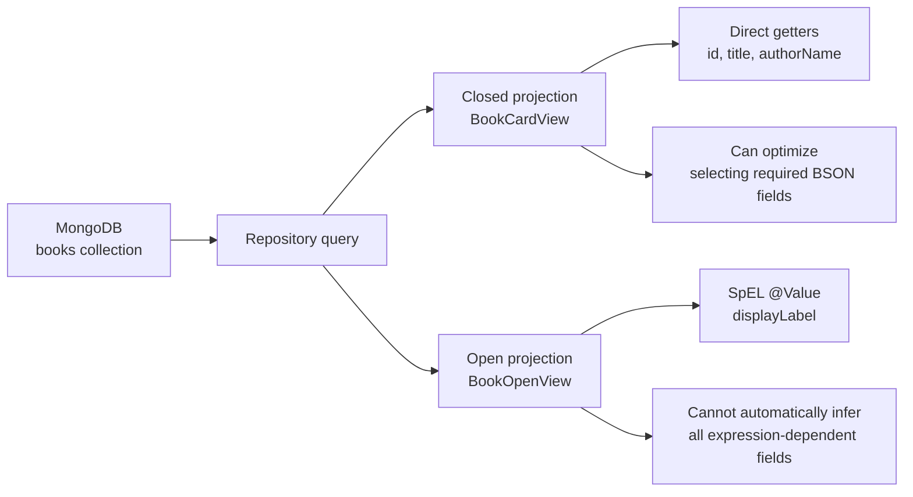

# Closed and Open Interface Projections

## 1. The Problem: A Screen Only Needs a Few Document Fields

A `books` collection in MongoDB might store complete book information: ISBN, title, author, publication status, creation date, long description, cover image, and administrative attributes. However, a list screen usually only needs the **ID, title, and author name**. If every query loads the entire `Book` entity, the application may transfer and map many unnecessary fields.

In **Spring Data MongoDB**, a *projection* lets you describe a **data view** instead of always returning the full entity. Two important types of interface projections:

- **Closed interface projection:** every getter maps to determinable properties of the source entity. Spring Data knows which properties the projection requires, so in supported queries the framework can **limit the fields fetched from MongoDB**.
- **Open interface projection:** at least one value is computed via an expression, such as `@Value` combined with **Spring Expression Language (SpEL)**. Because the expression can access arbitrary attributes of the entity, Spring Data **cannot reliably infer the full list of fields to read** to optimize the projection in the same way as a closed projection.

A projection is not a new BSON type, nor does it create a separate collection. It is a **Java-side data contract** for repository query results.



In this lesson, we will create an entity, two projection interfaces, write a repository, execute queries, inspect BSON data, and discuss limits regarding performance, nested projections, dynamic APIs, and testing.

## 2. Preparing the Sample Entity and Documents

Suppose a Spring Boot project has the `spring-boot-starter-data-mongodb` dependency and is configured to connect to the `library_projection_demo` database. The Java examples use Java 17+ and Spring Data MongoDB style on Spring Boot 3.x.

### Full Entity

```java
package com.example.library;

import java.time.Instant;
import org.springframework.data.mongodb.core.mapping.Document;
import org.springframework.data.mongodb.core.mapping.Field;
import org.springframework.data.mongodb.core.mapping.FieldType;
import org.springframework.data.mongodb.core.mapping.MongoId;

@Document(collection = "books")
public class Book {

    @MongoId(FieldType.STRING)
    private String id;

    private String isbn;
    private String title;
    private String category;
    private String status;

    @Field("author_name")
    private String authorName;

    @Field("created_at")
    private Instant createdAt;

    private String description;

    protected Book() {}

    public String getId() { return id; }
    public String getIsbn() { return isbn; }
    public String getTitle() { return title; }
    public String getCategory() { return category; }
    public String getStatus() { return status; }
    public String getAuthorName() { return authorName; }
    public Instant getCreatedAt() { return createdAt; }
    public String getDescription() { return description; }
}
```

The `authorName` and `createdAt` properties use `@Field` to be stored in MongoDB as `author_name` and `created_at`. `@MongoId(FieldType.STRING)` makes explicit that application-assigned string IDs are stored as BSON Strings without relying on ObjectId conversion.

### Practice Data

In `mongosh`, connect to a dedicated learning MongoDB instance and run:

```javascript
use library_projection_demo

db.books.insertMany([
  {
    _id: "BK-001",
    isbn: "ISBN-001",
    title: "Introduction to Spring Data MongoDB",
    author_name: "An",
    category: "backend",
    status: "PUBLISHED",
    created_at: ISODate("2026-11-01T08:00:00Z"),
    description: "Full description content, which may be many times longer than the title."
  },
  {
    _id: "BK-002",
    isbn: "ISBN-002",
    title: "Query-Driven Document Design",
    author_name: "Binh",
    category: "database",
    status: "PUBLISHED",
    created_at: ISODate("2026-11-05T08:00:00Z"),
    description: "Examples of schema design and access-pattern analysis."
  },
  {
    _id: "BK-003",
    isbn: "ISBN-003",
    title: "MongoDB Aggregation",
    author_name: "Chi",
    category: "database",
    status: "DRAFT",
    created_at: ISODate("2026-11-09T08:00:00Z"),
    description: "Draft currently under editorial review."
  }
])
```

The `insertMany` command is only for when the practice collection is empty; running it again with the same `_id` values causes a duplicate key error. The IDs here are Strings and timestamps are BSON Dates. For Spring Boot 3.x, an illustrative URI is:

```properties
spring.data.mongodb.uri=mongodb://localhost:27017/library_projection_demo
```

Reading a full document via `db.books.findOne({ _id: "BK-001" })` shows every field including `description`. The following sections demonstrate how projections let the interface see only a subset of properties.

## 3. Closed Interface Projection: Well-Defined Getters

Create an interface containing only three getters:

```java
package com.example.library;

public interface BookCardView {
    String getId();
    String getTitle();
    String getAuthorName();
}
```

**Why is this a closed projection?**

1. `getId()` corresponds to the `id` property of the `Book` entity.
2. `getTitle()` corresponds to the `title` property.
3. `getAuthorName()` corresponds to the `authorName` property, mapped to BSON field `author_name`.
4. There are no `@Value` expressions arbitrarily accessing other parts of the target.

Declare the repository:

```java
package com.example.library;

import java.util.List;
import org.springframework.data.mongodb.repository.MongoRepository;

public interface BookRepository extends MongoRepository<Book, String> {

    List<BookCardView> findByStatusOrderByCreatedAtDescIdDesc(
        String status);
}
```

The method uses **properties of the source entity** (`status`, `createdAt`, `id`) for filtering and sorting, while the **return type** is `List<BookCardView>`. When called:

```java
List<BookCardView> cards =
    bookRepository.findByStatusOrderByCreatedAtDescIdDesc(
        "PUBLISHED");

cards.forEach(card ->
    System.out.println(
        card.getId() + " | "
        + card.getTitle() + " | "
        + card.getAuthorName()
    )
);
```

Expected output with the sample data:

```text
BK-002 | Query-Driven Document Design | Binh
BK-001 | Introduction to Spring Data MongoDB | An
```

`BookCardView` has no `getDescription()` getter. Code receiving the projection cannot arbitrarily access additional `Book` fields through this interface. That is the **data contract** benefit, even before considering query optimization.

### Closed Projections Can Reduce Fields Read from MongoDB

Because the framework infers the properties of a closed projection, it can generate a query like:

```javascript
// Illustrative form of field selection; not guaranteed
// to be the exact driver statement across all versions.
db.books.find(
  { status: "PUBLISHED" },
  { _id: 1, title: 1, author_name: 1 }
).sort({ created_at: -1, _id: -1 })
```

The BSON projection in the second argument of `find` selects `_id`, `title`, and `author_name`, avoiding returning the long description field. MongoDB may still need to read other data for filtering/sorting depending on indexes and the execution plan.

**Limits to understand accurately:**

- The fact that Spring Data **can optimize field selection** does not mean it always performs a *covered query*; a covered query depends on an index containing all filtered, sorted, and returned fields.
- Actual optimization also depends on framework version, query shape, nested projections, and custom mappings/converters.
- Merely looking at the `BookCardView` type in Java does not prove the real MongoDB command excluded `description`. You need to inspect queries/command monitoring or query plans in tests.
- `_id` is typically included by MongoDB in projections by default unless explicitly excluded; in this example we intentionally include `getId()` because the ID is needed in the results.

### Do Not Use BSON Names as Java Getters

Getters must follow **Java properties**:

```java
// Correct for Book.authorName:
String getAuthorName();

// Do not use the BSON field naming convention for the getter name:
// String getAuthor_name();
```

Spring Data relies on `@Field("author_name")` metadata to map the `authorName` property to the MongoDB field. A getter that does not correspond to a valid property may cause a mapping error or fail to receive the expected value.

## 4. Open Interface Projection: Using `@Value` and SpEL

Now suppose the UI wants a display string `"Introduction to Spring Data MongoDB — An"`, combining title and author. One approach is an **open projection**:

```java
package com.example.library;

import org.springframework.beans.factory.annotation.Value;

public interface BookOpenView {

    String getTitle();

    String getAuthorName();

    @Value("#{target.title + ' — ' + target.authorName}")
    String getDisplayLabel();
}
```

`@Value` here is `org.springframework.beans.factory.annotation.Value`. The expression inside `@Value` is **Spring Expression Language (SpEL)**:

- `target` represents the backing source object wrapped by the projection.
- `target.title` reads the title from the source object.
- `target.authorName` reads the author name from the source object.
- The expression result becomes the return value of `getDisplayLabel()`; **no `displayLabel` BSON field** is created by the annotation.

Extend the repository with another method having different criteria:

```java
import java.util.List;

public interface BookRepository extends MongoRepository<Book, String> {

    List<BookCardView> findByStatusOrderByCreatedAtDescIdDesc(
        String status);

    List<BookOpenView> findByStatusAndCategory(
        String status, String category);
}
```

This is a **merged version of the same repository**—no need to create two identically named interfaces in the project.

Example call:

```java
List<BookOpenView> results =
    bookRepository.findByStatusAndCategory(
        "PUBLISHED", "backend");

results.forEach(view ->
    System.out.println(view.getDisplayLabel())
);
```

With the sample data, output:

```text
Introduction to Spring Data MongoDB — An
```

### Why Are Open Projections Hard to Optimize for Field Selection?

Spring Data cannot generally deduce which properties an arbitrary SpEL expression will access. The expression could invoke methods, traverse relationships, or reference another bean. Consequently, for open projections, the framework **does not apply the same field-selection optimization based on a known getter list** as with closed projections.

For example, the getter:

```java
@Value("#{target.title + ' — ' + target.authorName}")
String getDisplayLabel();
```

even though it reads only two fields, is still classified as an **open projection** because it depends on an expression. It is not automatically converted into a `$concat` running inside a MongoDB aggregation. The value is typically evaluated **on the Java side** when processing the projection; this adds no fields to stored documents.

A SpEL expression can be extended to invoke beans or custom logic, but keep in mind:

- Expressions are harder to read and debug than simple getters; they should not contain complex business logic.
- Do not use SpEL to perform hidden database queries or repeated I/O per result.
- If properties can be `null`, the expression needs clear null-handling rules to avoid unwanted display strings or runtime errors.
- If data needs to be **filtered/sorted by the computed string**, you cannot simply call `findByDisplayLabel(...)` or `OrderByDisplayLabel`: it is not a stored field in the document.

## 5. Comparing Closed Projections and Open Projections

| Aspect | Closed interface projection | Open interface projection |
| --- | --- | --- |
| Getters | Point directly to determinable properties of the entity | Has computed getters, usually via `@Value`/SpEL |
| Example | `String getTitle()` | `@Value(...) String getDisplayLabel()` |
| Stored BSON fields | Unchanged | Unchanged |
| Field selection optimization | Can be inferred and select only required fields in supported queries | Cannot be safely inferred from arbitrary expressions; usually not similarly optimized |
| Java-side work | Simple getter | Evaluates expression when retrieving value |
| Best suited for | List APIs, cards, search results, lean payloads | Displaying a simple computed value needing access to target |
| Risks | Wrong property getter, nested projections need verification | Mapping overhead, SpEL harder to debug, null and source data dependencies |

**Choose closed projection by default** when you only need existing fields. Only use open projections when you **truly need dynamic expressions** and have weighed the impact on I/O, mapping, and testability.

## 6. When You Only Need to Combine Getters: Default Methods Instead of SpEL

Many "computed" values actually just combine a few existing getters. In such cases, Java interfaces support **default methods** to keep the calculation in Java without opening the projection with SpEL:

```java
package com.example.library;

public interface BookCardWithLabel extends BookCardView {

    default String getDisplayLabel() {
        return getTitle() + " — " + getAuthorName();
    }
}
```

Here:

- `getTitle()` and `getAuthorName()` already exist in the closed projection `BookCardView`.
- `getDisplayLabel()` computes its value based **solely** on those two known getters; it does not need direct access to the entire `Book` object.
- Because there is no `@Value` with an arbitrary expression, Spring Data can still infer the set of properties to read when using this projection under supported mechanisms.

This is usually simpler than an open projection when presentation logic is just string concatenation, light formatting, or minor conditional checks. However, do not stuff complex business calculations into a projection's default method. If the computation needs multiple dependencies or many fields, use a **service/mapper to DTO** with clear responsibilities.

### Comparing Two Ways to Build a Display Label

```java
// Open projection: Spring Expression Language.
@Value("#{target.title + ' — ' + target.authorName}")
String getDisplayLabel();

// Default method in a closed projection.
default String getDisplayLabel() {
    return getTitle() + " — " + getAuthorName();
}
```

Both can return the exact same string, yet **their ability to analyze dependencies to limit BSON fields differs**. Do not look solely at the displayed output and conclude that both approaches have the same query cost.

## 7. Dynamic Projection: Choosing the Return Type When Calling the Repository

If the application needs multiple views for the same search condition, Spring Data supports **dynamic projections** via a `Class<T>` parameter:

```java
package com.example.library;

import java.util.List;
import org.springframework.data.mongodb.repository.MongoRepository;

public interface BookRepository extends MongoRepository<Book, String> {

    List<BookCardView> findByStatusOrderByCreatedAtDescIdDesc(
        String status);

    List<BookOpenView> findByStatusAndCategory(
        String status, String category);

    <T> List<T> findByStatus(String status, Class<T> type);
}
```

Examples:

```java
List<BookCardView> compact =
    bookRepository.findByStatus(
        "PUBLISHED", BookCardView.class);

List<BookCardWithLabel> cardsWithLabel =
    bookRepository.findByStatus(
        "PUBLISHED", BookCardWithLabel.class);

List<BookOpenView> computed =
    bookRepository.findByStatus(
        "PUBLISHED", BookOpenView.class);

List<Book> fullEntities =
    bookRepository.findByStatus(
        "PUBLISHED", Book.class);
```

**Key point:** the `Class<T>` parameter determines the mapping type of the result, but **does not make the repository join other collections or automatically grant permission to see sensitive fields**. When `T` is a closed projection, fields can be optimized per framework support; when `T` is an open projection, the SpEL expression reduces the ability to infer the required fields.

Some constraints:

1. `T` must be a return type that Spring Data can map compatibly with the `Book` domain.
2. Recognizing `Class<T>` as a projection parameter follows generic signature rules in the method. If `Class` is used as an actual **filter value**, design a dedicated signature instead of accidentally letting the framework treat it as a projection parameter.
3. Dynamic projections allow reusing query criteria, yet in public APIs **never let clients specify arbitrary Java class names** to resolve an unapproved data type.
4. Replacing an interface projection with the real entity changes which fields can be read and data accessibility; control this at the service layer.

### Distinguishing from Class-Based DTO Projections

Spring Data also supports **class-based projections**, typically using a constructor that identifies the properties to retrieve. A Java record is a natural fit:

```java
package com.example.library;

public record BookCardDto(
    String id,
    String title,
    String authorName
) {}
```

When the framework supports constructor mapping as designed, it can be used in dynamic projections:

```java
List<BookCardDto> dtoCards =
    bookRepository.findByStatus(
        "PUBLISHED", BookCardDto.class);
```

`BookCardDto` is a **concrete data object**, not a proxy interface. Constructor parameters must match source properties and mapping configuration; when multiple constructors exist or parameter metadata is unclear, explicitly declare the constructor to use according to your Spring Data version's rules.

**Do not equate class-based DTOs with open interface projections:** a DTO with a clear constructor can allow upfront determination of required fields, whereas `@Value` getters in open projections depend on expressions. Specific optimization behavior should be verified via the generated queries.

| Technique | Form | Best suited for |
| --- | --- | --- |
| Closed interface | `BookCardView` with getters | Returning a subset of properties, concise syntax, minimal manual mapping |
| Closed + default method | `BookCardWithLabel` | Simple formatting from known getters |
| Open interface | `@Value`/SpEL | Computing values via expressions not expressible by simple getters |
| Class/record DTO | `record BookCardDto(...)` | Clear result contract, easy to convert to API responses |
| Mapper in service | `Book → DTO` | Needs business logic, normalization, null handling, or combining data sources |

## 8. Nested Projections and Referenced Data

Applications do not always read only top-level properties. A book might embed publisher information:

```javascript
{
  _id: "BK-010",
  title: "Sample Book",
  publisher_snapshot: {
    name: "Example Publisher",
    city: "Hanoi",
    phone: "0123456789"
  }
}
```

If the `Book` entity adds a `publisherSnapshot` property of type `PublisherSnapshot` with `@Field("publisher_snapshot")`, you can declare a nested interface projection:

```java
public interface PublisherNameView {
    String getName();
}

public interface BookWithPublisherView {
    String getId();
    String getTitle();
    PublisherNameView getPublisherSnapshot();
}
```

Spring Data can build nested projections from embedded objects inside the document. However, **having a nested getter does not guarantee the query only reads the exact `publisher_snapshot.name` field** in every version/configuration. There are cases where the framework must fetch the entire embedded object to build the nested projection. Check the actual BSON query if the embedded document is large.

**Do not confuse embedded objects with document references.** If `Book` only stores `publisherId` and `Publisher` resides in another collection, projection does not automatically join the target collection. When the publisher's name is needed, the application must explicitly load it via repository/template, use aggregation `$lookup`, or store a snapshot if business rules allow.

When data comes from multiple collections, a **service-assembled DTO** is sometimes cleaner and easier to control than nested projections.

## 9. Distinguishing Interface Projection from Selecting BSON Fields with MongoTemplate

Interface projections belong to the repository result-mapping mechanism. Meanwhile, MongoDB supports **field projection** directly inside a `find` statement:

```javascript
db.books.find(
  { status: "PUBLISHED" },
  { _id: 1, title: 1, author_name: 1 }
)
```

In Spring Data MongoDB, you can specify fields using `MongoTemplate`:

```java
import java.util.List;
import org.springframework.data.mongodb.core.MongoTemplate;
import org.springframework.data.mongodb.core.query.Criteria;
import org.springframework.data.mongodb.core.query.Query;

public class BookFieldQuery {
    private final MongoTemplate template;

    public BookFieldQuery(MongoTemplate template) {
        this.template = template;
    }

    public List<Book> findPartialBooks() {
        Query query = Query.query(
            Criteria.where("status").is("PUBLISHED")
        );

        query.fields()
            .include("id")
            .include("title")
            .include("authorName");

        return template.find(query, Book.class);
    }
}
```

With `Book.class`, Spring Data has mapping metadata, so the `authorName` property is translated to `author_name` and `id` to `_id`. The API returns `Book`, **yet that entity is only populated with partial fields**.

**Caution when using partial entities:**

- Getters omitted from the field projection may return `null` or default values supplied by the Java constructor/property.
- Do not treat a partial entity as a complete aggregate.
- Do not blindly call `save` on a partial entity expecting all other fields to remain intact; saving can lead to unintended overwrites or data loss depending on entity state/semantics.
- When the goal is returning data to the UI, an interface projection or explicit DTO generally prevents the misconception that the object is fully loaded.

In a repository, a custom query can also configure BSON fields via `@Query(fields = "...")` when truly needed, but that does not replace declaring the right return type and testing. It is usually best to let a **closed projection express the required properties** before optimizing manually.

## 10. Measuring Performance: Fewer Fields Does Not Always Mean Faster Queries

The goal of closed projection is usually to **reduce BSON payload over the network** and mapping work in the application. To evaluate effectiveness, separate three layers of cost:

1. **MongoDB selects and reads data:** is an appropriate index used, and how many documents must be scanned?
2. **Which fields MongoDB returns:** are `description` or other large unnecessary fields still included?
3. **Application processes results:** how many bytes are transferred, how many objects/proxies are allocated, and does SpEL take significant time?

Example query needing the list of most recently published books:

```javascript
db.books.find(
  { status: "PUBLISHED" },
  { _id: 1, title: 1, author_name: 1 }
)
.sort({ created_at: -1, _id: -1 })
.limit(20)
.explain("executionStats")
```

Fields to inspect:

| Metric | Question |
| --- | --- |
| `winningPlan` | Which query plan did MongoDB choose? |
| `IXSCAN` / `COLLSCAN` | Is an index used or is it scanning the collection? |
| `totalKeysExamined` | How many index keys had to be examined? |
| `totalDocsExamined` | Did many documents need to be read? |
| `nReturned` | Does the number of returned documents match the limit? |
| `executionTimeMillis` | What was the execution time measured in this test run? |

A candidate index for the filter and sort order:

```javascript
db.books.createIndex(
  { status: 1, created_at: -1, _id: -1 },
  { name: "books_status_created_id" }
)
```

This index supports filtering by `status` and sorting by `created_at` and `_id`, yet **does not guarantee a covered query** because it lacks `title` and `author_name` required by the projection. To explore covered query potential, you can **experiment with** an index that also includes the output fields:

```javascript
db.books.createIndex(
  {
    status: 1,
    created_at: -1,
    _id: -1,
    title: 1,
    author_name: 1
  },
  { name: "books_card_cover_candidate" }
)
```

This is only a **candidate index for measurement**, not a recommendation to create by default. Wider indexes consume more storage and affect write speed. When a collection is small, MongoDB may also choose a different plan; measure under realistic workloads before deciding which indexes to keep.

### Do Not Confuse Projection with Filtering

Fetching fewer fields does not limit the number of documents if the query lacks filters or limits:

```java
// May still read a very large result set if status is common.
List<BookCardView> cards =
    bookRepository.findByStatus("PUBLISHED", BookCardView.class);
```

For list APIs, combine **queries with filters, sorting, and pagination**. Projection controls the **width** of each document's data; pagination and filtering control the **number** of documents.

### How to Verify Whether the Framework Optimizes BSON Field Selection

Do not rely solely on execution time over three sample documents. In a permitted test environment:

- Enable appropriate query logging/capture for MongoDB or use the driver's command monitoring to observe the actual `find` command and its `projection` section.
- Compare closed interfaces against open interfaces with the same filter, record count, and connection.
- Observe fetched fields, network bytes, mapping time, and Java heap when payloads have large descriptions.
- Compare `explain` for equivalent queries when evaluating indexes.
- Take care not to log sensitive data or full production documents just to debug projection.

If you observe that the framework is not excluding fields as expected, check the version, query type, nested mappings, custom converters, and projection style. **Do not build performance assumptions on a guarantee the framework does not make for all cases.**

## 11. Projections and API Boundaries: Not a Security Mechanism

A `BookCardView` interface does not expose `getDescription()`, yet that **does not automatically create an authorization policy**. For example, users A and B might be allowed to view different books; selecting fewer fields cannot filter documents by tenant, owner, or access rights.

API design should distinguish:

- **Filter/query:** which documents is the caller permitted to see?
- **Projection/DTO:** within those documents, which fields are allowed to be returned?
- **Mapping/serialization:** which fields actually get serialized to JSON?

Open projections can also reference properties not present in regular getters via `target`. Therefore, never let clients pass arbitrary SpEL expressions; expressions and projection types must be controlled by application code.

When building public responses, an explicit `record BookCardDto(...)` or dedicated mapper helps define the returned field list and handle computed values. Still, verify that the query layer does not fetch unauthorized data and does not leak data through logs or exceptions.

## 12. Testing Closed and Open Projections with Real Data

Run integration tests against a real MongoDB instance, such as a test MongoDB or Testcontainers, because projection bugs often involve **BSON field names, type mapping, and actual query commands**. `@DataMongoTest` on Spring Boot 3.x can bootstrap the data layer for tests; the project still needs an isolated test database configuration.

The following example seeds data using the **direct MongoDB Driver API**, verifying that mapping `author_name` to `authorName` from BSON does not depend on the entity itself during writes.

```java
package com.example.library;

import java.time.Instant;
import java.util.Date;
import java.util.List;
import org.bson.Document;
import org.junit.jupiter.api.BeforeEach;
import org.junit.jupiter.api.Test;
import org.springframework.beans.factory.annotation.Autowired;
import org.springframework.boot.test.autoconfigure.data.mongo.DataMongoTest;
import org.springframework.data.mongodb.core.MongoTemplate;

import static org.assertj.core.api.Assertions.assertThat;

@DataMongoTest
class BookProjectionTest {

    @Autowired
    BookRepository repository;

    @Autowired
    MongoTemplate template;

    @BeforeEach
    void seedIsolatedDatabase() {
        // Must only be used on an isolated test database.
        template.dropCollection(Book.class);

        template.getCollection("books").insertMany(List.of(
            new Document("_id", "BK-001")
                .append("isbn", "ISBN-001")
                .append("title", "Book One")
                .append("author_name", "An")
                .append("status", "PUBLISHED")
                .append("category", "backend")
                .append("created_at", Date.from(
                    Instant.parse("2026-11-01T08:00:00Z")))
                .append("description", "Long description"),
            new Document("_id", "BK-002")
                .append("isbn", "ISBN-002")
                .append("title", "Book Two")
                .append("author_name", "Binh")
                .append("status", "PUBLISHED")
                .append("category", "database")
                .append("created_at", Date.from(
                    Instant.parse("2026-11-05T08:00:00Z")))
                .append("description", "Other data")
        ));
    }

    @Test
    void closedProjectionMapsJavaPropertyFromBsonField() {
        List<BookCardView> cards =
            repository.findByStatusOrderByCreatedAtDescIdDesc(
                "PUBLISHED");

        assertThat(cards)
            .extracting(BookCardView::getId)
            .containsExactly("BK-002", "BK-001");

        assertThat(cards.get(0).getTitle())
            .isEqualTo("Book Two");
        assertThat(cards.get(0).getAuthorName())
            .isEqualTo("Binh");
    }

    @Test
    void openProjectionEvaluatesSpelGetter() {
        List<BookOpenView> views =
            repository.findByStatusAndCategory(
                "PUBLISHED", "backend");

        assertThat(views).hasSize(1);
        assertThat(views.get(0).getDisplayLabel())
            .isEqualTo("Book One — An");
    }

    @Test
    void dynamicClosedProjectionUsesSelectedType() {
        List<BookCardWithLabel> views =
            repository.findByStatus(
                "PUBLISHED", BookCardWithLabel.class);

        assertThat(views)
            .extracting(BookCardWithLabel::getDisplayLabel)
            .containsExactlyInAnyOrder(
                "Book One — An",
                "Book Two — Binh");
    }
}
```

**Note:** `template.dropCollection(Book.class)` drops the entire collection; this operation is only safe on an isolated test database and must never be used to prepare fixtures on production or shared databases. `BookRepository` in the test is the interface with **merged methods** from Section 7.

The assertions above verify **correct data and computations**, yet they do not prove that MongoDB selected fewer fields for the closed projection. To verify network optimization, add command observation or inspect actual queries as in Section 10. Never infer performance merely because `getDescription()` is absent from the interface.

Cases to add in real implementations:

1. Missing or null `author_name`: define behavior of the getter and SpEL expression.
2. Changing BSON field name via `@Field`: verify closed projection still reads the Java property accurately.
3. Entity with embedded objects: measure field selection of nested projections.
4. Large datasets and long descriptions: compare payload/latency among closed, open, and full entities.
5. Queries with sorting, limits, and pagination: ensure deterministic ordering and bounded document count.
6. Legacy incompatible BSON data: verify mapping failures or missing values are handled appropriately.
7. Dynamic projection: prevent clients from selecting types outside an allowed list.

## 13. Reactive Repositories and Projections

If your application uses reactive access, Spring Data MongoDB provides `ReactiveMongoRepository`. You can still express projection result types from repository queries:

```java
package com.example.library;

import org.springframework.data.mongodb.repository.ReactiveMongoRepository;
import reactor.core.publisher.Flux;

public interface ReactiveBookRepository
        extends ReactiveMongoRepository<Book, String> {

    Flux<BookCardView> findByStatusOrderByCreatedAtDescIdDesc(
        String status);
}
```

Invocation:

```java
Flux<BookCardView> cards =
    reactiveBookRepository
        .findByStatusOrderByCreatedAtDescIdDesc("PUBLISHED");
```

`Flux<BookCardView>` is a reactive result stream: data is retrieved upon subscription. Projection still does not replace `limit`/`Pageable` or filters; if you want a single page, design a paginated repository method or a corresponding `ReactiveMongoTemplate` query.

An open projection using SpEL does not turn its calculation into a reactive operator or aggregation stage. With large result sets, the evaluation work per getter and the amount of fields MongoDB returns remain worth measuring. Avoid calling `block()` on a reactive request path just to convert the stream into a synchronous list.

## 14. Common Errors

| Symptom | Possible cause | Resolution |
| --- | --- | --- |
| `getAuthorName()` returns null | Document uses `authorName` instead of `author_name`, or field is missing | Cross-check `@Field` and actual BSON; verify migrations |
| Closed projection does not return fewer fields as expected | Query/mapping/nested projection type does not trigger optimization | Inspect MongoDB commands, check version and generated query |
| `@Value` expression fails when reading | Wrong property in `target` or null value | Check SpEL, sample data, and null handling |
| Open projection is slower than closed projection | Extra SpEL evaluation work and potentially reading more fields | Use default methods or DTO/mappers when appropriate; measure real load |
| Calling `getDisplayLabel()` in `OrderBy` fails | Display label is computed in Java, not a sortable BSON property | Use a stored field or aggregation `$addFields`/`$sort` with explicit logic |
| Nested projection does not reduce payload as expected | Embedded object is selected at a broader level | Inspect BSON command and consider DTOs or custom queries |
| API leaks sensitive data | Treating projection as authorization | Apply tenant filters, authorization, and dedicated response DTOs |
| Calling `save` on a `Book` with only a few fields loaded | Partial entity has missing fields | Avoid saving partial entities; use conditional updates or load the full entity |
| Dynamic projection fails to map DTO | Constructor/property names do not match domain | Check constructor, mapping metadata, and return type |
| Projection still returns too many documents | Projection present without filter/limit | Combine derived queries, `Sort`, and `Pageable` |

## 15. Self-Check Exercises

**Exercise 1.** Entity `Book` has properties `title`, `authorName`, and `description`. Interface:

```java
public interface Card {
    String getTitle();
    String getAuthorName();
}
```

**Question:** Is this a closed or open projection? **Answer:** Closed, because both getters correspond to concrete properties and no SpEL expression is needed.

**Exercise 2.** Add getter:

```java
@Value("#{target.title + ' — ' + target.authorName}")
String getDisplayLabel();
```

**Question:** Why does the projection become open? **Answer:** Because the getter depends on an expression over `target`; the framework cannot generally deduce every field the expression will access.

**Exercise 3.** You want `getDisplayLabel()` without a dynamic expression. Is there an option that still leverages closed getters?

**Answer:** Use a default method on the interface calling `getTitle()` and `getAuthorName()`. When all dependencies of the computation reside in closed getters, the framework can still analyze the set of properties to read.

**Exercise 4.** `@Field("author_name")` is applied to Java property `authorName`. What should the getter in the projection interface be?

**Answer:** `getAuthorName()`. Spring Data maps the Java property name to the BSON field `author_name`.

**Exercise 5.** A request is only allowed to view books belonging to `tenantId = "TENANT-A"`. Can you use `BookCardView` and skip tenant filtering?

**Answer:** No. Projection defines returned fields, not which documents a user is authorized to access. You must apply tenant criteria and permission checks.

**Exercise 6.** After switching from the `Book` entity to a closed projection, query time did not decrease noticeably. Does that prove projections are ineffective?

**Answer:** Not yet. Measure the actual payload, query, and indexes. If `description` is already small or most time is spent filtering/sorting, the gain may be modest; if the framework did not optimize field selection for that query, inspect the actual command.

## 16. Process for Choosing a Projection for a New API

1. **Identify the fields the UI actually needs.** For example, a book card only needs ID, title, and author name.
2. **Choose a closed interface first** if only reading entity properties: minimal code, clear dependencies, and opportunity for field-selection optimization.
3. **Need computed display values?** If only combining declared getters, use a default method. If more flexible expressions are needed, consider an open projection and measure cost.
4. **Need a concrete response contract?** Use a class/record DTO or service mapper, especially when authorization checks, type conversions, and business logic are involved.
5. **Choose the right repository method.** Filter, sort, and page/limit at the database; dynamic projection only chooses the return type.
6. **Reconcile Java with BSON.** `@Field` can rename properties; verify real data, nested mappings, and ID types.
7. **Measure and test.** Verify results, SpEL/null behavior, generated MongoDB queries, payload, indexes, and latency.
8. **Maintain safe boundaries.** Projection is not authorization; do not save and overwrite a partial entity without proper control.

**Conclusion:** **Closed interface projections** use getters matching determinable entity properties and can help Spring Data MongoDB select only the necessary BSON fields. **Open interface projections** allow computing getters via `@Value`/SpEL but typically cannot optimize field selection the same way. When simple computed display values are needed, **default methods** offer a readable approach that keeps dependencies explicit; when stable responses and business logic are required, **DTOs** fit better. Whichever technique you choose, verify against real MongoDB queries and data instead of inferring performance from Java method signatures alone.
