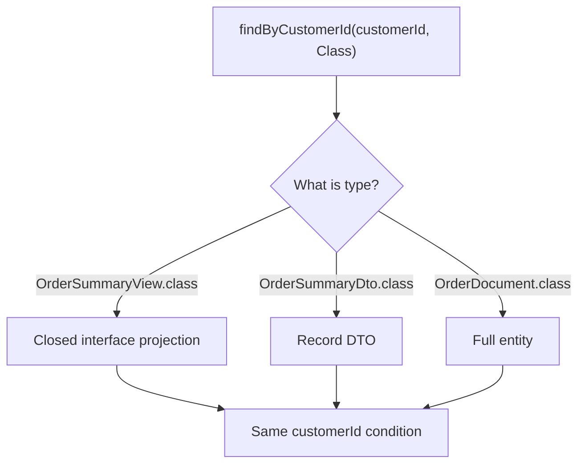

# Dynamic Projections with a Class Parameter

## 1. Why Do We Need Dynamic Projections?

In an order management application, the same MongoDB `orders` collection may serve very different screens:

- **Order list:** needs only order ID, status, total amount, and order timestamp.
- **Reconciliation:** needs order ID, currency, amount, and payment status.
- **Order detail:** needs buyer, shipping address, line items, and displayable notes.
- **Data export:** has its own set of fields defined by the receiving system's contract.

If every screen calls `findByCustomerId(...)` and receives the full `OrderDocument`, endpoints needing only a few fields may read excessive data, allocate large objects, and accidentally expose internal information.

If you create a separate repository method for each return type, the interface ends up with many methods repeating the same filter conditions:

```java
List<OrderSummaryView> findSummaryByCustomerId(...);
List<OrderFinanceView> findFinanceByCustomerId(...);
List<OrderDocument> findFullByCustomerId(...);
```

Spring Data's **dynamic projection** solves the situation where **search criteria stay the same, while the result type varies according to the caller's needs**. You declare a generic method with a `Class<T>` parameter, then pass an interface projection, DTO class/record, or the entity itself at each call site.

This lesson belongs to the **Projection and DTO** chapter of the **SPRING_DATA_MONGODB** module. The scope covers repositories, how MongoDB stores and returns documents, differences between projection interfaces and DTOs, query optimization limits, pagination, `MongoTemplate`, reactive access, indexes, testing, and performance diagnostics. The key takeaway is that **the `Class<T>` parameter selects the projection type at call time**—it is not a BSON value filter parameter.

## 2. The Problem and Sample MongoDB Document

Suppose the database contains a document:

```javascript
db.orders.insertOne({
  _id: "ord-1001",
  customerId: "cus-01",
  status: "PAID",
  currency: "VND",
  totalAmount: NumberDecimal("1850000.00"),
  placedAt: ISODate("2026-11-20T02:00:00Z"),
  shippingAddress: {
    recipient: "Nguyen An",
    city: "Da Nang",
    phone: "0900000000"
  },
  items: [
    {
      productId: "p-10",
      productNameAtPurchase: "Mechanical Keyboard",
      quantity: 2,
      unitPrice: NumberDecimal("925000.00")
    }
  ],
  internalNote: "Contact customer before delivery"
});
```

This is learning data: run write commands only on a test database, never directly in a production system.

Three different responses can be produced from that same document.

**List:**

```json
{
  "id": "ord-1001",
  "status": "PAID",
  "totalAmount": 1850000.00,
  "placedAt": "2026-11-20T02:00:00Z"
}
```

**Reconciliation:**

```json
{
  "id": "ord-1001",
  "currency": "VND",
  "totalAmount": 1850000.00,
  "status": "PAID"
}
```

**Detail:** may require `items` and address, while excluding `internalNote` from customer-facing APIs if it is internal information.

The two JSON snippets above only illustrate **API response contracts**, not MongoDB canonical Extended JSON. A `NumberDecimal` value stored in BSON differs from how a JSON serializer formats `BigDecimal` in an HTTP response. When exact monetary precision across systems is required, agree on a consistent serialization convention for the API.

## 3. Full Entity Model

Java 17+ example with Spring Data MongoDB:

```java
import java.math.BigDecimal;
import java.time.Instant;
import java.util.List;

import org.springframework.data.mongodb.core.mapping.Document;
import org.springframework.data.mongodb.core.mapping.Field;
import org.springframework.data.mongodb.core.mapping.FieldType;
import org.springframework.data.mongodb.core.mapping.MongoId;

@Document(collection = "orders")
public record OrderDocument(
    @MongoId(FieldType.STRING)
    String id,

    String customerId,
    String status,
    String currency,

    @Field(targetType = FieldType.DECIMAL128)
    BigDecimal totalAmount,

    Instant placedAt,
    ShippingAddress shippingAddress,
    List<OrderItem> items,
    String internalNote
) {
    public record ShippingAddress(
        String recipient,
        String city,
        String phone
    ) {}

    public record OrderItem(
        String productId,
        String productNameAtPurchase,
        int quantity,
        @Field(targetType = FieldType.DECIMAL128)
        BigDecimal unitPrice
    ) {}
}
```

`@Document(collection = "orders")` identifies the collection; `@MongoId(FieldType.STRING)` declares the intent to store `_id` as a BSON string. `@Field(targetType = FieldType.DECIMAL128)` on `BigDecimal` represents money as BSON Decimal128 under appropriate mapping.

We do **not** want to instantiate the full `OrderDocument` when a screen only uses four fields. At the same time, we do not want to create an entity missing `items`/`shippingAddress` and accidentally call `save`, replacing the original document. Thus, distinguish the **write model** from **read-only models**.

## 4. Defining Projection Types

### 4.1. Closed Interface Projection

An interface declaring only accessors that map directly to entity properties is called a **closed projection**:

```java
import java.math.BigDecimal;
import java.time.Instant;

public interface OrderSummaryView {
    String getId();
    String getStatus();
    BigDecimal getTotalAmount();
    Instant getPlacedAt();
}
```

Spring Data can create an implementation/proxy for this interface when reading results. Callers access only the defined properties without needing a full `OrderDocument`.

For closed projections, Spring Data can determine the required properties and optimize the fields fetched from MongoDB. Yet **do not assume every closed projection guarantees a covered query** or never reads other fields in all cases: it also depends on query type, nested mappings, converters, and framework version. Inspect the actual emitted MongoDB command whenever you need proof of optimization.

### 4.2. Interface Projection for Reconciliation

```java
import java.math.BigDecimal;

public interface OrderFinanceView {
    String getId();
    String getStatus();
    String getCurrency();
    BigDecimal getTotalAmount();
}
```

This interface targets the same `OrderDocument` entity with a different accessor set, serving another use case. Getters do not create new fields in the database; they are simply views over existing properties.

### 4.3. Class-Based Projection Using a Java Record

Instead of an interface, we define a DTO with an explicit constructor:

```java
import java.math.BigDecimal;
import java.time.Instant;

public record OrderSummaryDto(
    String id,
    String status,
    BigDecimal totalAmount,
    Instant placedAt
) {}
```

**Class-based projection** uses constructor information to determine how to instantiate the object and which fields are needed. Java records are particularly convenient because of their canonical constructor and explicit component names. For traditional Java classes with multiple constructors, `@PersistenceCreator` may be needed to pick the right constructor; constructor parameter names must be discoverable and match properties accurately.

Do not design a DTO constructor whose parameter types/names differ radically from the entity expecting Spring Data to infer arbitrary transformations. Complex derived values should be mapped in the service or produced by an aggregation pipeline.

### 4.4. Semantic Differences

| Result type | How it is created | Advantages | Things to watch out for |
| --- | --- | --- | --- |
| Full `OrderDocument` | Entity mapping | Has all properties needed for business logic | May over-fetch fields for list views |
| `OrderSummaryView` interface | Proxy/projection | Reusable accessors, supports nested/open projections | Does not guarantee the server returns only those accessors in all configs |
| `OrderFinanceView` interface | Proxy/projection | Same query, different shape | Read-only descriptor, not a write model |
| `OrderSummaryDto` record | Constructor DTO | Immutable, explicit data contract | Constructor names/types must align with mapping |
| Dedicated API response DTO | Service mapping | Controls data exposed over HTTP | May require an extra mapping step from the projection |

An interface projection **is not by default equivalent to an API DTO**. You can use it at the persistence layer and map it to a response object to maintain the boundary between persistence and the public API.

## 5. Declaring Dynamic Repository Methods with `Class<T>`

Here is the core syntax:

```java
import java.util.List;

import org.springframework.data.mongodb.repository.MongoRepository;

public interface OrderRepository
        extends MongoRepository<OrderDocument, String> {

    <T> List<T> findByCustomerId(
        String customerId,
        Class<T> type
    );
}
```

In this signature:

- `<T>` is the method's generic type parameter.
- `Class<T> type` tells Spring Data **which result type to build**.
- `findByCustomerId` is a derived query filtering on `OrderDocument`'s `customerId` property.
- `Class<T>` is a **projection selector**, not a MongoDB filter criterion and does not mean searching for documents whose Java class equals the argument.
- The `List<T>` return type lets the caller pick an interface, record DTO, or entity, though you should never pass an arbitrary type lacking matching properties.

The same method can be called in three ways:

```java
List<OrderSummaryView> summaries =
    orderRepository.findByCustomerId(
        "cus-01", OrderSummaryView.class
    );

List<OrderSummaryDto> dtoList =
    orderRepository.findByCustomerId(
        "cus-01", OrderSummaryDto.class
    );

List<OrderDocument> fullOrders =
    orderRepository.findByCustomerId(
        "cus-01", OrderDocument.class
    );
```

**All three calls filter by the same `customerId`, while their result shapes differ.** Callers do not need a separate repository method per projection.



Spring Data recognizes dynamic projections from the generic signature, not simply from the presence of any `Class<?>` parameter. This detail is especially important when declaring parameters in `@Query` or SpEL, explained in Section 9.

### 5.1. Meaning of Call-Time Type Selection

"Dynamic" in the name does **not** mean HTTP users send a class name and the application constructs arbitrary classes. Selection happens in **Java code calling the repository**. The system might choose `OrderSummaryView.class` for list screens and `OrderDocument.class` for internal business flows; access control decisions must still be enforced by the service/API.

Avoid designing endpoints that accept `projectionClassName` from the client and invoke `Class.forName(...)`: it is hard to audit, risks exposing unauthorized data, and does nothing to make the query safer.

## 6. Service Integration and Returning API DTOs

### 6.1. One Repository Method, Multiple Use Cases

```java
import java.util.List;
import org.springframework.stereotype.Service;

@Service
public class OrderReadService {
    private final OrderRepository orders;

    public OrderReadService(OrderRepository orders) {
        this.orders = orders;
    }

    public List<OrderSummaryDto> listSummaries(String customerId) {
        return orders.findByCustomerId(
            customerId, OrderSummaryDto.class
        );
    }

    public List<OrderFinanceView> loadFinanceViews(String customerId) {
        return orders.findByCustomerId(
            customerId, OrderFinanceView.class
        );
    }

    public List<OrderDocument> loadFullOrders(String customerId) {
        return orders.findByCustomerId(
            customerId, OrderDocument.class
        );
    }
}
```

This example illustrates **reusing filter logic** without forcing callers to know a projection's JSON definition. In real systems, `customerId` must come from the authenticated user or pass authorization checks; dynamic projection **does not filter access rights**.

### 6.2. Distinguishing Persistence Projections from HTTP Responses

Example where a service returns a controlled response:

```java
import java.math.BigDecimal;
import java.time.Instant;

public record OrderSummaryResponse(
    String orderId,
    String status,
    BigDecimal totalAmount,
    Instant placedAt
) {
    public static OrderSummaryResponse from(OrderSummaryView view) {
        return new OrderSummaryResponse(
            view.getId(),
            view.getStatus(),
            view.getTotalAmount(),
            view.getPlacedAt()
        );
    }
}
```

In the service:

```java
List<OrderSummaryResponse> result = orderRepository
    .findByCustomerId("cus-01", OrderSummaryView.class)
    .stream()
    .map(OrderSummaryResponse::from)
    .toList();
```

This creates a clear boundary: the repository decides **how data is fetched**, while the response DTO decides **what data is exposed**. For simple use cases, you can choose `OrderSummaryDto` directly as the response if the API and persistence contracts align; two separate DTOs are not always necessary.

### 6.3. Do Not Write Back a Projection

`OrderSummaryView` does not contain enough fields to represent a complete order. The same applies to DTO records. Never use a partial result to instantiate an `OrderDocument` with missing fields and call `save(...)`; a replace operation can wipe out unread values.

When only the order status needs updating, use `MongoTemplate.updateFirst(...)` with `$set` and state transition conditions, or load the full entity and apply proper concurrency safeguards. A projection is a **read model**, not a complete copy for writing back.

## 7. Dynamic Projections, Pagination, and Sorting

A method returning `List<T>` may work for small sets, but if a customer has tens of thousands of orders, loading all of them into memory is inappropriate.

### 7.1. Combining `Pageable` with `Slice<T>`

```java
import org.springframework.data.domain.Pageable;
import org.springframework.data.domain.Slice;
import org.springframework.data.mongodb.repository.MongoRepository;

public interface OrderRepository
        extends MongoRepository<OrderDocument, String> {

    <T> Slice<T> findByCustomerId(
        String customerId,
        Pageable pageable,
        Class<T> type
    );
}
```

This is a signature variant with a `Pageable` parameter; when used alongside the `List<T>` version from Section 5, you can declare the corresponding **overload** in the same interface.

Example call:

```java
import org.springframework.data.domain.PageRequest;
import org.springframework.data.domain.Pageable;
import org.springframework.data.domain.Slice;
import org.springframework.data.domain.Sort;

Pageable page = PageRequest.of(
    0, 20,
    Sort.by(Sort.Direction.DESC, "placedAt")
);

Slice<OrderSummaryView> summaries =
    orderRepository.findByCustomerId(
        "cus-01",
        page,
        OrderSummaryView.class
    );
```

`Slice` is usually appropriate when you only need to know **whether a next page exists**; `Page` provides total element/page counts and may require an extra count query. For deterministic ordering when multiple orders share `placedAt`, include a tie-breaker key such as ID in the sort.

On datasets receiving continuous writes, offset pagination can duplicate or skip records between page loads. When reading large histories, consider keyset pagination on a deterministic sort key and corresponding index.

### 7.2. Projections Do Not Replace Pagination

The `Class<T>` parameter determines the type and usually the set of fields to fetch, **not the number of documents read**. A method returning 100,000 DTOs still consumes significant bandwidth and memory. Optimal design combines:

- Appropriately selective filter criteria.
- Pagination or limits as required.
- Index-supported sorting.
- Projection selecting only needed fields.
- Measuring total transferred bytes, mapping time, and API latency.

## 8. Closed, Open, and Nested Projections

### 8.1. Closed Projection: Inferable Properties

```java
public interface OrderStateView {
    String getId();
    String getStatus();
}
```

Each accessor maps to an entity property. Spring Data can deduce that the view needs ID and status to optimize the query. This projection type generally offers better opportunities for reducing read data.

### 8.2. Open Projection: Expressions Depending on `target`

```java
import org.springframework.beans.factory.annotation.Value;

public interface OrderLabelView {
    String getId();

    @Value("#{target.status + ' / ' + target.customerId}")
    String getLabel();
}
```

This is an **open projection**, because `getLabel()`'s value is computed from a SpEL expression over `target`. The framework cannot always deduce the minimal set of fields the expression will access; therefore **do not assume open projections receive the same field optimization as closed projections**.

If you only need a display label, read the minimal fields using a closed projection and build the label in the service or response DTO. That separates presentation logic from query mechanics and makes read data volume easier to measure.

### 8.3. Nested Projection

If the entity has `shippingAddress`, you can write:

```java
public interface CityView {
    String getCity();
}

public interface OrderWithCityView {
    String getId();
    CityView getShippingAddress();
}
```

Caller usage:

```java
List<OrderWithCityView> result =
    orderRepository.findByCustomerId(
        "cus-01", OrderWithCityView.class
    );
```

Nested projections help return a hierarchical read structure. However, a nested property may cause Spring Data to read **the entire subdocument** instead of just a single child field, depending on mapping and query. Do not assume `getShippingAddress().getCity()` definitely fetches only `shippingAddress.city` from BSON.

If selecting strictly `shippingAddress.city` is required, consider `MongoTemplate` with `Query.fields().include("shippingAddress.city")` or aggregation `$project`, and verify the actual command/projection.

## 9. Is `Class<T>` a Query Parameter or SpEL Parameter?

This is an easy distinction to overlook.

### 9.1. `Class<T>` Selects the Projection

Consider the method:

```java
<T> List<T> findByCustomerId(
    String customerId,
    Class<T> type
);
```

When Spring Data detects `Class<T>` matching the generic return type `T`, that parameter acts as the **projection selector**. It is not a filter field bound into the MongoDB query.

Hence, the filter derived from the method name remains only `customerId`. It does not inject a `type` condition into JSON, nor does it imply each DTO type maps to a different collection.

### 9.2. Using `@Query` with Dynamic Projections

You can combine an explicit JSON query with a dynamic result type:

```java
import java.util.List;
import org.springframework.data.mongodb.repository.Query;

@Query(value = "{ 'customerId': ?0, 'status': ?1 }")
<T> List<T> findSelectedOrders(
    String customerId,
    String status,
    Class<T> type
);
```

`?0` and `?1` are the filter values `customerId` and `status`. `Class<T> type` serves projection and **is not a third BSON value** inserted into the criteria.

In real applications, verify results against an actual MongoDB repository, especially when combining `@Query`, dynamic projections, custom converters, or constructor DTOs.

### 9.3. When You Actually Need a `Class` as an Expression Parameter

Spring Data distinguishes a **parameter recognized as a projection selector** from **ordinary query parameters**. In many cases, if a `Class<?>` parameter does not match the generic return type, it is not treated as a dynamic projection selector. This detail affects whether the parameter can be referenced from SpEL or query binding.

Do not use the same `Class<T>` both as a projection selector and as business data, since special-parameter recognition may prevent the query from seeing the parameter as expected. When passing business classification values, use explicit codes/enums/strings; if you genuinely pass `Class<?>` into a query expression, verify the signature, expression, and behavior on your Spring Data version.

## 10. How Do `@Query(fields=...)` and Dynamic Projections Differ?

The two features are related yet **not identical**.

**Dynamic projection** selects the **Java result type** of a repository method at invocation time.

```java
<T> List<T> findByCustomerId(String customerId, Class<T> type);
```

**`@Query(fields=...)`** declares a **specific BSON projection** for a JSON query:

```java
@Query(
    value = "{ 'customerId': ?0 }",
    fields = "{ '_id': 1, 'status': 1, 'totalAmount': 1 }"
)
List<OrderSummaryView> findFixedSummaries(String customerId);
```

Comparison:

| Question | Dynamic projection `Class<T>` | `@Query(fields=...)` |
| --- | --- | --- |
| What does it decide? | The Java type receiving results | Which BSON fields MongoDB is asked to return |
| Selectable per call? | Yes, pass `OrderSummaryView.class` or `OrderDocument.class` | Usually fixed inside the annotation |
| Usable with derived queries? | Yes | Does not require writing a custom JSON query if only fields are customized |
| Can they coexist? | Yes, though interactions must be checked | Yes, static fields can restrict data for all projections |
| Guaranteed to reduce returned data? | Not for all projection kinds and queries | Sets an explicit projection, though actual mapping/query must be checked |
| Safe to `save` partial results? | No | No |

One concrete pitfall: if a repository declares `fields` selecting only `status` and `totalAmount`, and a caller passes `OrderDocument.class`, the result type is `OrderDocument` yet other fields are missing because the BSON projection restricted the data. **Passing a full return type does not make MongoDB resend fields excluded from the query.**

To serve multiple projection types, start with a derived query + `Class<T>`, then measure in practice. Only add `@Query(fields=...)` when you need explicit control over a fixed field set for a specific use case.

## 11. MongoTemplate Has the Same Concept with a Different API

`MongoTemplate` supports querying and mapping to a target type, yet **does not use the repository `Class<T>` dynamic projection signature in the same way**. With the template, you explicitly choose the filter, fields to load, collection, and result type.

### 11.1. Example Reading DTOs via `MongoTemplate`

```java
import java.util.List;

import org.springframework.data.mongodb.core.MongoTemplate;
import org.springframework.data.mongodb.core.query.Criteria;
import org.springframework.data.mongodb.core.query.Query;

public List<OrderSummaryDto> loadSummaries(
    MongoTemplate template,
    String customerId
) {
    Query query = Query.query(
        Criteria.where("customerId").is(customerId)
    );

    query.fields()
        .include("_id")
        .include("status")
        .include("totalAmount")
        .include("placedAt");

    return template.find(
        query,
        OrderSummaryDto.class,
        "orders"
    );
}
```

In this example, we explicitly pass `OrderSummaryDto.class` to `MongoTemplate.find(...)` while declaring the field projection ourselves. It does not require the full entity as the return type, though **the collection `"orders"` must be known** when the DTO lacks collection metadata.

### 11.2. Controlling BSON Field Names

If the entity uses `@Field("customer_id")` while the DTO has no matching annotation, building a query against the DTO type may not apply the source entity's metadata the way you expect. Therefore:

- With repository derived queries, `OrderDocument`'s metadata is the basis for resolving `customerId`.
- With `MongoTemplate` targeting a DTO and a string collection name, verify actual mapping/queries, especially when using `@Field`, naming strategies, or custom converters.
- If exact control over BSON names is needed, build queries using actual stored names or use the appropriate mapping path (`query(OrderDocument.class).as(...)`) and test against real MongoDB.

Do not assume passing `OrderSummaryDto.class` automatically lets the template inherit every annotation from `OrderDocument` when the DTO is completely independent.

### 11.3. When Results Need Calculations or Joins

If the response requires a conditional `statusLabel`, line totals, or data from another collection, an aggregation pipeline with `$project`, `$group`, and `$lookup` can be a better fit than interface/constructor projections.

```javascript
db.orders.aggregate([
  { $match: { customerId: "cus-01" } },
  {
    $project: {
      _id: 1,
      status: 1,
      totalAmount: 1,
      statusLabel: {
        $cond: [
          { $eq: ["$status", "PAID"] },
          "Paid",
          "Unpaid"
        ]
      }
    }
  }
]);
```

`MongoTemplate.aggregate(...)` can map aggregation outputs to a dedicated DTO when field names/types match. That is a different mechanism from repository dynamic projection `Class<T>`; choose based on the complexity of the returned data.

## 12. Performance: Does Dynamic Projection Reduce I/O?

### 12.1. Three Distinct Optimization Levels

Distinguish between:

1. **Limiting the API response:** callers only see approved DTO or interface accessors.
2. **Limiting returned BSON data:** the MongoDB server sends only projected fields, reducing network traffic and mapping cost.
3. **Covered query:** the entire filter/projection is satisfied from an index without reading source documents.

Dynamic projection generally serves goal 1 well and **can** create opportunities for goals 2 and 3, yet actual query plans must be inspected to prove it.

Example index by customer and timestamp:

```javascript
db.orders.createIndex({
  customerId: 1,
  placedAt: -1
});

db.orders.find(
  { customerId: "cus-01" },
  { _id: 1, status: 1, totalAmount: 1, placedAt: 1 }
)
.sort({ placedAt: -1 })
.limit(20)
.explain("executionStats");
```

The index above supports the filter and sort, yet **does not necessarily cover** the whole projection because `status` and `totalAmount` are not in the index. Even if missing fields are added, consider default `_id`, collation, and index-type limitations.

Example testing a covered query when `_id` is not needed:

```javascript
db.orders.createIndex({
  customerId: 1,
  placedAt: -1,
  status: 1,
  totalAmount: 1
});

db.orders.find(
  { customerId: "cus-01" },
  {
    _id: 0,
    customerId: 1,
    placedAt: 1,
    status: 1,
    totalAmount: 1
  }
).sort({ placedAt: -1 })
 .limit(20)
 .explain("executionStats");
```

When index/query conditions align and the planner selects the target index, `totalDocsExamined` can be 0. This is not a promise across every deployment. If the DTO requires the ID, you cannot arbitrarily drop `_id` just to get a covered query.

### 12.2. Open/Nested Projections May Not Reduce Data

If you pass `OrderLabelView.class` with SpEL referencing `target` or a nested projection, the framework may need to load more than four fields. Never conclude performance from **getter count** or **JSON response size**; inspect the sent MongoDB query and BSON read size.

Metrics to measure:

| Metric | Meaning |
| --- | --- |
| Queries per endpoint | Is there an N+1 when manually loading referenced documents? |
| `totalDocsExamined` and `totalKeysExamined` | Is the index actually being used effectively? |
| MongoDB command field projection | Which fields is the server asked to return? |
| Returned BSON size | Is network traffic actually reduced? |
| BSON → Java conversion time | Do interface proxies/DTO constructors incur notable overhead? |
| HTTP response serialization speed | DTO size and output payload |
| p95/p99 latency | Impact under load, not just a single warm run |

Indexes should reflect **filter + sort + returned fields**, yet overly wide indexes increase write overhead and storage. Do not create an index per projection just to achieve covered queries on paper.

## 13. Sensitive Data and Authorization

A dynamic projection can let a caller pick `OrderSummaryView.class` or **`OrderDocument.class`**, making it easy to mistake for a mechanism allowing clients to pick their own fields.

**Never use projections as a substitute for authorization.** Ensure:

- Filters are always tied to the customer/account authorized to read.
- The service chooses the list of allowed projection types per use case.
- `internalNote`, phone numbers, or payment data are exposed over the API only with proper permissions.
- Persistence entities are never returned straight over HTTP just because a caller passed `OrderDocument.class`.
- Never accept a class name string from a request and convert it to `Class<?>` without whitelisting.
- Response DTOs/serializers have an explicit contract and are tested for exposed fields.

A sample policy: the customer endpoint only calls `OrderSummaryView.class` or `OrderSummaryDto.class`, while the admin screen uses a dedicated service checking roles before loading full details. Permissions are enforced before and inside the query; projection merely shapes what is read.

## 14. Reactive Dynamic Projections

In applications using Spring WebFlux, reactive repositories can declare similar dynamic methods:

```java
import org.springframework.data.mongodb.repository.ReactiveMongoRepository;
import reactor.core.publisher.Flux;

public interface ReactiveOrderRepository
        extends ReactiveMongoRepository<OrderDocument, String> {

    <T> Flux<T> findByCustomerId(
        String customerId,
        Class<T> type
    );
}
```

Example:

```java
Flux<OrderSummaryDto> summaries =
    reactiveOrderRepository.findByCustomerId(
        "cus-01", OrderSummaryDto.class
    );

Flux<OrderSummaryView> views =
    reactiveOrderRepository.findByCustomerId(
        "cus-01", OrderSummaryView.class
    );
```

The return value is `Flux<T>`; the query executes when the stream is subscribed to, following reactive semantics. Never call `block()` inside WebFlux request handlers just to convert results to a synchronous list.

### 14.1. Reactive Projections Do Not Create Transactions

Dynamic projections do not automatically open a transaction or guarantee consistent multi-collection reads at a single point in time. When multi-document MongoDB transactions are required in a reactive app, configure `ReactiveMongoTransactionManager` and an appropriate transactional context; in imperative code, use `MongoTransactionManager`.

For an ordinary list read query, do not turn on transactions by default just because you use an interface/DTO. The `Class<T>` parameter selects how results are mapped and **does not affect data atomicity**.

### 14.2. Do Not Mix Reactive Repositories with Blocking Code

If a projection needs additional data from the `customers` collection, avoid calling an imperative repository inside `Flux.map(...)`. It is better to design a consistent reactive flow and consider batch loading to avoid N+1; projections do not automatically resolve plain ID references.

## 15. Testing Correctness and Result Shape

A test that only mocks `OrderRepository` does not verify that Spring Data recognized `Class<T>` as a projection selector or read the right BSON fields. You need **integration tests** against real MongoDB (e.g., MongoDB Testcontainers) alongside unit tests for services.

### 15.1. Example Repository Integration Test

Assuming a dedicated MongoDB test configuration, isolated data, and repository scanning enabled:

```java
import static org.assertj.core.api.Assertions.assertThat;

import java.math.BigDecimal;
import java.time.Instant;
import java.util.List;

import org.junit.jupiter.api.Test;
import org.springframework.beans.factory.annotation.Autowired;
import org.springframework.boot.test.autoconfigure.data.mongo.DataMongoTest;

@DataMongoTest
class OrderDynamicProjectionTest {

    @Autowired OrderRepository orders;

    @Test
    void sameQueryCanReturnInterfaceRecordOrEntity() {
        orders.insert(new OrderDocument(
            "ord-dynamic-test-01",
            "cus-dynamic-test",
            "PAID",
            "VND",
            new BigDecimal("1850000.00"),
            Instant.parse("2026-11-20T02:00:00Z"),
            new OrderDocument.ShippingAddress(
                "Nguyen An", "Da Nang", "0900000000"
            ),
            List.of(new OrderDocument.OrderItem(
                "p-10",
                "Mechanical Keyboard",
                2,
                new BigDecimal("925000.00")
            )),
            "Internal note"
        ));

        List<OrderSummaryView> interfaceViews =
            orders.findByCustomerId(
                "cus-dynamic-test", OrderSummaryView.class
            );

        assertThat(interfaceViews).hasSize(1);
        assertThat(interfaceViews.get(0).getId())
            .isEqualTo("ord-dynamic-test-01");
        assertThat(interfaceViews.get(0).getStatus())
            .isEqualTo("PAID");

        List<OrderSummaryDto> records =
            orders.findByCustomerId(
                "cus-dynamic-test", OrderSummaryDto.class
            );

        assertThat(records).hasSize(1);
        assertThat(records.get(0).totalAmount())
            .isEqualByComparingTo("1850000.00");

        List<OrderDocument> entities =
            orders.findByCustomerId(
                "cus-dynamic-test", OrderDocument.class
            );

        assertThat(entities).hasSize(1);
        assertThat(entities.get(0).items()).hasSize(1);
        assertThat(entities.get(0).internalNote())
            .isEqualTo("Internal note");
    }
}
```

With hardcoded IDs, the test needs a clean database/collection or cleanup between runs. The snippet above **is a test template**, not a claim that the test was executed in a project. If a test fails due to constructor mapping, converters, or unsupported projections in a configuration, diagnose the root cause using evidence from actual output.

### 15.2. Projection Testing Is More Than Checking Java Values

A test verifying accessors return right values **does not yet prove** the MongoDB server returned only those fields. In some cases the framework may load the entire document and construct the projection on the application side.

To measure actual BSON reduction, you can use:

- MongoDB Java Driver command monitoring in the test environment to inspect the **filter** and **projection** sent in commands.
- `mongosh` and `explain("executionStats")` on an equivalent query to check indexes and scanned documents.
- Measuring returned data size, mapping time, and endpoint latency.
- Inspecting nested fields and converters if MongoDB returns more fields than expected.

Never indiscriminately enable command logging containing personal data in production. Moreover, running `mongosh` with a handwritten projection only verifies **how MongoDB handles that projection**, not that the repository sent the same projection; to confirm the repository, observe the real command.

### 15.3. Regression Test Scenarios

| Scenario | Expected outcome |
| --- | --- |
| `Class<T> = OrderSummaryView.class` | Returns interface projection with accurate accessors |
| `Class<T> = OrderSummaryDto.class` | Instantiates record DTO via constructor |
| `Class<T> = OrderDocument.class` | Returns full entity if query has no static projection |
| Empty order list | Returns empty list without mapping errors |
| `totalAmount` is BSON Decimal128 | `BigDecimal` is mapped accurately |
| Multiple orders at the same timestamp | Pagination/sorting stays deterministic via tie-breaker key |
| Open projection using SpEL | Value computes properly; do not assume field optimization |
| Nested address projection | Reads city properly; verify BSON loaded |
| `@Query(fields=...)` with dynamic selector | No unintended missing fields when selecting entity |
| Changing `@Field` or converters | Derived queries/DTOs still map BSON accurately |
| Unauthorized caller | Cannot choose a projection to bypass authorization |
| Reactive repository | Returns `Flux<T>` without blocking |

## 16. Common Misconceptions

**"`Class<T>` is a filter condition by class."** False. It selects **the result type**, while filtering still follows `customerId`, `status`, or the defined JSON query.

**"With dynamic projections, DTOs are unnecessary."** Not necessarily. Interface projections are convenient for persistence; explicit response DTOs remain valuable for API control and versioning.

**"Changing `OrderSummaryView.class` to `OrderDocument.class` definitely returns full data."** Only when the actual query has no static projection or other field-limiting mechanism. `@Query(fields=...)` can still leave the entity missing fields.

**"Any record DTO is constructed automatically."** False. Constructors and property names/types must align with mappable data; other transformations require explicit logic.

**"Closed interfaces guarantee covered queries."** False. Covered queries also depend on indexes, filter fields, sorts, `_id`, collations, and query plans; actual field projection must also be verified.

**"Open SpEL projections read only the fields written in the expression."** Do not assume so. The framework may need to materialize the target and read much more.

**"Nested projections read only the declared child fields."** Not always. Nested subdocuments may be loaded in full.

**"Having no getter for `internalNote` means total safety."** False. Authorization, DTOs, serializers, logs, and API layers still require control.

**"With `Class<T>`, the same method works for any entity type."** False. The projection type must match the repository's entity; the parameter does not switch collections or perform automatic joins.

**"Reactive projections automatically have transactions."** False. Reactive alters the execution model; transactions are a separate decision and configuration.

## 17. Production Deployment Checklist

1. **Identify each use case**: which properties do list, reconciliation, and detail screens need?
2. **Design projection types**: closed interfaces for direct reads; record DTOs for immutable contracts; avoid open projections when BSON optimization is a priority.
3. **Define repository methods**: `<T> ... findBy...(criteria, Class<T> type)`, without mixing the selector into filter conditions.
4. **Pick types in the service**: never let clients specify arbitrary classes; enforce document-level and field-level authorization.
5. **Apply pagination/sorting**: avoid loading all orders, ensure deterministic ordering, and add matching indexes.
6. **Never save partial results**: projections are read models; update via conditional queries or full entities.
7. **Verify mappings**: `@Field`, String/ObjectId IDs, Decimal128, record constructors, and converters.
8. **Inspect actual queries**: verify which BSON projection the server receives; never guess from interface getters alone.
9. **Optimize with data**: measure `explain`, query counts, bytes transferred, mapping time, and API latency.
10. **Run integration tests**: cover interfaces, DTOs, entities, nested/open projections, legacy data, and reactive paths where applicable.

**Conclusion:** Dynamic projection with **`Class<T>`** lets a single Spring Data MongoDB repository method serve multiple result shapes without duplicating query conditions. Use **closed interfaces** or **record DTOs** for lean reads, pass the **entity class** when full documents are required, and clearly distinguish **Java result types** from **actual queried BSON fields**. Combined with pagination, indexes, access control, `MongoTemplate` for specialized queries, and real MongoDB testing, dynamic projection becomes a flexible and measurable tool for data API design.
