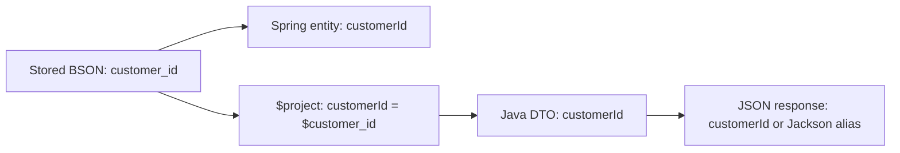

# Aliases, Computed Expressions, and Result Mapping in Spring Data MongoDB

## 1. Why Do We Need Projections and DTOs?

In a **Spring Data MongoDB** application, entities typically represent the full stored data, whereas an API or screen needs only a subset of fields with friendlier names, or even values **computed from multiple fields**. For instance, an order document has `subtotal_cents`, `shipping_cents`, and `discount_cents`; a list screen wants only `orderId`, `customerId`, and `netPayableCents`.

**Projection** is how you select or transform output fields. An **alias** is a new field name in the result. A **DTO** (*Data Transfer Object*) is a Java type designed for transferring/reading data, usually without carrying all responsibilities and state of the stored entity.

Three key questions to answer:

1. **Which fields does MongoDB return?** This is determined by `find` projections or aggregation stages like `$project` and `$set`/`$addFields`.
2. **What are the names and types of computed values?** Expressions such as `$add`, `$subtract`, `$ifNull`, `$concat`, and `$size` run on MongoDB and produce the BSON result.
3. **Which Java object does Spring Data map results into?** `MongoTemplate.aggregate(...)`, repository `@Aggregation`, or interface/class projections must align output fields with DTO properties or constructors.

This lesson in the **Projection and DTO** chapter walks through the same business requirement across `mongosh`, `MongoTemplate`, and repositories, distinguishing server-side computation from Java/SpEL computation, handling data types, missing fields, performance, and testing. Examples store money in the **smallest currency unit (cents)** as integers to avoid `double` rounding errors; real systems require their own currency unit, tax, and precision rules.

## 2. Three Kinds of "Aliases" That Are Easy to Confuse

| Mechanism | Example | Where does it take effect? | Does it modify stored data? |
|---|---|---|---|
| `@Field("customer_id")` | Java property `customerId` ↔ BSON `customer_id` | Spring Data entity mapping | No, only defines mapping rules |
| `$project` with `customerId: "$customer_id"` | Output BSON has field `customerId` | Aggregation result on MongoDB | No, only builds output |
| `@JsonProperty("customer_id")` | JSON API returns a different name from Java property | Jackson/HTTP JSON serialization | No, does not change Spring Data mapping |

One name can span multiple layers:



Do not use `@Field` merely to rename API JSON output, nor expect `@JsonProperty` to rename BSON fields. When an aggregation returns a DTO, **the projected field names** must match how the DTO is materialized, or explicit mapping/constructors must be provided.

## 3. Sample Data and Values to Compute

In a test database, create the `orders` collection:

```javascript
db.orders.insertMany([
  {
    _id: "O-101",
    customer_id: "C-01",
    status: "PAID",
    subtotal_cents: NumberLong(15000),
    shipping_cents: NumberLong(1500),
    discount_cents: NumberLong(1000),
    items: [{ sku: "P-A", qty: 2 }, { sku: "P-B", qty: 1 }],
    created_at: ISODate("2026-01-05T10:00:00Z")
  },
  {
    _id: "O-102",
    customer_id: "C-02",
    status: "PAID",
    subtotal_cents: NumberLong(20000),
    shipping_cents: NumberLong(0),
    items: [],
    created_at: ISODate("2026-01-06T10:00:00Z")
  },
  {
    _id: "O-103",
    customer_id: "C-03",
    status: "NEW",
    subtotal_cents: NumberLong(7000),
    shipping_cents: NumberLong(500),
    discount_cents: NumberLong(0),
    items: [{ sku: "P-C", qty: 1 }],
    created_at: ISODate("2026-01-07T10:00:00Z")
  }
]);
```

Rules for this lesson:

- `grossCents = subtotal_cents + shipping_cents`.
- `discountResolvedCents = discount_cents`, or `0` if the field is missing or null.
- `netPayableCents = grossCents - discountResolvedCents`.
- `lineCount` is the **number of elements** in `items`, not the sum of `qty`.
- `label = customer_id + " / " + _id`.

Expected results for orders with `status = "PAID"`:

| orderId | customerId | grossCents | discountResolvedCents | netPayableCents | lineCount | label |
|---|---|---:|---:|---:|---:|---|
| O-101 | C-01 | 16500 | 1000 | 15500 | 2 | C-01 / O-101 |
| O-102 | C-02 | 20000 | 0 | 20000 | 0 | C-02 / O-102 |

Order `O-103` is excluded because its status is not `PAID`. Document `O-102` intentionally **omits** `discount_cents` to demonstrate missing/null handling.

## 4. Simple Projection: Fetching Fewer Fields and Aliasing

### 4.1. Selecting Fields in a Find Projection

If you only need customer ID and status, you can use a `find` projection in `mongosh`:

```javascript
db.orders.find(
  { status: "PAID" },
  { customer_id: 1, status: 1, _id: 0 }
);
```

`1` includes a field, `0` excludes a field. MongoDB keeps `_id` by default when an inclusion projection is used unless `_id: 0` is explicitly stated. Aside from the `_id` exception and supported expression cases, do not arbitrarily mix inclusion and exclusion in the same projection.

With `MongoTemplate`:

```java
import java.util.List;
import org.springframework.data.mongodb.core.MongoTemplate;
import org.springframework.data.mongodb.core.query.Criteria;
import org.springframework.data.mongodb.core.query.Query;

Query query = Query.query(Criteria.where("status").is("PAID"));
query.fields()
    .include("customerId")
    .include("status")
    .exclude("id");

List<Order> partialOrders = mongoTemplate.find(query, Order.class);
```

This example assumes the `Order` entity has `customerId` with `@Field("customer_id")` and `id` with `@Id` as in Section 7. Spring Data maps Java properties to the corresponding BSON field names. **An entity loaded with a partial projection is not a complete entity for writing back:** unloaded fields may be null/default; avoid calling `save` on such an object and accidentally overwriting data.

### 4.2. Aliasing via Aggregation `$project`

If you need to rename `customer_id` to `customerId` in the **result**, use aggregation:

```javascript
db.orders.aggregate([
  { $match: { status: "PAID" } },
  {
    $project: {
      _id: 0,
      orderId: "$_id",
      customerId: "$customer_id",
      status: 1
    }
  },
  { $sort: { orderId: 1 } }
]);
```

`orderId` and `customerId` are not stored fields in the collection; they are created in the BSON output of `$project`. The `"$customer_id"` notation is a **field value reference**. Writing `customerId: "customer_id"` (without `$`) makes MongoDB emit the literal string `"customer_id"` instead of reading data.

### 4.3. Field Names in Subsequent Stages

After `$project`, the next stage sees **the projected output fields**, not the entire original document. For example:

```javascript
db.orders.aggregate([
  { $project: { _id: 0, orderId: "$_id", customerId: "$customer_id" } },
  { $sort: { customerId: 1 } }
]);
```

Here `$sort` uses `customerId`, not `customer_id`, because the original field was not carried through `$project`. If you need to compute with a source field after a projection, keep it in the output or reorder stages.

## 5. Computed Expressions with `$project`

MongoDB aggregation lets you write expressions as output values in `$project`, rather than merely copying fields.

### 5.1. Computing Gross, Discount, Net, and Line Count

```javascript
db.orders.aggregate([
  { $match: { status: "PAID" } },
  {
    $project: {
      _id: 0,
      orderId: "$_id",
      customerId: "$customer_id",
      grossCents: {
        $add: ["$subtotal_cents", "$shipping_cents"]
      },
      discountResolvedCents: {
        $ifNull: ["$discount_cents", NumberLong(0)]
      },
      netPayableCents: {
        $subtract: [
          { $add: ["$subtotal_cents", "$shipping_cents"] },
          { $ifNull: ["$discount_cents", NumberLong(0)] }
        ]
      },
      lineCount: {
        $size: { $ifNull: ["$items", []] }
      },
      label: {
        $concat: ["$customer_id", " / ", "$_id"]
      }
    }
  },
  { $sort: { orderId: 1 } }
]);
```

Explanation of each expression:

| Expression | Purpose | Type/result notes |
|---|---|---|
| `$add` | Adds subtotal and shipping fee | Preserves BSON numeric semantics; avoid string inputs |
| `$ifNull` | Replaces missing/null with a default | Does not fix wrongly typed fields |
| `$subtract` | Gross minus discount | Does not understand currency units or rounding rules |
| `$size` | Counts elements in `items` array | Requires array input; `[]` fallback only handles null/missing |
| `$concat` | Concatenates display label | If any part is null/missing, the result can be null |
| `$project` | Renames and selects output fields | Does not write back to source collection |

**Do not reference a newly created alias inside another expression of the same `$project` stage** as if it were a local variable. For example, `netPayableCents: { $subtract: ["$grossCents", ...] }` in the same `$project` as `grossCents` is not guaranteed to read the newly computed `grossCents`. In the example above, `$add` is written explicitly referencing source fields directly.

### 5.2. Using `$set` First, `$project` After to Avoid Repeating Formulas

`$set` is an alias for `$addFields`. It **adds or replaces fields in documents flowing through the pipeline** while keeping all other fields intact; `$project` then picks the final output.

```javascript
db.orders.aggregate([
  { $match: { status: "PAID" } },
  {
    $set: {
      grossCents: { $add: ["$subtotal_cents", "$shipping_cents"] },
      discountResolvedCents: {
        $ifNull: ["$discount_cents", NumberLong(0)]
      }
    }
  },
  {
    $project: {
      _id: 0,
      orderId: "$_id",
      customerId: "$customer_id",
      grossCents: 1,
      discountResolvedCents: 1,
      netPayableCents: {
        $subtract: ["$grossCents", "$discountResolvedCents"]
      },
      lineCount: {
        $size: { $ifNull: ["$items", []] }
      },
      label: {
        $concat: ["$customer_id", " / ", "$_id"]
      }
    }
  },
  { $sort: { orderId: 1 } }
]);
```

In this pipeline, `grossCents` and `discountResolvedCents` were produced by the preceding `$set` stage, so the `$project` stage may reference them. Distinguish **aggregation `$set` stages** from update commands: here we are only transforming documents **inside the pipeline**, without altering documents stored in `orders`.

## 6. Result DTOs Must Match Field Names and Data Types

MongoDB returns `aggregate` results as BSON documents. Spring Data MongoDB can convert them into `org.bson.Document`, a Java class, or a `record`/DTO matching constructors and mapping. The result DTO **does not need** to be an entity with `@Document` and does not need the same field list as the source document.

Suppose the full requirement from Section 5 is modeled as a Java record:

```java
public record OrderCard(
    String orderId,
    String customerId,
    long grossCents,
    long discountResolvedCents,
    long netPayableCents,
    int lineCount,
    String label
) {}
```

To materialize this record, the pipeline output needs these fields:

```json
{
  "orderId": "O-101",
  "customerId": "C-01",
  "grossCents": 16500,
  "discountResolvedCents": 1000,
  "netPayableCents": 15500,
  "lineCount": 2,
  "label": "C-01 / O-101"
}
```

The JSON values above only illustrate the result shape; in BSON, integers may be `Int32` or `Int64` depending on inputs and operations. The application must determine target Java types in advance. For instance, `$size` returns the array element count, usually mapping cleanly to `int`; monetary amounts computed from `NumberLong` values map appropriately to `long`.

**Key principles:**

- The `orderId` alias must match the constructor parameter/property `orderId`; MongoDB does not automatically know that alias corresponds to `@Id String id` on the source entity.
- `@Field` on the input entity explains how to read the storage schema. It does not automatically create arbitrary aliases in aggregation output.
- When an output field might be absent or null, consider using `Long`/`Integer` instead of primitives `long`/`int` in the DTO to detect missing state; better yet, handle missing/null explicitly via expressions.
- DTOs should be **read-only** objects for query results; never call `save` on a DTO as if it were a fully loaded entity.
- For immutable DTOs, parameter names and constructors must be recognized properly by your Spring Data version; Java records express output contracts cleanly.

### 6.1. Do Not Assume `_id` Always Maps to `id` in Every DTO

Raw aggregations typically keep `_id` unless excluded. For a DTO with an `orderId` property, the clear approach is:

```javascript
{
  $project: {
    _id: 0,
    orderId: "$_id"
  }
}
```

Attempting to read `_id` directly into an `orderId` constructor parameter without aliasing or mapping can lead to missing data or mis-mapping. Inspect raw output and design explicit aliases instead of guessing.

## 7. Input Entity and Typed Aggregation in Spring Data

### 7.1. Declaring an Entity Matching the Storage Schema

Java example for `orders` (classes in each block represent separate Java files):

```java
import java.time.Instant;
import java.util.List;
import org.springframework.data.annotation.Id;
import org.springframework.data.mongodb.core.mapping.Document;
import org.springframework.data.mongodb.core.mapping.Field;

@Document(collection = "orders")
public class Order {
    @Id
    private String id;

    @Field("customer_id")
    private String customerId;

    private String status;

    @Field("subtotal_cents")
    private long subtotalCents;

    @Field("shipping_cents")
    private long shippingCents;

    @Field("discount_cents")
    private Long discountCents;

    private List<OrderLine> items;

    @Field("created_at")
    private Instant createdAt;

    protected Order() {}

    public String getId() { return id; }
    public String getCustomerId() { return customerId; }
    public String getStatus() { return status; }
    public long getSubtotalCents() { return subtotalCents; }
    public long getShippingCents() { return shippingCents; }
    public Long getDiscountCents() { return discountCents; }
    public List<OrderLine> getItems() { return items; }
    public Instant getCreatedAt() { return createdAt; }
}

record OrderLine(String sku, int qty) {}
```

`@Field("customer_id")` and similar annotations instruct Spring Data to map Java properties `customerId`, `subtotalCents`, etc., to BSON fields. Constructors and `OrderLine` mapping compatibility must fit the project's Spring Data MongoDB/Java version.

Because `discount_cents` is absent in `O-102`, the entity uses `Long discountCents` instead of `long` to avoid conflating "no value" with zero in Java objects. Defaulting to `0` for reporting is expressed **in the pipeline**, not forced when reading every entity.

### 7.2. Typed Aggregation with ProjectionOperation

A small DTO needing only aliases and addition:

```java
public record OrderGrossView(
    String orderId,
    String customerId,
    long grossCents
) {}
```

Using the Spring Data Aggregation DSL:

```java
import java.util.List;
import org.springframework.data.domain.Sort;
import org.springframework.data.mongodb.core.MongoTemplate;
import org.springframework.data.mongodb.core.aggregation.Aggregation;
import org.springframework.data.mongodb.core.aggregation.AggregationResults;
import org.springframework.data.mongodb.core.query.Criteria;

Aggregation pipeline = Aggregation.newAggregation(
    Aggregation.match(Criteria.where("status").is("PAID")),
    Aggregation.project()
        .and("id").as("orderId")
        .and("customerId").as("customerId")
        .andExpression("subtotalCents + shippingCents").as("grossCents")
        .andExclude("_id"),
    Aggregation.sort(Sort.Direction.ASC, "orderId")
);

AggregationResults<OrderGrossView> result =
    mongoTemplate.aggregate(pipeline, Order.class, OrderGrossView.class);

List<OrderGrossView> cards = result.getMappedResults();
```

In `aggregate(pipeline, Order.class, OrderGrossView.class)`, `Order.class` supplies the **input type** for Spring Data mapping. The DSL expression references **Java property names** (such as `subtotalCents` and `shippingCents`); Spring translates them to the corresponding BSON field names when building the command. `OrderGrossView.class` is the **output type**.

`andExpression(...)` uses an expression syntax that Spring Data translates into the corresponding aggregation expression. For simple formulas it keeps code readable; for formulas with multiple `$ifNull`, `$cond`, arrays, and complex BSON types, dedicated builder APIs or explicit BSON stages may be clearer.

**Inspect the actual pipeline** when using `@Field`, nested properties, different Spring Data versions, or custom converters. Do not take a BSON snippet written for `mongosh` and assume every field string in the DSL maps identically across all `AggregationOperation` types.

### 7.3. Note Alias Scope After `$project`

After aliasing `customerId`, `orderId`, and `grossCents`, the `sort` stage in the example uses the output name `orderId`. If you subsequently write:

```java
Aggregation.sort(Sort.Direction.ASC, "subtotalCents")
```

then `subtotalCents` is no longer in the previous projection's output unless you kept it too. A pipeline can be syntactically valid yet yield wrong values or meaningless sorting when referencing a dropped field.

## 8. MongoTemplate with Raw BSON Stages for Full Expression Control

For multi-branch calculations or pipelines that need direct correspondence with `mongosh`, you can build a `Document`-based `AggregationOperation`. The example below computes gross and uses `$ifNull` to compute net, returning a three-field/four-field DTO:

```java
import java.util.List;
import org.bson.Document;
import org.springframework.data.domain.Sort;
import org.springframework.data.mongodb.core.aggregation.Aggregation;
import org.springframework.data.mongodb.core.aggregation.AggregationOperation;
import org.springframework.data.mongodb.core.aggregation.AggregationResults;
import org.springframework.data.mongodb.core.query.Criteria;

AggregationOperation rawProjection = context -> new Document(
    "$project",
    new Document("_id", 0)
        .append("orderId", "$_id")
        .append("customerId", "$customer_id")
        .append("grossCents",
            new Document("$add",
                List.of("$subtotal_cents", "$shipping_cents")))
        .append("netPayableCents",
            new Document("$subtract", List.of(
                new Document("$add",
                    List.of("$subtotal_cents", "$shipping_cents")),
                new Document("$ifNull",
                    List.of("$discount_cents", 0L))
            )))
);

Aggregation pipeline = Aggregation.newAggregation(
    Aggregation.match(Criteria.where("status").is("PAID")),
    rawProjection,
    Aggregation.sort(Sort.Direction.ASC, "orderId")
);

AggregationResults<OrderAmountView> result =
    mongoTemplate.aggregate(pipeline, "orders", OrderAmountView.class);
```

Corresponding DTO:

```java
public record OrderAmountView(
    String orderId,
    String customerId,
    long grossCents,
    long netPayableCents
) {}
```

**Important difference:** a raw stage constructed via `new Document("$project", ...)` does not necessarily pass through all of the typed DSL's Java-property-to-BSON-field translation. Therefore, the code **deliberately uses physical BSON field names** `customer_id`, `subtotal_cents`, `shipping_cents`, and `discount_cents`. If you change `@Field` or the storage schema, you must update corresponding raw stages.

The strength of this approach is that the BSON expression is completely explicit and easy to compare with `mongosh`. Its weakness is verbosity, field-name typo risk, and harder refactoring. For common logic, consider `Aggregation.project()`, `ArithmeticOperators`, `ConditionalOperators`, and `ArrayOperators` appropriate to your Spring Data version.

## 9. Repository @Aggregation Returning DTOs Directly

If the pipeline is fixed and you want a concise repository API, Spring Data MongoDB allows `@Aggregation` on repository methods. Example:

```java
import java.util.List;
import org.springframework.data.mongodb.repository.Aggregation;
import org.springframework.data.mongodb.repository.MongoRepository;

public interface OrderReportRepository
        extends MongoRepository<Order, String> {

    @Aggregation(pipeline = {
        "{ '$match': { 'status': ?0 } }",
        "{ '$project': { '_id': 0, " +
            "'orderId': '$_id', " +
            "'customerId': '$customer_id', " +
            "'grossCents': { '$add': " +
                "['$subtotal_cents', '$shipping_cents'] } } }",
        "{ '$sort': { 'orderId': 1 } }"
    })
    List<OrderGrossView> findGrossViewsByStatus(String status);
}
```

Invocation:

```java
List<OrderGrossView> paid =
    orderReportRepository.findGrossViewsByStatus("PAID");
```

`?0` references the first method parameter. The repository binds parameter values via Spring Data mechanisms, avoiding direct concatenation of user input into JSON queries. `$project` stages in the example still need to match output aliases and the storage schema accurately.

Advantage: concise declaration for small, stable reporting queries. Limitation: complex pipelines inside annotation strings quickly become hard to read, hard to refactor, and prone to wrong BSON field names. For multi-stage pipelines or complex business rules, placing them in a custom repository or service using `MongoTemplate` is usually easier to test and maintain.

**Distinction:** Spring Data repository `@Aggregation` is neither `@Query` for `find` queries nor an interface projection. `@Aggregation` executes a MongoDB pipeline; results are materialized into the declared return type.

## 10. Interface Projection, DTO Projection, and SpEL Expressions

An aggregation pipeline is not always necessary. Spring Data repositories support **interface-based projections** and **class-based projections** when you simply want to read a subset of an entity.

### 10.1. Closed Interface Projection: Selecting Existing Attributes

Example interface:

```java
public interface OrderCompactView {
    String getId();
    String getCustomerId();
    String getStatus();

    default String getShortLabel() {
        return getCustomerId() + " / " + getId();
    }
}
```

Repository:

```java
import java.util.List;
import org.springframework.data.mongodb.repository.MongoRepository;

public interface OrderCompactRepository
        extends MongoRepository<Order, String> {

    List<OrderCompactView> findByStatus(String status);
}
```

Getters `getId`, `getCustomerId`, and `getStatus` correspond to properties of `Order`. `getShortLabel` is a **Java default method** joining two available values. Because it relies solely on the projection's own getters, this structure can allow Spring to optimize the read field set if supported by the infrastructure/version.

This is **not** a `$concat` running on MongoDB. `getShortLabel` executes only when the application calls the method on the constructed projection object.

### 10.2. Open Projection with @Value SpEL

Spring Data supports SpEL on getters of interface projections:

```java
import org.springframework.beans.factory.annotation.Value;

public interface OrderOpenView {
    String getCustomerId();
    String getStatus();

    @Value("#{target.customerId + ' / ' + target.status}")
    String getSummary();
}
```

`target` in the expression references the backing object of the projection per Spring Data mechanics. `getSummary` is computed **on the application side**, not a field produced by MongoDB via `$project`. Because SpEL can access arbitrary properties on `target`, **open projections are generally hard to optimize for loading only required fields** compared to closed projections.

Do not use `@Value` as a default substitute for reporting calculations over millions of documents. When you need to filter, sort, group, or aggregate by computed results, prefer server-side aggregation when appropriate.

### 10.3. Class-Based Constructor Projections

Simple DTOs can use Java records:

```java
public record OrderBasicDto(
    String customerId,
    String status
) {}
```

When the repository supports class-based projections for the entity, constructor parameters align with selected properties; for instance:

```java
List<OrderBasicDto> findByStatus(String status);
```

Depending on query type, Spring Data can use constructor metadata to identify fields to read. Unlike interface projections, class-based DTOs do not typically use nested interface projections via the same mechanism. For records containing computed aliases **absent from the entity**, such as `grossCents` or `netPayableCents`, produce them in a `$project` pipeline and map the output rather than expecting derived queries to find matching properties.

### 10.4. Selection Guide by Requirement

| Requirement | Mechanism to consider first | What to watch out for |
|---|---|---|
| Fetch only a few existing properties | Closed interface projection / constructor DTO | Getters or constructors must match entity properties |
| Small string concatenation after reading a few fields | Interface projection default method | Computed in Java; cannot filter/sort in DB |
| Flexible calculation from loaded object | Open projection + `@Value` SpEL | May reduce field-selection optimization |
| Rename BSON field to returned alias | Aggregation `$project` | Alias names must match output DTO |
| Compute gross, net, count, label on server | `$project`, `$set`, aggregation expressions | BSON types, missing/null, indexes, and pipeline cost |
| Group and summarize by customer | `$group` + `$project` | Group `_id` differs from source document `_id` |
| Fixed output shape via repository | `@Aggregation` returning DTO | Long JSON strings hard to maintain; must test pipeline |
| Flexible conditions / many stages | Custom repository with `MongoTemplate` | Property path mapping and raw BSON must stay consistent |

## 11. Missing, Null, BSON Types, and Safe Computations

### 11.1. Why Is $ifNull Needed?

In the sample data, `O-102` lacks `discount_cents`. If you write:

```javascript
{
  $project: {
    netPayableCents: {
      $subtract: [
        { $add: ["$subtotal_cents", "$shipping_cents"] },
        "$discount_cents"
      ]
    }
  }
}
```

missing/null data can turn the arithmetic result into null. A DTO with primitive `long netPayableCents` will not accurately reflect the amount due if the app treats null as 0 by default or fails materialization.

Express the business rule explicitly:

```javascript
{
  $ifNull: ["$discount_cents", NumberLong(0)]
}
```

In MongoDB aggregation semantics, `$ifNull` replaces null values and nonexistent fields with the fallback. It does not convert a String like `"1000"` into `NumberLong`; if data has the wrong type, separate migration or validation is required.

### 11.2. $size Accepts Only Arrays

`$ifNull` helps when `items` is missing or null:

```javascript
lineCount: { $size: { $ifNull: ["$items", []] } }
```

However, if a malformed document has `items: "not-an-array"`, `$size` can still error because the input is not an array. When a collection has inconsistent legacy schemas, check the type first:

```javascript
lineCount: {
  $cond: [
    { $isArray: "$items" },
    { $size: "$items" },
    0
  ]
}
```

This snippet chooses `0` for non-array data, yet that is a **business decision**: in many systems you should raise an error and fix the schema rather than silently masking bad data.

### 11.3. String Concatenation, Type Conversion, and Display

`$concat` joins strings, yet a single null/missing component can make the whole result null. If a display label must always have content, define explicit fallbacks and formatting rules:

```javascript
label: {
  $concat: [
    { $ifNull: ["$customer_id", "UNKNOWN"] },
    " / ",
    { $toString: "$_id" }
  ]
}
```

In the sample data `_id` is already a String; `$toString` simply shows how to normalize input when IDs could be another BSON type. Conversions can error or return null depending on input values; handle edge schemas with `$convert` using `onError`/`onNull` when needed alongside a clear data policy.

If calculating money with `Decimal128` rather than `NumberLong`, keep numeric types consistent in `$add`/`$subtract`, and never store money as Strings. For percentages or division, consider rounding rules and type conversions; **locale-aware currency formatting** should usually happen at the API/UI layer rather than turning numbers into Strings prematurely while sorting/aggregating is still needed.

### 11.4. Primitives or Wrappers in DTOs?

| Output field | Example DTO type | When to use |
|---|---|---|
| `grossCents` | `long` | Pipeline guarantees a non-null numeric result |
| `discountResolvedCents` | `long` | Pipeline uses `$ifNull` to guarantee default `0` |
| `lineCount` | `int` | Pipeline ensures an array or safe fallback |
| `netPayableCents` | `Long` | Result cannot be guaranteed; want to detect missing/null |
| `label` | `String` | Matches output of `$concat`/`$toString` |

Choosing a primitive when output is missing can cause conversion errors or misleading defaults. Test **both the BSON shape and Java values**, not merely HTTP 200 status.

## 12. Summarizing Multiple Documents: Aliasing After $group

Many reports need totals per customer rather than per-order values. You can compute `net` per document, `$group` by customer, and `$project` output aliases:

```javascript
db.orders.aggregate([
  { $match: { status: "PAID" } },
  {
    $set: {
      netPayableCents: {
        $subtract: [
          { $add: ["$subtotal_cents", "$shipping_cents"] },
          { $ifNull: ["$discount_cents", NumberLong(0)] }
        ]
      }
    }
  },
  {
    $group: {
      _id: "$customer_id",
      orderCount: { $sum: 1 },
      totalNetCents: { $sum: "$netPayableCents" }
    }
  },
  {
    $project: {
      _id: 0,
      customerId: "$_id",
      orderCount: 1,
      totalNetCents: 1
    }
  },
  { $sort: { customerId: 1 } }
]);
```

In `$group`, `_id` **is the grouping key** `customer_id`, no longer an individual order ID. The final stage maps the grouping key to `customerId` and drops `_id` from the output. Matching DTO:

```java
public record CustomerRevenue(
    String customerId,
    int orderCount,
    long totalNetCents
) {}
```

With the sample data, the result has two rows: `C-01` totaling 15500 cents and `C-02` totaling 20000 cents, each with `orderCount=1`. When a customer has multiple orders, `totalNetCents` sums across the group. Never sum multiple currencies into one total if the collection holds mixed currencies; group by currency or convert to a single unit using deterministic exchange-rate rules.

**Note on aliases across stages:** `totalNetCents` exists only after `$group`; to filter by a revenue threshold, add a `$match` **after `$group`**, e.g. `{ $match: { totalNetCents: { $gte: 20000 } } }`. Conversely, `status: "PAID"` should filter before grouping to shrink input documents early.

## 13. How Does Projection Affect Performance?

### 13.1. Fetching Less Data Does Not Automatically Optimize the Query

Projection can reduce network payload and Java object materialization cost, yet total cost still depends on filtering, indexes, sorting, aggregation stages, and documents examined. A `$project` producing fewer fields does not guarantee the server avoids reading full documents or scanning many keys.

Example index for filter criteria and chronological order:

```javascript
db.orders.createIndex(
  { status: 1, created_at: -1 },
  { name: "ix_orders_status_created" }
);
```

Pipeline listing paid orders chronologically:

```javascript
db.orders.aggregate([
  { $match: { status: "PAID" } },
  { $sort: { created_at: -1 } },
  { $limit: 20 },
  {
    $project: {
      _id: 0,
      orderId: "$_id",
      customerId: "$customer_id"
    }
  }
]);
```

When `$match` and `$sort` align with an index, MongoDB can use the index before materializing the projection. Sometimes the optimizer reorders stages automatically, yet **do not rely on the optimizer to fix a logically flawed pipeline** or expect every expression to be pushed down into an index.

### 13.2. Caution When Sorting by Computed Aliases

Example:

```javascript
db.orders.aggregate([
  {
    $set: {
      grossCents: { $add: ["$subtotal_cents", "$shipping_cents"] }
    }
  },
  { $sort: { grossCents: -1 } },
  { $limit: 10 }
]);
```

`grossCents` is computed inside the pipeline and does not exist in the collection. B-tree indexes on `subtotal_cents` or `shipping_cents` **do not automatically index their sum**. If workloads are very large and frequently filter/sort by gross, consider storing a materialized/computed field maintained on writes, indexing it, or building precomputed reports. This trades write overhead and consistency complexity for read speed.

### 13.3. Measuring Pipelines with explain

In `mongosh`:

```javascript
db.orders.explain("executionStats").aggregate([
  { $match: { status: "PAID" } },
  {
    $project: {
      _id: 0,
      orderId: "$_id",
      grossCents: { $add: ["$subtotal_cents", "$shipping_cents"] }
    }
  }
]);
```

Depending on MongoDB version and chosen plan, inspect `winningPlan`, `IXSCAN`/`COLLSCAN`, keys/documents examined, returned count, and latency. On a three-document collection, `COLLSCAN` may still be picked; benchmark on realistically sized and distributed data before drawing conclusions.

Other considerations:

- Apply tenant/authorization `$match` **before** returning results so other tenants' data is never touched.
- Bound results with `$limit` and proper pagination. Deep `$skip` can be expensive; for real-time feeds, consider keyset/range pagination.
- Never treat `$project` as the **only security control**. Collection permissions, tenant filters, and data policies must be enforced independently.
- For large `$group` reports, monitor memory, disk spill usage, and cluster load; do not simply grow the connection pool to compensate for an overly heavy pipeline.
- If the same report runs frequently, consider caching, materialized views, or controlled data pipelines instead of recomputing everything per request.

## 14. Testing from BSON to DTO

A solid test suite proves **three layers**: source BSON data, pipeline BSON results with exact aliases, and mapped Java objects with expected types and values.

### 14.1. Inspecting Raw Output to Verify Field Names

With the raw pipeline in Section 8, before returning `OrderAmountView` you can temporarily request `Document.class` results:

```java
AggregationResults<org.bson.Document> rawResult =
    mongoTemplate.aggregate(pipeline, "orders", org.bson.Document.class);

for (org.bson.Document resultDoc : rawResult.getMappedResults()) {
    System.out.println(resultDoc.toJson());
}
```

Verify the raw result contains `orderId`, `customerId`, `grossCents`, and `netPayableCents`, and omits `_id` due to `_id: 0`. Do not guess alias names from Java record names without inspecting raw BSON output. Avoid logging sensitive data in production; this snippet is for test debugging.

### 14.2. Integration Test Against Real MongoDB

JUnit 5 and AssertJ example assuming a Spring Boot test environment with `MongoTemplate`, the `Order` entity, and the `OrderGrossView` record from earlier sections:

```java
import java.util.List;
import org.bson.Document;
import org.junit.jupiter.api.BeforeEach;
import org.junit.jupiter.api.Test;
import org.springframework.beans.factory.annotation.Autowired;
import org.springframework.boot.test.autoconfigure.data.mongo.DataMongoTest;
import org.springframework.data.domain.Sort;
import org.springframework.data.mongodb.core.MongoTemplate;
import org.springframework.data.mongodb.core.aggregation.Aggregation;
import org.springframework.data.mongodb.core.query.Criteria;

import static org.assertj.core.api.Assertions.assertThat;

@DataMongoTest
class OrderProjectionTest {
    @Autowired
    MongoTemplate template;

    @BeforeEach
    void seed() {
        // Only clear data in an isolated test database.
        template.getCollection("orders").deleteMany(new Document());

        template.getCollection("orders").insertMany(List.of(
            new Document("_id", "O-101")
                .append("customer_id", "C-01")
                .append("status", "PAID")
                .append("subtotal_cents", 15000L)
                .append("shipping_cents", 1500L)
                .append("discount_cents", 1000L),
            new Document("_id", "O-102")
                .append("customer_id", "C-02")
                .append("status", "PAID")
                .append("subtotal_cents", 20000L)
                .append("shipping_cents", 0L),
            new Document("_id", "O-103")
                .append("customer_id", "C-03")
                .append("status", "NEW")
                .append("subtotal_cents", 7000L)
                .append("shipping_cents", 500L)
        ));
    }

    @Test
    void aliasesAndComputedGrossMapToRecord() {
        Aggregation aggregation = Aggregation.newAggregation(
            Aggregation.match(Criteria.where("status").is("PAID")),
            Aggregation.project()
                .and("id").as("orderId")
                .and("customerId").as("customerId")
                .andExpression("subtotalCents + shippingCents")
                    .as("grossCents")
                .andExclude("_id"),
            Aggregation.sort(Sort.Direction.ASC, "orderId")
        );

        List<OrderGrossView> cards =
            template.aggregate(
                aggregation, Order.class, OrderGrossView.class)
                .getMappedResults();

        assertThat(cards)
            .extracting(OrderGrossView::orderId)
            .containsExactly("O-101", "O-102");

        assertThat(cards)
            .extracting(OrderGrossView::customerId)
            .containsExactly("C-01", "C-02");

        assertThat(cards)
            .extracting(OrderGrossView::grossCents)
            .containsExactly(16500L, 20000L);
    }
}
```

This test verifies `id → _id` and `customerId → customer_id` mappings, addition, and output aliasing. Specific Spring Boot versions may differ in `@DataMongoTest` package or test context setup; cross-check your dependencies. Never run `deleteMany(new Document())` on a shared database as it wipes the entire collection.

### 14.3. Minimum Test Case Suite

| Test case | Expected verification |
|---|---|
| Two `PAID` orders | Pipeline returns only `O-101`, `O-102` |
| Source field name `customer_id` | Output has `customerId` with correct value |
| `_id: 0` and `orderId: "$_id"` | No `_id` in output; `orderId` is accurate |
| `$add` and `$subtract` | Gross/net are 16500/15500 and 20000/20000 respectively |
| Missing discount | `$ifNull` yields 0, no null result |
| `items: []` | `lineCount=0` |
| Non-array `items` | Error or fallback behavior is controlled |
| Alias field then sort | Sort uses the post-projection alias name |
| DTO constructor missing an alias | Mis-mapping or unexpected data is caught |
| Output field is BSON Double instead of Long | Clear conversion/validation rules exist |
| Raw pipeline vs. typed DSL | Both pipelines produce identical outputs per contract |
| Multi-tenant access | Tenant filter applied before returning data |

For Java records with primitive fields, specifically test omitted fields so bugs are not masked by primitive defaults. Test both `MongoTemplate.aggregate(...)` and repository `@Aggregation` if both paths are used in the project.

## 15. Common Design Mistakes

| Mistake | Consequence | Fix |
|---|---|---|
| Putting `@Field` on entity expecting JSON API rename | Changes BSON mapping, not API names | Alias output in `$project` or JSON layer |
| DTO has `getTotal()` while output alias is `grossCents` | No value maps to the property | Synchronize output field names with DTO/constructor |
| Forgetting `_id: 0` in `$project` | `_id` remains unexpectedly in output | Exclude `_id` when output contract does not need it |
| Referencing newly computed `"$grossCents"` in the same `$project` | Reference does not exist yet in stage input | Repeat expression or add a preceding `$set` stage |
| Using Java name `customerId` in a raw `Document` stage | MongoDB reads nonexistent field | Use `customer_id`, or use typed DSL with mapping |
| `$size` on legacy String field | Aggregation fails because input is not an array | Validate schema; use `$isArray` if fallback is needed |
| Missing `$ifNull` on discount | Total becomes null; inconsistent DTO | Define explicit business fallback |
| Using primitives for potentially missing values | Masks nulls or fails materialization | Use wrappers/validation or guarantee populated output |
| Using `@Value` SpEL believing MongoDB computed it | May over-fetch data and cannot filter/sort by it in DB | Distinguish client-side evaluation from server-side aggregation |
| Calling `save(...)` on a DTO projection | May overwrite/replace document destructively | DTOs are read-only; update via entity or atomic field updates |
| Sorting by computed field expecting normal index use | May compute and sort many documents | Materialize/index value if workload requires it |
| Projecting data while skipping authorization | Risk of leaking another tenant's data | Enforce permissions and scoped `$match` |

When results look wrong, diagnose in order: **source BSON → running pipeline → raw BSON output → DTO conversion → JSON API**. This separates field-name bugs, formula bugs, null/type issues, and API serialization bugs.

## 16. Comprehensive Practice

**Scenario:** design an endpoint listing paid orders. Output has only order ID, customer, net payable amount, line count, and display label. MongoDB stores subtotal, shipping, and discount in three separate fields.

1. Seed the data from Section 3 into a test database.
2. Write the `$match + $project` pipeline per Section 5, verify the two `PAID` orders and exact calculated values.
3. Rewrite as `$match + $set + $project` to avoid repeating the gross expression, and explain the difference between the two pipelines.
4. Declare the `Order` entity with `@Field` and record `OrderGrossView`. Use typed `MongoTemplate.aggregate(...)` to alias and compute gross.
5. Create `OrderReportRepository` with `@Aggregation`, read into the same `OrderGrossView` record, and compare results.
6. Use `OrderCard` with full outputs: net, defaulted discount, `lineCount`, and `label`; inspect raw BSON before DTO mapping.
7. Test adding documents with `discount_cents: null`, missing `items`, or wrong-typed `items`; decide the handling policy for each case.
8. Sum per customer using `$group` and map results to `CustomerRevenue`.
9. Create index `{ status: 1, created_at: -1 }`, run `explain("executionStats")`, and compare sorting by `created_at` versus sorting by computed `grossCents`.
10. Write integration tests for alias names, numeric types, filtering, ordering, and missing/null behavior.

**Completion criteria:** accurately explain the difference between `@Field` BSON aliases, `$project` output aliases, and JSON aliases; distinguish database computations from Java/SpEL; map outputs into strongly typed DTOs/records; and verify pipelines for both correctness and performance.

## 17. Summary of Technical Decisions

| Question | Guideline |
|---|---|
| Only need a few existing fields? | Use `find` projection, closed interface projection, or constructor DTO |
| Need renaming or server-side computation? | Use `$project` and aggregation expressions |
| Need to reuse an alias in a later stage? | Create the alias in an earlier `$set`/`$project` stage |
| Want to map into a record? | Output field names/types must match a Spring Data-supported DTO |
| Entity has `@Field`? | Typed DSL maps Java properties; raw stages should use physical BSON fields |
| Missing/null data? | Use `$ifNull`, validation, and appropriate Java types |
| Need calculations across documents? | `$group` then alias output with `$project` |
| Need performance optimization? | Filter with indexes early, limit results, measure `explain` and expression cost |
| Need lightweight calculations in Java projection? | Default methods or SpEL; remember it is not server-side aggregation |

Good projections reduce data transferred to the application and establish clear result contracts. Their value lies not only in **fewer fields**, but in aligning **aliases, computations, BSON types, DTO mapping, and missing-data rules** so Spring Data MongoDB, the driver, and the API never disagree on the same report.

**References by project version:** [Spring Data MongoDB — Aggregation Framework Support](https://docs.spring.io/spring-data/mongodb/reference/mongodb/aggregation-framework.html), [Spring Data Commons — Projections](https://docs.spring.io/spring-data/commons/reference/repositories/projections.html), [MongoDB — $project](https://www.mongodb.com/docs/manual/reference/operator/aggregation/project/), [MongoDB — $addFields](https://www.mongodb.com/docs/manual/reference/operator/aggregation/addFields/), and [MongoDB — $ifNull](https://www.mongodb.com/docs/manual/reference/operator/aggregation/ifNull/). Verify API names and conversion behavior against your deployed Spring Data MongoDB/Java Driver version.
