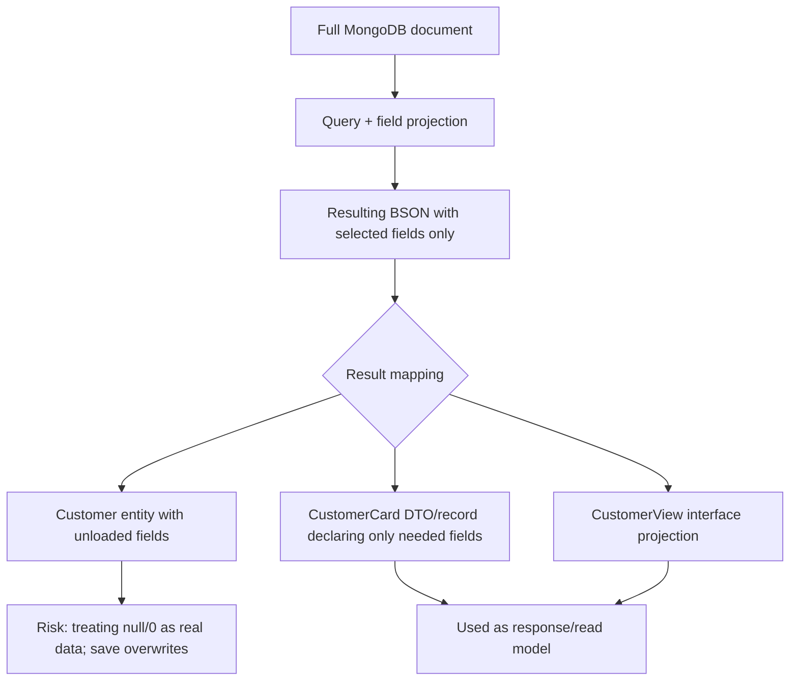
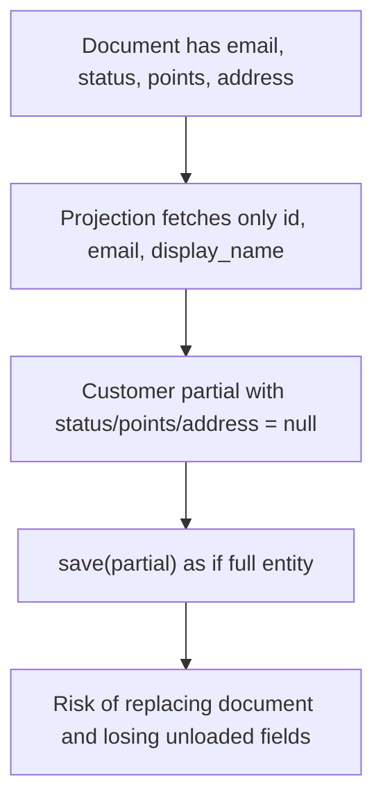

# Distinguishing Missing-Field Results from Full Entities

## 1. The Problem: A Java Object Is Not Necessarily a Fully Loaded Entity

In **Spring Data MongoDB**, repositories and `MongoTemplate` can read entire MongoDB documents or fetch only needed fields through **projection**. Projection reduces data transferred from MongoDB and mapping overhead when the query actually excludes fields on the server. In return, the resulting Java object may **not hold all stored state**.

Suppose the `customers` collection has a document:

```javascript
{
  _id: "customer-101",
  email: "lan@example.com",
  display_name: "Lan Nguyen",
  status: "ACTIVE",
  rewardPoints: NumberLong("120"),
  address: {
    city: "Da Nang",
    street: "Tran Phu"
  }
}
```

A search page needs only `_id`, `email`, and `display_name`. Query projection:

```javascript
db.customers.find(
  { status: "ACTIVE" },
  { _id: 1, email: 1, display_name: 1 }
);
```

Resulting shape:

```javascript
{
  _id: "customer-101",
  email: "lan@example.com",
  display_name: "Lan Nguyen"
}
```

The database document **still has** `status`, `rewardPoints`, and `address`. They are simply **absent from this query's result**. If you map that result back into the same `Customer` class, unreturned properties may take Java defaults such as `null`, `0`, or `false`. Those defaults are not proof that the database deleted the data.

**Main takeaway of this lesson in the Projection and DTO chapter:** distinguish **the source document**, **the field set returned by the query**, **the mapped Java object**, and **the DTO returned to clients**. Confusing these layers causes display bugs, faulty business checks, or data overwrites when calling `save` on a partial entity.

## 2. Four Concepts to Keep Separate



| Concept | What does it mean? | What does it NOT mean? |
| --- | --- | --- |
| **Full document** | Actual data stored in MongoDB at read time | Every field is guaranteed to be non-null |
| **Field projection** | List of fields allowed to appear in query results | MongoDB deleted the unselected fields |
| **Partially populated entity** | Entity class built from results having only a few fields | Entity holds complete state safe for updating back |
| **DTO / projection interface** | Read model with a contract containing only consumed attributes | DTO automatically guarantees security or full server-side optimization |

In the **SPRING_DATA_MONGODB** module, access paths such as `MongoTemplate`, `MongoRepository`, `ReactiveMongoTemplate`, and reactive repositories can all work with projections. Document structure, converters, field name mappings, indexes, and update consistency must still be designed separately.

## 3. Distinguishing Missing Fields, BSON Null, and Projection-Excluded Fields

All three cases below can produce `customer.getRewardPoints() == null` in Java, yet they carry very different meanings.

### 3.1. Source Document Lacks the Field

```javascript
{ _id: "c-1", email: "a@example.com" }
```

Here `rewardPoints` **was never stored**. It may come from a legacy schema, optional data, an incomplete write path, or a migration gap.

### 3.2. Source Document Contains BSON Null

```javascript
{ _id: "c-2", email: "b@example.com", rewardPoints: null }
```

The `rewardPoints` key **exists**, with a BSON `null` value. When mapped into `Long`, the Java property is typically `null`.

### 3.3. Document Has Data, Yet Projection Excluded the Field

```javascript
// Source document:
{ _id: "c-3", email: "c@example.com", rewardPoints: NumberLong("120") }

// Read only _id and email:
db.customers.find(
  { _id: "c-3" },
  { _id: 1, email: 1 }
);
```

The result lacks `rewardPoints` even though MongoDB still stores `120`. If a mapper constructs a `Customer`, the getter for `Long rewardPoints` returns `null` identically to the first two cases.

### 3.4. Inspecting Source Values When You Must Distinguish Them

```javascript
// Find documents without the rewardPoints key:
db.customers.find({
  rewardPoints: { $exists: false }
});

// Has the key with a null value:
db.customers.find({
  rewardPoints: { $exists: true, $eq: null }
});

// Inspect field types, including missing cases:
db.customers.aggregate([
  {
    $project: {
      rewardPointsType: { $type: "$rewardPoints" }
    }
  },
  { $limit: 50 }
]);
```

MongoDB `{ rewardPoints: null }` matches both **missing** documents and documents with BSON null. If business rules must distinguish them, use `$exists` or controlled direct BSON reads. **An entity read from a partial projection does not provide enough evidence** to classify the underlying database state.

## 4. Creating a Java Entity for Illustration

To trace read paths, use a `Customer` entity and `Address` value object. Using `Long` and `String` fields makes unloaded state easy to spot; we avoid primitive `long` in the main example because `0` could be mistaken for an actual zero-point balance.

```java
package example.customers;

public record Address(String city, String street) {}
```

```java
package example.customers;

import org.springframework.data.annotation.Id;
import org.springframework.data.mongodb.core.mapping.Document;
import org.springframework.data.mongodb.core.mapping.Field;

@Document(collection = "customers")
public class Customer {
    @Id
    private String id;

    private String email;

    @Field("display_name")
    private String displayName;

    private String status;
    private Long rewardPoints;
    private Address address;

    public Customer() {}

    public Customer(
            String id,
            String email,
            String displayName,
            String status,
            Long rewardPoints,
            Address address) {
        this.id = id;
        this.email = email;
        this.displayName = displayName;
        this.status = status;
        this.rewardPoints = rewardPoints;
        this.address = address;
    }

    public String getId() { return id; }
    public String getEmail() { return email; }
    public String getDisplayName() { return displayName; }
    public String getStatus() { return status; }
    public Long getRewardPoints() { return rewardPoints; }
    public Address getAddress() { return address; }
}
```

`@Field("display_name")` indicates that Java property `displayName` corresponds to BSON field `display_name`. In queries backed by entity mapping metadata, Spring Data translates Java property paths to matching BSON names. When querying directly in `mongosh`, use the actual stored field name.

### 4.1. Full Read with MongoTemplate

```java
import org.springframework.data.mongodb.core.MongoTemplate;

Customer customer =
    mongoTemplate.findById("customer-101", Customer.class);

// When the illustrative document exists in full:
// customer.getRewardPoints() == 120L
// customer.getStatus().equals("ACTIVE")
// customer.getAddress().city().equals("Da Nang")
```

`findById` specifies no field projection, so it requests the full document under normal mapping. Still, **reading the full document** does not guarantee every field has a valid value: the source document itself may omit fields or contain BSON null.

## 5. Reading Partial Fields with MongoTemplate

### 5.1. include() to Select Fields

```java
package example.customers;

import org.springframework.data.mongodb.core.MongoTemplate;
import org.springframework.data.mongodb.core.query.Criteria;
import org.springframework.data.mongodb.core.query.Query;

public class CustomerQueryService {
    private final MongoTemplate template;

    public CustomerQueryService(MongoTemplate template) {
        this.template = template;
    }

    public Customer findPartialEntity(String id) {
        Query query = Query.query(
            Criteria.where("id").is(id)
        );
        query.fields()
            .include("email")
            .include("displayName");

        return template.findOne(query, Customer.class);
    }
}
```

With the `Customer` entity above, Spring Data maps `displayName` to `display_name`. Because MongoDB normally **keeps `_id` in inclusion projections unless explicitly excluded**, the loaded object contains `id`, `email`, and `displayName`, while `status`, `rewardPoints`, and `address` are not returned.

```java
Customer partial = service.findPartialEntity("customer-101");

// With the sample document:
// partial.getId().equals("customer-101")  -> true
// partial.getEmail().equals("lan@example.com") -> true
// partial.getDisplayName().equals("Lan Nguyen") -> true
// partial.getRewardPoints() == null       -> true
// partial.getAddress() == null            -> true
// partial.getStatus() == null             -> true
```

The comments reflect expected outcomes for a class with a no-arg constructor and reference fields as shown; a class with required constructor parameters, initializers, or callbacks may behave differently.

**Do not name a variable `partial` and later forget its origin.** From Java's type perspective, `partial` is still a `Customer` with all getters, yet it lacks the data required for operations needing full state.

### 5.2. include() and exclude() Do Not "Delete Fields"

```java
Query query = new Query();
query.fields().exclude("address");
```

With a projection excluding only `address`, MongoDB returns all other fields except the excluded one. Choosing `include` versus `exclude` depends on requirements and data cost. For a screen needing only three fields, explicit `include` generally controls payloads better.

MongoDB restricts mixing `include` and `exclude` in the same projection, with exceptions like `_id`. Do not construct conflicting field projections assuming the framework will fix them for you.

## 6. Partial Entities Are Most Dangerous When Passed Back to save()

### 6.1. A Common Mistake

Suppose application code reads a summary, updates the display name, and calls `save`:

```java
// DO NOT USE THIS PATTERN FOR PARTIALLY LOADED ENTITIES:
Customer partial = service.findPartialEntity("customer-101");

// ... mutate some properties on partial ...
mongoTemplate.save(partial);
```

`save` on an entity with an ID is not an instruction to "update only the fields selected in the previous query." It typically performs a save/replace of the document matching the current object's state. Because `partial` lacks `status`, `rewardPoints`, and `address`, fields previously in the source document **risk being wiped or overwritten**, depending on mapping and null-handling rules.



Key point: **there is no default dirty tracking for fields omitted by projection**. Repository `save` cannot tell whether you intentionally skipped loading `rewardPoints` or genuinely want to remove it.

### 6.2. @Version Does Not Make a Partial Entity Safe

If an entity uses `@Version` for optimistic locking, an object loaded partially without the version field may no longer carry the metadata needed for valid updates. Saving may fail, be misclassified as a different version state, or exhibit unexpected behavior depending on ID/version types and Spring Data version.

**Do not treat `@Version` as a cure for this bug.** To use optimistic locking properly, load a valid version and execute an update following the right contract. For updating a few fields, conditional `Update` (including version if needed) is usually much clearer.

### 6.3. When Updating Specific Fields, Use Field-Level Update

```java
import org.springframework.data.mongodb.core.query.Criteria;
import org.springframework.data.mongodb.core.query.Query;
import org.springframework.data.mongodb.core.query.Update;

public void changeDisplayName(
        MongoTemplate template, String id, String newName) {

    Query query = Query.query(Criteria.where("id").is(id));
    Update update = new Update().set("displayName", newName);

    template.updateFirst(query, update, Customer.class);
}
```

In this typed operation, Spring Data maps property `displayName` to BSON field `display_name` and updates only that field without reconstructing the entire `Customer` object in memory.

If business logic needs precondition checks or ordering guarantees, add query criteria, optimistic locking, transactions, or appropriate update logic. A plain `updateFirst` alone does not solve every concurrency issue.

### 6.4. Alternative: Load the Full Entity for Intentional Replacement

If you genuinely need to update **the entire document** in an edit workflow, load the full entity via `findById`, run business validation, and save under the system's concurrency rules. Never treat a projected entity as a safe replacement. For objects with sensitive fields or concurrent updates, consider versioning and dedicated input DTOs.

## 7. DTOs: Explicitly Stating "I Only Need Three Fields"

Instead of loading data into `Customer` and risking two meanings for `null`, create a read model containing only the attributes the screen needs:

```java
package example.customers;

public record CustomerCard(
    String id,
    String email,
    String displayName
) {}
```

`CustomerCard` has no `rewardPoints`, `address`, or `status`. When code calls `card.email()` or `card.displayName()`, the intent is unambiguous: this is a **summary data view**, not an entity allowed to be saved.

### 7.1. Class-Based Projection via Repository

```java
package example.customers;

import java.util.List;
import org.springframework.data.mongodb.repository.MongoRepository;

public interface CustomerRepository
        extends MongoRepository<Customer, String> {

    List<CustomerCard> findByStatus(String status);
}
```

Spring Data supports **class-based projections**. With a Java record whose canonical constructor aligns with domain properties, the framework has the metadata to build DTO results. Actual server-side field elimination and materialization depend on Spring Data version, projection style, query/mapping, and custom converters: **do not assume the query selects only three fields from the return type alone**.

In this example, `status` acts as a **filter criterion** and does not have to appear in the returned DTO. To be certain network traffic includes only intended fields, inspect the actual query command BSON or run integration tests with query observation.

### 7.2. Interface-Based Projection

```java
package example.customers;

public interface CustomerView {
    String getId();
    String getEmail();
    String getDisplayName();
}
```

Another repository method:

```java
List<CustomerView> findAllByStatus(String status);
```

This is a **closed interface projection**: getters reference entity properties directly. Spring Data can leverage the declared property set to optimize fetched fields in supported scenarios. However, a projection interface is a **read contract**, not an entity to pass to `repository.save`.

### 7.3. Open Projections Are Not Equivalent to Simple Field Selection

```java
import org.springframework.beans.factory.annotation.Value;

public interface CustomerLabelView {
    String getEmail();

    @Value("#{target.displayName}")
    String getLabel();
}
```

An **open projection** using SpEL can reference the target object in ways that prevent the framework from knowing all required fields upfront. Hence, optimizing the query to select only specific fields **is not guaranteed** like a closed projection. Be careful with SpEL expressions on null/missing data or expensive invocations.

**Set the right expectation:** DTOs clarify the data contract for callers. They do not guarantee uniform server-side optimization across all projection styles. Inspect actual queries when I/O reduction is the goal.

## 8. Dynamic Projection: Same Filter, Multiple Data Views

In a repository, you can allow selecting the result type at call time:

```java
public interface CustomerRepository
        extends MongoRepository<Customer, String> {

    <T> List<T> findByStatus(String status, Class<T> type);
}
```

In this example, the method above can be added to the same `CustomerRepository` interface rather than duplicating the interface across files. Calling it:

```java
List<CustomerCard> cards =
    repository.findByStatus("ACTIVE", CustomerCard.class);

List<CustomerView> views =
    repository.findByStatus("ACTIVE", CustomerView.class);
```

This is handy when one filter serves both summary and detail screens. However, **never let clients pick arbitrary `Class<?>` values** via HTTP requests. Services should pick projection types from an approved list, and API responses must be governed by DTOs and authorization checks.

## 9. Returning Entities or DTOs via @Query(fields = ...)

### 9.1. Specifying Fields While Returning an Entity: Possible, Yet Must Stay "Read-Only"

```java
import java.util.List;
import org.springframework.data.mongodb.repository.Query;

@Query(
    value = "{ 'status': ?0 }",
    fields = "{ '_id': 1, 'email': 1, 'display_name': 1 }"
)
List<Customer> findPartialCustomersByStatus(String status);
```

This method declaration belongs inside `CustomerRepository`. Spring Data returns `Customer`, yet unselected fields are not populated. That is a **partial entity**, not a full entity, even though the Java type is the same.

Prefer returning a dedicated read model instead of passing partial entities across system layers. Method names should also signal to readers that this is a summary query, preventing accidental use in update flows.

### 9.2. Considerations When Using a DTO

```java
@Query(
    value = "{ 'status': ?0 }",
    fields = "{ '_id': 1, 'email': 1, 'display_name': 1 }"
)
List<CustomerCard> findCardsByStatus(String status);
```

This instructs the framework to map query results into `CustomerCard`. When custom mappings exist or BSON field names differ from constructor parameter names, test the actual mapping rather than assuming from `@Query`. When a DTO needs only selected fields, tests should verify both accurate mapped values and absence of unintended sensitive reads.

### 9.3. @Query(fields) Is Not a Serialization Filter

When an API uses Jackson to serialize an entity, JSON output also depends on getters, Jackson annotations, DTOs, and serialization configuration. MongoDB projection controls **data returned by the query**, whereas HTTP JSON shaping is a separate step.

Suppose an entity has an `internalNotes` field: omitting it from one query does not prove every endpoint is safe. Another endpoint might load the full entity and accidentally serialize it to JSON. Protect sensitive fields with appropriate DTOs, authorization, and API contract tests rather than relying on one repository method's projection.

## 10. Nested Objects, Primitives, and Nullability

### 10.1. When Only Part of a Child Document Is Loaded

Source document:

```javascript
{
  _id: "customer-101",
  address: { city: "Da Nang", street: "Tran Phu" }
}
```

A projection might select only:

```javascript
db.customers.find(
  { _id: "customer-101" },
  { "address.city": 1 }
);
```

The result contains `address` with `city` while omitting `street`. If mapped to `Address`, the child object may be constructed with partial data depending on the value object/constructor. Do not assume that because `address != null`, the entire address is complete.

With nested interface projections, the framework may need to materialize a broader child structure than expected. When performance matters, measure actual BSON queries and transferred bytes instead of assuming every nested projection performs minimal field selection.

### 10.2. Primitives Hide Unloaded Data

If an entity declares:

```java
private long rewardPoints;
private boolean verified;
```

then a fresh instance where those fields were not loaded defaults to `0` and `false`. If the MongoDB document stores `rewardPoints: 120` and `verified: true` while the projection excludes both, business logic could wrongly conclude the customer actually has 0 points and is unverified.

When code must distinguish **absent/unloaded** state from `0`/`false`, use wrappers `Long`/`Boolean` or dedicated DTOs. Even so, a null wrapper still does not by itself prove data is absent in the database; inspect the query path.

### 10.3. Constructors, Immutable Records, and Kotlin Nullability

An entity with required constructor arguments or a non-null-tolerant record may fail to map results missing fields in the same way a mutable class with a no-args constructor does. In Kotlin, non-null types without defaults can also throw when a field is missing.

Therefore, **DTOs used for projections should be designed to mirror the exact selected fields**, while entities with strict invariants should be loaded in full when executing business operations relying on those invariants.

## 11. When to Use Projection, DTO, or Full Entity?

| Requirement | Usually suitable choice | Why |
| --- | --- | --- |
| List page displaying only name and email | DTO/closed projection | Compact contract; avoids confusion with full entities |
| Update one field by ID | `MongoTemplate.updateFirst` or suitable update operation | Avoids loading/rewriting the whole document |
| Workflow validating full state before updating | Full entity, versioning, and business validation | Needs complete data to uphold invariants |
| API returning data to external clients | Dedicated response DTO | Controls exposed fields and access rights |
| Aggregation computing labels/totals | Aggregation result DTO | Output no longer matches entity schema |
| Checking existence only | `existsBy...` or existence query | Avoids transferring full documents |
| Counting only | `count...` | Avoids transferring unnecessary documents |
| Large data reporting | Projection + pagination/streaming | Cuts payload and prevents loading too much into RAM |

Choosing a projection is not just bandwidth optimization. It defines a **data read boundary**: which fields are needed, which are permitted, and whether the returned object may be treated as an updatable entity.

## 12. Reactive Repositories: Missing Fields Are Not Automatically "Filled In"

In reactive Spring Data MongoDB, repositories offer the same projection styles. The main difference is returning results via `Mono` and `Flux`:

```java
package example.customers;

import org.springframework.data.mongodb.repository.ReactiveMongoRepository;
import reactor.core.publisher.Flux;
import reactor.core.publisher.Mono;

public interface ReactiveCustomerRepository
        extends ReactiveMongoRepository<Customer, String> {

    Flux<CustomerCard> findByStatus(String status);

    Mono<CustomerView> findProjectedById(String id);
}
```

`Mono<CustomerView>` completes empty if the ID is not found, and `Flux<CustomerCard>` emits 0, 1, or more items. Still, **publishers do not fetch fields excluded by projection**. If a DTO lacks `rewardPoints`, turning a `Flux` into a `List` via `collectList()` will not make that data appear.

```java
import java.util.List;
import reactor.core.publisher.Mono;

Mono<List<CustomerCard>> cards = repository
    .findByStatus("ACTIVE")
    .collectList();
```

For large lists, `collectList()` buffers all items in memory; apply limits, pagination, or streaming based on workload. Reactive execution improves I/O concurrency, yet **does not replace projection design, indexing, or safe update strategies**.

### 12.1. Do Not "Rehydrate" a DTO into a Fake Entity to Save

A common mistake is receiving `CustomerCard` from a query, constructing a new `Customer` with only `id`, `email`, and `displayName`, and calling reactive `save`. That is still saving **incomplete state** and carries the exact same data-loss risk as imperative code. When only changing the display name, use a targeted field update and handle errors/concurrency in the reactive pipeline.

## 13. Indexes and Field Projection Performance

### 13.1. Projection Cuts Payload, Does Not Fix Slow Queries

For a list screen:

```javascript
db.customers.find(
  { status: "ACTIVE" },
  { _id: 1, email: 1, display_name: 1 }
);
```

MongoDB still must locate documents matching `status`. Without an appropriate index on a large collection, projection does not prevent scan overhead. You can evaluate:

```javascript
db.customers.createIndex({
  status: 1,
  email: 1,
  display_name: 1
});
```

This index **is only a candidate** for the illustrative workload, not mandatory. Whether a compound index makes sense depends on cardinality, sort queries, index size, write ratio, and operational overhead.

### 13.2. Covered Queries Require Empirical Verification

When both filter criteria and selected fields can be satisfied from an index, a query can achieve **covered query** status without fetching source documents. However, in inclusion projections MongoDB normally still includes `_id` unless excluded; an index omitting `_id` may keep the query **uncovered**.

For instance, if the UI does not need ID:

```javascript
db.customers.find(
  { status: "ACTIVE" },
  { _id: 0, email: 1, display_name: 1 }
).explain("executionStats");
```

Never add `_id: 0` if the app needs keys for navigation/updates or the DTO expects an ID. Establish requirements before tuning indexes and projections. Read metrics like `totalDocsExamined`, `totalKeysExamined`, plan stages, and actual payload to evaluate.

### 13.3. Specifying Fields in a Repository Query Does Not Prove Optimization

Across interface projections, DTO projections, nested projections, or custom converters, how Spring Data constructs BSON filters/projections varies. Some projections optimize field selection, while others load more data to materialize views. To confirm actual optimization:

1. Inspect MongoDB commands/filters/projections via an appropriate observation tool.
2. Check transferred bytes and latency on representative data.
3. Run `explain("executionStats")` on the equivalent query.
4. Weigh DTO instantiation, serialization cost, and N+1 risks if the service issues extra queries.

Do not treat the property count on a Java interface as an accurate measure of bytes returned by the server.

## 14. Testing: Comparing Source Document, Full Entity, and Partial Entity

### 14.1. Testing Goals

A worthwhile integration test should simultaneously verify:

1. The MongoDB document actually holds `rewardPoints` and `address`.
2. A full read query maps those fields into `Customer`.
3. A query selecting only `email` and `displayName` produces an object missing the remaining fields.
4. The source document remains unchanged after a **projected read**.
5. A targeted `Update.set` updates only the target field without losing other data.

### 14.2. Testing with MongoTemplate and Raw BSON

```java
package example.customers;

import static com.mongodb.client.model.Filters.eq;
import static org.junit.jupiter.api.Assertions.*;

import java.util.UUID;
import org.bson.Document;
import org.junit.jupiter.api.Test;
import org.springframework.beans.factory.annotation.Autowired;
import org.springframework.boot.test.autoconfigure.data.mongo.DataMongoTest;
import org.springframework.data.mongodb.core.MongoTemplate;
import org.springframework.data.mongodb.core.query.Criteria;
import org.springframework.data.mongodb.core.query.Query;
import org.springframework.data.mongodb.core.query.Update;

@DataMongoTest
class CustomerProjectionTest {

    @Autowired
    MongoTemplate template;

    @Test
    void partialReadDoesNotMeanFieldsWereDeleted() {
        String id = "customer-test-" + UUID.randomUUID();
        template.save(new Customer(
            id,
            "lan@example.com",
            "Lan Nguyen",
            "ACTIVE",
            120L,
            new Address("Da Nang", "Tran Phu")
        ));

        Customer full = template.findById(id, Customer.class);
        assertNotNull(full);
        assertEquals(120L, full.getRewardPoints());
        assertEquals("Da Nang", full.getAddress().city());

        Query onlySummary = Query.query(
            Criteria.where("id").is(id)
        );
        onlySummary.fields()
            .include("email")
            .include("displayName");

        Customer partial = template.findOne(
            onlySummary, Customer.class
        );
        assertNotNull(partial);
        assertEquals(id, partial.getId());
        assertEquals("Lan Nguyen", partial.getDisplayName());
        assertNull(partial.getRewardPoints());
        assertNull(partial.getAddress());
        assertNull(partial.getStatus());

        Document raw = template.getCollection("customers")
            .find(eq("_id", id))
            .first();

        assertNotNull(raw);
        assertEquals(120L, raw.getLong("rewardPoints"));
        assertNotNull(raw.get("address", Document.class));

        template.updateFirst(
            Query.query(Criteria.where("id").is(id)),
            new Update().set("displayName", "Lan N."),
            Customer.class
        );

        Document afterUpdate = template.getCollection("customers")
            .find(eq("_id", id))
            .first();

        assertNotNull(afterUpdate);
        assertEquals("Lan N.", afterUpdate.getString("display_name"));
        assertEquals(120L, afterUpdate.getLong("rewardPoints"));
        assertNotNull(afterUpdate.get("address", Document.class));
    }
}
```

The test uses a UUID to avoid key collisions and reads the raw `Document` directly to separate source data from mapped objects. `@DataMongoTest` must connect to a suitable test MongoDB instance; configure Testcontainers or a dedicated instance. Imports and test configuration may need adjustment depending on Spring Boot version.

**Do not put `template.save(partial)` into a test asserting safety.** If you want to demonstrate the harm of saving an incomplete entity, run an isolated test expecting data divergence—never on a shared collection.

### 14.3. Testing DTO Projections

When a repository returns `CustomerCard` or `CustomerView`, verify the mapped values:

```java
List<CustomerCard> cards = repository.findByStatus("ACTIVE");

assertTrue(cards.stream().anyMatch(card ->
    card.email().equals("lan@example.com")
));
```

This is a snippet from a test inside the same context with the repository and sample data. In full integration tests, isolate datasets/tenants so assertions do not depend on other existing customers. If the contract genuinely requires payload optimization, add query projection observation rather than only asserting DTO fields.

## 15. Common Pitfalls

| Symptom | Possible cause | Diagnosis/fix |
| --- | --- | --- |
| Getter returns null even though MongoDB has a value | Query projection omitted the field | Cross-check source BSON and actual projection |
| Numeric field unexpectedly 0 or boolean false | Primitive defaults when field was not loaded | Use DTOs or wrappers when state distinction is needed |
| Fields or child objects vanish after `save` | Saved a partially loaded entity | Use typed field `Update` or load the full entity |
| Constructor mapping throws error | Projection omitted required constructor parameter | Design DTO/class projection with matching constructor |
| Query returns more data than expected | Open/nested projection or mapping requires wider target | Inspect the actual MongoDB command |
| DTO fails to map field names | Java/BSON names differ; missing alias/conversion | Check `@Field`, constructor, `@Query(fields)` |
| API accidentally returns sensitive data | Returning entity directly with unintended serialization | Use response DTOs, authorization, and JSON tests |
| Pagination slow despite projection | Filter/sort lacks index, expensive count | Inspect `explain`, indexes, and `Page`/`Slice` |
| Assuming missing means BSON null | Projection or query omitted/matched field | Distinguish `$exists`, `$type`, and raw BSON |
| Reactive code still loses data on `save` | Publisher does not change partial-entity semantics | Update fields instead of rebuilding full entity from DTO |

### Quick Diagnostic Procedure

1. Identify which method read the object: `findById`, `@Query(fields)`, `MongoTemplate`, or DTO projection.
2. Inspect the raw MongoDB document to confirm whether the field exists and what value it holds.
3. Inspect the BSON projection sent to the server, especially `_id` and `@Field` names.
4. Check constructors, Java defaults, and custom converters on the receiving type.
5. For updates, check whether code called `save` on an incomplete entity instead of typed `Update`.
6. Measure query/filter/indexes with `explain`; check JSON output and authorization separately at the API layer.

## 16. Hands-on Exercises

### Exercise 1 — Distinguishing Three States

Create three documents: one missing `rewardPoints`, one with `rewardPoints: null`, and one with `rewardPoints: NumberLong("120")`. Read with a projection selecting only `email`, then explain why all three entity results can yield `rewardPoints == null`. Use raw BSON and `$exists` to determine exact stored values.

### Exercise 2 — Missing-Field Entity and Safe Update

Create a customer with complete email, name, status, reward points, and address. Use `@Query(fields)` to load only name and email, then write a `MongoTemplate.updateFirst` command changing the name without losing reward points or address. Explain why `repository.save(partial)` must not be used instead.

### Exercise 3 — DTO and Interface Projection

Write a `CustomerCard` record and `CustomerView` interface both reflecting `id`, `email`, and `displayName`. Add repository methods returning both types, verify received values, and observe the actual BSON projection on the server. Compare benefits against a method returning partially loaded `List<Customer>`.

### Exercise 4 — Nested Objects

With `Address(city, street)`, project only `address.city`. Inspect the mapped child object, then try a DTO containing only `city` so it does not imply a complete address exists. Describe how to handle constructors that forbid a null `street`.

### Exercise 5 — Performance and Covered Queries

Design an index on `status`, `email`, and `display_name`. Run two queries with and without `_id`, inspect `explain("executionStats")` and total documents examined. Explain when dropping `_id` allows index coverage, and when dropping the ID violates business requirements.

### Self-Check Questions

- Can `customer.getRewardPoints() == null` be used to assert MongoDB stores no reward points? Why or why not?
- How do "full entity" and "reading the full document" resemble and differ from each other?
- Why is `save(partialEntity)` not a PATCH command updating only selected fields?
- Do DTOs/closed interface projections always guarantee MongoDB returns strictly the declared fields?
- How does `@Field("display_name")` affect typed queries versus `mongosh` queries?
- When should you choose `MongoTemplate.updateFirst` over loading an entity and calling `save`?
- Why does using `Flux` or `Mono` not eliminate missing-field risks?

## Summary

**Projection is a request to read partial data, not an operation deleting data from MongoDB.** When mapping a projection into a `Customer` entity, unreturned fields can become `null`, `0`, or `false` in Java even though the stored document still holds values. Never infer database state from a getter on a partial entity; in particular, **never `save` a partial entity as if it were fully loaded**. Use DTOs/read models to represent required fields clearly, use field-level updates for safe modifications, and test raw BSON, mapped objects, query projections, indexes, and API responses together.

## References

- [Spring Data MongoDB Reference — Projections](https://docs.spring.io/spring-data/mongodb/reference/repositories/projections.html)
- [Spring Data MongoDB Reference — Querying Documents](https://docs.spring.io/spring-data/mongodb/reference/mongodb/template-query-operations.html)
- [MongoDB Manual — Project Fields to Return from Query](https://www.mongodb.com/docs/manual/tutorial/project-fields-from-query-results/)
