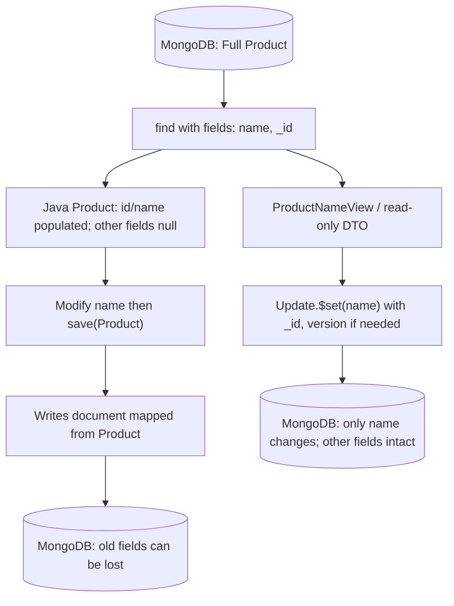

# Risk of Data Loss When Saving a Partially Loaded Entity

In **Spring Data MongoDB**, *projection* lets a query fetch only needed fields, reducing network traffic and avoiding redundant processing when building list pages or read APIs. However, if the application maps a projection result into a **full domain entity**, edits one field, and calls `save`, the **unloaded fields** can be lost from the document stored in MongoDB.

This is a dangerous bug because developers often assume `save` writes only the fields whose setters were called. In reality, when saving an existing entity without special versioning mechanisms, `MongoTemplate.save` or the corresponding repository `save` path typically sends the mapped state to **replace the document** (replace/upsert); it **does not track a list of fields modified in Java**.

This lesson belongs to the **Projection and DTO** chapter of the `SPRING_DATA_MONGODB` module. We examine projections, `MongoRepository`/`MongoTemplate` write mechanics, separating read DTOs from write entities, updating via `Update`/`$set`, optimistic locking, transactions, testing against real MongoDB, and diagnosing missing data. The goal is choosing read/write approaches that are **semantically sound**, not merely making queries run.

After this lesson, you will be able to:

- Explain why a `null` field on a Java object does not indicate whether the field was **unloaded**, **missing in the database**, or **intentionally deleted**.
- Reproduce the data-loss risk when `Query.fields().include(...)` or `@Query(fields = ...)` returns an entity that is then passed to `save`.
- Use **interface/class DTO projections** on the read path to prevent DTOs from being mistaken for full writable entities.
- Use `MongoTemplate.updateFirst`, `findAndModify`, conditional updates, and `@Version` appropriately.
- Test field-loss scenarios on an isolated database, inspect raw BSON, and pick strategies to prevent lost updates.

## 1. Understanding Projection and the Save Operation

**Projection** specifies which fields MongoDB Server returns or which Java type Spring Data builds from results. **Save** writes an entity's state back to the database. The two operations are independent and create no automatic tracking of which fields were fetched:



In particular, `_id` is returned by MongoDB by default in an *inclusion projection* unless excluded. Thus an object missing most of its data still carries a valid ID. A subsequent `save` call does not necessarily fail: it can match the exact document and overwrite it with **field-incomplete contents**.

| Concept | Purpose | Safe as a full entity to save? |
| --- | --- | --- |
| Query projection: `{ name: 1 }` | Fetch only name (and default `_id`) | **No**; this is partial data |
| Interface projection: `ProductNameView` | Return a view exposing only read fields | **No**; keep read-only |
| Record DTO: `ProductSummary` | Return a summary with its own contract | **No**; not a full snapshot to replace the document |
| Fully loaded `Product` entity | Entity containing all mapped fields | Can be saved, with concurrency and version checks |
| `Update.set("name", ...)` | Set only one field on the server | Does not replace the document |
| `save(partialProduct)` | Persist state of a field-incomplete object | **Risk of data loss** |

**Rule:** data selected for display is not equivalent to data sufficient to replace a document. Projections and DTOs should act as **read boundaries**, while write APIs should explicitly state which fields are allowed to change.

## 2. Sample Data and Illustrative Entity

Suppose a product has SKU, name, price, stock, description, and tags:

```javascript
// Collection: products
{
  _id: "P-100",
  sku: "BK-100",
  name: "Notebook",
  category: "BOOK",
  priceVnd: NumberLong("85000"),
  stock: 42,
  description: "Hardcover, white paper",
  tags: ["office", "gift"],
  active: true
}
```

Corresponding Java entity using Spring Data MongoDB:

```java
import java.util.List;
import org.springframework.data.mongodb.core.mapping.Document;
import org.springframework.data.mongodb.core.mapping.MongoId;

@Document(collection = "products")
public class Product {
    @MongoId
    private String id;
    private String sku;
    private String name;
    private String category;
    private Long priceVnd;
    private Integer stock;
    private String description;
    private List<String> tags;
    private Boolean active;

    protected Product() {}

    public Product(String id, String sku, String name, String category,
                   Long priceVnd, Integer stock, String description,
                   List<String> tags, Boolean active) {
        this.id = id;
        this.sku = sku;
        this.name = name;
        this.category = category;
        this.priceVnd = priceVnd;
        this.stock = stock;
        this.description = description;
        this.tags = tags;
        this.active = active;
    }

    public String getId() { return id; }
    public String getSku() { return sku; }
    public String getName() { return name; }
    public String getCategory() { return category; }
    public Long getPriceVnd() { return priceVnd; }
    public Integer getStock() { return stock; }
    public String getDescription() { return description; }
    public List<String> getTags() { return tags; }
    public Boolean getActive() { return active; }

    public void setName(String name) { this.name = name; }
    public void setPriceVnd(Long priceVnd) { this.priceVnd = priceVnd; }
    public void setStock(Integer stock) { this.stock = stock; }
}
```

We use wrapper types `Long`, `Integer`, and `Boolean` so unread fields appear clearly as `null` in Java. With primitives `long`/`int`/`boolean`, defaults would become `0`/`false`, making it even harder to notice which fields were skipped.

`@MongoId String id` keeps `_id` as a BSON String under default mapping, avoiding confusing 24-hex strings with ObjectIds. Other rules such as custom converters or `@Field` must be accounted for in project tests.

Repository:

```java
import java.util.Optional;
import org.springframework.data.mongodb.repository.MongoRepository;
import org.springframework.data.mongodb.repository.Query;

public interface ProductRepository extends MongoRepository<Product, String> {

    @Query(
        value = "{ '_id' : ?0 }",
        fields = "{ 'name' : 1 }")
    Optional<Product> findNameOnlyEntityById(String id);
}
```

This method **deliberately returns `Product` while selecting only `name`**—precisely the pattern to avoid in write flows. `@Query(fields = ...)` is a MongoDB query-level projection, not a promise of a *read-only entity*. This example is solely for learning and risk testing.

## 3. Reproducing Data Loss: Partial Load Followed by Save

### 3.1. Querying with a Projection Selecting Only a Few Fields

Example using `MongoTemplate`:

```java
import org.springframework.data.mongodb.core.MongoTemplate;
import org.springframework.data.mongodb.core.query.Criteria;
import org.springframework.data.mongodb.core.query.Query;

// Run on a test database only; do not apply to real data.
Query query = Query.query(Criteria.where("_id").is("P-100"));
query.fields().include("name"); // _id is still returned by default.

Product partial = mongoTemplate.findOne(query, Product.class);
// partial.id == "P-100", partial.name == "Notebook"
// partial.sku, partial.stock, partial.description, partial.tags... == null
```

Here `partial.getStock() == null` **does not mean stock on the server is actually null**. It merely tells you the Java object lacks a value for that property because the query omitted the field. Spring Data mapping an entity does not attach a "list of fields that were read" for `save` to respect later.

### 3.2. Saving an Incomplete Object

The snippet below **illustrates the bug to avoid**—run only in tests with disposable data:

```java
// WRONG: Product holds only partial data, yet is passed to save.
Product partial = productRepository
        .findNameOnlyEntityById("P-100")
        .orElseThrow();

partial.setName("Premium Notebook");
productRepository.save(partial);
```

For an entity **without `@Version`** as in this example, the ID already exists, so the repository normally takes the existing-document `MongoOperations.save` branch. MongoDB can receive a document replacement containing only what was mapped from `partial`. The stored document may become:

```javascript
// Illustration of the aftermath after saving a partial Product.
{
  _id: "P-100",
  name: "Premium Notebook"
  // sku, category, priceVnd, stock, description, tags, active
  // are no longer preserved from the original document.
}
```

How converters handle `null` may cause fields to be **dropped altogether** or written according to null-handling rules; either way, original values risk being lost. MongoDB cannot deduce that fields absent from the Java object ought to be preserved upon receiving a document replacement.

### 3.3. Distinguishing Save and Update at the BSON Level

Semantically, these two operations are very different:

```javascript
// DANGEROUS: Replaces the document with a version containing only a few fields.
db.products.replaceOne(
  { _id: "P-100" },
  { _id: "P-100", name: "Premium Notebook" }
);

// SAFER FOR PATCH: Updates only the name field.
db.products.updateOne(
  { _id: "P-100" },
  { $set: { name: "Premium Notebook" } }
);
```

This is a conceptual MongoDB Server illustration, **not a claim that every `save` call emits that exact driver syntax**. Execution paths depend on `isNew`, `@Version`, converters, and Spring Data version. The takeaway is that **replace** and **`$set`** differ fundamentally in mutation scope.

## 4. Why Is This Bug Hard to Spot?

### 4.1. Unloaded Data and Null Data Look Alike

A `null` field on an entity can have at least three causes:

1. The source document lacks the field.
2. The document has the field, yet **the projection omitted it**.
3. The field was selected and the stored value is BSON `null`.

Looking only at `product.getDescription() == null` cannot tell these three situations apart. When using a DTO for updates, you must also distinguish **client omitted the field** from **client wants to clear the field**. That is why bundling all cases into a single `save` call is problematic.

### 4.2. The ID Is Still Present So Save Throws No Error

MongoDB normally returns `_id` even when a projection requests only `name`. Spring Data sees the ID, treats the entity as existing, and rewrites the document under that key. The bug can occur silently: the service returns success, while another API querying `stock`, `priceVnd`, or `tags` discovers the data is gone.

If the projection intentionally excludes `_id` so Java's ID becomes `null`, `repository.save` may treat the entity as new, insert a duplicate document, or fail; that is **a different failure**, not a safe fix.

### 4.3. Slim DTOs Do Not Represent Writable Entities

Suppose a list page needs only:

```json
{
  "id": "P-100",
  "name": "Notebook",
  "priceVnd": 85000
}
```

This is a **read contract**. If the backend takes this object back, builds `new Product(...)` with `null` for all remaining fields, and calls `save`, it treats a summary as the entire document's state. That is a design flaw; for edits, define dedicated command/DTO types for specific modifications.

### 4.4. Higher Risk with Automated Mapping

Operations like reflection-based DTO-to-entity copying, generic mappers, or `BeanUtils.copyProperties` can overwrite fields with `null`/defaults when unsupplied, causing `save` to wipe existing values. Adding new domain fields later can also cause older APIs to drop those fields if they build incomplete entities for saving.

**Do not treat "copy ignoring nulls" as a complete solution**: if a client intentionally asks to clear a field, ignoring nulls skips that deletion. Clearly define semantics for *field omitted*, *field sent as null to clear*, and *field sent with a new value*.

## 5. First Solution: Use Projections/DTOs on the Read Path

For list, search, or summary queries, **return a type containing only the values the application actually needs**. Never pass that type into a domain repository's `save`.

### 5.1. Closed Interface Projection

Example projection interface:

```java
public interface ProductListView {
    String getId();
    String getName();
    Long getPriceVnd();
}
```

Dedicated repository for read use cases:

```java
import java.util.List;
import org.springframework.data.mongodb.repository.MongoRepository;

public interface ProductReadRepository
        extends MongoRepository<Product, String> {

    List<ProductListView> findByCategory(String category);
}
```

`ProductListView` requests only `id`, `name`, and `priceVnd`. This is a **closed projection** because all accessors map to determinable properties; Spring Data can optimize fetched fields depending on feature, projection kind, and version.

```java
List<ProductListView> books = productReadRepository
        .findByCategory("BOOK");

for (ProductListView book : books) {
    System.out.println(book.getName());
}
```

The crucial benefit goes beyond smaller responses: **the return type is not `Product`**. A service developer cannot accidentally call `ProductRepository.save(book)` with `ProductListView` as an ordinary domain entity. Even so, never copy an interface projection into a field-incomplete `Product` just to call `save`.

For large lists, add `Pageable`/`Slice` or query limits; projection does not limit document counts. Projection is also not a sensitive-data protection mechanism: enforce authorization at query/service/API layers.

### 5.2. Record DTOs

A class-based DTO can represent read results:

```java
public record ProductSummary(
        String id,
        String name,
        Long priceVnd
) {}
```

Spring Data can support **class-based projections** when constructor parameter names and mapping metadata match source properties. Example repository:

```java
import java.util.List;
import org.springframework.data.mongodb.repository.MongoRepository;

public interface ProductSummaryRepository
        extends MongoRepository<Product, String> {

    List<ProductSummary> findByCategory(String category);
}
```

`ProductSummary` is a **read model**, not `@Document(collection = "products")`. Do not declare another repository to `save(ProductSummary)` as if it were the full entity for the same collection. If a class projection comes from complex queries, renamed field aliases, or aggregations, test DTO mapping against your Spring Data version.

### 5.3. Open Projections May Not Save Fields as Expected

Spring Data supports SpEL expressions in certain **open interface projections**, such as getters computed from `target`. When an expression can touch unknown properties, the framework may **not optimize field selection down to a few fields**.

Therefore:

- **Closed projections:** usually easy to infer required fields for optimization.
- **Open projections:** more flexible, yet require verifying actual queried data volume.
- **Entities returned from field-restricted queries:** carry severe risk if passed to `save`.

Do not judge projection efficiency solely by Java interface getter counts. Inspect the actual sent MongoDB queries and read payload size.

## 6. Second Solution: Targeted Updates with `$set`

If a user wants to change **the product name**, the clearest approach is issuing a command **updating only `name`** on the MongoDB Server. There is no need to load the whole entity or touch price, stock, or tags.

### 6.1. `MongoTemplate.updateFirst` for PATCH

```java
import com.mongodb.client.result.UpdateResult;
import java.util.NoSuchElementException;
import org.springframework.data.mongodb.core.MongoTemplate;
import org.springframework.data.mongodb.core.query.Criteria;
import org.springframework.data.mongodb.core.query.Query;
import org.springframework.data.mongodb.core.query.Update;
import org.springframework.stereotype.Service;

@Service
public class ProductNameCommandService {
    private final MongoTemplate mongoTemplate;

    public ProductNameCommandService(MongoTemplate mongoTemplate) {
        this.mongoTemplate = mongoTemplate;
    }

    public void rename(String id, String newName) {
        if (newName == null || newName.isBlank()) {
            throw new IllegalArgumentException("Name must not be blank");
        }

        Query query = Query.query(Criteria.where("_id").is(id));
        Update update = new Update().set("name", newName);
        UpdateResult result = mongoTemplate.updateFirst(
                query, update, Product.class);

        if (result.getMatchedCount() == 0) {
            throw new NoSuchElementException(
                    "Product not found: " + id);
        }
    }
}
```

On the MongoDB side, equivalent meaning:

```javascript
db.products.updateOne(
  { _id: "P-100" },
  { $set: { name: "Premium Notebook" } }
);
```

`$set` alters only `name`; `sku`, `category`, `stock`, `description`, `tags`, and `active` **remain untouched**. `updateFirst` does not upsert by default, so if no document matches, `matchedCount` is 0. `modifiedCount` can be 0 when the new name equals the old name, so checking `matchedCount` is better for verifying the document exists.

**Limitation:** updating a single field prevents overwriting unrelated fields, yet **does not prevent two concurrent requests from modifying `name`** without version criteria. When concurrent edits on the same field must be detected, use optimistic locking or state-comparison conditions.

### 6.2. Updating Multiple Fields Within an Allowed List

A command DTO can explicitly state update permissions:

```java
public record RenameAndRepriceCommand(
        String name,
        Long priceVnd
) {}
```

The service builds per-field updates:

```java
Update update = new Update()
        .set("name", command.name())
        .set("priceVnd", command.priceVnd());

mongoTemplate.updateFirst(
        Query.query(Criteria.where("_id").is(id)),
        update,
        Product.class);
```

This snippet illustrates code inside a method having `mongoTemplate`, `id`, and `command`. Validate name, price, caller role, and business rules before issuing the command. Never construct `Update` by looping over **arbitrary field names supplied by the client** without an allowlist, as that could allow modifying `_id`, access permissions, tenant ID, or internal fields.

### 6.3. Distinguishing "Omitted", "Set to Null", and "Remove Field"

A PATCH endpoint might define:

| Payload | Meaning | Chosen operator |
| --- | --- | --- |
| No `description` property | Keep existing description | **Do not include field in Update** |
| `"description": "New note"` | Update description | `$set` |
| `"description": null` | Store BSON null, if business allows | `$set: { description: null }` |
| Explicit request to delete description | Remove field from document | `$unset` |

Example intentional field removal:

```java
Update update = new Update().unset("description");
mongoTemplate.updateFirst(
        Query.query(Criteria.where("_id").is("P-100")),
        update,
        Product.class);
```

MongoDB distinguishes **absent fields** from **fields with BSON null** in certain queries, indexes, and validators. Therefore, define PATCH semantics upfront in the API contract and express them with the right operator.

### 6.4. Using `findAndModify` When the Updated Record Is Needed

Instead of calling `updateFirst` followed by `findById`, you can use `findAndModify` to update and return the new document in a single atomic document operation:

```java
import org.springframework.data.mongodb.core.FindAndModifyOptions;
import org.springframework.data.mongodb.core.query.Criteria;
import org.springframework.data.mongodb.core.query.Query;
import org.springframework.data.mongodb.core.query.Update;

Product updated = mongoTemplate.findAndModify(
        Query.query(Criteria.where("_id").is(id)),
        new Update().set("name", newName),
        FindAndModifyOptions.options().returnNew(true),
        Product.class
);
```

This snippet assumes a service with `mongoTemplate`, `id`, and `newName`. The result can be `null` when no document matches. With large payloads, if the API only needs a few fields back, consider proper projection and returned byte size; `findAndModify` does not make a returned partial entity safe for subsequent `save`.

## 7. When Is Loading in Full and Saving Appropriate?

Some workflows intentionally replace **the entire state of a small aggregate**. Reading the full entity, applying business-validated changes, and calling `save` can make sense, provided full-state replacement semantics are acceptable:

```java
Product full = productRepository.findById("P-100")
        .orElseThrow();

full.setName("New Name");
productRepository.save(full);
```

Minimum requirements:

1. The entity is genuinely **loaded in full** per mapping and business needs, not produced by a field-level projection.
2. The service updates only permitted fields rather than blindly copying incomplete DTOs into the entity.
3. **Concurrent writes** are handled: `@Version`, conditional updates, or other domain logic.
4. Understand that fields added/managed by other systems may not be mapped on the older entity, so `save` can still lose unmapped fields even when you thought you "read everything."

MongoDB does not perform an automatic merge "preserving all fields absent from the Java object." If multiple applications share a collection with differing schemas, prefer field-level updates or clear data-ownership contracts.

## 8. Does `@Version` Prevent Data Loss from Projection?

**Not necessarily.** `@Version` provides **optimistic locking**—detecting if a record was modified since it was read. It does not make Spring Data track which fields were omitted by a projection.

### 8.1. Versioned Entity

Standalone example separate from the unversioned `Product` entity above:

```java
import org.springframework.data.annotation.Version;
import org.springframework.data.mongodb.core.mapping.Document;
import org.springframework.data.mongodb.core.mapping.MongoId;

@Document(collection = "versionedProducts")
public class VersionedProduct {
    @MongoId
    private String id;

    @Version
    private Long version;

    private String name;
    private Long priceVnd;
    private Integer stock;

    protected VersionedProduct() {}

    public String getId() { return id; }
    public Long getVersion() { return version; }
    public String getName() { return name; }
    public Long getPriceVnd() { return priceVnd; }
    public Integer getStock() { return stock; }

    public void setName(String name) { this.name = name; }
}
```

When a repository saves a fully loaded versioned entity, Spring Data can attach the version condition to the write operation and increment the version upon success. If another request already bumped the version, the stale save fails to match and can throw `OptimisticLockingFailureException`.

### 8.2. When Projection Omits `version`

Suppose `VersionedProduct` is loaded with only `_id` and `name`. Then `version == null` in Java even though the database holds a valid version. How a repository classifies an entity as **new vs. existing** can depend on `@Version`, so calling `save` may follow the **insert path**—causing a duplicate key error—or behave unexpectedly depending on call path and mapping. Never assume `@Version` protects a partial entity from errors.

Even if the projection **includes `version`**, the problem is not solved: optimistic locking only confirms no concurrent version bump happened, while **the `Product` being saved still lacks `priceVnd`, `stock`, etc.**. A replacement succeeding with the matching version will still wipe out those fields.

| Object state | What does `@Version` solve? | Remaining risk |
| --- | --- | --- |
| Full entity, valid version | Writes if no competing version change occurred | Unmapped fields still need care |
| Full entity, stale version | Detects conflict in properly configured setups | Service must handle retry/conflict |
| Partial entity, **missing version** | May be misidentified as new or throw errors | Insufficient data to save |
| Partial entity, **has version** | Can detect concurrent updates | Still drops unloaded fields if replace succeeds |

**Conclusion:** `@Version` solves **"did someone else modify this since I read it?"**, whereas `projection` raises **"does this object have enough data to replace the document?"**. These are two independent problems.

### 8.3. Combining PATCH with a Version Check

When an endpoint updates only the name yet must detect concurrent changes, put the **expected version** in the update criteria and increment version atomically:

```java
import com.mongodb.client.result.UpdateResult;
import org.springframework.dao.OptimisticLockingFailureException;
import org.springframework.data.mongodb.core.MongoTemplate;
import org.springframework.data.mongodb.core.query.Criteria;
import org.springframework.data.mongodb.core.query.Query;
import org.springframework.data.mongodb.core.query.Update;

// Method inside a service with injected MongoTemplate.
void renameIfUnchanged(
        MongoTemplate template,
        String id,
        long expectedVersion,
        String newName
) {
    Query query = Query.query(
            Criteria.where("_id").is(id)
                    .and("version").is(expectedVersion));

    Update update = new Update()
            .set("name", newName)
            .inc("version", 1);

    UpdateResult result = template.updateFirst(
            query, update, VersionedProduct.class);

    if (result.getMatchedCount() != 1) {
        throw new OptimisticLockingFailureException(
                "Document does not exist or version has changed");
    }
}
```

The `_id + version` filter and `$set + $inc` operations execute on **the same document**, so when matched, the update and version bump apply atomically on MongoDB Server. With `MongoTemplate`, `@Version` fields may be managed automatically when version is omitted from `Update`; in this example we **explicitly incremented version**, so keep a consistent version strategy across the application to avoid double-incrementing or skipping version bumps.

When relying on version checks on writes, ensure write concern provides required acknowledgments, and distinguish not-found, conflict, and connectivity errors per your API contract.

## 9. Queries from Repositories, `MongoTemplate`, and Aggregation

Not all projection forms behave identically. Check the **read path** before deciding whether results can feed a **write path**:

| Read path | Example | Recommended result type | Should you call `save` directly? |
| --- | --- | --- | --- |
| Repository full entity lookup | `findById(id)` | `Product` | Only when intending full save with concurrency handling |
| Repository with `@Query(fields = ...)` | Fetch only `name` | `ProductNameView` or DTO | **No** |
| `MongoTemplate` with `query.fields().include(...)` | Fetch only `name` | Dedicated DTO or read-only processing | **No** with partial entity |
| Repository closed interface projection | `findByCategory(...)` | `ProductListView` | **No** |
| Aggregation with `$project` | `name`, `priceVnd` | Summary DTO | **No** |
| `findAndModify` with field update | `$set(name)` | `Product` or response DTO | The update already wrote; do not save response out of habit |

### 9.1. Aggregation Projection Does Not Produce Full Entities

Example pipeline:

```javascript
db.products.aggregate([
  { $match: { active: true } },
  {
    $project: {
      _id: 1,
      name: 1,
      priceVnd: 1
    }
  },
  { $limit: 20 }
]);
```

Results are suitable only for display or a three-field DTO. Mapping results into `Product` and calling `save` still omits `sku`, `stock`, `tags`, etc.; the exact same safety rule as `find` projections applies.

### 9.2. Projection Helps Performance Without Replacing Indexes

Selecting fewer fields cuts returned bytes, especially when documents have long descriptions or large arrays. However, MongoDB Server still executes filtering and sorting; design indexes matching your primary queries. Example:

```javascript
// Query active product list by category, newest first.
db.products.createIndex({
  category: 1,
  active: 1,
  _id: -1
});

db.products.find(
  { category: "BOOK", active: true },
  { name: 1, priceVnd: 1 }
).sort({ _id: -1 }).limit(20);
```

With an appropriate **covered query**, the server can satisfy some queries straight from the index without reading full documents; yet that depends on exact selected fields (including `_id`), filters, sorts, and index structure. Do not assume every projection becomes a covered query; verify with `explain("executionStats")`.

### 9.3. Embedded Fields and References Can Also Vanish

If `Product` contains `details` (an embedded document) or ID-linked fields, projecting only `name` and calling `save` can wipe **entire subdocuments** or reference lists, not only scalars like `priceVnd`. For array elements, use targeted array update operators such as `$addToSet`, `$pull`, or positional updates when required instead of rewriting the whole aggregate from an incomplete snapshot.

If an entity has `@DocumentReference`/`@DBRef`, partial reads can also leave linked fields unloaded. Never treat lazy proxies or reference lookups as protection against overwriting: they govern **reading**, while `save` still requires complete state and reference lifecycle management.

## 10. Concurrent Writes, Transactions, and Reactive Access

### 10.1. Partial Saves Differ from Lost Updates, Yet Both Can Coexist

Distinguish two risks:

- **Data loss from partial entities:** a request reads only `name` without `stock`, then calls `save`, writing an incomplete document. **Even a single request** can wipe data.
- **Lost updates from concurrency:** two requests both read data, each edits one part and calls `save`; the later write overwrites changes saved by the earlier request. This happens **even when both read the full document**, if versioning or update conditions are missing.

`$set` targeting specific fields reduces the risk of clobbering unrelated fields, while `@Version`/compare-and-set detects competing updates. The two techniques address two different risk classes.

### 10.2. Transactions Do Not Restore Missing Fields

MongoDB transactions provide atomicity across multi-document operations on supported deployments, yet calling `save(partial)` inside a transaction still replaces the document with field-incomplete state. Transactions **do not fix choosing the wrong write API**.

For a single `$set` on one document, MongoDB already guarantees document-level atomicity. Use multi-document transactions only when business boundaries truly require them, with a properly configured transaction manager tested on a supported MongoDB topology.

### 10.3. Reactive MongoDB Carries the Same Risk

With `ReactiveMongoRepository` and `ReactiveMongoTemplate`, the difference lies in the `Mono`/`Flux` publisher model and non-blocking I/O. If an entity is retrieved via a partial-field projection and passed to reactive `save`, **the risk of dropping fields remains**.

A safer option is reactive field-level updates:

```java
import reactor.core.publisher.Mono;
import org.springframework.data.mongodb.core.ReactiveMongoTemplate;
import org.springframework.data.mongodb.core.query.Criteria;
import org.springframework.data.mongodb.core.query.Query;
import org.springframework.data.mongodb.core.query.Update;

Mono<Long> renameReactive(
        ReactiveMongoTemplate template,
        String id,
        String newName
) {
    return template.updateFirst(
            Query.query(Criteria.where("_id").is(id)),
            new Update().set("name", newName),
            Product.class
    ).map(result -> result.getMatchedCount());
}
```

This snippet shows an illustrative method inside a service with proper imports and validation. Never call `block()` on an event loop to turn reactive code into blocking code; using reactive operators does not alter `$set`/replace semantics on MongoDB Server.

## 11. Integration Testing to Catch Field Loss

**Unit tests mocking repositories are insufficient** to verify the BSON written when saving a partial entity. Use a real yet **isolated** MongoDB Server (e.g., Testcontainers) and `@DataMongoTest` with Spring Boot 3.x to verify both **the dangerous behavior** and **the fix**.

### 11.1. Reproduction Test (Test Environment Only)

The example below uses `Product` and `ProductRepository` from Section 2. The first test **deliberately calls `save` on a partial entity** to prove the consequence; never copy that pattern into production business logic.

```java
import static com.mongodb.client.model.Filters.eq;
import static org.assertj.core.api.Assertions.assertThat;

import java.util.List;
import org.bson.Document;
import org.junit.jupiter.api.Test;
import org.springframework.beans.factory.annotation.Autowired;
import org.springframework.boot.test.autoconfigure.data.mongo.DataMongoTest;
import org.springframework.data.mongodb.core.MongoTemplate;
import org.springframework.data.mongodb.core.query.Criteria;
import org.springframework.data.mongodb.core.query.Query;
import org.springframework.data.mongodb.core.query.Update;

@DataMongoTest
class PartialProjectionSaveTest {

    @Autowired MongoTemplate template;
    @Autowired ProductRepository repository;

    private Product sample(String id) {
        return new Product(
                id, "BK-100", "Notebook", "BOOK",
                85_000L, 42, "Hardcover",
                List.of("office", "gift"), true);
    }

    private Document raw(String id) {
        return template.getCollection("products")
                .find(eq("_id", id))
                .first();
    }

    @Test
    void savingPartiallyLoadedEntityCanDropOtherFields() {
        template.insert(sample("TEST-PARTIAL-001"));

        Product partial = repository
                .findNameOnlyEntityById("TEST-PARTIAL-001")
                .orElseThrow();

        assertThat(partial.getId()).isEqualTo("TEST-PARTIAL-001");
        assertThat(partial.getName()).isEqualTo("Notebook");
        assertThat(partial.getStock()).isNull(); // Because it was not loaded.

        partial.setName("Premium Notebook");

        // INTENTIONALLY demonstrating the bug in a test database:
        repository.save(partial);

        Document after = raw("TEST-PARTIAL-001");
        assertThat(after).isNotNull();
        assertThat(after.getString("name"))
                .isEqualTo("Premium Notebook");
        assertThat(after).doesNotContainKeys(
                "sku", "stock", "priceVnd", "tags");
    }

    @Test
    void targetedUpdateKeepsAllUnchangedFields() {
        template.insert(sample("TEST-PATCH-001"));

        Query query = Query.query(
                Criteria.where("_id").is("TEST-PATCH-001"));

        template.updateFirst(
                query,
                new Update().set("name", "Premium Notebook"),
                Product.class);

        Document after = raw("TEST-PATCH-001");
        assertThat(after).isNotNull();
        assertThat(after.getString("name"))
                .isEqualTo("Premium Notebook");
        assertThat(after.getString("sku")).isEqualTo("BK-100");
        assertThat(after.getInteger("stock")).isEqualTo(42);
        assertThat(after.getString("description"))
                .isEqualTo("Hardcover");
        assertThat(after.getList("tags", String.class))
                .containsExactly("office", "gift");
    }
}
```

The test inspects raw BSON via the Java Driver so re-mapping `Product` does not mask missing fields. The first test holds for mappings/converters and Spring Data versions that perform document replacement as shown; rely on real execution in your project rather than assumptions.

`@DataMongoTest` is a test slice and **does not start a MongoDB Server automatically in all configurations**. Provide a real test database (e.g., via Testcontainers), configure a dedicated URI, and clean up appropriately. Never use shared or production databases for tests that intentionally drop fields.

### 11.2. Additional Test Cases to Include

| Scenario | What to verify |
| --- | --- |
| Query returning domain entity selecting only `name` | Java object lacks other fields; never passed to `save` in business code |
| Query returning `ProductListView` | Returns only read attributes; not used as a write object |
| `updateFirst` changing `name` | `stock`, `priceVnd`, `tags`, and unknown fields remain intact |
| `findAndModify` ID not found | Service returns appropriate error; does not silently insert unless upsert enabled |
| PATCH omits `description` | Server preserves existing field |
| PATCH requests deleting `description` | `$unset` removes field; not confused with omitting |
| `@Version` entity with projection lacking version | Never treated as a full entity for `save` |
| `@Version` entity with valid version yet missing fields | Do not allow replacement `save` when fields are missing |
| Two concurrent requests updating `name` | Version condition handles conflict if business rules require |
| Document has extra fields written by another service | PATCH alters only allowed fields without deleting unmapped fields |
| Partially loaded nested object or array | Do not replace entire nested document with field-incomplete version |
| Reactive projection followed by `save` | Not safe by default merely from using `Mono`/`Flux` |

## 12. Diagnosing Missing Data After an Update

A real-world incident: the rename-product API returns HTTP 200, yet the frontend reports "price and stock suddenly vanished." Do not jump to blaming MongoDB for deleting fields; trace the read/write path:

1. **Inspect BSON documents before and after** in a reproducible environment. Avoid logging sensitive values. Check whether fields are **absent** or **`null`**.
2. **Locate queries using projections** in the use case: `@Query(fields = ...)`, `query.fields().include/exclude`, aggregation `$project`, DTO mapping.
3. **Check return types**: does the repository return `Product` or `ProductListView`/`ProductSummary`? Was a DTO converted back into an entity?
4. **Check write operations**: `save`, `insert`, `replace`, `updateFirst`, `findAndModify`, or bulk operations? Each has different semantics.
5. **Inspect `_id` and `@Version`**: does ID have the right BSON type? Was a versionless entity treated as new? Were concurrency errors swallowed?
6. **Check mappings/converters and null handling**: does a field have `@Field`, a custom converter, or `@Transient`?
7. **Check concurrent flows**: did another request write after the service read? Did field loss come from projection or lost update from a stale snapshot?
8. **Write a regression test** on real test MongoDB: reproduce the failure before fixing, and verify all unrelated fields remain intact after fixing.

### 12.1. Inspecting Raw Documents in `mongosh`

```javascript
db.products.findOne({ _id: "P-100" });

// Strictly for inspecting which fields actually exist in BSON.
db.products.aggregate([
  { $match: { _id: "P-100" } },
  {
    $project: {
      name: 1,
      hasSku: { $ne: [{ $type: "$sku" }, "missing"] },
      hasStock: { $ne: [{ $type: "$stock" }, "missing"] },
      hasTags: { $ne: [{ $type: "$tags" }, "missing"] }
    }
  }
]);
```

`$type` returns `"missing"` when a field does not exist inside an aggregation expression. This checks **absent** fields, unlike existing fields holding BSON `null`. Before altering or re-running tests, note that MongoDB cannot automatically recover fields wiped by a replacement; you need backups, event logs, or data-recovery workflows if fields were lost in production.

### 12.2. Checking Whether the Query Actually Optimizes Reads

Projections can reduce returned bytes, yet only when the query actually requests the right fields and mapping does not force reading the full document. Inspect the execution plan:

```javascript
db.products.find(
  { category: "BOOK", active: true },
  { _id: 1, name: 1, priceVnd: 1 }
)
.limit(20)
.explain("executionStats");
```

Observe examined documents/index keys and execution stages. `explain` does not prove a returned entity is safe to `save`; **read performance** and **write correctness** are separate properties to verify independently.

## 13. Case Study Exercise

An e-commerce platform stores documents:

```javascript
{
  _id: "ORDER-1",
  status: "PENDING",
  customerId: "CUS-1",
  shippingAddress: { city: "Hue", street: "Hoa Street" },
  lines: [
    { sku: "BK-001", quantity: 2, unitPriceVnd: NumberLong("85000") }
  ],
  totalVnd: NumberLong("170000"),
  version: NumberLong("4")
}
```

The admin screen only needs `_id` and `status`; the repository returns an `Order` entity via a `{status: 1}` projection. Staff clicks "Confirm Order", the service sets `status = "CONFIRMED"`, and calls `save(order)`.

**Questions:**

1. Which fields risk being lost when saving an entity that only has `status`?
2. Why is having `@Version` still not enough to ensure safety?
3. Propose a command that updates `status` while keeping shipping address, line items, and total intact.
4. If confirmation is only allowed when `status == "PENDING"` and `version == 4`, what must the query/update check?
5. What test will catch a regression if a developer accidentally replaces `updateFirst` with `save`?

A reference solution for Questions 3 and 4:

```java
Query query = Query.query(
        Criteria.where("_id").is("ORDER-1")
                .and("status").is("PENDING")
                .and("version").is(4L));

Update update = new Update()
        .set("status", "CONFIRMED")
        .inc("version", 1);

UpdateResult result = mongoTemplate.updateFirst(
        query, update, Order.class);

if (result.getMatchedCount() != 1) {
    throw new IllegalStateException(
            "Order does not exist or status/version has changed");
}
```

This is a **snippet inside a service method**, requiring an appropriate `Order` entity declaration, injected `mongoTemplate`, and imports for `Query`, `Criteria`, `Update`, and `UpdateResult`. Status/version checks and update operators run atomically on a single document; there is no need to load shipping address or line items just to change status.

The regression test must insert a complete document, call the confirmation service, and read **raw BSON** to assert `shippingAddress`, `lines`, and `totalVnd` still hold their original values. When clients are authorized to confirm orders, also check user permissions beyond matching `_id`/version.

## 14. Pre-Save Entity Checklist

1. **Where did the object about to be saved come from?** A full `findById` or a query/aggregation with projection?
2. **Are any fields unloaded?** Unloaded fields differ from null fields or intentionally deleted fields.
3. **Is the goal PATCHing a few fields or replacing the whole document?** For PATCH, use `$set`, `$unset`, `$inc`, or matching operators.
4. **Is a read DTO being reused as a write DTO?** Keep read models and write commands separate.
5. **Are there custom converters, versioned entities, references, or nested fields?** Check their impact on mapping and `save`.
6. **Is concurrency control needed?** Use `@Version` or version conditions in updates, never treating them as substitutes for missing fields.
7. **Does the API distinguish null from omitted fields?** Never blindly copy request payloads onto entities.
8. **Are any fields managed by other services or application versions?** Avoid full replacement when owning only part of the schema.
9. **Does the query have the right indexes and projections?** Measure read performance separately from write correctness.
10. **Do integration tests exist against real MongoDB?** Check raw BSON before/after PATCH, missing-field scenarios, stale versions, and concurrent writes.

**Rule to remember:** **Projection reads fewer fields; it does not turn `save` into a "partial update."** Never save an entity constructed from a partial read. Use **DTO/interface projections on the read path**, **commands + field-level `Update` on the write path**, and **versions/update conditions for concurrency control**. Verify raw BSON before and after on test MongoDB to ensure unmodified fields remain intact.
