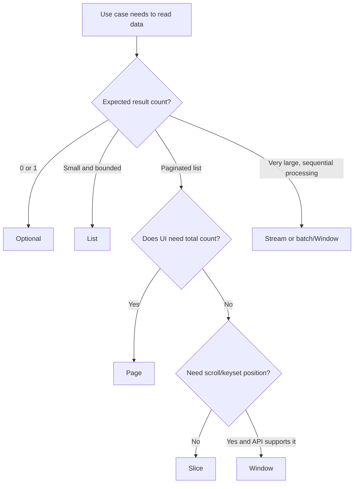

# Choosing Optional, List, Page, Slice, Stream, or Window Based on Support

## 1. The problem: not every query should return a List

An order management application using MongoDB has many different reading needs: fetching exactly one order, displaying the 20 latest orders, letting users switch pages, exporting hundreds of thousands of records, or syncing data in small batches. If every repository returned `List<OrderDocument>`, the program might load excess data, force you to write pagination logic manually, and make memory hard to control.

In **SPRING_DATA_MONGODB**, Spring Data MongoDB provides `MongoRepository`, derived queries, `@Query`, and `MongoTemplate` to connect, map documents, and operate on MongoDB. The return type choices **Optional, List, Page, Slice, Stream, and Window** express different contracts regarding element count, pagination, cursor state, and query cost. Choosing the return type is part of designing access patterns, indexes, testing, and performance—not just a Java coding preference.

The **Pagination and Streams** chapter will answer these questions:

1. When should you use `Optional<T>` instead of returning an entity or a list?
2. When does `List<T>` make sense, and how do you bound the data?
3. Why can `Page<T>` incur a count query, whereas `Slice<T>` only needs to know whether a next page exists?
4. How does `Stream<T>` relate to a cursor, and why must resources be closed?
5. How do `Window<T>` and `ScrollPosition` differ from offset pagination and server-side streaming?
6. How do you choose the right API when a project uses different Spring Data MongoDB/driver versions?

**Core principle:** Start from the business contract: **0–1 results, a small bounded set, a page with a total count, a page needing only hasNext, a long-running processing stream, or a scrolling window**. Only then choose the appropriate Java type and index.

## 2. Quick comparison of the six return types

| Type | Result contract | Suitable use cases | Key cost / considerations |
| --- | --- | --- | --- |
| `Optional<T>` | Zero or one element | Lookup by unique key or condition matching at most one record | Unsuitable if the query can return multiple documents |
| `List<T>` | Materialized result set | Small, clearly bounded lists | No pagination metadata; risk of loading too much data |
| `Page<T>` | Page content with total count metadata | UI needing total record/page counts | May trigger a count query or total calculation logic |
| `Slice<T>` | Page content and whether a next page exists | "Load more" buttons, simple infinite scroll | Does not provide a total count; deep offsets remain costly |
| `Stream<T>` | Sequential processing via Java Stream | Exports, large read batches, single-pass pipelines | May hold a MongoDB cursor/resources; must be closed |
| `Window<T>` | A window of results with a continuation position | Offset/keyset scrolling on supported APIs | Requires `ScrollPosition`, stable sort; version-dependent |

**No single type is always best.** A `Page<T>` is very convenient for an admin screen that needs "Page 3/42", but counting millions of documents can be unnecessary if the UI only has a "View more" button. A `Stream<T>` avoids loading all results into a `List`, yet it does not by itself solve a user's need to jump to an arbitrary page.

### 2.1. Two decision axes



This diagram helps choose a starting direction. Afterward, you still have to evaluate changing data, deep offsets, cursor resources, concurrency, indexes, and the actual library versions.

## 3. Preparing sample data and the Java model

Suppose a multi-tenant order management service. A tenant needs to view its orders, warehouse staff need to view orders awaiting shipment, and the system exports data periodically.

### 3.1. Sample documents in mongosh

```javascript
db.orders.insertMany([
  {
    _id: "order-101",
    tenantId: "tenant-a",
    customerId: "customer-01",
    status: "READY_TO_SHIP",
    createdAt: ISODate("2026-11-18T08:00:00Z"),
    amountVnd: NumberLong("120000")
  },
  {
    _id: "order-102",
    tenantId: "tenant-a",
    customerId: "customer-02",
    status: "READY_TO_SHIP",
    createdAt: ISODate("2026-11-18T08:00:00Z"),
    amountVnd: NumberLong("150000")
  },
  {
    _id: "order-103",
    tenantId: "tenant-a",
    customerId: "customer-03",
    status: "SHIPPED",
    createdAt: ISODate("2026-11-19T10:00:00Z"),
    amountVnd: NumberLong("270000")
  },
  {
    _id: "order-104",
    tenantId: "tenant-b",
    customerId: "customer-04",
    status: "READY_TO_SHIP",
    createdAt: ISODate("2026-11-20T02:00:00Z"),
    amountVnd: NumberLong("320000")
  }
]);
```

Run this only on an empty test collection or change the IDs to avoid duplicate key errors. Points to note: `order-101` and `order-102` share the same `createdAt`, while `order-104` belongs to another tenant and must not appear in `tenant-a`'s list.

### 3.2. Java entity

```java
import java.time.Instant;
import org.springframework.data.mongodb.core.mapping.Document;
import org.springframework.data.mongodb.core.mapping.FieldType;
import org.springframework.data.mongodb.core.mapping.MongoId;

@Document(collection = "orders")
public record OrderDocument(
    @MongoId(FieldType.STRING) String id,
    String tenantId,
    String customerId,
    String status,
    Instant createdAt,
    long amountVnd
) {}
```

`@MongoId(FieldType.STRING)` intentionally keeps `_id` as a BSON String. The Java property name `id` maps to the BSON field `_id`. When writing queries with `MongoTemplate` bound to `OrderDocument.class`, Spring Data uses metadata to map field paths.

The repository examples below are **independent variants** of read contracts; you should not declare all interfaces with the same name or create redundant beans just to run the examples in a production application.

## 4. Optional<T>: queries with at most one result

### 4.1. Finding one order by exact ID and tenant

```java
import java.util.Optional;
import org.springframework.data.repository.Repository;

public interface OrderLookupRepository
    extends Repository<OrderDocument, String> {

    Optional<OrderDocument> findByTenantIdAndId(
        String tenantId,
        String id
    );
}
```

Example call:

```java
Optional<OrderDocument> maybeOrder =
    repository.findByTenantIdAndId("tenant-a", "order-101");

OrderDocument order = maybeOrder.orElseThrow(
    () -> new IllegalArgumentException("No matching order found")
);
```

`repository` in the snippet is an injected `OrderLookupRepository` bean. If there is no match, the contract returns `Optional.empty()`; if exactly one match is found, `Optional.of(entity)`. With `findByTenantIdAndId`, the condition pair constrains both the tenant and the ID.

**Security note:** The `tenantId` parameter must come from a trusted authentication/authorization context, not an arbitrary value sent by the client.

### 4.2. Optional does not mean "pick an arbitrary result"

`Optional<T>` is appropriate when a query is designed to match **at most one** document, such as looking up by `_id` or a guaranteed unique index. If the query actually matches multiple documents while the repository declares a single entity/`Optional` return type, Spring Data may throw a non-unique result error instead of silently picking the first document.

If you want "the single latest order" among many orders, state that explicitly:

```java
Optional<OrderDocument>
findFirstByTenantIdAndCustomerIdOrderByCreatedAtDescIdDesc(
    String tenantId, String customerId
);
```

`findFirst...OrderBy...` expresses the record selection policy. If timestamps can tie, add `IdDesc` as a tie-breaker key. Do not rely on the "natural order" of the collection.

### 4.3. Optional vs. Mono

`Optional<T>` is Java's synchronous container for 0–1 results. With reactive Spring Data MongoDB, the corresponding contract is usually `Mono<T>`, not `Optional<Mono<T>>`. The differences between imperative and reactive approaches are covered in section 12.

## 5. List<T>: bounded materialized results

### 5.1. When does List make sense?

`List<T>` is straightforward to use when:

- The result set is **small and bounded**, such as 10 configuration statuses or the 20 latest orders.
- The caller needs to iterate over the data set multiple times in memory.
- Neither a total count, `hasNext`, nor a continuation position is required.

Example of a repository method with a bound built right into its name:

```java
import java.util.List;
import org.springframework.data.repository.Repository;

public interface OrderRecentRepository
    extends Repository<OrderDocument, String> {

    List<OrderDocument>
    findTop20ByTenantIdAndStatusOrderByCreatedAtDescIdDesc(
        String tenantId, String status
    );
}
```

`Top20` limits the number of elements fetched. You can use `First20` with the same limiting semantics in query derivation. Both the tenant/status filter and the sort order are explicitly specified.

### 5.2. List has no page metadata

When receiving a `List` of 20 elements, the caller cannot tell from that list alone **whether a 21st result exists**. Seeing a full page of 20 elements is not enough to conclude there is another page. If you need `hasNext`, use `Slice` or `Window` (when supported), or implement a mechanism that fetches one extra element.

### 5.3. Risks of an unbounded List

```java
// Avoid using for large collections without a business bound:
List<OrderDocument> findByTenantId(String tenantId);
```

This method can pull many documents into application memory, increasing heap usage, latency, and GC pressure. The underlying MongoDB cursor does not make `List` behave like streaming: the entire result is still materialized before being returned.

Even when a `Pageable` parameter is passed to a method returning `List`, the return type still provides neither a total count nor `hasNext`; the query limit must be verified and tested.

## 6. Page<T>: when users genuinely need a total count

### 6.1. The Page contract

`Page<T>` represents a single page along with metadata such as:

- `getContent()`: the documents on the current page.
- `getNumber()`: the page index, normally 0-based.
- `getSize()`: the requested page size.
- `getTotalElements()`: the total number of records matching the filter.
- `getTotalPages()`: the total number of pages for the given page size.
- `hasNext()`: whether a subsequent page exists according to page metadata.

An admin screen displaying "Page 3/48" or "943 orders found" may require `Page<T>`.

### 6.2. A repository returning Page

```java
import org.springframework.data.domain.Page;
import org.springframework.data.domain.Pageable;
import org.springframework.data.repository.Repository;

public interface OrderPageRepository
    extends Repository<OrderDocument, String> {

    Page<OrderDocument> findByTenantIdAndStatus(
        String tenantId,
        String status,
        Pageable pageable
    );
}
```

Fetching the first page:

```java
import org.springframework.data.domain.PageRequest;
import org.springframework.data.domain.Sort;

PageRequest request = PageRequest.of(
    0,
    20,
    Sort.by(
        Sort.Order.desc("createdAt"),
        Sort.Order.desc("id")
    )
);

Page<OrderDocument> page =
    repository.findByTenantIdAndStatus(
        "tenant-a", "READY_TO_SHIP", request
    );

System.out.println(page.getTotalElements());
System.out.println(page.getTotalPages());
```

Here `repository` is an injected `OrderPageRepository` bean. The sort uses the Java property `id`; in BSON, the corresponding field is `_id`.

### 6.3. Page may require a count query

To compute the total count, Spring Data may execute an additional count query using the filter. Some implementations can optimize away the count when the total can already be deduced from the returned results (for instance, a partially full last page). Therefore, the accurate statement is that **Page can incur extra count cost**, not that every `Page` call always executes exactly two commands.

On large datasets, the count query can be a significant expense, especially with complex filters. If the UI does not display a total count or page count, consider `Slice<T>`.

### 6.4. Total count is not a consistent snapshot by default

Between executing the content query and the count query, documents may be inserted or deleted. Do not assume `Page.getTotalElements()` and `Page.getContent()` always describe **the exact same data snapshot** under concurrent writes. If the business logic requires a strict consistent snapshot, you must design the appropriate isolation, read concern, or transaction strategy for the system; simply changing the return type to `Page` will not achieve it.

## 7. Slice<T>: pages that only need to know if more data follows

### 7.1. What does Slice return?

`Slice<T>` provides the current page content, page number, page size, and indicators such as `hasNext()`. It **does not promise a total record count** and does not expose `getTotalPages()` like `Page`.

In a common pagination mechanism, the system can request `pageSize + 1` elements to determine whether a next page exists without counting the entire dataset. Whether this runs as a single command or uses a specific optimization still depends on Spring Data MongoDB and the version in use.

### 7.2. A repository returning Slice

```java
import org.springframework.data.domain.Pageable;
import org.springframework.data.domain.Slice;
import org.springframework.data.repository.Repository;

public interface OrderSliceRepository
    extends Repository<OrderDocument, String> {

    Slice<OrderDocument> findByTenantIdAndStatus(
        String tenantId,
        String status,
        Pageable pageable
    );
}
```

Usage:

```java
var first = repository.findByTenantIdAndStatus(
    "tenant-a", "READY_TO_SHIP",
    PageRequest.of(
        0, 20,
        Sort.by(Sort.Order.desc("createdAt"), Sort.Order.desc("id"))
    )
);

for (OrderDocument item : first.getContent()) {
    System.out.println(item.id());
}
if (first.hasNext()) {
    var next = repository.findByTenantIdAndStatus(
        "tenant-a", "READY_TO_SHIP",
        first.nextPageable()
    );
}
```

This example assumes `repository` is an injected `OrderSliceRepository` bean, with `PageRequest` and `Sort` imported as in section 6. Calling `nextPageable()` creates the next page request using the same pagination strategy.

### 7.3. Slice does not automatically solve deep offsets

`PageRequest.of(5000, 20, sort)` still asks to skip a huge number of documents before returning the next 20. Even without counting the total, the server may still have to walk through a large volume of data to apply the offset. When users continuously scroll deep into a list, consider **keyset scrolling** with `Window<T>` or a custom cursor mechanism.

If the application needs to jump directly to "page 120", offset pagination still has an advantage; the choice should be based on UI requirements, real workload, and desired stability.

## 8. Stream<T>: sequential processing instead of loading everything into a List

### 8.1. When is Stream useful?

`Stream<T>` fits tasks that scan a large amount of data in a single pass: CSV exports, audits, ETL processing, or batch preparation. Some Spring Data streaming methods may use a cursor that holds connections or resources open during reading.

Repository example:

```java
import java.util.stream.Stream;
import org.springframework.data.repository.Repository;

public interface OrderStreamRepository
    extends Repository<OrderDocument, String> {

    Stream<OrderDocument> streamByTenantId(String tenantId);
}
```

Example of proper lifecycle management:

```java
try (Stream<OrderDocument> orders =
         repository.streamByTenantId("tenant-a")) {
    orders.forEach(order -> {
        // Process each record; avoid collecting everything into a List.
        process(order);
    });
}
```

`repository` is an `OrderStreamRepository` bean; `process(order)` is a business method implemented by the application. **Closing the Stream** with try-with-resources is critical because the stream may be backed by a MongoDB cursor and associated resources. Do not return an open `Stream` outside the service scope and hope a controller or serializer closes it in time.

### 8.2. Stream does not imply arbitrary ordering

If export logic requires a specific order, declare the sort explicitly in the query; do not assume MongoDB returns documents in insertion or `_id` order.

In addition, `Stream<T>` may still use driver-level buffers or cursor batches. "Streaming" does not mean each byte flows from the server into Java with zero buffering, nor does it guarantee constant memory usage if the pipeline calls `collect(toList())` or retains results in a cache.

### 8.3. MongoTemplate.stream and CloseableIterator

With `MongoTemplate`, you can use `stream` to manage the cursor explicitly:

```java
import org.springframework.data.util.CloseableIterator;
import org.springframework.data.mongodb.core.query.Criteria;
import org.springframework.data.mongodb.core.query.Query;

Query query = Query.query(
    Criteria.where("tenantId").is("tenant-a")
);

try (CloseableIterator<OrderDocument> cursor =
         mongoTemplate.stream(query, OrderDocument.class)) {
    while (cursor.hasNext()) {
        OrderDocument order = cursor.next();
        process(order);
    }
}
```

This example assumes `mongoTemplate` is injected and `process` exists in the service. A `CloseableIterator` lets you close resources explicitly even if processing throws an exception.

### 8.4. Resource management and mid-stream failures

When streaming large datasets:

- Bound execution time, and account for cursor timeouts and unstable networks.
- Do not hold a MongoDB cursor open indefinitely while waiting for a slow external API.
- Handle backpressure at the application layer or split long jobs into checkpointed batches.
- Define **idempotency** if the job fails and must be restarted.
- Ensure the stream/cursor is closed on both success and exception paths.
- Avoid relying on lazy references that trigger extra queries per element.

For very long exports that need to resume, **Window/keyset or checkpointed batches** can be more reliable than keeping a single cursor open continuously. A `Stream` does not provide a durable resume position after a process stops.

## 9. Window<T>: a result window with a continuation position

### 9.1. How does Window differ from Page and Stream?

`Window<T>` is a concept used with the **Scroll API** in Spring Data versions that support scrolling. It returns a **bounded** result set and provides a way to obtain a `ScrollPosition` to fetch the next window.

A Window:

- Does not necessarily provide a total count across the entire dataset like `Page`.
- Provides information such as `hasNext()` and the position of the elements read.
- Supports **offset scrolling** or **keyset scrolling**, depending on how `ScrollPosition` is initialized.
- Is not the same as a Java `Stream` or a MongoDB cursor kept open across multiple calls.

**Important precondition:** `Window<T>` and `ScrollPosition` are not available in all generations of Spring Data MongoDB. Especially on older projects, check the actual Spring Data Commons/MongoDB version and the query method / `MongoTemplate.scroll(...)` signatures before copying examples.

### 9.2. A keyset-scrolling repository

In a Spring Data MongoDB version that supports derived queries returning `Window<T>`, you can declare:

```java
import org.springframework.data.domain.ScrollPosition;
import org.springframework.data.domain.Window;
import org.springframework.data.repository.Repository;

public interface OrderWindowRepository
    extends Repository<OrderDocument, String> {

    Window<OrderDocument>
    findFirst20ByTenantIdAndStatusOrderByCreatedAtDescIdDesc(
        String tenantId,
        String status,
        ScrollPosition position
    );
}
```

`First20` sets the maximum window size. `OrderByCreatedAtDescIdDesc` establishes a stable ordering by `createdAt DESC, id DESC`. When Spring Data maps the entity, `id` corresponds to BSON `_id`.

This is a **version-dependent example**: if your library version does not yet support `Window`/scrolling for MongoDB repositories, use `Slice`/`Page` or manual queries with `MongoTemplate` on a compatible version.

### 9.3. Iterating across windows

```java
ScrollPosition position = ScrollPosition.keyset();

while (true) {
    Window<OrderDocument> window =
        repository.findFirst20ByTenantIdAndStatusOrderByCreatedAtDescIdDesc(
            "tenant-a", "READY_TO_SHIP", position
        );

    if (window.isEmpty()) {
        break;
    }

    for (OrderDocument order : window) {
        process(order);
    }

    if (!window.hasNext()) {
        break;
    }

    position = window.positionAt(window.size() - 1);
}
```

`repository` is an injected `OrderWindowRepository` bean; the `process` method is provided by the application. `ScrollPosition.keyset()` represents the starting point when using keyset scrolling; `window.positionAt(...)` retrieves the position associated with the **last processed element**.

The example checks `window.isEmpty()` before calling `size()-1` to avoid indexing with a negative number. Using the last element's position according to the scrolling contract avoids repeating the first element of the next window.

### 9.4. ScrollPosition.offset() vs. PageRequest

`ScrollPosition.offset()` is the initial position for **offset scrolling** in the Scroll API. It is not `PageRequest.of(0, 20)` and does not carry total-page metadata. Subsequent offset positions are typically obtained from the `Window` result.

Keep in mind that a scroll position usually represents **a point before/after an element per the Scroll API contract**, which differs from a Page's "page index". When constructing a numeric offset manually, check your version's exclusive/start position semantics to avoid off-by-one errors. For the first page, prefer the `ScrollPosition.offset()` factory rather than guessing a numeric index.

## 10. How do offset pagination and keyset scrolling differ?

### 10.1. Offset: skipping N records

Typical MongoDB query:

```javascript
db.orders.find({
  tenantId: "tenant-a",
  status: "READY_TO_SHIP"
})
  .sort({ createdAt: -1, _id: -1 })
  .skip(10000)
  .limit(20);
```

The server must process the positions of preceding records according to the query plan; deeper offsets tend to require more work. Offset is easy to use when the UI needs to jump to an arbitrary page, but it does not scale naturally to infinite scrolling across hundreds of thousands of items.

### 10.2. Keyset: fetching records after the last seen key

Suppose the previous page ended at:

```text
createdAt = 2026-11-18T08:00:00Z
_id       = "order-102"
```

When sorting **descending** by `createdAt` and `_id`, an illustrative continuation query is:

```javascript
const lastCreatedAt = ISODate("2026-11-18T08:00:00Z");
const lastId = "order-102";

db.orders.find({
  tenantId: "tenant-a",
  status: "READY_TO_SHIP",
  $or: [
    { createdAt: { $lt: lastCreatedAt } },
    {
      createdAt: lastCreatedAt,
      _id: { $lt: lastId }
    }
  ]
})
  .sort({ createdAt: -1, _id: -1 })
  .limit(20);
```

The `$or` clause expresses lexicographic ordering on the pair `(createdAt DESC, _id DESC)`: fetch older records, or records with the same timestamp whose ID comes later in descending order. With keyset `Window`, the framework can construct an equivalent condition from `ScrollPosition` and sort metadata instead of the developer writing it by hand.

**Preconditions:** The sort must be stable, uniquely determine the continuation path, and have valid key values. If sort keys contain `null`/missing values or mixed BSON types, keyset scrolling may not work as expected. Properties used in the keyset must be read/projected so the framework can extract them to build the next position.

### 10.3. Decision table

| Criterion | Offset | Keyset |
| --- | --- | --- |
| Jump to page N | Easier | Does not naturally support arbitrary page jumps |
| Very deep sequential scrolling | Can be costly with large `skip` | Usually more efficient with a matching index |
| Requires stable sort keys | Strongly recommended | Mandatory to resume at the right position |
| Cursor interpretation | Numeric offset | Values of the last read keys |
| Concurrent inserts/deletes | Can duplicate or skip due to offset shift | Reduces some offset-shift issues; still not a snapshot |
| Mutated sort keys | Can change positions | Can change positions and cause duplicates or skips |
| Total record count | Not included automatically | Not included automatically |

**Keyset is not snapshot isolation.** If orders are inserted, deleted, or have their `createdAt` modified while a user is scrolling, the list across requests can still change. Strict consistency requirements must be designed separately.

## 11. Indexes and projections for Page, Slice, and Window

### 11.1. Indexing for filter and sort order

For the query:

```javascript
db.orders.find({
  tenantId: "tenant-a",
  status: "READY_TO_SHIP"
})
  .sort({ createdAt: -1, _id: -1 })
  .limit(20);
```

A candidate index:

```javascript
db.orders.createIndex(
  { tenantId: 1, status: 1, createdAt: -1, _id: -1 },
  { name: "ix_orders_tenant_status_recent" }
);
```

The first two fields are equality filters, followed by the fields used for sorting. This index can support `Page`, `Slice`, and `Window` for the same query shape. The page number, return type, and continuation mechanism **do not create indexes automatically**.

Do not assume `Page`/`Slice`/`Window` always have the same cost: `Page` may require a count, `Slice` may fetch one extra record, and keyset `Window` adds a continuation predicate over the sort keys.

### 11.2. Keeping sort keys in projections when scrolling

A list view often displays only the ID, status, and timestamp:

```java
import java.time.Instant;

public interface OrderSummary {
    String getId();
    String getStatus();
    Instant getCreatedAt();
}
```

When using **keyset scrolling**, the fields needed for sorting and the unique key must be retrieved by the framework to extract the continuation position. A projection that includes `status` while omitting `createdAt` and `id` can cause keyset position generation to fail or behave incorrectly. Whenever customizing field selection, inspect the actual BSON projection and test scrolling across multiple consecutive windows.

### 11.3. Using explain to verify cost

```javascript
db.orders.find({
  tenantId: "tenant-a",
  status: "READY_TO_SHIP"
})
  .sort({ createdAt: -1, _id: -1 })
  .limit(20)
  .explain("executionStats");
```

Inspect `winningPlan`, `IXSCAN`/`COLLSCAN`, `totalKeysExamined`, `totalDocsExamined`, `nReturned`, and any sort stage. For large offsets, compare `skip(10000)` against the corresponding keyset query on realistic data. Do not benchmark on a four-document sample collection because the performance difference will not be visible.

## 12. Choosing return types with Reactive MongoDB

Spring Data MongoDB supports two common programming models:

| Imperative | Reactive counterpart in intent |
| --- | --- |
| `Optional<T>` | `Mono<T>` for 0–1 results |
| `List<T>` | `Flux<T>` for a sequence of results, collectable to a `List` when truly needed |
| `Page<T>` | Do not blindly replace with `Flux<T>` expecting a built-in total count |
| `Slice<T>` | Needs an explicit pagination API/mechanism; `Flux<T>` does not automatically provide `hasNext` |
| `Stream<T>` | `Flux<T>` supporting asynchronous processing and Reactive Streams backpressure |
| `Window<T>` | Reactive scrolling support depends on version/module; verify the actual API |

Reactive repository example:

```java
import org.reactivestreams.Publisher;
import reactor.core.publisher.Flux;
import reactor.core.publisher.Mono;
import org.springframework.data.mongodb.repository.ReactiveMongoRepository;

public interface ReactiveOrderRepository
    extends ReactiveMongoRepository<OrderDocument, String> {

    Mono<OrderDocument> findByTenantIdAndId(
        String tenantId, String id
    );

    Flux<OrderDocument>
    findFirst20ByTenantIdAndStatusOrderByCreatedAtDescIdDesc(
        String tenantId, String status
    );
}
```

The `Publisher` import is only shown to indicate the Reactive Streams ecosystem; this interface uses `Mono` and `Flux` and does not need a Java `Stream`. If you want a narrower reactive contract, you can extend `ReactiveRepository` instead of inheriting full CRUD methods.

### 12.1. Flux does not automatically provide total counts or resumable cursors

A `Flux<OrderDocument>` lets you process data asynchronously as a stream. However, it does not automatically provide:

- Total record count across all pages.
- `hasNext` for a page of size 20.
- A persistable keyset position to resume after a process stops.
- A transaction or snapshot spanning multiple subscriptions.

If the UI needs a total count, you need a separate count query or an appropriate API. If you need checkpoints, design an explicit cursor/keyset or batch-processing pipeline. Do not call `collectList()` on an unbounded `Flux` and claim you are doing memory-efficient streaming.

### 12.2. Do not mix blocking and reactive code arbitrarily

Avoid calling `block()` to convert a reactive pipeline into imperative code on paths that need to remain non-blocking, or creating a `Stream<T>` and bridging it into reactive code without managing the cursor and resource lifecycle. Using `ReactiveMongoTemplate`, the reactive driver, and `Flux` aligns better with the overall application stack than ad-hoc conversions.

## 13. When to use MongoTemplate instead of a repository

Repositories are convenient when the query shape can be clearly expressed as a method. `MongoTemplate` is useful when filters, sorts, or projections are built dynamically under controlled rules, when you need cursor streaming, or when using the scroll API on supported versions.

### 13.1. Fetching a bounded list

```java
import org.springframework.data.domain.Sort;
import org.springframework.data.mongodb.core.query.Criteria;
import org.springframework.data.mongodb.core.query.Query;

Query query = Query.query(
    Criteria.where("tenantId").is("tenant-a")
        .and("status").is("READY_TO_SHIP")
);
query.with(Sort.by(
    Sort.Order.desc("createdAt"),
    Sort.Order.desc("id")
));
query.limit(20);

var orders = mongoTemplate.find(query, OrderDocument.class);
```

This returns a bounded `List<OrderDocument>`, with no total count or `hasNext`. If you want `Slice` semantics, either fetch one extra record or use a repository API that provides it directly.

### 13.2. If your version supports MongoTemplate.scroll

In Spring Data MongoDB generations that provide the Scroll API on `MongoTemplate`, the pattern looks like:

```java
import org.springframework.data.domain.ScrollPosition;
import org.springframework.data.domain.Sort;
import org.springframework.data.domain.Window;
import org.springframework.data.mongodb.core.query.Criteria;
import org.springframework.data.mongodb.core.query.Query;

Query query = Query.query(
    Criteria.where("tenantId").is("tenant-a")
        .and("status").is("READY_TO_SHIP")
);
query.with(Sort.by(
    Sort.Order.desc("createdAt"),
    Sort.Order.desc("id")
));
query.limit(20);
query.with(ScrollPosition.keyset());

Window<OrderDocument> window =
    mongoTemplate.scroll(query, OrderDocument.class);
```

Then use `window.hasNext()` and `window.positionAt(window.size() - 1)` to continue. On the next call, build or update the `Query` with the exact same filter, sort, and limit, but pass the new position instead of always starting from `ScrollPosition.keyset()`. Verify the behavior of `Query.with(ScrollPosition)` in your exact version to avoid accidentally accumulating two positions.

If `MongoTemplate.scroll` does not exist in your project's version, do not try to force `Window<T>` onto `find(...)`. You can choose a `Slice` repository or write explicit keyset filters with `Criteria` as shown in section 10.

### 13.3. Building Page manually requires defining the count query

If a service constructs a `Page` manually via `MongoTemplate`, it must separate the **content query** (sort, skip, limit, projection) from the **count query** (the same logical filter without page bounds). Conceptual example:

```java
Query filter = Query.query(
    Criteria.where("tenantId").is("tenant-a")
        .and("status").is("READY_TO_SHIP")
);

long total = mongoTemplate.count(filter, OrderDocument.class);

Query contentQuery = Query.query(
    Criteria.where("tenantId").is("tenant-a")
        .and("status").is("READY_TO_SHIP")
);
contentQuery.with(PageRequest.of(
    0, 20,
    Sort.by(Sort.Order.desc("createdAt"), Sort.Order.desc("id"))
));

var content = mongoTemplate.find(contentQuery, OrderDocument.class);
```

This example requires importing `PageRequest`, `Sort`, `Criteria`, and `Query` as in previous sections. If the application builds `PageImpl` manually, it must handle the total count and concurrent changes according to business rules; do not assume counting and fetching content form an atomic snapshot.

## 14. Risks when data changes during pagination

Suppose a tenant has 1,000 orders sorted by `createdAt DESC, _id DESC`. After the client fetches page 1, a new order is inserted at the top of the list.

**Offset pagination:** When the client calls `skip(20)`, positions may have shifted. The last record of page 1 can reappear on page 2, or a record can be skipped.

**Keyset scrolling:** Because the cursor is based on the key values of the last item on page 1, a new record with a key greater than the cursor normally does not shift the boundary for fetching older records. However, if a document's sort field is modified, if it is deleted, or if a business filter field changes (for example, `status` transitions from `READY_TO_SHIP` to `SHIPPED`), results can still differ between windows.

**Streaming cursor:** Holding a cursor open does not guarantee strong isolation or a consistent snapshot for the entire operation, especially for long-running tasks. Never promise "each record exactly once" merely because you use `Stream` or `Flux`.

If you need to export all data as of a fixed point, consider a time/ID cutoff, state snapshots, or checkpointed idempotent batch processing; strict consistency requirements may call for transaction/read-concern design depending on the environment.

## 15. Designing APIs around real requirements

| Use case | Recommended starting point | Why |
| --- | --- | --- |
| View one order by key | `Optional<OrderDocument>` | Expresses 0–1 results |
| Show top 10 latest orders | `List<OrderDocument>` with `Top10` | Small, explicitly bounded set |
| Admin table with total orders/pages | `Page<OrderDocument>` | Needs total metadata |
| "View more" button with small pages | `Slice<OrderSummary>` | Avoids total count query |
| Very deep infinite scroll, proper index | `Window<OrderSummary>` with keyset if supported | Provides key-based continuation position |
| Export hundreds of thousands of orders | `Stream<OrderDocument>` or keyset batches | Avoids materializing everything; requires resource management |
| Reactive service needing async processing | `Mono<T>`/`Flux<T>` | Reactive contract; no automatic page metadata |
| Revenue summary report | Appropriate aggregation/projection | No need to load every full document |

These are not absolute rules. For example, an export requiring reliable resume may use keyset `Window` batches instead of `Stream`; a report needing totals may use a separate count aggregation instead of `Page`. The final choice should depend on frequency, scale, SLA, consistency, and actual API versions.

## 16. Testing each result contract

### 16.1. Testing Optional

- ID exists for the right tenant → `Optional.isPresent()`.
- ID does not exist → `Optional.empty()`.
- ID belongs to another tenant → returns no data.
- Query should match at most one document; if multiple match, detect the contract violation rather than picking arbitrarily.

### 16.2. Testing List

- `Top20` returns no more than 20 results.
- With more than 20 matching documents, the list follows the declared sort order.
- Never leaks data from another tenant.
- Makes no promise of `hasNext` or total metadata.

### 16.3. Testing Page

- `getContent()` has the right order and size.
- `getTotalElements()` matches the test dataset.
- Last page, empty page, and out-of-range page behave per contract.
- Count query applies the exact same tenant/status filters.
- Benchmarks measure whether the count is significantly expensive on large datasets.

### 16.4. Testing Slice

- N items present with exactly N remaining → `hasNext` reflects reality accurately.
- Last page with fewer than N items → no next page.
- Page with exactly N matching records in the entire dataset → does not falsely assume another page exists.
- Deep offsets and unstable sorts are caught by tests with sufficient data.

### 16.5. Testing Stream

- Stream/cursor is closed on completion and when `process` throws an exception.
- Does not accumulate all results in memory.
- Mid-stream error handling, retry, and idempotency policies are in place.
- Query uses proper filters and sorting, avoiding per-element reference resolution when unnecessary.

### 16.6. Testing Window

- First page initializes with `ScrollPosition.keyset()` or `offset()` per contract.
- Consecutive windows neither duplicate nor skip items when the test dataset is **unchanged**.
- Two records with the same `createdAt` are ordered deterministically by `id`.
- `positionAt(lastIndex)` is only called when the `Window` is non-empty.
- Projections include all required keyset fields.
- Empty `Window`, last window, and `hasNext()` are handled properly.
- Verify behavior after Spring Data upgrades, especially Scroll API and ID mapping.

### 16.7. JUnit example for ordering and pagination

The following snippet illustrates the assertion part assuming the repository and test dataset are already initialized; it is not a complete test class:

```java
import static org.junit.jupiter.api.Assertions.*;
import org.junit.jupiter.api.Test;
import org.springframework.data.domain.PageRequest;
import org.springframework.data.domain.Sort;

@Test
void sliceMustRespectTenantAndStableSort() {
    var first = sliceRepository.findByTenantIdAndStatus(
        "tenant-a",
        "READY_TO_SHIP",
        PageRequest.of(
            0, 2,
            Sort.by(Sort.Order.desc("createdAt"), Sort.Order.desc("id"))
        )
    );

    assertTrue(first.getContent().stream()
        .allMatch(order -> order.tenantId().equals("tenant-a")));
    assertTrue(first.getNumberOfElements() <= 2);
}
```

In real tests, seed enough records and assert the **exact ID order**, `hasNext`, and subsequent pages—not merely that the result size is at most `size`. If using Testcontainers, configure the MongoDB test context and clean up between tests.

## 17. Common design mistakes

| Mistake | Impact | Fix |
| --- | --- | --- |
| Using `findAll()` returning `List` on large collections | Heap/GC spikes, loading excessive data | Add limits, `Slice`/`Window`, or streaming |
| Using `Optional<T>` for queries matching multiple records | Contract violation, potential non-unique error | Make query unique or use a collection type |
| Using `Page<T>` when UI does not need a total | May pay unnecessary count query cost | Use `Slice<T>` |
| Using `Slice<T>` and calling `getTotalPages()` | API does not provide a total | Switch to `Page` or run a separate count query |
| Using `Stream<T>` without closing it | May hold open cursors/network resources | Use try-with-resources |
| Using `Stream<T>` and calling `toList()` on everything | Loses streaming memory benefits | Process per element or in bounded batches |
| Using very deep offsets | Query may have to walk many records | Keyset/`Window` with a proper index |
| Sorting only by `createdAt` | Documents with matching timestamps have unstable order | Add a tie-breaker such as `_id` |
| Using keyset with null/missing sort fields | Cannot extract/compare cursor reliably | Normalize data and projections |
| Keyset projection missing sort keys | Cannot construct continuation position | Project all sort fields + ID |
| Treating `Window` as a Java `Stream` | Confusion over resource lifecycle and continuation position | Distinguish windows from cursors |
| Assuming `Flux` automatically includes `Page` metadata | Missing total/`hasNext` per contract | Design explicit pagination queries |
| Calling Scroll API methods on unsupported versions | Does not compile or fails at runtime | Check dependencies and use an appropriate fallback |
| Duplicate pages when data mutates | Offset shifts or sort keys are updated | Keyset/bounded snapshots, concurrency tests |
| Using `findById` without tenant checks | Risk of cross-tenant data exposure | Scope query by tenant and enforce authorization |

## 18. Practice exercises with solutions

### Exercise 1 — Choosing Optional or List

**Problem:** An API fetches a single order by `_id` and tenant. Should the repository return `Optional<OrderDocument>` or `List<OrderDocument>`?

**Solution:** Choose `Optional<OrderDocument>` because `_id` is unique within the collection and the tenant filter narrows the match further. Use `findByTenantIdAndId(...)` and obtain the tenant from an authenticated context.

### Exercise 2 — Is Page needed for a "View more" button?

**Problem:** The UI fetches 20 orders at a time and only needs to know whether more orders exist to show a "View more" button; total page count is not needed.

**Solution:** `Slice<OrderDocument>`, or `Window<OrderDocument>` if scrolling/keyset is needed, is the right choice. `Page` can incur a count query for unused metadata.

### Exercise 3 — Why does top 20 returning 20 items not prove more data exists?

**Problem:** A method returning `List` from `findTop20By...` returned exactly 20 elements. Can you conclude with certainty that a next page exists?

**Solution:** No. The entire matching result set might contain exactly 20 records. To determine `hasNext`, you need a mechanism that reads one extra item or a return type like `Slice`/`Window`.

### Exercise 4 — Diagnosing deep offsets

**Problem:** `PageRequest.of(5000, 20)` is slow on a collection of several million documents. Will merely switching from `Page` to `Slice` fix it?

**Solution:** Not completely. `Slice` removes the total count requirement, but it can still use offset pagination and traverse deep into the results. For continuous scrolling use cases, evaluate keyset scrolling or continuation queries on `(createdAt, _id)`, backed by an index and benchmarks on realistic data.

### Exercise 5 — Handling Stream with the right lifecycle

**Problem:** A job exports 500,000 orders; a developer calls `repository.streamByTenantId(...)` and returns the `Stream` to a controller.

**Solution:** This risks extending the MongoDB cursor lifecycle and leaves no clear place to close the resource. Consume the `Stream` within a managed scope such as try-with-resources, write incrementally to output, and establish error/retry handling. If the job must resume across multiple runs, checkpointed batches/keyset may be a better fit.

### Exercise 6 — Writing a keyset query by hand

**Problem:** Sort is `createdAt DESC, _id DESC`; the last cursor has timestamp `t` and ID `k`. What is the condition for the next page?

**Solution:** Keep all business filters and add:

```javascript
{
  $or: [
    { createdAt: { $lt: t } },
    { createdAt: t, _id: { $lt: k } }
  ]
}
```

Combine with `sort({ createdAt: -1, _id: -1 })` and `limit(20)`. This assumes the BSON types of `t` and `k` match the stored data, and the sort keys are non-null and immutable.

### Exercise 7 — Why does Window fail when using a projection?

**Problem:** A repository returns `Window<OrderSummary>`, where `OrderSummary` only exposes `status`, while sorting by `createdAt` and `id`.

**Solution:** Keyset scrolling needs the sort values and unique key to build `ScrollPosition`. Add `getCreatedAt()` and `getId()` to the projection or design the query so the framework receives all required values. Test multiple consecutive windows.

### Exercise 8 — Moving to reactive

**Problem:** A service uses `ReactiveMongoRepository` and wants to return results asynchronously. Should it return `Stream<OrderDocument>` or `Flux<OrderDocument>`?

**Solution:** Use `Flux<OrderDocument>` for a reactive sequence of results and `Mono<OrderDocument>` for 0–1 results. However, if you need total pages or a resumable cursor, build an explicit contract for them; `Flux` does not provide them by default.

### Exercise 9 — Needing an exact total under concurrent writes

**Problem:** A `Page` screen shows the total number of orders while orders are constantly changing. Can `getTotalElements()` and the page content be treated as an absolute single snapshot?

**Solution:** Not by default. The count and content queries can run separately while data changes. If the business requires strong consistency, design appropriate read concern, transactions, or snapshot techniques; changing the return type to `Page` alone will not solve it.

## 19. Pre-decision checklist for choosing a return type

| Review question | Verification hint |
| --- | --- |
| How many results does the use case allow? | 0–1, top N, multiple pages, or the full dataset |
| Does the UI need total count / total pages? | If yes, `Page`; if no, `Slice`/`Window` |
| Do you need to resume from a processed position? | `Window`/keyset or checkpointed batches |
| Do you need to jump directly to an arbitrary page? | Offset/`Pageable` may fit |
| Is there a risk of loading unbounded data? | Limit, projection, `Stream`, or batching |
| Are tenant/owner checks enforced in the query? | Filter and authorization tests |
| Is the sort stable with an ID tie-breaker? | `createdAt` + `_id` in matching directions |
| Are keyset fields non-null and projected? | Actual BSON inspection and `Window` tests |
| Does an index match the filter and sort? | `explain("executionStats")` |
| Can data mutate while reading multiple pages? | Test inserts/deletes/sort-field updates |
| Are streams/cursors closed properly? | Try-with-resources and exception tests |
| Reactive or imperative stack? | Choose `Mono`/`Flux` or `Optional`/`Stream` accordingly |
| Does the current version support `Window`/Scroll API? | Check signatures and integration tests |
| Are empty, last, and tied-timestamp pages tested? | Adequate test data and exact assertions |

### Key takeaways

1. `Optional<T>` expresses **0–1**, while `List<T>` is a materialized result set that must have a clear bound.
2. `Page<T>` provides total metadata and may require a count; `Slice<T>` prioritizes `hasNext`, avoiding unnecessary totals while still potentially bounded by offset costs.
3. `Stream<T>` serves single-pass processing with managed cursor resources; it does not solve pagination or resumption on its own.
4. `Window<T>` supports scrolling via `ScrollPosition` on supported versions; keyset scrolling requires a stable sort, non-null sort keys, and projections containing all needed keys.
5. Indexes, tenant security, mutating data, and version API support are **just as important** as the Java return type.
6. Test correctness across multiple pages/windows first, then measure performance with `explain` and representative workloads.
