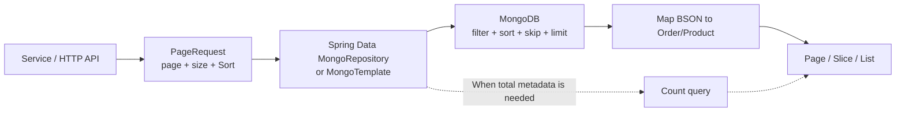

# Pageable, PageRequest, and Sort

## 1. Lesson objectives

In **Spring Data MongoDB**, querying products or orders should not return the entire collection every time a user opens a list page. **Pagination** limits the amount of data to read, while **sorting** determines record order. Spring Data provides three abstractions that commonly appear together:

- `Pageable`: describes a pagination *request* (page number, page size, ordering).
- `PageRequest`: an implementation of `Pageable` using **page number and offset** pagination.
- `Sort`: a collection of one or more property-based sorting rules.

This lesson belongs to the **Pagination and Streams** chapter of Spring Data MongoDB. The examples stay consistent with a **Mini Commerce** application featuring `Product`, `Customer`, and `Order`: displaying products by price, order history by customer, filtering orders by status, and exporting data in batches. These concepts relate directly to `MongoRepository`, `MongoTemplate`, BSON queries, indexes, aggregation, transactions, reactive access, testing, and performance diagnostics.

After this lesson, you will be able to:

1. Construct `PageRequest.of(page, size, sort)` following **0-based page indexing** and positive size rules.
2. Distinguish `Page<T>`, `Slice<T>`, `List<T>`, and the need for `count` queries.
3. Combine dynamic sorting, multi-field sorting, and Java property-to-BSON field mapping.
4. Explain `skip`/`limit`, the impact of large offsets, and why **stable sorting** is required.
5. Apply pagination with repositories or `MongoTemplate` in both synchronous and reactive applications.
6. Design sort-field allowlists, page-size bounds, and verify indexes with `explain("executionStats")`.
7. Recognize when to switch to **keyset/cursor pagination** instead of continuing with offsets.

**Prerequisites:** Java, Spring Boot, `spring-boot-starter-data-mongodb`, a running MongoDB instance, `@Document`, `@Id`, repositories, and `MongoTemplate`. Code snippets use Java 17+; the reactive section uses `spring-boot-starter-data-mongodb-reactive` instead of the synchronous starter.

## 2. Mini Commerce data model

Suppose the following documents:

```json
{
  "_id": "order-104",
  "customerId": "customer-001",
  "status": "PLACED",
  "placedAt": { "$date": "2026-11-20T11:00:00Z" },
  "totalAmount": { "$numberDecimal": "259800.00" },
  "shippingAddressSnapshot": {
    "city": "Ho Chi Minh City",
    "country": "VN"
  }
}
```

```json
{
  "_id": "prod-001",
  "sku": "LAP-001",
  "category": "phu-kien",
  "active": true,
  "unit_price": { "$numberDecimal": "129900.00" },
  "stock": 20
}
```

This is **MongoDB Extended JSON**: `$date` represents BSON Date, and `$numberDecimal` represents BSON Decimal128. For query examples in `mongosh`, use `ISODate("...")` and `NumberDecimal("...")` to pass the right data types.

The two minimal corresponding Java classes:

```java
package com.example.minicommerce.domain;

import java.math.BigDecimal;
import java.time.Instant;

import org.springframework.data.annotation.Id;
import org.springframework.data.mongodb.core.mapping.Document;
import org.springframework.data.mongodb.core.mapping.Field;
import org.springframework.data.mongodb.core.mapping.FieldType;

@Document(collection = "orders")
public class Order {
    @Id
    private String id;
    private String customerId;
    private String status;
    private Instant placedAt;

    @Field(targetType = FieldType.DECIMAL128)
    private BigDecimal totalAmount;

    public Order() {}

    public String getId() { return id; }
    public void setId(String id) { this.id = id; }
    public String getCustomerId() { return customerId; }
    public void setCustomerId(String customerId) {
        this.customerId = customerId;
    }
    public String getStatus() { return status; }
    public void setStatus(String status) { this.status = status; }
    public Instant getPlacedAt() { return placedAt; }
    public void setPlacedAt(Instant placedAt) {
        this.placedAt = placedAt;
    }
    public BigDecimal getTotalAmount() { return totalAmount; }
    public void setTotalAmount(BigDecimal totalAmount) {
        this.totalAmount = totalAmount;
    }
}
```

```java
package com.example.minicommerce.domain;

import java.math.BigDecimal;
import org.springframework.data.annotation.Id;
import org.springframework.data.mongodb.core.mapping.Document;
import org.springframework.data.mongodb.core.mapping.Field;
import org.springframework.data.mongodb.core.mapping.FieldType;

@Document(collection = "products")
public class Product {
    @Id
    private String id;
    private String sku;
    private String category;
    private boolean active;

    @Field(name = "unit_price", targetType = FieldType.DECIMAL128)
    private BigDecimal price;

    public Product() {}

    public String getId() { return id; }
    public void setId(String id) { this.id = id; }
    public String getSku() { return sku; }
    public void setSku(String sku) { this.sku = sku; }
    public String getCategory() { return category; }
    public void setCategory(String category) {
        this.category = category;
    }
    public boolean isActive() { return active; }
    public void setActive(boolean active) { this.active = active; }
    public BigDecimal getPrice() { return price; }
    public void setPrice(BigDecimal price) { this.price = price; }
}
```

The two Java snippets above are **two separate files** in the package `com.example.minicommerce.domain`. To focus on pagination, `Order` omits `OrderLine` and shipping snapshots, while `Product` omits other fields. Lessons on embedded mapping, aggregation, or transactions use fuller versions of the domain model.

## 3. How are page, size, and offset related?

With offset-based pagination, the order is determined by `Sort`, then a number of records are skipped and up to `size` records are fetched:

```text
offset = page * size

page = 0, size = 3 -> offset = 0  -> elements 1, 2, 3
page = 1, size = 3 -> offset = 3  -> elements 4, 5, 6
page = 2, size = 3 -> offset = 6  -> elements 7, 8, 9
```

For example, given 10 orders sorted descending by placement time:

| PageRequest | Offset | Maximum records fetchable |
| --- | ---: | ---: |
| `PageRequest.of(0, 3)` | 0 | 3 |
| `PageRequest.of(1, 3)` | 3 | 3 |
| `PageRequest.of(2, 3)` | 6 | 3 |
| `PageRequest.of(3, 3)` | 9 | 1 |
| `PageRequest.of(4, 3)` | 12 | 0 |

**Important:** `page` in `PageRequest` is **0-based**, not 1-based. If a REST API exposes 1-based page numbers, the controller/service layer must perform a validated conversion before calling the repository.

In MongoDB, the equivalent representation in `mongosh` is:

```javascript
db.orders
  .find({ customerId: "customer-001" })
  .sort({ placedAt: -1, _id: -1 })
  .skip(20)
  .limit(10);
```

This command corresponds to `page = 2`, `size = 10`: skip 20 records in the sorted result and return up to the next 10 records. This is a **logical illustration**; Spring Data and the driver represent filter, sort, skip, and limit via command parameters rather than a `mongosh` string.



## 4. Distinguishing Pageable, PageRequest, Sort, Page, and Slice

### 4.1. Pageable is the request contract

`Pageable` belongs to `org.springframework.data.domain` and describes:

- Page number via `getPageNumber()`.
- Page size via `getPageSize()`.
- Offset via `getOffset()` (type `long`).
- Sort via `getSort()`.
- Whether pagination is applied (`isPaged()` / `isUnpaged()`).

Example:

```java
import org.springframework.data.domain.Pageable;
import org.springframework.data.domain.PageRequest;

Pageable pageable = PageRequest.of(2, 10);

System.out.println(pageable.getPageNumber()); // 2
System.out.println(pageable.getPageSize());   // 10
System.out.println(pageable.getOffset());     // 20
```

`Pageable` is an **interface**. `PageRequest` is simply the common implementation. You should declare repository/service parameters as `Pageable` so the code is not tightly coupled to how the object is constructed.

### 4.2. PageRequest creates a pagination request

```java
import org.springframework.data.domain.PageRequest;
import org.springframework.data.domain.Pageable;
import org.springframework.data.domain.Sort;

Pageable firstPage = PageRequest.of(0, 20);

Pageable secondPage = PageRequest.of(
    1, 20, Sort.by(Sort.Order.desc("placedAt")));

Pageable bySize = PageRequest.ofSize(25).withPage(3);
```

All three are configuration objects and **do not execute any query yet**. `PageRequest` is immutable: changing the sort or page via its API returns a new object without mutating the existing one.

| Case | Behavior to remember |
| --- | --- |
| `PageRequest.of(0, 20)` | First page, 20 records |
| `PageRequest.of(1, 20)` | Second page, skips 20 records |
| `PageRequest.of(-1, 20)` | Invalid: page must not be negative |
| `PageRequest.of(0, 0)` | Invalid: size must be greater than 0 |
| `PageRequest.ofSize(25)` | Creates a request with size 25 and page 0 |
| `Pageable.unpaged()` | Does not bound pages in the usual way; unsuitable for uncontrolled public APIs |

Deep pagination can consume significant resources even when `size` is small. Therefore, not only should you bound `size`, you should also consider capping maximum `page` or switching pagination strategies for large datasets.

### 4.3. Sort describes the ordering

`Sort` also belongs to `org.springframework.data.domain`. A `Sort` can contain multiple `Sort.Order` entries:

```java
import org.springframework.data.domain.Sort;

Sort newestFirst = Sort.by(
    Sort.Order.desc("placedAt"),
    Sort.Order.desc("id")
);

Sort cheapestFirst = Sort.by(
    Sort.Order.asc("price"),
    Sort.Order.asc("id")
);

Sort noOrdering = Sort.unsorted();
```

`asc` means ascending and `desc` means descending. You can write `Sort.by(Sort.Direction.DESC, "placedAt")` or chain with `and(...)`.

**Without a sort**, MongoDB **does not guarantee a stable default order** across queries. On a system with frequent updates, paginating without sorting can duplicate or skip records even when the dataset is not very large.

### 4.4. Page and Slice are results, not requests

| Return type | Contains data? | Knows total records? | Knows if next page exists? | Typical usage |
| --- | --- | --- | --- | --- |
| `Page<T>` | Yes | **Yes** (`getTotalElements()`, `getTotalPages()`) | Yes | UI displaying total page count |
| `Slice<T>` | Yes | **No** total required | Yes (`hasNext()`) | "View more" buttons |
| `List<T>` | Yes | No | No built-in page metadata | Tasks needing only a batch of records |
| `Stream<T>` | Data consumed sequentially | No | Per iterator/cursor | Batching/reading many records when API supports it |

`Page<T>` is typically associated with an additional **count query** to compute the total, though the infrastructure may optimize away the count in certain cases where the total can be deduced from the result count. Never assume every `Page` request always sends only a single MongoDB command.

`Slice<T>` only needs to know whether **more data exists** beyond the current chunk, which can be implemented by fetching one more element than `size` and generally avoids counting the entire collection.

`List<T>` with a `Pageable` parameter can be bounded with skip/limit, but it provides neither `hasNext()` nor total record count. To know if a next page exists, you must define a separate strategy.

## 5. What metadata does Page contain?

A repository returning `Page<Order>` can be used as follows:

```java
Page<Order> result =
    orderRepository.findByCustomerId("customer-001", pageable);

List<Order> orders = result.getContent();
long total = result.getTotalElements();
int totalPages = result.getTotalPages();
int currentPage = result.getNumber(); // zero-based
int pageSize = result.getSize();
int returnedCount = result.getNumberOfElements();
boolean hasNext = result.hasNext();
boolean isFirst = result.isFirst();
boolean isLast = result.isLast();
```

**Distinction:** `result.getSize()` is the **requested** page size; `getNumberOfElements()` is the number of records **actually returned**. On the last page or an out-of-range page, these two values can differ.

If there are 23 orders and page size is 10:

| Page | `getNumberOfElements()` | `getTotalElements()` | `getTotalPages()` | `hasNext()` |
| --- | ---: | ---: | ---: | --- |
| 0 | 10 | 23 | 3 | true |
| 1 | 10 | 23 | 3 | true |
| 2 | 3 | 23 | 3 | false |
| 3 | 0 | 23 | 3 | false |

These numbers assume no concurrent writes or deletes occur during query execution. If the collection changes between the page query and the count query, the metadata may not reflect an exact point-in-time snapshot. **Page does not automatically enable transactions or snapshot isolation.**

## 6. Repository: declaring methods with the right pagination contract

### 6.1. Synchronous repository

```java
package com.example.minicommerce.repository;

import java.util.List;

import org.springframework.data.domain.Page;
import org.springframework.data.domain.Pageable;
import org.springframework.data.domain.Slice;
import org.springframework.data.domain.Sort;
import org.springframework.data.mongodb.repository.MongoRepository;

import com.example.minicommerce.domain.Order;

public interface OrderRepository
        extends MongoRepository<Order, String> {

    Page<Order> findByCustomerId(
        String customerId, Pageable pageable);

    Slice<Order> findByCustomerIdAndStatus(
        String customerId, String status, Pageable pageable);

    List<Order> findByStatus(String status, Sort sort);
}
```

```java
package com.example.minicommerce.repository;

import java.util.List;

import org.springframework.data.domain.Page;
import org.springframework.data.domain.Pageable;
import org.springframework.data.domain.Sort;
import org.springframework.data.mongodb.repository.MongoRepository;

import com.example.minicommerce.domain.Product;

public interface ProductRepository
        extends MongoRepository<Product, String> {

    Page<Product> findByActiveTrueAndCategory(
        String category, Pageable pageable);

    List<Product> findByActiveTrueAndCategory(
        String category, Sort sort);
}
```

These two interfaces are **two separate Java files**. Spring Data parses the condition segments `ByCustomerId`, `ByCustomerIdAndStatus`, or `ByActiveTrueAndCategory` from the method name; `Pageable`/`Sort` are **special parameters** and are not bound as equality fields. The repository proxy constructs the filter, sort, and result bounds according to the request type.

### 6.2. Calling the repository in a service

```java
import org.springframework.data.domain.Page;
import org.springframework.data.domain.PageRequest;
import org.springframework.data.domain.Pageable;
import org.springframework.data.domain.Sort;

Pageable pageable = PageRequest.of(
    0,
    20,
    Sort.by(
        Sort.Order.desc("placedAt"),
        Sort.Order.desc("id"))
);

Page<Order> page = orderRepository.findByCustomerId(
    "customer-001", pageable);

for (Order order : page.getContent()) {
    System.out.println(order.getId());
}
```

Logical BSON query:

```javascript
db.orders
  .find({ customerId: "customer-001" })
  .sort({ placedAt: -1, _id: -1 })
  .skip(0)
  .limit(20);
```

When `Page` is needed, the system also needs the total number of matching documents (logically equivalent to `countDocuments({ customerId: "customer-001" })`). Exact counting behavior and optimizations depend on the framework's query execution.

**Note:** `id` is the **Java property name**; because it carries `@Id`, the actual field sorted in BSON is `_id`.

### 6.3. Using Slice when total pages are not needed

```java
Pageable request = PageRequest.of(
    0,
    20,
    Sort.by(
        Sort.Order.desc("placedAt"),
        Sort.Order.desc("id"))
);

Slice<Order> slice = orderRepository.findByCustomerIdAndStatus(
    "customer-001", "PLACED", request);

List<Order> current = slice.getContent();
boolean more = slice.hasNext();
Pageable next = slice.nextPageable();
```

Once on the last slice, `hasNext()` is false and you should not request another page. Note clearly that this is an **offset-based Slice**, not keyset/cursor pagination: moving to later pages can still skip many records.

## 7. Multi-field sorting for a stable order

Suppose three orders share the exact same `placedAt`:

```text
order-101  2026-11-20T10:00:00Z
order-102  2026-11-20T10:00:00Z
order-103  2026-11-20T10:00:00Z
```

If you only use `Sort.by(desc("placedAt"))`, MongoDB is not required to return those three orders in a deterministic order because their sort key values are equal. When a page boundary splits a group of tied values, the next page may skip or duplicate records if the order changes.

The solution is to append a **unique, consistent secondary key**:

```java
Sort stableSort = Sort.by(
    Sort.Order.desc("placedAt"),
    Sort.Order.desc("id")
);
```

BSON:

```javascript
{ placedAt: -1, _id: -1 }
```

Because `_id` is unique within a collection, the key pair (`placedAt`, `_id`) defines a deterministic order for documents at query time. If the system uses an ID field with mixed BSON types, standardize the types and clarify cross-type sort semantics before adopting a cursor strategy.

**Stable ordering does not mean a fixed snapshot.** Even with a unique secondary key, inserting or deleting documents or updating a sort key between page requests can cause offsets to shift. Keyset pagination below addresses part of this issue, though it still does not automatically provide a transactional snapshot.

### 7.1. Sorting by price with an @Field alias

The `Product` entity defines:

```java
@Field(name = "unit_price", targetType = FieldType.DECIMAL128)
private BigDecimal price;
```

When calling the repository:

```java
Sort byPrice = Sort.by(
    Sort.Order.asc("price"),
    Sort.Order.asc("id")
);

Page<Product> page = productRepository.findByActiveTrueAndCategory(
    "phu-kien",
    PageRequest.of(0, 20, byPrice));
```

Logical MongoDB query after mapping:

```javascript
db.products
  .find({ active: true, category: "phu-kien" })
  .sort({ unit_price: 1, _id: 1 })
  .limit(20);
```

**Rule:** Spring Data code takes the **Java property** `price`, whereas raw MongoDB uses the BSON field `unit_price`. If legacy data mixes BSON String/Double/Decimal128, sorting results can be misleading; normalize types before testing sorts and indexes.

### 7.2. Sorting on nested properties

If `Order` has `shippingAddressSnapshot.city`, you can sort by the corresponding property path:

```java
Sort byCity = Sort.by(
    Sort.Order.asc("shippingAddressSnapshot.city"),
    Sort.Order.asc("id")
);
```

If the entity uses `@Field("ship_to")` on the address property, the mapping layer can translate the path to `ship_to.city` in BSON. With custom converters or special field names, test the actual filter and sort queries to avoid mixing up Java and BSON names.

### 7.3. Null, missing, collation, and text sorting

MongoDB sorts according to **BSON type comparison order** and specific rules for null/missing fields. `Sort.NullHandling` in Spring Data is an abstraction-level **hint**; do not assume MongoDB implements every null-first/null-last option the same way SQL does.

Similarly, to sort text by locale rules or case-insensitively, evaluate **MongoDB collation** and matching collated indexes. Adding `Sort.Order.ignoreCase()` alone does not always ensure locale-accurate sorting or index usage. Test with Vietnamese data both with and without diacritics.

## 8. Avoid accepting arbitrary Sort parameters from users

A public endpoint might receive:

```text
GET /customers/customer-001/orders?page=0&size=20&sort=placedAt,desc
```

However, you must never take an arbitrary sort string from a request and pass it straight into a repository. There are three risks:

1. Sorting by non-existent or deeply nested fields causes errors or unpredictable behavior.
2. Sorting by an unindexed field causes slow queries or excessive memory consumption.
3. The API could leak internal schema details or let users probe sensitive fields.

A service can enforce an allowlist:

```java
package com.example.minicommerce.service;

import java.util.Map;

import org.springframework.data.domain.Page;
import org.springframework.data.domain.PageRequest;
import org.springframework.data.domain.Pageable;
import org.springframework.data.domain.Sort;
import org.springframework.stereotype.Service;

import com.example.minicommerce.domain.Order;
import com.example.minicommerce.repository.OrderRepository;

@Service
public class OrderHistoryService {

    private static final Map<String, String> SORTABLE_FIELDS = Map.of(
        "placedAt", "placedAt",
        "totalAmount", "totalAmount",
        "status", "status"
    );

    private final OrderRepository repository;

    public OrderHistoryService(OrderRepository repository) {
        this.repository = repository;
    }

    public Page<Order> list(
            String customerId,
            int page,
            int requestedSize,
            String requestedSort,
            String direction) {

        if (page < 0 || page > 1000) {
            throw new IllegalArgumentException("Invalid page");
        }

        if (requestedSize < 1) {
            throw new IllegalArgumentException("Invalid page size");
        }

        int size = Math.min(requestedSize, 100);
        String property = SORTABLE_FIELDS.get(requestedSort);

        if (property == null) {
            throw new IllegalArgumentException("Unsupported sort field");
        }

        Sort.Direction order;
        if ("asc".equalsIgnoreCase(direction)) {
            order = Sort.Direction.ASC;
        } else if ("desc".equalsIgnoreCase(direction)) {
            order = Sort.Direction.DESC;
        } else {
            throw new IllegalArgumentException("Unsupported sort direction");
        }

        Sort sort = Sort.by(
            new Sort.Order(order, property),
            Sort.Order.desc("id")
        );

        Pageable pageable = PageRequest.of(page, size, sort);

        return repository.findByCustomerId(customerId, pageable);
    }
}
```

This is a **service** example (not a complete HTTP controller). A production API must also authenticate the user and verify permission to view `customerId`'s orders. Pagination, sorting, and input validation do not automatically enforce data authorization.

**Two notes:**

- The `page > 1000` check is only an **illustrative limit**, not a universal threshold. Choose limits based on actual data and SLAs.
- If a user can sort by `id`, avoid adding `id` twice; this service only allows three non-ID fields and appends `id` as a tie-breaker. If sorting by `id` is allowed, build the sort separately so the property is not duplicated.

When a public API uses 1-based page numbers, validate `page >= 1` on input and create `PageRequest.of(page - 1, size, sort)`. Document the convention clearly in the API contract; do not adjust it repeatedly across multiple layers.

## 9. Pagination with MongoTemplate

`MongoTemplate` is the synchronous API for dynamically constructed queries. When a service has many optional conditions, this can be more readable than dozens of repository methods.

```java
import java.util.List;

import org.springframework.data.domain.Page;
import org.springframework.data.domain.PageImpl;
import org.springframework.data.domain.Pageable;
import org.springframework.data.mongodb.core.MongoTemplate;
import org.springframework.data.mongodb.core.query.Criteria;
import org.springframework.data.mongodb.core.query.Query;

public Page<Order> findOrders(
        String customerId,
        String status,
        Pageable pageable,
        MongoTemplate template) {

    Criteria criteria = Criteria.where("customerId").is(customerId)
        .and("status").is(status);

    Query dataQuery = new Query(criteria).with(pageable);
    List<Order> content = template.find(dataQuery, Order.class);

    // Separate count query, without skip/limit.
    Query countQuery = new Query(
        Criteria.where("customerId").is(customerId)
            .and("status").is(status));
    long total = template.count(countQuery, Order.class);

    return new PageImpl<>(content, pageable, total);
}
```

This is an **illustrative method** placed inside a service where Spring injects `MongoTemplate`; you can change the design to constructor injection instead of passing the template as a parameter.

Things to remember:

- `new Query(criteria).with(pageable)` adds **skip, limit, and sort** from `Pageable`.
- `template.find(..., Order.class)` applies entity mapping.
- The count query must keep the **same filter**, but must not carry paging skip/limit when computing the total count.
- `new PageImpl<>(content, pageable, total)` constructs page metadata from the fetched data and the computed total.
- If you only need `List<Order>`, omit the count query to reduce cost.

A variant can use `PageableExecutionUtils.getPage(...)` to defer or skip certain count queries when the available information already suffices. Do not optimize counting manually before understanding how Spring Data behaves in your version.

### 9.1. When you only need sorting without paging

```java
Query query = Query.query(
    Criteria.where("active").is(true)
).with(Sort.by(
    Sort.Order.asc("price"),
    Sort.Order.asc("id")
));

List<Product> products = mongoTemplate.find(
    query, Product.class);
```

For large datasets, **do not** return an entire list just because you are not using `Pageable`. Add `query.limit(...)` or build a batch-fetching strategy. For `Product`, the Java property `price` maps to BSON `unit_price`.

## 10. How offset depth affects performance and consistency

Suppose an endpoint requests page 20,000 with size 50:

```text
page   = 20000
size   = 50
offset = 1,000,000
```

MongoDB still has to **walk through or skip** a large number of matching results before returning the 50 documents for the requested page. Having an index that supports sorting reduces sorting overhead, but **does not eliminate all the cost of a deep skip**. As a result, pages near the end can be much slower than the first page.

### 10.1. When data changes between two pages

For example, the first page initially has the list:

```text
order-104, order-103, order-102, order-101
```

With `size = 2`:

```text
Page 0: order-104, order-103
Page 1: order-102, order-101
```

If a new order `order-105` is inserted at the top before page 1 is fetched, page 1's offset is still 2, but the data has shifted:

```text
New list: order-105, order-104, order-103, order-102, order-101
Page 1 with skip(2): order-103, order-102
```

`order-103` is **duplicated** across the two pages and `order-101` is pushed to the next page. Stable sorting by `_id` does not prevent shifting caused by inserts/deletes when using offsets.

### 10.2. When should offset pagination be used?

Offset/page-number pagination still fits when:

- The dataset is moderate in size or users only browse the first few pages.
- The UI requires jumping to **page N** and displaying the total page count.
- Both count queries and skips stay within acceptable performance bounds.
- Concurrent changes do not severely impact the user experience.

For order histories or feeds that continuously receive new entries, **cursor/keyset pagination** usually offers clear advantages.

## 11. Keyset/cursor pagination: an approach for large order histories

Keyset pagination does not ask to "skip 1 million records"; it asks to "fetch the orders **coming after** the last order of the previous page in the chosen order."

Suppose the sort is:

```javascript
{ placedAt: -1, _id: -1 }
```

And the previous page ended at:

```text
lastPlacedAt = 2026-11-20T10:00:00Z
lastId       = "order-102"
```

The query for the next page can be:

```javascript
db.orders.find({
  customerId: "customer-001",
  $or: [
    { placedAt: { $lt: ISODate("2026-11-20T10:00:00Z") } },
    {
      placedAt: ISODate("2026-11-20T10:00:00Z"),
      _id: { $lt: "order-102" }
    }
  ]
})
.sort({ placedAt: -1, _id: -1 })
.limit(20);
```

Explanation:

- If `placedAt` is **earlier** than the cursor value, the document comes after the cursor.
- If `placedAt` **equals** the cursor value, only fetch documents with `_id` smaller than the last ID under descending sort.
- Keep the **filter, sort, traversal direction, and cursor BSON types** consistent across requests.
- Fields used for the keyset should be **stable/immutable**, have deterministic values, and include a unique tie-breaker key.

A compound index worth evaluating:

```javascript
db.orders.createIndex({
  customerId: 1,
  placedAt: -1,
  _id: -1
});
```

If the cursor includes `_id` as a BSON `ObjectId`, the cursor token and query must preserve that type; the example above uses String IDs such as `"order-102"`. Do not expose a cursor that users can tamper with to bypass tenant filters or access other data; enforce authorization, opaque/signed tokens, or encryption appropriate for your API.

**Benefits:** avoids deep skips and reduces many offset-shift issues when new records are inserted ahead of the cursor. **Limitations:** inconvenient for jumping directly to page N and does not automatically provide `totalPages`; updates/deletes to sort key values between reads can still cause inconsistencies.

Spring Data also provides scrolling abstractions such as `ScrollPosition`/`Window<T>` in supported versions. When using them, check your exact version and repository APIs; do not confuse an offset `PageRequest` with a cursor `ScrollPosition`.

## 12. Query plans and indexes for filter + sort

### 12.1. Product listing by category, ascending price

Query:

```javascript
db.products
  .find({ active: true, category: "phu-kien" })
  .sort({ unit_price: 1, _id: 1 })
  .skip(0)
  .limit(20)
  .explain("executionStats");
```

Candidate index to test:

```javascript
db.products.createIndex({
  active: 1,
  category: 1,
  unit_price: 1,
  _id: 1
});
```

### 12.2. Customer order history, newest first

```javascript
db.orders
  .find({ customerId: "customer-001" })
  .sort({ placedAt: -1, _id: -1 })
  .skip(0)
  .limit(20)
  .explain("executionStats");
```

Candidate index:

```javascript
db.orders.createIndex({
  customerId: 1,
  placedAt: -1,
  _id: -1
});
```

This is a **proposed index for testing**, not a mandatory configuration for every project. Actual optimization depends on data distribution, filter predicates, document count, write frequency, and existing indexes.

When inspecting `explain("executionStats")`, look at:

| Field / concept | What to check |
| --- | --- |
| `winningPlan` | Does the plan use `IXSCAN`/`FETCH` or `COLLSCAN`? |
| `totalKeysExamined` | How many index entries were scanned? |
| `totalDocsExamined` | How many actual documents were examined? |
| `nReturned` | Number of documents returned |
| `SORT` in the plan | Is there an expensive in-memory sort stage outside the index? |
| Deep skip | Does the number of skipped entries grow with page number even with a good index? |

**Do not look only at a small page size and assume a query is cheap.** With `Page<T>`, you may also need to measure the count query. Monitor latency, memory, round trips, and cache hit rates using proper observability tools.

### 12.3. Sorting by an unindexed field

`Sort.by("totalAmount")` can force MongoDB to sort a large result set if a matching index is missing. For pages like "highest-value orders", consider a dedicated index or adjust the data retrieval strategy. Do not create dozens of indexes for every UI sort combination: every index adds storage and write overhead.

## 13. Projections to reduce transferred data

Pagination bounds the **number of documents**, whereas projections bound the **fields returned**. When displaying an order list, you may not need every `OrderLine`, address, and detail field.

Example:

```javascript
db.orders.find(
  { customerId: "customer-001" },
  {
    _id: 1,
    status: 1,
    placedAt: 1,
    totalAmount: 1
  }
)
.sort({ placedAt: -1, _id: -1 })
.limit(20);
```

In Spring Data, you can declare **interface/DTO projections** or use `Query.fields()` on `MongoTemplate`. Never read a partially loaded entity and then call `save()` as if it were complete: replacing the document risks wiping out unloaded fields. Projections are best suited for **read** paths.

Using projections can reduce network bandwidth and mapping cost, but if the query still has to filter or sort a large unindexed dataset, reducing returned fields **will not solve** all performance problems on its own.

## 14. Pagination with reactive MongoDB

If the project uses `spring-boot-starter-data-mongodb-reactive`, you can declare a repository:

```java
package com.example.minicommerce.repository;

import org.springframework.data.domain.Pageable;
import org.springframework.data.mongodb.repository.ReactiveMongoRepository;

import reactor.core.publisher.Flux;
import reactor.core.publisher.Mono;

import com.example.minicommerce.domain.Order;

public interface ReactiveOrderRepository
        extends ReactiveMongoRepository<Order, String> {

    Flux<Order> findByCustomerId(
        String customerId, Pageable pageable);

    Mono<Long> countByCustomerId(String customerId);
}
```

Calling it:

```java
Pageable request = PageRequest.of(
    0, 20,
    Sort.by(
        Sort.Order.desc("placedAt"),
        Sort.Order.desc("id"))
);

Flux<Order> orders =
    reactiveOrderRepository.findByCustomerId(
        "customer-001", request);

Mono<Long> total =
    reactiveOrderRepository.countByCustomerId("customer-001");
```

In reactive repositories, return types are typically `Flux<T>`/`Mono<T>`, **not blocking `Page<T>` with an automatic count**. If an API needs a total, design the count query and publisher composition explicitly; if not, returning only the items for a page/scroll is cleaner and lighter.

With `ReactiveMongoTemplate`:

```java
import org.springframework.data.mongodb.core.query.Criteria;
import org.springframework.data.mongodb.core.query.Query;

Query query = Query.query(
    Criteria.where("customerId").is("customer-001"))
    .with(request);

Flux<Order> orders =
    reactiveMongoTemplate.find(query, Order.class);
```

Reactive I/O executes when the publisher is **subscribed**. Do not call `.block()` on a WebFlux event loop to turn reactive calls into synchronous ones. In tests, you can use Reactor `StepVerifier`; for paginated queries, verify the exact count, order, and completion signal.

**Distinction:** the reactive driver provides non-blocking I/O, but it does not make `skip(1_000_000)` an efficient query; query plans, indexes, and offset costs still apply.

## 15. Querying large datasets: Stream does not replace pagination

Sometimes you need to export all orders for internal reporting or batch processing. There are two approaches:

1. **Page/batch reads**: fetch one small page at a time, process it, then move to the next page or use keyset pagination.
2. **Streaming cursor**: certain Spring Data MongoDB APIs can iterate results as a `Stream<T>` or underlying cursor; resources must be closed promptly.

Example using synchronous `MongoTemplate.stream(...)`:

```java
import java.util.stream.Stream;
import org.springframework.data.mongodb.core.query.Criteria;
import org.springframework.data.mongodb.core.query.Query;

Query query = Query.query(
    Criteria.where("status").is("PLACED"))
    .with(Sort.by(
        Sort.Order.asc("placedAt"),
        Sort.Order.asc("id")));

try (Stream<Order> orders = mongoTemplate.stream(
        query, Order.class)) {
    orders.forEach(order -> {
        // Process each Order; do not accumulate everything in memory.
        System.out.println(order.getId());
    });
}
```

**Important boundaries:**

- A stream/cursor can hold connection resources and a server cursor open during iteration; it must be closed (e.g., via `try-with-resources`).
- Do not keep a stream open across a long HTTP request or uncontrolled slow network calls.
- For large exports, keyset batching or a checkpointed batch job is usually easier to retry than a single long-lived stream.
- Streaming does not automatically create a transaction or stable snapshot; choose an explicit consistency mechanism if the business requires it.

## 16. Integration testing: pages, counts, and stable ordering

Tests using a mock repository only verify that your code calls a method; they will not catch wrong sort orders or `id → _id` mapping mistakes. Use a real MongoDB instance or Testcontainers with a **dedicated test database**.

The example below seeds four orders for a test customer. Two orders share the same `placedAt` to demonstrate the `_id` tie-breaker:

```java
package com.example.minicommerce;

import static org.junit.jupiter.api.Assertions.*;

import java.time.Instant;
import java.util.Date;
import java.util.List;

import org.bson.Document;
import org.junit.jupiter.api.Test;
import org.springframework.beans.factory.annotation.Autowired;
import org.springframework.boot.test.context.SpringBootTest;
import org.springframework.data.domain.Page;
import org.springframework.data.domain.PageRequest;
import org.springframework.data.domain.Pageable;
import org.springframework.data.domain.Sort;
import org.springframework.data.mongodb.core.MongoTemplate;

import com.example.minicommerce.domain.Order;
import com.example.minicommerce.repository.OrderRepository;

@SpringBootTest
class OrderPaginationIntegrationTest {

    @Autowired MongoTemplate template;
    @Autowired OrderRepository repository;

    @Test
    void pagesAreZeroBasedStableAndCounted() {
        String customer = "customer-pagination-test";
        var raw = template.getCollection("orders");
        Document customerFilter = new Document("customerId", customer);

        // Delete only test fixtures; never run against a production database.
        raw.deleteMany(customerFilter);

        try {
            raw.insertMany(List.of(
                order("order-101", customer, "2026-11-20T09:00:00Z"),
                order("order-102", customer, "2026-11-20T10:00:00Z"),
                order("order-103", customer, "2026-11-20T10:00:00Z"),
                order("order-104", customer, "2026-11-20T11:00:00Z")
            ));

            Sort stable = Sort.by(
                Sort.Order.desc("placedAt"),
                Sort.Order.desc("id"));
            Pageable firstRequest = PageRequest.of(0, 2, stable);
            Pageable secondRequest = PageRequest.of(1, 2, stable);

            Page<Order> first =
                repository.findByCustomerId(customer, firstRequest);
            Page<Order> second =
                repository.findByCustomerId(customer, secondRequest);

            assertEquals(
                List.of("order-104", "order-103"),
                first.getContent().stream().map(Order::getId).toList());
            assertEquals(
                List.of("order-102", "order-101"),
                second.getContent().stream().map(Order::getId).toList());

            assertEquals(4L, first.getTotalElements());
            assertEquals(2, first.getTotalPages());
            assertTrue(first.hasNext());
            assertFalse(second.hasNext());
            assertEquals(0, first.getNumber());
            assertEquals(1, second.getNumber());
        } finally {
            raw.deleteMany(customerFilter);
        }
    }

    private static Document order(
            String id, String customer, String placedAt) {
        return new Document("_id", id)
            .append("customerId", customer)
            .append("status", "PLACED")
            .append("placedAt",
                Date.from(Instant.parse(placedAt)));
    }
}
```

This test intentionally persists only the fields needed for pagination, so `totalAmount` may be null; that is valid for testing mapping/sorting, though it **does not** replace order-creation business tests. Also fix your MongoDB test configuration and ensure other tests do not mutate `customer-pagination-test` concurrently.

### 16.1. Recommended test matrix

| Case | Expectation |
| --- | --- |
| `page = 0`, `size = 2` | First two results according to sort |
| `page = 1`, `size = 2` | Next two results, no duplicates when data is unchanged |
| Two orders with equal `placedAt` | Secondary sort by `id` produces a predictable order |
| Partial last page | `getNumberOfElements() < getSize()` |
| Out-of-range page | Empty content, metadata is not misinterpreted |
| `Page` | Returns total record count and total page count |
| `Slice` | `hasNext()` is accurate without requiring `getTotalPages()` |
| `size <= 0` or `page < 0` | Service/`PageRequest` rejects the input |
| Sort field not in allowlist | API rejects it instead of passing directly to repository |
| Sort by `price` | Query uses BSON `unit_price` per `@Field` |
| Nested sort like `shippingAddressSnapshot.city` | Query uses the actual BSON field |
| Deep offset query | Observe latency and scan depth |
| Cursor across tied timestamps | No skipped documents on `(placedAt, _id)` |
| New insert between two offset pages | Test demonstrates drift risk |
| Reactive pagination | `Flux` returns expected order/size without `block()` |

## 17. Common mistakes

| Symptom | Common cause | Fix |
| --- | --- | --- |
| First page is skipped | Confusing 1-based and 0-based pages | Convert at API boundary, verify `PageRequest.of(0, ...)` |
| `IllegalArgumentException` creating PageRequest | `page < 0` or `size <= 0` | Validate and bound inputs |
| Duplicate or missing orders across pages | Missing stable sort or shifting data between queries | Add unique tie-breaker; use keyset when appropriate |
| Query returns pages in wrong order | Wrong property name or direction in Sort | Use Java property names, verify BSON and `@Field` |
| Monetary sorting is wrong | Prices stored as mixed String/Double/Decimal128 | Normalize to BSON Decimal128 and check indexes |
| `Page` is slower than `List` | Count query or total metadata work | Use `Slice`/`List` when total is unneeded; measure count query |
| Deep pages are very slow | Large `skip` | Switch to keyset/cursor for continuous browsing |
| `Sort.NullHandling` behaves unexpectedly | Not all stores honor every hint | Inspect BSON ordering and actual queries, define null/missing policy |
| Case-insensitive sorting is wrong | Incompatible collation/index | Configure matching collation and test with Vietnamese text |
| API hit by heavy queries via free-form sort | Missing field allowlist or page size limit | Allowlist fields, cap page/size, and index per workload |
| `MongoTemplate` computes wrong total | Count query has different filter or unintended paging | Use a separate count query with identical filter |
| Projected entity saved and loses fields | Partially loaded entity passed to `save` | Use read DTOs; never save partially loaded entities |
| Reactive pagination returns blocking `Page<T>` | Confusing blocking and reactive contracts | Return `Flux` with `Pageable`, plus `Mono<Long>` count if needed |
| Streams exhaust resources | Unclosed cursors or slow processing | `try-with-resources`, timeouts, batch/checkpoint |
| Index exists yet page is slow | Index does not match filter/sort or deep skip | Check `explain` and data distribution |

## 18. Practice exercises

**Exercise 1 — Pagination syntax.** Create `PageRequest` objects for pages 0, 1, and 2 with size 10; compute expected offsets and compare with `getOffset()`. Explain why `PageRequest.of(0, 0)` is rejected.

**Exercise 2 — Product listing.** Declare `ProductRepository.findByActiveTrueAndCategory(category, pageable)`, using `Sort.by(asc("price"), asc("id"))`. Insert three Decimal128 prices, predict the BSON `unit_price` order, and verify with `mongosh`.

**Exercise 3 — Order history.** Create four orders for the same customer, with two sharing the same `placedAt`. Read pages 0 and 1 with size 2, sorted by `placedAt DESC, id DESC`; verify there are no duplicates on an immutable dataset.

**Exercise 4 — Page vs. Slice.** Create two repository methods with the same filter but different return types. Compare `getContent()`, `hasNext()`, and `totalElements` metadata; use database observation to verify whether a count query runs.

**Exercise 5 — Input bounds.** Implement an API accepting page, size, and sort/direction. Allow three sort fields, reject oversized pages, reject negative pages, and disallow arbitrary queries against internal fields.

**Exercise 6 — Performance.** Create a larger test dataset, compare the first page and a deep page using `explain("executionStats")`. Test a compound index `{ customerId: 1, placedAt: -1, _id: -1 }` and record keys/documents examined.

**Exercise 7 — Cursor.** Use (`placedAt`, `_id`) of the last order as a cursor; write a raw query fetching older orders in descending order. Insert a new order at the top and compare duplication/skipping risks between offset and keyset.

**Extension exercise — Reactive/batch.** Create `ReactiveOrderRepository` returning `Flux<Order>` with `Pageable`, and test with `StepVerifier`. Or use `MongoTemplate.stream(...)` on a test dataset to process sequentially while ensuring the cursor closes.

### Self-check questions

1. How do `Pageable`, `PageRequest`, and `Sort` differ in responsibility?
2. With `page = 5` and `size = 25`, what is the offset? What number does the first page start at?
3. Why can `Page<T>` incur an extra count query, whereas `Slice<T>` usually does not need a total?
4. Why is sorting only by `placedAt` not stable enough if multiple orders share the same timestamp?
5. Java `price` has `@Field("unit_price")`; which name do you pass to `Sort`, and which field does MongoDB actually sort by?
6. Why can a deep `skip` still be expensive even with a good compound index?
7. What does a keyset pagination token need to contain, and what is the cursor condition for descending sort?
8. How does reactive MongoDB change the return type without automatically making large-offset queries cheaper?
9. Why must an API allowlist sort fields and enforce customer order access authorization?
10. When should you use projection or streaming instead of sending entire `Order` documents to the UI?

**Expected outcome:** learners can build safe paginated queries, understand 0-based paging and `Page`/`Slice` metadata, sort deterministically across multiple fields, inspect BSON fields and compound indexes, and know when to switch from offset to cursor pagination. These skills provide a solid foundation for implementing queries, aggregations, indexes, transactions, reactive access, and data performance diagnostics in Spring Data MongoDB.

## References

- [Spring Data Commons — Paging and Sorting](https://docs.spring.io/spring-data/commons/reference/repositories/query-methods-details.html): `Pageable`/`Sort` parameters, limits, paging, and sorting.
- [Spring Data Commons API — PageRequest](https://docs.spring.io/spring-data/commons/docs/current/api/org/springframework/data/domain/PageRequest.html): zero-based pages and factory methods.
- [Spring Data Commons API — Page, Slice, Sort](https://docs.spring.io/spring-data/commons/docs/current/api/org/springframework/data/domain/Page.html): page metadata and related interfaces.
- [Spring Data MongoDB — Query Methods](https://docs.spring.io/spring-data/mongodb/reference/mongodb/repositories/query-methods.html): repository queries with `Pageable`/`Sort` and reactive return types.
- [Spring Data MongoDB — Template Query Operations](https://docs.spring.io/spring-data/mongodb/reference/mongodb/template-query-operations.html): `MongoTemplate`, `Query`, and sort/limit operations.
- [MongoDB — Cursor.skip()](https://www.mongodb.com/docs/manual/reference/method/cursor.skip/): performance and stability impact of large skips.
- [MongoDB — Compound Indexes](https://www.mongodb.com/docs/manual/core/indexes/index-types/index-compound/): designing indexes for filtering and sorting.
- [MongoDB — Explain Results](https://www.mongodb.com/docs/manual/reference/explain-results/): reading `winningPlan` and `executionStats`.
