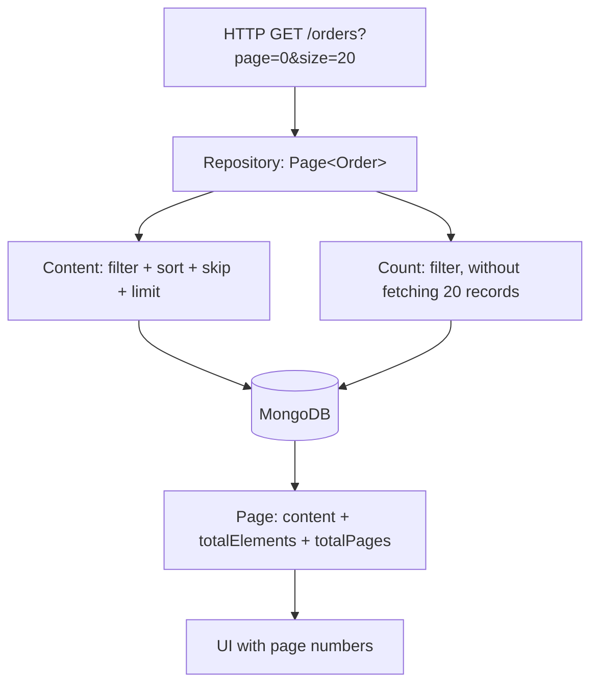
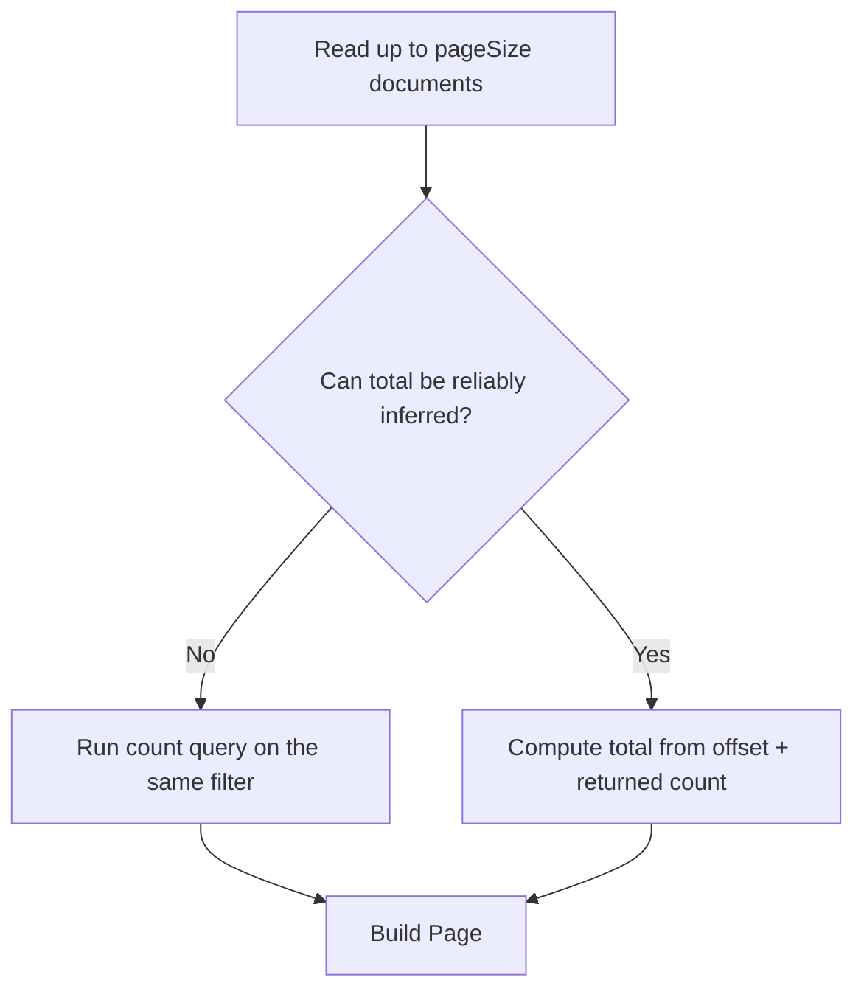

# Page, Count Queries, and the Cost of Total Result Counts

> **Chapter:** Pagination and Streams  
> **Module:** `SPRING_DATA_MONGODB` — using Spring Data MongoDB to connect, map documents, and operate on MongoDB via `MongoTemplate` or repositories. This lesson focuses on **Page**, how **total result counts are computed via count**, the impact on indexes/performance, and how to choose `Slice`, bounded lists, keyset pagination, or streams when a total count is unnecessary. These decisions affect queries, aggregations, transactions, reactive access, testing, and data load diagnostics.

## 1. The problem: 20 records and how many in total?

Suppose an admin screen displays **20 orders per page**. With the filter `status = "PAID"` and `archived = false`, the API might want to return:

```json
{
  "content": [
    { "id": "ORD-201", "status": "PAID" },
    { "id": "ORD-200", "status": "PAID" },
    { "id": "ORD-199", "status": "PAID" },
    { "id": "ORD-198", "status": "PAID" },
    { "id": "ORD-197", "status": "PAID" },
    { "id": "ORD-196", "status": "PAID" },
    { "id": "ORD-195", "status": "PAID" },
    { "id": "ORD-194", "status": "PAID" },
    { "id": "ORD-193", "status": "PAID" },
    { "id": "ORD-192", "status": "PAID" },
    { "id": "ORD-191", "status": "PAID" },
    { "id": "ORD-190", "status": "PAID" },
    { "id": "ORD-189", "status": "PAID" },
    { "id": "ORD-188", "status": "PAID" },
    { "id": "ORD-187", "status": "PAID" },
    { "id": "ORD-186", "status": "PAID" },
    { "id": "ORD-185", "status": "PAID" },
    { "id": "ORD-184", "status": "PAID" },
    { "id": "ORD-183", "status": "PAID" },
    { "id": "ORD-182", "status": "PAID" }
  ],
  "page": 0,
  "size": 20,
  "numberOfElements": 20,
  "totalElements": 202342,
  "totalPages": 10118,
  "hasNext": true
}
```

This is an **example response structure**; a `Page` returned by Spring Data does not serialize to these exact field names by default, and `totalElements` is illustrative. The key point is that two groups of data come from different sources:

1. **Content query** returns at most 20 documents belonging to the requested page, according to the filter and sort.
2. **Count query** determines the total number of documents matching the filter—**not** merely counting the 20 loaded documents.

If the UI only needs a **"View more"** button, counting the entire dataset can be an unjustifiable cost. If the UI needs **"Page 1 / 10,118"**, the total count is a functional requirement. Thus, choosing between `Page` and `Slice` must start from the API contract, not just the Java return type name.



**Important note:** the diagram depicts **two logical operations**, not a claim that every `Page` return always executes exactly two MongoDB commands. Spring Data has optimizations that skip the count when the total can be deduced from the content, depending on the scenario and version.

## 2. Core concepts: Pageable, PageRequest, and Page

### 2.1. Pages are 0-indexed

In Spring Data, `PageRequest.of(page, size)` uses **0-based page indices**:

| Java | Meaning | Skip at MongoDB level |
| --- | --- | --- |
| `PageRequest.of(0, 20)` | First page, 20 records | `0` |
| `PageRequest.of(1, 20)` | Second page | `20` |
| `PageRequest.of(2, 20)` | Third page | `40` |
| `PageRequest.of(10, 20)` | 11th page | `200` |

With standard offset pagination:

\[
\text{offset} = \text{pageNumber} \times \text{pageSize}
\]

`PageRequest` is an implementation of `Pageable`; it holds the page number, page size, and an optional `Sort`. It **does not execute queries on its own**. The repository or template uses these parameters to construct MongoDB commands.

### 2.2. What values does a Page provide?

When a method returns `Page<Order>`, the caller can access:

| API | Meaning |
| --- | --- |
| `getContent()` | List of entities on the current page. |
| `getNumber()` | Current page index, starting from 0. |
| `getSize()` | Requested page size. |
| `getNumberOfElements()` | Number of elements **actually** in the current content. |
| `getTotalElements()` | Total number of matching elements per how the `Page` was constructed. |
| `getTotalPages()` | Total page count computed from total and page size. |
| `hasNext()` / `hasPrevious()` | Whether a next/previous page exists according to pagination metadata. |
| `isFirst()` / `isLast()` | Whether this is the first/last page according to available metadata. |

If `totalElements = 45` and `size = 20`:

\[
\text{totalPages}=\left\lceil\frac{45}{20}\right\rceil=3
\]

The three pages have indices `0`, `1`, and `2`, with maximum record counts `20`, `20`, and `5`, respectively. `getNumberOfElements()` on the last page is `5`, **not** `45`.

Never use `page.getContent().size()` to display the total number of orders in the system. That is only the number of records loaded for a single page.

## 3. Building a complete Spring Data MongoDB example

### 3.1. Entity and collection

Suppose each order has a creation timestamp, status, and archived flag:

```java
package demo.orders;

import java.math.BigDecimal;
import java.time.Instant;
import org.springframework.data.annotation.Id;
import org.springframework.data.mongodb.core.mapping.Document;
import org.springframework.data.mongodb.core.mapping.Field;
import org.springframework.data.mongodb.core.mapping.FieldType;

@Document(collection = "orders")
public record Order(
    @Id String id,
    String customerId,
    String status,
    boolean archived,
    Instant createdAt,
    @Field(targetType = FieldType.DECIMAL128) BigDecimal totalAmount
) {}
```

Example BSON document in MongoDB:

```json
{
  "_id": "ORD-201",
  "customerId": "CUST-42",
  "status": "PAID",
  "archived": false,
  "createdAt": { "$date": "2026-11-20T03:20:00Z" },
  "totalAmount": { "$numberDecimal": "1250.50" }
}
```

`Instant` is well suited for sorting by absolute point in time. The `ORD-...` IDs are business strings, avoiding confusion with BSON `ObjectId` in the keyset illustration. In a real system, keep `_id` types consistent before designing a cursor.

### 3.2. Repository returning Page

```java
package demo.orders;

import org.springframework.data.domain.Page;
import org.springframework.data.domain.Pageable;
import org.springframework.data.mongodb.repository.MongoRepository;

public interface OrderRepository extends MongoRepository<Order, String> {

    Page<Order> findByStatusAndArchivedFalse(
        String status,
        Pageable pageable
    );
}
```

Call site:

```java
import org.springframework.data.domain.Page;
import org.springframework.data.domain.PageRequest;
import org.springframework.data.domain.Sort;

PageRequest pageable = PageRequest.of(
    0,
    20,
    Sort.by(Sort.Direction.DESC, "createdAt")
        .and(Sort.by(Sort.Direction.DESC, "id"))
);

Page<Order> page =
    orderRepository.findByStatusAndArchivedFalse("PAID", pageable);

var orders = page.getContent();
long total = page.getTotalElements();
int numberOfPages = page.getTotalPages();
boolean next = page.hasNext();
```

The method name `findByStatusAndArchivedFalse` is a **derived query**: Spring Data turns `status` and `archived` into corresponding conditions. `Sort` uses **Java property names**; the mapping layer translates `id` to BSON `_id` where appropriate.

### 3.3. Actual query semantics

For the BSON fields of `Order` above, the content query is logically equivalent to:

```javascript
db.orders.find({
  status: "PAID",
  archived: false
}).sort({
  createdAt: -1,
  _id: -1
}).skip(0).limit(20);
```

The corresponding separate count query:

```javascript
db.orders.countDocuments({
  status: "PAID",
  archived: false
});
```

Count does not need `skip(0)`/`limit(20)` and does not need sorting to determine the total. That is precisely why computing the exact total can require examining far more matching documents than the 20 documents just read.

**Do not read the `mongosh` examples as exact wire-protocol commands for every version.** Spring Data and the Java Driver may use aggregation-based counting or other optimizations; what matters is the **filtered count semantics**, not the specific wire command name.

## 4. When does the count query execute?

### 4.1. Page requires total count information

When constructing a `Page`, the framework must supply meaningful `totalElements` and `totalPages`. Whenever the total cannot be inferred from the content alone, it must run a **filtered count**.

For example, the first-page query retrieves a full 20 documents. From those 20 documents, the framework **cannot tell** whether MongoDB holds 20, 200, or 2 million matching documents in total. A count is required if the `Page` contract demands an accurate total at execution time.

Logical sequence:



### 4.2. Cases where count can be skipped

Spring Data Commons provides the `PageableExecutionUtils` utility to **defer the count call** and invoke it only when needed. Spring Data's repository infrastructure can apply similar optimizations.

Common cases:

- **First page** requests 20 and receives only 7 records: the total can be inferred as `7`, avoiding a separate count.
- **Later page** receives a full 20 records: unknown how many more remain; typically still requires a count to build `Page`.
- **Non-empty later page** with fewer than 20 records: under normal read conditions, the total can be inferred as `offset + returnedCount`.
- **Far out-of-range empty page**: caution is required; you cannot arbitrarily infer total as `offset`. The framework may still run a count or handle it separately.

These optimization branches depend on implementation, library version, and data state. **Never promise that `Page` always skips count on the last page, or always executes two queries.** To know what your live application does, observe commands/metrics on the running system.

Moreover, under **concurrent data mutations**, inferring the total from a short page does not necessarily reflect a globally consistent snapshot; this is a general pagination limitation, not a bug unique to count optimization.

### 4.3. Does calling getTotalElements trigger count lazily at that moment?

Do not assume the count only runs when your code calls `page.getTotalElements()`. An implementation constructing `Page` may have already computed the total before returning from the repository; `PageableExecutionUtils.getPage(…)` can also invoke the count supplier **while creating the Page** if needed, rather than waiting for the getter call.

Therefore, if your API only uses `page.getContent()` while the repository method still returns `Page<Order>`, the application **may still be paying unnecessary count costs**. When totals are not needed, change the return type to `Slice`, `List`, or use an appropriate cursor model.

## 5. Cost of countDocuments in MongoDB

### 5.1. Count is not free

`countDocuments(filter)` must compute the number of documents matching the predicate at execution time. When a filter matches a large set, counting may require:

- Scanning many **index entries** if a suitable index is used.
- Fetching actual documents if the predicate is not fully covered by an index.
- Scanning the entire collection if no supporting index exists or the planner chooses a collection scan.
- Scattering the count across multiple shards in a sharded cluster, depending on filter routing.

A content query with `limit(20)` and a sort-supporting index sometimes traverses only a short prefix of the index. A count query needs the total across **all matching documents**, so it can consume more CPU, I/O, and time than reading 20 items.

### 5.2. What affects the cost?

| Factor | Typical impact |
| --- | --- |
| **Filter selectivity** | Selective filters matching few documents are usually cheaper to count than broad filters matching most of the collection. |
| **Index matching filter** | Reduces documents read; may still have to traverse many index entries. |
| **Operator types** | Certain regexes, expressions, or hard-to-index predicates can cause large scans. |
| **Collection size** | Counting the whole collection or very broad predicates scales with dataset size. |
| **Sharding** | If the filter lacks an appropriate shard key, multiple shards may need to be queried. |
| **Concurrent load** | Hundreds of concurrent requests demanding totals can generate substantial count load. |
| **Transaction/read concern** | Snapshot semantics and resource usage depend on configuration; plain `Page` does not provide consistent snapshots. |
| **Repeated counting** | As users click page by page, the server may recount the same dataset on every request. |

Do not conclude that count is fast just because latency is low on a local database with a few hundred rows. Measure with production-like data sizes and distributions while monitoring indexes and resource contention.

### 5.3. Inspecting explain for count and content

For the content query:

```javascript
db.orders.find({
  status: "PAID",
  archived: false
}).sort({
  createdAt: -1,
  _id: -1
}).limit(20).explain("executionStats");
```

For count logic, MongoDB allows analyzing the equivalent pipeline:

```javascript
db.orders.explain("executionStats").aggregate([
  { $match: { status: "PAID", archived: false } },
  { $count: "total" }
]);
```

This pipeline is a **way to measure the logically equivalent count operation**, not a claim that Spring Data always sends this exact pipeline. Compare `winningPlan`, `totalKeysExamined`, `totalDocsExamined`, execution time, and intermediate record counts if any. A single `explain` does not capture network latency, cache warmth, or concurrency; combine it with logs and application metrics.

## 6. Designing indexes for both content and count

For the main query `status="PAID"`, `archived=false`, sorted descending by creation time and ID, consider an index:

```javascript
db.orders.createIndex({
  status: 1,
  archived: 1,
  createdAt: -1,
  _id: -1
});
```

Rationale behind this choice:

1. `status` and `archived` are equality predicates and can precede the sort fields.
2. `createdAt` and `_id` support stable ordering for the content query.
3. The count query can leverage the leading prefix of the index when matching the same filter, even though it still has to sum matching entries.

This is a **candidate index**, not a guarantee MongoDB will always pick it. Indexes incur write overhead, storage, and maintenance cost. If the system has many other query shapes, measure the overall workload before deciding.

### 6.1. Why add _id to the sort?

If two orders share the same `createdAt` and you sort only by `createdAt`, the relative order between them is **not uniquely defined**. When paginating with `skip/limit`, two different page requests can observe different orders among tied documents, causing skipped or duplicated items.

A composite sort:

```javascript
{ createdAt: -1, _id: -1 }
```

provides a much more deterministic ordering over the current data. It **does not** lock a data snapshot across requests: inserts or deletes while a user flips pages can still shift document positions.

### 6.2. Is the count index always identical to the content index?

Not always:

- **Content** needs filtering, sorting, and limiting.
- **Count** only needs filtering and counting; sorting is unnecessary.

A shorter index `{status: 1, archived: 1}` may suffice for count, whereas content adds `createdAt`/`_id`. However, keeping both indexes creates prefix overlap and extra write cost. Typically, test whether the longer compound index serves both operations adequately before adding a second index.

With per-user filters (such as `customerId` or tenant), index field ordering must be designed around **actual filters and data access rules**. Do not copy sample indexes verbatim if your application has a different query shape.

## 7. Page vs. Slice, List, and options without total

### 7.1. Comparison table

| Return type | Has content? | Has totalElements/totalPages? | When appropriate |
| --- | --- | --- | --- |
| `Page<T>` | Yes | **Yes** | UI strictly requires total count and page count. |
| `Slice<T>` | Yes | **No** | UI only needs to know if a next page exists. |
| `List<T>` with `Pageable` | Yes | **No** | Only a window of results is needed, without metadata. |
| `Window<T>`/scrolling | Yes | **Not in Page's sense** | Forward traversal by cursor/scroll position; check store/version support. |
| `Stream<T>` | Yes, read incrementally | **No** | Processing many records with controlled cursor resource management. |
| Reactive `Flux<T>` | Yes, asynchronous | **No built-in total** | Reactive streaming queries, pagination via supported mechanisms. |

If the API only needs "the next 20 orders", `Slice` is usually a more sensible starting point than `Page`.

### 7.2. Returning Slice from a repository

```java
import org.springframework.data.domain.Page;
import org.springframework.data.domain.Pageable;
import org.springframework.data.domain.Slice;
import org.springframework.data.mongodb.repository.MongoRepository;

public interface OrderRepository
        extends MongoRepository<Order, String> {

    Page<Order> findByStatusAndArchivedFalse(
        String status, Pageable pageable
    );

    Slice<Order> findSliceByStatusAndArchivedFalse(
        String status, Pageable pageable
    );
}
```

With `Slice`, Spring Data can read up to **`pageSize + 1`** records to determine whether a next page exists. It does not need to count all matching documents just to populate `hasNext()`.

For instance, requesting 20 records: if the query finds at least 21 documents starting at the current position, Spring Data returns 20 items and `hasNext = true`. The extra element acts as a lookahead signal and is not included in `content`.

```java
Slice<Order> slice =
    orderRepository.findSliceByStatusAndArchivedFalse(
        "PAID",
        PageRequest.of(
            0, 20,
            Sort.by(Sort.Direction.DESC, "createdAt")
                .and(Sort.by(Sort.Direction.DESC, "id"))
        )
    );

var currentItems = slice.getContent();
boolean more = slice.hasNext();
```

**Trade-off:** there is no `getTotalElements()` or `getTotalPages()`. If the UI demands exact page counts, `Slice` cannot supply them without performing separate counting work.

### 7.3. List with Pageable

Another method can return `List<Order>` with `Pageable`:

```java
List<Order> findListByStatusAndArchivedFalse(
    String status, Pageable pageable
);
```

The result contains only the items in the read window, **with no total count** and usually no `hasNext()`. If the application needs to know whether a next page exists, it must fetch one extra item or use `Slice` instead of guessing that "getting 20 items guarantees more data."

### 7.4. APIs can separate lists from total counts

A design that often fits large systems:

- Endpoint `GET /orders?cursor=...&limit=20` returns content and `nextCursor`.
- Endpoint `GET /orders/count?...` or a dedicated summary endpoint counts only when the user actually needs it.
- If totals can be slightly stale, consider **caching**, periodic stats, or a clearly labeled approximate count.

Never disguise an approximate count as an exact `Page.getTotalElements()` if the API contract guarantees exactness. When separating endpoints, document clearly that the two responses may be computed at **different points in time**.

## 8. countDocuments vs. estimatedDocumentCount

In the MongoDB Java Driver, these are two distinct concepts:

| API | Arbitrary filter? | Meaning |
| --- | --- | --- |
| `collection.countDocuments(filter)` | **Yes** | Counts documents matching the filter using an actual count operation. |
| `collection.estimatedDocumentCount()` | **No** | Estimates total documents in the **entire collection** from metadata. |
| `MongoTemplate.count(query, Order.class)` | **Yes** | Spring Data API counting by query with domain mapping; command details vary by version. |

Example with the Java Driver via `MongoTemplate`:

```java
import com.mongodb.client.MongoCollection;
import com.mongodb.client.model.Filters;
import org.bson.Document;

MongoCollection<Document> collection =
    mongoTemplate.getCollection("orders");

long filtered = collection.countDocuments(
    Filters.and(
        Filters.eq("status", "PAID"),
        Filters.eq("archived", false)
    )
);

long estimateWholeCollection =
    collection.estimatedDocumentCount();
```

**Never replace `filtered` with `estimateWholeCollection`**: the estimate ignores the `status` and `archived` filters and carries metadata/approximation semantics. Putting it into `Page.totalElements` of a filtered list produces wrong metadata.

### 8.1. When is estimatedDocumentCount useful?

It can be useful for a dashboard showing an **estimated total document count across the whole collection** with an appropriate label, when no filter is applied and metadata lag/inaccuracy is acceptable. It **does not solve** exact counting by tenant, status, date range, or arbitrary filters.

### 8.2. For small collections, do you need complex optimizations?

Not necessarily. With a few thousand documents and a UI that genuinely needs a total, `Page` can be simple and fast enough. Prioritize **measuring** before building count caches or complex cursors. The design rule is: get semantics right first, then optimize based on evidence from realistic workloads.

## 9. Building Page manually with MongoTemplate and PageableExecutionUtils

When dynamic queries are needed and repository method names become unwieldy, `MongoTemplate` keeps filtering, sorting, and counting cleanly separated.

### 9.1. Service example

```java
package demo.orders;

import java.util.List;
import org.springframework.data.domain.Page;
import org.springframework.data.domain.Pageable;
import org.springframework.data.mongodb.core.MongoTemplate;
import org.springframework.data.mongodb.core.query.Criteria;
import org.springframework.data.mongodb.core.query.Query;
import org.springframework.data.support.PageableExecutionUtils;
import org.springframework.stereotype.Service;

@Service
public class OrderPageService {

    private final MongoTemplate template;

    public OrderPageService(MongoTemplate template) {
        this.template = template;
    }

    public Page<Order> paidOrders(Pageable pageable) {
        Query contentQuery = paidFilter().with(pageable);
        List<Order> rows =
            template.find(contentQuery, Order.class);

        return PageableExecutionUtils.getPage(
            rows,
            pageable,
            () -> template.count(paidFilter(), Order.class)
        );
    }

    private Query paidFilter() {
        return Query.query(
            Criteria.where("status").is("PAID")
                .and("archived").is(false)
        );
    }
}
```

This snippet uses `PageableExecutionUtils` (Spring Data Commons), where the **supplier** only runs the count when needed per the utility's rules. `paidFilter()` creates a fresh `Query` each time because:

- The content query adds `skip`, `limit`, and `sort` provided by `pageable`.
- The count query only applies `status` and `archived`; it must not accidentally count **a single page** instead of the entire matching set.
- Both queries share the same business filter while keeping pagination settings independent.

In practice, make sure callers pass a `Pageable` with a stable sort, or have the service normalize the sort. Otherwise, pagination can be unstable even when the count is completely accurate.

### 9.2. If you want to count eagerly right away

To illustrate separating the count explicitly:

```java
long total = template.count(paidFilter(), Order.class);
List<Order> rows =
    template.find(paidFilter().with(pageable), Order.class);

Page<Order> page = new PageImpl<>(rows, pageable, total);
```

This snippet assumes `PageImpl` is imported from `org.springframework.data.domain.PageImpl`. **It executes the count eagerly** and therefore does not benefit from `PageableExecutionUtils`'s deferred supplier. Counting before reading does not make the two operations a consistent snapshot without an appropriate consistency mechanism.

## 10. Why does deep skip/offset hurt beyond just counting?

Counting is one cost, but **skipping many documents** (`skip`) also consumes resources.

Suppose `page size = 20` and a user jumps to 0-based page `5000`:

```text
skip = 5000 × 20 = 100000
limit = 20
```

MongoDB typically still has to walk past many results in the chosen order before returning the 20 documents of that deep page. An index supporting the sort avoids sorting the entire dataset, but it does **not** make `skip(100000)` free.

Therefore, an offset-based `Page` endpoint can have **two cost sources**:

1. The content query with a large `skip`.
2. The count query computing the total matching records.

Even if you switch to `Slice` and drop the count, the endpoint can still be slow on very deep pages because of `skip`. When traversal is primarily forward sequential scrolling, consider **keyset/cursor pagination**.

## 11. Keyset pagination: avoiding large skips when you only need the next page

### 11.1. The idea

Sort orders by:

```javascript
{ createdAt: -1, _id: -1 }
```

After returning the first 20 orders, the server returns a cursor holding `createdAt` and `_id` of the **last record**. The next request only fetches records "smaller than" that anchor in descending order.

Illustrative representation in `mongosh` with consistent **BSON String** IDs:

```javascript
const cursorTime = ISODate("2026-11-20T03:20:00Z");
const cursorId = "ORD-099";

db.orders.find({
  status: "PAID",
  archived: false,
  $or: [
    { createdAt: { $lt: cursorTime } },
    { createdAt: cursorTime, _id: { $lt: cursorId } }
  ]
}).sort({
  createdAt: -1,
  _id: -1
}).limit(21);
```

With page size = 20, the request tries to fetch 21 items to detect whether another page follows. At most 20 documents are returned to the client; the last item among those **20 returned documents** produces the next cursor. When there is no 21st row, `hasNext = false`.

### 11.2. Prerequisites

- The sort key must be **stable and deterministically ordered**; pair `createdAt` with `_id` to break timestamp ties.
- The BSON type of `_id` must be consistent; the example uses strings and does not assume every document uses `ObjectId`.
- `createdAt` should not change after being used as a cursor; null/missing timestamps require an explicit policy.
- An index matching the filter + sort is usually needed; use `explain` to evaluate `$or` filters under real workloads.
- Cursors must be encoded/transmitted and **validated on the server**; never let clients alter tenants/filters or read unauthorized data.

Keyset pagination makes forward traversal efficient and less sensitive to inserts at the top of the list compared to offsets; however, it **does not guarantee an immutable snapshot** when records are modified or deleted mid-traversal. It is also inconvenient for "jumping straight to page 5000". If the UI strictly requires page numbers and arbitrary page jumps, offset + count still has a reason to exist.

Spring Data Commons provides scroll/window APIs in supported versions, though MongoDB repository support and behavior should be checked against your exact version. Never assume every Spring Data MongoDB release shares the exact same keyset scrolling API.

## 12. Count and content are not a single consistent snapshot

Suppose an API executes two operations:

```text
T1: find content → 20 orders
T2: an order is deleted or inserted by another request
T3: count filter → total has changed
```

The response may then contain:

- Content reflecting the data at `T1`.
- Total reflecting the data at `T3`.

This is not a query syntax bug. **A regular `Page` does not open a transaction or pin a snapshot between content and count.** For many admin dashboards, a momentary discrepancy of a few records is acceptable.

If business logic requires strong consistency between the two reads, design an appropriate transaction/read concern or snapshot strategy on a supported MongoDB topology. That adds operational complexity and resource cost and should not be turned on merely to render a standard paginated table.

### 12.1. Security considerations in count queries

The count filter must include **every access condition** present in the content query: tenant, owner, soft delete, status, and permissions. If content returns only tenant A's orders while count counts the entire collection, the API both reports a wrong total and can **leak the scale of other tenants' data**.

For instance, if the content filter is:

```javascript
{ tenantId: "T-1", status: "PAID", archived: false }
```

count must apply the exact same access predicates. It is best to build a shared business filter safely in one place rather than duplicating filter logic in two places that can drift apart.

## 13. Pagination with reactive repositories and streams

### 13.1. Reactive does not provide Page automatically

In a reactive stack, `ReactiveMongoRepository` typically returns `Flux<T>`/`Mono<T>`; `Page<T>` is not supported as a return type in the same way as imperative repositories. If you need total metadata, you normally run a **separate count** and combine results asynchronously.

Method example:

```java
import org.springframework.data.domain.Pageable;
import org.springframework.data.mongodb.repository.ReactiveMongoRepository;
import reactor.core.publisher.Flux;
import reactor.core.publisher.Mono;

public interface ReactiveOrderRepository
        extends ReactiveMongoRepository<Order, String> {

    Flux<Order> findByStatusAndArchivedFalse(
        String status, Pageable pageable
    );

    Mono<Long> countByStatusAndArchivedFalse(String status);
}
```

If a service wants a DTO containing `items` and `total`, it can use operators like `Mono.zip` to combine `collectList()` and the count. **These two publishers are two separate logical I/O operations** and do not automatically share a transactional snapshot. Subscription, concurrency, and backpressure choices must suit the actual pipeline.

### 13.2. Stream should not be used to count by loading everything

An imperative repository can support `Stream<Order>` for cursor-based processing:

```java
import java.util.stream.Stream;

// Example method in OrderRepository:
Stream<Order> streamByStatusAndArchivedFalse(String status);
```

When using a stream backed by a database cursor, close it with **try-with-resources** per Spring Data guidance:

```java
try (Stream<Order> stream =
         orderRepository.streamByStatusAndArchivedFalse("PAID")) {
    stream.forEach(this::processOrder);
}
```

`this::processOrder` is a business method defined by the service. Never use `stream.count()` in place of a count query when you only want the total count, as it may read/stream **every document**. Use `countDocuments` for an exact count, or avoid counting altogether when the API does not require it.

Streams also carry the risk of holding connections/cursors open too long and increasing memory usage if collected into a `List`. For batch jobs, consider cursor-based batching, timeouts, retry/idempotency, and resource monitoring.

## 14. Designing APIs around product requirements

### 14.1. When users need page-number navigation

A contract can use `Page`:

```json
{
  "content": [ { "id": "ORD-201" } ],
  "page": 0,
  "size": 20,
  "totalElements": 1043,
  "totalPages": 53
}
```

Advantage: easy to render a "1, 2, 3, …, 53" pager. Trade-off: the total incurs count cost and is not guaranteed to share a snapshot with the content.

### 14.2. When users only want to load more

A `Slice` or cursor contract:

```json
{
  "content": [ { "id": "ORD-201" } ],
  "hasNext": true,
  "nextCursor": "opaque-token"
}
```

`opaque-token` here is an **illustrative placeholder**, not a real encoded cursor. A production token must bind to the sort key, filter, and permissions, with validation against tampering. With an offset-based `Slice`, the API may pass `nextPage` instead of `nextCursor`; the two mechanisms are not identical.

### 14.3. When totals are only informational

If the UI shows "approximately 200k orders", define a dedicated field such as `estimatedTotal` and document its lag, scope, and computation schedule. Never call `estimatedDocumentCount()` for the entire collection and label it "number of paid orders"—that violates the filter.

## 15. Testing and measuring before optimizing

### 15.1. Creating discriminative test data

Seed 23 documents matching `status=PAID` and `archived=false`, plus at least 5 `PAID` documents with `archived=true`, and 7 documents with status `PENDING`.

Calling the repository:

```java
PageRequest firstRequest = PageRequest.of(
    0, 10,
    Sort.by(Sort.Direction.DESC, "createdAt")
        .and(Sort.by(Sort.Direction.DESC, "id"))
);

Page<Order> first =
    orderRepository.findByStatusAndArchivedFalse(
        "PAID", firstRequest
    );

// Expected on the prepared dataset:
// first.getNumberOfElements() == 10
// first.getTotalElements() == 23
// first.getTotalPages() == 3
// first.hasNext() == true
```

Last page:

```java
Page<Order> last =
    orderRepository.findByStatusAndArchivedFalse(
        "PAID", firstRequest.withPage(2)
    );

// Expected:
// last.getNumberOfElements() == 3
// last.getTotalElements() == 23
// last.hasNext() == false
```

For `Slice`, call with the same filter and page size, verifying `hasNext()` **without** expecting `totalElements`.

### 15.2. Testing that the count filter matches content

Add a document from another tenant or with `archived=true`. If content excludes it, count must exclude it as well. Likewise, soft-delete conditions must be applied identically to both count and content. Such bugs often go unnoticed if tests only assert `getContent()`.

### 15.3. Measuring actual MongoDB commands

In a controlled test environment, use command monitoring/metrics or profiling to verify:

- Which `Page` requests trigger additional count work?
- Are counts skipped when a short page is returned?
- Does `Slice` fetch one extra element in the version being run?
- What are the latencies of the content query and the count query?
- Does the count query use the exact same filter, tenant/soft-delete predicates, and BSON types?
- How are indexes used for count versus content?

Do not deduce query counts solely from **driver command names**; some versions implement counting via aggregation. Observe operations and returned data directly. When enabling logs, avoid logging sensitive user data.

### 15.4. Simulating concurrent updates

In a separate test, interleave inserts or deletes of orders between two page requests or between content and count. Verify how the application/API handles changing metadata and do not assume page order is always invariant. This is a property of mutating database state, not just how `PageRequest` is written.

## 16. Common mistakes table

| Symptom | Possible cause | Fix |
| --- | --- | --- |
| `getTotalElements()` is larger than returned items | Total counts **all matching records**; content is just one page. | Distinguish `getNumberOfElements()` from `getTotalElements()`. |
| API only needs content, yet database runs heavy counts | Repository returns `Page` even though UI does not need total. | Switch to `Slice`, `List`, or cursor if appropriate. |
| First page is fast, deep pages are slow | Large `skip`; possibly compounded by count/sort work. | Evaluate keyset pagination and matching indexes. |
| Count disagrees with content | The two queries have different filters; tenant/soft-delete missing in count. | Share a common filter and test with excluded records. |
| Total changes between two Next clicks | Data was inserted or deleted between requests. | Accept eventual UI updates, or design snapshots if business requires it. |
| `getTotalPages()` equals 0 | No matching documents, so total = 0. | Handle empty lists gracefully in the UI instead of forcing page 1. |
| Content query is fast, count is slow | Small limit, yet count must examine many documents. | Measure count separately; check indexes and whether total is needed. |
| Index exists yet large scans still happen | Filter is too broad, index does not match, or count scans many keys. | Check `explain("executionStats")`, not just index names. |
| Unstable order when flipping pages | Sorted only by a field with tied values; data mutates. | Add `_id` tie-breaker; consider a cursor. |
| Used `estimatedDocumentCount()` for filtered total | Estimate applies to the **entire collection**, ignoring filters. | Use an exact filtered count or change the API contract to explicitly estimated. |
| Page tests pass, yet production struggles | Tests had tiny data, lacking realistic distributions/filters and concurrency. | Benchmark on representative datasets and observe MongoDB metrics. |
| Streams hold connections open too long | Unclosed cursors, slow processing, or collecting everything. | Try-with-resources, batching, and cursor monitoring. |

## 17. Practice exercises

**Scenario:** build an invoice/order list API with status, creation timestamp, total amount, and archived flag. Users have two screens: an **admin screen with page numbers** and a **load-more screen**.

1. Create the `orders` collection and `Order` entity as shown; insert at least 50 documents with varied statuses, timestamps, and archived flags.
2. Implement `Page<Order> findByStatusAndArchivedFalse(String status, Pageable pageable)`. Call pages 0, 1, and the last page with size = 10; inspect total, totalPages, and hasNext.
3. Implement `Slice<Order> findSliceByStatusAndArchivedFalse(...)`. Compare the response and MongoDB work against `Page`.
4. Create the index `{status: 1, archived: 1, createdAt: -1, _id: -1}` and inspect `explain` for the content query.
5. Measure `countDocuments({status:"PAID",archived:false})` at larger scale; explain why an index does not guarantee counts are always cheap.
6. Write a `MongoTemplate` service using `PageableExecutionUtils.getPage` with a count supplier; verify the count filter carries no skip/limit.
7. Test a page returning fewer items than page size and observe whether the count is optimized away on your library version.
8. Compare deep offset pages against a cursor based on `createdAt` and `_id`; list the conditions required for cursor stability.
9. Insert/delete a document while browsing pages; explain why total and content may not match a single snapshot.
10. Propose two API contracts: one with `totalElements/totalPages` for admins, and one with `hasNext/nextCursor` for a "load more" screen.

### Self-assessment questions

- Why can `Page<Order>` run an extra count query in addition to the content query?
- Under what conditions can the total be deduced from the content without running a count?
- How does `getNumberOfElements()` differ from `getTotalElements()`?
- How do `Page` and `Slice` differ in metadata and count cost?
- Why can `estimatedDocumentCount()` not replace `countDocuments(filter)` for paid orders?
- Why does adding `_id` to the sort make pagination more stable?
- Why does dropping the count still fail to solve `skip` latency on deep pages?
- Why can content and count observe two different states of the data?
- When should you use keyset/cursor pagination, and when does offset + `Page` still make sense?
- In a reactive application, how do you obtain a total when `Flux<Order>` itself does not carry one?

## 18. Summary and official references

- **`Page<T>`** holds content and total metadata; the total may require an expensive count query.
- **Count does not always run**, since Spring Data can infer the total on short result pages; verify on your actual library version.
- **`Slice<T>`** fits when you only need to know whether another page follows, avoiding total count work.
- **`List<T>`, streams, or `Flux<T>`** do not provide totals automatically; choose based on loading, processing, and programming model needs.
- **`countDocuments(filter)`** counts by filter; **`estimatedDocumentCount()`** estimates the whole collection and cannot replace exact filtered totals.
- **Indexes must match filters and sorts**; counting may still scan many index entries even when the content query returns only 20 items.
- **Deep offsets carry their own cost**; keyset/cursor pagination reduces large skips during forward traversal with stable sort keys.
- **Count and content reads are not automatically synchronized on a single snapshot**, so design consistency per business requirements.
- **Proper access control:** count and content must enforce identical tenant, soft-delete, and visibility predicates.

Official references to verify against your exact version:

- [Spring Data MongoDB — Repository Query Methods](https://docs.spring.io/spring-data/mongodb/reference/mongodb/repositories/query-methods.html)
- [Spring Data MongoDB — Template Query Operations](https://docs.spring.io/spring-data/mongodb/reference/mongodb/template-query-operations.html)
- [Spring Data Commons — Repository Query Return Types](https://docs.spring.io/spring-data/commons/reference/repositories/query-return-types-reference.html)
- [Spring Data Commons — Scrolling](https://docs.spring.io/spring-data/commons/reference/repositories/scrolling.html)
- [MongoDB — countDocuments()](https://www.mongodb.com/docs/manual/reference/method/db.collection.countDocuments/)
- [MongoDB — estimatedDocumentCount()](https://www.mongodb.com/docs/manual/reference/method/db.collection.estimatedDocumentCount/)
- [MongoDB — cursor.skip()](https://www.mongodb.com/docs/manual/reference/method/cursor.skip/)
