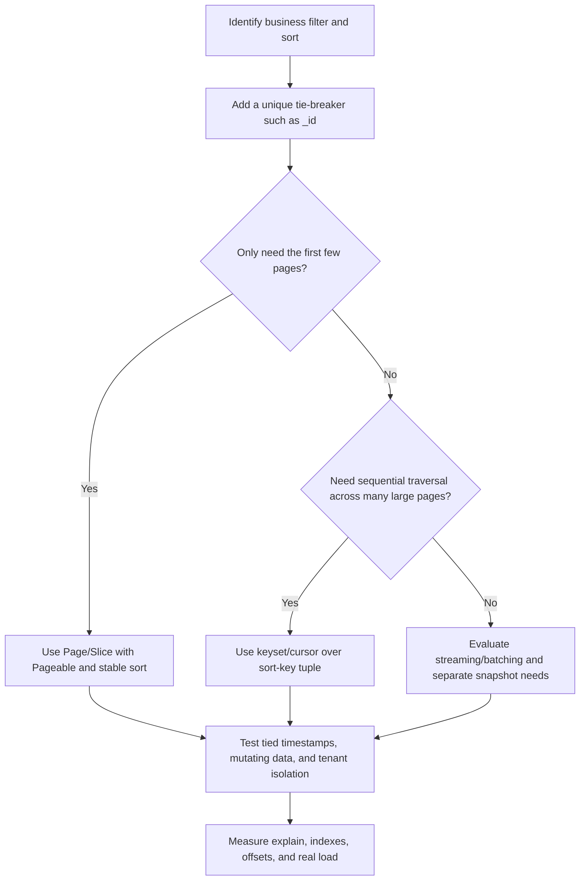

# Stable Ordering When Multiple Documents Share the Same Value

When building list APIs with **Spring Data MongoDB**, you often sort by creation time, price, or priority and paginate with `Pageable`. If multiple documents share the same sort value—such as the same `createdAt` down to the millisecond—MongoDB is under no obligation to return those documents in a fixed order. Consequently, page 1 and page 2 can produce duplicate or skipped records even when the filter expression has not changed.

The foundational solution is to define a **total ordering**: combine the business sort field with a **unique tie-breaker**, typically `_id`. For an order list, sorting `{ createdAt: -1, _id: -1 }` has much clearer semantics than `{ createdAt: -1 }`: if two orders were created at the exact same instant, `_id` decides which comes first.

This lesson in the **Pagination and Streams** chapter applies directly to `MongoRepository`, `MongoTemplate`, BSON queries, indexes, and cursor-based traversal strategies in Spring Data MongoDB.

After this lesson, you will be able to:

- Explain why sorting by a single **non-unique** field does not create a stable order.
- Use `_id` or another suitable unique key to break ties (*tie-break*).
- Ensure `Pageable`, `Slice`, and scrolling/traversal APIs produce consistent ordering.
- Write **keyset/seek pagination** queries with multiple sort fields and properly oriented comparisons.
- Design compound indexes, inspect `explain("executionStats")`, and evaluate the cost of `skip`.
- Distinguish **deterministic ordering** from a **consistent data snapshot under concurrent writes**.
- Test scenarios with multiple documents sharing `createdAt`, page boundaries, and newly inserted data.

## 1. Why is sorting by a single field not enough?

Suppose there are six order documents, sorted newest-first by `createdAt`:

| Document | `createdAt` (UTC) | Short `_id` | Total amount |
| --- | --- | --- | ---: |
| A | 2026-11-20 09:00:02.000 | 201 | 120,000 |
| B | 2026-11-20 09:00:01.000 | 102 | 80,000 |
| C | 2026-11-20 09:00:01.000 | 103 | 30,000 |
| D | 2026-11-20 09:00:01.000 | 104 | 200,000 |
| E | 2026-11-20 09:00:00.000 | 100 | 90,000 |
| F | 2026-11-20 08:59:59.000 | 099 | 50,000 |

The `_id` values above are only **shorthand labels** for the example; in MongoDB, each real document has an `_id` of the proper BSON type. B, C, and D share the exact same creation timestamp down to the millisecond.

The query:

```javascript
db.orders.find({ tenantId: "T1" })
  .sort({ createdAt: -1 })
  .limit(3);
```

certainly places A before the B/C/D group and that group before E/F, **but it makes no promise about the order within B/C/D**. One execution might return A, B, D; another might return A, C, B. MongoDB does not promise to preserve insertion order or `_id` order for elements with identical sort keys unless you ask for it.

With page size 2:

```javascript
db.orders.find({ tenantId: "T1" })
  .sort({ createdAt: -1 })
  .skip(0).limit(2); // Page 1

db.orders.find({ tenantId: "T1" })
  .sort({ createdAt: -1 })
  .skip(2).limit(2); // Page 2
```

If the relative order of B/C/D changes between the two queries, one document can appear on both pages while another is never returned. Using the exact same sort syntax in both requests **does not guarantee** the two runs order tied items the same way.

### General rule

A sort order is completely deterministic when **no two distinct documents in the result set can share the exact same full sort key tuple**. If `createdAt` can collide, use a tuple like:

```text
(createdAt, _id)
```

In a regular collection, `_id` is unique; therefore, if two documents share `createdAt`, they still differ by `_id`. Do not expect `ObjectId` to preserve exact creation chronology: `ObjectId` has only 1-second timestamp resolution, includes random/counter bytes, and can be generated on different clients. Here `_id` serves as a **unique tie-breaker**, not a more accurate business clock than `createdAt`.

## 2. Adding a tie-breaker to the sort order

For the orders data:

```javascript
db.orders.find({ tenantId: "T1" })
  .sort({ createdAt: -1, _id: -1 })
  .limit(3);
```

MongoDB compares fields left to right:

1. `createdAt` descending: newer orders come first.
2. When `createdAt` values tie, `_id` descending breaks the tie.

In the table above, if the shorthand IDs increase as 102, 103, 104, you can picture the order as **A, D, C, B, E, F** (assuming the real IDs follow the same order as the labels). In the hands-on section, the result will be verified with real deterministic ObjectIds.

### Distinguishing business keys from tie-breaker keys

| Sort key | Advantage | Limitation |
| --- | --- | --- |
| `createdAt` | Matches "newest first" requirement | Multiple documents can share the same value |
| `price` or `priority` | Expresses business meaning | Easily ties, and may be updated |
| `createdAt, _id` | Total order if `_id` is unique | Must keep sort directions consistent across requests |
| `price, _id` | Breaks ties when prices are equal | If price changes between reads, ordering still shifts |
| `createdAt, orderNo` | Suitable if `orderNo` is truly unique | Must have a real unique constraint and consistent comparison/collation |

If a list needs a different ordering, such as `priority` descending and `createdAt` ascending, append `_id` to break ties:

```javascript
db.tasks.find({ tenantId: "T1" })
  .sort({ priority: -1, createdAt: 1, _id: 1 });
```

**There is no rule requiring the tie-breaker to be descending.** Choose the direction per your API contract and keep it consistent across every query, cursor predicate, and corresponding index.

### Why is `_id` often a reasonable choice?

MongoDB requires every document to have `_id`, and collections come with a default index on that field. That does not mean every composite sort containing `_id` is efficiently served by the `_id_` index alone; most queries still need a **compound index**. However, `_id` is already present, immutable once created, and unique within the collection.

If your data spans multiple merged collections, aggregation outputs, or systems using custom keys, verify whether the tie-breaker is **unique within the actual result set**. Do not assume `_id` is unique in an aggregation result after `$group` or `$unwind` produces multiple rows for the same source document.

## 3. Stable sorting in Spring Data MongoDB repositories

### 3.1. Entity used in this lesson

```java
import java.time.Instant;
import org.bson.types.ObjectId;
import org.springframework.data.annotation.Id;
import org.springframework.data.mongodb.core.mapping.Document;

@Document(collection = "orders_page_lab")
public class OrderRecord {
    @Id
    private ObjectId id;

    private String tenantId;
    private boolean deleted;
    private Instant createdAt;
    private String status;
    private long totalMinor;

    protected OrderRecord() {}

    public OrderRecord(
            String tenantId, boolean deleted,
            Instant createdAt, String status, long totalMinor) {
        this.tenantId = tenantId;
        this.deleted = deleted;
        this.createdAt = createdAt;
        this.status = status;
        this.totalMinor = totalMinor;
    }

    public ObjectId getId() { return id; }
    public String getTenantId() { return tenantId; }
    public Instant getCreatedAt() { return createdAt; }
    public boolean isDeleted() { return deleted; }
}
```

`@Id` maps the Java property `id` to BSON `_id`. `Instant` typically maps to BSON Date; BSON Date stores timestamps at millisecond precision, so multiple concurrent transactions can easily share the same `createdAt`.

### 3.2. Repository accepting `Pageable`

```java
import org.bson.types.ObjectId;
import org.springframework.data.domain.Page;
import org.springframework.data.domain.Pageable;
import org.springframework.data.mongodb.repository.MongoRepository;

public interface OrderRecordRepository
        extends MongoRepository<OrderRecord, ObjectId> {

    Page<OrderRecord> findByTenantIdAndDeletedFalse(
        String tenantId, Pageable pageable);
}
```

When calling the repository, construct an explicit sort order:

```java
import org.springframework.data.domain.Page;
import org.springframework.data.domain.PageRequest;
import org.springframework.data.domain.Sort;

Sort stableSort = Sort.by(
    Sort.Order.desc("createdAt"),
    Sort.Order.desc("id")
);

PageRequest request = PageRequest.of(0, 20, stableSort);
Page<OrderRecord> page = repository.findByTenantIdAndDeletedFalse(
    trustedTenantId, request
);
```

In Spring Data's `Sort`, use the **Java property name** `id`; the mapper translates it to `_id` when querying with the domain class. Make sure you use the right property name if the entity renames BSON fields with `@Field`.

The snippet above illustrates a service where `repository` and `trustedTenantId` are already available; it is not a complete application. In a multi-tenant API, `tenantId` must be verified from the login session/permissions—never trust an arbitrary tenant sent by the client.

### 3.3. `Page`, `Slice`, and their semantics

| Return type | When to use | Notes |
| --- | --- | --- |
| `Page<T>` | UI needs total elements / total pages | May require a count query alongside the data query |
| `Slice<T>` | UI only needs to know whether a next page exists | Can avoid computing exact totals, depending on implementation |
| `List<T>` with `Pageable` | Only a bounded list is needed | No total pages or `hasNext` metadata like `Page` |
| Cursor/keyset | Traversing many consecutive pages, avoiding large offsets | Requires stable sort keys and an "after last key" predicate |

All of these return types still require a **deterministic sort** if you want consistent ordering. `Page` having a total count does not fix tied-sort instability; `Slice` reduces count overhead, yet it does not add a tie-breaker automatically either.

### 3.4. Do not accept uncontrolled arbitrary sorts

If an API lets clients choose the sort, build an allowlist of field names and append the tie-breaker key yourself:

```java
import org.springframework.data.domain.Sort;

public Sort stableSortFor(String requestedField, boolean descending) {
    String property = switch (requestedField) {
        case "created" -> "createdAt";
        case "total" -> "totalMinor";
        default -> throw new IllegalArgumentException("Invalid sort");
    };

    Sort.Direction direction = descending
        ? Sort.Direction.DESC : Sort.Direction.ASC;

    return Sort.by(
        new Sort.Order(direction, property),
        new Sort.Order(direction, "id")
    );
}
```

Clients must not pass arbitrary field names that could leak data or trigger slow queries. When using a `Pageable` bound automatically from an HTTP request, ensure the service layer validates/normalizes the sort instead of blindly forwarding client input to the repository.

## 4. `MongoTemplate`: explicit filtering, sorting, skip, and limit

When full query control is needed:

```java
import java.util.List;
import org.springframework.data.domain.Sort;
import org.springframework.data.mongodb.core.MongoTemplate;
import org.springframework.data.mongodb.core.query.Criteria;
import org.springframework.data.mongodb.core.query.Query;

public List<OrderRecord> readPage(
        MongoTemplate template, String trustedTenantId,
        int pageNumber, int pageSize) {

    if (pageNumber < 0 || pageSize < 1 || pageSize > 100) {
        throw new IllegalArgumentException("Invalid pagination");
    }
    long offset = Math.multiplyExact(
        (long) pageNumber, (long) pageSize
    );

    Query query = Query.query(
        Criteria.where("tenantId").is(trustedTenantId)
                .and("deleted").is(false)
    );
    query.with(Sort.by(
        Sort.Order.desc("createdAt"),
        Sort.Order.desc("id")
    ));
    query.skip(offset);
    query.limit(pageSize);
    return template.find(query, OrderRecord.class);
}
```

In Spring Data MongoDB, `Query.skip(...)` sets the offset and `Query.limit(...)` bounds the document count. Both `pageNumber` and `pageSize` must be validated to prevent oversized queries; when using `PageRequest`, enforce a page-size cap at the API boundary as well.

### 4.1. Even a stably sorted offset can suffer page drift

A tie-breaker solves nondeterministic order among documents with **tied sort keys**, but **it does not freeze the dataset** across requests. For example:

1. The client reads page 1 containing A, D under `createdAt DESC, _id DESC`.
2. A new order X is inserted at the top of the list.
3. The client reads page 2 using `skip(2)`, whose offset has now shifted.

Document D may appear again, or another document may be skipped. This is *page drift* caused by **data mutations**, not by two documents sharing `createdAt`.

| Problem | What does tie-breaker ordering help with? | What else is still needed? |
| --- | --- | --- |
| Multiple documents sharing `createdAt` | Defines a clear order among them | Keep the sort identical on every page |
| Inserts/deletes between `skip` calls | Does not prevent offset shift | Cursor/keyset, bounded snapshot, or custom mechanism |
| Document sort key changes | Does not stop the document from moving | Immutable sort keys, sync strategy, or snapshot |
| Paginating across independent requests | Deterministic order per query execution | No cross-request consistent snapshot by default |

For a long report export to guarantee an unchanging dataset throughout, you may need snapshot/read concern settings, suitable transactions, or a frozen ID-list strategy depending on business rules. A plain `Pageable` does not provide those guarantees.

## 5. Keyset/seek pagination: using the last key instead of an offset

When clients traverse many pages, keyset pagination avoids large `skip` costs and reduces duplicate-page issues from inserts at the top. The idea is: after receiving the last document of the previous page, the next page only reads documents **coming after** that sort-key tuple.

With descending sort:

```javascript
{ createdAt: -1, _id: -1 }
```

and the last keys:

```text
lastCreatedAt = 2026-11-20T09:00:01.000Z
lastId        = ObjectId("...")
```

the next document must satisfy:

```text
createdAt < lastCreatedAt
OR
(createdAt = lastCreatedAt AND _id < lastId)
```

**Because both fields are descending, the comparison operator here is less-than (`$lt`).** For an ascending sort, the comparison becomes greater-than (`$gt`). With multiple fields and mixed directions, construct the lexicographic comparison matching each field's direction.

### 5.1. `mongosh` filter

```javascript
const lastCreatedAt = ISODate("2026-11-20T09:00:01.000Z");
const lastId = ObjectId("665f1f2a4b6c7d8e9f001234");

db.orders_page_lab.find({
  tenantId: "T1",
  deleted: false,
  $or: [
    { createdAt: { $lt: lastCreatedAt } },
    {
      createdAt: lastCreatedAt,
      _id: { $lt: lastId }
    }
  ]
})
.sort({ createdAt: -1, _id: -1 })
.limit(20);
```

This is an **illustrative structure**. In real execution, `lastCreatedAt` and `lastId` must come from the last document of the previous page rather than hardcoded constants. On the first page with no cursor yet, omit `$or`. Tenant and soft-delete predicates sit at the top level, **applying to both branches**.

### 5.2. `MongoTemplate` with a parsed cursor

```java
import java.time.Instant;
import java.util.List;
import org.bson.types.ObjectId;
import org.springframework.data.domain.Sort;
import org.springframework.data.mongodb.core.MongoTemplate;
import org.springframework.data.mongodb.core.query.Criteria;
import org.springframework.data.mongodb.core.query.Query;

public List<OrderRecord> readNext(
        MongoTemplate template,
        String trustedTenantId,
        Instant lastCreatedAt,
        ObjectId lastId,
        int size) {

    if (size < 1 || size > 100) {
        throw new IllegalArgumentException("size must be in [1, 100]");
    }
    if ((lastCreatedAt == null) != (lastId == null)) {
        throw new IllegalArgumentException(
            "Cursor must contain both createdAt and id"
        );
    }

    Criteria scoped = new Criteria().andOperator(
        Criteria.where("tenantId").is(trustedTenantId),
        Criteria.where("deleted").is(false)
    );

    if (lastCreatedAt != null) {
        Criteria after = new Criteria().orOperator(
            Criteria.where("createdAt").lt(lastCreatedAt),
            new Criteria().andOperator(
                Criteria.where("createdAt").is(lastCreatedAt),
                Criteria.where("id").lt(lastId)
            )
        );
        scoped = new Criteria().andOperator(scoped, after);
    }

    Query query = new Query(scoped)
        .with(Sort.by(
            Sort.Order.desc("createdAt"),
            Sort.Order.desc("id")
        ))
        .limit(size);

    return template.find(query, OrderRecord.class);
}
```

`Criteria.where("id")` is a Java property path and is mapped to `_id` because the query runs with `OrderRecord.class`. With the raw driver or `mongosh`, write `_id` directly.

**Note:** since BSON Date has millisecond precision, preserve the exact timestamp read back rather than converting to `LocalDateTime`, rounding, or misapplying timezones in the cursor. Parse `ObjectId` into its proper BSON type. Never bind an arbitrary raw JSON snippet from the client as a cursor.

### 5.3. A cursor is data, not authorization

A cursor can be encoded (for instance, base64url) from `lastCreatedAt` and `lastId`, along with a schema version, sort order, and necessary filter context. However, **base64 is neither encryption nor a signature**. When a client supplies a cursor:

- Parse values into **concrete types** (`Instant`, `ObjectId`); validate length and format.
- Pin or verify that the cursor's sort direction and filter match the request.
- Obtain the trusted `tenantId` from the server context; never allow a cursor to switch tenants.
- Consider signing the cursor (HMAC) if the API needs tamper protection or binding to a filter/user.
- Never let a cursor inject raw operators or arbitrary query fields.

A cursor's role is to identify the **traversal position**, not to replace access control.

## 6. Keyset is not a snapshot: cases where skips or duplicates can still occur

Keyset pagination avoids depending on the offset positions of documents **before the cursor**. If a newer order is inserted at the top of the list after the client reads page 1, a seek query anchored on the last key continues from that anchor instead of recounting `skip` from the beginning.

However, keyset does not guarantee an invariant result if:

- **A sort key changes**: an already-read document has its `price` or `priority` edited, moving behind the cursor and reappearing later.
- **An unread document's sort key changes**: it moves ahead of the cursor and may be missed during the current traversal.
- **Documents are deleted or change filter status**: page membership changes.
- **Documents are inserted with older sort keys**: depending on where they land relative to the cursor, they may appear on later pages.
- **The application changes sort/filter definitions mid-stream**: an old cursor is no longer meaningful for the new query.

Thus, for typical feeds, cursor traversal is a strong choice when live mutations are acceptable. For exports, accounting, or reconciliation jobs requiring a **fixed result set**, design explicit snapshots, time boundaries, watermarks, transactions/read concerns, or persisted key lists matching your deployment capabilities.

### 6.1. Choosing low-churn sort keys

`createdAt` is generally mutated far less often than `updatedAt`, `price`, or `priority`. Therefore, when displaying "newest orders first", `(createdAt, _id)` is usually a favorable choice for keyset pagination.

If a screen asks to sort by `updatedAt`, confirm whether an already-read record jumping back to the top upon update is desirable. Avoid promising users that a cursor guarantees every document appears strictly once across minutes of continuous updates; that guarantee requires additional design.

### 6.2. Do not ignore tied timestamps

A common mistake is writing only:

```javascript
// WRONG for keyset if multiple orders can share createdAt.
db.orders_page_lab.find({
  tenantId: "T1",
  createdAt: { $lt: lastCreatedAt }
}).sort({ createdAt: -1 }).limit(20);
```

If the previous page ended inside a group of documents sharing `createdAt`, this `$lt` filter skips **all remaining documents in that group**. You must include `createdAt = lastCreatedAt AND _id < lastId` matching the sort order.

Conversely, using `createdAt <= lastCreatedAt` alone causes the last document of the previous page and earlier-read documents with the same timestamp to be fetched again. **A full two-field lexicographic comparison** is the only accurate expression.

## 7. `mongosh` hands-on lab with tied timestamps

This section creates a dataset in the `orders_page_lab` collection of a test database—**never run on production data**. Each run has its own marker; to keep variables in scope, run the commands sequentially within **a single `mongosh` session**.

### 7.1. Seeding test data

```javascript
use spring_data_training

const lab = db.getCollection("orders_page_lab");
const runId = "pagination-streams-005-" + new ObjectId().toHexString();
const tenant1 = runId + "-T1";
const tenant2 = runId + "-T2";

const d0 = ISODate("2026-11-20T09:00:00.000Z");
const d1 = ISODate("2026-11-20T09:00:01.000Z");
const d2 = ISODate("2026-11-20T09:00:02.000Z");

const inserted = lab.insertMany([
  {
    runId: runId, tenantId: tenant1, label: "A",
    deleted: false, createdAt: d2, totalMinor: NumberLong("120000")
  },
  {
    runId: runId, tenantId: tenant1, label: "B",
    deleted: false, createdAt: d1, totalMinor: NumberLong("80000")
  },
  {
    runId: runId, tenantId: tenant1, label: "C",
    deleted: false, createdAt: d1, totalMinor: NumberLong("30000")
  },
  {
    runId: runId, tenantId: tenant1, label: "D",
    deleted: false, createdAt: d1, totalMinor: NumberLong("200000")
  },
  {
    runId: runId, tenantId: tenant1, label: "E",
    deleted: false, createdAt: d0, totalMinor: NumberLong("90000")
  },
  {
    runId: runId, tenantId: tenant1, label: "F",
    deleted: false,
    createdAt: ISODate("2026-11-20T08:59:59.000Z"),
    totalMinor: NumberLong("50000")
  },
  {
    runId: runId, tenantId: tenant2, label: "X",
    deleted: false, createdAt: d2, totalMinor: NumberLong("60000")
  },
  {
    runId: runId, tenantId: tenant1, label: "Z",
    deleted: true, createdAt: d2, totalMinor: NumberLong("70000")
  }
]);

print("runId=" + runId);
print("tenant1=" + tenant1);
print("Session document count=" +
  lab.countDocuments({ runId: runId })); // Expected: 8
```

This generates a distinct `ObjectId` for each record by default; do not assume they are ordered alphabetically by labels A/B/C/D. What is guaranteed is that the ObjectIds are distinct and sufficient to break ties when `createdAt` matches.

### 7.2. Observing a deterministic order

```javascript
const commonFilter = {
  runId: runId,
  tenantId: tenant1,
  deleted: false
};

const stable = lab.find(commonFilter)
  .sort({ createdAt: -1, _id: -1 })
  .toArray();

printjson(stable.map(d => ({
  label: d.label,
  createdAt: d.createdAt,
  id: d._id
})));
```

The result contains exactly **6** records A–F, excluding X (other tenant) and Z (soft-deleted). Within the tied B/C/D group sharing `createdAt`, the order depends on the generated `_id` values, yet it is **fully determined** by the sort.

### 7.3. Paginating with offset and tie-breaker

```javascript
const pageSize = 2;
const page0 = lab.find(commonFilter)
  .sort({ createdAt: -1, _id: -1 })
  .skip(0).limit(pageSize).toArray();

const page1 = lab.find(commonFilter)
  .sort({ createdAt: -1, _id: -1 })
  .skip(2).limit(pageSize).toArray();

const page2 = lab.find(commonFilter)
  .sort({ createdAt: -1, _id: -1 })
  .skip(4).limit(pageSize).toArray();

printjson({
  page0: page0.map(d => d.label),
  page1: page1.map(d => d.label),
  page2: page2.map(d => d.label)
});
```

Without concurrent writes, concatenating those three pages yields the exact same 6 documents in `stable` order. Verify:

```javascript
const allPages = [...page0, ...page1, ...page2];
print(allPages.length); // 6
print(new Set(allPages.map(d => d._id.toHexString())).size); // 6
```

This confirms the ordering on a **static dataset**. It does not prove pages stay invariant if inserts or deletes occur between requests.

### 7.4. Paginating with keyset, even when a page splits a tied group

```javascript
function seekAfter(lastDoc, limit) {
  const filter = {
    ...commonFilter,
    $or: [
      { createdAt: { $lt: lastDoc.createdAt } },
      {
        createdAt: lastDoc.createdAt,
        _id: { $lt: lastDoc._id }
      }
    ]
  };
  return lab.find(filter)
    .sort({ createdAt: -1, _id: -1 })
    .limit(limit)
    .toArray();
}

const seek0 = lab.find(commonFilter)
  .sort({ createdAt: -1, _id: -1 })
  .limit(2)
  .toArray();

const seek1 = seekAfter(seek0[seek0.length - 1], 2);
const seek2 = seekAfter(seek1[seek1.length - 1], 2);

const seekAll = [...seek0, ...seek1, ...seek2];
printjson(seekAll.map(d => d.label));

print(seekAll.length); // 6
print(new Set(seekAll.map(d => d._id.toHexString())).size); // 6
```

Because B/C/D contains three documents with identical `createdAt` and each page takes two items, at least one page boundary cuts across the tied group. The two branches in `seekAfter` ensure the remaining documents sharing that timestamp are not skipped.

**Further check:** compare `seekAll` against `stable`:

```javascript
const expectedIds = stable.map(d => d._id.toHexString());
const seekIds = seekAll.map(d => d._id.toHexString());
printjson({ equal: JSON.stringify(expectedIds) === JSON.stringify(seekIds) });
// Expected: { equal: true } if the dataset has not changed.
```

### 7.5. Why filtering only `createdAt < lastCreatedAt` is wrong

```javascript
const firstCursor = seek0[seek0.length - 1];
const incorrectNext = lab.find({
  ...commonFilter,
  createdAt: { $lt: firstCursor.createdAt }
})
.sort({ createdAt: -1, _id: -1 })
.limit(2)
.toArray();

printjson({
  cursorTime: firstCursor.createdAt,
  nextIfOnlyDate: incorrectNext.map(d => d.label),
  nextWithTieBreaker: seek1.map(d => d.label)
});
```

Whenever a page cuts through the B/C/D group, filtering solely by date skips the unread items sharing that timestamp. This exercise demonstrates the difference with real output without relying on predetermined ObjectId values.

### 7.6. Cleaning up only the data you created

After finishing the lab:

```javascript
const before = lab.countDocuments({ runId: runId });
print("Documents to clean up: " + before);

const cleanup = lab.deleteMany({ runId: runId });
printjson({ deletedCount: cleanup.deletedCount });
```

Clean up only by your session's `runId` marker. Never run `deleteMany({})` or `drop()` on a collection that could contain other people's data.

## 8. Compound indexes for filtering and sorting

A frequent query:

```javascript
db.orders_page_lab.find({
  tenantId: "T1",
  deleted: false
}).sort({ createdAt: -1, _id: -1 }).limit(20);
```

can consider a compound index:

```javascript
db.orders_page_lab.createIndex(
  {
    tenantId: 1,
    deleted: 1,
    createdAt: -1,
    _id: -1
  },
  { name: "idx_tenant_deleted_created_id" }
);
```

Here `tenantId` and `deleted` are **equality filter** fields, followed by the **sort** fields. When the query, sort direction, and selectivity align, this index lets MongoDB return documents in order without a separate memory-intensive sort stage.

**Do not misunderstand:** the default `_id_` index only indexes `_id` alone and does not substitute for a compound index covering tenant filtering and date sorting. Each index also consumes storage and write maintenance cost, so measure against the workload instead of creating every conceivable variant.

### 8.1. Reading `explain("executionStats")`

```javascript
db.orders_page_lab.find({
  tenantId: "ACTUAL_TENANT",
  deleted: false
})
.sort({ createdAt: -1, _id: -1 })
.limit(20)
.explain("executionStats");
```

Replace `ACTUAL_TENANT` with a real tenant that has data. Observe:

| Component | Inspection question |
| --- | --- |
| `winningPlan` | Is an appropriate `IXSCAN` used? Is there a `SORT` stage? |
| `totalKeysExamined` | How many index entries were traversed? |
| `totalDocsExamined` | How many documents were fetched/examined? |
| `nReturned` | Do count and filter match expectations? |
| `executionTimeMillis` | Timing for this run; run multiple measurements to evaluate in practice |

Running `explain` on an eight-document dataset does not prove an index is optimal for production. Use a representative dataset, realistic query frequency, sort directions, page limits, and actual filter predicates.

### 8.2. Large offsets and keyset with indexes

With `skip(100000)`, MongoDB typically still has to walk past/skip many results before returning 20 documents for the current page, even with a matching index. Keyset uses an **"after last key"** condition to start inside a narrower portion of the index order and can significantly lower cost on deep traversals.

However, keyset `$or` predicates, varying filters, indexes, and the query planner can still produce different execution plans. Never assume keyset is universally faster; verify with `explain` and load tests.

### 8.3. Direction, collation, and nullable fields

- For `{ createdAt: -1, _id: -1 }`, create an index with matching sort directions; MongoDB can also traverse an index in reverse when structurally compatible.
- When sorting Strings like `lastName`, collation can change comparison semantics (case sensitivity, accents). Queries and indexes must share the same collation when required.
- If a sort field is missing or `null`, many documents can tie on that key. `_id` still breaks ties, but keyset predicates comparing against `null`/missing values have tricky edge cases; normalize the schema or define an explicit policy.
- When sorting by an **array** field, the effective sort key follows MongoDB's array-sort rules and may not suit simple cursors; choose a clean scalar sort key for stable pagination.

## 9. Pagination and streams: both must enforce ordering

`stream` and `pagination` solve two different problems:

- **Pagination** splits results into chunks accessible across multiple requests, optionally with total page counts or cursors.
- **Streaming** reads results sequentially via a cursor/stream instead of loading the whole result set into one large in-memory `List`.

Neither mechanism provides a total ordering automatically. When using a stream to export an ordered list or split into batches, if deterministic output is required, specify the sort explicitly **on the MongoDB query**.

### 9.1. `MongoTemplate.stream` for synchronous access

```java
import org.springframework.data.domain.Sort;
import org.springframework.data.mongodb.core.MongoTemplate;
import org.springframework.data.mongodb.core.query.Criteria;
import org.springframework.data.mongodb.core.query.Query;
import org.springframework.data.util.CloseableIterator;

public void consumeOrdered(
        MongoTemplate template, String trustedTenantId) {

    Query query = Query.query(
        Criteria.where("tenantId").is(trustedTenantId)
                .and("deleted").is(false)
    );
    query.with(Sort.by(
        Sort.Order.desc("createdAt"),
        Sort.Order.desc("id")
    ));

    try (CloseableIterator<OrderRecord> cursor =
             template.stream(query, OrderRecord.class)) {
        while (cursor.hasNext()) {
            OrderRecord order = cursor.next();
            // Process each document; avoid storing everything in memory.
            process(order);
        }
    }
}
```

`process(order)` is a business method implemented by the application; the example illustrates the read loop. You must **close `CloseableIterator`** to release cursor resources. For very large datasets, also account for connection/cursor lifetimes, timeouts, server memory limits, and recovery if the process stops mid-run.

A deterministically sorted stream over **a single query** still does not guarantee a consistent snapshot under concurrent writes. When a requirement demands "export the exact same set of records", select an appropriate read consistency policy and workflow.

### 9.2. Reactive access with `ReactiveMongoTemplate`

With Reactive Spring Data MongoDB, `find` returns a `Flux`:

```java
import reactor.core.publisher.Flux;
import org.springframework.data.domain.Sort;
import org.springframework.data.mongodb.core.ReactiveMongoTemplate;
import org.springframework.data.mongodb.core.query.Criteria;
import org.springframework.data.mongodb.core.query.Query;

public Flux<OrderRecord> readOrderedReactive(
        ReactiveMongoTemplate template, String trustedTenantId) {

    Query query = Query.query(
        Criteria.where("tenantId").is(trustedTenantId)
                .and("deleted").is(false)
    );
    query.with(Sort.by(
        Sort.Order.desc("createdAt"),
        Sort.Order.desc("id")
    )).limit(100);

    return template.find(query, OrderRecord.class);
}
```

The sort is pushed down to **MongoDB**, and the 100-document limit is enforced in the query. Avoid sorting a large `Flux` in Java when your goal is leveraging MongoDB indexes and streaming sequentially; in-memory sorting can force buffering all elements in RAM.

Reactive backpressure helps regulate consumption rates on the application side, but it does not replace long-running pagination or snapshot strategies. If you need to traverse multiple reactive batches, design cursor/keyset batches using the last key just like in synchronous queries.

### 9.3. Options in the Spring Data Scroll API

Certain Spring Data versions support **scrolling** via `Window<T>` and `ScrollPosition` (offset or keyset). When using this API, verify support in your exact Spring Data MongoDB version, projection and sort-key requirements, how `positionAt(...)` is returned, and conditions for fetching the next window.

Even when the framework generates keyset predicates automatically, you must still supply a **stable order with a tie-breaker key**, and ensure the required key values are present in the returned objects used to build the cursor. Avoid writing cursors based solely on a non-unique field.

## 10. Integration testing: multiple documents sharing `createdAt`

A unit test checking only that `Sort` contains two fields is insufficient. Test directly against MongoDB with documents sharing the same timestamp, then assert **exact ID sets and ordering** across every page.

### 10.1. Minimum recommended test cases

| Test case | Data setup | Expected outcome |
| --- | --- | --- |
| Multiple tied timestamps | 4 orders with identical `createdAt`, page size = 2 | No skips or duplicates when data is static and sort includes `_id` |
| No tie-breaker | Sort only by `createdAt` | Do not depend on relative order of tied items in assertions |
| Splitting a tied group | Group of 3 documents sharing a date with only 1 slot left on page 1 | Keyset continues by picking up the remaining items with that timestamp |
| Tenant boundary | T1 and T2 share timestamps | Querying T1 never returns T2 on any page |
| Soft delete | An order with `deleted = true` has the newest timestamp | Excluded from active list pages |
| Sort direction | Switching from DESC to ASC | Keyset comparisons flip from `$lt` to `$gt` |
| Mutating data | Insert a new order between two offset requests | Acknowledge page drift risk; do not promise a snapshot |
| Missing sort field | Document lacks `createdAt` | Data contract must explicitly state whether this is permitted |
| Query plan | Large enough dataset, with/without compound index | Measure `IXSCAN`/`SORT`, docs examined, and latency |

### 10.2. JUnit 5 + Spring Data MongoDB

The example below uses `@DataMongoTest` in a Spring Boot application with a dedicated test MongoDB instance. It generates non-overlapping tenant IDs per run and cleans them up afterward. Exact behavior depends on your Spring Boot/Spring Data MongoDB version, so configure a suitable test MongoDB instance before running.

```java
import static org.junit.jupiter.api.Assertions.*;

import java.time.Instant;
import java.util.ArrayList;
import java.util.Comparator;
import java.util.List;
import java.util.UUID;
import org.bson.types.ObjectId;
import org.junit.jupiter.api.Test;
import org.springframework.beans.factory.annotation.Autowired;
import org.springframework.boot.test.autoconfigure.data.mongo.DataMongoTest;
import org.springframework.data.domain.PageRequest;
import org.springframework.data.domain.Sort;

@DataMongoTest
class StableOrderPageTest {

    @Autowired
    OrderRecordRepository repository;

    @Test
    void pagesAreDeterministicWhenTimestampsTie() {
        String tenant = "T-" + UUID.randomUUID();
        String otherTenant = "T-" + UUID.randomUUID();

        Instant sameTime =
            Instant.parse("2026-11-20T09:00:01Z");
        Instant newer =
            Instant.parse("2026-11-20T09:00:02Z");

        List<OrderRecord> inserted = repository.insert(List.of(
            new OrderRecord(tenant, false, newer, "ACTIVE", 100L),
            new OrderRecord(tenant, false, sameTime, "ACTIVE", 200L),
            new OrderRecord(tenant, false, sameTime, "ACTIVE", 300L),
            new OrderRecord(tenant, false, sameTime, "ACTIVE", 400L),
            new OrderRecord(tenant, false, sameTime, "ACTIVE", 500L),
            new OrderRecord(otherTenant, false, newer, "ACTIVE", 600L),
            new OrderRecord(tenant, true, newer, "ACTIVE", 700L)
        ));

        try {
            Sort sort = Sort.by(
                Sort.Order.desc("createdAt"),
                Sort.Order.desc("id")
            );

            List<ObjectId> actual = new ArrayList<>();
            for (int page = 0; page < 3; page++) {
                repository.findByTenantIdAndDeletedFalse(
                    tenant, PageRequest.of(page, 2, sort)
                ).forEach(order -> actual.add(order.getId()));
            }

            List<ObjectId> expected = inserted.stream()
                .filter(o -> tenant.equals(o.getTenantId()))
                .filter(o -> !o.isDeleted())
                .sorted(Comparator
                    .comparing(OrderRecord::getCreatedAt)
                    .thenComparing(OrderRecord::getId)
                    .reversed())
                .map(OrderRecord::getId)
                .toList();

            assertEquals(5, actual.size());
            assertEquals(expected, actual);
        } finally {
            repository.deleteAllById(
                inserted.stream().map(OrderRecord::getId).toList()
            );
        }
    }
}
```

The test verifies both **membership** and **ordering**: only the 5 active documents for the target tenant are returned, other-tenant and soft-deleted documents are excluded, and the four documents sharing the same timestamp are tie-broken by `ObjectId`.

If you only assert "result contains 5 documents" without comparing the exact sequence of IDs across the three pages, the test can miss nondeterministic ordering bugs. When cursors are involved, add a test for the lexicographic predicate by taking the last document of each page and comparing the full ID sequence against a single full sorted query.

**Limitation:** this test runs on static data. To observe page drift or keyset behavior under concurrent writes, write a separate test with inserts/updates interleaved between reads, clearly documenting what is and is not guaranteed.

## 11. Common errors and fixes

| Symptom | Possible cause | Solution |
| --- | --- | --- |
| Next page skips or duplicates documents even on static data | Sorted by a non-unique field | Add `_id` or a unique tie-breaker and keep sort consistent |
| Same query returns tied-timestamp documents in shifting order | BSON Date is millisecond-precision; sort lacks tie-breaker | Sort by `createdAt` then `_id` |
| Keyset misses documents on the same timestamp | Filtered only by `createdAt < lastCreatedAt` | Add branch `createdAt = lastCreatedAt AND _id < lastId` |
| Keyset repeats the last document of the previous page | Used `<=` or `>=` without a tie-breaker | Use strict lexicographic comparison |
| Reversed sort direction without updating seek predicate | Used `$lt` for ascending sort or vice versa | Match operators to each sort key's direction |
| Offset page duplicates items after new data is inserted | `skip` shifted due to mutating dataset | Use keyset where appropriate or snapshots if a fixed set is required |
| Previously read record reappears later | Sort key was updated and document moved | Choose immutable sort keys or add deduplication handling |
| Query is slow on page 10,000 | Large offset scanning/skipping many entries | Measure with `explain`, consider keyset/scrolling |
| Query sorts in memory despite `_id_` index | Filter + `createdAt` sort lacks a supporting index | Design a compound index for the workload |
| Cursor does not match current request | Client changed sort/filter/tenant mid-traversal | Bind cursor to query definition and current permissions |
| Raw query sorting by `id` fails | BSON stores `_id`, not `id` | Use `id` in Java domain mapping, `_id` in `mongosh`/raw driver |
| Name sorting yields unexpected results | Collation mismatch between query and index | Align collation and inspect the query plan |

## 12. Workflow for choosing a pagination strategy



Before implementing, confirm:

1. **What is the sort key?** Can it tie or change after creation?
2. **Is the tie-breaker unique?** Unique within the actual result set, not merely in one source entity?
3. **Are sort directions uniform?** Do repository, template, raw query, and keyset predicate all match?
4. **Is total page count needed?** If not, `Slice` or cursor may beat `Page`.
5. **Do users need arbitrary page jumps?** Offsets are easier for random access, though deep pages are costly.
6. **Does data change continuously?** Is page drift acceptable, or is a snapshot/frozen set required?
7. **Does an index cover filter + sort?** Does the query plan incur expensive scans or in-memory sorts?
8. **Is the cursor controlled?** Strictly typed, bound to filter/tenant, and page size bounded.

## 13. Practice exercises

**Exercise 1 — Tied ordering.** Seven orders exist, four with identical `createdAt`. Explain why `sort({createdAt:-1})` is insufficient and write a sort ensuring every pair of documents has a deterministic order.

**Exercise 2 — Repository.** Write `findByTenantIdAndDeletedFalse(String, Pageable)` and construct a `PageRequest` for page 0, size 25, sorted by `createdAt DESC, id DESC`. If the entity uses `@Id ObjectId id`, what is the Java sort property name?

**Exercise 3 — Offset drift.** Page 1 contains A, B, C. Then a newest item X is inserted, and page 2 is queried with `skip(3)`. Describe why C can appear again and why adding `_id` alone does not prevent this.

**Exercise 4 — Keyset DESC.** Write a filter taking `lastCreatedAt` and `lastId` that returns only documents after the last key under `{createdAt:-1,_id:-1}`. Explain why `$or` with two branches is required.

**Exercise 5 — Keyset ASC.** Change the sort in Exercise 4 to `{createdAt:1,_id:1}`. Flip all `$lt` comparisons to the proper direction and illustrate with three documents sharing a timestamp.

**Exercise 6 — Multi-field sort with mixed directions.** A task board sorts by `priority DESC, dueAt ASC, _id ASC`. Write the corresponding seek predicate for a three-value cursor tuple. Clearly specify comparison precedence and operators per branch.

**Exercise 7 — Index.** For the query `tenantId = T1`, `deleted = false` sorted by `createdAt DESC, _id DESC`, propose a compound index. Run `explain("executionStats")` to inspect keys/documents examined and any sort stage.

**Exercise 8 — Stream and reactive.** Write a `MongoTemplate.stream` snippet closing the cursor properly, or `ReactiveMongoTemplate.find` with a deterministic sort. Explain why a stream does not automatically provide a cross-request snapshot.

**Exercise 9 — Integration test.** Seed at least five documents, four sharing `createdAt`, with page size = 2. Assert that merging all pages yields the exact expected ID set and `(createdAt, _id)` order.

**Exercise 10 — Secure cursor.** Design a cursor containing timestamp, ID, version, and sort direction; describe how to verify it belongs to the same filter/tenant and why base64 alone does not stop clients from modifying a cursor.

### Key takeaways

**Sorting by a non-unique field does not yield a stable order.** In MongoDB and Spring Data MongoDB, append a **unique tie-breaker**—typically `_id`—to your sort, such as `createdAt DESC, _id DESC`. Use the exact same order across `Pageable`, `MongoTemplate`, streams, and cursors. For keyset pagination, the filter must compare the **entire key tuple** in the matching directions, not just `createdAt`. Deterministic ordering solves tied values, while inserts, deletes, and updates between pages remain a separate consistency problem that must be explicitly designed and tested.
