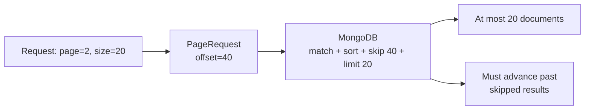

# Offset Pagination and Skip Cost on Large Datasets

## 1. Goal: fetch a page of data without loading the entire collection

In Spring Data MongoDB, methods like `findAll()` can return every document in a collection. For an order listing page over millions of records, an application rarely needs to read all of them. Typically, a screen displays 20–50 orders at a time with explicit filtering and ordering.

**Offset pagination** divides pages by **position** within a sorted result set: skip `offset` documents and return up to `limit` documents. In MongoDB, the underlying mechanism corresponds to `skip()` and `limit()`. Spring Data MongoDB provides `Pageable`/`PageRequest` and `MongoTemplate` queries to use this mechanism.

This lesson targets five skills:

1. Explain `page`, `size`, `offset`, `skip`, and `limit`; remember Spring Data uses **0-based** page numbers.
2. Write offset pagination queries using `MongoRepository` and `MongoTemplate`.
3. Analyze why **skipping on deep pages still incurs traversal work**, even with an index.
4. Distinguish `Page`, `Slice`, total element counts, stable sorting, and the effects of concurrent writes.
5. Know when to keep offset pagination and when to switch to **keyset/cursor pagination**.

Key point to remember right away: **an index helps MongoDB locate the right sort order, but it does not turn `skip(100000)` into a constant-cost jump straight to the 100,001st element**.

## 2. Example order data model

Suppose a multi-store order management system. The `orders` collection contains these fields:

| Java Property | MongoDB Field | Role |
| --- | --- | --- |
| `id` | `_id` | Unique ID within the collection |
| `tenantId` | `tenant_id` | Identifies the store owning the order |
| `status` | `status` | Order status, e.g., `PAID` |
| `createdAt` | `created_at` | Creation timestamp |
| `totalMinor` | `total_minor` | Amount in the smallest currency unit |

All list queries in this lesson filter by `tenant_id` and `status`. This matches business requirements and avoids using `findAll(Pageable)` to accidentally read another store's data.

### Sample BSON document

```javascript
// Collection: orders; IDs are BSON Strings.
{
  _id: "ORD-0007",
  tenant_id: "SHOP-A",
  status: "PAID",
  created_at: ISODate("2026-11-07T08:00:00Z"),
  total_minor: NumberLong("450000")
}
```

We use the order **`created_at DESC, _id DESC`**: newest orders first, and if two orders share the same timestamp, compare IDs to produce a deterministic order. Within a collection, `_id` is unique, making it a convenient secondary key.



## 3. Offset formula and the meaning of `skip`

With 0-based page numbering:

\[
\text{offset} = \text{pageNumber} \times \text{pageSize}
\]

| Parameters | Value | Meaning |
| --- | --- | --- |
| `page = 0`, `size = 20` | `offset = 0` | Fetch results at positions 1–20 |
| `page = 1`, `size = 20` | `offset = 20` | Skip 20 results, fetch up to the next 20 |
| `page = 5`, `size = 20` | `offset = 100` | Skip 100 sorted results |
| `page = 5000`, `size = 20` | `offset = 100000` | Skip 100,000 results before returning the page |

Corresponding query in `mongosh`:

```javascript
db.orders.find({
  tenant_id: "SHOP-A",
  status: "PAID"
})
.sort({ created_at: -1, _id: -1 })
.skip(40)
.limit(20)
```

Semantically, MongoDB filters matching orders, applies the ordering, discards the first `40` results, and returns up to `20` results afterward. Never equate `skip(40)` with "jump directly to the 40th key" without traversing earlier keys.

### `skip` is not like accessing the `n`th element of a Java List

In Java, `list.get(100000)` on an `ArrayList` is an indexed lookup on a structure already held in memory. MongoDB must determine **which documents match the filter and sort order** before knowing which 100,000 results to skip. An index reduces filtering/sorting work, yet the number of results that must be passed over still grows with the offset.

With `skip(N).limit(K)`, a favorable index-scan plan still typically advances through roughly **`N + K` matching positions** to return the page, barring query-plan specifics or optimizations. Actual `totalKeysExamined` is not necessarily equal to `N + K`, as it depends on filters and execution details.

## 4. Entity and Repository in Spring Data MongoDB

The examples use Spring Boot 3.x, Java 17+, and a MongoDB database named `order_pagination_demo`. Basic Maven dependency:

```xml
<dependency>
    <groupId>org.springframework.boot</groupId>
    <artifactId>spring-boot-starter-data-mongodb</artifactId>
</dependency>
```

And an illustrative local connection string:

```properties
spring.data.mongodb.uri=mongodb://localhost:27017/order_pagination_demo
```

### `PurchaseOrder` Entity

```java
package com.example.orders;

import java.time.Instant;
import org.springframework.data.mongodb.core.mapping.Document;
import org.springframework.data.mongodb.core.mapping.Field;
import org.springframework.data.mongodb.core.mapping.FieldType;
import org.springframework.data.mongodb.core.mapping.MongoId;

@Document(collection = "orders")
public class PurchaseOrder {

    @MongoId(FieldType.STRING)
    private String id;

    @Field("tenant_id")
    private String tenantId;

    private String status;

    @Field("created_at")
    private Instant createdAt;

    @Field("total_minor")
    private long totalMinor;

    protected PurchaseOrder() {}

    public PurchaseOrder(
            String id, String tenantId, String status,
            Instant createdAt, long totalMinor) {
        this.id = id;
        this.tenantId = tenantId;
        this.status = status;
        this.createdAt = createdAt;
        this.totalMinor = totalMinor;
    }

    public String getId() { return id; }
    public String getTenantId() { return tenantId; }
    public String getStatus() { return status; }
    public Instant getCreatedAt() { return createdAt; }
    public long getTotalMinor() { return totalMinor; }
}
```

`@MongoId(FieldType.STRING)` stores IDs as BSON Strings; `@Field` maps Java property names to snake_case BSON fields. Repositories and `MongoTemplate` with entity metadata accept Java names like `tenantId`, `createdAt`, and `id`; in `mongosh`, use `tenant_id`, `created_at`, and `_id`.

### Repository with `Pageable`

```java
package com.example.orders;

import org.springframework.data.domain.Page;
import org.springframework.data.domain.Pageable;
import org.springframework.data.mongodb.repository.MongoRepository;

public interface PurchaseOrderRepository
        extends MongoRepository<PurchaseOrder, String> {

    Page<PurchaseOrder> findByTenantIdAndStatus(
        String tenantId, String status, Pageable pageable);
}
```

`findByTenantIdAndStatus` is a **derived query**: Spring Data builds a filter over the two `PurchaseOrder` properties. `Pageable` adds sort, skip, and limit. In a real application, `tenantId` should come from an authenticated authorization context, never blindly trusting a client-supplied parameter.

### Fetching a page with `PageRequest`

```java
import org.springframework.data.domain.Page;
import org.springframework.data.domain.PageRequest;
import org.springframework.data.domain.Pageable;
import org.springframework.data.domain.Sort;

Sort newestFirst = Sort.by(
    Sort.Order.desc("createdAt"),
    Sort.Order.desc("id")
);

Pageable pageable = PageRequest.of(2, 20, newestFirst);

Page<PurchaseOrder> result =
    purchaseOrderRepository.findByTenantIdAndStatus(
        "SHOP-A", "PAID", pageable);

System.out.println("Offset: " + pageable.getOffset()); // 40
System.out.println("Orders on this page: " + result.getNumberOfElements());
System.out.println("Total matching orders: " + result.getTotalElements());
System.out.println("Has next page? " + result.hasNext());
```

Note that `PageRequest.of(2, 20, ...)` is the **third page** because pages are 0-based. In MongoDB, the data query corresponds logically to filtering by tenant/status, sorting, `skip(40)`, and `limit(20)`; exact implementation and count optimizations depend on the Spring Data version.

## 5. `Page`, `Slice`, and total count cost

Two UI requirements are frequently confused:

- "Show Page 3/240; how many orders in total?" requires the **total result count**.
- "Here are the next 20 orders; should we show a View more button?" only needs to know **whether a next page exists**.

In Spring Data:

| Return type | Content | Key metadata | Cost notes |
| --- | --- | --- | --- |
| `Page<T>` | List of up to `pageSize` items | `totalElements`, `totalPages`, page number, `hasNext` | May require an additional filtered total count |
| `Slice<T>` | List of up to `pageSize` items | Page number and `hasNext` | Can detect next page without counting total, depending on implementation |
| `List<T>` | Result list | No total/page metadata | Provides neither total nor `hasNext` automatically |

Example repository using `Slice` **with a distinct method name** to avoid two methods differing only by return type:

```java
import org.springframework.data.domain.Pageable;
import org.springframework.data.domain.Slice;

public interface PurchaseOrderRepository
        extends MongoRepository<PurchaseOrder, String> {

    Page<PurchaseOrder> findByTenantIdAndStatus(
        String tenantId, String status, Pageable pageable);

    Slice<PurchaseOrder> findSliceByTenantIdAndStatus(
        String tenantId, String status, Pageable pageable);
}
```

Here `findSliceBy...` uses a **descriptive prefix** before `By` to distinguish the method name; Spring Data still parses conditions from `ByTenantIdAndStatus`. Verify compatibility of the method pattern in your exact Spring Data version. Declare **only one** `PurchaseOrderRepository` interface containing the methods you need, not duplicate interfaces in the same project.

Using `Slice`:

```java
Slice<PurchaseOrder> slice =
    purchaseOrderRepository.findSliceByTenantIdAndStatus(
        "SHOP-A", "PAID", PageRequest.of(0, 20, newestFirst));

boolean nextAvailable = slice.hasNext();
```

In implementations supporting `Slice`, the framework can read `pageSize + 1` records to decide whether a next page exists instead of counting the whole result set. This **does not eliminate offset cost**: on page 5,000, the database still has to skip past all preceding elements. Verify `Page`/`Slice` behavior and count queries on your Spring Data version; never equate "one fewer count query" with "deep pagination is solved."

### Counting and concurrent data mutations

Even when `Page` retrieves an accurate `totalElements` at the instant the count runs, documents can be inserted or deleted between fetching content and counting. Without an appropriate snapshot/transaction, never assume `getTotalElements()` and the page's content always reflect **the exact same immutable moment**.

If a screen only needs a "View more" button, dropping the "Page 1/5000" indicator can simplify the API significantly. Often, products do not actually need real-time exact totals.

## 6. Measuring deep-page cost with `explain("executionStats")`

To verify the bottleneck, generate a sufficiently large test dataset in a **test environment**, add a suitable index, and compare different depths. Never run large exploratory scans on production without controlling impact.

A candidate index for the filter and ordering:

```javascript
db.orders.createIndex(
  { tenant_id: 1, status: 1, created_at: -1, _id: -1 },
  { name: "orders_tenant_status_created_id" }
)
```

This places the two equality predicates (`tenant_id`, `status`) ahead of the two sort keys. MongoDB can use the index to filter by tenant/status and retrieve results in `created_at DESC, _id DESC` order instead of sorting all matches in memory after scanning.

### Querying the first page

```javascript
db.orders.find({
  tenant_id: "SHOP-A",
  status: "PAID"
})
.sort({ created_at: -1, _id: -1 })
.skip(0)
.limit(20)
.explain("executionStats")
```

### Querying page 5,001

```javascript
db.orders.find({
  tenant_id: "SHOP-A",
  status: "PAID"
})
.sort({ created_at: -1, _id: -1 })
.skip(100000)
.limit(20)
.explain("executionStats")
```

If at least 100,020 documents match the filter, the second query must **skip 100,000 results** before returning 20 documents. Even when MongoDB uses the index cleanly, it typically still traverses a huge number of index entries prior to the page position.

Metrics to record:

| Metric from explain | Interpretation |
| --- | --- |
| `winningPlan` | Chosen execution plan and index |
| `IXSCAN` | Index scan occurred; still check **how many keys** were scanned |
| `SORT` | Whether a separate sort stage ran instead of leveraging index order |
| `totalKeysExamined` | Total index keys traversed by the database |
| `totalDocsExamined` | Total documents fetched; can be low when the index handles most work |
| `nReturned` | Number of documents actually returned |
| `executionTimeMillis` | Observed execution time in that measurement |

A typical result is: page 1 examines few keys, while a deep page examines a huge number of keys to return the same 20 documents. **Do not state an exact ratio or claim `totalKeysExamined = skip + limit` for every query plan**: examined keys also depend on filters, index structure, query plans, and MongoDB optimizations.

### Why can `IXSCAN` still be slow?

`IXSCAN` only means MongoDB is scanning an index—**not that every index scan is O(1)**. If most of the execution time goes into stepping past skipped keys, even the right index will not make very deep pages fast. At that point, revisit the access UX: do users genuinely need to jump straight to page 5,001, or do they just want to load more items after a known point?

## 7. Stable ordering does not mean pages are a snapshot

Offset pagination is only meaningful when the result set has a **deterministic order**. A query without `sort` is not guaranteed to return documents in insertion or `_id` order. Even `sort({ created_at: -1 })` alone is insufficient when multiple orders share the same `created_at`: MongoDB may return them in varying orders.

The fix for tied sort keys is appending a unique field:

```javascript
db.orders.find({ tenant_id: "SHOP-A", status: "PAID" })
  .sort({ created_at: -1, _id: -1 })
  .skip(20)
  .limit(20)
```

**For a fixed set of documents and sort values**, the pair `(created_at, _id)` establishes a deterministic order. However, it **does not guarantee that two page requests see the same version of the data**.

### Inserting a new order between two calls

Suppose all orders are sorted newest-to-oldest by ID, and each page has three records.

| Point in time | List in descending order | Page query | Result |
| --- | --- | --- | --- |
| Before insert | O7, O6, O5, O4, O3, O2 | Page 0: `skip(0).limit(3)` | O7, O6, O5 |
| After inserting O8 at top | O8, O7, O6, O5, O4, O3, O2 | Page 1: `skip(3).limit(3)` | O5, O4, O3 |

**O5 appears on both pages.** The cause is that offset recounts from the beginning over a **changed result set**, not a MongoDB sorting bug.

### Deleting an order between two calls

If page 1 returned `O7, O6, O5` and then `O7` is deleted, the list becomes `O6, O5, O4, O3, O2`. The next call using `skip(3)` starts at `O3`, **skipping O4**.

These issues can also occur when:

- A document changes `status` and enters or leaves the filtered set.
- `created_at` or another sort field is edited, moving the document's position.
- Users flip pages during heavy write traffic.

In admin interfaces allowing random page jumps, minor drift is sometimes acceptable. For report exports, full scans, or batch processing requiring zero duplicates/misses, **never rely on offsets over continuously mutating data without an explicit consistency strategy**.

## 8. Protecting APIs from oversized offsets and page sizes

`PageRequest` is a pagination utility, not a **resource protection mechanism**. If a client can send `page=50000000&size=1000`, the application can generate extremely expensive queries or hit overflow/limit errors in the API or driver.

The service layer should enforce both technical validation and business bounds:

- `page` must be non-negative and `size` must be positive.
- Cap **maximum page size**, such as 100.
- Cap **maximum offset** for skip-based APIs, or switch to a cursor past the threshold.
- Tenant and data-access filters must never be freely controlled by the caller.
- Sort fields must belong to an allowlist and include a unique secondary key.
- Apply appropriate query timeouts/quotas in deployment so one expensive query cannot starve other requests.

### Validated offset service

```java
package com.example.orders;

import org.springframework.data.domain.Page;
import org.springframework.data.domain.PageRequest;
import org.springframework.data.domain.Sort;
import org.springframework.stereotype.Service;

@Service
public class OrderPageService {

    private static final int MAX_SIZE = 100;
    private static final long MAX_OFFSET = 10_000;

    private final PurchaseOrderRepository orders;

    public OrderPageService(PurchaseOrderRepository orders) {
        this.orders = orders;
    }

    public Page<PurchaseOrder> listPaidOrders(
            String authorizedTenantId, int page, int size) {
        if (authorizedTenantId == null || authorizedTenantId.isBlank()) {
            throw new IllegalArgumentException("Invalid tenant");
        }
        if (page < 0 || size < 1 || size > MAX_SIZE) {
            throw new IllegalArgumentException("Invalid page parameters");
        }

        long offset = (long) page * size;
        if (offset > MAX_OFFSET) {
            throw new IllegalArgumentException(
                "Page too deep; use cursor pagination");
        }

        Sort sort = Sort.by(
            Sort.Order.desc("createdAt"),
            Sort.Order.desc("id")
        );

        return orders.findByTenantIdAndStatus(
            authorizedTenantId,
            "PAID",
            PageRequest.of(page, size, sort)
        );
    }
}
```

`MAX_OFFSET = 10_000` here is an **illustrative policy**, not a hard MongoDB limit. Choose thresholds from measured data/latency and product requirements. `(long) page * size` prevents `int` overflow before comparing against the limit.

In a multi-tenant system, `authorizedTenantId` must be derived from the user's authentication and authorization context, not accepted blindly as a client-supplied parameter.

## 9. Keyset/cursor pagination: continuing after a key tuple

For a "View more" UI, users rarely care that "this is page 8,212"—they just want the orders **coming after the last document of the previous page**. In that case, keyset/cursor pagination is worth considering.

Unlike offset:

- **Offset:** "Skip the first 100,000 documents and take 20."
- **Keyset:** "After the order with `created_at = T` and `_id = I`, take the next 20 orders."

Under `created_at DESC, _id DESC`, the "after cursor" condition is:

\[
created\_at < T\quad\text{or}\quad
(created\_at = T \land \_id < I)
\]

Here, `T` and `I` are the values from the **last document of the previous page**; the less-than operator matches both keys being sorted descending.

### Executing in `mongosh`

Suppose the previous page ended with order `ORD-0050` at `2026-11-10T08:00:00Z`:

```javascript
const lastCreatedAt = ISODate("2026-11-10T08:00:00Z");
const lastId = "ORD-0050";

db.orders.find({
  tenant_id: "SHOP-A",
  status: "PAID",
  $or: [
    { created_at: { $lt: lastCreatedAt } },
    { created_at: lastCreatedAt, _id: { $lt: lastId } }
  ]
})
.sort({ created_at: -1, _id: -1 })
.limit(20)
```

MongoDB can use a matching index to locate the key range after the cursor **without re-skipping all earlier results from the beginning**. Depending on the `$or` shape, data distribution, and query planner, real efficiency varies; verify with `explain` rather than assuming every keyset query is automatically cheap.

### `MongoTemplate` example with cursor

The snippet below is an illustrative service using Java properties `createdAt` and `id`. With `PurchaseOrder.class`, Spring Data maps them to `created_at` and `_id` in BSON:

```java
package com.example.orders;

import java.time.Instant;
import java.util.List;
import org.springframework.data.domain.Sort;
import org.springframework.data.mongodb.core.MongoTemplate;
import org.springframework.data.mongodb.core.query.Criteria;
import org.springframework.data.mongodb.core.query.Query;
import org.springframework.stereotype.Service;

@Service
public class OrderCursorService {

    private final MongoTemplate template;

    public OrderCursorService(MongoTemplate template) {
        this.template = template;
    }

    public CursorPage next(
            String authorizedTenantId,
            Instant lastCreatedAt,
            String lastId,
            int pageSize) {

        if (authorizedTenantId == null || authorizedTenantId.isBlank()) {
            throw new IllegalArgumentException("Invalid tenant");
        }
        if (pageSize < 1 || pageSize > 100) {
            throw new IllegalArgumentException("Invalid page size");
        }
        if ((lastCreatedAt == null) != (lastId == null)) {
            throw new IllegalArgumentException(
                "Cursor requires both timestamp and ID");
        }

        Criteria base = new Criteria().andOperator(
            Criteria.where("tenantId").is(authorizedTenantId),
            Criteria.where("status").is("PAID")
        );

        Criteria filter = base;
        if (lastCreatedAt != null) {
            Criteria afterCursor = new Criteria().orOperator(
                Criteria.where("createdAt").lt(lastCreatedAt),
                new Criteria().andOperator(
                    Criteria.where("createdAt").is(lastCreatedAt),
                    Criteria.where("id").lt(lastId)
                )
            );
            filter = new Criteria().andOperator(base, afterCursor);
        }

        Query query = Query.query(filter)
            .with(Sort.by(
                Sort.Order.desc("createdAt"),
                Sort.Order.desc("id")
            ));

        // Fetch 1 extra record to detect whether a next page exists.
        query.limit(pageSize + 1);
        List<PurchaseOrder> fetched =
            template.find(query, PurchaseOrder.class);

        boolean hasNext = fetched.size() > pageSize;
        List<PurchaseOrder> items = List.copyOf(
            fetched.subList(0, Math.min(pageSize, fetched.size())));

        PurchaseOrder last = items.isEmpty()
            ? null
            : items.get(items.size() - 1);

        return new CursorPage(
            items,
            last == null ? null : last.getCreatedAt(),
            last == null ? null : last.getId(),
            hasNext
        );
    }

    public record CursorPage(
        List<PurchaseOrder> items,
        Instant nextCreatedAt,
        String nextId,
        boolean hasNext
    ) {}
}
```

On the first call, pass `lastCreatedAt = null` and `lastId = null`. If the response has `hasNext = true`, the client can pass the last returned document's key pair to continue. In real APIs, wrap that pair into a **versioned, validated cursor token** instead of letting clients edit two raw parameters directly.

**Remaining limitations:**

- The cursor must stay bound to the **exact same filter and sort order**; changing sort or tenant between pages yields invalid results.
- Sort keys such as `created_at` should remain effectively immutable during a document's lifecycle; if a key mutates, items can shift positions.
- A cursor does not create a snapshot: if records appear or are deleted, results reflect the dataset at query time. Keyset generally avoids duplicates/skips caused by inserts at the *top* of the list, yet it does not guarantee exactly-once traversal under arbitrary concurrent updates.
- When advancing only if `hasNext = true`, the last key pair must exist and be validated; never treat a cursor as an authorization token.
- `created_at` and `_id` must use the **matching BSON types**. This example uses `Instant` and String IDs; if your database uses `ObjectId`, adjust cursor parsing and ID comparisons accordingly.

## 10. Comparing offset and keyset on realistic workloads

| Criterion | Offset: `skip + limit` | Keyset: key-based cursor |
| --- | --- | --- |
| UI style | Pages 1, 2, 3…; easy random page jumps | "View more", continuous scrolling |
| Inputs | Page number, page size | Cursor + page size |
| Deep page queries | Must skip past many earlier results | Seeks into the key range after the cursor |
| Index utilization | Helps filter/sort but does not eliminate deep skips | Can be efficient with an index matching filter/sort and key range |
| Stability on inserts at top | Can duplicate or skip documents across requests | Much less susceptible to position shifts from top inserts |
| Random jump to page 500 | Convenient | Not directly supported without a cursor for that page |
| Total page count | Easy to pair with `Page`/count | Typically no total, or computed separately |
| Implementation complexity | Simple, built-in `PageRequest` | Requires stable sort, cursor encoding, and seek filter logic |

**Pragmatic choice:** admin tables with small/medium datasets needing page jumps can keep offset pagination. Feeds, timelines, rapidly mutating lists, large batch exports, or deep queries should evaluate keyset pagination—alongside snapshot design if strict consistency is required.

## 11. Offset pagination in reactive repositories

Applications using **reactive access** can declare a `ReactiveMongoRepository`. The rules for filtering, sorting, `skip`, `limit`, and indexes **do not change** just because Java returns `Flux` or `Mono`.

```java
package com.example.orders;

import org.springframework.data.domain.Pageable;
import org.springframework.data.mongodb.repository.ReactiveMongoRepository;
import reactor.core.publisher.Flux;

public interface ReactivePurchaseOrderRepository
        extends ReactiveMongoRepository<PurchaseOrder, String> {

    Flux<PurchaseOrder> findByTenantIdAndStatus(
        String tenantId, String status, Pageable pageable);
}
```

Example limiting the first page to 20 orders:

```java
import org.springframework.data.domain.PageRequest;
import org.springframework.data.domain.Sort;
import reactor.core.publisher.Flux;

Flux<PurchaseOrder> firstTwenty =
    reactivePurchaseOrderRepository.findByTenantIdAndStatus(
        "SHOP-A",
        "PAID",
        PageRequest.of(
            0, 20,
            Sort.by(
                Sort.Order.desc("createdAt"),
                Sort.Order.desc("id")
            )
        )
    );
```

`Flux` emits results when subscribed; it does not include `totalElements`/`totalPages` like a synchronous `Page`. If you need a total count, run a separate count query and combine data and metadata into an appropriate response. Never expect reactive execution to reduce the complexity of `skip(100000)`: MongoDB still performs the same work skipping earlier results before returning the page.

### Backpressure does not solve deep skip

Reactor lets consumers regulate element demand (*backpressure*) in the stream, bounding consumption rates across stages. However, backpressure **does not let MongoDB jump over deep offsets cheaply**. Nor does it replace server-side filters, sorts, limits, and indexes.

Never call `findAll().collectList()` to load the whole collection and then `skip`/`take` in Java when your real requirement is a paginated query; pass `Pageable` or use `ReactiveMongoTemplate` to bound work inside MongoDB. Avoid calling `.block()` on threads serving reactive requests.

## 12. Traversing large datasets: pagination vs. streaming

Another common requirement is exporting millions of orders to an analytics system. Here the API is not serving "page 2", it needs to **scan data in batches or as a stream** with bounded memory.

Options:

| Approach | When to consider | What must be ensured |
| --- | --- | --- |
| Offset `PageRequest` loop | Small/medium finite sets, UI needing page jumps | Avoid deep offsets, handle mutating data |
| Keyset on (`createdAt`, `id`) | Large scans in fixed order | Consistent cursor/filter, retry strategy |
| `MongoTemplate.stream(...)` | Sequential processing without loading all results into a `List` | Close cursor, handle errors and time bounds |
| Reactive cursor stream | Non-blocking pipeline needing demand control | Backpressure, timeouts, subscription management |
| Dedicated aggregation/batch pipeline | Large-scale summaries or transformations | Measure MongoDB resources, indexes, work partitioning |

### Reading sequentially with `MongoTemplate.stream`

`MongoTemplate.stream` can return a `CloseableIterator` to traverse query results without materializing the entire result set into a Java `List`:

```java
import org.springframework.data.domain.Sort;
import org.springframework.data.mongodb.core.query.Criteria;
import org.springframework.data.mongodb.core.query.Query;
import org.springframework.data.util.CloseableIterator;

Query query = Query.query(
    Criteria.where("tenantId").is("SHOP-A")
        .and("status").is("PAID")
);
query.with(Sort.by(
    Sort.Order.desc("createdAt"),
    Sort.Order.desc("id")
));

try (CloseableIterator<PurchaseOrder> cursor =
         mongoTemplate.stream(query, PurchaseOrder.class)) {
    cursor.forEachRemaining(order -> {
        // Process each order without accumulating everything into one huge List.
        System.out.println(order.getId());
    });
}
```

This snippet sits inside a service with an injected `MongoTemplate`. Because the iterator can hold MongoDB cursor resources, **it must be closed** upon completion or failure. Streaming also requires timeout policies, slow-consumer handling, runtime limits, and disconnect recovery.

An open cursor being traversed does not automatically guarantee an **absolutely consistent snapshot** if the collection keeps mutating. If business rules require reading the dataset "as of a single point in time", configure appropriate read concern/transaction/snapshot semantics or an explicit cutoff mechanism supported by your MongoDB deployment. Replacing offset with stream does not automatically satisfy every consistency requirement.

### A note on tailable cursors

In MongoDB, *tailable cursors* are primarily meant for **capped collections** and tailing newly arriving data; they are not a general substitute for page 100. Do not confuse a "query result stream", a "reactive publisher", and a "tailable cursor"—they have different lifecycles and purposes.

## 13. Testing pagination behavior

To ensure the API works properly, test against **real MongoDB in an isolated test environment** (such as Testcontainers). A small fixture verifies paging logic, sorting, and filtering, though it **cannot prove performance characteristics across millions of records**.

Testing example with Spring Boot 3.x:

```java
package com.example.orders;

import java.time.Instant;
import java.util.List;
import org.junit.jupiter.api.BeforeEach;
import org.junit.jupiter.api.Test;
import org.springframework.beans.factory.annotation.Autowired;
import org.springframework.boot.test.autoconfigure.data.mongo.DataMongoTest;
import org.springframework.data.domain.Page;
import org.springframework.data.domain.PageRequest;
import org.springframework.data.domain.Sort;

import static org.assertj.core.api.Assertions.assertThat;

@DataMongoTest
class PurchaseOrderPaginationTest {

    @Autowired
    PurchaseOrderRepository orders;

    private Sort sort;

    @BeforeEach
    void seedIsolatedDatabase() {
        // Use only on an isolated test database.
        orders.deleteAll();

        Instant t1 = Instant.parse("2026-11-01T08:00:00Z");
        Instant t2 = Instant.parse("2026-11-02T08:00:00Z");
        Instant t3 = Instant.parse("2026-11-03T08:00:00Z");

        orders.insert(List.of(
            new PurchaseOrder("O1", "SHOP-A", "PAID", t1, 100),
            new PurchaseOrder("O2", "SHOP-A", "PAID", t2, 200),
            new PurchaseOrder("O3", "SHOP-A", "PAID", t3, 300),
            new PurchaseOrder("O4", "SHOP-A", "PAID", t3, 400),
            new PurchaseOrder("O5", "SHOP-A", "DRAFT", t3, 500),
            new PurchaseOrder("O6", "SHOP-B", "PAID", t3, 600)
        ));

        sort = Sort.by(
            Sort.Order.desc("createdAt"),
            Sort.Order.desc("id")
        );
    }

    @Test
    void firstPageUsesFilterAndStableSort() {
        Page<PurchaseOrder> page =
            orders.findByTenantIdAndStatus(
                "SHOP-A", "PAID",
                PageRequest.of(0, 2, sort)
            );

        assertThat(page.getContent())
            .extracting(PurchaseOrder::getId)
            .containsExactly("O4", "O3");
        assertThat(page.getTotalElements()).isEqualTo(4);
        assertThat(page.hasNext()).isTrue();
    }

    @Test
    void secondPageSkipsExactlyTwoMatchingRows() {
        Page<PurchaseOrder> page =
            orders.findByTenantIdAndStatus(
                "SHOP-A", "PAID",
                PageRequest.of(1, 2, sort)
            );

        assertThat(page.getContent())
            .extracting(PurchaseOrder::getId)
            .containsExactly("O2", "O1");
        assertThat(page.hasNext()).isFalse();
    }
}
```

This example expects the declared repository/entity and a pre-configured test database; `@DataMongoTest` alone does not guarantee a MongoDB instance is ready. `deleteAll()` **wipes the collection** and must never run against production or a shared database.

### Additional test cases to include

1. **`page = 0`, `size = 1`**: returns only the newest document.
2. **Page past the end**: returns empty content without throwing when parameters are valid.
3. **Tied sort values:** two documents sharing `createdAt` must be ordered by secondary key `id`.
4. **Other tenant:** never returns documents outside `authorizedTenantId`.
5. **Other status:** `DRAFT` documents do not appear when filtering for `PAID`.
6. **Invalid inputs:** `page < 0`, `size = 0`, oversized `size`, and overly deep offsets are rejected in the service.
7. **Inserts/deletes between two requests:** simulate duplicate/skipped records to document offset limits; test cursor pagination if implemented.
8. **Deep pages on representative data:** measure `explain` and latency across multiple runs rather than extrapolating from a 6-order fixture.

## 14. Common mistakes and fixes

| Symptom | Common cause | Fix |
| --- | --- | --- |
| Page 1 already skips 20 records | Confusing 1-based and 0-based page numbering | Use `PageRequest.of(0, 20, ...)` for the first page |
| Deep pages get slower despite `IXSCAN` | `skip` still has to advance over many index entries | Use cursor/keyset if arbitrary page jumps are unnecessary |
| Documents repeat on the next page | Insert ahead of offset or incomplete sort order | Add a unique sort key; consider keyset pagination |
| Documents go missing between pages | Delete or filter/sort mutation between requests | Define consistency needs; evaluate keyset/snapshots |
| `Page` is slower than expected | In addition to page query, count may run | Check whether total is needed; evaluate `Slice` or separate count |
| `findAll()` spikes memory | Application loads entire collection | Query with limits/pages, streaming, or batching |
| Index added yet query still sorts separately | Index field order/directions mismatch filter/sort | Check `explain` and design a compound index |
| Sorted by `createdAt` yet `createdAt` index didn't help | Actual BSON field is `created_at` | Use real BSON field names when creating indexes in `mongosh` |
| Offset calculation overflows `int` | Multiplying page and size as `int` before checking bounds | Use `long` arithmetic and cap offset at the API |
| Cross-tenant data leak | Tenant accepted freely from request | Enforce scope via authentication, authorization, and filters |
| Cursor returns wrong page | Changed filter/sort, missing secondary key, or wrong operator direction | Bind cursor to filter, sort, and BSON types |
| Using backpressure yet deep pages stay slow | Backpressure does not remove `skip` in MongoDB | Fix the query model, not just the Java return type |

## 15. Design checklist and self-practice

### Pre-production checklist

1. **Clarify UX:** do users need to jump to arbitrary page numbers, or just scroll/load more?
2. **Scope filters:** tenant, status, and business predicates must execute in MongoDB.
3. **Choose stable sorting:** include a unique secondary key like `_id`; define directions and BSON types.
4. **Validate inputs:** validate page, size, offset, and sort inputs; reject invalid bounds clearly.
5. **Control count costs:** only fetch totals when UI needs them; consider `Slice` or alternatives.
6. **Design indexes:** align index order with filter and sort, and verify via `explain("executionStats")`.
7. **Evaluate concurrency:** inserts, deletes, status transitions, or sort-key edits between pages affect results.
8. **Pick right pattern at scale:** keyset/cursor, streaming, or batching per use case—don't force everything through offset.
9. **Test thoroughly:** on an isolated test database with representative data, including deep pages and concurrent writes.
10. **Monitor:** track p95/p99 latency, keys/docs examined, error rates, and payload sizes.

### Exercise 1: calculating offset

An API uses `PageRequest.of(4, 25, sort)`. **Question:** How many results are skipped? **Answer:** `4 × 25 = 100`; this is the fifth page under 0-based indexing.

### Exercise 2: does an index completely solve skip?

MongoDB uses index `{ tenant_id: 1, status: 1, created_at: -1, _id: -1 }` for `skip(100000).limit(20)`. **Question:** Does it examine only 20 index keys?

**Answer:** No. The index helps filter and sort, yet the query still has to pass over many skipped results. Actual `totalKeysExamined` should be verified via `explain`.

### Exercise 3: `Page` or `Slice`?

The UI only has a "View more" button and shows no total page count. **Question:** Why is `Slice` worth considering?

**Answer:** Because it only needs to know whether more results exist, potentially avoiding total count overhead. However, on deep pages, offset/skip still remains costly.

### Exercise 4: changing data

Page 0 returns `O7, O6, O5`; then a new order `O8` is inserted at the top of the list. Page 1 runs with `skip(3)`. **Question:** Why can `O5` repeat?

**Answer:** Because the offset applies to the updated result set now starting with `O8`, making the fourth element `O5`. Deterministic sorting does not create a cross-request snapshot.

### Exercise 5: descending keyset condition

With order `created_at DESC, _id DESC` and cursor `(T, I)`, **question:** what is the condition to select subsequent records?

**Answer:** `created_at < T` or `(created_at = T and _id < I)`, keeping the exact same filter and sort as the previous page.

### Exercise 6: authorization

An API takes `tenantId` from the query string and returns `Page<Order>` for that tenant. **Question:** Is using `Pageable` enough to protect the data?

**Answer:** No. `Pageable` only bounds quantity and ordering. The tenant must be derived/verified from user authorization, and authorization predicates must be enforced in the query path.

**Conclusion:** Offset pagination with `PageRequest` and MongoDB `skip + limit` is simple to implement and fits small/medium lists or UIs requiring page jumps. However, **skip cost grows with depth**, even when an index covers filtering and sorting. Use stable sorting with a unique secondary key, bound inputs, measure with `explain`, weigh count costs, and understand how data mutations affect multi-page reads. For deep queries or large feeds, **keyset/cursor pagination** and streaming/batch strategies are usually better than letting offsets grow without bound.
