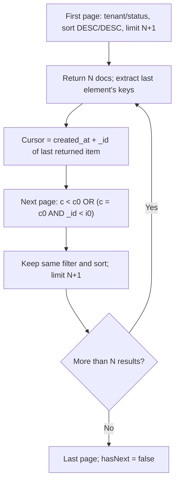

# Keyset Pagination with Proper Predicates and Indexes

In **Spring Data MongoDB**, pagination is more than just calling `findAll(PageRequest.of(page, size))`. When a collection grows large or users scroll continuously through newer records, **keyset pagination** (also called *seek pagination* or key-based *cursor pagination*) is usually a better choice than growing `skip` with the page number. It uses the **sort keys of the last element from the previous page** to write the predicate for the next page while taking advantage of a matching compound index.

This lesson belongs to the **Pagination and Streams** chapter of the **SPRING_DATA_MONGODB** module. We will design an API for browsing posts ordered by `createdAt DESC, _id DESC`, build queries with `MongoTemplate`, choose indexes for tenant/status and seek predicates, encode cursors, handle concurrent changes, read previous pages, diagnose with `explain`, and test against real MongoDB. Distinguish an **API pagination cursor** from the MongoDB Java Driver's **server-side cursor**: the two concepts are related, not identical.

## 1. Why does offset pagination become expensive?

Consider an API listing published posts:

```javascript
db.posts.find({
  tenant_id: "T1",
  status: "PUBLISHED"
})
.sort({ created_at: -1, _id: -1 })
.skip(100000)
.limit(20);
```

`skip(100000)` means the server must step through a large number of result positions before returning the 20 documents for the current page. Even when an index covers both filtering and sorting, deep offsets typically increase scanning/skipping work; the cost is not constant simply because `limit(20)` is small.

In Spring Data:

```java
Pageable page = PageRequest.of(
    5000,
    20,
    Sort.by(Sort.Order.desc("createdAt"), Sort.Order.desc("id"))
);
Page<Post> result = postRepository.findByTenantIdAndStatus(
    "T1", "PUBLISHED", page
);
```

The snippet above illustrates offset pagination with a repository declaring `findByTenantIdAndStatus(..., Pageable)`. `Page` may also trigger an extra count query for the total element count; `Slice` can avoid the total count, yet **it does not turn page 5000 into keyset pagination**. Keyset replaces page numbers with an **anchor right after the last element already read**.

| Criterion | Offset (`skip/limit`) | Keyset (seek/cursor) |
| --- | --- | --- |
| Page positioning | By position `page * size` | By the key values of an anchor record |
| Deep pages | Usually skips past many results | Can seek into the next key range via an index |
| Arbitrary page numbers | Easy to jump to page 500 | Cannot jump straight to an arbitrary page number |
| New records inserted at top | Can shift positions, causing duplicates/drift | Usually leaves the anchor intact if sort keys are stable |
| Displaying total pages | Fits well when paired with `count` | Typically returns `hasNext`, without a total count |
| Index requirements | Filter/sort index is very helpful | **Index covering filter, sort, and seek predicate is critical** |

Keyset is not a magic "O(1) for every page" fix: the database still pays for query planning, index traversal, document fetching, filtering, and network transfer. Its advantage lies in avoiding `skip` growing linearly with pages traversed when the query and index align.

## 2. Start from a total, stable ordering

Suppose the `posts` collection stores:

```javascript
{
  _id: ObjectId("674000000000000000000005"),
  tenant_id: "T1",
  status: "PUBLISHED",
  created_at: ISODate("2026-11-19T09:00:00Z"),
  title: "New post"
}
```

A common ordering is newest first:

```javascript
db.posts.find({ tenant_id: "T1", status: "PUBLISHED" })
  .sort({ created_at: -1 });
```

However, `created_at` values can collide (for example, multiple posts published within the same millisecond). If you sort only by `created_at`, records sharing the same timestamp have **no guaranteed secondary order** across queries; taking the last timestamp on a page and filtering `created_at < anchor` will **skip** unread posts that share that timestamp.

The fix is adding the unique key `_id`:

```javascript
.sort({ created_at: -1, _id: -1 })
```

This ordering is deterministic when every document has a well-defined `created_at` and unique `_id`. With BSON Date and ObjectId sort keys, both comparison predicates can use the same anchor tuple.

**Key invariant:** throughout pagination, a record should not mutate `created_at` or `_id`. `_id` is immutable in MongoDB, but the application must also treat `created_at` as a fixed creation timestamp. If you sort by `updatedAt`, `score`, or a frequently changing status, keyset pagination can still duplicate or drop records when values move between pages.

## 3. Seek formula for two descending keys

Let `c` be `created_at` and `i` be `_id`; a document comes after anchor `(c0, i0)` under **descending order on both** if:

```text
c < c0
OR
(c == c0 AND i < i0)
```

MongoDB filter for the next page:

```javascript
const lastCreatedAt = ISODate("2026-11-19T09:00:00Z");
const lastId = ObjectId("674000000000000000000004");

db.posts.find({
  tenant_id: "T1",
  status: "PUBLISHED",
  $or: [
    { created_at: { $lt: lastCreatedAt } },
    {
      created_at: lastCreatedAt,
      _id: { $lt: lastId }
    }
  ]
})
.sort({ created_at: -1, _id: -1 })
.limit(21);
```

With page size 20, fetch **21 documents** to know whether a next page follows; return at most 20 documents to the client. The 21st element is a *lookahead*, not the element used to build the next cursor.



Using strict inequality `<` ensures the anchor record is not returned again on the next page. Using `<=` would cause the previous page's last element to reappear at the top of the next page.

### Example with tied timestamps

Suppose the filtered dataset order is:

| Position in sort | `created_at` | `_id` (hex suffix) |
| --- | --- | --- |
| 1 | 09:00 | `...0005` |
| 2 | 09:00 | `...0004` |
| 3 | 09:00 | `...0003` |
| 4 | 08:00 | `...0002` |
| 5 | 07:00 | `...0001` |

With `size = 2`, page 1 returns `...0005` and `...0004`, anchoring the cursor at `(09:00, ...0004)`. Page 2 returns `...0003` and `...0002`; page 3 returns `...0001`.

If you used only `created_at < 09:00`, page 2 would start at `...0002` and drop `...0003`. That is why **the tie-breaker key must appear in the sort, the cursor, and the seek predicate**.

## 4. Choosing a matching compound index

For a workload that always applies equality filters on `tenant_id` and `status` and sorts by `created_at DESC, _id DESC`, the initial proposed index is:

```javascript
db.posts.createIndex(
  {
    tenant_id: 1,
    status: 1,
    created_at: -1,
    _id: -1
  },
  { name: "posts_by_tenant_status_seek" }
);
```

This candidate follows the **equality → sort/range → tie-breaker** guideline:

1. `tenant_id: 1`, `status: 1`: narrows the range to documents matching the tenant and status.
2. `created_at: -1`: traverses timestamps in descending order.
3. `_id: -1`: orders documents sharing a timestamp uniquely and supports the second comparison condition.

MongoDB can traverse an index in reverse in compatible cases; when sorting with mixed directions, align the index directions to **the entire sort pattern**, rather than guessing from one field. A seek `$or` condition can cause the query planner to generate multiple index-scan branches or extra stages; **a matching index does not absolutely guarantee zero `SORT` stages in every `explain`**. Verify against your MongoDB version and real data distribution.

| Actual query pattern | Index to consider |
| --- | --- |
| Always filters tenant + status, sorted by createdAt and id | `{tenant_id:1, status:1, created_at:-1, _id:-1}` |
| Filters only by tenant, without status | `{tenant_id:1, created_at:-1, _id:-1}` may fit better |
| Optional status filter with multiple other predicates | Re-evaluate index order using real statistics |
| Sorted by `created_at ASC, _id ASC` | Can leverage reverse scan of DESC/DESC index when compatible |
| Sorted by `score DESC, _id ASC` | Consider a matching mixed-direction index and mixed-direction cursor |

Do not instinctively create an index for every filter/sort variation: each index increases write cost, storage, and maintenance. Focus on key measured access patterns.

## 5. Declaring the entity in Spring Data MongoDB

A minimal entity:

```java
import java.time.Instant;
import org.bson.types.ObjectId;
import org.springframework.data.annotation.Id;
import org.springframework.data.mongodb.core.mapping.Document;
import org.springframework.data.mongodb.core.mapping.Field;

@Document("posts")
public class Post {
    @Id
    private ObjectId id;

    @Field("tenant_id")
    private String tenantId;

    private String status;

    @Field("created_at")
    private Instant createdAt;

    private String title;

    public Post() {}

    public ObjectId getId() { return id; }
    public String getTenantId() { return tenantId; }
    public String getStatus() { return status; }
    public Instant getCreatedAt() { return createdAt; }
    public String getTitle() { return title; }
}
```

In Spring Data queries using `Post.class`, use **Java property names**: `tenantId`, `createdAt`, `id`. `MappingMongoConverter` maps them to `tenant_id`, `created_at`, `_id`. When querying directly in `mongosh`, use the **actual BSON field names**.

`createdAt` should be assigned when persisting a post and left unchanged afterward; do not rely on an `ObjectId`'s embedded timestamp as an accurate business clock. MongoDB BSON Date has **millisecond** precision: if a Java `Instant` carries nanoseconds, build cursors from **entity values read back from MongoDB** or truncate timestamps before saving so boundary comparisons never drift.

## 6. Writing Keyset Pagination with MongoTemplate

Instead of `PageRequest.of(pageNumber, size)`, a service takes a **cursor** containing `createdAt` and `id` of the last returned item.

Shared records:

```java
import java.time.Instant;
import java.util.List;
import org.bson.types.ObjectId;

record PostCursor(Instant createdAt, ObjectId id) {}

record PostWindow(
    List<Post> content,
    boolean hasNext,
    PostCursor nextCursor
) {}
```

Service constructing the initial or continuation query:

```java
import java.util.List;
import org.springframework.data.domain.Sort;
import org.springframework.data.mongodb.core.MongoTemplate;
import org.springframework.data.mongodb.core.query.Criteria;
import org.springframework.data.mongodb.core.query.Query;

public class PostFeedService {
    private final MongoTemplate template;

    public PostFeedService(MongoTemplate template) {
        this.template = template;
    }

    public PostWindow load(
            String tenantId,
            String status,
            PostCursor after,
            int size) {

        if (size < 1 || size > 100) {
            throw new IllegalArgumentException("size must be between 1 and 100");
        }

        Criteria base = Criteria.where("tenantId").is(tenantId)
                .and("status").is(status);
        Criteria filter = base;

        if (after != null) {
            Criteria seek = new Criteria().orOperator(
                Criteria.where("createdAt").lt(after.createdAt()),
                new Criteria().andOperator(
                    Criteria.where("createdAt").is(after.createdAt()),
                    Criteria.where("id").lt(after.id())
                )
            );
            filter = new Criteria().andOperator(base, seek);
        }

        Query query = Query.query(filter)
            .with(Sort.by(
                Sort.Order.desc("createdAt"),
                Sort.Order.desc("id")))
            .limit(size + 1);

        List<Post> fetched = template.find(query, Post.class);
        boolean hasNext = fetched.size() > size;

        List<Post> content = hasNext
            ? List.copyOf(fetched.subList(0, size))
            : List.copyOf(fetched);

        PostCursor next = hasNext
            ? new PostCursor(
                content.get(content.size() - 1).getCreatedAt(),
                content.get(content.size() - 1).getId())
            : null;

        return new PostWindow(content, hasNext, next);
    }
}
```

In a real Spring application, annotate with `@Service` or declare `PostFeedService` as a bean and inject it into your controller. The code needs only synchronous `MongoTemplate`, with no dependency on `Pageable` or `skip`.

**Points to observe in the code:**

- `base` always restricts `tenantId` and `status` on **every page**; never derive filters solely from the cursor.
- The first page passes `after = null`, applying only filter and sort; subsequent pages add `seek`.
- `new Criteria().andOperator(base, seek)` preserves `base AND (createdAt < c0 OR (createdAt = c0 AND id < i0))`.
- `Sort.Order.desc("id")` maps to BSON `_id: -1`; `Criteria.where("id")` likewise maps to `_id`.
- Fetch `size+1` to detect `hasNext`, **without returning the lookahead element**.
- `nextCursor` is built from the **last element inside `content`**, not from the extra lookahead element.
- When no more pages follow, return `nextCursor = null`. If you want to support refreshing from an arbitrary page, an API might keep the last cursor even when `hasNext=false`, provided the contract defines that clearly.

Keyset accuracy does not depend on `findAll()` or `Page.getTotalPages()`. It depends on **matching sort and seek predicates**, immutable anchor fields, and suitable indexes.

## 7. Designing nextCursor for an HTTP API

Never ask the frontend to send a raw MongoDB `$or` expression. The API only needs to return a token containing the page's final keys:

```json
{
  "items": [
    {
      "id": "674000000000000000000005",
      "title": "New post",
      "createdAt": "2026-11-19T09:00:00Z"
    }
  ],
  "hasNext": true,
  "nextCursor": "opaque-token"
}
```

This is an **example response shape**; `opaque-token` is an illustrative placeholder, not a decodable token.

### 7.1. Encoding the anchor keys

Example encoding `PostCursor` as URL-safe Base64. Using epoch milliseconds aligns with BSON Date precision; `ObjectId.toHexString()` preserves the identifier cleanly:

```java
import java.nio.charset.StandardCharsets;
import java.time.Instant;
import java.util.Base64;
import org.bson.types.ObjectId;

final class PostCursorCodec {
    private PostCursorCodec() {}

    static String encode(PostCursor cursor) {
        String body = cursor.createdAt().toEpochMilli()
                + ":" + cursor.id().toHexString();
        return Base64.getUrlEncoder().withoutPadding()
                .encodeToString(body.getBytes(StandardCharsets.UTF_8));
    }

    static PostCursor decode(String token) {
        if (token == null || token.isBlank() || token.length() > 256) {
            throw new IllegalArgumentException("Invalid cursor");
        }
        try {
            byte[] bytes = Base64.getUrlDecoder().decode(token);
            String text = new String(bytes, StandardCharsets.UTF_8);
            String[] parts = text.split(":", -1);
            if (parts.length != 2 || !ObjectId.isValid(parts[1])) {
                throw new IllegalArgumentException("Invalid cursor");
            }
            return new PostCursor(
                Instant.ofEpochMilli(Long.parseLong(parts[0])),
                new ObjectId(parts[1])
            );
        } catch (IllegalArgumentException | java.time.DateTimeException ex) {
            throw new IllegalArgumentException("Invalid cursor", ex);
        }
    }
}
```

This code demonstrates **token formatting**, not production security. Base64 **neither encrypts secrets nor prevents tampering**: users can decode and alter the epoch or `ObjectId`. In a real API:

1. Include a **cursor schema version** and filter/sort scope (e.g., tenant, status, or a fingerprint of them).
2. Sign with **HMAC** or use a backend-managed token when integrity protection is needed, and enforce expiration if appropriate.
3. Obtain the tenant from the **authentication/authorization context**, never trusting a tenant claimed inside the token; continue enforcing tenant predicates in the query.
4. Bound token length, parse strictly, return HTTP **400** on malformed tokens, and never expose parser stack traces to clients.
5. Do not let clients change `sort`, `status`, `size`, or filters with the same cursor unless compatibility rules are explicitly defined.

A cursor is an **anchor to resume traversal**, not a session or transaction, and it does not provide a snapshot automatically.

## 8. What if you need the previous page?

With display order `created_at DESC, _id DESC`, the **next** page uses `<`. To fetch records **preceding** the first element of the current page, use **`>`**, flip the sort direction while reading the nearest preceding records, and then reverse the list before returning it:

```javascript
// beforeCreatedAt / beforeId are the keys of the current page's first element.
db.posts.find({
  tenant_id: "T1",
  status: "PUBLISHED",
  $or: [
    { created_at: { $gt: beforeCreatedAt } },
    {
      created_at: beforeCreatedAt,
      _id: { $gt: beforeId }
    }
  ]
})
.sort({ created_at: 1, _id: 1 })
.limit(21);
```

If page size is 20, this query reads up to 21 records **immediately preceding the anchor**, in ascending order. Use `size+1` to check whether an earlier page exists, keep the 20 nearest items, and **reverse the list in Java** back to DESC/DESC. Never change only the comparison operator to `>` while keeping DESC sort: that returns items farthest from the anchor instead of the adjacent page.

If the application does not need backward keyset navigation, you can support only **Next/Load more**. Often a one-way design is simpler and sufficient for news feeds and infinite scroll.

### General rule for mixed-direction sorts

If the sort is `score DESC, _id ASC`, the "after" condition is:

```text
score < score0
OR
(score = score0 AND _id > id0)
```

Each tuple component uses a comparison operator **matching its own sort direction**. Never copy the `<, <` predicate from DESC/DESC verbatim to other sort patterns.

## 9. How do concurrent mutations affect each page?

Keyset reduces position shifts caused by inserts at the top, yet **it does not provide an automatic snapshot**.

| Mutation while the user scrolls | What can happen |
| --- | --- |
| New post with `created_at` newer than previous page's anchor | Sits ahead of the anchor, usually absent from the next page; fits "feed as of scroll start" |
| New post backdated behind the anchor | May appear on a subsequent page |
| Unread post deleted | No longer returned |
| `created_at` or `score` updated, changing position | Risk of duplicating or skipping across pages |
| `status` changed from PUBLISHED to DRAFT | Record disappears from the filtered set |
| Tenant or permissions change | Service must enforce current authorization; never treat an old cursor as an access grant |

If you need to "freeze results as of a point in time", you can apply a **high-water mark** on an immutable creation timestamp on page 1, store that mark in the cursor, and constrain subsequent pages with it. That blocks posts newer than the mark, though it **does not prevent** edits/deletes of older documents or backdated inserts; it is not a true snapshot. For stronger snapshot consistency, evaluate your data model, dedicated snapshots, or read concern/transaction semantics supported by your MongoDB topology. Never hold a single long transaction open across hundreds of scroll requests just to simulate stability.

A pragmatic pattern is **immutable sort keys + unique ID + stable filter + validated cursor**. Many feed APIs accept natural eventual consistency as data evolves.

## 10. Does keyset force you to abandon MongoRepository?

**No.** You can declare repository queries with seek predicates and pass `Sort`/`Pageable` to bound them, or use Spring Data's `Window<T>` and `ScrollPosition` on versions that support scrolling/keyset. However, exact contracts and method support vary across Spring Data MongoDB versions.

Repository example showing the `$or` condition explicitly in JSON:

```java
import java.time.Instant;
import java.util.List;
import org.bson.types.ObjectId;
import org.springframework.data.domain.Pageable;
import org.springframework.data.mongodb.repository.MongoRepository;
import org.springframework.data.mongodb.repository.Query;

interface PostSeekRepository extends MongoRepository<Post, ObjectId> {
    @Query("{ 'tenantId': ?0, 'status': ?1, '$or': [" +
           "{ 'createdAt': { '$lt': ?2 } }," +
           "{ 'createdAt': ?2, 'id': { '$lt': ?3 } }" +
           "] }")
    List<Post> findAfter(
        String tenantId,
        String status,
        Instant anchorTime,
        ObjectId anchorId,
        Pageable limitAndSort
    );
}
```

Set `Pageable` to **page 0** with the sort and size:

```java
Pageable firstWindow = PageRequest.of(
    0, size + 1,
    Sort.by(Sort.Order.desc("createdAt"), Sort.Order.desc("id"))
);
```

In this example, `Pageable` is used **solely to pass limit + sort**, never incrementing `pageNumber`. For the first page with no anchor yet, provide a separate method or branch. To obtain `hasNext` without a count query, return `List<Post>` and fetch one extra item.

The Spring Data Scroll API (if supported by your version) wraps keyset positions into `ScrollPosition` and returns `Window<T>`; you still need stable ordering, proper indexes, and verification of generated queries. Likewise, returning `Stream<T>` from a repository is not keyset pagination: a stream iterates a continuous **server cursor**, requires careful resource closing, and does not automatically resume from a last key across HTTP requests.

## 11. Reactive pagination and backpressure

In WebFlux applications, `ReactiveMongoTemplate` returns `Flux<Post>`, yet you still need a proper keyset query. `Flux` does not automatically replace `skip` with seek, and **backpressure does not optimize a query lacking an index**.

Assuming the same `Query` builder from section 6:

```java
import reactor.core.publisher.Mono;
import org.springframework.data.mongodb.core.ReactiveMongoTemplate;
import org.springframework.data.mongodb.core.query.Query;

Mono<List<Post>> loadWindow(
        ReactiveMongoTemplate reactiveTemplate,
        Query keysetQuery) {
    // keysetQuery already has filter, sort, and limit(size+1).
    return reactiveTemplate.find(keysetQuery, Post.class)
        .collectList();
}
```

Here `collectList()` is safe only because the **query is bounded by `size+1`**—never use it on an unbounded `Flux`. The service layer handles `hasNext` and `nextCursor` just like the synchronous version and returns `Mono<PageResponse>`. Never call `.block()` on a WebFlux event loop, and never manually `.subscribe()` and return before the query completes.

## 12. Verifying indexes with explain and metrics

Start with realistic filters and a typical keyset anchor:

```javascript
db.posts.find({
  tenant_id: "T1",
  status: "PUBLISHED",
  $or: [
    { created_at: { $lt: ISODate("2026-11-19T09:00:00Z") } },
    {
      created_at: ISODate("2026-11-19T09:00:00Z"),
      _id: { $lt: ObjectId("674000000000000000000004") }
    }
  ]
})
.sort({ created_at: -1, _id: -1 })
.limit(21)
.explain("executionStats");
```

Read these metrics:

- **`winningPlan`**: is a suitable index scan (`IXSCAN`) used, or a collection scan (`COLLSCAN`)? Is there a `SORT` stage? With `$or`, inspect the entire plan tree, not just the top node.
- **`totalKeysExamined`**: how many index keys were scanned relative to returned documents?
- **`totalDocsExamined`**: how many actual documents were read for filtering?
- **`nReturned`**: at most `size+1` for a limited query.
- **Timing and load**: measure p50/p95/p99 latency, connection pool usage, page request rate, and bytes transferred under representative load.

Set realistic expectations: deep `skip` queries must skip many records; keyset queries with matching indexes typically read around the anchor key range. Even so, on the same data and filters, an ill-suited index or poor `$or` plan can still make a query slow.

Note: running `explain` on a simulated `find` command is a diagnostic tool, not a replacement for benchmarking the actual Spring Data application. Measure BSON mapping, network latency, and document size as well.

## 13. Integration testing to catch duplicates and skipped items

Unit tests on an already-sorted Java list **do not prove** Spring Data maps `createdAt` to `created_at` or that MongoDB evaluates the `$or` filter properly. Insert raw BSON and query through `MongoTemplate` against an isolated test database.

Example test using a Spring Boot test slice and AssertJ:

```java
import static org.assertj.core.api.Assertions.assertThat;

import java.time.Instant;
import java.util.Date;
import java.util.List;
import java.util.UUID;
import org.bson.Document;
import org.bson.types.ObjectId;
import org.junit.jupiter.api.Test;
import org.springframework.beans.factory.annotation.Autowired;
import org.springframework.boot.test.autoconfigure.data.mongo.DataMongoTest;
import org.springframework.data.mongodb.core.MongoTemplate;

@DataMongoTest
class PostKeysetIntegrationTest {
    @Autowired MongoTemplate template;

    @Test
    void shouldNotSkipItemsSharingTheSameTimestamp() {
        String tenant = "test-" + UUID.randomUUID();
        String otherTenant = "test-" + UUID.randomUUID();

        Date newer = Date.from(Instant.parse("2026-11-19T09:00:00Z"));
        Date older = Date.from(Instant.parse("2026-11-19T08:00:00Z"));

        ObjectId a = new ObjectId("674000000000000000000001");
        ObjectId b = new ObjectId("674000000000000000000002");
        ObjectId c = new ObjectId("674000000000000000000003");
        ObjectId d = new ObjectId("674000000000000000000004");
        ObjectId e = new ObjectId("674000000000000000000005");
        ObjectId unrelated = new ObjectId();

        template.getCollection("posts").insertMany(List.of(
            raw(a, tenant, "PUBLISHED", older),
            raw(b, tenant, "PUBLISHED", older),
            raw(c, tenant, "PUBLISHED", newer),
            raw(d, tenant, "PUBLISHED", newer),
            raw(e, tenant, "PUBLISHED", newer),
            raw(unrelated, otherTenant, "PUBLISHED", newer)
        ));

        PostFeedService service = new PostFeedService(template);

        PostWindow p1 = service.load(tenant, "PUBLISHED", null, 2);
        PostWindow p2 = service.load(
            tenant, "PUBLISHED", p1.nextCursor(), 2);
        PostWindow p3 = service.load(
            tenant, "PUBLISHED", p2.nextCursor(), 2);

        assertThat(ids(p1.content())).containsExactly(e, d);
        assertThat(ids(p2.content())).containsExactly(c, b);
        assertThat(ids(p3.content())).containsExactly(a);

        assertThat(p1.hasNext()).isTrue();
        assertThat(p2.hasNext()).isTrue();
        assertThat(p3.hasNext()).isFalse();
        assertThat(p3.nextCursor()).isNull();
    }

    private static Document raw(
            ObjectId id, String tenant, String status, Date at) {
        return new Document("_id", id)
            .append("tenant_id", tenant)
            .append("status", status)
            .append("created_at", at)
            .append("title", "Test post");
    }

    private static List<ObjectId> ids(List<Post> posts) {
        return posts.stream().map(Post::getId).toList();
    }
}
```

This test runs against real MongoDB, so the environment **must be isolated** (such as Testcontainers). Fixed IDs are chosen to verify tie-breaking; make sure they do not already exist from an earlier run, or configure each run with a clean database. Never use a production collection.

Additional test cases to add:

1. First page has fewer than `size` items, or collection is empty: `hasNext=false`, `nextCursor=null`.
2. Multiple records share `createdAt`, including across a page boundary: **no duplicate or missing IDs**.
3. Same sort keys belonging to another tenant/status: out-of-scope data never leaks in.
4. Malformed cursor or invalid timestamp: API returns a clear input error.
5. Changed filter or sort between requests: token is rejected or checked for compatibility.
6. Data with `created_at=null` or missing field: enforce a clear policy to exclude or handle before applying keyset.
7. New record inserted between two pages: behavior matches the defined consistency contract.
8. `explain("executionStats")` on large datasets confirms index usage without abnormal scans/skips.

## 14. Common implementation errors

| Error | Consequence | Fix |
| --- | --- | --- |
| Sorting only by `createdAt`, omitting `_id` | Skips or duplicates records when timestamps tie | Add a unique tie-breaker to sort, seek, and cursor |
| Using `createdAt < anchor` without the equal-timestamp branch | Drops unread documents sharing that timestamp | `createdAt < c0 OR (createdAt = c0 AND _id < id0)` |
| Using `$lte` on the next page | Returns the anchor element again | Use strict inequalities |
| Incrementing `PageRequest.of(pageNumber,...)` on every page | Still offset pagination | Keep page 0 for limited queries and add the seek predicate |
| Java sort differs from MongoDB index | Slow reads, potential blocking sort | Align sort/filter with compound index and inspect `explain` |
| Building cursor from the lookahead element | Can drop the first record of the next page | Anchor on the last **returned** element |
| Using `Instant.now()` as cursor | Does not reflect the last read position | Use `createdAt` and `id` of the actual last record |
| Converting BSON Date to string and truncating precision arbitrarily | Skewed seek boundary, duplicates/misses | Preserve millisecond precision matching stored data |
| Treating Base64 as a secure token | Clients can tamper with anchors or inspect content | Sign with HMAC, bind filter/scope, and validate |
| Omitting tenant filter on subsequent pages | Risk of leaking other tenants' data | Enforce tenant from auth on **every page** |
| Changing status or sort key between pages | Records can move and duplicate/drop | Immutable sort keys; analyze consistency requirements |
| Using `Flux` without a limit | Reads huge datasets and buffers into RAM | Limit server-side before `collectList()` |

## 15. Self-assessment and practice

**1.** Why is `sort({created_at:-1})` insufficient for keyset pagination?  
**Answer:** multiple documents can share the same timestamp; add `_id` to establish a unique ordering.

**2.** With sort `created_at DESC, _id DESC`, what predicate must the next page use?  
**Answer:** `created_at < c0 OR (created_at = c0 AND _id < id0)`.

**3.** To return up to 20 items and detect whether a next page exists, how many items should you query?  
**Answer:** 21; use the 21st item to set `hasNext=true`, but anchor the cursor on the 20th item.

**4.** Why is `{tenant_id:1, status:1, created_at:-1, _id:-1}` a sensible index?  
**Answer:** the first two fields serve equality filters, while the trailing two serve ordering and the feed's seek predicate.

**5.** Does keyset guarantee a snapshot across requests?  
**Answer:** no. Inserts, updates, and deletes can still occur; define separate consistency rules.

**6.** Can Spring Data's `Pageable` be used for keyset pagination?  
**Answer:** it can be used at **page 0** to pass limit and sort alongside a seek query, though incrementing the page index still generates an offset; `Window`/`ScrollPosition` can support scrolling directly depending on version.

**7.** Is an API letting the frontend pass raw `ObjectId` and timestamp secure for authorization?  
**Answer:** no; enforce tenant/authorization on the server and protect token integrity when needed.

**8.** Why is keyset not synonymous with `Stream<T>` or `Flux<T>`?  
**Answer:** streams/publishers describe how results are consumed, whereas keyset is a method of **positioning** the next result set by sort keys.

**Practice exercise:** build an endpoint `GET /posts?size=20&cursor=...` scoped to an authenticated tenant. Use `PostFeedService` from this lesson, a DTO returning `items/hasNext/nextCursor`, test tied timestamps and tenant isolation, apply the proposed index, and compare `explain`/latency between deep `skip` and keyset on a large enough dataset to observe the difference.

**Conclusion:** keyset pagination excels when **filters are properly scoped**, **ordering has a unique secondary key**, **seek predicates use matching comparison directions**, and **compound indexes match the access pattern**. In Spring Data MongoDB, `MongoTemplate` lets you express those conditions in full; repository/scroll APIs add convenience on top. Page correctness depends on anchor keys and data stability, while performance must be verified via `explain` and realistic load testing.
