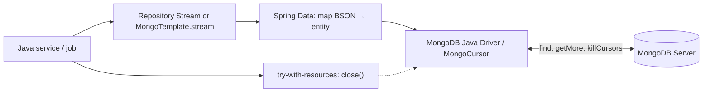
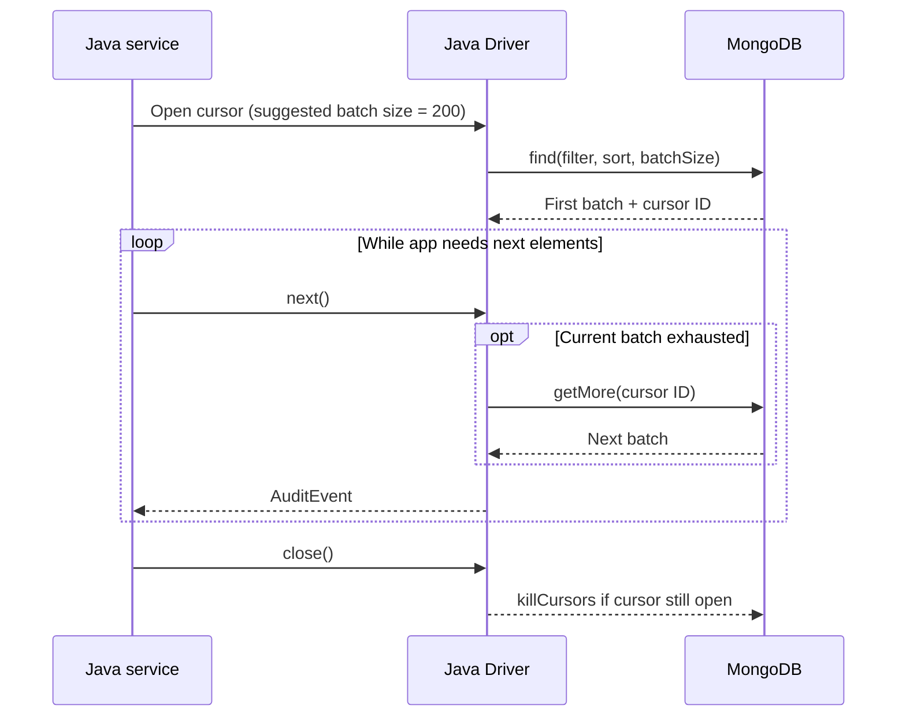
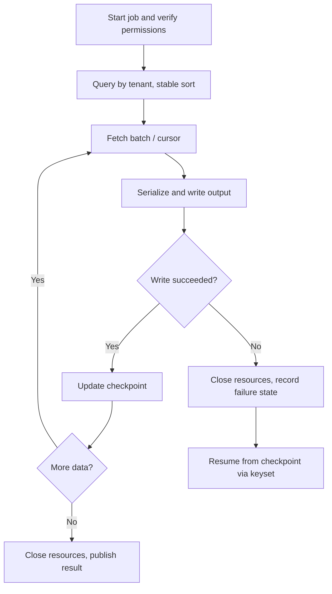

# Java Stream, Cursors, and Timely Resource Closing

When a MongoDB collection contains millions of documents, calling `findAll()` to fetch all data and process it in Java can spike memory usage, response time, and network traffic. **Spring Data MongoDB** supports reading results incrementally through **cursors** and APIs such as repository `Stream<T>` or `MongoTemplate.stream(...)`. This lets an application process records sequentially without holding every document in RAM at once.

However, streaming data also brings a responsibility: **a cursor is a live resource** that can hold server-side state, connections, and driver buffers. Failing to close it upon completion, on exceptions, or on early termination can increase open cursors, keep connections occupied longer, and degrade capacity for other requests. A Java `Stream` is not automatically closed merely because a terminal operation was invoked.

This lesson belongs to the **Pagination and Streams** chapter of the `SPRING_DATA_MONGODB` module. We will distinguish in-memory Java Streams from MongoDB cursors, practice with repositories and `MongoTemplate`, use `try-with-resources`, choose batch sizes, handle data exports, compare offset/keyset pagination and reactive `Flux`, and test/diagnose resource management.

After this lesson, you will be able to:

- Explain the relationship among `MongoDB Server`, `Java Driver`, `MongoCursor`, Spring Data, and `java.util.stream.Stream`.
- Distinguish `findAll().stream()` from a stream **created directly from a MongoDB query**.
- Use `try-with-resources` for repository `Stream<T>` and `MongoTemplate`'s `CloseableIterator<T>`.
- Understand scenarios involving **early termination, exceptions, slow processing, batch size, and timeouts**.
- Choose among streams, `Page`/`Slice`, or keyset pagination based on your goal.
- Design large-scale data processing with bounded resources, access control, and failure recovery.

## 1. Where does the MongoDB cursor sit in the processing flow?



When a query matches many documents, MongoDB can send an **initial batch** and return a **cursor** so the client can request subsequent batches (`getMore`). The Java Driver receives batches and handles BSON; Spring Data maps BSON to entities. Java `Stream` is the **consumption interface** inside your application, while the cursor is the **underlying result source and resource**.

| Concept | Role | Important notes |
| --- | --- | --- |
| `List<T>` from `findAll()` | Materializes all returned results upfront | Can consume substantial heap if results are large |
| `list.stream()` | Java Stream over an in-memory collection | **Does not open a new MongoDB cursor**; does not make an old query stream |
| `Stream<T>` returned from a repository query method | Allows streaming consumption of query results | **Must be closed** to release resources tied to the query |
| `CloseableIterator<T>` from `MongoTemplate.stream(...)` | Iterator for reading results incrementally via cursor | **Must be closed** on every execution path |
| `MongoCursor<T>` from Java Driver | Direct driver cursor | `AutoCloseable`; use `try-with-resources` |
| `Flux<T>` from reactive repository/template | Reactive Streams publisher | Not a `java.util.stream.Stream`; lifecycle via subscription, completion/cancellation |

A cursor **does not mean zero data is held in RAM**. Individual batches still occupy buffers, mapping still allocates Java objects, and client-side operations can still materialize data. Streaming is only effective when the **consumption pipeline is bounded**.

## 2. Sample event-log dataset

Suppose an application needs to export a tenant's activity log. The `auditEvents` collection contains many documents, each with an ID, event type, timestamp, and short message.

```javascript
// Collection: auditEvents
{
  _id: "EVT-0001",
  tenantId: "TENANT-A",
  type: "LOGIN",
  createdAt: ISODate("2026-11-20T00:00:00Z"),
  message: "Login successful"
}
{
  _id: "EVT-0002",
  tenantId: "TENANT-A",
  type: "LOGIN",
  createdAt: ISODate("2026-11-20T00:00:01Z"),
  message: "Logged in from app"
}
```

Java entity using Java 17+ and Spring Data MongoDB:

```java
import java.time.Instant;
import org.springframework.data.mongodb.core.mapping.Document;
import org.springframework.data.mongodb.core.mapping.MongoId;

@Document(collection = "auditEvents")
public record AuditEvent(
        @MongoId String id,
        String tenantId,
        String type,
        Instant createdAt,
        String message
) {}
```

`@MongoId String id` is chosen to keep business IDs as BSON Strings rather than accidentally converting ObjectId-like strings. In real applications, align ID BSON types, timestamp types, and indexes with your existing data.

A matching index for the query "LOGIN events of a tenant, ascending by timestamp and ID":

```javascript
db.auditEvents.createIndex({
  tenantId: 1,
  type: 1,
  createdAt: 1,
  _id: 1
});
```

The index supports both filtering and ordered reads. Sort by `createdAt` with `_id` as a secondary key because multiple events can share the exact same timestamp; **never rely on the natural order of a collection** when writing checkpointed jobs.

## 3. Distinguishing `findAll().stream()` from a database stream

### 3.1. An approach that easily wastes memory

```java
import java.util.List;

List<AuditEvent> all = auditEventRepository.findAll();

all.stream()
        .filter(event -> "LOGIN".equals(event.type()))
        .forEach(event -> process(event));
```

`findAll()` has already loaded the query results into a list before the Java `Stream` is created. Java-side `filter` **does not push the `type` condition down to MongoDB**; every document in the list was already fetched. On large collections, this can consume hundreds of MiB or more.

Even writing it as a one-liner:

```java
auditEventRepository.findAll().stream().forEach(this::process);
```

does not turn it into cursor streaming. What matters is not the word `stream` in Java, but **what the repository/query returned beforehand**.

### 3.2. Streaming directly from a repository query method

Declare a repository method returning `Stream<AuditEvent>`:

```java
import java.util.stream.Stream;
import org.springframework.data.mongodb.repository.MongoRepository;

public interface AuditEventRepository
        extends MongoRepository<AuditEvent, String> {

    Stream<AuditEvent>
    findByTenantIdAndTypeOrderByCreatedAtAscIdAsc(
            String tenantId, String type);
}
```

Spring Data derives the filter and sort from the method name and returns a stream of results. With `tenantId = "TENANT-A"` and `type = "LOGIN"`, the logical query is:

```javascript
db.auditEvents.find({
  tenantId: "TENANT-A",
  type: "LOGIN"
}).sort({
  createdAt: 1,
  _id: 1
});
```

The result set can be huge, yet the application consumes it sequentially without constructing a `List<AuditEvent>` containing all documents. Do not confuse this with a "zero memory" guarantee: the driver and pipeline still hold the active batch and in-flight objects.

### 3.3. Mandatory rule: `try-with-resources`

```java
import java.util.stream.Stream;
import org.springframework.stereotype.Service;

@Service
public class AuditExportService {
    private final AuditEventRepository repository;

    public AuditExportService(AuditEventRepository repository) {
        this.repository = repository;
    }

    public void exportLogins(String tenantId) {
        try (Stream<AuditEvent> events =
                repository.findByTenantIdAndTypeOrderByCreatedAtAscIdAsc(
                        tenantId, "LOGIN")) {

            events.forEach(this::writeOneEvent);
        }
    }

    private void writeOneEvent(AuditEvent event) {
        // Illustrative: write an event to a controlled sink.
        // Real sinks must bound resources and handle errors.
        System.out.println(event.id());
    }
}
```

`Stream` implements `AutoCloseable`. When exiting the `try` block, Java invokes `close()` even if the callback throws an exception. For a `Stream` backed by a MongoDB query, closing allows Spring Data and the driver to release cursor resources. Keep **all consumption** inside the `try` block.

**Do not** write:

```java
// Wrong: returning Stream outside the cursor management scope.
public Stream<AuditEvent> getEvents(String tenantId) {
    try (Stream<AuditEvent> stream =
            repository.findByTenantIdAndTypeOrderByCreatedAtAscIdAsc(
                    tenantId, "LOGIN")) {
        return stream; // Stream is already closed before the caller uses it!
    }
}
```

If you genuinely need to pass a stream to another layer, design an **explicit ownership contract specifying who closes it and where**; it is usually simpler for the service to consume the cursor itself and emit chunks/response writes inside a managed lifecycle.

## 4. `MongoTemplate.stream(...)` and `CloseableIterator<T>`

`MongoTemplate` fits when queries require dynamic predicates, projections, sorting, limits, and batch sizes. Its `stream` method returns Spring Data's `CloseableIterator<T>`:

```java
import org.springframework.data.domain.Sort;
import org.springframework.data.mongodb.core.MongoTemplate;
import org.springframework.data.mongodb.core.query.Criteria;
import org.springframework.data.mongodb.core.query.Query;
import org.springframework.data.util.CloseableIterator;

public class AuditCursorReader {
    private final MongoTemplate template;

    public AuditCursorReader(MongoTemplate template) {
        this.template = template;
    }

    public long processLogins(String tenantId) {
        Query query = Query.query(
                Criteria.where("tenantId").is(tenantId)
                        .and("type").is("LOGIN"));

        query.with(Sort.by(
                Sort.Order.asc("createdAt"),
                Sort.Order.asc("id")));
        query.cursorBatchSize(200);

        long processed = 0;
        try (CloseableIterator<AuditEvent> cursor =
                template.stream(query, AuditEvent.class)) {
            while (cursor.hasNext()) {
                AuditEvent event = cursor.next();
                validateAndWrite(event);
                processed++;
            }
        }
        return processed;
    }

    private void validateAndWrite(AuditEvent event) {
        // Process with bounded memory; do not accumulate every event.
    }
}
```

`CloseableIterator<T>` exposes `hasNext()`/`next()`, making it clean for sequential processing with an explicit lifecycle. `query.cursorBatchSize(200)` **suggests the batch size** for the cursor; it **does not cap the total number of documents** read. Use `query.limit(n)` or break on a business condition when you need an upper bound.

**Important:** even when `hasNext()` returns false after reading everything, always keep `try-with-resources` as a strict habit. When a callback fails, returns early, or cancels, the `try` block ensures `close()` executes.

### 4.1. Limiting results on the server

To read at most 500 events:

```java
Query query = Query.query(
        Criteria.where("tenantId").is("TENANT-A"));
query.with(Sort.by(Sort.Order.asc("createdAt"),
                   Sort.Order.asc("id")));
query.limit(500);
query.cursorBatchSize(100);

try (CloseableIterator<AuditEvent> cursor =
        template.stream(query, AuditEvent.class)) {
    while (cursor.hasNext()) {
        handle(cursor.next());
    }
}
```

This code lives inside a service where `template` and `handle` are already defined. `limit(500)` caps the query on the server, while `cursorBatchSize(100)` guides network batching; the two **do not replace each other**. If a project needs to cap total output bytes, add payload/streaming rules at the application layer rather than relying solely on document counts.

### 4.2. Projections when reading large volumes

If the job only needs `id` and `createdAt`, trim the transferred fields:

```java
query.fields()
        .include("id")
        .include("createdAt");
```

Mapping results into `AuditEvent` in this case creates a **partially populated entity**, suitable only for reading. **Never call `save` on a partially loaded entity**, as doing so can wipe out unloaded fields in the document (if `save` replaces the mapped document). For efficient, type-safe projections, use a dedicated DTO or deliberate BSON/projection mapping.

## 5. When a cursor must be closed, even without reading to the end

Understanding streaming requires more than just `forEach` or `while (hasNext)`. You must know what happens when processing **stops early**.

### 5.1. Normal completion

```java
try (Stream<AuditEvent> stream =
        repository.findByTenantIdAndTypeOrderByCreatedAtAscIdAsc(
                tenantId, "LOGIN")) {
    stream.forEach(this::process);
} // close() is called here.
```

Even after consuming the entire stream, `try-with-resources` makes ownership explicit and avoids depending on whether the driver or server has already released every resource at cursor exhaustion.

### 5.2. Stopping early once enough data is read

```java
try (Stream<AuditEvent> stream =
        repository.findByTenantIdAndTypeOrderByCreatedAtAscIdAsc(
                tenantId, "LOGIN")) {

    stream.limit(10).forEach(this::process);
} // Closes the underlying stream even if not all records were consumed.
```

Java Stream's `limit(10)` is a **client-side pipeline operator**, not equivalent to sending `limit(10)` to MongoDB. The driver may already have fetched a batch larger than 10 documents. When the bound is known upfront and fixed, **pushing `limit` into the query** is cleaner and more resource-efficient.

### 5.3. Exceptions thrown during processing

```java
try (Stream<AuditEvent> stream =
        repository.findByTenantIdAndTypeOrderByCreatedAtAscIdAsc(
                tenantId, "LOGIN")) {

    stream.forEach(event -> {
        validate(event);
        writeToOutput(event); // May throw an exception.
    });
}
// If validate()/writeToOutput() throws an exception,
// Stream.close() is still called when exiting the try block.
```

`try-with-resources` closes the cursor, yet **it does not roll back output already written** before the exception. If this is a CSV export or event-forwarding job, plan how to handle partial files, checkpoints, retry/idempotency, and error reporting.

### 5.4. Patterns that easily leak resources

```java
// WRONG: no close, especially since findFirst() stops early.
AuditEvent found = repository
        .findByTenantIdAndTypeOrderByCreatedAtAscIdAsc(tenantId, "LOGIN")
        .findFirst()
        .orElse(null);

// WRONG: terminal operations do not call Stream.close() automatically.
long total = repository
        .findByTenantIdAndTypeOrderByCreatedAtAscIdAsc(tenantId, "LOGIN")
        .count();

// WRONG FOR MEMORY GOALS: materializes every event.
List<AuditEvent> events;
try (Stream<AuditEvent> stream =
        repository.findByTenantIdAndTypeOrderByCreatedAtAscIdAsc(
                tenantId, "LOGIN")) {
    events = stream.toList(); // cursor closes, but the List can be huge.
}
```

Java Stream's `count()` **iterates all elements on the client**, not an optimized MongoDB count command. When you only need a count, use repository `countByTenantIdAndType(...)` or `MongoTemplate.count(...)`. When you only need the first document, use a derived query `findFirstBy...` with server-side sort/limit instead of opening a long stream.

Beyond `toList()`, operations like `sorted()`, some uses of `distinct()`, or `collect(...)` can retain large amounts of data in memory; `parallel()` is poorly suited to sharing a single sequential cursor and side-effecting callbacks. Keep pipelines simple, process item by item, and bound downstream memory.

### 5.5. Do not hand a cursor off to a later background task

Never open a cursor in one method and pass it to an asynchronous callback, an unbounded queue, or another thread **without clearly establishing who closes it**. Cursors and entity mapping share a lifecycle tied to the data source and processing state.

If an API streams content back to an HTTP client, reading must be governed by the **response lifecycle**: when the client disconnects or writing fails, cancel and close the source. Never store an open stream in a static field, cache, or HTTP session.

## 6. Cursor batch size, resources, and timeouts

### 6.1. `batchSize` is not the final document count

MongoDB can return multiple batches as the client iterates the cursor:



`batchSize = 200` is a **request/hint for documents per batch**, not a guarantee the driver always receives exactly 200. MongoDB is also constrained by response size limits, query types, server version, and execution factors. Batches can be smaller, and choosing a large batch size does not automatically make every query faster.

| Relatively small batch | Relatively large batch |
| --- | --- |
| May increase `getMore`/round-trip counts | May reduce network round trips |
| Lower driver buffering in some workloads | Higher RAM consumption and GC pressure |
| Fits large documents or slow per-record processing | Fits small documents and high network latency |
| May increase total runtime from excessive requests | May transfer wasted bytes if stopping early |

Measure latency, throughput, average BSON size, peak heap, GC, and `getMore` counts on production-like data. No single batch size fits every system.

### 6.2. Cursor timeouts, sessions, and slow processing

A MongoDB cursor can be closed by the server after **being idle for a timeout period**; lifetime also depends on sessions, driver behavior, and configured timeouts. If a job spends a long time processing a single record before calling `next()`, the cursor may expire even though Java still holds a reference.

In certain scenarios `noCursorTimeout` exists, yet it is **not a default solution**: cursors remain subject to session and resource constraints and carry a higher risk of orphaned server cursors. It is usually better to **keep cursor lifetimes short**, process in checkpointed batches, or decouple reading from slow processing via a **bounded** queue.

Do not raise every timeout to infinity to "avoid errors" when the root cause is a slow job, missing index, or unclosed stream.

### 6.3. Connections and long-running operations

Cursors consume server and driver resources; in certain contexts (such as transactions or special sessions), they also carry connection/session constraints. Do not assume each cursor **permanently pins a single connection** for its entire lifetime: that depends on driver, topology, and operation type. Still, opening many uncontrolled cursors puts strain on resources.

If an endpoint lets multiple customers export millions of records concurrently, enforce limits:

- **Concurrent export jobs**, with per-tenant/per-user quotas and maximum duration.
- **Record/byte limits** and export timeouts; consider writing to temporary files asynchronously for very long jobs.
- **Tenant authorization** pushed down into the query, never filtering tenants after fetching data.
- **Cancellation handling** when requests disconnect or jobs are aborted.
- **Monitoring** for open cursor counts, connection pools, slow queries, heap, GC, and bandwidth.

## 7. Choosing Stream, Page, Slice, or keyset pagination

Not every multi-document read should use a long-lived cursor. A UI list page and an export job have different goals.

| Goal | Often suitable choice | Why |
| --- | --- | --- |
| UI page of 20–50 docs needing total pages | `Page<T>` with `Pageable` | Provides content and total metadata, though count can be costly |
| UI page needing only whether more follows | `Slice<T>` | Avoids needing to run a count query |
| Read top N sorted records | Derived `TopN`/`FirstN` or `Query.limit` | Bounded on the server |
| Continuous export/sequential read job | Repository `Stream<T>` or `MongoTemplate.stream` | Reads incrementally, avoiding full materialization |
| Long job needing failure recovery and time slicing | **Keyset/seek pagination** with checkpoints | Independent queries, no long-lived open cursor |
| Continuous change synchronization | Change streams or problem-specific techniques | Completely different from iterating a finite query |

### 7.1. Offset pagination via repository

```java
import org.springframework.data.domain.Page;
import org.springframework.data.domain.Pageable;
import org.springframework.data.mongodb.repository.MongoRepository;

public interface AuditPageRepository
        extends MongoRepository<AuditEvent, String> {

    Page<AuditEvent> findByTenantIdAndType(
            String tenantId, String type, Pageable pageable);
}
```

Calling it:

```java
import org.springframework.data.domain.Page;
import org.springframework.data.domain.PageRequest;
import org.springframework.data.domain.Sort;

Page<AuditEvent> page = repository.findByTenantIdAndType(
        "TENANT-A",
        "LOGIN",
        PageRequest.of(
                0,
                20,
                Sort.by(Sort.Order.asc("createdAt"),
                        Sort.Order.asc("id"))));
```

Here `repository` is an `AuditPageRepository` injected into a service. `PageRequest.of(0, 20)` requests the first page with size 20. `Page` may run a count to supply the total; in some cases the framework can deduce the count without another query. When you only need "is there a next page?", `Slice` fits better by avoiding total count overhead.

As page numbers grow deep, `skip`/`limit` forces the server to skip past many documents. Beyond performance, if documents are inserted or deleted between page loads, offsets are prone to **duplicates or skips**.

### 7.2. Keyset pagination with `createdAt` and `_id`

Keyset (seek pagination) does not ask to "skip 100,000 records"; it asks to "fetch records **after the last processed key**." With ascending sort `createdAt, _id`, the continuation condition is:

```javascript
// lastCreatedAt and lastId are known from the last record of the previous page.
db.auditEvents.find({
  tenantId: "TENANT-A",
  type: "LOGIN",
  $or: [
    { createdAt: { $gt: ISODate("2026-11-20T00:00:01Z") } },
    {
      createdAt: ISODate("2026-11-20T00:00:01Z"),
      _id: { $gt: "EVT-0002" }
    }
  ]
})
.sort({ createdAt: 1, _id: 1 })
.limit(200);
```

The `$or` predicate handles **multiple events sharing the same `createdAt`**. Never use `createdAt > lastCreatedAt` alone, as it drops documents sharing the same timestamp as the last record of the previous page.

Spring Data `MongoTemplate` example:

```java
import java.time.Instant;
import java.util.List;
import org.springframework.data.domain.Sort;
import org.springframework.data.mongodb.core.MongoTemplate;
import org.springframework.data.mongodb.core.query.Criteria;
import org.springframework.data.mongodb.core.query.Query;

public class AuditKeysetReader {
    private final MongoTemplate template;

    public AuditKeysetReader(MongoTemplate template) {
        this.template = template;
    }

    public List<AuditEvent> nextPage(
            String tenantId,
            Instant lastCreatedAt,
            String lastId
    ) {
        Criteria filter = Criteria.where("tenantId").is(tenantId)
                .and("type").is("LOGIN");

        if (lastCreatedAt != null && lastId != null) {
            Criteria after = new Criteria().orOperator(
                    Criteria.where("createdAt").gt(lastCreatedAt),
                    new Criteria().andOperator(
                            Criteria.where("createdAt").is(lastCreatedAt),
                            Criteria.where("_id").gt(lastId)
                    )
            );
            filter = new Criteria().andOperator(filter, after);
        }

        Query query = Query.query(filter)
                .with(Sort.by(Sort.Order.asc("createdAt"),
                              Sort.Order.asc("id")))
                .limit(200);

        return template.find(query, AuditEvent.class);
    }
}
```

This example assumes **String IDs and immutable `createdAt`**; when choosing other fields, verify BSON types, collation, and index order. The first page passes `lastCreatedAt/lastId = null`; subsequent pages pass the keys of the **last successfully processed record**, not merely the last record loaded into RAM.

Keyset lets each batch finish its request/cursor and open a fresh query, making runtime bounds and retries far easier to manage than one giant cursor. Still, it **does not provide an immutable snapshot**: edits, deletes, or inserts during the scan can change results. For strictly reproducible jobs, define time cutoffs, immutable keys, checkpoints, and an appropriate consistency model.

## 8. Reactive `Flux` is not a Java `Stream`

Applications using **ReactiveMongoRepository** or **ReactiveMongoTemplate** receive `Flux<AuditEvent>` instead of Java `Stream<AuditEvent>`. The two APIs differ in consumption, backpressure, lifecycle, and resource management:

| Blocking Java Stream / cursor | Reactive `Flux` |
| --- | --- |
| `Iterator.next()`/`Stream.forEach()` pulls and blocks for results | Subscriber receives data signals via Reactive Streams |
| Managed with `try-with-resources` and `close()` | Lifecycle governed by subscription, completion, error, and **cancellation** |
| Blocking threads may sit waiting on I/O | Reactive driver provides a non-blocking I/O model |
| Java's `limit()` is a client-side operator | `take(n)` requests at most `n` elements and cancels upstream |
| Avoid `parallel()` on a shared cursor | `flatMap`/`concatMap` operators must bound concurrency/backpressure |

Reactive repository example:

```java
import reactor.core.publisher.Flux;
import org.springframework.data.mongodb.repository.ReactiveMongoRepository;

public interface ReactiveAuditEventRepository
        extends ReactiveMongoRepository<AuditEvent, String> {

    Flux<AuditEvent>
    findByTenantIdAndTypeOrderByCreatedAtAscIdAsc(
            String tenantId, String type);
}
```

Service returning a bounded `Flux`:

```java
import reactor.core.publisher.Flux;
import org.springframework.stereotype.Service;

@Service
public class ReactiveAuditReadService {
    private final ReactiveAuditEventRepository repository;

    public ReactiveAuditReadService(
            ReactiveAuditEventRepository repository) {
        this.repository = repository;
    }

    public Flux<AuditEvent> firstHundredLogins(String tenantId) {
        return repository
                .findByTenantIdAndTypeOrderByCreatedAtAscIdAsc(
                        tenantId, "LOGIN")
                .take(100);
    }
}
```

In a standard reactive pipeline, the client/driver handles releasing resources when the publisher **completes, errors, or is cancelled**. Do not wrap `Flux` in `try-with-resources` because `Flux` is not a Java `Stream`. Still, the application must **manage subscription lifecycles properly**: when an HTTP client disconnects or a job is cancelled, ensure cancellation propagates down to the data source.

Common pitfalls:

- Calling `collectList()` on a stream of millions of events and expecting low memory usage.
- Calling `block()` on an event loop, defeating non-blocking execution.
- Using unbounded `flatMap` for slow write operations, creating excessive load. When ordering is required, use `concatMap` or set explicit concurrency limits.
- Keeping subscriptions alive indefinitely without cancellation, timeout, or backpressure policies.

### 8.1. Tailable cursors and change streams are special cases

A standard `find` query has a **finite result set**. Tailable cursors (on capped collections) or MongoDB change streams wait long-term for new data and follow a different lifecycle. Never treat them as normal "pagination."

For long-lived streams, explicitly design **cancellation, reconnection, resume tokens (for change streams), resource bounds, and error monitoring**. Never repurpose a finite history cursor as an endless subscription service.

## 9. Safe and resumable data export jobs

A 2-million-document export job can fail midway due to output disconnects, full disks, or worker restarts. `try-with-resources` closes the cursor on time, yet **it does not recover already-processed work**.

A reliable export job typically includes:

1. **Data boundaries:** tenant, event type, time range, and access permissions are clearly scoped.
2. **Stable ordering:** `createdAt + _id` or another key with a strict total order.
3. **Incremental processing:** sequential streaming with bounded output; avoid full `toList()`.
4. **Checkpointing:** save the last key only after the corresponding output chunk has been **successfully written**.
5. **Idempotent retries:** avoid duplicates on retry; consider writing to temporary files and publishing complete files atomically.
6. **Bounds and cancellation:** cap concurrent jobs, runtime, and output size; transition state to `FAILED/CANCELLED` when needed.
7. **Resources:** close cursors on completion, cancellation, or exception; flush/close output under clear ownership.



If each document requires a network call taking several seconds, holding one cursor open for hours risks timeouts and resource strain. In that case, read **moderately sized keyset pages**, close the query after each batch, and persist checkpoints instead of keeping a cursor open while waiting on external I/O.

### 9.1. HTTP streaming and client disconnects

When exporting CSV over a streaming HTTP response, reading MongoDB and writing to the socket should run **inside the same callback/workflow with a clear lifecycle**. If the client closes the connection, writing throws `IOException`; the application must exit the scope and close the cursor rather than reading millions more documents.

Do not design a controller returning a raw `Stream<AuditEvent>` and hope the JSON serializer/framework always calls `close()`. If your framework supports streaming responses, verify which callback **owns the cursor**, how cleanup runs on client abort, and how timeouts/exceptions are handled.

For large files downloaded repeatedly, export via a **system-managed background job** to object storage and return a job status and download link once ready, rather than holding an HTTP connection and MongoDB cursor open for hours. Design quotas, access control, and temporary-file cleanup.

### 9.2. Do not hold long read transactions open unnecessarily

MongoDB transactions on supported deployments carry time limits, resource overhead, and session constraints. If you are only **exporting data for reporting**, do not blindly wrap a multi-hour read loop in `@Transactional`. Nor does a transaction make a continuously mutating source infinitely reproducible over hours.

If a legal or financial report requires a consistent snapshot, establish actual requirements for read concern, snapshot/transactions, maximum duration, and export strategy tested on a suitable topology. Never mistake a Java `Stream` for a transactional mechanism.

## 10. Testing cursors and resource management

A simple unit test mocking `AuditEventRepository` to return `Stream.of(...)` verifies processing logic, yet **does not prove** MongoDB opens a real cursor or releases resources properly. Use an **isolated MongoDB test instance** (such as Testcontainers) with `@DataMongoTest` to test mapping, queries, ordering, and streaming APIs.

### 10.1. Testing Spring Data MongoDB with `Stream<T>`

Example using Spring Boot 3.x, Java 17+, and a dedicated test database:

```java
import static org.assertj.core.api.Assertions.assertThat;

import java.time.Instant;
import java.util.List;
import java.util.stream.Stream;
import org.junit.jupiter.api.BeforeEach;
import org.junit.jupiter.api.Test;
import org.springframework.beans.factory.annotation.Autowired;
import org.springframework.boot.test.autoconfigure.data.mongo.DataMongoTest;
import org.springframework.data.domain.Sort;
import org.springframework.data.mongodb.core.MongoTemplate;
import org.springframework.data.mongodb.core.query.Criteria;
import org.springframework.data.mongodb.core.query.Query;
import org.springframework.data.util.CloseableIterator;

@DataMongoTest
class AuditStreamIntegrationTest {

    @Autowired AuditEventRepository repository;
    @Autowired MongoTemplate template;

    @BeforeEach
    void prepare() {
        // Use only on an isolated test database; never run on production.
        template.remove(new Query(), AuditEvent.class);
        template.insertAll(List.of(
                event("EVT-1", "TENANT-A", "LOGIN", "2026-11-01T00:00:00Z"),
                event("EVT-2", "TENANT-A", "LOGIN", "2026-11-01T00:00:01Z"),
                event("EVT-3", "TENANT-A", "LOGOUT", "2026-11-01T00:00:02Z"),
                event("EVT-4", "TENANT-B", "LOGIN", "2026-11-01T00:00:03Z")
        ));
    }

    private AuditEvent event(
            String id, String tenant, String type, String time
    ) {
        return new AuditEvent(
                id, tenant, type, Instant.parse(time), "Test");
    }

    @Test
    void repositoryStreamFiltersAndSorts() {
        try (Stream<AuditEvent> stream =
                repository.findByTenantIdAndTypeOrderByCreatedAtAscIdAsc(
                        "TENANT-A", "LOGIN")) {

            List<String> ids = stream.map(AuditEvent::id).toList();
            assertThat(ids).containsExactly("EVT-1", "EVT-2");
        }
    }

    @Test
    void templateCursorCanStopEarlyAndStillClose() {
        Query query = Query.query(
                Criteria.where("tenantId").is("TENANT-A")
                        .and("type").is("LOGIN"));
        query.with(Sort.by(Sort.Order.asc("createdAt"),
                           Sort.Order.asc("id")));
        query.cursorBatchSize(1);

        try (CloseableIterator<AuditEvent> cursor =
                template.stream(query, AuditEvent.class)) {

            assertThat(cursor.hasNext()).isTrue();
            assertThat(cursor.next().id()).isEqualTo("EVT-1");
            // Stop early; close is called automatically on exiting the try block.
        }
    }
}
```

This test proves **filtering and sorting work** and the code uses `try-with-resources`, though it does not directly measure every driver/server resource. When deeper cleanup verification is needed, add **tests verifying `close()` calls** on an appropriate wrapper/spy or inspect cursor metrics and command monitoring in an isolated test environment.

`@DataMongoTest` does not guarantee a MongoDB Server is already running; provide a real MongoDB test instance, mappings, and project dependencies. Never run `template.remove(new Query(), ...)` against a shared database.

### 10.2. Testing failure scenarios

| Scenario | What to verify |
| --- | --- |
| Query matches nothing | Iterator has no elements; `close` is still invoked |
| 2 documents, batch size = 1 | Both elements are read across batches |
| Callback throws on the second event | `try` block exits and cursor is closed |
| Stop after 10 documents | Cursor is not left open; entire collection is not materialized |
| Method returns `Stream` outside closed scope | Test catches invalid stream lifecycle usage |
| Unauthorized tenant input | Query never reads records outside authorized tenant |
| Tied `createdAt` records | `_id` key guarantees deterministic ordering |
| Keyset enabled, stop and resume | Static test data produces no skips or duplicates |
| Client aborts export or output sink fails | Returns proper error state and closes source |
| Multiple concurrent jobs | Configured connection/cursor/heap limits are respected |

Testing with 2–4 documents is not enough to infer performance across millions of documents. To evaluate batch sizes and memory footprints, generate synthetic datasets matching realistic BSON sizes, volumes, and filter selectivity.

## 11. Diagnosing performance and long-lived open cursors

When a large read job slows down or the application exhausts connections, distinguish **slow MongoDB queries**, **slow network/driver**, **CPU-heavy Java mapping**, and **slow output sinks**. The same symptom of a "hung stream" can stem from any of them.

### 11.1. Inspecting filters, sorts, and indexes

Using the running example:

```javascript
db.auditEvents.getIndexes();

db.auditEvents.find({
  tenantId: "TENANT-A",
  type: "LOGIN"
})
.sort({ createdAt: 1, _id: 1 })
.limit(200)
.explain("executionStats");
```

Inspect the query plan (`IXSCAN`/`COLLSCAN`), documents and index keys examined, whether an expensive sort stage exists, server execution time, and returned count. Without an index supporting both filter and sort, the server may scan huge amounts of data or sort expensively before returning the first batch.

`explain("executionStats")` does not measure Java serialization time, waiting on an output file sink, or how long a client holds the cursor open afterward. For end-to-end diagnosis, also measure per-batch application time, documents/second, and heap usage.

### 11.2. Monitoring cursors and connection pools

With appropriate monitoring privileges, some MongoDB versions expose cursor stats in server status:

```javascript
// Requires appropriate monitoring privileges; not permitted in every environment.
db.serverStatus().metrics.cursor.open;
```

Watch the open cursor count and its trend over time. A cursor remaining open during an active export request **is not automatically a leak**; conversely, open cursors climbing steadily after requests finish suggests a cleanup bug. Server metrics do not always map a specific cursor directly back to a specific Java method.

On the application side, combine:

- MongoDB Java Driver **command monitoring** for `find`/`getMore`/`killCursors` when deep analysis is needed.
- Connection pool metrics, timeouts, concurrent export counts, and per-job duration.
- Heap/GC stats, records processed, bytes written, and per-record processing latency.
- Structured start/end/error/cancel job logs **excluding credentials or sensitive payload data**.

If a `MongoCursor` is closed by the server due to timeout or network failure, the client may get an exception on the next `next()`. Never assume simply calling `next()` again on the same cursor recovers it; start a **new query** from a valid checkpoint if business rules permit.

### 11.3. Common mistakes and fixes

| Mistake | Consequence | Fix |
| --- | --- | --- |
| `findAll().stream()` on large collections | Entire result materialized before streaming | Use repository `Stream<T>` query or `MongoTemplate.stream` |
| Calling `Stream.findFirst()` without closing | Cursor may not close promptly | Use `try-with-resources`; if only one record is needed, use `findFirstBy...` |
| Calling `forEach` without `close` | Terminal operations do not guarantee closing resources | Wrap stream source in `try-with-resources` |
| Calling `stream.toList()` on millions of documents | Heap spikes despite cursor source | Process sequentially in bounded batches or stream straight to output |
| Keeping cursor open during slow external API calls | Idle cursor timeouts and resource strain | Paginate/chunk, close query, and checkpoint |
| Growing batch size without bound | High buffers/memory and wasted bytes on early exit | Benchmark workload and tune batch size sensibly |
| Sorting only by potentially tied timestamps | Unstable order when resuming jobs | Add `_id` or a unique secondary key |
| Using very deep offset pagination | Scans/skips many records; duplicates/skips on changes | Use keyset pagination with immutable keys when suitable |
| Returning `Stream` from a closed scope | Caller receives an invalidated stream | Consume within the same resource scope |
| Using `parallel()` on a single cursor | Hard to manage cursor, ordering, and side effects | Read sequentially; offload downstream work via bounded queue |
| Using `Page` for export jobs needing only data | Adds unnecessary total/count overhead | Use `Stream` or `Slice`/keyset per requirements |
| Using `Flux.collectList()` on huge datasets | Accumulates all items in memory | Keep reactive pipeline streaming and enforce backpressure |
| Just setting `noCursorTimeout` when streams fail | Risks longer-lived orphaned cursors | Close promptly, shorten processing time, use checkpoints |
| Using projected entities and calling `save` | Risk of wiping unloaded fields | Use read DTOs and field-level updates on write paths |

## 12. Hands-on exercise: exporting order history

An e-commerce service stores 8 million documents in `orders`. Each document has `tenantId`, `status`, `createdAt`, `_id`, `totalVnd`, and a `lines` array. An employee is authorized to export **`PAID` orders within a time range** to CSV.

Requirements:

1. Never load all 8 million documents into RAM.
2. Export only `_id`, `createdAt`, `totalVnd`, and `status`; do not load `lines` unnecessarily.
3. Filter by tenant **inside the MongoDB query**, never after fetching.
4. If the user cancels the download or the disk fills up, stop and release resources.
5. The job must be resumable from the last successfully written document.
6. The query must use deterministic ordering and an appropriate index.

### 12.1. Option A: streaming in a single short run

Query design with `MongoTemplate`:

```java
import java.time.Instant;
import org.springframework.data.domain.Sort;
import org.springframework.data.mongodb.core.query.Criteria;
import org.springframework.data.mongodb.core.query.Query;

Query query = Query.query(
        Criteria.where("tenantId").is(tenantId)
                .and("status").is("PAID")
                .and("createdAt").gte(fromInclusive).lt(toExclusive));

query.fields()
        .include("id")
        .include("createdAt")
        .include("totalVnd")
        .include("status");

query.with(Sort.by(Sort.Order.asc("createdAt"),
                   Sort.Order.asc("id")));
query.cursorBatchSize(200);
```

This forms the body of a service method where `tenantId`, `fromInclusive`, and `toExclusive` are validated. Results can be streamed into a **read-only DTO** or appropriate mapping class—never `save` partial entities. `toExclusive` cleanly defines a half-open time interval `[from, to)`.

Example export-only DTO, not annotated as a domain `@Document` for persistence:

```java
import java.time.Instant;
import org.springframework.data.annotation.Id;

public record OrderExportRow(
        @Id String id,
        Instant createdAt,
        Long totalVnd,
        String status
) {}
```

`@Id` in the DTO tells Spring Data to map `_id` when projecting results. DTO properties and types must match actual BSON data; never pass this DTO to `save` into `orders`.

Within a scope managing both cursor and output:

```java
try (CloseableIterator<OrderExportRow> cursor =
        mongoTemplate.stream(query, OrderExportRow.class, "orders")) {

    while (cursor.hasNext()) {
        OrderExportRow row = cursor.next();
        writeCsvRow(row); // Must escape CSV and handle output errors.
    }
}
```

`OrderExportRow` is the read-only DTO defined above. The collection name is explicitly passed via the `MongoTemplate.stream(Query, Class<T>, String)` overload. The export flow must verify tenant authorization, bound the time window, and ensure the writer/output is also flushed and closed by its owner. If the sink throws an exception, the `try` scope closes the cursor.

### 12.2. Option B: checkpointed batch processing

For multi-hour jobs, replace a single long-lived cursor with keyset pages:

- Sort by `createdAt ASC, _id ASC`; checkpoint the pair `lastCreatedAt/lastId`.
- Query 200–1,000 documents per batch depending on document size and throughput.
- Persist the checkpoint **only after** reliably writing a batch or record to output.
- On failure, resume using `createdAt > lastCreatedAt` or `createdAt = lastCreatedAt AND _id > lastId`.
- Fix a stable `toExclusive` upper bound for the export session, keeping in mind that edits/deletes to older records still affect output without a snapshot.

This lets every query finish quickly and keeps cursor lifetimes short, in exchange for explicitly managing **job state, retries, and idempotency**.

### 12.3. Index to consider

```javascript
db.orders.createIndex({
  tenantId: 1,
  status: 1,
  createdAt: 1,
  _id: 1
});
```

This index covers equality on tenant/status and range/sort on `createdAt` + ID. Verify with `explain` on representative data rather than creating indexes blindly from examples. If queries add other filters or sort keys, adapt the index accordingly.

**Open question:** if a client wants to export "all paid orders from last month, strictly as of the job start time", is a cursor or keyset alone enough? **Not enough to guarantee the requested snapshot.** Select an appropriate snapshot/read concern strategy or point-in-time freeze mechanism within the capabilities and limits of your MongoDB deployment.

## 13. Pre-deployment checklist for streaming

1. **Is the data source truly streaming?** `MongoTemplate.stream` or repository `Stream<T>` is not `findAll().stream()`.
2. **Who owns the resource?** Are query cursors/Streams wrapped in `try-with-resources`?
3. **How are early stops and exceptions handled?** Do all return/error/cancel paths close the source?
4. **Are tenant filters, conditions, and sorts pushed to the server?** Never pull excess data to filter in Java.
5. **Is there a suitable index?** Have you measured `explain`, batch round trips, and memory footprint?
6. **What are the batch size, concurrent job limit, and output limits?** Are connection pools and heap protected?
7. **Do you need totals, UI pagination, or checkpoints?** Pick `Page`/`Slice`, `Stream`, or keyset per the task.
8. **Does the sort include a unique tie-breaker?** Use `createdAt + _id` or an equivalent convention.
9. **If a mid-job error happens, is retry safe?** Base checkpoints on successfully written data, not merely read data.
10. **Using reactive?** Do not confuse `Flux` with Java `Stream`; manage subscriptions, cancellation, and backpressure.
11. **Does projection leave entities incomplete?** Never `save` partially loaded records.
12. **Tested against real MongoDB and verified cleanup?** Cover early stops, output failures, timeouts, query ordering, and concurrency.

**Key rule to remember:** **Java Stream does not automatically turn already-loaded data into a streaming query, nor does it close a cursor after a terminal operation.** In Spring Data MongoDB, open `Stream<T>`/`CloseableIterator<T>` inside `try-with-resources`, process sequentially with bounded memory, push filters/sorts/limits down to MongoDB Server, and close resources within the right lifecycle. For long resumable jobs, **keyset pagination + checkpoints** is usually safer operationally than keeping one cursor open for hours; for reactive `Flux`, manage subscriptions and cancellation rather than Java Stream's `close()`.
