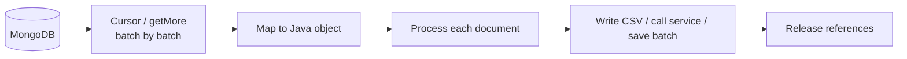
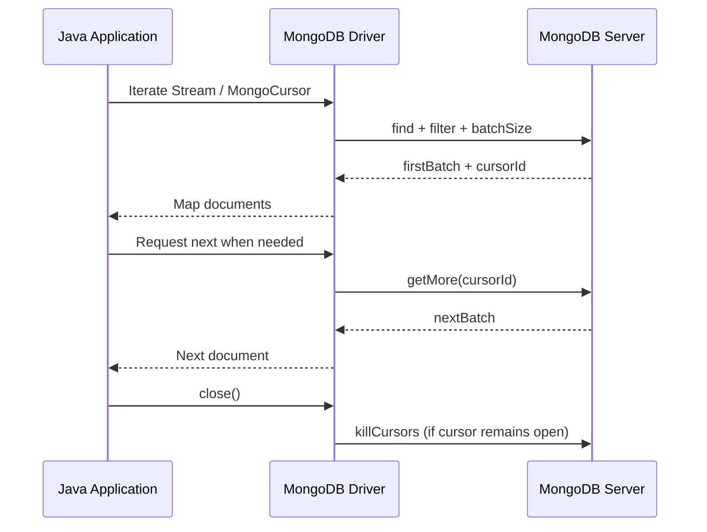

# Batch Size, Result Limits, and Memory Control

> **Chapter:** Pagination and Streams  
> **Module:** `SPRING_DATA_MONGODB` — using Spring Data MongoDB to connect, map documents, and operate on MongoDB via `MongoTemplate` or repositories. This lesson explains **cursors**, **batch size**, **limit**, and incremental data-reading patterns to keep memory under control, and connects them to queries, aggregation, indexes, transactions, reactive access, testing, and performance diagnostics.

## 1. The problem: exporting one million orders without filling the heap

Suppose the system needs to export 1,000,000 orders to CSV. Each document holds an ID, status, timestamp, total amount, address, and several order lines. The simplest approach:

```java
List<Order> orders = mongoTemplate.find(
    Query.query(Criteria.where("status").is("PAID")),
    Order.class
);

for (Order order : orders) {
    writeCsvRow(order);
}
```

This snippet has a major problem: `MongoTemplate.find(…)` returns a **`List<Order>`**, so the entire result set can be materialized in JVM memory before the processing loop even begins. The MongoDB Driver may fetch data **in batches from the server**, yet the list assembled by the application keeps growing.

If each mapped object consumes an average of 10 KiB on the heap, one million records can occupy roughly:

\[
1,000,000 \times 10\,\mathrm{KiB}
\approx 9.54\,\mathrm{GiB}
\]

This is only an **illustrative example**, not the exact size of `Order`. In reality there are also object headers, Strings, collections, driver buffers, references, intermediate data structures, and garbage collection overhead. An application with a 512 MiB heap can hit `OutOfMemoryError` far sooner.

The solution is not merely shrinking `batchSize`, but designing how you **read, process, and release** data:



The goal is keeping retained in-memory data **bounded**, without causing excessive network round trips or forcing the server to perform memory-heavy sorts or aggregations.

## 2. Distinguishing three easily confused concepts: limit, batchSize, and page size

| Mechanism | What does it control? | What does it NOT guarantee? |
| --- | --- | --- |
| **`limit(N)`** | The **maximum** number of documents a query can return. | Does not ensure data uses only N × a tiny size; does not paginate an API. |
| **`batchSize(B)`** | The **maximum documents per batch** sent by the server on a cursor, still capped by BSON response size limits. | Does not bound the **total** documents of a query; does not shrink a Java `List` automatically. |
| **`pageSize(P)`** | Number of elements on a single page in `Pageable`/`Page`/`Slice`. | Not necessarily the network batch size; `Page` may also trigger a count query. |
| **`skip(K)`** | Skips the first K documents in query order. | Does not eliminate the cost of stepping through K results on deep pages. |
| **Projection** | Which fields the server returns per document. | Does not bound document count unless paired with limit/filter. |

Example in `mongosh`:

```javascript
db.orders.find({ status: "PAID" })
  .sort({ createdAt: 1, _id: 1 })
  .limit(5)
  .batchSize(2);
```

This query returns **at most 5 documents total**. Assuming small documents and the server honors the requested batch size, network deliveries might carry 2, 2, and 1 document. `batchSize(2)` **does not mean** the query returns only 2 documents. Depending on cursor consumption, driver, server, or byte-size limits, actual batch sizes may differ from this illustration.

Conversely:

```javascript
// No limit: may read the entire result set.
db.orders.find({ status: "PAID" }).batchSize(100);
```

Batch size tunes how results are **transported**, not a safety bound on the business operation. If the application still calls `toArray()` or builds a `List` from the entire cursor, memory still grows with document count.

## 3. How does a MongoDB cursor work?

### 3.1. Initial batch, cursor ID, and getMore

When executing `find` or `aggregate`, MongoDB can return:

1. An initial batch of results.
2. A **cursor ID** so the client can request remaining documents.
3. Subsequent batches via `getMore` commands as the driver needs more data.



According to MongoDB documentation, the **default initial batch** for a standard `find` query is up to **101 documents or 16 MiB**, whichever comes first. Subsequent `getMore` responses are capped at **16 MiB**; when a batch size is specified, the server also caps by the requested document count. Cursor handling on sharded clusters and specialized queries has additional nuances, so observe actual commands rather than assuming every batch always carries exactly N documents.

**16 MiB applies in two distinct places:** MongoDB caps **a single regular BSON document** at 16 MiB, and a cursor response batch carries a corresponding size limit. Do not assume `batchSize(100)` guarantees the server always sends 100 documents if each document is large.

### 3.2. Small vs. large batch size: trade-offs

| Batch size | Potential benefits | Potential risks |
| --- | --- | --- |
| Small, e.g., 20 | Fewer documents per batch; fits slow per-item processing or large documents. | More `getMore` calls, increasing network round trips and overhead. |
| Medium, e.g., 100–500 | Sensible starting point for many jobs; balances round trips and memory per batch. | Still needs measurement based on document size and concurrency. |
| Large, e.g., several thousand | Can reduce `getMore` calls for tiny documents. | Larger buffers, heap/network pressure; batches remain subject to response byte caps. |

No single batch size is optimal for every workload. A 3-field document differs dramatically from one containing large nested arrays. Network latency, worker count, post-read computation, and driver prefetching all matter.

### 3.3. Batch size 0 and special values

At the **raw MongoDB command** level, `batchSize: 0` can request creating a cursor with an **empty first batch**. In Spring Data's `Query.cursorBatchSize(int)`, the API documentation assigns its own meaning to `0` (no explicit batch limit) and negative values carry special single-batch cursor semantics.

Because different API layers interpret them differently, **do not guess with 0 or negative numbers as "optimizations"**. In these exercises, use **positive integers** such as `cursorBatchSize(100)`. If you need special cursor options, verify the API and actual wire commands on your exact version.

## 4. Limiting results in Spring Data MongoDB

### 4.1. Query.limit with MongoTemplate

Suppose the entity:

```java
package demo.orders;

import java.time.Instant;
import org.springframework.data.annotation.Id;
import org.springframework.data.mongodb.core.mapping.Document;

@Document(collection = "orders")
public record Order(
    @Id String id,
    String status,
    String customerId,
    Instant createdAt,
    String note
) {}
```

Building the query:

```java
import org.springframework.data.domain.Sort;
import org.springframework.data.mongodb.core.query.Criteria;
import org.springframework.data.mongodb.core.query.Query;

Query query = Query.query(Criteria.where("status").is("PAID"))
    .with(Sort.by(Sort.Direction.DESC, "createdAt")
        .and(Sort.by(Sort.Direction.DESC, "id")))
    .limit(100)
    .cursorBatchSize(25);

List<Order> topOrders = mongoTemplate.find(query, Order.class);
```

The result contains at most **100** `Order`s; `25` only configures the cursor batch size used to deliver them. Because the total count is bounded, returning a `List` here **can be acceptable** if individual document sizes are controlled. Still, 100 enormous documents can pressure the heap.

`limit(0)` in standard MongoDB semantics means **no limit on result count**; never pass 0 thinking it means "return zero documents." To return an empty list per business rules, short-circuit in the service layer instead of sending an unbounded query.

### 4.2. Skip + limit is not batch size

```java
Query query = Query.query(Criteria.where("status").is("PAID"))
    .with(Sort.by(Sort.Direction.DESC, "createdAt")
        .and(Sort.by(Sort.Direction.DESC, "id")))
    .skip(1000)
    .limit(100)
    .cursorBatchSize(20);
```

This query asks to **skip 1,000 documents**, then return up to **100** results; batch size **20** only controls the delivery chunks sent to the client. A small batch size does not make `skip(1000)` lightweight and does not substitute for a sort-supporting index.

For forward-only traversal over large datasets, consider cursor/keyset pagination with stable sort keys instead of continuously increasing offsets. When data mutates during traversal, both offset and cursor pagination require an explicit consistency/checkpoint policy.

### 4.3. Derived queries bounded with Top and First

With a repository:

```java
import java.util.List;
import org.springframework.data.mongodb.repository.MongoRepository;

public interface OrderRepository extends MongoRepository<Order, String> {
    List<Order> findTop50ByStatusOrderByCreatedAtDesc(String status);
    List<Order> findFirst10ByCustomerIdOrderByCreatedAtDesc(String customerId);
}
```

`Top50` and `First10` cap the **total documents returned** by a derived query, not the cursor batch size. When reading all records for a batch job, avoid mistakenly assuming `findAll()` streams incrementally with low memory: `findAll()` returns a `List` and can materialize a massive set.

Repositories can also accept `Pageable` and return `Slice<T>`/`Page<T>`; this is a good fit for paginated APIs. For high-volume jobs, streaming or page/chunk iteration makes more sense, provided you address snapshots, sorting, and retries.

## 5. Stream with MongoTemplate: reading incrementally and closing cursors

### 5.1. Using MongoTemplate.stream

When iterating hundreds of thousands of documents without accumulating everything in a `List`, `MongoTemplate.stream(Query, Class<T>)` returns a Java `Stream<T>` backed by the MongoDB Driver cursor.

```java
import java.util.stream.Stream;
import org.springframework.data.domain.Sort;
import org.springframework.data.mongodb.core.query.Criteria;
import org.springframework.data.mongodb.core.query.Query;

Query query = Query.query(Criteria.where("status").is("PAID"))
    .with(Sort.by(Sort.Direction.ASC, "createdAt")
        .and(Sort.by(Sort.Direction.ASC, "id")))
    .cursorBatchSize(100);

try (Stream<Order> stream = mongoTemplate.stream(query, Order.class)) {
    stream.forEach(order -> processOne(order));
}
```

`processOne(order)` is a business method defined by the service (writing a CSV row, normalizing data, or emitting a message); the snippet assumes `mongoTemplate` is injected. **Try-with-resources is operationally mandatory**: closing the `Stream` releases the cursor even when processing stops early or throws an exception.

`Stream` does not guarantee O(1) memory on its own because:

- The driver still buffers the active batch being read.
- Mapping BSON to Java allocates objects, Strings, and nested collections per document.
- `processOne` might retain references in a cache, list, or separate queue.
- Java operations like `collect(toList())` or `sorted()` can retain massive datasets.

Control the entire **pipeline**, not merely the `stream` API call.

### 5.2. Early exit still requires closing the cursor

```java
try (Stream<Order> stream = mongoTemplate.stream(query, Order.class)) {
    stream.limit(500).forEach(this::processOne);
}
```

`Stream.limit(500)` is a **Java-side operation** (on an already open stream), not automatically translated to a MongoDB server `limit(500)`. It stops consumption after 500 items, yet the underlying cursor was still opened to scan more documents. To limit total results on the server, use **`Query.limit(500)`**.

If you only need 500 documents, combine `Query.limit(500)` with `try-with-resources` to minimize server work and cleanly close resources on completion.

### 5.3. Do not let a stream escape its resource scope

Dangerous example:

```java
// Do not return an open Stream from a service and let callers hold it indefinitely.
public Stream<Order> getOrders() {
    return mongoTemplate.stream(new Query(), Order.class);
}
```

Callers can forget `close()`, close too late, or consume on another thread outside the expected transaction/session context. In regular HTTP APIs, let the service **own the cursor lifecycle** and return DTOs/pages or write directly to the response inside a tightly managed streaming workflow.

A batch service can accept a `Consumer<Order>` or write directly to a `Writer` while owning `try-with-resources`. In production, add timeouts, cancellation, I/O error handling, and retry/checkpoint policies.

## 6. Stream from repositories and the raw MongoDB Java Driver

### 6.1. Repository method returning Stream

```java
import java.util.stream.Stream;
import org.springframework.data.mongodb.repository.MongoRepository;

public interface OrderStreamRepository
        extends MongoRepository<Order, String> {

    Stream<Order> streamByStatusAndCustomerId(
        String status, String customerId
    );
}
```

Usage:

```java
try (Stream<Order> orders =
         orderStreamRepository.streamByStatusAndCustomerId(
             "PAID", "CUST-42")) {
    orders.forEach(this::processOne);
}
```

Depending on the Spring Data version, repositories support streaming MongoDB queries; close the `Stream` and verify repository query return types for your exact version. Returning a `Stream` from a repository does not run `count` or `aggregation` unless asked, though mapping and server-side filtering/sorting still carry costs.

### 6.2. Raw Java Driver: MongoCursor

In jobs needing lower-level optimization beneath domain mapping:

```java
import com.mongodb.client.MongoCollection;
import com.mongodb.client.MongoCursor;
import com.mongodb.client.model.Filters;
import org.bson.Document;

MongoCollection<Document> collection =
    mongoTemplate.getCollection("orders");

try (MongoCursor<Document> cursor = collection
        .find(Filters.eq("status", "PAID"))
        .projection(new Document("_id", 1)
            .append("status", 1)
            .append("createdAt", 1))
        .batchSize(100)
        .limit(1000)
        .iterator()) {
    while (cursor.hasNext()) {
        Document raw = cursor.next();
        processRaw(raw);
    }
}
```

`processRaw` is a business method accepting `Document`. The lower-level driver does not apply `MappingMongoConverter` property renames; use **actual BSON field names** in filters and projections, such as `_id` rather than the Java property `id`.

`MongoCursor` is a resource with its own lifecycle. Using `try-with-resources` guarantees `close()` runs on normal completion, early exit, or exception. Never assume the driver frees server state the instant Java loses references; server cursors eventually time out, yet you must close explicitly rather than relying on timeouts.

## 7. Batch size is not a substitute for "processing chunks" or bulk writes

In software systems, the word *batch* carries three completely different meanings:

| Batch type | Example | Role |
| --- | --- | --- |
| **Cursor fetch batch** | `Query.cursorBatchSize(100)` | Reads up to 100 documents per response batch, still subject to byte limits. |
| **Application processing chunk** | Flush file/checkpoint every 200 items | Bounds business-layer work and memory. |
| **Bulk write batch** | Group 500 `UpdateOneModel`s and call `bulkWrite` | Groups write operations to cut round trips and manage errors. |

There is no rule requiring all three sizes to match. For instance, you might **fetch 100**, **process/flush 200**, and **bulk-write 500**, depending on the workload. What matters is bounding every buffer and controlling worker concurrency.

### 7.1. A 200-item chunk in the application layer

```java
import java.util.ArrayList;
import java.util.List;
import java.util.stream.Stream;

List<Order> chunk = new ArrayList<>(200);

try (Stream<Order> stream = mongoTemplate.stream(query, Order.class)) {
    for (Order order : (Iterable<Order>) stream::iterator) {
        chunk.add(order);
        if (chunk.size() >= 200) {
            flushChunk(chunk);
            chunk.clear();
        }
    }
    if (!chunk.isEmpty()) {
        flushChunk(chunk);
        chunk.clear();
    }
}
```

`flushChunk(List<Order>)` is a hypothetical business method that **must process synchronously or copy whatever data it retains**. If it pushes the mutable `chunk` reference onto an async queue and the loop immediately calls `clear()`, consumers may see an empty list. For async handoff, pass an immutable copy such as `List.copyOf(chunk)` and **bound the number of queued batches**; otherwise the queue can still grow without limit.

In this example, `chunk` itself is bounded at 200 entities, though that **excludes** driver buffers, object overhead, downstream processing resources, and external queues. Measure real heap in integration and load tests.

### 7.2. "Exactly once" does not appear automatically from chunking

If a job processes 3,000 records and then hits a network failure, where does the next run resume? A cursor is not a durable checkpoint across restarts. If writes occur while the job runs, the scan can also observe live mutations.

Recommended approach for large exports/ETL:

- Pick a stable traversal order, such as `createdAt` and `_id`.
- Persist checkpoints by **last processed key** only after a chunk succeeds.
- Make processing idempotent in case retries re-read some documents.
- If a consistent snapshot over mutating data is needed, design snapshot/transaction rules or read from immutable records; batch size does not solve consistency.

## 8. Controlling memory by document size and concurrency

### 8.1. Rough estimation model

A rough starting model for budgeting memory:

\[
M_{\text{retained}}
\approx C \times B \times S \times H
+ M_{\text{queue}} + M_{\text{other}}
\]

Where:

- `C` is the number of cursors/workers **reading concurrently**;
- `B` is the average client-side batch size;
- `S` is the average BSON document size (bytes);
- `H` is the expansion factor from Java object mapping, Strings, collections, and buffers (must be **measured**—no universal constant);
- `M_queue` is memory held in chunks, queues, and pending writes;
- `M_other` includes application baseline, caches, JVM runtime, and unrelated tasks.

Illustrative example: `C=4`, `B=200`, `S=30 KiB`, `H≈2` yields roughly **46.9 MiB** just for active documents and buffers. If each worker also holds a queue of 10 chunks × 500 items, the queue component can dwarf the cursor buffers. **Do not treat this formula as a hard cap**; verify with heap metrics, allocation profiling, and production-like load.

### 8.2. Ways to cut peak memory that beat tuning batchSize alone

1. **Filter early**: add MongoDB `Criteria`/filters so out-of-scope data is never transferred.
2. **Project**: fetch only needed fields, avoiding large arrays or unused text/blobs.
3. **Set limits**: use `limit` for top-N APIs; for full exports, combine streaming and checkpoints.
4. **Bound concurrency**: cap concurrent jobs and downstream operations.
5. **Bound queues**: never turn a bounded stream into an unbounded queue by submitting tasks faster than consumers drain them.
6. **Flush output in chunks**: avoid building one giant `StringBuilder` or `List<DTO>` before writing CSV/JSON.
7. **Shrink Java objects**: use lean DTOs/projections instead of mapping full object graphs needlessly.
8. **Measure and tune**: monitor peak heap, GC, batch round trips, per-document latency, and throughput.

### 8.3. Projections with MongoTemplate

If the CSV job only needs ID, timestamp, and status:

```java
Query query = Query.query(Criteria.where("status").is("PAID"))
    .with(Sort.by("createdAt").ascending())
    .cursorBatchSize(100);

query.fields()
    .include("id")
    .include("createdAt")
    .include("status");
```

**Note:** projecting into the full `Order` record from section 4 can leave excluded fields with default/null values or cause materialization issues depending on domain classes and constructors. For production jobs, use a **dedicated projection type or DTO** containing the exact fields read, and test reading real data. In raw MongoDB commands, the ID field is `_id`, not `id`.

`Query.fields().include(...)` in Spring Data applies domain mapping; with the raw Java Driver, pass `"_id"` explicitly.

## 9. Reactive access: backpressure is not batchSize

### 9.1. Creating a Flux from ReactiveMongoTemplate

`ReactiveMongoTemplate.find(…)` returns `Flux<Order>` for reactive processing:

```java
import reactor.core.publisher.Flux;
import org.springframework.data.mongodb.core.query.Criteria;
import org.springframework.data.mongodb.core.query.Query;

Query query = Query.query(Criteria.where("status").is("PAID"))
    .cursorBatchSize(100);

Flux<Order> flux = reactiveMongoTemplate.find(query, Order.class);
```

A reactive stream executes when **subscribed**, not merely when constructing the `flux` variable. `request(n)`/backpressure signals coordinate demand between publisher and subscriber, yet **there is no strict 1-to-1 rule where `request(1) = 1 document per getMore`**. The reactive MongoDB driver, batch buffers, and prefetching manage wire fetching according to their own rules.

### 9.2. Bounding concurrent downstream operations

Suppose each order is forwarded to another system via a reactive function:

```java
import reactor.core.publisher.Mono;

Mono<Void> completed = reactiveMongoTemplate
    .find(query, Order.class)
    .flatMap(order -> archiveOne(order), 4)
    .then();
```

`archiveOne(order)` is a hypothetical function returning a `Mono<?>` that completes when the order is handled. The **`4`** parameter in `flatMap` caps the number of concurrent in-flight inner publishers; it does not mean the MongoDB batch size is 4. When ordering must be preserved, consider `concatMap`, measuring throughput and prefetch behavior.

Never call `.block()` per item inside an event loop. Never call `.collectList()` across millions of documents when streaming is the goal. Also avoid unbounded `onBackpressureBuffer()`, which converts slow downstream demand into unbounded heap growth.

### 9.3. Cancellation and cleanup

When a subscriber cancels a subscription, the reactive driver attempts to release the cursor and associated resources according to its lifecycle. Even so, the application should:

- Propagate cancellation when an HTTP client disconnects or a job is aborted.
- Avoid calling `.subscribe()` manually and discarding the `Disposable` in job services.
- Configure timeouts, retries, and per-document error policies.
- Bound concurrency/queues and monitor the MongoDB connection pool.

If records must never be lost on failure, implement checkpoints and idempotency; `Flux` and `batchSize` do not provide exactly-once delivery guarantees.

## 10. Server-side memory: small batches cannot save a bad sort query

An important trap: batch size limits only **the volume returned per delivery chunk**, not the work done **before producing the first result**.

Example:

```javascript
db.orders.find({ status: "PAID" })
  .sort({ createdAt: -1 })
  .batchSize(20);
```

Without an index covering both filter and sort, MongoDB may have to process and sort a huge dataset before emitting the first batch. Reducing `batchSize(20)` to `batchSize(2)` **does not remove the server-side sort**. Inspect query plans, indexes, and how many documents are sorted.

### 10.1. Index for filter + sort

A candidate index:

```javascript
db.orders.createIndex({
  status: 1,
  createdAt: -1,
  _id: -1
});
```

Corresponding query:

```javascript
db.orders.find({ status: "PAID" })
  .sort({ createdAt: -1, _id: -1 })
  .limit(100)
  .explain("executionStats");
```

Compare `totalDocsExamined`, `totalKeysExamined`, sort stages, and returned counts. An index is not automatically appropriate for every filter; weigh real workloads and write costs.

### 10.2. Aggregation: $group, $sort, and $lookup

An aggregation containing `$group`, `$sort`, or `$lookup` can materialize large intermediate state. Example:

```javascript
db.orders.aggregate([
  { $match: { status: "PAID" } },
  { $group: { _id: "$customerId", orderCount: { $sum: 1 } } },
  { $sort: { orderCount: -1 } },
  { $limit: 100 }
], { cursor: { batchSize: 50 } });
```

`cursor.batchSize = 50` in that pipeline tunes **output batching**, not how many groups `$group` holds in memory before aggregating. When aggregations exceed memory thresholds, MongoDB provides disk-spill mechanisms and options per stage; enabling disk spill (e.g., `allowDiskUse` depending on version) is an operational trade-off incurring disk I/O, not a replacement for indexes or cardinality limits.

In Spring Data, `MongoTemplate.aggregateStream(…)` streams aggregation results instead of forcing everything into a `List`; remember to close that stream too. When diagnosing, inspect aggregation `explain` plans and server memory/disk metrics.

## 11. Cursor lifecycles, timeouts, and transactions

### 11.1. Cursors hold resources on both client and server

An unconsumed cursor can retain server state. When an application omits `close()`, MongoDB eventually cleans up timed-out cursors, yet applications should never rely on timeouts for cleanup. Metrics to watch:

- Unexpected spikes in open cursors.
- High connection pool utilization when many streams run slowly.
- Elevated `getMore` counts and growing latency.
- Rising heap/GC caused by queued items or long-lived buffers.
- Slow exports bottlenecked by slow CSV writing or stalled clients.

**Never enable `noCursorTimeout()` reflexively** to silence timeout errors. That option keeps cursors alive longer and amplifies the risk of orphaned resource leaks if jobs hang or fail to close. For genuinely long jobs, design timeouts/cancellation, checkpoints, and concurrency bounds.

### 11.2. Streaming inside a transaction is not always wise

Multi-document transactions require a supported MongoDB topology and an appropriate Spring Data transaction manager. Holding a transaction open throughout an export of millions of records creates resource strain, transaction lifetime limits, and error-handling complications.

**Do not automatically wrap long export cursors in a transaction.** If a consistent snapshot is required, design it with your DBA and architecture: backups/snapshots, immutable timestamps, event logs, or short transactions with checkpoints. Conversely, for reports tolerating concurrent edits during export, document those semantics clearly and traverse in a controlled order.

### 11.3. Tailable cursors and change streams are separate cases

Tailable cursors serve capped collections; change streams subscribe to mutations on supported MongoDB deployments. Both produce ongoing streams of changes rather than finite query results. Reactive change streams or tailable queries require explicit retry/resume-token handling, subscription management, and throughput control.

This lesson focuses on **reading a finite dataset** for search, exports, or batch processing; never apply standard `limit`/cursor patterns blindly to an unbounded update stream.

## 12. Diagnostics workflow and measuring batch size properly

### 12.1. Measure throughput, latency, and memory together

A meaningful benchmark holds the dataset and filter constant while varying batch size across values such as 25, 100, 500, and 1000. Observe:

| Metric | Question to answer |
| --- | --- |
| Documents/s | Does a larger batch actually improve throughput? |
| Time to first document | Is fast first-byte latency or total throughput more important? |
| `getMore` count | How many extra round trips does a small batch add? |
| Total bytes transferred | Do projections/filters meaningfully reduce network traffic? |
| Peak heap and GC | How many objects are held in mapping, queues, and batches? |
| Connection pool utilization | Are too many cursors/workers open simultaneously? |
| CPU / server query plan | Are there `COLLSCAN`s, blocking sorts, or disk spills? |
| Downstream latency | Is file I/O, HTTP, or bulk writing the actual bottleneck? |
| Error / cancellation | Does early termination close the cursor and release resources? |

Never tweak `batchSize` and measure only one run's total wall-clock time. Use proper warmup, repeated trials, representative data, and verify impact on other workloads sharing the MongoDB instance.

### 12.2. Observing find/getMore commands

The MongoDB Driver offers **CommandListener / command monitoring**; in test environments, attach a listener to count `find`, `getMore`, and `killCursors` commands and timings. Avoid logging sensitive user data or full documents in production.

In `mongosh`, try:

```javascript
db.orders.find({ status: "PAID" })
  .sort({ createdAt: 1, _id: 1 })
  .batchSize(25)
  .limit(100);
```

Check the index query plan:

```javascript
db.orders.find({ status: "PAID" })
  .sort({ createdAt: 1, _id: 1 })
  .limit(100)
  .explain("executionStats");
```

`explain("executionStats")` reveals execution stages and scan counts, yet **it does not capture the `getMore` round trips of a Java stream execution**. Combine driver command monitoring with JVM metrics.

### 12.3. Estimating document size from real data

Sample representative documents:

```javascript
db.orders.aggregate([
  { $match: { status: "PAID" } },
  { $limit: 1000 },
  { $project: { sizeBytes: { $bsonSize: "$$ROOT" } } },
  { $group: {
      _id: null,
      avgBytes: { $avg: "$sizeBytes" },
      maxBytes: { $max: "$sizeBytes" }
  } }
]);
```

This measures **BSON size**, not Java heap object size. If the first sample is skewed (e.g., newer orders are tiny while older orders have huge arrays), sample across segments and check high percentiles rather than just averages. Never rely on this estimate alone to claim heap is sufficient; run load tests.

## 13. Integration testing against real MongoDB

A good test verifies not only query output, but also that the program **processes records incrementally** and **releases the cursor** on early exit or exceptions.

### 13.1. Test data

Seed 230 `Order` documents: 200 with `status = "PAID"` and 30 with other statuses, with distinct `createdAt` and ID values. With `limit(120)` and `cursorBatchSize(25)`, expect:

- Total items processed via stream is **at most 120**.
- Order matches the declared sort.
- Items outside the filter never appear.
- The cursor is closed after processing finishes.

From the returned document count alone, **you cannot deduce the exact number of `getMore` calls**, as server, driver, and consumption details affect batching.

### 13.2. Example limit test

```java
import static org.assertj.core.api.Assertions.assertThat;

import java.util.concurrent.atomic.AtomicInteger;
import java.util.stream.Stream;
import org.junit.jupiter.api.Test;
import org.springframework.data.mongodb.core.query.Criteria;
import org.springframework.data.mongodb.core.query.Query;

@Test
void streamHonorsServerSideLimit() {
    Query query = Query.query(Criteria.where("status").is("PAID"))
        .limit(120)
        .cursorBatchSize(25);

    AtomicInteger processed = new AtomicInteger();
    try (Stream<Order> stream = mongoTemplate.stream(query, Order.class)) {
        stream.forEach(order -> processed.incrementAndGet());
    }

    assertThat(processed.get()).isEqualTo(120);
}
```

This test is a **method inside an integration test class** configured with `mongoTemplate` and seeded as in section 13.1; it is not a standalone Java file. If fewer than 120 documents match the filter, the count equals the actual matching count because `limit` is an **upper bound**.

### 13.3. Testing early exit and exceptions

Add tests intentionally throwing an exception after a few items and verify `try-with-resources` still closes the stream. To verify at the MongoDB command level, register a `CommandListener` on the test `MongoClient` to observe `killCursors` or cursor cleanup when a cursor remains open; never assume every close emits `killCursors` (an exhausted cursor may already be closed on the server).

Properly scoped example:

```java
try (Stream<Order> stream = mongoTemplate.stream(query, Order.class)) {
    stream.limit(3).forEach(order -> {
        if ("ORD-002".equals(order.id())) {
            throw new IllegalStateException("Fail in test");
        }
    });
}
// Even with an exception, the compiler generates a finally block to call stream.close().
```

When asserting the exception in JUnit/AssertJ, wrap the `try` block inside the `assertThatThrownBy` lambda. If your seed does not place `ORD-002` in the first three items, adjust the test condition so the error branch definitely executes.

### 13.4. Testing overload scenarios

Generate data where a fraction of documents contain large arrays, vary 1/2/4 workers, and adjust batch sizes. Track:

1. Peak heap memory; GC count and pause time.
2. Time to first document.
3. Throughput (documents/s) and `getMore` counts.
4. Timeout, pool-exhaustion, and cancelled-cursor error rates.
5. Business queue depth when downstream processing is intentionally throttled.

If adding workers spikes heap, queue depth, or connection pool usage too quickly, **reduce concurrency and cap queues first** before tweaking batch size.

## 14. Common mistakes table

| Symptom | Common cause | Fix |
| --- | --- | --- |
| Calling `find(…)` with `cursorBatchSize(50)` still throws `OutOfMemoryError` | `find` returns a `List` holding all results; batch size does not bound the total. | Use `limit` or `stream` and avoid collecting everything. |
| Only wanted 100 items, yet query read millions | Set `batchSize` without setting `limit`. | Use `Query.limit(100)` or derived `Top100`. |
| Too many `getMore` calls, low throughput | Batch size is tiny relative to document size and network latency. | Increase batch size gradually and measure latency/heap. |
| Heap grows even with `stream` | Downstream accumulates lists/caches/queues, or too many concurrent cursors. | Bound chunks, concurrency, and queues; profile memory. |
| Query slow despite tiny batch size | Missing index, blocking sort, or heavy `$group`/`$lookup`. | Inspect `explain` and fix indexes/pipelines. |
| No more documents appear after first batch | Small `limit` set, cursor exhausted, or wrong filter. | Distinguish total limit, batch size, and filter. |
| Job cancelled yet MongoDB cursor stays open | Stream/cursor not closed on early stop. | Use `try-with-resources`, cancel/dispose, monitor open cursors. |
| Deep page API is slow | Large `skip` despite tuning batch size. | Consider keyset/cursor pagination with matching index and stable sort. |
| Exported data duplicates on retry | No checkpoint/idempotency while data mutates. | Save last processed key after chunk success; control retries. |
| HTTP streaming stalls and exhausts pool | Slow client reads or missing disconnect handling; cursor holds resources. | Enforce timeouts, cancellation, and cap concurrent exports. |
| Reactive pipeline runs `collectList()` and OOMs | Entire `Flux` collected into a list. | Process item-by-item or in bounded chunks and cap `flatMap` concurrency. |
| Small batch yet huge memory footprint | Individual documents are huge; 16 MiB is a byte limit, not a small-heap guarantee. | Project fields, split large payloads, measure BSON/Java object sizes. |

## 15. Practice: building a reliable CSV export

**Scenario:** an order service must export up to 100,000 `PAID` orders starting from a timestamp in CSV format with three columns: `id`, `createdAt`, `status`. This is a finite-result job, not a change stream.

1. Declare the `Order` entity and seed test data. Choose an index matching the `status` filter and `createdAt, _id` sort.
2. Build a `MongoTemplate` query with `Criteria.where("status").is("PAID")`, sorted by `createdAt` then `_id`, `limit(100000)`, and `cursorBatchSize(100)`.
3. Execute via `mongoTemplate.stream(query, Order.class)` inside `try-with-resources`. Write each row to a `BufferedWriter`; **never accumulate everything in a `List` or `StringBuilder`**.
4. Run the same query with `batchSize` 25, 100, and 500; measure runtime, peak heap, GC, and `getMore` counts. Explain results in terms of document size and latency.
5. Try setting `batchSize(100)` without `limit` in a test environment using `mongoTemplate.find`; observe why memory climbs.
6. Try projecting only `id`, `createdAt`, and `status` into an appropriate DTO; compare bytes transferred and heap usage.
7. Trigger a mid-run failure, confirm the cursor closes, and verify the job saves checkpoints after successful chunks.
8. Increase concurrent jobs from 1 to 4, add queue bounds, and monitor the connection pool—do not look only at aggregate throughput.
9. Test `sort({createdAt: 1})` on an unindexed query and inspect `explain`; demonstrate that small batches do not eliminate blocking sorts.
10. To support restart recovery, add a `(createdAt, _id)` cursor and idempotency, and describe consistency behavior if new orders arrive during export.

### Self-check questions

- How does `limit(100)` differ from `cursorBatchSize(100)`?
- Why can `MongoTemplate.find(Query.cursorBatchSize(50))` still fill the heap?
- What factors besides batch size determine the number of `getMore` calls?
- Why must a `Stream` be closed even if the application reads only a few documents and stops?
- Why are `Stream.limit(500)` and `Query.limit(500)` not completely equivalent?
- Why can an application running 5 cursors at batch size 200 consume more memory than 1 cursor at batch size 500?
- When `$sort` lacks an index, does a small batch size stop the server from processing a huge dataset?
- How do reactive backpressure and MongoDB cursor batches relate, and why are they not the exact same number?
- When should you use a projection/DTO instead of materializing full entities?
- What must be added to a multi-million-record cursor scan if crash recovery is required?

## 16. Takeaways and references

- **`limit`** caps total documents; **`batchSize`** tunes documents per delivery batch; **`Pageable`** serves API pagination. The three do not replace one another.
- Cursors deliver results in batches via `find`/`getMore`; batches are bounded by both document count and byte size, not guaranteed to always contain N items.
- `MongoTemplate.find` returns a `List`, so **a small `batchSize` is not enough to cap heap** when results are huge.
- `MongoTemplate.stream`, repository `Stream`, and Java Driver `MongoCursor` support incremental iteration, yet you must **close cursors**, avoid accumulating operators, and cap queues/concurrency.
- "Delivery batch", "processing chunk", and "bulk write" are three independent layers. Size each according to workload and measurements.
- **Projections, filters, limits, indexes, and streaming processing** usually matter far more than tweaking batch size alone.
- **Reactive `Flux` provides backpressure**, yet `request(n)` does not directly configure documents per `getMore`; keep pipelines non-blocking and cap concurrency.
- **Aggregations and sorts can consume server memory** before returning any batch; address them with query plans, indexes, and pipeline design rather than batch size alone.
- Long-running exports need **checkpoints, idempotency, and explicit consistency policies**; a cursor is not automatically a transaction or an immutable snapshot.

Official sources to verify APIs and version-specific behavior:

- [Spring Data MongoDB — Query API: cursorBatchSize](https://docs.spring.io/spring-data/mongodb/reference/api/java/org/springframework/data/mongodb/core/query/Query.html)
- [Spring Data MongoDB — MongoTemplate API: stream and aggregateStream](https://docs.spring.io/spring-data/mongodb/reference/api/java/org/springframework/data/mongodb/core/MongoTemplate.html)
- [Spring Data MongoDB — Template Query Operations](https://docs.spring.io/spring-data/mongodb/reference/mongodb/template-query-operations.html)
- [Spring Data MongoDB — Repository Query Methods](https://docs.spring.io/spring-data/mongodb/reference/mongodb/repositories/query-methods.html)
- [MongoDB — cursor.batchSize()](https://www.mongodb.com/docs/manual/reference/method/cursor.batchsize/)
- [MongoDB — Cursors and Cursor Batches](https://www.mongodb.com/docs/manual/core/cursors/)
- [MongoDB Java Sync Driver — Access Data From a Cursor](https://www.mongodb.com/docs/drivers/java/sync/current/crud/query-documents/cursor/)
- [MongoDB — Explain Results](https://www.mongodb.com/docs/manual/reference/explain-results/)
