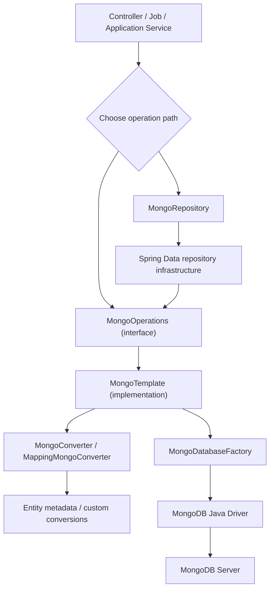

# The Role of MongoOperations and MongoTemplate

## 1. Why understand these two components?

In Spring Data MongoDB, repositories help you write common operations using interfaces, such as `findByTenantIdAndStatus(...)`. However, when you need to conditionally update a single field, combine multiple dynamic query criteria, use aggregation, create indexes, or inspect write results, developers often need to work closer to MongoDB. **`MongoOperations` and `MongoTemplate`** are the central pair of APIs that address that need.

This lesson belongs to the **MongoTemplate** chapter of the **SPRING_DATA_MONGODB** module, covering connecting, document mapping, and operating on MongoDB via `MongoTemplate` or repositories; as well as designing queries, aggregation, indexes, transactions, reactive access, testing, and diagnosing data performance.

After this lesson, you will be able to:

1. Distinguish **`MongoOperations` as the interface contract** and **`MongoTemplate` as the primary implementation** in imperative Spring Data MongoDB.
2. Explain the layers from the service down to the mapping converter, Java driver, and MongoDB server.
3. Choose between a repository and a template based on the access pattern, rather than applying either mechanically.
4. Use `MongoOperations` to write queries, inserts, saves, updates, deletes, aggregations, and controlled index management.
5. Know when you need transactions, projections, streams, or the reactive API variant.
6. Test the correctness of BSON/queries and measure performance rather than treating compilable syntax as sufficient.

In the examples, Java 17+ and Spring Data MongoDB using modern APIs are used. Method names, options, and advanced configurations should be verified against your actual Spring Data, MongoDB driver, Spring Boot, and server versions before deployment.

## 2. Core roles: interface and implementation

Both types reside in the package:

```java
import org.springframework.data.mongodb.core.MongoOperations;
import org.springframework.data.mongodb.core.MongoTemplate;
```

**`MongoOperations`** is the interface describing the MongoDB operations supported by Spring Data in the imperative programming model. It defines methods such as `find`, `findOne`, `findById`, `insert`, `save`, `updateFirst`, `updateMulti`, `remove`, `aggregate`, `count`, and access to specialized operations.

**`MongoTemplate`** is the standard implementation of `MongoOperations`. It coordinates:

- `MongoDatabaseFactory` to access the MongoDB database through the driver.
- `MongoConverter`, typically `MappingMongoConverter`, to convert Java objects to and from BSON.
- Mapping metadata: `@Document`, `@Id`/`@MongoId`, `@Field`, type conversions, and collections.
- Query/update mapping components, callbacks, transaction configuration, and operation options.



The diagram describes the architecture at a conceptual level: the repository implementation also uses Spring Data's operation/mapping infrastructure; not every repository method necessarily goes through the exact same internal call chain. What matters is that repositories and templates belong to **the same mapping ecosystem**, not two different database technologies.

### 2.1. Why inject the interface?

In services, prefer declaring the dependency as:

```java
import org.springframework.data.mongodb.core.MongoOperations;
import org.springframework.stereotype.Service;

@Service
public class OrderQueryService {
    private final MongoOperations mongo;

    public OrderQueryService(MongoOperations mongo) {
        this.mongo = mongo;
    }
}
```

This signals that the service needs **MongoDB operation capabilities**, without necessarily needing to know the concrete implementation. When the application has a `MongoTemplate` bean (or a `MongoOperations`-compatible bean), Spring can inject it by interface. If the application configures multiple databases/templates, you must use `@Qualifier` or an explicit bean-selection mechanism; do not assume Spring automatically picks the right database.

Injecting `MongoTemplate` directly is also valid when the code needs class-specific functionality, but it is unnecessary for methods already present on `MongoOperations`.

## 3. Comparing MongoOperations, MongoTemplate, MongoRepository, and the driver

| Criterion | `MongoOperations` | `MongoTemplate` | `MongoRepository` | MongoDB Java driver |
| --- | --- | --- | --- | --- |
| Nature | Interface | Implementation of the interface | Repository API | MongoDB driver API |
| Abstraction level | Operations by domain entity | Coordinates operations and mapping | Method-based CRUD/queries | Collection/BSON/driver-level |
| Dynamic queries | Yes | Yes | Limited via methods/custom impl | Yes, manually build BSON |
| `@Field`/`@Document` mapping | Via implementation | Via converter/context | Via Spring Data infrastructure | Does not automatically understand Spring annotations |
| Partial updates | `Update`/`Query` | Executes operations | Can use annotated/custom updates depending on version | `updateOne`/`updateMany` |
| Aggregation | Has API | Executes pipeline | Can use `@Aggregation` depending on version | Aggregation via BSON |
| Indexes | `indexOps(...)` | Yes | Not a strength of CRUD repositories | `createIndex` |
| Best suited for | Services/adapters requiring operations | Spring-managed implementation | Common queries, narrow contracts | Special driver-level needs |

You do not need to eliminate repositories to use `MongoTemplate`: the two approaches usually **complement each other**. Repositories serve read models or simple CRUD; the template serves dynamic queries, conditional updates, and complex pipelines.

**Security note:** Regardless of which API you use, your code must still check tenant/owner and access permissions itself. Converters, repositories, or templates do not authenticate or authorize users automatically.

## 4. Connection configuration and bean initialization

### 4.1. With Spring Boot

In a Spring Boot application with the Spring Data MongoDB dependency and valid connection configuration, Boot typically auto-configures the client, database factory, converter, and `MongoTemplate`. Example configuration for a local environment:

```yaml
spring:
  data:
    mongodb:
      uri: mongodb://localhost:27017/order_lab
```

In production, the URI must come from secure secrets/configuration; configure TLS, authentication, pooling, timeouts, and topology appropriately for the environment. Never commit passwords to source code or shared documentation.

A service can request `MongoOperations` as shown in section 2. This avoids creating a `MongoClient`/`MongoTemplate` per request. The MongoDB client should be shared, leverage connection pooling, and be closed along with the application lifecycle.

### 4.2. Manual MongoTemplate initialization when truly needed

Given an already-configured `MongoDatabaseFactory`:

```java
import org.springframework.context.annotation.Bean;
import org.springframework.context.annotation.Configuration;
import org.springframework.data.mongodb.MongoDatabaseFactory;
import org.springframework.data.mongodb.core.MongoOperations;
import org.springframework.data.mongodb.core.MongoTemplate;

@Configuration
class MongoTemplateConfiguration {

    @Bean
    MongoOperations orderMongoOperations(MongoDatabaseFactory factory) {
        return new MongoTemplate(factory);
    }
}
```

This is an example illustrating construction, **not configuration that must be added to every Boot application**. When manually replacing the default bean, evaluate converters, callbacks, custom conversions, transaction infrastructure, and the possibility of multiple beans of the same type. If the application already has an auto-configured `MongoTemplate`, creating another bean may cause ambiguous injection.

### 4.3. Multiple databases/templates

In a system connecting to multiple databases, multiple `MongoTemplate` beans with different factories may exist. In that case:

- Assign explicit bean names and use `@Qualifier` in services.
- Point repository packages to the appropriate template via repository configuration.
- Test that every operation of a given business flow targets the right database.
- Do not use a database name received directly from a client request without explicit tenant rules and authorization.

A `MongoTemplate` is generally safe to reuse across threads once configured. Avoid mutating global template configuration while processing individual requests.

## 5. Establishing a domain model throughout

A multi-tenant order management example, with status and version for concurrent updates:

```java
import java.time.Instant;
import org.springframework.data.annotation.Version;
import org.springframework.data.mongodb.core.mapping.Document;
import org.springframework.data.mongodb.core.mapping.FieldType;
import org.springframework.data.mongodb.core.mapping.MongoId;

@Document(collection = "orders")
public record OrderDocument(
    @MongoId(FieldType.STRING) String id,
    String tenantId,
    String customerId,
    OrderStatus status,
    Instant createdAt,
    Instant updatedAt,
    long totalAmountVnd,
    @Version Long version
) {}

enum OrderStatus {
    NEW, PAID, READY_TO_SHIP, SHIPPED, CANCELLED
}
```

Meaning:

- `@Document(collection = "orders")` specifies the default collection.
- `@MongoId(FieldType.STRING)` intentionally keeps the BSON `_id` as a String.
- `status` is stored according to the enum mapping mechanism.
- `@Version` is metadata for optimistic locking on appropriate operation paths; it is distinct from the ID field.
- `createdAt` and `updatedAt` are business/audit data. They are not automatically updated simply because `MongoTemplate` is called.

Illustrative sample document:

```javascript
{
  _id: "order-2026-0101",
  tenantId: "tenant-a",
  customerId: "customer-01",
  status: "READY_TO_SHIP",
  createdAt: ISODate("2026-11-19T09:00:00Z"),
  updatedAt: ISODate("2026-11-19T09:00:00Z"),
  totalAmountVnd: NumberLong("250000"),
  version: NumberLong("0")
}
```

The `version` value and the presence of type metadata (such as `_class`) depend on how the document was created, mapping configuration, and version. This is a sample for visualization, not a guarantee that every insert produces byte-for-byte identical BSON.

## 6. Path of a command through MongoOperations

When calling:

```java
mongo.findById("order-2026-0101", OrderDocument.class);
```

the process can be understood in these steps:

1. Determine the entity type and corresponding collection, defaulting to `orders`.
2. Use metadata to map the Java ID and query paths to the BSON `_id` field.
3. Convert the query value to match the configured BSON type.
4. Send the `find` operation through the MongoDB Java driver to the server.
5. Receive the BSON document and use `MongoConverter` to materialize `OrderDocument`.
6. Return the result or `null` according to the template method's contract.

Repository `findById` typically returns `Optional<T>`, whereas `MongoOperations.findById(...)` returns a nullable entity type (with corresponding nullability annotations depending on the version). This is a notable **API contract** difference: do not copy `Optional.orElseThrow()` code from a repository and apply it to a template result without null checking.

### 6.1. Java property differs from the physical BSON name

Suppose we add:

```java
@org.springframework.data.mongodb.core.mapping.Field("order_no")
String orderNo;
```

In a query with `OrderDocument.class` context, `Criteria.where("orderNo")` is mapped to `order_no`. The raw driver and `mongosh` must use the actual name `order_no`. The template **assists with mapping**, rather than guessing renamed fields outside metadata.

## 7. Reading data: findById, findOne, find, exists, and count

### 7.1. Finding by ID

```java
OrderDocument order =
    mongo.findById("order-2026-0101", OrderDocument.class);

if (order == null) {
    // Not found; handle according to the business contract.
}
```

`findById` is convenient when the ID alone is sufficient to locate the document. However, if a multi-tenant application prohibits viewing data from other tenants, filtering solely by ID is insufficient to enforce access control.

### 7.2. Querying with a tenant filter

```java
import org.springframework.data.mongodb.core.query.Criteria;
import org.springframework.data.mongodb.core.query.Query;

Query query = Query.query(
    Criteria.where("id").is("order-2026-0101")
        .and("tenantId").is(authenticatedTenantId)
);

OrderDocument order =
    mongo.findOne(query, OrderDocument.class);
```

`authenticatedTenantId` in this example is a verified value from the security context, **not** an arbitrary HTTP request parameter. The query mapper uses `OrderDocument.class` to map the name `id` to `_id`. If the document does not exist or does not belong to the tenant, the result is `null`.

### 7.3. Fetching a list with filter, sort, and limit

```java
import java.util.List;
import org.springframework.data.domain.Sort;

Query queueQuery = Query.query(
    Criteria.where("tenantId").is(authenticatedTenantId)
        .and("status").is(OrderStatus.READY_TO_SHIP)
);
queueQuery.with(Sort.by(
    Sort.Order.desc("createdAt"),
    Sort.Order.desc("id")
));
queueQuery.limit(20);

List<OrderDocument> orders =
    mongo.find(queueQuery, OrderDocument.class);
```

Do not assume MongoDB's natural order reflects business order. Records with identical timestamps need a tie-breaker key such as `id`/`_id` for stable pagination.

### 7.4. Checking existence and counting

```java
Query byTenantAndStatus = Query.query(
    Criteria.where("tenantId").is(authenticatedTenantId)
        .and("status").is(OrderStatus.READY_TO_SHIP)
);

boolean any = mongo.exists(byTenantAndStatus, OrderDocument.class);
long count = mongo.count(byTenantAndStatus, OrderDocument.class);
```

`exists` answers the question "is there any matching record?"; `count` returns the number of documents matching the filter and can be expensive on large datasets. Do not use `mongo.find(...).size()` on a very large list just to obtain the count.

### 7.5. Choosing an API by result cardinality

| Need | MongoOperations | Notes |
| --- | --- | --- |
| Known ID | `findById(...)` | Returns entity or null per contract |
| Multiple criteria, at most one | `findOne(...)` | If business requires uniqueness, add an appropriate constraint/index |
| Bounded list | `find(...)` with `Query.limit(...)` | Results are materialized into a List |
| Check existence | `exists(...)` | Avoids loading unnecessary entities |
| Count by filter | `count(...)` | Has counting cost, especially without an index |
| Process a large stream | `stream(...)` | Close the cursor after use |

## 8. Insert and save do not have the same meaning

### 8.1. Insert: intent to create new

```java
OrderDocument draft = new OrderDocument(
    "order-2026-0201",
    authenticatedTenantId,
    "customer-08",
    OrderStatus.NEW,
    Instant.now(),
    Instant.now(),
    150000L,
    null
);

OrderDocument inserted = mongo.insert(draft);
```

`insert` is intended to create a new document. If `_id` already exists, MongoDB rejects it with a duplicate key error; this behavior can be used to enforce "create-only" semantics. Fields like `@Version` may be handled by the mapping layer during an appropriate insert flow, so do not blindly expect every version value to be an exact fixed number without testing.

### 8.2. Save: can overwrite an existing document

```java
OrderDocument saved = mongo.save(draft);
```

`save` carries the semantics of saving a document by ID, with replacement/upsert behavior depending on state and implementation. It is **not** a guarantee of "insert only if not yet present". If you use `save` to persist an object constructed from an API payload without controlling which fields may be modified, the risk of overwriting data or bypassing state transitions is very high.

Especially in systems with concurrent writers, prefer:

- Explicit `insert` for creation.
- Partial updates with a filter checking current status/version.
- Optimistic locking with `@Version` when using compatible save/update paths.
- Validation and authorization before writing.

### 8.3. Distinguishing insert/save/update/upsert

| Method | Intent | Risk to control |
| --- | --- | --- |
| `insert(entity)` | Create new | Duplicate key, requires ID assignment |
| `save(entity)` | Save entity by ID | May overwrite/replace, concurrent conflicts |
| `updateFirst(query, update, type)` | Modify one matching document | Missing tenant in query, matched vs modified |
| `updateMulti(query, update, type)` | Modify multiple matching documents | Overly broad scope, index efficiency, per-document atomicity |
| `upsert(query, update, type)` | Update if present, insert if absent | Creating unintended records if filter is not tight enough |

Do not treat these APIs as interchangeable syntactic variants.

## 9. Conditional field-level updates

### 9.1. Atomic state transition on a single document

Suppose only `READY_TO_SHIP -> SHIPPED` is allowed and must be scoped to a tenant:

```java
import org.springframework.data.mongodb.core.query.Update;
import com.mongodb.client.result.UpdateResult;

Query query = Query.query(
    Criteria.where("id").is(orderId)
        .and("tenantId").is(authenticatedTenantId)
        .and("status").is(OrderStatus.READY_TO_SHIP)
);

Update update = new Update()
    .set("status", OrderStatus.SHIPPED)
    .set("updatedAt", Instant.now());

UpdateResult result =
    mongo.updateFirst(query, update, OrderDocument.class);

boolean matched = result.getMatchedCount() == 1;
boolean changed = result.getModifiedCount() == 1;
```

`orderId` and `authenticatedTenantId` are assumed to be already available in the service. Putting the status condition and the mutation together in a single document update avoids the dangerous anti-pattern of "read status then write regardless of whether the data changed". MongoDB guarantees atomicity for single-document updates.

**Matched vs modified:** `getMatchedCount()` indicates whether a document matched the filter; `getModifiedCount()` indicates how many documents were actually modified. When the existing value already equals the new value, it can be matched without being modified. Do not use `modifiedCount == 0` as definitive proof that the document does not exist.

### 9.2. Updating multiple documents

```java
Query staleDrafts = Query.query(
    Criteria.where("tenantId").is(authenticatedTenantId)
        .and("status").is(OrderStatus.NEW)
        .and("createdAt").lt(cutoff)
);

Update cancel = new Update()
    .set("status", OrderStatus.CANCELLED)
    .set("updatedAt", Instant.now());

UpdateResult many =
    mongo.updateMulti(staleDrafts, cancel, OrderDocument.class);
```

`cutoff` is the threshold timestamp defined by business policy. This is a bulk operation; verify the expected document count, transaction impact, auditing, and retry behavior. Per-document atomicity does not mean all updated documents form a single shared transaction.

### 9.3. Upserts require clear rules

```java
Query q = Query.query(
    Criteria.where("tenantId").is(authenticatedTenantId)
        .and("externalKey").is(externalKey)
);
Update u = new Update()
    .set("lastSeenAt", Instant.now())
    .setOnInsert("createdAt", Instant.now());

mongo.upsert(q, u, ExternalSyncDocument.class);
```

`ExternalSyncDocument` is an illustrative entity for a sync workflow, not the `OrderDocument` from section 5; the snippet assumes this type is already defined and has an appropriate unique index. Upserts can create new documents, so:

- The filter must include the exact business identifier key, not an overly broad condition.
- Use a unique index when you need to prevent race conditions from creating duplicate records.
- Do not use upsert for an operation that should only modify an already-existing document.
- Test the scenario where two concurrent requests perform the same upsert.

## 10. findAndModify: reading the before/after update result

When business logic needs to **update and receive the document back** in the same operation, `findAndModify` can be a good fit:

```java
import org.springframework.data.mongodb.core.FindAndModifyOptions;

Query query = Query.query(
    Criteria.where("id").is(orderId)
        .and("tenantId").is(authenticatedTenantId)
        .and("status").is(OrderStatus.READY_TO_SHIP)
);
Update update = new Update()
    .set("status", OrderStatus.SHIPPED)
    .set("updatedAt", Instant.now());

OrderDocument after = mongo.findAndModify(
    query,
    update,
    FindAndModifyOptions.options().returnNew(true),
    OrderDocument.class
);
```

If no document matches, the result can be `null`. `returnNew(true)` requests returning the document **after the update**; otherwise, the standard behavior is returning the document before the update. There is no need to perform separate `findOne`, then `updateFirst`, then `findOne` calls when a single atomic operation fits the use case.

When the domain uses `@Version`, update operations and how the framework manages versions must be tested against the API in use. Do not assume every way of constructing an `Update` automatically enforces the full optimistic locking of `save(entity)`; for critical state transitions, include the concurrency condition in the filter or use a supported versioning mechanism.

## 11. Deleting data: remove and findAndRemove

### 11.1. Remove always requires a clear scope

```java
Query draftQuery = Query.query(
    Criteria.where("id").is(orderId)
        .and("tenantId").is(authenticatedTenantId)
        .and("status").is(OrderStatus.NEW)
);

var deletion = mongo.remove(draftQuery, OrderDocument.class);
long deletedCount = deletion.getDeletedCount();
```

This example only allows deleting draft orders. A delete command with tenant and status filters is much safer than an arbitrary delete by ID. You do not need to reveal to end users whether an order outside their tenant exists.

### 11.2. When to use findAndRemove?

`findAndRemove` can return the deleted document in a single operation, which is useful when business logic needs to store pre-deletion information or emit an event from the deleted data. However, emitting an external event after a MongoDB deletion **is not automatically an atomic transaction**; if reliable synchronization is required, consider an outbox or delivery-guarantee mechanism.

### 11.3. Soft delete is often preferable to hard delete

For orders, historical data may need to be retained for reconciliation. Instead of physical deletion, you can use `deletedAt`/`archivedAt` fields or a business status. When doing so, every read query, index, report, and retention policy must handle hidden records consistently.

**Never use `remove(new Query(), OrderDocument.class)`** without a specifically approved operational task: an empty filter can affect the entire collection.

## 12. Aggregation via MongoOperations

`MongoOperations` is not just for CRUD. When you need to calculate revenue, group data, transform documents, or look up across collections, you can call `aggregate(...)`.

Example calculating total revenue by status for a tenant:

```java
import org.springframework.data.mongodb.core.aggregation.Aggregation;
import org.springframework.data.mongodb.core.aggregation.AggregationResults;
import static org.springframework.data.mongodb.core.aggregation.Aggregation.*;

record StatusRevenue(String status, long totalVnd) {}

Aggregation pipeline = newAggregation(
    match(Criteria.where("tenantId").is(authenticatedTenantId)),
    group("status").sum("totalAmountVnd").as("totalVnd"),
    project("totalVnd").and("_id").as("status")
);

AggregationResults<StatusRevenue> results =
    mongo.aggregate(pipeline, OrderDocument.class, StatusRevenue.class);

for (StatusRevenue row : results.getMappedResults()) {
    System.out.println(row.status() + ": " + row.totalVnd());
}
```

Pipeline meaning:

1. `$match` by tenant before aggregating.
2. `$group` by status and sum the totals.
3. `$project` maps the group key `_id` to the `status` field for the DTO.
4. The converter maps BSON results into `StatusRevenue`.

For large monetary amounts, check `long` limits, BSON types, and precision requirements; other designs may use `Decimal128`/`BigDecimal`. When adding `$lookup`, `$sort`, or `$unwind`, review indexes, cardinality, and intermediate data volume.

**Note:** Aggregation does not necessarily trigger the same entity lifecycle callbacks as a `save`. Do not rely on aggregation to implicitly enforce business validation.

## 13. indexOps: connecting query logic to real indexes

### 13.1. Declaring an index matching the query shape

If a queue query filters by `tenantId + status` and sorts by `createdAt DESC, _id DESC`, you can create an index:

```java
import org.springframework.data.domain.Sort;
import org.springframework.data.mongodb.core.index.Index;

Index index = new Index()
    .on("tenantId", Sort.Direction.ASC)
    .on("status", Sort.Direction.ASC)
    .on("createdAt", Sort.Direction.DESC)
    .on("_id", Sort.Direction.DESC)
    .named("ix_orders_tenant_status_recent");

mongo.indexOps(OrderDocument.class).ensureIndex(index);
```

Some versions change return types or index-management API names; verify against your exact artifact. `ensureIndex` does not guarantee that a new index is built quickly or safely on every production collection. In large environments, indexes are usually managed via a separate migration/maintenance plan to control load, naming, and schema changes.

### 13.2. Comparison with mongosh

```javascript
db.orders.createIndex(
  { tenantId: 1, status: 1, createdAt: -1, _id: -1 },
  { name: "ix_orders_tenant_status_recent" }
);

db.orders.find({
  tenantId: "tenant-a",
  status: "READY_TO_SHIP"
})
  .sort({ createdAt: -1, _id: -1 })
  .limit(20)
  .explain("executionStats");
```

Merely seeing `@Indexed` in Java or calling `indexOps` is not enough to conclude the index exists. Verify `db.orders.getIndexes()` and the actual execution plan. Indexes speed up matching queries but incur storage and write overhead; do not index every field out of habit.

### 13.3. Consequences of field name mapping

When a domain entity uses `@Field("order_no") String orderNo`, the query API has metadata mapping Java properties to BSON fields; index definitions should also be checked in the entity context to avoid creating indexes on the wrong field name. In `mongosh`, always use the physical name. For special queries/indexes, inspect the actual BSON to confirm.

## 14. Projection, pagination, and streaming

### 14.1. Fetching only the fields you need

When the UI only needs ID, status, and timestamp:

```java
Query query = Query.query(
    Criteria.where("tenantId").is(authenticatedTenantId)
);
query.fields()
    .include("id")
    .include("status")
    .include("createdAt");
query.limit(20);
```

If the result is still mapped directly into a full entity with required components, unselected properties may become null/default or cause instantiation issues. In many cases, using a **purpose-built DTO/projection** is safer than returning a partially populated entity and then saving that entity back.

### 14.2. Page, Slice, and offsets

The template can build queries with limit/skip and work with `Pageable`:

```java
import org.springframework.data.domain.PageRequest;
import org.springframework.data.domain.Sort;

Query query = Query.query(
    Criteria.where("tenantId").is(authenticatedTenantId)
);
query.with(PageRequest.of(
    0,
    20,
    Sort.by(Sort.Order.desc("createdAt"), Sort.Order.desc("id"))
));

List<OrderDocument> content =
    mongo.find(query, OrderDocument.class);
```

`mongo.find(...)` here returns a **List**, not automatically a `Page` just because the query has a `Pageable`. If you need a total count, the service must perform an appropriate count query or use a repository returning `Page<T>`. If you only need `hasNext`, you can use a repository `Slice<T>` or fetch one extra element using an appropriate mechanism.

Large offsets with `skip` can be slow. When deep scrolling is required, consider the keyset/scrolling API in supported versions, using a stable sort key like `createdAt, _id` and a matching index.

### 14.3. Streaming via MongoTemplate

```java
import org.springframework.data.util.CloseableIterator;

Query exportQuery = Query.query(
    Criteria.where("tenantId").is(authenticatedTenantId)
);

try (CloseableIterator<OrderDocument> cursor =
         mongo.stream(exportQuery, OrderDocument.class)) {
    while (cursor.hasNext()) {
        OrderDocument order = cursor.next();
        process(order);
    }
}
```

`process(order)` is an application-defined method. Use try-with-resources to close the MongoDB cursor when finished or if an exception occurs. If an export needs to resume across multiple runs, batch/keyset with checkpoints may be more suitable than keeping a cursor open for a very long time.

## 15. Callbacks, converters, auditing, and validation

`MongoTemplate` uses Spring Data's mapping infrastructure. That provides capabilities such as:

| Component | Role | Do not assume |
| --- | --- | --- |
| `@Field`, `@Document` | Field/collection mapping | Automatically migrates legacy documents |
| `MongoCustomConversions` | Java/BSON type conversion | Fixes existing legacy data |
| Entity callbacks | Hook into conversion/save/read stages by operation | Every update/bulk/driver call triggers identically to `save` |
| Auditing | Populates created/modified timestamps or user when enabled | Automatically updates on every `updateFirst` command |
| `@Version` | Optimistic locking on supported paths | Replaces all hand-written concurrency conditions |
| Bean Validation | Input/domain constraints when properly integrated | Runs automatically just because MongoDB has a collection |
| MongoDB schema validation | Server-side BSON constraints | Completely replaces business validation |

For example, `mongo.updateFirst(...)` updates specific fields directly without necessarily invoking the same callbacks as saving a full entity via `save(...)`. If the system tracks `updatedAt`, set it explicitly in `Update` or use a verified auditing strategy.

For `@Version`, do not assume an update command automatically checks the current version of a previously read Java object. If the use case requires preventing overwrites, use version according to its contract or add the `version` condition to the filter and inspect the matched count.

## 16. Transactions and session management

### 16.1. Single document vs multiple documents

MongoDB guarantees atomicity for write operations on a **single document**. Therefore, conditional order status updates generally do not need multi-document transactions.

If business logic simultaneously:

- Transitions the order status.
- Records a payment entry.
- Updates inventory in another collection.

and requires all of them to commit or roll back together, a multi-document transaction may be needed. MongoDB transactions require an appropriate topology and configuration, such as a replica set or supported sharded cluster.

### 16.2. MongoTransactionManager

In imperative Spring Data configuration, you can register a transaction manager:

```java
import org.springframework.context.annotation.Bean;
import org.springframework.context.annotation.Configuration;
import org.springframework.data.mongodb.MongoDatabaseFactory;
import org.springframework.data.mongodb.MongoTransactionManager;

@Configuration
class MongoTransactionConfiguration {

    @Bean
    MongoTransactionManager mongoTransactionManager(
        MongoDatabaseFactory factory
    ) {
        return new MongoTransactionManager(factory);
    }
}
```

Once transactions are properly configured, a service can use `@Transactional`:

```java
import org.springframework.stereotype.Service;
import org.springframework.transaction.annotation.Transactional;

@Service
class OrderSettlementService {
    private final MongoOperations mongo;

    OrderSettlementService(MongoOperations mongo) {
        this.mongo = mongo;
    }

    @Transactional
    public void settle(String tenantId, String orderId) {
        // Illustrative example of transaction scope.
        // Perform MongoDB operations designed to be consistent.
    }
}
```

This snippet only illustrates infrastructure and transaction scope; it is not a complete payment flow. In a real application, test transaction rollback, retries for transient failures, session configuration, and behavior when methods are invoked through Spring proxies. `@Transactional` does not make HTTP calls or external messaging part of a MongoDB transaction.

### 16.3. Notes when using multiple MongoTemplates

The transaction manager and database factory must be compatible with the template/repository in use. If multiple databases or reactive clients are configured, do not assume a single imperative transaction manager automatically coordinates every client. The choice of transaction manager must match the stack type and boundaries.

## 17. ReactiveMongoOperations is not MongoOperations

Spring Data MongoDB has an imperative branch and a reactive branch:

| Imperative | Reactive |
| --- | --- |
| `MongoOperations` | `ReactiveMongoOperations` |
| `MongoTemplate` | `ReactiveMongoTemplate` |
| `List<T>`/entity/null | `Flux<T>`/`Mono<T>` |
| Blocking driver | Reactive MongoDB driver |
| `MongoTransactionManager` | Reactive transaction manager per matching configuration |

A reactive example:

```java
import reactor.core.publisher.Mono;
import org.springframework.data.mongodb.core.ReactiveMongoOperations;
import org.springframework.data.mongodb.core.query.Criteria;
import org.springframework.data.mongodb.core.query.Query;

public class ReactiveOrderLookup {
    private final ReactiveMongoOperations mongo;

    public ReactiveOrderLookup(ReactiveMongoOperations mongo) {
        this.mongo = mongo;
    }

    public Mono<OrderDocument> find(String tenantId, String id) {
        Query query = Query.query(
            Criteria.where("tenantId").is(tenantId)
                .and("id").is(id)
        );
        return mongo.findOne(query, OrderDocument.class);
    }
}
```

`Mono` represents an asynchronous 0–1 result; `Flux` represents multiple elements. Do not arbitrarily call `block()` inside non-blocking execution flows to turn reactive into imperative. Going reactive does not eliminate the need for tenant validation, index selection, conversion error handling, or proper transactions.

## 18. Common pitfalls when using MongoTemplate

| Symptom | Possible cause | Resolution |
| --- | --- | --- |
| `findById` works, but `findOne` by ID does not match | Confusing Java/BSON field names or wrong `_id` type | Check ID mapping, actual BSON, and filter |
| Reading `null` when filtering by tenant | Document belongs to another tenant or does not exist | Handle as not found; do not leak cross-tenant info |
| `save` overwrites unintended fields | Using replace/save for a single-field edit | Use conditional `Update` |
| `updateFirst` matched = 1, modified = 0 | New value equals old value or no-op | Distinguish matched vs modified |
| Upsert creates invalid document | Filter/`setOnInsert` missing required fields | Design unique keys, validation, and tests |
| Update does not refresh audit fields | Bulk/update does not run the same callbacks as save | Explicitly set `updatedAt` in the update |
| List query is very slow | Missing index or sort not supported by index | Inspect query shape and `explain` |
| Many extra queries when reading entity | Lazy/eager references causing additional loads | Use projections, review embedding/referencing, and measure |
| Data loss for another tenant | Write/delete filter missing tenant | Enforce tenant predicate on every command |
| Transaction annotation appears not to roll back | Missing transaction manager/topology, or non-proxy call | Verify config and rollback integration tests |
| Bean not found for injection | Missing config, multiple `MongoTemplate` beans, or wrong qualifier | Check bean wiring and database config |
| Reactive method does not return List | Confusing imperative/reactive APIs | Use `Mono`/`Flux` with `ReactiveMongoOperations` |

## 19. Observing performance and inspecting queries

### 19.1. Describe the real query before optimizing

A short Java method does not reveal what the server executes. To investigate, determine:

1. The actual collection.
2. The BSON filter, including data types and tenant.
3. Sort, projection, limit, collation, or hint if any.
4. Existing indexes and plan statistics.
5. Number of queries generated per use case, including reference resolution.

Example in `mongosh`:

```javascript
db.orders.find({
  tenantId: "tenant-a",
  status: "READY_TO_SHIP"
})
  .sort({ createdAt: -1, _id: -1 })
  .limit(20)
  .explain("executionStats");
```

Inspect `winningPlan`, `IXSCAN`/`COLLSCAN`, `totalKeysExamined`, `totalDocsExamined`, `nReturned`, and any sort stage. Do not conclude "MongoTemplate is slower than repositories" if the two query paths use different filters, projections, or indexes.

### 19.2. Measure across layers

| Measurement layer | Question |
| --- | --- |
| Application service | How long does a request take, and is it waiting on external systems? |
| Spring Data | Are there mappings, callbacks, reference resolutions, or extra queries? |
| Driver | What do connection pool, timeouts, retries, and round trips look like? |
| MongoDB server | How are indexes, sorts, docs examined, and locks/resources behaving? |
| Data | Are BSON types, document sizes, and cardinality as expected? |

In production, do not log entire documents containing personal data or secrets to debug a query. Use bounded observability, redaction, and correlation IDs according to security policy.

### 19.3. Correct query first, fast second

A query with `nReturned = 0` is not necessarily "index-optimized". It might have the wrong ID type, wrong tenant, wrong BSON field name, or wrong collation. Verify filter correctness and expected results before forcing an index with a hint.

## 20. Testing MongoOperations and MongoTemplate

### 20.1. Service unit tests and data integration tests

Mocking `MongoOperations` can verify that a service calls the right method with the right `Query`/`Update` objects, but it does not guarantee:

- Java property names were correctly translated to BSON fields.
- How enums, IDs, dates, and `Decimal128` are encoded.
- That indexes actually exist.
- Transaction rollback on MongoDB.
- That tenant-scoped queries return the right dataset.

Therefore, for critical persistence logic, write integration tests against a test MongoDB instance (e.g., Testcontainers with an appropriate topology when testing transactions). Integration tests are not executed while authoring this Markdown lesson; the snippet below illustrates a project with a test context already configured.

### 20.2. Testing conditional state updates

```java
import static org.junit.jupiter.api.Assertions.*;
import java.time.Instant;
import org.junit.jupiter.api.Test;
import org.springframework.data.mongodb.core.MongoOperations;
import org.springframework.data.mongodb.core.query.Criteria;
import org.springframework.data.mongodb.core.query.Query;
import org.springframework.data.mongodb.core.query.Update;

class OrderUpdateIntegrationTest {
    // Inject mongo from the test context before running.
    MongoOperations mongo;

    @Test
    void cannotShipOrderFromWrongTenant() {
        Instant now = Instant.parse("2026-11-19T09:00:00Z");
        mongo.insert(new OrderDocument(
            "test-order-101", "tenant-a", "customer-a",
            OrderStatus.READY_TO_SHIP, now, now, 100000L, null
        ));

        Query wrongTenant = Query.query(
            Criteria.where("id").is("test-order-101")
                .and("tenantId").is("tenant-b")
                .and("status").is(OrderStatus.READY_TO_SHIP)
        );

        var result = mongo.updateFirst(
            wrongTenant,
            new Update().set("status", OrderStatus.SHIPPED),
            OrderDocument.class
        );

        assertEquals(0, result.getMatchedCount());
    }
}
```

This is a learning test skeleton. To actually run it, you need dependencies, a test context, injection, a dedicated test database, and data cleanup configured. Add cases for the right tenant, disallowed statuses, repeated requests, and two concurrent operations.

### 20.3. Minimum test matrix

| Scenario | Expectation |
| --- | --- |
| Insert new ID | Document created with correct BSON types |
| Insert duplicate ID | Duplicate key error; no silent replacement |
| Find matching tenant | Returns authorized entity |
| Find wrong tenant | Does not return entity |
| Find list with sort/limit | Stable order and within limit |
| Update valid status | Matches 1, updates only intended fields |
| Update invalid status | Matches 0, data unchanged |
| Update across tenants | Matches 0 |
| Upsert under race condition | Does not create duplicate business keys |
| Remove with status filter | Does not delete completed orders |
| Aggregation | Group totals match fixture data |
| Indexes and plans | Query/compound index is effective on representative data |
| Transaction | Rolls back properly when a step fails |
| Type mapping | Reads/writes ID, enum, date, and version accurately |

## 21. Practice exercises with solutions

### Exercise 1 — Interface or implementation?

**Prompt:** A service only uses `findOne`, `insert`, and `updateFirst`. Should its constructor declare `MongoOperations` or require `MongoTemplate`?

**Solution:** You can declare `MongoOperations` because the required operations belong to the interface contract. `MongoTemplate` is the implementation typically injected. This clarifies the dependency and avoids coupling the service to a concrete class unnecessarily.

### Exercise 2 — Create new or upsert?

**Prompt:** An order creation API must reject requests if the ID already exists. Choose `insert`, `save`, or `upsert`?

**Solution:** Prefer `insert` with controlled IDs and validation. On duplicate keys, MongoDB rejects the write. Do not use `save`/`upsert` because those two operations can overwrite an existing document or create under conditions that violate a "create-only" contract.

### Exercise 3 — Safe state transition

**Prompt:** Transition `READY_TO_SHIP` to `SHIPPED` only if the ID, tenant, and current status are all valid.

**Solution:** Use `updateFirst` with the filter:

```java
Query q = Query.query(
    Criteria.where("id").is(orderId)
        .and("tenantId").is(authenticatedTenantId)
        .and("status").is(OrderStatus.READY_TO_SHIP)
);
Update u = new Update()
    .set("status", OrderStatus.SHIPPED)
    .set("updatedAt", Instant.now());

var result = mongo.updateFirst(q, u, OrderDocument.class);
```

Check `matchedCount` and `modifiedCount` with proper semantics. You can add a version predicate when stronger optimistic concurrency is needed.

### Exercise 4 — Find or count?

**Prompt:** A service only needs to know whether there are any pending-delivery orders in a tenant. Should it fetch `List<OrderDocument>` and call `isEmpty()`?

**Solution:** Use `mongo.exists(query, OrderDocument.class)`. There is no need to load entire documents onto the heap. If you need an exact count, use `count`; keep indexes and counting cost in mind.

### Exercise 5 — When to use aggregation?

**Prompt:** You need total revenue by status within a tenant. Should you fetch all orders with `find` and sum them in Java?

**Solution:** When data is large, use an aggregation `match(tenant) -> group(status).sum(amount) -> project` so MongoDB aggregates server-side and transfers only the summarized results to the application. Check numeric types, precision, tenant authorization, and indexes.

### Exercise 6 — Distinguishing insert/save/update

**Prompt:** A service receives a request to update `updatedAt` on an existing order. Should it read the entity and call `save` just to change this field?

**Solution:** Usually you should use `Update.set("updatedAt", ...)` with an ID, tenant, and business-condition filter. This avoids rewriting the whole document from potentially stale data and precisely expresses which fields are allowed to change.

### Exercise 7 — Why doesn't the template guarantee security?

**Prompt:** A service calls `mongo.findById(id, OrderDocument.class)` and returns the result for a URL containing the ID. What is missing?

**Solution:** Authorization/tenant scoping is missing. Use `findOne` with a filter containing an authenticated `tenantId` or perform equivalent authorization checks; do not treat hard-to-guess IDs as a security mechanism.

### Exercise 8 — Choosing MongoTemplate or Repository

**Prompt:** You have a search screen with many optional filters, a conditional status-transition command, and a catalog page looking up by unique code.

**Solution:** Use `MongoOperations`/`MongoTemplate` for the dynamic query and conditional command; use a narrow repository for the simple catalog lookup. You do not need to pick one technology for the entire application. Test BSON/queries along each path.

### Exercise 9 — Why close the cursor?

**Prompt:** An export of millions of orders uses `mongo.stream(...)` and aborts due to an exception before reading everything.

**Solution:** Use try-with-resources with `CloseableIterator` so the cursor is closed even on failure. For long-running exports that need resume capability, design batch/keyset pagination, checkpoints, and idempotency instead of holding an unbounded cursor.

## 22. Checklist for designing a MongoOperations adapter

| Review question | Evidence |
| --- | --- |
| Why use the template instead of a repository? | Queries/commands/aggregations/indexes require flexible APIs |
| Is the interface injected instead of creating a client per request? | Bean wiring and connection pool lifecycle |
| Are collection and ID mapping correct? | `@Document`/`@MongoId`, actual BSON |
| Are queries always scoped to tenant/owner when required? | Filters from an authenticated context |
| Are list queries bounded? | `limit`, sort, projection, or scrolling |
| Are updates conditional and targeting the right fields? | `Update` + ID/status/version filters |
| Are insert, save, and upsert clearly distinguished? | Duplicate and replacement tests |
| Are deletes authorized and status-guarded? | Filters, soft-delete policy, tests |
| Do indexes serve the query shapes? | `getIndexes()` and `explain` |
| Are converters/callbacks/auditing tested? | Read/write BSON and update tests |
| Are cross-collection transactions needed? | Invariants and rollback tests |
| Reactive or imperative? | Stack-appropriate APIs and transaction manager |
| Are streams/cursors closed? | Try-with-resources, mid-stream error tests |
| Are query counts and latency measured? | Metrics/driver monitoring, plans |
| Are there integration tests with representative data? | Testcontainers or a MongoDB test environment |

### Key takeaways

1. **`MongoOperations` is the interface**, while **`MongoTemplate` is the primary implementation** providing Spring Data's imperative MongoDB operations.
2. The template bridges **domain mapping** and the **BSON driver**: it understands collections, properties, and converters, and supports queries, updates, aggregations, and indexes; it does not replace business validation or authorization.
3. Repositories and templates **complement each other**: repositories for simple CRUD/query contracts, templates for flexible operations and atomic conditional updates.
4. Clearly distinguish `insert`, `save`, `updateFirst`, `updateMulti`, and `upsert` to avoid unintended overwrites or document creation.
5. For tenant isolation, status transitions, and concurrency, place **proper conditions in the write query**; do not rely solely on reading an entity before updating.
6. Choosing indexes, inspecting `explain("executionStats")`, closing cursors, and integration testing on real MongoDB are inseparable parts of using `MongoOperations` effectively.
