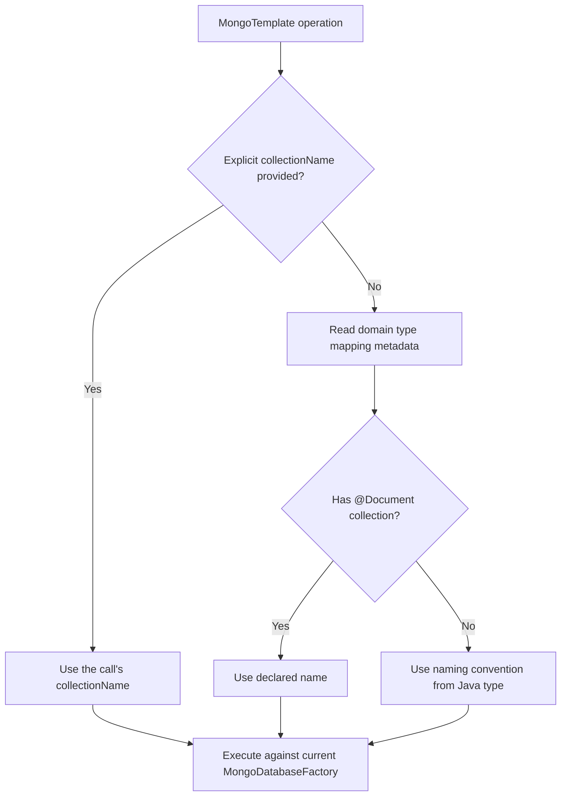
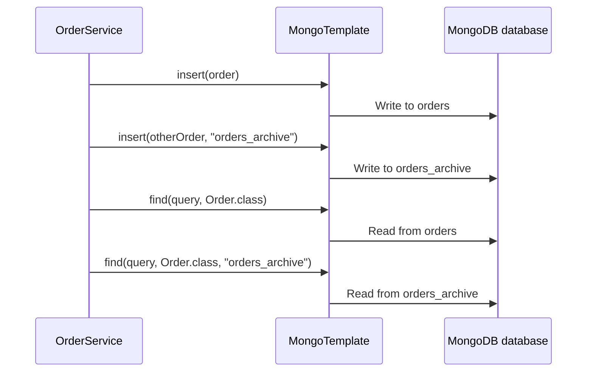
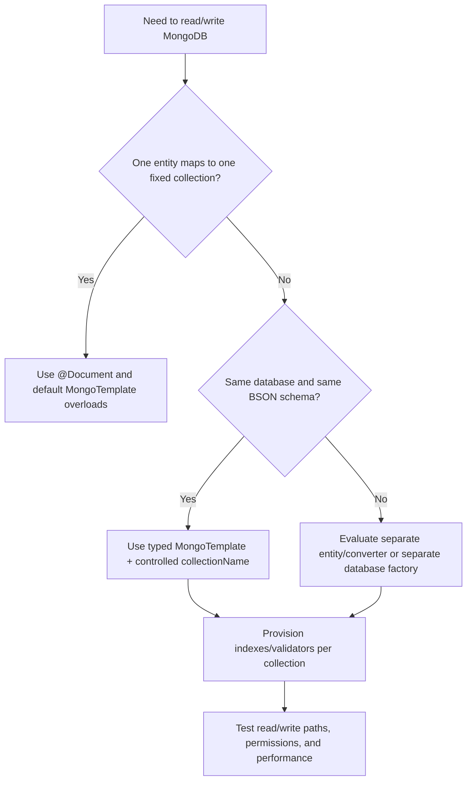

# Selecting a Collection from an Entity or Specifying It Explicitly with MongoTemplate

## 1. Core question: which collection can a Java type access?

In **Spring Data MongoDB**, `MongoTemplate` provides APIs to read, write, update, delete, aggregate, and manage indexes on MongoDB. Every operation needs to know the target **database** and **collection**. The database is typically determined via the `MongoDatabaseFactory` used by the template; the collection can be determined **from entity metadata** or **from a collection name passed by the caller**.

For example, an order management application has the Java type `Order`. In normal business flows, the entity maps to the `orders` collection. However, the system might have other datasets sharing the same BSON shape:

- `orders`: active orders.
- `orders_archive`: archived orders.
- `orders_import_staging`: testing or import staging area.

When calling `mongoTemplate.find(query, Order.class)`, Spring Data determines which collection corresponds to `Order.class`. When calling `mongoTemplate.find(query, Order.class, "orders_archive")`, the developer **explicitly specifies the target for that call**.

The topic of this **MongoTemplate** chapter lesson is not automatic data partitioning or multi-tenant routing, but understanding **collection selection rules and their consequences for mapping, querying, updating, indexing, transactions, and security**.

After this lesson, you should be able to:

1. Use `@Document(collection = "...")` and naming conventions to infer collections.
2. Use `MongoTemplate.getCollectionName(...)` to verify the name resolved by mapping.
3. Choose the right overload of `insert`, `save`, `find`, `findById`, `updateFirst`, `upsert`, `remove`, and `count` when overriding the collection.
4. Understand why the **entity type** still matters for BSON field mapping even when the collection name is overridden.
5. Distinguish `MongoTemplate.getCollection(...)`, which returns the raw driver API, from mapped template operations.
6. Design dynamic collection selection safely, with controlled indexes and easy testability.

## 2. Where does MongoTemplate resolve the collection from?



| Call | Collection source | Is entity mapping still used? |
|---|---|---|
| `insert(order)` | Metadata from the object's class | Yes |
| `save(order)` | Metadata from the object's class | Yes |
| `find(query, Order.class)` | Metadata of `Order.class` | Yes |
| `find(query, Order.class, "orders_archive")` | Explicitly passed string | Yes, because `Order.class` is still present |
| `updateFirst(query, update, Order.class, "orders_archive")` | Explicitly passed string | Yes, maps query and update using `Order.class` |
| `getCollection("orders_archive")` | Explicitly passed string | **Does not automatically go through Spring entity converter** for raw driver operations |

From the table above, separate two decisions:

- **Collection selection**: which collection will the operation run on?
- **Object mapping**: how are Java object properties and query criteria converted into BSON fields?

The collection name and mapping type are often chosen at the same time, but **they are not the same thing**. Selecting an explicit collection does not mean Spring Data ignores `@Id`, `@Field`, value objects, or custom conversions when you still use an overload taking an entity type.

## 3. Entities using @Document(collection = ...)

### 3.1. An order entity used throughout

Java 17 and Spring Data MongoDB example, with each class placed in its appropriate file:

```java
import java.time.Instant;
import org.springframework.data.annotation.Id;
import org.springframework.data.mongodb.core.mapping.Document;
import org.springframework.data.mongodb.core.mapping.Field;

@Document(collection = "orders")
public class Order {
    @Id
    private String id;

    @Field("customer_id")
    private String customerId;

    private String status;

    @Field("total_cents")
    private long totalCents;

    @Field("created_at")
    private Instant createdAt;

    protected Order() {
        // Spring Data materialization
    }

    public Order(String id, String customerId,
                 String status, long totalCents, Instant createdAt) {
        this.id = id;
        this.customerId = customerId;
        this.status = status;
        this.totalCents = totalCents;
        this.createdAt = createdAt;
    }

    public String getId() { return id; }
    public String getCustomerId() { return customerId; }
    public String getStatus() { return status; }
    public long getTotalCents() { return totalCents; }
    public Instant getCreatedAt() { return createdAt; }
}
```

`@Document(collection = "orders")` declares the default collection name. `@Id` maps the Java property `id` to BSON `_id`; `@Field("customer_id")` and the other annotations rename BSON fields **inside the document**, without changing the collection.

A typical record has the BSON shape:

```javascript
{
  _id: "O-101",
  customer_id: "C-01",
  status: "PAID",
  total_cents: NumberLong(15500),
  created_at: ISODate("2026-01-05T10:00:00Z")
}
```

These are illustrative values. A Java `long` is typically written as a BSON 64-bit integer and `Instant` maps according to the framework's time configuration; verify actual stored data when the application uses custom converters.

### 3.2. Inserting without supplying a collection name

```java
import java.time.Instant;
import org.springframework.data.mongodb.core.MongoTemplate;
import org.springframework.stereotype.Service;

@Service
public class OrderWriter {
    private final MongoTemplate template;

    public OrderWriter(MongoTemplate template) {
        this.template = template;
    }

    public Order create() {
        Order order = new Order(
            "O-101", "C-01", "PAID", 15500L, Instant.now());

        return template.insert(order);
    }
}
```

`insert(order)` uses `Order`'s metadata and writes to the `orders` collection. You do not have to repeat the collection name in every service method, reducing duplication and typos when an entity has **one canonical collection**.

The same holds for other operations:

```java
Order loaded = template.findById("O-101", Order.class);
long total = template.count(new Query(), Order.class);
```

Both use the collection inferred from `Order.class`.

### 3.3. If @Document does not declare a collection

For a mapped entity without a specified name, Spring Data MongoDB applies a naming convention derived from the class name. For example:

```java
@Document
public class InventoryItem {
    @Id
    private String id;
}
```

By standard convention, `InventoryItem` uses the `inventoryItem` collection. It **does not default to a plural form** like `inventoryItems`. If the dataset must live in `inventory_items` or `inventoryItems`, declare it explicitly with `@Document(collection = "...")`.

In applications requiring a stable schema or working with pre-existing data, avoid letting a Java class rename accidentally change the collection the application targets. Using explicit annotations also saves code readers from guessing the convention.

### 3.4. Checking the resolved collection name with getCollectionName

```java
String orderCollection =
    mongoTemplate.getCollectionName(Order.class);

System.out.println(orderCollection); // "orders"
```

`getCollectionName(Class<?>)` returns the collection name according to the class's mapping metadata; **it does not open the collection, count documents, or prove the collection exists on the server**.

Example startup or integration-test configuration check:

```java
if (!"orders".equals(
        mongoTemplate.getCollectionName(Order.class))) {
    throw new IllegalStateException(
        "Order mapping points to unexpected collection");
}
```

This is a simple mapping-contract check. It does not mean every `MongoTemplate` call in the application is forced to use `orders`: overloads accepting `collectionName` can still select another collection.

## 4. Specifying the collection name explicitly when calling MongoTemplate

### 4.1. Inserting into another collection

Suppose you need to store test/import orders in `orders_import_staging` while still reusing the `Order` entity:

```java
Order incoming = new Order(
    "O-IMP-01", "C-99", "IMPORTED", 4200L, Instant.now());

mongoTemplate.insert(incoming, "orders_import_staging");
```

The `insert(object, collectionName)` overload writes the mapped object into the specified collection. It **does not modify the `@Document` annotation** on the `Order` class and does not change what `getCollectionName(Order.class)` returns.

Two consecutive calls target two different collections:

```java
mongoTemplate.insert(incoming, "orders_import_staging");
// Target: orders_import_staging

mongoTemplate.insert(otherOrder);
// Target: orders, per @Document on Order
```

In this snippet, `otherOrder` is another `Order` with a non-conflicting ID created earlier. Use separate test data so you do not confuse a duplicate `_id` error with targeting the wrong collection.

### 4.2. Finding in another collection

```java
import java.util.List;
import org.springframework.data.mongodb.core.query.Criteria;
import org.springframework.data.mongodb.core.query.Query;

Query byCustomer = Query.query(
    Criteria.where("customerId").is("C-99"));

List<Order> stagingOrders =
    mongoTemplate.find(
        byCustomer, Order.class, "orders_import_staging");
```

Spring Data continues using `Order.class` mapping to translate `customerId` into the BSON field `customer_id`. Semantically, MongoDB receives the filter:

```javascript
db.orders_import_staging.find({ customer_id: "C-99" });
```

If you instead call:

```java
mongoTemplate.find(byCustomer, Order.class);
```

it queries `orders`, not `orders_import_staging`. This is an easy bug to hit when a service **writes to an overridden collection but reads back using the default method**, leading developers to think data was lost.

### 4.3. findById in another collection

```java
Order archiveOrder = mongoTemplate.findById(
    "O-101",
    Order.class,
    "orders_archive"
);
```

The three-argument overload selects `orders_archive`. The ID value is still converted according to `Order`'s metadata; if the Java ID is a String shaped like an ObjectId, you need to understand `@Id`/`@MongoId` rules and the actual BSON `_id` of the entity. Changing only the collection name cannot fix an **`_id` type mismatch** between two collections.

### 4.4. Saving into another collection

```java
mongoTemplate.save(archiveOrder, "orders_archive");
```

`save` expresses write-by-object-identity semantics, potentially replacing data or creating a new document depending on the entity's state/ID and Spring Data rules. It **differs from `insert`**: `insert` is for creation and throws duplicate-key errors on existing keys; `save` should not be used as a concurrency-safe single-field update.

If you need to modify one field, prefer an atomic update matching your business conditions. Avoid reading an object with a projection containing only a few fields and then calling `save` on it into another collection: doing so can **replace the document with incomplete data**.

### 4.5. Remember the rule: "collectionName belongs to each individual call"

A call with `collectionName` selects the target **only for that specific call**. It does not mutate the `MongoTemplate` bean into a "template permanently pointed at that collection", nor does it cause other services to automatically use the new collection.



## 5. Reference table of commonly used APIs

Having the same method name does not mean every overload resolves the collection the same way. When writing code, read the exact **method signature** and check whether a collection name is passed.

| Operation | Collection from entity | Explicit collection |
|---|---|---|
| Insert | `insert(order)` | `insert(order, "orders_archive")` |
| Save | `save(order)` | `save(order, "orders_archive")` |
| Find multiple documents | `find(query, Order.class)` | `find(query, Order.class, "orders_archive")` |
| Find one document | `findOne(query, Order.class)` | `findOne(query, Order.class, "orders_archive")` |
| Find by ID | `findById(id, Order.class)` | `findById(id, Order.class, "orders_archive")` |
| Read all | `findAll(Order.class)` | `findAll(Order.class, "orders_archive")` |
| Count | `count(query, Order.class)` | `count(query, Order.class, "orders_archive")` |
| Update first matching document | `updateFirst(query, update, Order.class)` | `updateFirst(query, update, Order.class, "orders_archive")` |
| Update multiple documents | `updateMulti(query, update, Order.class)` | `updateMulti(query, update, Order.class, "orders_archive")` |
| Upsert | `upsert(query, update, Order.class)` | `upsert(query, update, Order.class, "orders_archive")` |
| Delete matching documents | `remove(query, Order.class)` | `remove(query, Order.class, "orders_archive")` |
| Default collection name | `getCollectionName(Order.class)` | Do not use this method to override: pass the string in the operation itself |

Additional overloads may exist for `findAndModify`, `findAndReplace`, or specialized APIs depending on the Spring Data MongoDB version. The general rule remains: **pass the explicit collection name in the supported overload position**, rather than creating a dummy entity object hoping the mapper switches collections.

### 5.1. Update and upsert with entity mapping

```java
import com.mongodb.client.result.UpdateResult;
import org.springframework.data.mongodb.core.query.Criteria;
import org.springframework.data.mongodb.core.query.Query;
import org.springframework.data.mongodb.core.query.Update;

Query byId = Query.query(Criteria.where("id").is("O-101"));
Update markArchived = new Update().set("status", "ARCHIVED");

UpdateResult result = mongoTemplate.updateFirst(
    byId,
    markArchived,
    Order.class,
    "orders_archive"
);

System.out.println(result.getMatchedCount());
System.out.println(result.getModifiedCount());
```

The code above updates only `orders_archive`. If document `O-101` exists only in `orders`, `matchedCount` will be 0. `updateFirst` does not automatically search every collection mapped to `Order`.

When adding criteria using Java properties:

```java
Query byCustomerAndStatus = Query.query(
    Criteria.where("customerId").is("C-01")
        .and("status").is("PAID"));

mongoTemplate.updateMulti(
    byCustomerAndStatus,
    new Update().set("status", "ARCHIVED"),
    Order.class,
    "orders_archive"
);
```

Spring Data maps `customerId` to BSON `customer_id` because the method receives `Order.class`. If you only want to mark a set of archived orders, ensure **the data actually resides in the target collection** before updating.

Upsert example:

```java
Query byOrderId = Query.query(Criteria.where("id").is("O-NEW"));

mongoTemplate.upsert(
    byOrderId,
    new Update()
        .set("customerId", "C-02")
        .set("status", "NEW")
        .set("totalCents", 8900L),
    Order.class,
    "orders_import_staging"
);
```

Points to note:

- `upsert` can create a new document if no matching document is found. The `id` predicate is mapped to `_id`; check the BSON type of `_id`.
- Fields in `Update` are mapped using `Order` metadata; for example, `totalCents` translates to `total_cents`.
- If the staging collection has a different schema, reusing `Order.class` may **no longer be appropriate**.
- Upsert does not replace idempotency design, validation, and unique indexes when multiple writers execute concurrently.

### 5.2. Targeted deletion in a collection

```java
import com.mongodb.client.result.DeleteResult;

Query target = Query.query(
    Criteria.where("id").is("O-IMP-01"));

DeleteResult deleted = mongoTemplate.remove(
    target,
    Order.class,
    "orders_import_staging"
);

System.out.println(deleted.getDeletedCount());
```

`remove` is a destructive operation; you must verify the query filter, collection name, and access permissions. In particular, `new Query()` can match every document. Never execute a broad delete when the collection name comes from unvalidated external input.

### 5.3. Distinguishing single-object insert from insertAll

`insert(order, "orders_archive")` explicitly specifies a single collection for the passed object. In contrast, `insertAll(collectionOfObjects)` may inspect **each object's type** to group them and choose collections via mapping. Therefore, do not use `insertAll` assuming it inherits a collection override from another call.

If you need to batch multiple documents into the **same collection**, choose the bulk insert API matching both class and collection name (such as `mongoTemplate.insert(listOfOrders, "orders_import_staging")` when supported by your version) or `BulkOperations` configured with the proper entity type/collection. Check write ordering, duplicate-key handling, and partial failures in import flows.

## 6. Specifying the collection while keeping entity mapping

### 6.1. Why does Order.class still matter?

Compare these two calls:

```java
Query q = Query.query(
    Criteria.where("customerId").is("C-01"));

List<Order> typed = mongoTemplate.find(
    q, Order.class, "orders_archive");

var raw = mongoTemplate.getCollection("orders_archive")
    .find(new org.bson.Document("customer_id", "C-01"))
    .into(new java.util.ArrayList<>());
```

Both read `orders_archive`, yet **they work differently**:

- The first call uses `MongoTemplate.find(..., Order.class, ...)`. Spring understands `customerId` as a Java property, maps it to `customer_id`, and maps returned BSON documents back into `Order` entities.
- The second call uses `MongoTemplate.getCollection(...)` to obtain a **Java Driver** `MongoCollection<Document>`. The query condition uses the raw BSON field `customer_id`; the driver does not infer it from `@Field` on `Order`.

If raw driver code writes:

```java
mongoTemplate.getCollection("orders_archive")
    .find(new org.bson.Document("customerId", "C-01"));
```

it searches for a BSON field literally named `customerId`. In the example schema, the actual field is `customer_id`, so it may return nothing. This is an entirely different mistake from picking the wrong collection.

### 6.2. What happens if another collection stores a different schema?

Suppose `orders_archive` stores legacy state with the structure:

```javascript
{
  _id: "O-101",
  customer: { id: "C-01" },
  current_state: "ARCHIVED",
  amount_minor: NumberLong(15500)
}
```

The `Order` entity in section 3 expects `customer_id`, `status`, and `total_cents`. Calling:

```java
Order archived = mongoTemplate.findById(
    "O-101", Order.class, "orders_archive");
```

still uses `Order`'s converter, **without automatically adapting to the different archive schema**. Mismatched fields may be read as null/defaults or fail mapping depending on constructors, validation, target types, and converters. This is especially hazardous when Java properties use primitive types like `long`.

If collections have different schemas, you should:

1. Use separate entities/DTOs for each schema with explicit mapping.
2. Or normalize archived data to the same schema as active data.
3. Or design a tested migration/compatibility translation layer.

There is **no guarantee** that overriding the collection name alone makes two schemas compatible. The overload taking `collectionName` solves **choosing where to read/write**, not **transforming data shapes**.

### 6.3. @Id and @Field are not ignored on override

```java
mongoTemplate.findById(
    "O-101", Order.class, "orders_archive");
```

Spring can still apply ID mapping rules. If the entity uses `@Id String id`, a String formatted like an ObjectId may be converted to a BSON ObjectId depending on mapping/version rules. When the archive collection stores `_id` as a plain BSON String, verify and choose an appropriate ID strategy, such as `@MongoId` when preserving a fixed type.

Likewise, `@Field("total_cents")` on the entity remains active during typed operations against `orders_archive`. If raw BSON in the archive uses a different name, the mapper does not change automatically just because of the collection name.

## 7. Distinguishing collection, database, and MongoClient

In a typical setup:

```text
MongoClient
  └─ MongoDatabaseFactory (selects database, connection settings)
       └─ MongoTemplate
            ├─ orders
            ├─ orders_archive
            └─ orders_import_staging
```

`MongoTemplate` is typically bound to a single configured `MongoDatabaseFactory` database. Passing `"orders_archive"` into a call **does not switch to another database**, change tenant credentials, or create a separate client.

Example Spring Boot 3.x configuration using an environment URI:

```yaml
spring:
  data:
    mongodb:
      uri: ${MONGODB_URI}
```

Suppose `MONGODB_URI` points to the `shop` database. Both calls:

```java
mongoTemplate.find(new Query(), Order.class, "orders");
mongoTemplate.find(new Query(), Order.class, "orders_archive");
```

access **collections inside the `shop` database** through this template.

If you need a different database, cluster, or credentials, you must configure a corresponding `MongoDatabaseFactory`/`MongoTemplate` or a controlled database routing strategy. Do not pass dotted strings like `"otherDb.orders"` as `collectionName` expecting database-switching syntax.

**Separate three concerns:**

| What you want to change | Where it is normally configured |
|---|---|
| Java ↔ BSON fields, identifiers, and custom converters | Entity metadata, mapping configuration |
| Collection within the same database | `@Document` or overload accepting `collectionName` |
| Database/cluster/credentials | `MongoDatabaseFactory`, `MongoTemplate`, or appropriate client configuration |

Dynamic collection selection does not automatically solve **secure multi-tenancy**. Authorization still must be enforced at the API/domain layer, MongoDB roles, and appropriate connection settings.

## 8. Choosing collections by business purpose without scattering strings across code

### 8.1. The problem with hard-coded strings in every service

One service might read from `orders_archive`, while another uses `order_archive` or `orders_archived`. MongoDB treats these strings as completely different collection names. When a write uses the wrong name and the account has privileges, the database may create an unintended new collection; on the read path, the application typically gets an empty list and the typo goes unnoticed.

Anti-pattern not to repeat:

```java
mongoTemplate.insert(order, "orders_archived");
mongoTemplate.find(query, Order.class, "orders_archive");
// Two different collections due to a typo!
```

Your design should centralize collection resolution behind a testable rule rather than passing collection names straight from controllers into every call.

### 8.2. Using an enum to restrict allowed collections

```java
public enum OrderStore {
    ACTIVE,
    ARCHIVE,
    IMPORT_STAGING
}
```

```java
import org.springframework.stereotype.Component;

@Component
public class OrderCollectionResolver {
    public String resolve(OrderStore store) {
        return switch (store) {
            case ACTIVE -> "orders";
            case ARCHIVE -> "orders_archive";
            case IMPORT_STAGING -> "orders_import_staging";
        };
    }
}
```

In a service:

```java
import java.util.Optional;
import org.springframework.data.mongodb.core.MongoTemplate;
import org.springframework.stereotype.Service;

@Service
public class OrderLookupService {
    private final MongoTemplate template;
    private final OrderCollectionResolver resolver;

    public OrderLookupService(
            MongoTemplate template,
            OrderCollectionResolver resolver) {
        this.template = template;
        this.resolver = resolver;
    }

    public Optional<Order> find(String id, OrderStore store) {
        String target = resolver.resolve(store);
        Order result = template.findById(id, Order.class, target);
        return Optional.ofNullable(result);
    }
}
```

This illustrates a **finite set of collections**. It does not itself verify whether the user has permission to read the archive: authorization must still happen before the service selects `OrderStore`. However, using an enum prevents external clients from supplying arbitrary MongoDB collection names.

### 8.3. Default repositories have no collectionName parameter

`MongoRepository<Order, String>` uses the entity's mapping to query the default collection. For example:

```java
import org.springframework.data.mongodb.repository.MongoRepository;

public interface OrderRepository
        extends MongoRepository<Order, String> {
}
```

`orderRepository.findById("O-101")` has no parameter to target `orders_archive`. When a project needs to operate on multiple collections within the same database, you can use:

- `MongoTemplate` inside a service or custom repository fragment, where the collection is chosen by business rules.
- Another entity/repository explicitly mapped to the other collection if schemas, lifecycles, and responsibilities genuinely differ.
- A purposeful routing mechanism with tests and clear resource management.

Do not "temporarily mutate" `@Document` or a singleton bean at runtime so that a repository suddenly points to a different collection per request. Such global mutations can cause concurrent requests to read/write the wrong target.

### 8.4. Should you create one collection per tenant?

Some systems consider naming collections `orders_tenantA`, `orders_tenantB`, etc., using the same `Order` entity. That is merely one design option, **not a recommended default** in Spring Data MongoDB.

If each tenant has its own collection, the system must manage:

1. Lifecycle creation/deletion of collections and indexes per tenant.
2. Total number of namespaces/collections and metadata/index overhead.
3. Naming, tenant authorization, migrations, and per-tenant backup/restore.
4. MongoDB quotas, resource consumption, sharding strategy, and connection/database routing.
5. Cross-tenant analytics or queries.

With a large number of tenants, you should usually compare **a shared collection with `tenantId` and appropriate indexes** or a multi-database/multi-cluster layout depending on isolation requirements. Simply "being able to pass `collectionName`" does not justify a collection-per-tenant design.

## 9. Dynamic collection naming and security

### 9.1. Never accept collectionName directly from a request

An API must not allow clients to arbitrarily send:

```text
GET /orders?collection=orders_archive
```

and then call `mongoTemplate.find(query, Order.class, request.collection())` unchecked. Although a collection name is not a filter expression like `$where`, it still determines **where data is read from or written to**. If the application uses broad MongoDB credentials, this mistake can expose sensitive data or modify unrelated collections.

**Principle:** collection selection must be derived from an authenticated business context and server-side authorization rules, never from an unverified client-supplied parameter.

### 9.2. Separate authorization from naming

Example flow for reading archived orders for a tenant:

```text
Authenticated JWT/session
    ↓
Extract tenantId and permissions from trusted security context
    ↓
Verify tenant's permission to read archive
    ↓
Resolver picks an allowed collection
    ↓
Query adds tenantId predicate if schema requires it
    ↓
MongoTemplate.find(..., Order.class, targetCollection)
```

In a shared-collection model, picking the right collection **does not** replace the `tenantId` predicate. For example:

```java
Query byTenantAndId = Query.query(
    Criteria.where("tenantId").is(authenticatedTenant)
        .and("id").is(orderId));
```

The snippet above assumes the actual entity has a `tenantId` property or corresponding mapping; the sample `Order` in section 3 does not include this field yet. When implementing multi-tenancy, add the property, indexes, validation, and data-isolation tests rather than copying code blindly.

If data is separated by per-tenant credentials/clusters, use the appropriate database/client configuration. Changing `collectionName` on a template does not grant or alter MongoDB access privileges.

### 9.3. If time-based dynamic naming is required

Another example is monthly collections like `orders_2026_01`, `orders_2026_02`. Names can be generated from an **internal time type** rather than concatenating raw user text:

```java
import java.time.YearMonth;
import java.time.format.DateTimeFormatter;

public final class MonthlyOrderCollection {
    private static final DateTimeFormatter FORMAT =
        DateTimeFormatter.ofPattern("uuuu_MM");

    private MonthlyOrderCollection() {}

    public static String forMonth(YearMonth month) {
        if (month == null || month.getYear() < 2020
                || month.getYear() > 2100) {
            throw new IllegalArgumentException("Unsupported month");
        }
        return "orders_" + month.format(FORMAT);
    }
}
```

The year bounds in this example illustrate **business policy**, not a MongoDB limit. Any monthly collection selection must be consistent between writers and readers: querying a date range spanning multiple months may require querying **multiple collections**, aggregating results, and ensuring proper sorting/pagination.

Splitting collections by time also increases lifecycle and indexing work; for many workloads, a single collection indexed on `created_at`, TTL indexes (when applicable), an archive workflow, or sharding can be simpler. Do not choose collection-per-month just hoping queries will be faster without benchmarking.

## 10. Collection lifecycle, indexes, and collection options

### 10.1. @Document does not mean the collection already exists

`@Document(collection = "orders")` is mapping metadata. Simply loading `Order.class` in Java or calling `getCollectionName(Order.class)` **does not create the collection** in MongoDB.

In an environment permitted to manage schemas:

```java
boolean exists = mongoTemplate.collectionExists("orders_archive");

if (!exists) {
    mongoTemplate.createCollection("orders_archive");
}
```

This is an administrative operation example to check/create a collection; do not run check-then-create on every request as a synchronization mechanism. Multiple instances could race to create the collection; collection provisioning usually belongs in migrations or a controlled bootstrap step.

Additionally, some write operations cause MongoDB to create a collection implicitly if it does not yet exist and credentials allow it. Do not rely on implicit creation when the system needs **validators, collation, time-series, or other collection creation options**.

### 10.2. Indexes belong to each collection, not to the class

Suppose `orders` has an index:

```javascript
db.orders.createIndex(
  { customer_id: 1, created_at: -1 },
  { name: "ix_orders_customer_created" }
);
```

That index **does not automatically appear** on `orders_archive` simply because both hold documents mapped by `Order.class`. To query the archive efficiently, the archive collection needs matching indexes:

```javascript
db.orders_archive.createIndex(
  { customer_id: 1, created_at: -1 },
  { name: "ix_orders_archive_customer_created" }
);
```

Similarly with Spring Data:

```java
import org.springframework.data.domain.Sort;
import org.springframework.data.mongodb.core.index.Index;

mongoTemplate.indexOps("orders_archive")
    .ensureIndex(
        new Index()
            .on("customer_id", Sort.Direction.ASC)
            .on("created_at", Sort.Direction.DESC)
    );
```

When using `indexOps("orders_archive")` with a collection name, this example intentionally uses **physical BSON field names**. With `indexOps(Order.class)`, the template has entity context and resolves the default collection `orders`. Never create an index on `"customerId"` in the archive if the actual BSON field is `customer_id`.

Annotations like `@Indexed` and `@CompoundIndex` do not guarantee that every overridden collection gets indexes created automatically. Auto-index creation depends on configuration/version, while dynamically created collections generally require **separate index provisioning**.

### 10.3. Validators and retention policies also belong per collection

Each collection can be created with different schema validators, collations, or options. Therefore, even when `orders_archive` and `orders` share the same Java class, insert outcomes can differ if one allows missing fields while the other requires specific values.

For example, a validator on the archive collection might require `status = "ARCHIVED"`, whereas `orders` only accepts `status = "NEW"` or `"PAID"`. `@Document` and Java converters do not replace database-level validation; writes into an overridden collection can be rejected.

When deploying monthly or per-tenant collections:

- Define who creates collections and when.
- Ensure indexes/validators are ready before opening for reads/writes.
- Separate retention and deletion privileges from regular query logic.
- Plan schema migrations across all collections, not only the default one.
- Monitor collection/index counts, storage, namespace creation rate, and operational overhead.

### 10.4. Distinguishing collection existence from data presence

`collectionExists("orders_archive")` only confirms the namespace exists at the moment of the call; **it does not prove any documents exist**. Conversely, an empty query result is not enough to conclude the collection does not exist. To diagnose, check both separately:

```java
boolean archiveExists =
    mongoTemplate.collectionExists("orders_archive");

long archivedCount =
    mongoTemplate.count(new Query(), Order.class, "orders_archive");
```

Counting every document can be resource-intensive in some contexts and should not be run repeatedly on every request. When monitoring counts, consider estimates or appropriate metrics depending on accuracy needs.

## 11. Transactions when operating across multiple collections

Specifying a collection name **does not automatically create a transaction**. This matters if the application needs to **move an order from `orders` to `orders_archive`**:

```text
1. Read Order from orders
2. Insert Order into orders_archive
3. Delete Order from orders
```

Without a transaction, a failure after step 2 can leave two copies; failures at other steps can leave unintended states. If business logic requires all three operations to be atomically consistent, use a MongoDB transaction on a supported deployment.

### 11.1. Configuring the transaction manager

With synchronous Spring Data MongoDB and a database running on a replica set or transaction-capable sharded cluster:

```java
import org.springframework.context.annotation.Bean;
import org.springframework.context.annotation.Configuration;
import org.springframework.data.mongodb.MongoDatabaseFactory;
import org.springframework.data.mongodb.MongoTransactionManager;

@Configuration
public class MongoTransactionsConfig {
    @Bean
    MongoTransactionManager mongoTransactionManager(
            MongoDatabaseFactory factory) {
        return new MongoTransactionManager(factory);
    }
}
```

Multi-document transactions do not work as expected on standalone MongoDB. Target collections should have their **schemas/indexes/validators prepared in advance**, rather than relying on implicit namespace creation inside a transaction.

### 11.2. Service moving an order to archive

```java
import org.springframework.data.mongodb.core.MongoTemplate;
import org.springframework.data.mongodb.core.query.Criteria;
import org.springframework.data.mongodb.core.query.Query;
import org.springframework.stereotype.Service;
import org.springframework.transaction.annotation.Transactional;

@Service
public class OrderArchiveService {
    private final MongoTemplate template;

    public OrderArchiveService(MongoTemplate template) {
        this.template = template;
    }

    @Transactional
    public void moveToArchive(String orderId) {
        Order source = template.findById(orderId, Order.class);
        if (source == null) {
            throw new IllegalArgumentException("Order not found");
        }

        // Write a copy with the same BSON schema to the archive collection.
        template.insert(source, "orders_archive");

        Query byId = Query.query(Criteria.where("id").is(orderId));
        long deleted = template.remove(byId, Order.class)
            .getDeletedCount();
        if (deleted != 1L) {
            throw new IllegalStateException("Unexpected delete result");
        }
    }
}
```

The example uses both target-selection mechanisms **within the same transaction**:

- `template.findById(orderId, Order.class)`: from `orders` via entity.
- `template.insert(source, "orders_archive")`: writes explicitly to `orders_archive`.
- `template.remove(byId, Order.class)`: deletes from `orders` via entity.

`@Transactional`, backed by `MongoTransactionManager`, attaches the appropriate transaction/session to participating Spring Data operations. On rollback, the goal is to avoid leaving a copy in the archive if deleting the source fails. Test this against a real supported topology and understand transaction limits, retries, and write concerns.

**Do not use as-is in production without addressing:**

- Concurrent conflict when two workers archive the same order simultaneously: duplicate `_id` insert, retries, and final state.
- Requirements to transition `status` to `ARCHIVED`, auditing, and history retention rules.
- API-layer retry handling, idempotency, and transaction timeouts.
- Remaining references to the order in old collections or cross-collection links.
- Invoking `@Transactional` via a Spring proxy; self-invocation can bypass transactions under standard proxy behavior.

If an order only needs a status change within **a single document**, an atomic update inside `orders` may be simpler than copying to another collection. Splitting collections should have clear operational, retention, or data-modeling reasons.

### 11.3. Transactions and changing collectionName

A transaction does not make `MongoTemplate` track a "current collection" across calls. Every operation still resolves its collection from the entity or passed name. Commands in the same transaction can target multiple collections, but **picking the right target remains the code's responsibility**.

With reactive Spring Data MongoDB, transactions typically use `ReactiveMongoTransactionManager` and Reactor Context; do not use a synchronous transaction manager expecting it to cover a reactive pipeline. Collection resolution in each reactive template call follows the corresponding mapping and overload rules, even though return types are `Mono` or `Flux`.

## 12. Aggregation, BulkOperations, and collection paths

### 12.1. Aggregating over default or explicit collections

For aggregation using only the `Order` entity:

```java
import org.bson.Document;
import org.springframework.data.mongodb.core.aggregation.Aggregation;
import org.springframework.data.mongodb.core.aggregation.AggregationResults;
import org.springframework.data.mongodb.core.query.Criteria;

Aggregation aggregation = Aggregation.newAggregation(
    Aggregation.match(Criteria.where("status").is("PAID")),
    Aggregation.group("customerId").count().as("orderCount")
);

AggregationResults<Document> activeCounts =
    mongoTemplate.aggregate(
        aggregation, Order.class, Document.class);
```

This overload derives the input collection name from `Order.class`. If you want to run the aggregation on `orders_archive` while still mapping property paths via `Order`, create a **typed aggregation** and pass the collection name:

```java
import org.springframework.data.mongodb.core.aggregation.TypedAggregation;

TypedAggregation<Order> archivePipeline =
    Aggregation.newAggregation(
        Order.class,
        Aggregation.match(
            Criteria.where("status").is("ARCHIVED")),
        Aggregation.group("customerId")
            .count().as("orderCount")
    );

AggregationResults<Document> archiveCounts =
    mongoTemplate.aggregate(
        archivePipeline,
        "orders_archive",
        Document.class
    );
```

`TypedAggregation<Order>` carries input-type metadata. `"orders_archive"` is the source collection, while `Document.class` is the **result** type. In `$group`, the result's `_id` field is the customer ID value used as the group key, not the source order ID.

A plain BSON pipeline with a direct collection name can also use `aggregate(aggregation, collectionName, outputType)`. When using raw `Document` stages or physical BSON field-name strings, do not confuse `customerId` with `customer_id`, especially when there is no input mapping context.

### 12.2. BulkOperations needs an explicit target collection

When updating many documents, `MongoTemplate` provides `bulkOps(...)` to batch write operations. Depending on the version, the API supports specifying both the input class and explicit collection:

```java
import org.springframework.data.mongodb.core.BulkOperations;

BulkOperations bulk = mongoTemplate.bulkOps(
    BulkOperations.BulkMode.ORDERED,
    Order.class,
    "orders_import_staging"
);

bulk.updateOne(
    Query.query(Criteria.where("id").is("O-IMP-01")),
    new Update().set("status", "VALIDATED")
);

bulk.updateOne(
    Query.query(Criteria.where("id").is("O-IMP-02")),
    new Update().set("status", "VALIDATED")
);

bulk.execute();
```

These updates are batched for the `orders_import_staging` collection. Do not create one bulk writer expecting to swap collections arbitrarily per operation inside the same bulk. Understand the difference between `ORDERED`/`UNORDERED`, per-operation failures, and lifecycle callback/versioning limitations of bulk operations in your Spring Data version.

### 12.3. Using raw MongoCollection

```java
import com.mongodb.client.MongoCollection;
import org.bson.Document;

MongoCollection<Document> collection =
    mongoTemplate.getCollection("orders_archive");

Document rawOrder = collection.find(
    new Document("_id", "O-101")
).first();
```

Calling `getCollection(...)` returns the **Java Driver API**, not a `MongoTemplate` "pinned to a new default collection". Direct driver operations do not automatically pass through:

- `MappingMongoConverter` for `Order`.
- Spring Data `@Field`, `@Id` mapping metadata on raw BSON queries.
- Lifecycle callbacks/auditing events bound to Spring Data template paths, if used by the application.

The driver still uses its **CodecRegistry** to read/write BSON. If you want a raw `MongoCollection<Order>`, you must configure corresponding codec/POJO mapping; having `@Document("orders")` on a Spring Data entity is not enough for the raw driver to understand `Order`.

Use the raw driver when you need low-level control or a specialized driver API; for regular CRUD with entity mapping, prefer `MongoTemplate` to reduce the risk of two write paths producing divergent schemas.

### 12.4. Do not confuse withCollection/withDatabase and template scope

The MongoDB Driver offers views such as `MongoDatabase.getCollection(...)` or `MongoCollection.withCodecRegistry(...)`. They do not alter the global state of the Spring `MongoTemplate` bean. A helper returning a raw driver collection does not make `mongoTemplate.find(query, Order.class)` read from it automatically.

When designing service APIs, name methods clearly—such as `readFromArchive`, `readFromActive`—or pass an `OrderStore` enum so callers know the **collection scope**; avoid hiding target selection in global mutable settings.

## 13. Common collection-selection mistakes

| Symptom | Possible cause | Investigation step |
|---|---|---|
| `insert(order, "orders_archive")` succeeds, but `findById(id, Order.class)` returns null | Wrote to archive, read from default `orders` | Use `findById(id, Order.class, "orders_archive")` |
| Data not found even with the right collection | Used `customerId` instead of `customer_id` in raw driver | Inspect raw BSON and check `@Field` mapping |
| Unknown similarly-named collection appears | Typo in collection name on insert, or buggy resolver | Check `getCollectionNames()` / names passed in code; review collection-create permissions |
| `getCollectionName(Order.class)` returns `orders` yet service writes elsewhere | Overload with `collectionName` overrides metadata | Inspect actual call sites, not just annotations |
| Archive with different schema produces null Java properties | Using `Order` mapper against legacy archive schema | Check actual BSON; use separate entity or migration |
| Archive queries are slow while `orders` is fast | Index exists only on `orders` | Check `getIndexes()` on each collection |
| `collectionExists(...)` returns true but `find` is empty | Collection exists without matching documents | Compare count/filter/ID/schema and database |
| `@Indexed` is on `Order` yet archive lacks index | Auto-index does not create across arbitrary collection overrides | Provision archive indexes explicitly |
| Archive move transaction leaves duplicate data | Not running in a transaction, or misconfigured/wrong code path | Check `MongoTransactionManager`, topology, retry/idempotency |
| Data ends up in another database | Template points to wrong database, not wrong collection | Check `MongoDatabaseFactory`/URI and expected database |
| Raw `getCollection` reads/writes different schema from entity | Bypassed Spring mapping converter and callbacks | Use typed `MongoTemplate` or configure separate driver mapping |
| Client input can pick sensitive collections | Missing authorization/allowlist | Derive collection from trusted context and checked permissions |
| Paginating across multiple archive collections misses/duplicates items | Querying one collection or merging without stable sort | Design aggregate/fan-out/range pagination per dataset |

### 13.1. Outside-in investigation method

When a `MongoTemplate` call unexpectedly returns empty or fails:

1. **Actual collection name:** Which method is being called? Is `collectionName` passed? Where does that value come from?
2. **Database:** Which `MongoDatabaseFactory` does the template use? Where do the URI/credentials point? Are there multiple templates or environment profiles?
3. **BSON schema:** Does MongoDB store `customer_id` or `customerId`? Is `_id` a String or ObjectId? Does the archive data share the same schema?
4. **Mapped query:** Did Spring translate Java properties into the right BSON field names and types? Is a tenant/status filter missing?
5. **Indexes and server:** Run `explain("executionStats")` for the query on the exact collection; compare keys/docs examined and execution time.
6. **Concurrency/transactions:** When data can be moved/deleted concurrently, verify snapshots, sessions, transactions, retries, and consistency expectations.

Do not rush to add a new `@Document`, expand the connection pool, or change timeouts when the root cause is simply **reading from a different collection than where data was written**.

### 13.2. Inspecting with mongosh

Against the appropriate database:

```javascript
db.getName();
db.getCollectionNames();

db.orders.findOne({ _id: "O-101" });
db.orders_archive.findOne({ _id: "O-101" });

db.orders.getIndexes();
db.orders_archive.getIndexes();

db.orders_archive
  .find({ customer_id: "C-01" })
  .explain("executionStats");
```

These commands distinguish "no document", "wrong field", "wrong collection", and "unindexed query". Run them in environments and datasets you are authorized to access; never export or log documents containing PII or credentials.

### 13.3. Schema errors and collection differences are separate issues

Suppose an application has two collections:

```javascript
// Collection orders:
{ _id: "O-101", customer_id: "C-01", total_cents: NumberLong(15500) }

// Collection orders_archive:
{ _id: "O-101", customer_id: "C-01", total_cents: "15500" }
```

A `findById` query may locate the document in both places. However, `Order.totalCents` is declared as `long`; in the archive, a BSON String is not a BSON Int64, so reading into the entity may fail or pass through a configured converter. **Finding data** does not mean BSON-to-Java mapping will always succeed.

The solution is to normalize schemas or design tested compatibility converters/DTOs. Never silently convert `String` to `long` without checking legacy values that are non-numeric, null, missing, overflowing, or in different units.

## 14. Integration testing: one entity, two different collections

### 14.1. Objectives and test data

An integration test should verify these contracts:

- `getCollectionName(Order.class)` returns `"orders"`.
- Default inserts appear in `orders` and do not automatically appear in `orders_archive`.
- Explicit inserts appear in `orders_archive` and do not automatically appear in `orders`.
- Typed queries on `customerId` still match the BSON field `customer_id` when reading the archive.
- Explicit updates/removes do not affect the default collection.
- Raw `getCollection(...)` returns actual BSON, without renaming fields from Java properties.
- The archive collection has the indexes required for deployment; do not assume main collection indexes are copied over.

### 14.2. JUnit 5 example with MongoTemplate

The test snippet below illustrates an isolated test database, such as Spring Boot `@DataMongoTest` connected to an integration-test MongoDB instance. **Never run cleanup logic against shared or production databases.**

```java
import java.time.Instant;
import java.util.List;

import org.bson.Document;
import org.junit.jupiter.api.BeforeEach;
import org.junit.jupiter.api.Test;
import org.springframework.beans.factory.annotation.Autowired;
import org.springframework.boot.test.autoconfigure.data.mongo.DataMongoTest;
import org.springframework.data.mongodb.core.MongoTemplate;
import org.springframework.data.mongodb.core.query.Criteria;
import org.springframework.data.mongodb.core.query.Query;
import org.springframework.data.mongodb.core.query.Update;

import static org.assertj.core.api.Assertions.assertThat;

@DataMongoTest
class OrderCollectionRoutingTest {
    @Autowired
    MongoTemplate template;

    @BeforeEach
    void cleanupTestIds() {
        Document filter =
            new Document("_id", new Document("$regex", "^TEST-"));

        template.getCollection("orders").deleteMany(filter);
        template.getCollection("orders_archive").deleteMany(filter);
    }

    @Test
    void usesEntityDefaultCollectionWhenNameIsOmitted() {
        assertThat(template.getCollectionName(Order.class))
            .isEqualTo("orders");

        Order active = new Order(
            "TEST-ACTIVE", "C-01", "NEW", 1200L, Instant.now());

        template.insert(active);

        assertThat(template.findById("TEST-ACTIVE", Order.class))
            .isNotNull();

        assertThat(template.findById(
            "TEST-ACTIVE", Order.class, "orders_archive"))
            .isNull();
    }

    @Test
    void explicitNameKeepsEntityFieldMapping() {
        Order archive = new Order(
            "TEST-ARCHIVE", "C-99", "ARCHIVED", 3500L, Instant.now());

        template.insert(archive, "orders_archive");

        assertThat(template.findById("TEST-ARCHIVE", Order.class))
            .isNull();

        Query byCustomer = Query.query(
            Criteria.where("customerId").is("C-99"));

        List<Order> archived = template.find(
            byCustomer, Order.class, "orders_archive");

        assertThat(archived)
            .extracting(Order::getId)
            .containsExactly("TEST-ARCHIVE");

        Document raw = template.getCollection("orders_archive")
            .find(new Document("_id", "TEST-ARCHIVE"))
            .first();

        assertThat(raw).isNotNull();
        assertThat(raw.getString("customer_id")).isEqualTo("C-99");
        assertThat(raw.containsKey("customerId")).isFalse();
    }

    @Test
    void updateAndDeleteTargetOnlyExplicitCollection() {
        Order sameActive = new Order(
            "TEST-SAME", "C-10", "NEW", 1500L, Instant.now());
        Order sameArchive = new Order(
            "TEST-SAME", "C-10", "ARCHIVED", 1500L, Instant.now());

        template.insert(sameActive);
        template.insert(sameArchive, "orders_archive");

        Query byId = Query.query(
            Criteria.where("id").is("TEST-SAME"));

        template.updateFirst(
            byId, new Update().set("status", "PURGED"),
            Order.class, "orders_archive");

        assertThat(template.findById(
            "TEST-SAME", Order.class).getStatus()).isEqualTo("NEW");
        assertThat(template.findById(
            "TEST-SAME", Order.class,
            "orders_archive").getStatus()).isEqualTo("PURGED");

        template.remove(byId, Order.class, "orders_archive");

        assertThat(template.findById(
            "TEST-SAME", Order.class, "orders_archive")).isNull();
        assertThat(template.findById(
            "TEST-SAME", Order.class)).isNotNull();
    }
}
```

These tests use `getCollection("orders")` during cleanup to remove records whose ID starts with `TEST-`. This approach is only safe when **the test database is genuinely isolated** and contains no important data sharing that prefix; creating/cleaning namespaces also requires appropriate permissions.

The test also checks that two collections can hold **the same `_id`**: `_id` uniqueness is enforced per collection in MongoDB, not across every collection in a database. Thus, two records with `_id: "TEST-SAME"` in `orders` and `orders_archive` can coexist seamlessly.

### 14.3. Testing the collection-name resolver

A unit test for the resolver needs no database:

```java
import org.junit.jupiter.api.Test;
import static org.assertj.core.api.Assertions.assertThat;

class OrderCollectionResolverTest {
    private final OrderCollectionResolver resolver =
        new OrderCollectionResolver();

    @Test
    void resolvesOnlyKnownStores() {
        assertThat(resolver.resolve(OrderStore.ACTIVE))
            .isEqualTo("orders");
        assertThat(resolver.resolve(OrderStore.ARCHIVE))
            .isEqualTo("orders_archive");
        assertThat(resolver.resolve(OrderStore.IMPORT_STAGING))
            .isEqualTo("orders_import_staging");
    }
}
```

Unit tests verify naming rules; integration tests verify MongoDB operations. Both are needed when collection selection affects correctness and data scope.

### 14.4. Testing transactions separately with a replica set

Do not use a standalone database to validate multi-document rollback. When testing `OrderArchiveService.moveToArchive(...)`:

1. Run a dedicated test MongoDB replica set or properly configured Testcontainers instance.
2. Create `orders_archive` before the test; prepare mappings/indexes.
3. Insert an order in `orders`, and invoke the service **through the Spring proxy** so `@Transactional` takes effect.
4. Verify on success: the source is gone from `orders` and the copy exists in `orders_archive`.
5. Inject a controlled error after inserting into the archive but before deleting the source; verify transaction rollback per Spring rules.
6. Test the case where the archive already holds the same `_id` to check duplicate keys, retries/idempotency, and final state.

Transaction rollback tests must assert **both collections**, not just the thrown exception. If the application has multiple transaction managers, ensure `MongoTransactionManager` matches the template being called.

## 15. Practice lab: active, staging, and archive sharing one entity

### 15.1. Context

A sales system uses Spring Data MongoDB. Regular orders live in `orders`. Orders imported from external files must go through validation in `orders_import_staging`. Older orders after an archive process are stored in `orders_archive`. Initially, all three collections use the **`Order` BSON schema**.

Requirements:

- Default access goes to `orders` via `@Document` metadata.
- When importing to staging, target only the `orders_import_staging` collection.
- When reading the archive, require calling the overload accepting `collectionName`.
- Never let users pick arbitrary collection names.
- Indexes and validators are prepared separately for each collection.
- Keep the BSON field names `customer_id`, `total_cents`, and `created_at` consistent everywhere.

### 15.2. Steps to carry out

1. **Configure the application:** create a Spring Boot app with `spring-boot-starter-data-mongodb`, connecting to test MongoDB using an environment-variable URI. Do not hardcode credentials.
2. **Define the entity:** create `Order` from section 3, keeping `@Document(collection = "orders")` and the corresponding `@Field` annotations.
3. **Check mapping:** print or assert that `mongoTemplate.getCollectionName(Order.class)` equals `orders`.
4. **Prepare collections:** create `orders`, `orders_archive`, and `orders_import_staging` via bootstrap/migration. Create appropriate indexes on each collection.
5. **Write data:** call `insert(activeOrder)` then `insert(stagingOrder, "orders_import_staging")`, using distinct IDs.
6. **Read data:** run `findById(id, Order.class)` and `findById(id, Order.class, "orders_import_staging")` to observe different results despite using the same class.
7. **Query by property:** use `Criteria.where("customerId")` with both typed overloads; confirm `@Field` mapping still works.
8. **Raw BSON:** use `mongoTemplate.getCollection("orders_import_staging")` to inspect physical field names; try querying with `"customerId"` vs `"customer_id"` to see the difference.
9. **Update:** call `updateFirst` and `upsert` on staging with an explicit collection name, verifying `orders` remains untouched.
10. **Archive service:** use an enum resolver to choose `orders_archive`. If an atomic move is required, implement a transaction on a replica set and test rollback.
11. **Performance:** run `explain("executionStats")` for the same query on `orders` and `orders_archive`; compare existing indexes, `keysExamined`, and `docsExamined`.
12. **Regression tests:** add tests for collection-name typos, unintended database configuration, and an archive document having a schema different from `Order`.

### 15.3. Self-check with mongosh

Against a test database, you can run:

```javascript
// Check collection info before starting.
db.getCollectionNames();

// Read respective IDs from each collection.
db.orders.findOne({ _id: "O-101" });
db.orders_import_staging.findOne({ _id: "O-IMP-01" });
db.orders_archive.findOne({ _id: "O-101" });

// Check that BSON fields are named properly.
db.orders_import_staging.find(
  { customer_id: "C-99" },
  { _id: 1, customer_id: 1, status: 1 }
);

// Inspect archive indexes directly rather than assuming orders' apply.
db.orders_archive.getIndexes();
```

If a collection has no sample data yet, an empty query result is normal. Verify that the insert ran against the right database and the ID was stored with the expected BSON type before concluding there is a mapping bug.

### 15.4. Completion criteria

A lab is complete when the learner can:

- Identify the **default collection** and **explicit collection** for every call.
- Correctly explain the roles of `@Document`, `getCollectionName`, `MongoDatabaseFactory`, and `@Field`.
- Demonstrate that writing to staging does not make the document appear in the default collection.
- Read staging/archive via `MongoTemplate` and receive properly mapped `Order` objects.
- Explain why `getCollection(...)` uses raw BSON names and does not automatically invoke Spring converters.
- Create indexes on the target collection rather than assuming indexes from another collection apply automatically.
- Propose safe policies for collection names from requests, enum resolvers, and multi-tenancy.
- Describe the transactions required when moving data across multiple collections.

## 16. Quick reference sheet

| Question | Correct principle |
|---|---|
| What does `@Document(collection = "orders")` do? | Specifies the default collection in the entity's metadata. |
| What does Spring use if the collection name is omitted? | Class mapping metadata or class-name convention where applicable. |
| Does `getCollectionName(Order.class)` create a collection? | No; it only resolves the name from mapping metadata. |
| Does `insert(order, "orders_archive")` change `@Document`? | No; it overrides the collection only for that call. |
| Does `find(query, Order.class, "orders_archive")` still use `@Field`? | Yes; the entity type still participates in mapping. |
| Does `getCollection("orders_archive")` map entities? | Not via Spring Data; it returns a raw driver collection. |
| Does passing a collection name change the database? | No; the database depends on the current template/factory. |
| Does `MongoRepository.findById(...)` search the archive automatically? | No; standard repositories use the entity's mapped collection. |
| Can two collections hold the same `_id`? | Yes; `_id` uniqueness is enforced per collection in MongoDB. |
| Do indexes on `orders` apply to `orders_archive`? | No; indexes must be designed/provisioned per collection. |
| Does `@Document` create indexes or validators on every dynamic collection? | There is no such guarantee; configure provisioning separately. |
| Is letting clients pass raw `collectionName` safe? | No; require authentication, authorization, and an allowlist/resolver. |
| Is moving a document to archive automatically atomic? | No; multi-document transactions require a supported deployment and proper configuration. |
| What if the archive has a different schema from the current entity? | You need a separate entity/converter, migration, or tested compatibility layer. |

### Concise decision rule



Choosing **entity-derived collections** keeps code concise and consistent when data has a single standard home. Choosing **explicit collections** is useful for archives, staging, scoped datasets, or intentional administrative workflows. Either way, the system must maintain consistent **BSON mapping, access control, schemas, indexes, and transactions** to avoid misreading or writing to the wrong collection.

**Version-specific references:** [Spring Data MongoDB — Template API](https://docs.spring.io/spring-data/mongodb/reference/mongodb/template-api.html), [Spring Data MongoDB — Object Mapping](https://docs.spring.io/spring-data/mongodb/reference/mongodb/mapping/mapping.html), [Spring Data MongoDB — Index Creation](https://docs.spring.io/spring-data/mongodb/reference/mongodb/mapping/mapping-index-management.html), and [MongoDB — Databases and Collections](https://www.mongodb.com/docs/manual/core/databases-and-collections/). When implementing, verify overload signatures, mapper behavior, transactions, and auto-index behavior against your project's Spring Data MongoDB and Java Driver versions.
