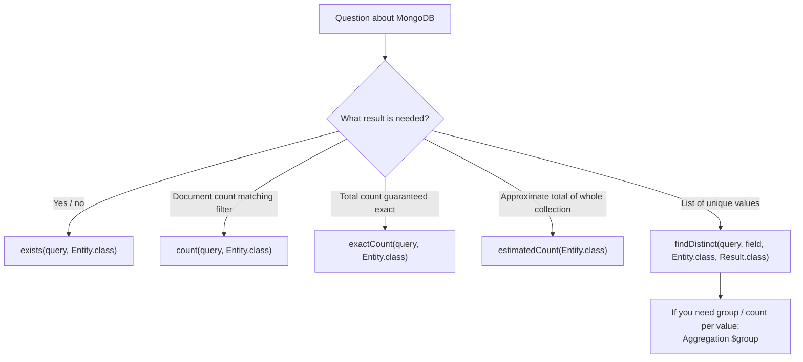

# count, exactCount, estimatedCount, exists, and distinct

## 1. Objectives and context

In **Spring Data MongoDB**, `MongoTemplate` lets you inspect and summarize data without loading entire documents as Java objects. When building **Mini Commerce** with the `products`, `customers`, and `orders` collections, the system frequently needs to answer:

- How many active products are in a category?
- Does a customer have any orders in the `PLACED` status?
- Approximately how many documents are in the whole collection for displaying operational metrics?
- Which categories, order statuses, or product tags exist in the dataset?
- Does the total item count for pagination need an **exact count**, or is an **estimate** acceptable?

This lesson belongs to the **MongoTemplate** chapter, focusing on the five API groups `count`, `exactCount`, `estimatedCount`, `exists`, and `findDistinct`. We will distinguish **counting documents**, **checking existence**, and **retrieving distinct value sets**, while learning how Java properties map to BSON, writing indexed queries, testing, and applying these APIs in synchronous and reactive environments.

After this lesson, you will be able to:

1. Use `count(Query, Class<?>)` to count documents matching a filter.
2. Use `exactCount(Query, Class<?>)` when you must force an exact count, even for an empty query.
3. Use `estimatedCount(Class<?>)` for an **estimated total document count of a collection**, without applying a filter.
4. Choose `exists(Query, Class<?>)` over counting or fetching entities when you only need a boolean result.
5. Use `findDistinct(Query, field, entityClass, resultClass)` to retrieve unique values, including over arrays.
6. Avoid pitfalls involving `skip`/`limit` in counts, BSON types, `@Field` names, and wrong expectations about distinct.
7. Test results against real MongoDB, verify indexes, and understand transaction/accuracy boundaries.

**Prerequisites:** Java 17+, Spring Boot with `spring-boot-starter-data-mongodb`, a working MongoDB connection, `@Document`, `@Id`, `@Field`, and `Query`/`Criteria`. Examples illustrate the synchronous branch; the end of the lesson compares with `ReactiveMongoTemplate`. APIs such as `exactCount` and the `useEstimatedCount` optimization require a Spring Data MongoDB version that supports them (such as the 4.x/5.x lines).

## 2. Quick decision table: which API to use?

| Question | API | Return value | Key characteristic |
| --- | --- | --- | --- |
| How many products match the criteria? | `count(query, Product.class)` | `long` | Counts by filter; defaults to exact counting |
| Need guaranteed exact count even when the query is empty? | `exactCount(query, Product.class)` | `long` | Forces data-based counting; never uses estimated statistics |
| Roughly how many products are in the collection? | `estimatedCount(Product.class)` | `long` | Estimated from metadata/statistics; **accepts no filter** |
| Does a product with this SKU exist? | `exists(query, Product.class)` | `boolean` | Checks existence without materializing entities |
| Which categories currently have active products? | `findDistinct(query, "category", Product.class, String.class)` | `List<String>` | Returns **unique values**, not document counts |



Core point: **`estimatedCount` is not a faster variant of `count(query, ...)` with a filter**. It serves an entirely different requirement: estimating the total number of documents in a collection.

## 3. Preparing Mini Commerce data

### 3.1. The Product entity

The example uses a `Product` entity whose Java field `price` is stored in BSON under the key `unit_price` with type `Decimal128`:

```java
package com.example.minicommerce.domain;

import java.math.BigDecimal;
import java.util.List;

import org.springframework.data.annotation.Id;
import org.springframework.data.mongodb.core.mapping.Document;
import org.springframework.data.mongodb.core.mapping.Field;
import org.springframework.data.mongodb.core.mapping.FieldType;

@Document(collection = "products")
public class Product {

    @Id
    private String id;

    private String sku;
    private String category;
    private boolean active;

    @Field(name = "unit_price", targetType = FieldType.DECIMAL128)
    private BigDecimal price;

    private List<String> tags;

    public Product() {}

    public Product(String id, String sku, String category,
                   boolean active, BigDecimal price, List<String> tags) {
        this.id = id;
        this.sku = sku;
        this.category = category;
        this.active = active;
        this.price = price;
        this.tags = tags;
    }

    public String getId() { return id; }
    public void setId(String id) { this.id = id; }

    public String getSku() { return sku; }
    public void setSku(String sku) { this.sku = sku; }

    public String getCategory() { return category; }
    public void setCategory(String category) { this.category = category; }

    public boolean isActive() { return active; }
    public void setActive(boolean active) { this.active = active; }

    public BigDecimal getPrice() { return price; }
    public void setPrice(BigDecimal price) { this.price = price; }

    public List<String> getTags() { return tags; }
    public void setTags(List<String> tags) { this.tags = tags; }
}
```

`@Document(collection = "products")` selects the collection; `@Id` maps to `_id`; `@Field(name = "unit_price", ...)` sets the target BSON name and type for price. For count, exists, and distinct examples, we **do not need to load full `Product` objects** to obtain results.

### 3.2. Verification dataset

In `mongosh` connected to the `mini_commerce` database, you can insert **four sample documents**:

```javascript
use mini_commerce

db.products.insertMany([
  {
    _id: "demo-p1",
    sku: "LAP-001",
    category: "accessories",
    active: true,
    unit_price: NumberDecimal("129900.00"),
    tags: ["featured", "office"]
  },
  {
    _id: "demo-p2",
    sku: "MOU-001",
    category: "accessories",
    active: true,
    unit_price: NumberDecimal("249000.00"),
    tags: ["office"]
  },
  {
    _id: "demo-p3",
    sku: "KEY-OLD",
    category: "accessories",
    active: false,
    unit_price: NumberDecimal("99000.00"),
    tags: ["clearance"]
  },
  {
    _id: "demo-p4",
    sku: "HOME-001",
    category: "home-goods",
    active: true,
    unit_price: NumberDecimal("199000.00"),
    tags: ["featured"]
  }
]);
```

**Results considering only these four fixtures**:

| Condition | Document count |
| --- | ---: |
| All | 4 |
| `active = true` | 3 |
| `active = true AND category = "accessories"` | 2 |
| `active = false` | 1 |
| `sku = "LAP-001"` | 1 |
| `sku = "NOT-FOUND"` | 0 |

Insert once into a dedicated test database; re-running with the same `_id` values causes a duplicate key error. If the collection holds other data, queries not restricted to fixture `_id`s can return higher counts; the integration test at the end of the lesson isolates data using a fixed set of IDs.

Equivalent `mongosh` commands:

```javascript
db.products.countDocuments({ active: true });

db.products.countDocuments({
  active: true,
  category: "accessories"
});

db.products.findOne({ sku: "LAP-001" });

db.products.distinct("category", { active: true });
```

Do not confuse `countDocuments(filter)` with the driver's `estimatedDocumentCount()`. The Spring Data Java API names in the following sections differ from the MongoDB driver API names, even though they invoke corresponding counting mechanisms.

## 4. count(Query, Class): counting matching documents

### 4.1. Example with MongoTemplate

```java
import org.springframework.data.mongodb.core.MongoTemplate;
import org.springframework.data.mongodb.core.query.Criteria;
import org.springframework.data.mongodb.core.query.Query;

Query activeAccessories = Query.query(
    Criteria.where("active").is(true)
        .and("category").is("accessories"));

long total = mongoTemplate.count(activeAccessories, Product.class);
System.out.println(total); // 2, if only the lesson's four fixtures exist.
```

`count` returns a `long`: that is the **number of documents** matching the filter, not a list of `Product` objects, and no objects are instantiated per record. With the collection mapped by `Product.class`, `MongoTemplate` resolves both the collection and the Java type's mapping metadata.

If only the collection name is known:

```java
long allProducts =
    mongoTemplate.count(new Query(), "products");
```

However, an overload accepting only a **collection name** has no entity metadata to map Java property aliases. If the query references Java's `price`, you must use the overload with `Product.class` or write the physical BSON key `unit_price` when querying by collection name.

### 4.2. count with complex filters

Example counting active products within a price range:

```java
import java.math.BigDecimal;

Query priceRange = Query.query(
    Criteria.where("active").is(true)
        .and("price")
        .gte(new BigDecimal("100000.00"))
        .lt(new BigDecimal("200000.00")));

long count = mongoTemplate.count(priceRange, Product.class);
```

Because of `@Field(name = "unit_price", targetType = DECIMAL128)`, the logical filter after Spring Data mapping is roughly:

```javascript
db.products.countDocuments({
  active: true,
  unit_price: {
    $gte: NumberDecimal("100000.00"),
    $lt: NumberDecimal("200000.00")
  }
});
```

On the fixtures, `demo-p1` and `demo-p4` match, so the result is **2**. Legacy price data stored as String/Double may not produce expected results when compared with `Decimal128`; audit BSON types before trusting aggregate statistics.

### 4.3. Count affected by skip/limit

**A very common mistake:** reusing a paginated `Query` to count the total:

```java
import org.springframework.data.domain.PageRequest;
import org.springframework.data.domain.Sort;

Query paged = Query.query(
    Criteria.where("active").is(true))
    .with(PageRequest.of(
        1, 2, Sort.by(Sort.Order.asc("sku"))));

long pageRestrictedCount = mongoTemplate.count(paged, Product.class);
```

The query above carries `skip` and `limit`; per the `MongoOperations` API, those settings **can directly affect the number returned by `count`**. It is **not** a safe way to obtain the total item count across all pages.

Counting the total must use a **fresh `Query` containing only the filter**, with no paging:

```java
Query countQuery = Query.query(
    Criteria.where("active").is(true));

long totalMatching = mongoTemplate.count(countQuery, Product.class);
// 3 in the fixture dataset.
```

The rule applies to both `count` and `exactCount`: when building a `Page`, keep the **same filter** but **omit the data query's `skip`/`limit`** from the count query. Sorting is usually unnecessary for counting as well.

## 5. exactCount(Query, Class): forcing an exact count

`MongoTemplate.exactCount(...)` uses document-based counting of matching records, even when the filter is **empty**, rather than collection statistics.

```java
Query all = new Query();

long exactTotal =
    mongoTemplate.exactCount(all, Product.class);

long exactActive =
    mongoTemplate.exactCount(
        Query.query(Criteria.where("active").is(true)),
        Product.class);
```

With only the four fixtures, `exactTotal == 4` and `exactActive == 3`. This API executes a counting path with proper semantics for shards, sessions, and transactions; the trade-off can be higher cost than immediately reading estimated statistics.

**When should you call `exactCount` explicitly?**

- Admin/UI views need an exact total for reconciliation.
- You need to verify document counts after a migration or data-processing job.
- `mongoTemplate.useEstimatedCount(true)` is enabled, yet one specific operation **must be exact**.
- You are operating inside a session/transaction and need a count reflecting transactional state.

`exactCount` does not turn separate queries executed at different times into **a single snapshot**. If documents are changing concurrently, the count result can differ from a subsequent `find(...)`. Transaction/snapshot consistency is a separate decision at the business layer and MongoDB topology level.

### 5.1. Why is it exact yet not always cheap?

According to modern Spring Data MongoDB documentation, the exact counting path uses MongoDB `countDocuments` (which can execute via internal aggregation). Even with an empty filter, the server may need to read data/indexes to determine the exact total, unlike quickly reading metadata statistics.

If you need numbers for **reconciliation**, never switch to `estimatedCount` just to reduce latency. If a dashboard only shows an approximate figure, label it clearly as an estimate.

## 6. estimatedCount(Class): estimated total count

`estimatedCount` uses collection statistics, which can be faster when you need an estimated total **without any filter**:

```java
long approximateTotal =
    mongoTemplate.estimatedCount(Product.class);
```

Or specifying the collection name explicitly:

```java
long approximateProducts =
    mongoTemplate.estimatedCount("products");
```

These methods **do not accept a `Query`**. Therefore, there is no equivalent call like:

```java
// There is NO estimatedCount(Query, Product.class) API
// to estimate only active=true or category="accessories".
```

| Need | Should you use estimatedCount? | Reason |
| --- | --- | --- |
| Display "approximately X products stored" | Possibly | Only needs an approximate collection total |
| Total active products | **No** | Requires a filter |
| Total orders for a customer | **No** | Requires a `customerId` filter |
| Pre-migration inventory check | Usually insufficient | Needs exact numbers/criteria for verification |
| Financial/order reconciliation | No | Inaccuracy is unacceptable |
| Approximate monitoring metric | Possibly | Metadata-based estimate is acceptable |

**Do not assert** that `estimatedCount(Product.class) == 4` across all environments. The estimate can drift from the real count, especially right after changes on a collection or sharded cluster; behavior also depends on MongoDB version, topology, and statistics limitations.

### 6.1. How does useEstimatedCount(true) affect count?

`MongoTemplate` has a configuration method:

```java
// Enable only when configuring MongoTemplate if the system
// accepts estimates for empty count queries:
mongoTemplate.useEstimatedCount(true);
```

When enabled, `mongoTemplate.count(...)` calls with an **empty, unpaginated filter** can be routed to `estimatedCount`, **provided it is not a transaction/session-bound template**. Queries with predicates still count by filter.

If you need guaranteed exact results regardless of this setting:

```java
long auditedTotal =
    mongoTemplate.exactCount(new Query(), Product.class);
```

**By default, `MongoTemplate` uses exact counting.** Never toggle `useEstimatedCount(true)` arbitrarily in controllers or per request. This is an application-level configuration decision; document its impact on existing `count(new Query(), ...)` calls.

### 6.2. Limitations in sessions and transactions

Collection statistics do not reliably reflect uncommitted changes inside a transaction, and estimates do not carry transactional count semantics. When counting inside a transaction, use an appropriate `count`/`exactCount` API on a transaction-capable MongoDB deployment. If your application runs on a sharded cluster, verify estimate limitations under your topology.

## 7. exists(Query, Class): when you only need to know if a document exists

Instead of loading a product:

```java
Product product = mongoTemplate.findOne(
    Query.query(Criteria.where("sku").is("LAP-001")),
    Product.class);

boolean found = product != null;
```

You can ask directly:

```java
boolean exists = mongoTemplate.exists(
    Query.query(Criteria.where("sku").is("LAP-001")),
    Product.class);
```

When only a boolean is needed, `exists` expresses intent cleanly and avoids materializing full entities. On the fixture dataset, `exists` for `LAP-001` returns `true`; for `NOT-FOUND` it returns `false`.

### 7.1. Avoid count > 0 when checking existence

Less idiomatic example:

```java
boolean exists = mongoTemplate.count(
    Query.query(Criteria.where("sku").is("LAP-001")),
    Product.class) > 0;
```

This asks the server to count all matching documents when the business logic only needs to know whether **at least one document exists**. `MongoTemplate.exists(...)` is more direct and can avoid part of the work required by a full count. Still, existence queries need appropriate filters/indexes to be fast; do not assume O(1) cost for every filter.

### 7.2. Checking a customer's orders

In the `orders` collection, to check whether customer `customer-001` has any `PLACED` order:

```java
Query pending = Query.query(
    Criteria.where("customerId").is("customer-001")
        .and("status").is("PLACED"));

boolean hasPlacedOrder =
    mongoTemplate.exists(pending, Order.class);
```

`Order.class` needs `@Document(collection = "orders")` and the two properties `customerId` and `status`. In multi-tenant systems or store-scoped authorization, the `exists` filter must also include **full tenant/authorization conditions**, never stripped down just because the return type is boolean.

### 7.3. exists does not replace a unique index

Code pattern:

```java
if (!mongoTemplate.exists(
        Query.query(Criteria.where("sku").is(sku)),
        Product.class)) {
    // After this check, another request can still
    // insert a product with a duplicate SKU before we insert.
}
```

This is a **check-then-act race condition**. To guarantee unique SKUs, create a unique index:

```javascript
db.products.createIndex({ sku: 1 }, { unique: true });
```

Then handle duplicate-key exceptions at the service/API layer. `exists` can improve UX validation feedback, but it is not a database uniqueness constraint.

## 8. distinct: retrieving unique values, not document counts

Spring Data MongoDB provides `findDistinct` on `MongoTemplate`. Example retrieving categories of active products:

```java
Query active = Query.query(
    Criteria.where("active").is(true));

List<String> categories =
    mongoTemplate.findDistinct(
        active, "category", Product.class, String.class);
```

`findDistinct(query, field, entityClass, resultClass)` takes:

| Parameter | Meaning |
| --- | --- |
| `query` | Filter considering only matching documents |
| `field` | Java property path from which to extract unique values |
| `entityClass` | Class used to select the collection and map field names/types |
| `resultClass` | Target Java type for each returned element, e.g., `String.class` |

On the fixtures, active categories are `"accessories"` and `"home-goods"`. The order of items in the result list **has no default sorting contract**; if the UI needs ordering, sort small sets in application code or use an aggregation with `$sort`.

MongoDB `mongosh` equivalent:

```javascript
db.products.distinct("category", { active: true });
```

### 8.1. Distinct on arrays: returning unique elements

The `tags` field is a `List<String>`. When running distinct on an array, MongoDB inspects **the element values**:

```java
List<String> uniqueActiveTags =
    mongoTemplate.findDistinct(
        Query.query(Criteria.where("active").is(true)),
        "tags",
        Product.class,
        String.class);
```

Across active fixtures, the resulting set of values is:

```text
featured
office
```

It is not a list of arrays `["featured", "office"]` and `["office"]`. Distinct returns each non-duplicate value without occurrence counts.

If you want to know **how many products contain each tag**, use aggregation `$unwind` + `$group` instead of `distinct`.

### 8.2. Distinct on embedded fields

Suppose `Order` has `shippingAddressSnapshot.city`. You can write:

```java
List<String> cities =
    mongoTemplate.findDistinct(
        Query.query(Criteria.where("status").is("PLACED")),
        "shippingAddressSnapshot.city",
        Order.class,
        String.class);
```

In raw `mongosh`:

```javascript
db.orders.distinct(
  "shippingAddressSnapshot.city",
  { status: "PLACED" }
);
```

If the Java property has `@Field(name = "ship_to")`, Spring Data mapping can translate `shippingAddressSnapshot.city` into `ship_to.city`. **The raw driver and `mongosh` always use actual BSON names** and do not know Java aliases.

### 8.3. Distinct has no pagination/sort like Page<T>

Do not treat `findDistinct(...)` as an infinitely scalable paginated category API. It returns a list of distinct values without standard `Pageable` support to slice values the way `find(...)` returns `Page<T>`.

If the cardinality of distinct values is very large, distinct results can consume significant memory/bandwidth and hit MongoDB's BSON result size limits. For dashboards requiring filtering, sorting, limiting, or multi-group statistics, consider **aggregation `$match -> $group -> $sort -> $limit`** with appropriate indexes.

### 8.4. Nulls, missing fields, and mixed BSON types

If a collection contains:

```javascript
{ _id: "a", category: "accessories" }
{ _id: "b", category: null }
{ _id: "c" }
{ _id: "d", category: 123 }
```

Distinguish carefully:

- A **missing** field differs from a field with BSON value `null`.
- Distinct can return `null` when an explicit `null` value exists; a missing field has no category value to include.
- If a field contains both String and Number values, multiple **BSON types** exist; coercing everything to `String.class` can trigger conversions or unexpected errors.
- If you need a "valid category" rule, filter types/values in MongoDB or normalize via migration; do not treat distinct as a data-cleansing mechanism.

## 9. Aggregation when you need counts per value

`count` returns matching document count, while `findDistinct` returns unique values. Answering "how many active products are in each category?" requires `$group`:

```javascript
db.products.aggregate([
  { $match: { active: true } },
  {
    $group: {
      _id: "$category",
      totalProducts: { $sum: 1 }
    }
  },
  { $sort: { totalProducts: -1, _id: 1 } }
]);
```

On the fixtures:

| category | totalProducts |
| --- | ---: |
| `accessories` | 2 |
| `home-goods` | 1 |

If you want product counts per tag (where one document can have multiple tags):

```javascript
db.products.aggregate([
  { $match: { active: true } },
  { $unwind: "$tags" },
  {
    $group: {
      _id: "$tags",
      products: { $sum: 1 }
    }
  },
  { $sort: { products: -1, _id: 1 } }
]);
```

On active fixtures, `featured` has 2 products and `office` has 2. `$unwind` turns each array element into an intermediate record so each tag is counted individually.

### 9.1. Aggregation example using MongoTemplate

```java
import org.springframework.data.mongodb.core.aggregation.Aggregation;
import org.springframework.data.mongodb.core.aggregation.AggregationResults;
import org.bson.Document;

Aggregation pipeline = Aggregation.newAggregation(
    Aggregation.match(Criteria.where("active").is(true)),
    Aggregation.group("category").count().as("totalProducts"),
    Aggregation.sort(Sort.Direction.DESC, "totalProducts")
);

AggregationResults<Document> results =
    mongoTemplate.aggregate(
        pipeline, Product.class, Document.class);
```

This snippet illustrates `Aggregation` with `MongoTemplate`; add imports for `Criteria` and `Sort` in a real Java file. When your application needs a stable DTO, create a projection class with matching `_id`/`totalProducts` fields rather than passing raw `Document` objects around.

**Never take `distinct(...).size()` and treat it as a product count.** That is only the **number of unique values**, not the number of documents.

## 10. Count, exists, and distinct with FluentMongoOperations

Beyond direct methods, `MongoTemplate` supports a fluent API:

```java
long activeCount = mongoTemplate
    .query(Product.class)
    .matching(Query.query(Criteria.where("active").is(true)))
    .count();

boolean hasSku = mongoTemplate
    .query(Product.class)
    .matching(Query.query(Criteria.where("sku").is("LAP-001")))
    .exists();
```

The fluent API chains domain type selection, filtering, and terminal operations. Just like direct APIs, queries still rely on entity mapping and need appropriate indexes. For distinct, you can use `mongoTemplate.findDistinct(...)` as in section 8 for readability and result-type control.

When switching to reactive, `ReactiveMongoTemplate` has its own fluent API returning publishers; do not use synchronous `long`/`boolean` results inside a Reactor pipeline.

## 11. Pagination: total count and data query must match

Suppose a catalog UI requests `page=1`, `size=20` with filter `active=true, category=accessories`.

```java
import java.util.List;
import org.springframework.data.domain.Page;
import org.springframework.data.domain.PageImpl;
import org.springframework.data.domain.PageRequest;
import org.springframework.data.domain.Pageable;
import org.springframework.data.domain.Sort;

Pageable page = PageRequest.of(
    1,
    20,
    Sort.by(Sort.Order.asc("price"), Sort.Order.asc("id")));

Query dataQuery = Query.query(
    Criteria.where("active").is(true)
        .and("category").is("accessories")).with(page);

List<Product> content =
    mongoTemplate.find(dataQuery, Product.class);

// Use only the matching filter, without skip/limit.
Query countQuery = Query.query(
    Criteria.where("active").is(true)
        .and("category").is("accessories"));

long total = mongoTemplate.count(countQuery, Product.class);

Page<Product> result =
    new PageImpl<>(content, page, total);
```

`PageImpl` bundles the content and metadata; `count` incurs an additional query. If you do not need the total item count, consider `Slice` or a "load more" API to eliminate unnecessary counting.

**Critical invariant:** never use `estimatedCount(Product.class)` as `totalElements` for a category-filtered query, because the estimate reflects the **entire collection**, not documents matching the filter.

## 12. Performance and index design

These operations do not have identical costs:

| Operation | Cost to watch | Mitigation |
| --- | --- | --- |
| `count` by SKU | Equality filter can be highly selective | Index `sku`, unique if business rules require |
| `count` by active/category | Many documents may match | Compound index and inspect plan |
| `exactCount(new Query())` | Needs exact collection total | Use only when truly required |
| `estimatedCount(Product.class)` | Fast stats read, but can drift | Label result as approximate |
| `exists` by SKU | Only needs true/false | Use `exists` API and matching index |
| `findDistinct` by category | Can scan many keys and return many values | Index, bound distinct cardinality, or use aggregation |
| `findDistinct` on `tags` array | Multikey index / potentially many values | Monitor workload, avoid unbounded arrays |

### 12.1. Indexes for Mini Commerce operations

```javascript
// Check SKU existence and enforce uniqueness.
db.products.createIndex({ sku: 1 }, { unique: true });

// Count by active status and category.
db.products.createIndex({ active: 1, category: 1 });

// Count orders by customer and status.
db.orders.createIndex({ customerId: 1, status: 1 });
```

These are **candidate indexes to benchmark**, not a mandatory set to create blindly. Before creating a unique index, clean up existing duplicate SKUs; every index consumes storage and adds write overhead.

### 12.2. Explaining queries with the same filter

To see how a filter is supported:

```javascript
db.products.find({
  active: true,
  category: "accessories"
}).explain("executionStats");
```

Inspect `winningPlan`, `totalKeysExamined`, `totalDocsExamined`, and `nReturned`. Running `find(...).explain()` checks a **similar query shape**, and is not guaranteed to be identical to the plan chosen for `countDocuments` or `distinct`; different commands can pick different plans. When measuring exact `count`/`distinct` behavior, use the profiler, command monitoring, or explain on the exact command for your MongoDB version.

**Never assume `count` is O(1)**: exact filtered counts may still traverse many index entries. **Never assume `exists` is O(1)**: without an index, the server may still scan to find the first match.

### 12.3. Collation, case sensitivity, and the definition of "distinct"

`findDistinct` determines distinctness using BSON comparison and collation settings. For example, `"Accessories"` and `"accessories"` are two distinct values unless a compatible collation is applied. If the UI wants them merged into one category, normalize the data on write or configure an intentional collation, and verify matching indexes carry the same collation. Do not rely on lowercasing Java `String` values **after** `distinct` and assume the server ran an optimal query.

## 13. Transactions, sessions, and point-in-time accuracy

In multi-document MongoDB transactions (e.g., creating an `Order` while decrementing `Product.stock`), count operations must align with the session and transaction. In Spring Data MongoDB, `count` inside a transaction uses a `countDocuments`/aggregation-based approach so it reflects transactional writes. `estimatedCount`, which reads collection statistics, **is unsuitable for inspecting uncommitted changes**.

If your application uses Geo queries, note that operators such as `$near`/`$nearSphere` cannot be used verbatim inside `countDocuments`/aggregation counts; Spring Data rewrites certain queries, while conditions like `$minDistance` require special attention and testing. When business logic depends on counts, verify the final BSON filter and semantics rather than relying solely on method names.

**Never replace transactions or atomic updates with `exists` before writing.** For example, "if fewer than N orders are pending, create another" is a check-then-act pattern vulnerable to race conditions under concurrent requests. Use unique indexes, atomic conditional updates, transactions, or coordination suited to your actual invariants.

## 14. Reactive MongoTemplate: same semantics, Publisher results

When using `spring-boot-starter-data-mongodb-reactive`, analogous methods return `Mono`/`Flux`:

```java
import reactor.core.publisher.Mono;
import reactor.core.publisher.Flux;

import org.springframework.data.mongodb.core.ReactiveMongoTemplate;
import org.springframework.data.mongodb.core.query.Criteria;
import org.springframework.data.mongodb.core.query.Query;

Query active = Query.query(
    Criteria.where("active").is(true));

Mono<Long> count =
    reactiveMongoTemplate.count(active, Product.class);

Mono<Long> exact =
    reactiveMongoTemplate.exactCount(new Query(), Product.class);

Mono<Long> estimated =
    reactiveMongoTemplate.estimatedCount(Product.class);

Mono<Boolean> exists =
    reactiveMongoTemplate.exists(
        Query.query(Criteria.where("sku").is("LAP-001")),
        Product.class);

Flux<String> categories =
    reactiveMongoTemplate.findDistinct(
        active, "category", Product.class, String.class);
```

This snippet assumes a service with an injected `ReactiveMongoTemplate` bean and `Product` imported from your application package. Reactive operations execute only upon **subscription**; never call `block()` inside the WebFlux event loop. Filter semantics, estimation behavior, distinct rules, and transactional count caveats remain unchanged despite non-blocking I/O.

For integration tests, you can use Reactor's `StepVerifier`:

```java
StepVerifier.create(
    reactiveMongoTemplate.exists(
        Query.query(Criteria.where("sku").is("LAP-001")),
        Product.class))
    .expectNext(true)
    .verifyComplete();
```

This requires importing `reactor.test.StepVerifier` and the `reactor-test` dependency in test scope. Verify both emitted values and clean completion without mapping or database errors.

## 15. Integration testing: distinguishing exact from estimated

Mocking `MongoTemplate` does not prove how the driver counts or computes distinct values over BSON. Use **real MongoDB or Testcontainers** with a dedicated test database. The test below inserts raw BSON with fixture IDs and **counts only those IDs** so it does not depend on data from other tests.

```java
package com.example.minicommerce;

import static org.junit.jupiter.api.Assertions.*;

import java.math.BigDecimal;
import java.util.List;
import java.util.Set;

import org.bson.Document;
import org.bson.types.Decimal128;
import org.junit.jupiter.api.Test;
import org.springframework.beans.factory.annotation.Autowired;
import org.springframework.boot.test.context.SpringBootTest;
import org.springframework.data.mongodb.core.MongoTemplate;
import org.springframework.data.mongodb.core.query.Criteria;
import org.springframework.data.mongodb.core.query.Query;

import com.example.minicommerce.domain.Product;

@SpringBootTest
class MongoTemplateCountDistinctIntegrationTest {

    @Autowired
    MongoTemplate template;

    @Test
    void countsChecksExistenceAndGetsDistinctValues() {
        List<String> ids = List.of(
            "template-count-01",
            "template-count-02",
            "template-count-03",
            "template-count-04"
        );
        var raw = template.getCollection("products");
        Document fixtureFilter =
            new Document("_id", new Document("$in", ids));

        raw.deleteMany(fixtureFilter);
        try {
            raw.insertMany(List.of(
                product(ids.get(0), "LAP-T1", "accessories",
                    true, "129900.00", "featured", "office"),
                product(ids.get(1), "MOU-T1", "accessories",
                    true, "249000.00", "office"),
                product(ids.get(2), "OLD-T1", "accessories",
                    false, "99000.00", "clearance"),
                product(ids.get(3), "HOME-T1", "home-goods",
                    true, "199000.00", "featured")
            ));

            Query allFixture = Query.query(
                Criteria.where("id").in(ids));
            Query activeFixture = Query.query(
                Criteria.where("id").in(ids)
                    .and("active").is(true));
            Query accessoryFixture = Query.query(
                Criteria.where("id").in(ids)
                    .and("active").is(true)
                    .and("category").is("accessories"));

            assertEquals(4L,
                template.exactCount(allFixture, Product.class));
            assertEquals(3L,
                template.count(activeFixture, Product.class));
            assertEquals(2L,
                template.count(accessoryFixture, Product.class));

            assertTrue(template.exists(
                Query.query(Criteria.where("sku").is("LAP-T1")),
                Product.class));
            assertFalse(template.exists(
                Query.query(Criteria.where("sku").is("MISSING-T1")),
                Product.class));

            List<String> categories = template.findDistinct(
                activeFixture, "category", Product.class, String.class);
            assertEquals(Set.of("accessories", "home-goods"),
                Set.copyOf(categories));

            List<String> tags = template.findDistinct(
                activeFixture, "tags", Product.class, String.class);
            assertEquals(Set.of("featured", "office"),
                Set.copyOf(tags));

            // Estimate is an approximate total of the ENTIRE collection,
            // not just the four fixtures. Do not assert estimated == 4.
            assertTrue(template.estimatedCount(Product.class) >= 0);
        } finally {
            raw.deleteMany(fixtureFilter);
        }
    }

    private static Document product(
            String id, String sku, String category,
            boolean active, String price, String... tags) {
        return new Document("_id", id)
            .append("sku", sku)
            .append("category", category)
            .append("active", active)
            .append("unit_price",
                new Decimal128(new BigDecimal(price)))
            .append("tags", List.of(tags));
    }
}
```

**How to read the test:** `exactCount`/`count` scope by isolated fixture IDs; `exists` checks a fixture-specific SKU; distinct inspects only active fixtures, yielding two categories and two tags; `estimatedCount` applies to the whole collection, so it **only** asserts a valid non-negative value rather than matching the fixture count.

If other tests reuse the same IDs or SKUs, results can still collide. In practice, use an isolated test database/collection and never run cleanup on production. This test requires a real Spring Boot setup capable of injecting `MongoTemplate`; it does not benchmark index performance.

### 15.1. Recommended test matrix

| Test case | Expectation |
| --- | --- |
| `count` with exact filter | Document count matches fixture |
| `exactCount` with empty query | Exact total in isolated test collection |
| `estimatedCount` | Returns valid `long`; **do not** assert equality with exact count |
| `count` with skip/limit | Understand and verify pagination effect |
| `exists` with present/absent SKU | Returns accurate true/false |
| `findDistinct` on `category` | Returns each category once, no guaranteed order |
| `findDistinct` on `tags` array | Returns each unique tag, not arrays as values |
| `findDistinct` with `active` filter | Excludes categories/tags belonging only to inactive docs |
| `@Field(name = "unit_price")` | Price counts/queries target the proper BSON field |
| Data with null/missing | Distinguished and handled per schema |
| Transaction | Count via session-bound template; never use estimate for pending writes |
| Reactive | `Mono`/`Flux` emit expected types and completion signals |
| Query performance | Filter uses expected index; measure real execution plan |

## 16. Common pitfalls and fixes

| Symptom | Cause | Fix |
| --- | --- | --- |
| `Page` total is unexpectedly low | Count query carries `skip`/`limit` | Create a separate unpaginated count query |
| `estimatedCount` differs from `exactCount` | Estimate relies on statistics, not guaranteed exact | Choose `exactCount` for reconciliation |
| Using estimate for active-only filter | `estimatedCount` accepts no `Query` | Use `count`/`exactCount` with filter |
| Empty-filter `count` is no longer exact | `useEstimatedCount(true)` was enabled | Call `exactCount(new Query(), ...)` when required |
| `exists` is fast in tests but slow in prod | Missing index or low-selectivity filter | Index the query shape and measure |
| Duplicate SKU despite `exists` before insert | Check-then-write race condition | Enforce unique index and handle duplicate-key errors |
| Price count is inaccurate | Field mixes String/Double with `Decimal128`, or wrong alias | Check `$type`, `@Field`, and normalize data |
| `findDistinct` returns values out of order | Distinct does not guarantee sort order | Sort small lists in Java or use aggregation |
| Distinct `tags` returns individual tags | MongoDB flattens array elements in distinct | Expected behavior; use aggregation if another structure is needed |
| Too many distinct values hurt resources | High cardinality / result size limits | Use aggregation with limits, caching, or redesign schema |
| Distinct categories have case duplicates | Unnormalized data / missing collation | Normalize or configure matching collation and index |
| Query uses `price` while collection stores `unit_price` | Using collection-name overload without entity mapping | Use `Product.class` overload or physical BSON field name |
| Count is accurate yet UI shows wrong order count | Count and find executed at different times | Address concurrency and consistency requirements |
| `exists` on orders leaks other customers' info | Missing tenant/authorization filter | Enforce authorization in filters/services |
| Reactive code calls `block()` inside WebFlux | Misusing reactive publishers | Compose non-blocking `Mono`/`Flux` pipelines |

## 17. Exercises and completion criteria

**Exercise 1 — Filtered count.** Insert the four fixture products. Write `Query` objects to count active products, active products in category `accessories`, and products in price range `[100000, 200000)`. Verify against `mongosh countDocuments`.

**Exercise 2 — Exact vs estimate.** Call `exactCount(new Query(), Product.class)` and `estimatedCount(Product.class)` on an isolated test database. Explain why they can differ and why estimates must not be used for reconciliation.

**Exercise 3 — Paging impact.** Create a `Query` with `PageRequest.of(1, 2)`, call `count`, then create a filter-only `Query` for the total. Explain why the two counts can differ.

**Exercise 4 — Exists with unique SKU.** Write a helper checking whether a SKU exists. Simulate two concurrent requests creating the same SKU, explain why `exists` alone is insufficient, and design a unique index.

**Exercise 5 — Filtered distinct and arrays.** Retrieve categories of active products, and retrieve all distinct tags across active products. Sort the category list for display; verify distinct over an array yields individual elements.

**Exercise 6 — Grouped aggregation.** Instead of just listing categories, use `$group` to count how many products each category has. Contrast `distinct().size()` with total product counts.

**Exercise 7 — Performance.** Run `explain("executionStats")` on `{ active: true, category: "accessories" }`. Add a test index and re-check the plan. Observe actual `countDocuments`/`distinct` commands via the profiler or command monitoring when analyzing them separately.

**Extension exercise — Reactive.** Using `ReactiveMongoTemplate`, write the five equivalent operations and test `Mono<Long>`, `Mono<Boolean>`, and `Flux<String>` with `StepVerifier`. Do not call `block()` inside reactive request handlers.

### Self-check questions

1. What is the semantic difference between `count`, `exactCount`, and `estimatedCount`?
2. Why is `estimatedCount` unsuitable for counting active products in a category?
3. When `useEstimatedCount(true)` is enabled, which `count` calls can route to estimation?
4. Why should a count query used for `Page` never carry `skip`/`limit`?
5. When only a boolean existence check is needed, why is `exists` usually preferable to `count > 0` or `findOne != null`?
6. Why can `exists` never replace a unique index?
7. What shape of result does `findDistinct` return on `tags: ["featured", "office"]`?
8. When is `$group` better than `findDistinct`?
9. Why must you distinguish the Java property `price` from the BSON field `unit_price`?
10. How does a transactional count differ from a statistics-based estimated count?

**Expected outcome:** learners choose the right counting, existence, or distinct operation for business needs, keep pagination totals accurate, respect the limits of estimates, verify field names and BSON types, and measure query costs. This lays a solid foundation for reliable reporting, aggregations, indexing, transactions, reactive access, and testing in Spring Data MongoDB.

## References

- [Spring Data MongoDB — Counting Documents](https://docs.spring.io/spring-data/mongodb/reference/mongodb/template-document-count.html) — `count`, `exactCount`, `estimatedCount`, `useEstimatedCount`, and transactions.
- [Spring Data MongoDB — Querying Documents](https://docs.spring.io/spring-data/mongodb/reference/mongodb/template-query-operations.html) — `Query`, `Criteria`, distinct, mapping, and projections.
- [Spring Data MongoDB — MongoOperations API](https://docs.spring.io/spring-data/mongodb/docs/current/api/org/springframework/data/mongodb/core/MongoOperations.html) — signatures for `count`, `exactCount`, `exists`, and `findDistinct`.
- [Spring Data MongoDB — Sessions and Transactions](https://docs.spring.io/spring-data/mongodb/reference/mongodb/client-session-transactions.html) — count semantics inside transactions.
- [MongoDB — db.collection.countDocuments()](https://www.mongodb.com/docs/manual/reference/method/db.collection.countDocuments/) — exact filtered counting.
- [MongoDB — db.collection.estimatedDocumentCount()](https://www.mongodb.com/docs/manual/reference/method/db.collection.estimatedDocumentCount/) — collection metadata-based estimation.
- [MongoDB — db.collection.distinct()](https://www.mongodb.com/docs/manual/reference/method/db.collection.distinct/) — distinct values, arrays, and result size limits.
- [MongoDB — Explain Results](https://www.mongodb.com/docs/manual/reference/explain-results/) — analyzing query plans and performance.
