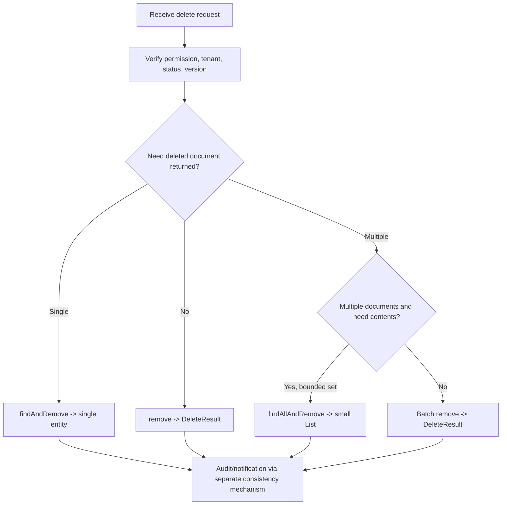

# remove, findAndRemove, and findAllAndRemove

When working with **Spring Data MongoDB**, not every delete operation shares the same semantics. `MongoTemplate` provides three common method groups:

- `remove(...)`: deletes documents matching criteria and returns the **deletion operation result**.
- `findAndRemove(...)`: finds and deletes **one** matching document, returning the deleted document as well.
- `findAllAndRemove(...)`: finds and deletes **multiple** matching documents, returning the corresponding list of documents.

The differences lie in **document count**, **return value**, **atomicity**, and **cost of materializing data into Java**. Picking the wrong API can wipe more records than intended, leave audit trails incomplete, or consume excessive memory. This **MongoTemplate** chapter lesson explains how to choose properly, enforce tenant boundaries, write conditional filters, and verify results against MongoDB.

After this lesson, you will be able to:

1. Choose the right delete method based on whether you need only deletion, deletion plus one record, or multiple records.
2. Inspect `DeleteResult`, handle not-found cases, and understand returned document values.
3. Distinguish atomic single-document deletion from a multi-document deletion workflow.
4. Use `_id`, `tenantId`, status, and `version` filters to prevent accidental deletions.
5. Recognize when **soft delete** is preferable to physical deletion.
6. Verify queries, indexes, BSON outcomes, and concurrency behavior with `mongosh`, `MongoTemplate`, and integration tests.

## 1. Thinking clearly about deletions in MongoDB

MongoDB provides driver/server operations such as `deleteOne`, `deleteMany`, and `findOneAndDelete`. `MongoTemplate` exposes domain-object-level APIs using `MappingMongoConverter` to map field names and data types.

For example, with an `OrderRecord` class whose `id` property is annotated with `@Id`, a `MongoTemplate` query can be written as:

```java
Query query = Query.query(Criteria.where("id").is(orderId));
```

Spring Data knows `id` maps to the BSON field `_id` when you pass `OrderRecord.class`. In `mongosh`, you must query the real BSON field name:

```javascript
db.orders_delete_lab.findOne({ _id: ObjectId("665f1f2a4b6c7d8e9f001234") });
```

### Three core methods

| `MongoTemplate` API | Target document count | Return value | When to use |
| --- | --- | --- | --- |
| `remove(Query, Entity.class)` | All matching documents; at most 1 when filtering by unique `_id` | `DeleteResult` | Only need to delete and know how many were removed |
| `findAndRemove(Query, Entity.class)` | At most **1** matching document | Deleted entity or `null` | Need to read **the exact deleted document** without splitting into two steps |
| `findAllAndRemove(Query, Entity.class)` | Multiple matching documents | `List<Entity>` | Need **multiple documents before they are removed**, with a small bounded result set |

Additional overloads accept a **collection name**; `remove(Object)` also has specific behavior for an existing entity instance. This lesson focuses on the **`Query + Class`** overloads to clarify filter scope and return types.

**Important warning:** `remove(Query, Entity.class)` does not limit itself to one document just because it is named "remove". If the filter matches 100 documents, it can delete all 100. To delete **strictly one**, filter by `_id` or a unique key, or use `findAndRemove` if you also need the document returned.

### Results and atomicity

A delete operation on a **single document** is atomic at the document level. With `findAndRemove`, selecting and removing one document is a single atomic find-and-delete operation on MongoDB, avoiding the gap between "read" and "delete" across two separate commands.

Conversely, **deleting multiple documents does not automatically form a full transaction**. Whether `remove` or `findAllAndRemove` deletes multiple records, the application must not assume the entire set commits or rolls back as one unit without configuring an explicit transaction.

## 2. Preparing the entity and data conventions

Consider a multi-tenant order management application. To avoid data mix-ups, each document contains:

- `tenantId`: access boundary between organizations.
- `labRun`: dedicated marker for a practice run.
- `status`: state such as `DRAFT`, `CANCELLED`, `EXPIRED`.
- `deleted`: flag supporting soft deletes when business rules require it.
- `createdAt`: creation timestamp.
- `version`: optimistic locking property.

Java entity:

```java
import java.time.Instant;
import org.bson.types.ObjectId;
import org.springframework.data.annotation.Id;
import org.springframework.data.annotation.Version;
import org.springframework.data.mongodb.core.mapping.Document;

@Document(collection = "orders_delete_lab")
public class OrderRecord {
    @Id
    private ObjectId id;

    private String labRun;
    private String tenantId;
    private String status;
    private boolean deleted;
    private Instant createdAt;
    private Instant deletedAt;

    @Version
    private Long version;

    protected OrderRecord() {}

    public OrderRecord(
            String labRun, String tenantId, String status,
            boolean deleted, Instant createdAt) {
        this.labRun = labRun;
        this.tenantId = tenantId;
        this.status = status;
        this.deleted = deleted;
        this.createdAt = createdAt;
    }

    public ObjectId getId() { return id; }
    public String getLabRun() { return labRun; }
    public String getTenantId() { return tenantId; }
    public String getStatus() { return status; }
    public boolean isDeleted() { return deleted; }
    public Instant getCreatedAt() { return createdAt; }
    public Long getVersion() { return version; }
}
```

The following Java examples assume `MongoTemplate` is injected by Spring, `trustedTenantId` has been obtained or verified from a **trusted authentication context**, and operations run against a test database. Never accept an arbitrary `tenantId` from a URL and treat it as authorization.

Illustrative BSON:

```javascript
{
  _id: ObjectId("665f1f2a4b6c7d8e9f001234"),
  labRun: "run-001",
  tenantId: "T1",
  status: "CANCELLED",
  deleted: false,
  createdAt: ISODate("2026-11-20T02:00:00Z"),
  version: NumberLong(0)
}
```

The `_id` and `version` values are illustrative; `_class` metadata may also appear depending on converter settings. When Spring Data first writes an entity, `@Id` and `@Version` participate in mapping per library version and write path. **Do not treat sample data as proof of actual BSON types or versions**; inspect real documents.

## 3. `remove(Query, Entity.class)` — deleting and receiving `DeleteResult`

### 3.1. Deleting one order by ID and tenant

```java
import com.mongodb.client.result.DeleteResult;
import org.bson.types.ObjectId;
import org.springframework.data.mongodb.core.MongoTemplate;
import org.springframework.data.mongodb.core.query.Criteria;
import org.springframework.data.mongodb.core.query.Query;

public DeleteResult removeCancelledOrder(
        MongoTemplate template,
        ObjectId orderId,
        String trustedTenantId) {

    Query query = Query.query(
        Criteria.where("id").is(orderId)
            .and("tenantId").is(trustedTenantId)
            .and("status").is("CANCELLED")
            .and("deleted").is(false)
    );

    return template.remove(query, OrderRecord.class);
}
```

The filter matches a document only if **the ID, tenant, status, and non-soft-deleted flag all match**. Since `_id` is unique within a collection, this command deletes at most one document.

The return value is `com.mongodb.client.result.DeleteResult`:

```java
DeleteResult outcome = removeCancelledOrder(
    template, orderId, trustedTenantId
);

if (!outcome.wasAcknowledged()) {
    throw new IllegalStateException(
        "Write concern did not acknowledge delete operation"
    );
}

long deletedCount = outcome.getDeletedCount();
if (deletedCount == 0) {
    // No match: nonexistent, wrong tenant, wrong status,
    // or already deleted.
}
```

`getDeletedCount()` reports the number of documents actually removed when the write is **acknowledged**. With an unacknowledged `write concern`, do not rely on `deletedCount`; in many APIs, reading the count on an unacknowledged result throws an exception.

| Outcome | Interpretation |
| --- | --- |
| `deletedCount = 1` | Matching document was deleted |
| `deletedCount = 0` | No document matched **all** predicates at deletion time |
| `deletedCount > 1` | Query matched multiple documents; appropriate for intentional batch deletion |
| Exception or unacknowledged result | Cannot conclude success from an unconfirmed return value |

Never infer that `deletedCount = 0` means "ID does not exist". It could also mean a tenant authorization failure or that business status changed. Choose API error codes according to security policy; avoid leaking information about documents belonging to other tenants.

### 3.2. `remove` can delete multiple documents

If you want to purge **all expired orders** for a tenant within a practice run:

```java
public long purgeExpiredLabOrders(
        MongoTemplate template, String labRun,
        String trustedTenantId) {

    Query query = Query.query(
        Criteria.where("labRun").is(labRun)
            .and("tenantId").is(trustedTenantId)
            .and("status").is("EXPIRED")
    );

    DeleteResult result = template.remove(
        query, OrderRecord.class
    );
    return result.getDeletedCount();
}
```

This query **does not restrict `_id`**, so it can remove many documents. That is intentional for a purge method, but **unsafe** for an API meant to delete a single order.

In `mongosh`, the rough equivalent is:

```javascript
db.orders_delete_lab.deleteMany({
  labRun: "run-001",
  tenantId: "T1",
  status: "EXPIRED"
});
```

**Never call `template.remove(new Query(), OrderRecord.class)` on a collection holding important data.** An empty query targets every document in the collection. Before any purge operation, establish scope review, dry-runs, count monitoring, and operational approval.

### 3.3. `remove(Object entity)` is not the same as `remove(Query, Entity.class)`

Spring Data MongoDB also supports deleting an entity object that was previously read via repository/template. The entity deletion path can leverage ID/version metadata and support **optimistic locking** depending on the overload and Spring Data version.

When the goal is deleting under business conditions (tenant, status, and expected version), **explicitly build a `Query` containing all of those predicates**. Do not assume `remove(Query, ...)` automatically inspects the version of a Java object that the query never received.

## 4. `findAndRemove(Query, Entity.class)` — deleting one document and returning it

Suppose an application manages a queue of test orders: it needs to claim **the oldest `CANCELLED` order** while removing that document so it is no longer in the pending set.

```java
import org.springframework.data.domain.Sort;
import org.springframework.data.mongodb.core.MongoTemplate;
import org.springframework.data.mongodb.core.query.Criteria;
import org.springframework.data.mongodb.core.query.Query;

public OrderRecord takeOldestCancelled(
        MongoTemplate template,
        String labRun,
        String trustedTenantId) {

    Query query = Query.query(
        Criteria.where("labRun").is(labRun)
            .and("tenantId").is(trustedTenantId)
            .and("status").is("CANCELLED")
            .and("deleted").is(false)
    );
    query.with(Sort.by(
        Sort.Order.asc("createdAt"),
        Sort.Order.asc("id")
    ));

    return template.findAndRemove(query, OrderRecord.class);
}
```

The method finds **one document** matching the filter, uses the sort order to select the first record, deletes it, and returns the corresponding `OrderRecord`. If no document matches, the return value is `null`:

```java
OrderRecord removed = takeOldestCancelled(
    template, labRun, trustedTenantId
);

if (removed == null) {
    // No matching order available to claim and delete.
} else {
    // Can use removed.getId(), removed.getStatus(), ...
    // to construct results or audit data per business rules.
}
```

Ordering by `createdAt ASC, id ASC` picks the **oldest order**, using `id` as a tie-breaker when two orders share the same `createdAt`. In raw BSON sorting, `id` maps to `_id`.

### 4.1. How does it differ from `findOne` followed by `remove`?

Two-step pattern:

```java
OrderRecord candidate = template.findOne(query, OrderRecord.class);
if (candidate != null) {
    template.remove(
        Query.query(Criteria.where("id").is(candidate.getId())),
        OrderRecord.class
    );
}
```

This **does not guarantee** the returned record is the one deleted under concurrency. Between `findOne` and `remove`, another worker can delete the record or change its status. If the `remove` filters only by ID, you also risk deleting a document that just transitioned into a protected status.

`findAndRemove` uses MongoDB's single-document find-and-delete operation, so **selecting, deleting, and returning that exact document** leaves no window between two separate commands.

When popping an item from a work queue, if you want to transition its status to `PROCESSING` instead of deleting it permanently, consider `findAndModify` with a conditional update. Do not use physical deletion just to mark "claimed for processing" when you still need retries, progress tracking, or auditing.

### 4.2. Filters must carry all business conditions

`findAndRemove` **does not automatically enforce tenant, permissions, status, or soft-delete rules**. Filtering solely by `{ status: "CANCELLED" }` can delete an order belonging to another tenant. Put every mandatory predicate into the `Query`.

Moreover, the returned document reflects the state immediately prior to deletion. Downstream actions like publishing a message or writing an audit log **do not become atomic with the deletion** simply because `findAndRemove` returned the document. Design an outbox, transaction, or idempotency strategy matching your reliability requirements.

### 4.3. Comparison with MongoDB's `findOneAndDelete`

In `mongosh`:

```javascript
db.orders_delete_lab.findOneAndDelete(
  {
    labRun: "run-001",
    tenantId: "T1",
    status: "CANCELLED"
  },
  { sort: { createdAt: 1, _id: 1 } }
);
```

This is the raw operation on the MongoDB server; the field name is BSON `_id`. Spring Data's `findAndRemove` adds mapping back into a Java entity. Depending on the API/version, projection, collation, or hint support may vary; when needing specialized options, read the overload contract for your version and test against the server.

## 5. `findAllAndRemove(Query, Entity.class)` — receiving a list of deleted documents

Suppose an administrative task needs to remove expired orders and **retrieve their details** for reconciliation within the same flow.

```java
import java.util.List;
import org.springframework.data.mongodb.core.MongoTemplate;
import org.springframework.data.mongodb.core.query.Criteria;
import org.springframework.data.mongodb.core.query.Query;

public List<OrderRecord> removeExpiredAndReturnAll(
        MongoTemplate template,
        String labRun,
        String trustedTenantId) {

    Query query = Query.query(
        Criteria.where("labRun").is(labRun)
            .and("tenantId").is(trustedTenantId)
            .and("status").is("EXPIRED")
    );

    return template.findAllAndRemove(
        query, OrderRecord.class
    );
}
```

At the API level, the method returns a `List<OrderRecord>` containing the matching documents that were retrieved and deleted. When nothing matches, it returns an empty list. Unlike `findAndRemove`, this targets **multiple documents**.

### 5.1. Why not use it for every bulk deletion?

When deleting 500,000 documents without needing their pre-deletion contents, calling `findAllAndRemove` just to count the list:

```java
// AVOID if you only need the count of deleted records:
int count = template.findAllAndRemove(query, OrderRecord.class).size();
```

forces the application to read and map a massive dataset into Java entities, spiking network traffic and heap memory. Calling:

```java
DeleteResult deleted = template.remove(query, OrderRecord.class);
long count = deleted.getDeletedCount();
```

fits the intent far better when you only need the count under an acknowledged write concern.

| Criterion | `remove` | `findAndRemove` | `findAllAndRemove` |
| --- | --- | --- | --- |
| Returns deleted document(s)? | No | Yes, at most 1 | Yes, as a list |
| Suitable for bulk deletes without needing contents? | **Yes**, after scope review | No | Not recommended for large sets |
| Java memory usage by returned count | No entity materialization needed for result | One entity | Scales with entity count |
| Need exact confirmation of the single deleted document | Not directly supported | **Yes** | Use for multiple documents with known bounds |
| Atomic transaction across multi-document deletion? | Not automatic | Single document | **Not automatic** |

### 5.2. Multi-document deletions and consistency

Returning a **result list** does not mean all documents were deleted as a single atomic transaction across the whole set. Especially when other workers concurrently update, delete, or insert documents, never assume "find all, delete all, return list" gives a clean point-in-time snapshot of the collection.

If the business requirement is "either delete all 20 documents and persist the audit log, or delete none of them", you must evaluate multi-document transactions on a supported deployment alongside scope controls and error handling. Exact execution mechanics of `findAllAndRemove`—including selection and `Query` option support—depend on the Spring Data MongoDB version; do not infer transactional semantics from the method name.

### 5.3. Use only on datasets with business-enforced bounds

Reasonable examples:

- A task step managing records for **one identified batch ID**, with a small, explicit upper bound.
- An administrative action scoped to a single practice run isolated by `labRun` and tenant.
- A command needing to reconcile deleted documents whose expected count has already been bounded.

Inappropriate examples:

- Purging years of old system logs.
- Deleting millions of records and loading them all into a `List` just to get a count.
- Treating the returned list as "durable audit proof" without an independent audit persistence mechanism.

When durable auditing is required over large datasets, design a workflow with batching, checkpoints, idempotency, and/or transactions/outbox matching your consistency guarantees; never treat a returned `List<Entity>` as an audit system.

## 6. Choosing an API by business scenario

| Requirement | Recommended API/approach | Reason |
| --- | --- | --- |
| Delete one document by `_id` and confirm success | `remove(query by id, Entity.class)` | `DeleteResult.getDeletedCount()` suffices |
| Delete one document and need its exact state before deletion | `findAndRemove(query, Entity.class)` | Selects/deletes/returns in one single-document operation |
| Delete a group of documents, only need the count | `remove(query, Entity.class)` | Avoids materializing entities |
| Delete a small set, need contents of deleted documents | `findAllAndRemove(query, Entity.class)` | Returns list of entities to process |
| Claim an order from a queue while keeping retry/audit | `findAndModify` to transition status, or dedicated workflow | Physical deletion may be undesirable |
| Allow "restoring" records | Soft delete via `updateFirst` or `updateMulti` | Keeps document available for restore |
| Delete must verify client-read version | Query with `_id` + `version` and check result | Prevents deleting a document modified since read |
| Deletions across collections must commit together | Transaction on supported MongoDB infrastructure | Individual delete APIs do not start transactions |

**A helpful question before coding:** *"After deleting, what do I actually need?"* If you only need to know whether it succeeded, use `DeleteResult`; if you need the exact deleted entity, use `findAndRemove`; if you need a small list, `findAllAndRemove` works.

## 7. Guarding delete scope: ID, tenant, status, and dry-run

### 7.1. Never blindly trust client input

Suppose an API receives `DELETE /orders/{id}`. The order ID may be syntactically valid, yet that does not prove the caller is authorized to delete it. The filter should combine ID and verified tenant:

```java
Query safeDelete = Query.query(
    Criteria.where("id").is(orderId)
        .and("tenantId").is(trustedTenantId)
        .and("status").is("DRAFT")
        .and("deleted").is(false)
);
```

If the ID arrives as a string, parse and validate at the application boundary:

```java
public ObjectId requireObjectId(String input) {
    if (input == null || !ObjectId.isValid(input)) {
        throw new IllegalArgumentException("Invalid ID");
    }
    return new ObjectId(input);
}
```

Parsing validates **format**, not authorization. Never let clients submit raw JSON filters parsed arbitrarily into `Query`/`Document`; clients must not delete using arbitrary `$ne`, `$or`, or user-supplied field names.

### 7.2. Dry-run with the exact same filter as the delete

For purge jobs, you can check the count first:

```java
Query purgeScope = Query.query(
    Criteria.where("labRun").is(labRun)
        .and("tenantId").is(trustedTenantId)
        .and("status").is("EXPIRED")
);

long candidates = template.count(
    purgeScope, OrderRecord.class
);

if (candidates > 1000) {
    throw new IllegalStateException(
        "Count exceeds approved threshold"
    );
}

DeleteResult result = template.remove(
    purgeScope, OrderRecord.class
);
```

**Limitation to understand:** `count` followed by `remove` are **two separate operations**. Documents can be inserted, deleted, or change status in between, so this is only an operational safety guard and preview—**not an atomic guarantee** that "at most 1000 will be deleted". If a strict cap is mandatory, design batch IDs, transactions, or controlled chunking workflows.

In production, large-scale deletion workflows typically also need:

- Dedicated operational permissions, scope confirmation, and environment checks.
- Logging/auditing without secrets, recording reason and counts.
- Proper backup and retention policies.
- Staging dry-runs and recovery procedures.
- Timeouts, batch sizing, and cluster impact monitoring.

### 7.3. Filter missing `tenantId` inside `$or`

A query like:

```javascript
{
  $or: [
    { tenantId: "T1", status: "EXPIRED" },
    { deleted: true }
  ]
}
```

can delete soft-deleted documents belonging to **other tenants** via the second branch. Keep `tenantId` at the top level or repeat it in every branch:

```javascript
{
  tenantId: "T1",
  $or: [
    { status: "EXPIRED" },
    { deleted: true }
  ]
}
```

With physical deletions, boolean grouping bugs are far more severe than returning extra items in a list query. Tests must include **documents from another tenant matching an `OR` branch** to catch this.

## 8. Version-conditional deletions and optimistic locking

For entities with `@Version`, Spring Data MongoDB supports optimistic locking on appropriate entity write/delete paths. However, with **Query-based deletions**, explicitly include the expected version when enforcing "do not delete if modified since the client read it".

### 8.1. `remove` by ID and expected version

```java
public boolean deleteDraftIfUnchanged(
        MongoTemplate template,
        ObjectId id,
        String trustedTenantId,
        long expectedVersion) {

    Query query = Query.query(
        Criteria.where("id").is(id)
            .and("tenantId").is(trustedTenantId)
            .and("status").is("DRAFT")
            .and("deleted").is(false)
            .and("version").is(expectedVersion)
    );

    DeleteResult result = template.remove(
        query, OrderRecord.class
    );

    return result.getDeletedCount() == 1;
}
```

If another request updated the version from `3` to `4`, `version = 3` no longer matches. The deleted count is 0 rather than silently erasing newer state. When the system must distinguish "not found" from "version conflict", add a secondary check per API policy without leaking cross-tenant data.

### 8.2. `findAndRemove` with version check

```java
public OrderRecord findAndRemoveIfVersionMatches(
        MongoTemplate template,
        ObjectId id,
        String trustedTenantId,
        long expectedVersion) {

    Query query = Query.query(
        Criteria.where("id").is(id)
            .and("tenantId").is(trustedTenantId)
            .and("status").is("DRAFT")
            .and("version").is(expectedVersion)
    );

    return template.findAndRemove(query, OrderRecord.class);
}
```

If the result is `null`, at least one predicate failed at deletion time. If an entity is returned, it is the deleted document, and the query ensured the expected version was verified atomically with the deletion.

### 8.3. Other write paths must also update version consistently

Some `MongoTemplate` operations auto-increment `@Version` on update without necessarily checking a client-supplied expected version. With raw `mongosh` or driver calls, Java `@Version` metadata **is not applied automatically**. For optimistic locking to hold, every participating write path must honor the same versioning contract.

Entity-based deletion via `remove(entity)` may apply Spring Data version checks depending on the overload and library version. Never rely on that mechanism as a substitute for a query delete that only received an ID.

## 9. Soft delete is an update operation, not `remove`

If users need undo/restore, order auditing, or regulatory history retention, physical deletion may be inappropriate. **Soft delete** retains the document while marking its state:

```java
import org.springframework.data.mongodb.core.query.Update;

public boolean softDeleteDraft(
        MongoTemplate template,
        ObjectId id,
        String trustedTenantId) {

    Query query = Query.query(
        Criteria.where("id").is(id)
            .and("tenantId").is(trustedTenantId)
            .and("status").is("DRAFT")
            .and("deleted").is(false)
    );

    Update update = new Update()
        .set("deleted", true)
        .currentDate("deletedAt");

    return template.updateFirst(
        query, update, OrderRecord.class
    ).getModifiedCount() == 1;
}
```

This is a **conditional single-document update**; it makes no copies and does not physically delete the document. Subsequent list queries must consistently filter `deleted = false`.

| Soft delete | Hard delete |
| --- | --- |
| Keeps document in collection | Removes document from collection |
| Can support restore | Restore usually requires backups or external sources |
| Still consumes storage; risks accidental reads if filter is missed | Cannot be read via ordinary queries |
| Needs retention strategy, indexing, and eventual purge | Requires strict scope/timing review before deletion |

Do not treat `findAndRemove` as a "soft delete returning the document": it performs **physical deletion**. If you want to mark a flag and retrieve the before/after document in one step, use `findAndModify` with appropriate options, combining version/tenant predicates per business rules.

### 9.1. Should data be physically deleted everywhere?

Not necessarily. Personal data or records governed by retention policies may require erasure, anonymization, or preservation under law/policy. Setting a `deleted` flag **does not mean** data has been purged from the database, backups, logs, caches, or downstream systems. Retention decisions must follow product and operational policies.

## 10. Consistency when deleting and recording audits

Consider the workflow "delete `CANCELLED` order, record audit, and emit message". `findAndRemove` returns the **pre-deletion document**, yet operations outside MongoDB such as emails or message brokers **do not commit atomically** with the deletion.



### 10.1. When is a MongoDB transaction needed?

MongoDB guarantees single-document atomicity. If you must delete documents across multiple collections **and** insert an audit document in the same transaction, you can use `MongoTransactionManager` with `@Transactional` on transaction-capable MongoDB infrastructure (such as a replica set or properly configured sharded cluster).

Keep these distinctions clear:

- MongoDB transactions cover MongoDB operations sharing the same session/transaction.
- Sending HTTP requests, emails, or messages to external systems **does not automatically roll back** with a MongoDB transaction.
- Multi-document transactions increase operational cost and require proper transient-error/retry handling.
- For many downstream events, an outbox/idempotency pattern fits better than firing side effects mid-transaction.

A sound workflow defines its *business invariants* and delivery guarantees explicitly rather than assuming deleting and publishing a message will both always succeed.

### 10.2. Batched deletes and retryability

When cleaning up a very large dataset, split work into batches with deterministic keys, rate/size limits, and checkpoints. If a job stops, retries must know which documents were already processed and avoid missing audits. Never assume one giant `findAllAndRemove` is a safe batch.

For scheduled expiration, consider a TTL index if you only need **automatic document expiration** based on a date field under supported rules. TTL is not a direct replacement when you need business-status checks, authorization, per-record auditing, or returning deleted contents; TTL background deletion is also not exact to the millisecond.

## 11. `mongosh` lab: comparing the three deletion needs

This section uses a local/test MongoDB instance—never run against production data. Create a dedicated collection and a `labRun` marker so you can clean up **only the documents you inserted**.

### 11.1. Prepare seven documents

Open `mongosh`, select a training database, and run:

```javascript
use spring_data_training

const lab = db.getCollection("orders_delete_lab");
const labRun = "mongo-template-005-" + new ObjectId().toHexString();
const t1 = labRun + "-T1";
const t2 = labRun + "-T2";

const batch = lab.insertMany([
  {
    labRun: labRun, tenantId: t1,
    status: "CANCELLED", deleted: false,
    createdAt: ISODate("2026-11-20T01:00:00Z")
  },
  {
    labRun: labRun, tenantId: t1,
    status: "CANCELLED", deleted: false,
    createdAt: ISODate("2026-11-20T02:00:00Z")
  },
  {
    labRun: labRun, tenantId: t1,
    status: "EXPIRED", deleted: false,
    createdAt: ISODate("2026-11-19T01:00:00Z")
  },
  {
    labRun: labRun, tenantId: t1,
    status: "EXPIRED", deleted: false,
    createdAt: ISODate("2026-11-19T02:00:00Z")
  },
  {
    labRun: labRun, tenantId: t2,
    status: "EXPIRED", deleted: false,
    createdAt: ISODate("2026-11-19T03:00:00Z")
  },
  {
    labRun: labRun, tenantId: t1,
    status: "DRAFT", deleted: false,
    createdAt: ISODate("2026-11-20T03:00:00Z")
  },
  {
    labRun: labRun, tenantId: t1,
    status: "CANCELLED", deleted: true,
    createdAt: ISODate("2026-11-18T01:00:00Z")
  }
]);

print("labRun=" + labRun);
print("t1=" + t1);
print("t2=" + t2);
print("count=" + lab.countDocuments({ labRun: labRun })); // 7
```

The following commands assume you **stay in the same shell session** to reuse `lab`, `labRun`, `t1`, and `t2`. Raw data inserted via `mongosh` does not automatically apply Spring Data `@Version` metadata, yet it remains suitable for comparing Query-based deletions.

### 11.2. `findOneAndDelete`: matching the `findAndRemove` use case

Claim the oldest `CANCELLED` order for T1, excluding soft-deleted ones:

```javascript
const oldestCancelled = lab.findOneAndDelete(
  {
    labRun: labRun,
    tenantId: t1,
    status: "CANCELLED",
    deleted: false
  },
  { sort: { createdAt: 1, _id: 1 } }
);

printjson(oldestCancelled);
// Expected: document with createdAt 2026-11-20T01:00:00Z.

print(lab.countDocuments({
  labRun: labRun, tenantId: t1,
  status: "CANCELLED", deleted: false
})); // Expected: 1
```

`findOneAndDelete` atomically selects and deletes one document and returns it. If nothing matches, the result is `null`. The filter and `sort` correspond to the intent of `MongoTemplate.findAndRemove` in section 4.

### 11.3. `deleteMany`: matching broad-Query `remove`

```javascript
const expired = lab.deleteMany({
  labRun: labRun,
  tenantId: t1,
  status: "EXPIRED"
});

printjson(expired);
// Expected: deletedCount = 2.

print(lab.countDocuments({
  labRun: labRun, tenantId: t2,
  status: "EXPIRED"
})); // Expected: 1 (other tenant untouched).
```

The command returns a **count** rather than the contents of the two deleted documents. This aligns with `remove(Query, Entity.class)` when the application does not need entities prior to deletion.

### 11.4. Retrieving multiple documents before deletion: limits of doing it manually

In `mongosh`, you can visualize the intent of `findAllAndRemove` in two steps:

```javascript
// CONCEPTUAL ILLUSTRATION ONLY — not atomic across the whole set.
const candidates = lab.find({
  labRun: labRun, tenantId: t1, status: "CANCELLED"
}).toArray();

printjson(candidates);
// If you subsequently run deleteMany with the same filter,
// other clients have a window to modify/delete/insert documents in between.
```

**Never equate** `findAllAndRemove` with "find then deleteMany" as having full-set transactionality. The Spring Data API returns the list of matching entities removed, without providing an automatic snapshot/atomic commit across all documents. When a workflow requires strict consistency across operations, design explicit transactions or batching.

### 11.5. Cleaning up lab documents

```javascript
const beforeCleanup = lab.countDocuments({ labRun: labRun });
print("Documents to clean up: " + beforeCleanup);

const cleanup = lab.deleteMany({ labRun: labRun });
printjson({ deletedCount: cleanup.deletedCount });

print(lab.countDocuments({ labRun: labRun })); // 0
```

After the two deletions in sections 11.2 and 11.3, **4** documents from the current run normally remain to clean up if nothing else changed. Never replace `{ labRun: labRun }` with `{}` and never call `drop()` on a collection containing data that does not belong to you.

## 12. Indexes, performance, and deletion costs

A delete command must first **locate the documents to remove** before deleting them. For a query:

```javascript
{
  tenantId: "T1",
  status: "EXPIRED"
}
```

you can consider a compound index on tenant and status, such as:

```javascript
db.orders_delete_lab.createIndex(
  { tenantId: 1, status: 1 },
  { name: "idx_tenant_status" }
);
```

If you frequently use `findAndRemove` to pick the oldest document by `createdAt ASC, _id ASC`:

```javascript
db.orders_delete_lab.createIndex(
  {
    tenantId: 1,
    status: 1,
    createdAt: 1,
    _id: 1
  },
  { name: "idx_tenant_status_created_id" }
);
```

These are **candidate indexes**, not a mandatory index set for every system. If queries also frequently filter `deleted = false`, field inclusion and ordering must be tuned to the real workload. Adding indexes increases storage usage and slows down writes/deletes.

### 12.1. Inspecting `explain` before broad deletions

To design and inspect the filtering plan, start with an **equivalent read-only query**:

```javascript
db.orders_delete_lab.find({
  tenantId: "ACTUAL_TENANT",
  status: "EXPIRED"
}).explain("executionStats");
```

Substitute a tenant with realistic test data. Inspect `winningPlan`, `totalKeysExamined`, `totalDocsExamined`, and `nReturned`. On tiny datasets, MongoDB may choose a collection scan because it is cheaper; do not extrapolate production performance from a handful of records.

**The true cost of deletion** also includes write traffic, index maintenance, replication, cache impact, and concurrent workload contention. A fast lookup filter does not guarantee deleting millions of documents will not cause heavy load. For large deletions, consider chunking, off-peak scheduling, and monitoring.

### 12.2. Using `findAllAndRemove` can be memory-intensive

On a large result set, documents read into Java can contain embedded objects, arrays, and many fields. `List<OrderRecord>` can sharply increase heap/GC pressure and network overhead compared to `remove` returning a compact `DeleteResult`. When bulk auditing is needed, persist audits in batches instead of holding all entities in a single list.

### 12.3. Should you pass Sort to multi-document deletes?

`Sort` has a clear purpose with `findAndRemove`: picking the **one** first document in order. With broad `remove` queries, deleting "all matching records" is unrelated to picking one ordered record. With `findAllAndRemove`, do not assume sort/limit/skip options behave identically to paginated queries across all versions. When you need to delete a **bounded ordered subset**, resolve the batch/ID list inside a controlled workflow and test on your exact version.

## 13. Integration testing all three methods

A unit test asserting `template.remove(...)` was invoked does not prove the right collection, tenant, or document count was deleted. Use a test MongoDB instance or Testcontainers and verify before/after database state directly.

### 13.1. Minimum test cases

| Test case | Dataset | Expected result |
| --- | --- | --- |
| `remove` by ID | DRAFT order in T1; another in T2 | Deletes exactly 1 order in T1, preserves T2 |
| `remove` no match | Valid ID but disallowed status | `deletedCount = 0` |
| `remove` by group | Two EXPIRED in T1, one EXPIRED in T2 | Deletes 2 in T1, preserves T2 |
| `findAndRemove` | Two CANCELLED in T1 with different `createdAt` | Returns/deletes strictly the oldest one |
| `findAndRemove` no match | No matching document | Returns `null` |
| `findAllAndRemove` | Two EXPIRED in T1, one in T2 | List of 2 records from T1; T2 remains |
| Matching version | `version = expectedVersion` | Deletes if all other predicates match |
| Stale version | Client holds old version | Does not delete document |
| Missing tenant | Query lacks tenant filter | Tests should catch or block production usage |
| Soft delete | Order already `deleted = true` | Not selected/deleted by active-only filters |

### 13.2. JUnit 5 example with `@DataMongoTest`

The code below assumes a Spring Boot project configured with a dedicated test MongoDB instance. The example deliberately uses multiple tenants so assertions prove not only "it deleted", but also "it did not delete the wrong tenant's data".

```java
import static org.junit.jupiter.api.Assertions.*;

import java.time.Instant;
import java.util.List;
import java.util.Set;
import java.util.UUID;
import java.util.stream.Collectors;

import com.mongodb.client.result.DeleteResult;
import org.bson.types.ObjectId;
import org.junit.jupiter.api.Test;
import org.springframework.beans.factory.annotation.Autowired;
import org.springframework.boot.test.autoconfigure.data.mongo.DataMongoTest;
import org.springframework.data.domain.Sort;
import org.springframework.data.mongodb.core.MongoTemplate;
import org.springframework.data.mongodb.core.query.Criteria;
import org.springframework.data.mongodb.core.query.Query;

@DataMongoTest
class MongoTemplateDeleteTest {
    @Autowired
    MongoTemplate template;

    private OrderRecord save(
            String run, String tenant, String status,
            String createdAt) {
        return template.insert(new OrderRecord(
            run, tenant, status, false, Instant.parse(createdAt)
        ));
    }

    private Query scope(
            String run, String tenant, String status) {
        return Query.query(
            Criteria.where("labRun").is(run)
                .and("tenantId").is(tenant)
                .and("status").is(status)
        );
    }

    private void cleanup(String run) {
        template.remove(
            Query.query(Criteria.where("labRun").is(run)),
            OrderRecord.class
        );
    }

    @Test
    void removeDeletesOnlyMatchingTenant() {
        String run = UUID.randomUUID().toString();
        String t1 = run + "-T1";
        String t2 = run + "-T2";

        OrderRecord target =
            save(run, t1, "EXPIRED", "2026-11-19T01:00:00Z");
        OrderRecord otherTenant =
            save(run, t2, "EXPIRED", "2026-11-19T02:00:00Z");

        try {
            DeleteResult outcome = template.remove(
                scope(run, t1, "EXPIRED"), OrderRecord.class
            );

            assertEquals(1L, outcome.getDeletedCount());
            assertNull(template.findById(
                target.getId(), OrderRecord.class
            ));
            assertNotNull(template.findById(
                otherTenant.getId(), OrderRecord.class
            ));
        } finally {
            cleanup(run);
        }
    }

    @Test
    void findAndRemoveReturnsExactlyTheOldest() {
        String run = UUID.randomUUID().toString();
        String tenant = run + "-T1";

        OrderRecord oldest =
            save(run, tenant, "CANCELLED", "2026-11-19T01:00:00Z");
        OrderRecord newer =
            save(run, tenant, "CANCELLED", "2026-11-20T01:00:00Z");

        try {
            Query query = scope(run, tenant, "CANCELLED");
            query.with(Sort.by(
                Sort.Order.asc("createdAt"),
                Sort.Order.asc("id")
            ));

            OrderRecord removed = template.findAndRemove(
                query, OrderRecord.class
            );

            assertNotNull(removed);
            assertEquals(oldest.getId(), removed.getId());
            assertNull(template.findById(
                oldest.getId(), OrderRecord.class
            ));
            assertNotNull(template.findById(
                newer.getId(), OrderRecord.class
            ));
        } finally {
            cleanup(run);
        }
    }

    @Test
    void findAllAndRemoveReturnsMatchingList() {
        String run = UUID.randomUUID().toString();
        String t1 = run + "-T1";
        String t2 = run + "-T2";

        OrderRecord a =
            save(run, t1, "EXPIRED", "2026-11-18T01:00:00Z");
        OrderRecord b =
            save(run, t1, "EXPIRED", "2026-11-19T01:00:00Z");
        OrderRecord otherTenant =
            save(run, t2, "EXPIRED", "2026-11-19T02:00:00Z");

        try {
            List<OrderRecord> removed = template.findAllAndRemove(
                scope(run, t1, "EXPIRED"), OrderRecord.class
            );

            Set<ObjectId> removedIds = removed.stream()
                .map(OrderRecord::getId)
                .collect(Collectors.toSet());

            assertEquals(Set.of(a.getId(), b.getId()), removedIds);
            assertEquals(0L, template.count(
                scope(run, t1, "EXPIRED"), OrderRecord.class
            ));
            assertNotNull(template.findById(
                otherTenant.getId(), OrderRecord.class
            ));
        } finally {
            cleanup(run);
        }
    }
}
```

These examples test **functional behavior** against a configured test database; the code was not executed during lesson authoring. For multi-document workflows, add concurrency and transaction tests if required by actual business rules.

### 13.3. Testing race conditions and versions

A useful scenario:

1. Request A reads `OrderRecord` at version `3`.
2. Request B updates the document, incrementing version to `4`.
3. Request A attempts to delete filtering by `_id` and `version = 3`.
4. Deleted count must be 0; version `4` remains intact.

If Request A filters solely by ID without expected version, it would wipe the document B just updated. This test validates optimistic locking on the **actual delete path used by the application**, not just on `repository.save`.

## 14. Common pitfalls when deleting with `MongoTemplate`

| Symptom | Possible cause | Fix |
| --- | --- | --- |
| Calling `remove` by status deletes more than expected | Query lacks `_id`/unique key | Filter by ID for single deletes; review and approve scope for group deletes |
| Accidentally deleting another tenant's documents | Missing `tenantId` or placed in only one `$or` branch | Apply trusted tenant filter across the entire query |
| `deletedCount = 0` even though ID exists | Wrong status, tenant, version, or already deleted | Check all predicates and concurrent updates; avoid leaking cross-tenant data |
| `findAndRemove` returns `null` | No document matched all criteria | Handle as a valid outcome; do not assume a non-null entity |
| Needed deleted entity yet called `remove` | `DeleteResult` only reports count, not document contents | Use `findAndRemove` when deleting one document and needing pre-image |
| Using `findAllAndRemove` on millions of documents | Reading/mapping too many entities, exhausting heap and network | Use `remove` when only count is needed; batch/audit separately if details needed |
| Using `findOne` then `remove` and data changes in between | Race window between read and delete | Use `findAndRemove` with full filter or verify version |
| Deleting via `remove(Query, ...)` expecting automatic version check | Query does not carry client's version | Put `version = expectedVersion` in query and inspect count |
| Delete succeeds yet downstream message fails | MongoDB delete and downstream I/O are not in one transaction | Use outbox, idempotency, or recovery workflows |
| Soft delete does not "hide" items in API | Read queries fail to filter `deleted = false` | Standardize read filters and test soft-deleted fixtures |
| Relying on `count` to guarantee exact delete count | Concurrent writes between count and delete | Treat dry-run as an estimate, not an atomic limit |
| Delete is very slow | Query lacks index, huge doc count, many indexes to update | Check `explain` on filter, measure load, and batch |
| Deleted data cannot be recovered | Used hard delete for data that needed retention | Decide retention/soft delete/backups before deleting |
| `mongosh` script skips Java version/callbacks | Raw operations bypass Spring Data mapping | Inspect raw BSON and unify policies across all write paths |
| Tests pass yet production fails | Tests lacked other tenants or other statuses | Add negative cases, concurrency, and real count assertions |

### 14.1. Do not misread method names

A common mistake is reading "`findAndRemove`" and thinking it fetches **all** documents and removes them. That API targets only one document; to retrieve multiple deleted documents, use `findAllAndRemove`. Conversely, "`remove`" sounds singular yet a query without an ID can delete many.

Always check **signature + return type + filter** instead of guessing from the method name.

### 14.2. Do not treat physical deletion as logging

`findAndRemove` returns one document at call time, yet if the Java process crashes right after deletion, that returned object may never reach the audit store. For systems requiring durable auditing, audit persistence must be **part of an explicit design**, not assumed because a method returned an object.

### 14.3. Do not assume callbacks run on every delete path

Query-based deletes, repository object deletes, raw driver calls, and soft deletes via update follow different lifecycle paths. Never put a critical rule like "must emit a notification on every delete" solely inside a callback without verifying it fires on **every** write/delete path. For reliable side effects, design them in the service/workflow or outbox.

## 15. Pre-deployment checklist for physical deletions

1. **Purpose:** Is hard delete or soft delete needed? Is retention required for auditing or restore?
2. **Cardinality:** Expecting one document or many? Is there an enforced batch limit?
3. **Return need:** Only count, one pre-image, or a list of pre-images?
4. **Tenant safety:** Are all filter branches constrained by tenant/authorization?
5. **Status guard:** Can the document change status between read and delete?
6. **Version:** Must client-read version match? Do other write paths honor the same policy?
7. **Atomicity:** Single document or multiple documents/collections?
8. **Side effects:** How are audits, messages, and cache invalidations handled on mid-flight failure?
9. **Performance:** Does the filter have an appropriate index? Is there any risk of loading too many entities into RAM?
10. **Recoverability:** Are backups, retention, migrations, and rollback plans in place?
11. **Testing:** Are nonexistent, wrong-tenant, wrong-status, stale-version, concurrent-update, and zero-match cases tested?
12. **Observability:** Are `deletedCount` metrics, deletion scope logs, anomaly alerts, and API permissions configured?

### Quick selection rule

```text
Only delete + count?
    -> remove(Query, Entity.class) -> DeleteResult

Delete one + retrieve exact pre-deletion document?
    -> findAndRemove(Query, Entity.class) -> Entity or null

Delete multiple + need list of pre-deletion documents?
    -> findAllAndRemove(Query, Entity.class) -> List<Entity>
       Use only when set is bounded; not implicitly atomic across the whole set.

Need to preserve data for recovery?
    -> update (soft delete) or alternative workflow
```

## 16. Self-study exercises

**Exercise 1 — Choose the API.** For each requirement, choose `remove`, `findAndRemove`, `findAllAndRemove`, or soft delete: (a) delete one order by ID and know whether it succeeded; (b) pop the oldest `CANCELLED` order from a list and return the object; (c) purge 50,000 expired logs needing only the count; (d) delete three orders in a small batch and return details for reconciliation; (e) allow restoring cancelled orders.

**Exercise 2 — Write a safe filter.** Build a `Query` deleting an order only if `id` matches, `tenantId` matches, `status = "DRAFT"`, `deleted = false`, and `version = expectedVersion`. Explain what happens when any single condition fails.

**Exercise 3 — Compare return values.** With three `EXPIRED` documents in the same tenant, write code deleting them via `remove` and reading `DeleteResult.getDeletedCount()`. Then recreate three test documents, use `findAllAndRemove`, and verify the returned IDs. Compare network and heap impact as the result set grows very large.

**Exercise 4 — Race condition.** Request A calls `findOne`, Request B deletes that document, and then A calls `remove` by ID. What outcomes can happen? Rewrite with `findAndRemove` and state the limits of single-document atomicity.

**Exercise 5 — Sorted deletion.** Create three `CANCELLED` documents in the same tenant, two sharing the same `createdAt`. Use `findAndRemove` sorted by `createdAt ASC, id ASC`. Prove only one document is deleted and the returned document matches the first sort key.

**Exercise 6 — Tenant bug with `$or`.** Write a dangerous query with the tenant predicate in the first `$or` branch but missing from the second. Seed a fixture in another tenant matching the second branch and prove why that query must never be used to delete. Fix it by placing tenant outside `$or`.

**Exercise 7 — Soft delete.** Write `MongoTemplate.updateFirst` setting `deleted = true` and `deletedAt` to the current time. Write a query reading only `deleted = false` and a restore operation. Contrast retaining records in the database with hard delete.

**Exercise 8 — Version conflict.** Insert an entity with `@Version`, read its version, update the document via a write path that increments version, then attempt `remove` with the old version. Assert `getDeletedCount() == 0` and that the document still exists.

**Exercise 9 — Integration tests.** Write three `@Test` methods for `remove`, `findAndRemove`, and `findAllAndRemove`. Each test must include a document belonging to another tenant; use a unique marker and clean up in `finally`. Assert both counts and remaining IDs.

**Exercise 10 — Design a data-purge job.** A collection has millions of old orders and full auditing is required. Propose batching, checkpoints, operational permissions, duplicate-retry prevention, and deletion verification. Explain why a single huge `findAllAndRemove` returning a massive `List` is unsuitable.

### Key takeaways

The three `MongoTemplate` APIs serve distinct purposes:

- **`remove`** deletes by `Query` and returns `DeleteResult` — the right choice when you only need the **deleted count**.
- **`findAndRemove`** finds and deletes **one document** and returns the deleted document or `null` — ideal when you need the pre-image in a single-document atomic operation.
- **`findAllAndRemove`** returns a **list of matching documents** that were deleted — use only when the result set is bounded and you actually need the entity contents.

In all three cases, **safe filtering is the application's responsibility**: scope strictly by tenant, ID, status, and version; inspect real results; distinguish hard delete from soft delete; and design separate transactions/audits when operations span more than one document. Never trade correctness and recoverability for a shorter delete statement.
