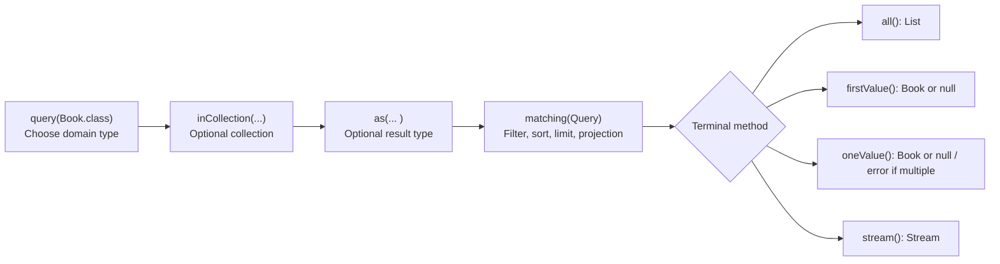

# FluentMongoOperations and the Type–Criteria–Result Steps

In **Spring Data MongoDB**, `MongoTemplate` is often used with methods such as `find(query, Book.class)`, `findOne(...)`, `updateFirst(...)`, and `remove(...)`. Alongside those methods, Spring Data provides a **fluent API** via `FluentMongoOperations`: instead of passing every option into one call, you chain explicit, meaningful steps from **entity type -> query criteria -> result retrieval**.

This lesson belongs to the **MongoTemplate** chapter of the **SPRING_DATA_MONGODB** module. Its goal is to build intuition for the fluent API, know when to use `query(Class)`, `matching(Query)`, `as(Class)`, `inCollection(String)`, and terminal methods like `all()`, `firstValue()`, `oneValue()`, and `stream()`; as well as using fluent update/remove variants and understanding their impact on MongoDB queries, indexes, transactions, testing, and reactive access.

## 1. What problem does the Fluent API solve?

Both styles below express the same intent: retrieving published books by an author.

**Traditional MongoTemplate:**

```java
Query filter = Query.query(
    Criteria.where("authorId").is(authorId)
            .and("status").is("PUBLISHED")
);

List<Book> books = mongoTemplate.find(filter, Book.class);
```

**FluentMongoOperations:**

```java
List<Book> books = mongoTemplate.query(Book.class)
    .matching(Query.query(
        Criteria.where("authorId").is(authorId)
                .and("status").is("PUBLISHED")
    ))
    .all();
```

The main difference is **expressiveness and step-by-step call structure**, not a different MongoDB query engine. Both use the same Spring Data MongoDB mapping infrastructure, driver, connections, and server. The fluent API is often easier to read when changing result types, collections, or terminal operations, making service intent clearer.



Step ordering depends on the specific fluent interface and chosen options; the diagram highlights **three core questions**: read **what type**, filter **which documents**, return in **what form**. Only the terminal call triggers a read operation; do not assume `query(Book.class)` sends a command to MongoDB on its own.

## 2. Preparing the entity, collection, and index

Suppose the `books` collection stores book documents in the format:

```javascript
{
  _id: ObjectId("674000000000000000000401"),
  tenant_id: "T1",
  author_id: "A-101",
  title: "MongoDB in Practice",
  status: "PUBLISHED",
  published_at: ISODate("2026-01-15T09:00:00Z"),
  price_vnd: NumberLong("280000")
}
```

A Java entity matching the document:

```java
import java.time.Instant;
import org.bson.types.ObjectId;
import org.springframework.data.annotation.Id;
import org.springframework.data.mongodb.core.mapping.Document;
import org.springframework.data.mongodb.core.mapping.Field;

@Document(collection = "books")
public class Book {
    @Id
    private ObjectId id;

    @Field("tenant_id")
    private String tenantId;

    @Field("author_id")
    private String authorId;

    private String title;
    private String status;

    @Field("published_at")
    private Instant publishedAt;

    @Field("price_vnd")
    private long priceVnd;

    public Book() {}

    public ObjectId getId() { return id; }
    public String getTenantId() { return tenantId; }
    public String getAuthorId() { return authorId; }
    public String getTitle() { return title; }
    public String getStatus() { return status; }
    public Instant getPublishedAt() { return publishedAt; }
    public long getPriceVnd() { return priceVnd; }
}
```

`@Id` marks the property mapped to the BSON `_id` field, while `@Field` maps Java names to actual MongoDB fields. When building `Criteria.where("authorId")` with `Book.class`, Spring Data resolves the path via mapping to `author_id`. When writing raw queries in `mongosh`, you must use `author_id`.

If services consistently filter by `tenant_id` and `status` and sort by publish date, one index to consider is:

```javascript
db.books.createIndex(
  { tenant_id: 1, status: 1, published_at: -1, _id: -1 },
  { name: "books_tenant_status_publish" }
);
```

This is a **candidate based on access patterns**, not a guarantee the query planner will pick it. Always verify `explain` against realistic data and query frequencies.

## 3. Obtaining and injecting FluentMongoOperations

`MongoTemplate` implements MongoDB operations and supports fluent operations. In a Spring Boot application with the synchronous Spring Data MongoDB starter, the template infrastructure is normally auto-configured.

Example service depending only on the fluent interface:

```java
import org.springframework.data.mongodb.core.FluentMongoOperations;
import org.springframework.stereotype.Service;

@Service
public class BookReadService {
    private final FluentMongoOperations mongo;

    public BookReadService(FluentMongoOperations mongo) {
        this.mongo = mongo;
    }
}
```

When a service also needs methods outside the fluent API, it can inject `MongoOperations` or `MongoTemplate` depending on its scope. Injecting the interface clarifies the API surface in use; it does not create a new MongoDB connection per call.

**Required setup:** synchronous MongoDB Java Driver, a valid database/URI, a `MongoTemplate` pointing to the intended database, and entities/converters recognized by Spring Data. You do not need to manually rebuild `MongoClient`/`MongoTemplate` beans just to use the fluent API if Boot already configured them properly.

## 4. Step one — selecting the type with query(Class)

Starting point of the read flow:

```java
var operation = mongo.query(Book.class);
```

`Book.class` is the **domain type**: Spring Data uses it to determine the default collection (`books`), `@Id`/`@Field` mappings, and how to deserialize documents into Java objects. Calling `query(Class)` merely constructs an operation builder object; **it has not fetched any data yet**.

Difference between *domain type* and *result type*:

- **Domain type** `Book`: describes the queried document and supplies mapping metadata.
- **Result type** can remain `Book`, or be a different type when `as(Class)` is used.
- **Collection** defaults to `@Document("books")`; it can be overridden via `inCollection(...)` when there is a clear reason.

Example query with no filter and a terminal call:

```java
List<Book> allBooks = mongo.query(Book.class).all();
```

This command can read the **entire collection**; never use it in a production endpoint when the collection is large. Being "fluent" does not automatically add pagination, filters, or RAM limits.

## 5. Step two — matching(Query): selecting documents with criteria

Use `Query` and `Criteria` to declare MongoDB filters.

```java
import org.springframework.data.mongodb.core.query.Criteria;
import org.springframework.data.mongodb.core.query.Query;

Query publishedByAuthor = Query.query(
    Criteria.where("tenantId").is("T1")
        .and("authorId").is("A-101")
        .and("status").is("PUBLISHED")
);

List<Book> result = mongo.query(Book.class)
    .matching(publishedByAuthor)
    .all();
```

Semantically, the filter translates to roughly:

```javascript
db.books.find({
  tenant_id: "T1",
  author_id: "A-101",
  status: "PUBLISHED"
});
```

`matching(Query)` **carries more than just filters**: `Query` can hold sort, limit, skip, and field projection settings. That keeps fluent chains concise while giving fine-grained query control.

### Combining sort and limit

```java
import org.springframework.data.domain.Sort;

Query newest = Query.query(
    Criteria.where("tenantId").is("T1")
        .and("status").is("PUBLISHED")
).with(Sort.by(
    Sort.Order.desc("publishedAt"),
    Sort.Order.desc("id")
)).limit(20);

List<Book> newestBooks = mongo.query(Book.class)
    .matching(newest)
    .all();
```

Mapping translates these to `published_at` and `_id` in BSON. `id` serves as a tie-breaker so ordering stays stable if multiple books share the exact same `publishedAt`. For deep pagination, prefer keyset pagination over growing `skip` offsets; the fluent API **does not automatically convert offsets into keyset queries**.

### Complex conditions with and/or

```java
Criteria tenant = Criteria.where("tenantId").is("T1");
Criteria eligible = new Criteria().orOperator(
    Criteria.where("status").is("PUBLISHED"),
    Criteria.where("status").is("PREORDER")
);

Query query = Query.query(
    new Criteria().andOperator(tenant, eligible)
);

List<Book> books = mongo.query(Book.class)
    .matching(query)
    .all();
```

In multi-tenant applications, the tenant predicate must apply across **every query branch** and come from a trusted authentication context, never from an unchecked client parameter. Using the fluent API does not automatically provide tenant isolation or authorization.

## 6. Step three — choosing how to receive results

The terminal method at the end of the chain expresses the question the service wants answered.

| Terminal method | Meaning in synchronous API | Best fit |
| --- | --- | --- |
| `all()` | Returns `List<T>` of matching documents | Bounded lists with filter and limit |
| `firstValue()` | Returns the first value or `null` if empty | Sorted queries defining the "first" record |
| `oneValue()` | Expects at most one result; throws error if multiple | Lookups by unique key or uniquely constrained criteria |
| `stream()` | Returns `Stream<T>` for sequential consumption | Processing large datasets with cursor resource management |

**Do not swap `oneValue()` and `firstValue()` casually:** the two methods differ in cardinality contracts. If criteria are expected to be unique yet two documents match, `oneValue()` exposes the uniqueness bug; `firstValue()` silently accepts taking one matching result.

### 6.1. all() — list

```java
List<Book> cards = mongo.query(Book.class)
    .matching(
        Query.query(Criteria.where("status").is("PUBLISHED"))
            .limit(30)
    )
    .all();
```

`all()` materializes the result list in Java memory. If a query can match hundreds of thousands of documents, enforce limits, select projections, or use streaming/batch processing. Measure actual document sizes, not just element counts.

### 6.2. firstValue() — taking the first match

```java
Book newest = mongo.query(Book.class)
    .matching(
        Query.query(Criteria.where("tenantId").is("T1"))
            .with(Sort.by(Sort.Order.desc("publishedAt"),
                          Sort.Order.desc("id")))
            .limit(1)
    )
    .firstValue();

if (newest == null) {
    // Tenant has no matching books yet.
}
```

Without specifying a sort, "first" does not mean newest, lowest ID, or insertion order. Always add a `Sort` when "newest", "lowest price", or any business ordering is intended.

### 6.3. oneValue() — requiring uniqueness

Suppose the collection has an `isbn` field and a **real unique index** exists for that ISBN scope:

```java
Book byIsbn = mongo.query(Book.class)
    .matching(Query.query(Criteria.where("isbn").is(isbn)))
    .oneValue();
```

`oneValue()` suits cases where business logic expects **at most one document**. If none match, it returns `null`. If multiple documents match, Spring Data throws an incorrect-result-size exception (e.g., a subtype of `IncorrectResultSizeDataAccessException`) instead of silently picking one.

**Distinguish two guarantees:** `oneValue()` expresses the contract in code and helps surface corrupted data, yet **it does not replace a MongoDB unique index** for preventing concurrent writes from inserting duplicates. If uniqueness is scoped to `tenant_id + isbn`, filter by tenant and create a matching compound unique index.

### 6.4. stream() — sequential consumption

```java
import java.util.stream.Stream;

Query query = Query.query(
    Criteria.where("tenantId").is("T1")
        .and("status").is("PUBLISHED")
).with(Sort.by(Sort.Order.asc("id")));

try (Stream<Book> books = mongo.query(Book.class)
        .matching(query)
        .stream()) {
    books.forEach(book -> processOneBook(book));
}
```

`processOneBook` is an illustrative application method. **Close the `Stream` with try-with-resources** so driver/cursor resources are released promptly. Never return a cursor-backed `Stream` out of a service after closing `MongoClient`, or hold a stream open across multiple HTTP requests.

`stream()` does not implement API keyset pagination: it consumes results of **a single open query**, whereas keyset pagination is a strategy for traversing **independent requests** using a sort key. Streaming also does not mean MongoDB uses zero memory; an unindexed sort may still buffer large amounts of data on the server before returning batches.

## 7. as(Class) — choosing a result type different from the entity

In an API returning only titles and IDs, a service may prefer a small read model instead of the full entity.

Declare the result type:

```java
import org.bson.types.ObjectId;

public class BookCard {
    private ObjectId id;
    private String title;

    public BookCard() {}

    public ObjectId getId() { return id; }
    public String getTitle() { return title; }
}
```

Use `as(BookCard.class)` together with server-side field projection in `Query`:

```java
Query listQuery = Query.query(
    Criteria.where("tenantId").is("T1")
        .and("status").is("PUBLISHED")
).with(Sort.by(Sort.Order.desc("publishedAt"),
              Sort.Order.desc("id"))).limit(20);

listQuery.fields().include("title");

List<BookCard> cards = mongo.query(Book.class)
    .as(BookCard.class)
    .matching(listQuery)
    .all();
```

`Book.class` remains the domain type for query construction and collection mapping, while `BookCard.class` is the target type for results. The `_id` field is included in projections by default unless excluded, letting the DTO populate its ID.

**Distinguish two concepts:** `as(BookCard.class)` maps results into **another Java type**, yet you should not assume it automatically trims the BSON payload across every version and configuration. `listQuery.fields().include("title")` explicitly tells the server which fields to return. For DTOs with `@Field`, immutable constructors, or interface projections, run integration tests against real data and your exact Spring Data version.

Objects populated via projection are usually **missing fields from the original entity**. Never pass a projected entity to `save` to update a single field, as doing so can overwrite and erase unloaded data. Use dedicated DTOs and explicit `update` operations.

## 8. inCollection(String) — deliberate collection selection

Per `@Document("books")`, the `Book` domain maps by default to `books`. If the business maintains a separate collection with the same schema (such as an archive collection), the fluent API can override the target:

```java
List<Book> archived = mongo.query(Book.class)
    .inCollection("books_archive")
    .matching(
        Query.query(Criteria.where("status").is("ARCHIVED"))
            .limit(20)
    )
    .all();
```

`inCollection("books_archive")` **does not switch databases**; it selects a collection inside `MongoTemplate`'s current database. Queries still use `Book` mapping for properties.

Never accept raw collection names directly from clients without validation: the collection name is **query structure**, not a filter value. Pick collections from an allowlist or backend routing logic, and never treat it as automatic tenant isolation.

## 9. Fluent update: choosing type, criteria, changes, and write scope

The fluent API is not limited to reads. For updates, there are three main choices: **entity type**, **filter**, and **modifications**.

Example transitioning a `DRAFT` book to `PUBLISHED` for a tenant:

```java
import com.mongodb.client.result.UpdateResult;
import org.springframework.data.mongodb.core.query.Update;

Query draftOfTenant = Query.query(
    Criteria.where("tenantId").is("T1")
        .and("status").is("DRAFT")
);

Update statusChange = new Update().set("status", "PUBLISHED");

UpdateResult firstResult = mongo.update(Book.class)
    .matching(draftOfTenant)
    .apply(statusChange)
    .first();

long updated = firstResult.getModifiedCount();
```

That contract **updates only the first matching document**; to update every document matching the filter, choose the corresponding terminal operation:

```java
UpdateResult allResult = mongo.update(Book.class)
    .matching(draftOfTenant)
    .apply(statusChange)
    .all();
```

In the **update** chain, `first()` and `all()` specify how many documents to modify, **which differs** from `firstValue()`/`all()` in the **find** chain. Always check whether the chain starts with `query(...)` or `update(...)` before interpreting the terminal method.

When targeting a single document by ID, filter by `id` and tenant rather than relying on "first" over multiple documents in natural order. Depending on the use case, `findAndModify` or conditional updates can return the pre- or post-update document.

### 9.1. Atomicity and @Version

A MongoDB update on a **single document** is atomic at the document level. However, updating multiple documents does not default to a shared transaction. Furthermore, manual `MongoTemplate` update operations may require explicit `@Version` handling or anti-overwrite conditions according to your versioning rules; do not assume every update carries full `repository.save(entity)` optimistic locking.

When transitioning status under "only if still DRAFT", put `status: DRAFT` in the filter and inspect `matchedCount`/`modifiedCount`. If another writer already changed the status, the filter will not match and the stale update will not apply silently.

## 10. Fluent remove: choosing type, criteria, and deleting

Deleting by filter is destructive, so always constrain tenant and status strictly.

```java
import com.mongodb.client.result.DeleteResult;

Query oldDrafts = Query.query(
    Criteria.where("tenantId").is("T1")
        .and("status").is("DRAFT")
);

DeleteResult removed = mongo.remove(Book.class)
    .matching(oldDrafts)
    .all();

long count = removed.getDeletedCount();
```

This **deletes matching documents**, not a single field. To remove a single field, use `Update.unset(...)`. Never copy this snippet to production without adding retention/time-bound conditions and proper authorization.

For simple CRUD, `MongoRepository` can be more concise; fluent update/remove shines when services need to state target entity, filter, and scope explicitly. If the filter omits tenant or is too broad, the fluent API **provides no built-in safeguard**.

## 11. Where do count, exists, and aggregation live?

Fluent queries focus on **finding and mapping documents**. If you only need a count or boolean, `MongoTemplate` provides dedicated operations so you never load all entities just to call `size()`:

```java
Query published = Query.query(
    Criteria.where("tenantId").is("T1")
        .and("status").is("PUBLISHED")
);

long total = mongoTemplate.count(published, Book.class);
boolean any = mongoTemplate.exists(published, Book.class);
```

This snippet assumes the service also holds `MongoTemplate` or `MongoOperations`. Depending on the Spring Data version, fluent APIs and repositories may offer additional count/exists terminals; the reliable choice is using **dedicated APIs** when only a count or existence check is needed.

When `$group`, `$lookup`, `$unwind`, or other stages are required, use the aggregation API instead of trying to squeeze a pipeline into `matching(Query)` on a find:

```java
Aggregation pipeline = Aggregation.newAggregation(
    Aggregation.match(
        Criteria.where("tenantId").is("T1")
            .and("status").is("PUBLISHED")
    ),
    Aggregation.group("authorId").count().as("bookCount")
);
```

This illustrates pipeline construction (requiring `import org.springframework.data.mongodb.core.aggregation.Aggregation`); execution uses `MongoTemplate.aggregate(...)` or appropriate aggregation operations. Fluent find, update, and aggregation correspond to distinct operations on MongoDB Server as well.

## 12. Dynamic queries: avoiding contradictory criteria

A search request may have optional filters: mandatory tenant, optional status, optional author, optional maximum price.

```java
import org.springframework.data.mongodb.core.query.Criteria;
import org.springframework.data.mongodb.core.query.Query;

Query buildFilter(
        String tenantId, String status,
        String authorId, Long maxPriceVnd) {

    Criteria criteria = Criteria.where("tenantId").is(tenantId);

    if (status != null && !status.isBlank()) {
        criteria = criteria.and("status").is(status);
    }
    if (authorId != null && !authorId.isBlank()) {
        criteria = criteria.and("authorId").is(authorId);
    }
    if (maxPriceVnd != null) {
        if (maxPriceVnd < 0) {
            throw new IllegalArgumentException("Maximum price must be non-negative");
        }
        criteria = criteria.and("priceVnd").lte(maxPriceVnd);
    }

    return Query.query(criteria).limit(100);
}
```

Usage:

```java
List<Book> result = mongo.query(Book.class)
    .matching(buildFilter("T1", "PUBLISHED", null, 500_000L))
    .all();
```

In complex queries, avoid adding duplicate keys on the same `Criteria` that overwrite earlier ones, or building JSON strings by concatenating raw input. `Criteria` represents dynamic values safely, and Spring Data translates `priceVnd` to `price_vnd`. If users can select sort fields, **allowlist** allowed property names rather than accepting arbitrary paths or MongoDB operators from clients.

## 13. Performance, indexes, and measurement

A clean fluent chain does not make the underlying query faster. Performance dimensions to measure:

- **Filter:** are equality fields like `tenant_id` and `status` selective?
- **Sort:** is `published_at DESC, _id DESC` index-supported or forcing an in-memory sort over many documents?
- **Limit:** does the API bound returned records?
- **Projection:** is it loading huge fields like book content or large nested arrays when only titles are needed?
- **Collection:** is `inCollection(...)` targeting the intended collection, or is the template pointing to the wrong database?
- **Stream:** are cursors closed promptly so the server does not retain open cursor state?
- **Update/remove:** do filters strictly enforce tenant/status, and is write concern acknowledged when reading modified counts?

Verify the equivalent query directly in `mongosh`:

```javascript
db.books.find({
  tenant_id: "T1",
  status: "PUBLISHED"
})
.sort({ published_at: -1, _id: -1 })
.limit(20)
.explain("executionStats");
```

Check `winningPlan`, `totalKeysExamined`, `totalDocsExamined`, `nReturned`, and any `SORT` stage. When queries combine multiple filters or sorts incompatible with an index, MongoDB may scan and sort many documents. On large datasets, benchmark p95/p99 latency and payload bytes rather than timing Java fluent-builder creation.

## 14. Testing fluent operations against real MongoDB

Mocking `FluentMongoOperations` verifies which chain a service calls, yet cannot prove `@Field` mappings, BSON types, filters, sorts, or counts on real MongoDB. Write integration tests against an isolated test MongoDB instance.

Example test inserting **raw documents** and reading them back via the fluent API:

```java
import static org.assertj.core.api.Assertions.assertThat;

import java.util.List;
import org.bson.Document;
import org.bson.types.ObjectId;
import org.junit.jupiter.api.Test;
import org.springframework.beans.factory.annotation.Autowired;
import org.springframework.boot.test.autoconfigure.data.mongo.DataMongoTest;
import org.springframework.data.mongodb.core.MongoTemplate;
import org.springframework.data.mongodb.core.query.Criteria;
import org.springframework.data.mongodb.core.query.Query;

@DataMongoTest
class FluentBookQueryTest {
    @Autowired MongoTemplate template;

    @Test
    void shouldMatchUsingMappedJavaPropertyNames() {
        ObjectId id1 = new ObjectId();
        ObjectId id2 = new ObjectId();
        String tenant = "test-" + id1.toHexString();

        template.getCollection("books").insertMany(List.of(
            new Document("_id", id1)
                .append("tenant_id", tenant)
                .append("author_id", "A-101")
                .append("status", "PUBLISHED")
                .append("title", "Book A"),
            new Document("_id", id2)
                .append("tenant_id", tenant)
                .append("author_id", "A-102")
                .append("status", "DRAFT")
                .append("title", "Book B")
        ));

        Query published = Query.query(
            Criteria.where("tenantId").is(tenant)
                .and("status").is("PUBLISHED")
        );

        List<Book> books = template.query(Book.class)
            .matching(published)
            .all();

        assertThat(books).hasSize(1);
        assertThat(books.get(0).getId()).isEqualTo(id1);
        assertThat(books.get(0).getTitle()).isEqualTo("Book A");
        assertThat(books.get(0).getAuthorId()).isEqualTo("A-101");

        Book single = template.query(Book.class)
            .matching(published)
            .oneValue();

        assertThat(single).isNotNull();
        assertThat(single.getId()).isEqualTo(id1);
    }
}
```

This test isolates tenant data using a random ID and does not need to wipe the whole collection. Run only against a **test database** (such as Testcontainers), never against production. If your project uses a different Spring Boot/Spring Data version, adjust test slices and dependencies accordingly.

Additional test cases to include:

1. `firstValue()` with sorting and with an empty result set.
2. `oneValue()` when two documents match to verify uniqueness enforcement.
3. `as(BookCard.class)` with field projection: receiving only needed data without overwriting the original entity.
4. `inCollection("books_archive")` reading the archive without mixing with `books`.
5. Fluent `update(...).first()` and `.all()` modifying the expected document counts when two records match.
6. Fluent `remove(...).all()` leaving other tenants' documents intact.
7. `stream()` closed cleanly upon completion without holding cursors across resource boundaries.
8. `explain` diagnostics under larger datasets to confirm compound index usage.

## 15. Reactive fluent API differs in return types and execution timing

In WebFlux applications, `ReactiveMongoTemplate` uses the reactive MongoDB Driver. The fluent API has a similar query structure, yet results are `Mono<T>`/`Flux<T>` publishers instead of synchronous values or collections:

```java
import org.springframework.data.mongodb.core.ReactiveMongoTemplate;
import reactor.core.publisher.Flux;

Flux<Book> findPublishedReactive(
        ReactiveMongoTemplate template, String tenantId) {

    Query query = Query.query(
        Criteria.where("tenantId").is(tenantId)
            .and("status").is("PUBLISHED")
    ).limit(20);

    return template.query(Book.class)
        .matching(query)
        .all();
}
```

`Flux<Book>` merely describes the operation until subscribed to; Spring WebFlux normally subscribes to the publisher returned by a handler. Never call `block()` on an event-loop thread, and never manually `subscribe()` in a service and return before the query completes. Queries and indexes still require optimization: reactive I/O does not turn a `COLLSCAN` into an `IXSCAN`.

Reactive transactions require the reactive driver and `ReactiveMongoTransactionManager`, propagating context along the Reactor chain. Do not think wrapping a synchronous `FluentMongoOperations` result in `Mono.just(...)` makes it reactive.

## 16. Common mistakes and how to avoid them

| Mistake | Why it is dangerous | Solution |
| --- | --- | --- |
| Calling `query(Book.class)` and thinking it ran a query | The fluent builder has no terminal call yet | Add terminal `all()`, `firstValue()`, `oneValue()`, or `stream()` |
| Calling `all()` on a huge collection | Loads many documents and exhausts heap | Add filters/limits, projections, or proper streaming |
| Using `firstValue()` for unique lookups | Masks duplicate records | Use `oneValue()` and an appropriate unique index |
| Fetching "newest" without sorting | Natural order is unreliable | Sort by timestamp with a tie-breaker |
| Querying by `author_id` as if it were the Java property | Breaks when mapping/schema changes | Use `authorId` and verify `@Field` |
| Assuming `as()` guarantees only two fields are read | Network payload may still transfer more | Configure `Query.fields()` and measure payload |
| Passing raw user input to `inCollection(...)` | Reads wrong collection or breaks tenant isolation | Enforce an allowlist and server-side tenant checks |
| Forgetting to close `stream()` | Leaks open cursors/connections | Use try-with-resources |
| Calling `save` on a projected partial entity | Risks erasing unloaded fields | Use DTOs + field-level updates |
| Fluent remove with an overly broad filter | Can delete unintended documents | Always scope by tenant, permissions, and business rules |
| Relying on `@Transactional` without configuring manager | Fails to provide expected atomicity | Configure transaction manager/sessions per driver/topology |
| Tests only mock fluent chains | Fails to verify query mapping and BSON | Write integration tests against real MongoDB |

## 17. Practice lab and self-assessment

**Lab:** Create the `books` collection in a development MongoDB instance and the `Book` entity from the example. Then:

1. Use `mongo.query(Book.class).matching(...).all()` to list `PUBLISHED` books for `T1`, limited to 20 records.
2. Add sort `publishedAt DESC, id DESC` and call `firstValue()` to retrieve the newest book.
3. Set up a unique-expected predicate (e.g., `tenantId + isbn` after adding the field/index); test `oneValue()` against duplicate records.
4. Use `as(BookCard.class)` with `Query.fields().include("title")`; observe returned fields via command monitoring.
5. Create `books_archive` and use `inCollection(...)` to read from it without altering domain mapping.
6. Run `update(Book.class).matching(...).apply(...).first()`; inspect `matchedCount`/`modifiedCount`.
7. Test `remove(Book.class).matching(...).all()` **strictly** on test data with an explicit tenant filter.
8. Use `stream()` inside try-with-resources and compare with `all()` on bounded reads.
9. Add a compound index matching real queries and verify with `explain("executionStats")`.

**Q1.** Does `query(Book.class)` choose the collection or the result type?  
**Answer:** It selects the **domain type** to determine mapping and the default collection; you can choose a different result type with `as(...)` and a different collection with `inCollection(...)`.

**Q2.** Does `matching(Query)` hold only filters?  
**Answer:** No; `Query` can hold filters, sort, limit, skip, and field projections.

**Q3.** Why does `oneValue()` differ from `firstValue()`?  
**Answer:** `oneValue()` requires at most one result, whereas `firstValue()` takes the first when multiple match; for "first" to have business meaning, an explicit sort is required.

**Q4.** Does `as(BookCard.class)` mean a `Book` entity is stored as `BookCard`?  
**Answer:** No; `as()` only changes the **target mapping type for read results**, without altering data stored in MongoDB.

**Q5.** Is `update(...).apply(...).all()` similar to `query(...).all()`?  
**Answer:** No; one updates all matching documents, while the other reads and returns a list of documents.

**Q6.** Can you return a Java `Stream<Book>` directly to a client to consume after the service closes resources?  
**Answer:** You should not; the stream may depend on an open driver cursor and must be consumed and closed within a valid lifecycle.

**Q7.** Why do fluent queries still need indexes?  
**Answer:** The fluent API is purely a Java-side abstraction; MongoDB Server still chooses query plans based on filters, sorts, indexes, and data distribution.

**Conclusion:** Using **FluentMongoOperations** with the flow **select type (`query(Class)`) -> select criteria (`matching(Query)`) -> select result (`all`, `firstValue`, `oneValue`, `stream`)** makes query intent explicit. `as` and `inCollection` adjust mapping output and target collection, while `update` and `remove` chains share terminal names with write effects. Correctness, consistency, and performance must still be verified via BSON mapping, safe filters, indexes, transactions, and integration tests against real MongoDB.
