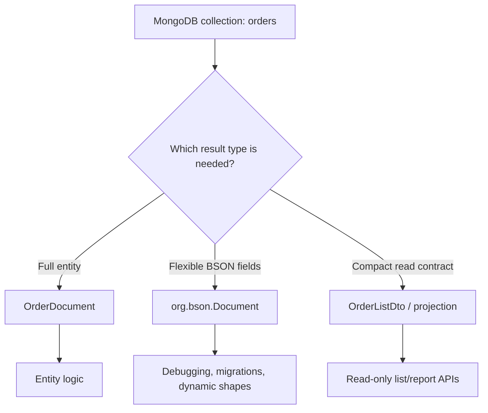

# Returning Document or DTO When the Full Entity Is Not Needed

## 1. Problem: a screen only needs a few fields from a large document

In an ordering system, an `orders` document might hold customer details, shipping address, line items, totals, update history, and internal notes. Yet an order listing page typically only needs **order ID, status, total amount, and creation time**.

If every query maps to the full `OrderDocument`, the application may:

- Transfer more BSON bytes over the network than necessary.
- Instantiate nested objects and `items` arrays even though the screen ignores them.
- Spend extra time converting types and serializing JSON responses.
- Easily confuse a partially loaded object with a full entity, leading to bugs when writing back.
- Accidentally expose or log internal data without clear API boundaries.

**`MongoTemplate`** in **Spring Data MongoDB** lets you deliberately choose **how to query, which fields to fetch, and the result type**. Alongside returning entities, two important options are:

1. Returning **`org.bson.Document`** when you want to work directly with BSON structures/dynamic fields, debug legacy data, or handle results without a fixed Java model.
2. Returning a **DTO/record or interface projection** when the application wants a compact, strongly typed read contract.

This lesson belongs to the **MongoTemplate** chapter of the **SPRING_DATA_MONGODB** module. It connects template usage with query design, projections, aggregations, indexes, transactions, reactive access, testing, and performance diagnostics. The focus is on **reading strictly the data you need without loading or using the full entity**; do not treat `Document` and DTOs as interchangeable in every scenario.

## 2. Sample data and source entity

### 2.1. BSON document in MongoDB

Suppose a test database contains the record:

```javascript
db.orders.insertOne({
  _id: "ord-1001",
  customer_id: "cus-01",
  status: "PAID",
  total_amount: NumberDecimal("1850000.00"),
  placed_at: ISODate("2026-11-20T02:00:00Z"),
  shipping_address: {
    recipient: "Alice Nguyen",
    city: "Da Nang",
    phone: "0900000000"
  },
  items: [
    {
      product_id: "p-10",
      name_at_purchase: "Mechanical Keyboard",
      quantity: NumberInt(2),
      unit_price: NumberDecimal("925000.00")
    }
  ],
  internal_note: "Deliver during business hours"
});
```

This `insertOne` illustrates **actual BSON** written directly from `mongosh`. It bypasses Spring Data mapping. In production code, verify the BSON shape produced after writing via a repository or template because converters and annotations can alter field names and types.

From this data, the list view only wants results equivalent to:

```javascript
{
  _id: "ord-1001",
  status: "PAID",
  total_amount: NumberDecimal("1850000.00"),
  placed_at: ISODate("2026-11-20T02:00:00Z")
}
```

Fields `shipping_address`, `items`, and `internal_note` stay in the database and **are not returned** when an appropriate projection is applied.

### 2.2. Full Java entity

Java 17+ example with Spring Data MongoDB:

```java
import java.math.BigDecimal;
import java.time.Instant;
import java.util.List;

import org.springframework.data.mongodb.core.mapping.Document;
import org.springframework.data.mongodb.core.mapping.Field;
import org.springframework.data.mongodb.core.mapping.FieldType;
import org.springframework.data.mongodb.core.mapping.MongoId;

@Document(collection = "orders")
public record OrderDocument(
    @MongoId(FieldType.STRING)
    String id,

    @Field("customer_id")
    String customerId,

    String status,

    @Field(value = "total_amount", targetType = FieldType.DECIMAL128)
    BigDecimal totalAmount,

    @Field("placed_at")
    Instant placedAt,

    @Field("shipping_address")
    ShippingAddress shippingAddress,

    List<OrderItem> items,

    @Field("internal_note")
    String internalNote
) {
    public record ShippingAddress(
        String recipient,
        String city,
        String phone
    ) {}

    public record OrderItem(
        @Field("product_id") String productId,
        @Field("name_at_purchase") String nameAtPurchase,
        int quantity,
        @Field(value = "unit_price", targetType = FieldType.DECIMAL128)
        BigDecimal unitPrice
    ) {}
}
```

Here Java names and BSON names are intentionally different. For instance, `customerId` is stored as `customer_id`, and `totalAmount` as `total_amount`. `@MongoId(FieldType.STRING)` explicitly keeps `id` in `_id` as a BSON `string`.

Documents written via Spring Data may also include a `_class` type hint depending on mapping configuration; sample data inserted via `mongosh` does not include that field automatically.

**Key point:** the full entity fits business operations that require loading the entire aggregate; it is not necessarily the best return type for every read-only endpoint.

## 3. Three read options and mapping boundaries

| Read approach | Return type | Which mapping does it use? | Best suited when |
| --- | --- | --- | --- |
| `mongoTemplate.find(query, OrderDocument.class)` | `List<OrderDocument>` | Entity mapping via `OrderDocument` | Full aggregate or entity-based business logic is needed |
| `mongoTemplate.find(query, Document.class, "orders")` | `List<org.bson.Document>` | Query/template execution and `Document` conversion; no `OrderDocument` instantiation | Flexible BSON field sets or heterogeneous data handling |
| `mongoTemplate.query(OrderDocument.class).as(OrderListDto.class)...all()` | `List<OrderListDto>` | Uses **source entity** for query mapping and **DTO** for result construction | Compact DTO needed while Java/BSON names may differ |
| `mongoTemplate.getCollection("orders").find(...)` | `MongoCollection<Document>` returning raw driver documents | Bypasses Spring Data entity mapping on the driver path | BSON diagnostics or low-level driver features |

`org.bson.Document` is a **MongoDB Driver Java class**, distinct from Spring Data's `@Document` annotation. Both contain the word "Document", yet their roles are completely different:

- `@Document(collection = "orders")` marks an entity type and its collection metadata.
- `org.bson.Document` is a key/value structure holding driver-decoded BSON data, providing methods like `getString`, `getDate`, and `get`.

Avoid calling `org.bson.Document` "plain JSON" because it still holds `Decimal128`, `ObjectId`, `Date`, and other BSON-specific values. Converting it to JSON for display can change how numbers or dates are represented.



## 4. Restricting fields with `Query.fields()`

Before choosing between `Document` and DTO, understand how to select fields directly on the server.

### 4.1. Inclusion projection

In `mongosh`:

```javascript
db.orders.find(
  { customer_id: "cus-01" },
  {
    _id: 1,
    status: 1,
    total_amount: 1,
    placed_at: 1
  }
);
```

In Spring Data MongoDB, a query **mapped against the source entity** can use Java properties:

```java
import org.springframework.data.mongodb.core.query.Criteria;
import org.springframework.data.mongodb.core.query.Query;

Query query = Query.query(
    Criteria.where("customerId").is("cus-01")
);

query.fields()
    .include("id")
    .include("status")
    .include("totalAmount")
    .include("placedAt");
```

When `Query` executes through a path carrying `OrderDocument` metadata, Spring Data maps `customerId` -> `customer_id`, `totalAmount` -> `total_amount`, and `id` -> `_id`.

**Do not assume the exact same query maps identically when the target is just `Document.class` or an independent DTO.** Which template path you call determines the domain type used to translate property names.

### 4.2. Exclusion projection and default `_id`

MongoDB includes `_id` by default unless you explicitly exclude it:

```javascript
db.orders.find(
  { customer_id: "cus-01" },
  { status: 1, total_amount: 1, _id: 0 }
);
```

Standard inclusion (`1`) and exclusion (`0`) directives **cannot be mixed arbitrarily**, except for `_id` and certain server-specific projection operators. For example, `{ status: 1, items: 0 }` is invalid in standard projections; choose either inclusion or exclusion.

For APIs with fixed response contracts, an **inclusion allowlist** is usually easier to maintain than exclusion. If a `risk_note` field is added to documents later, an old exclusion list will expose the new field unexpectedly, whereas an inclusion list will not expand on its own.

### 4.3. Nested fields and arrays

```javascript
// Fetch only recipient name, omitting the rest of the address.
db.orders.find(
  { _id: "ord-1001" },
  { "shipping_address.recipient": 1 }
);

// Fetch only product_id from each element of items.
db.orders.find(
  { _id: "ord-1001" },
  { "items.product_id": 1 }
);
```

Projecting `items.product_id` still returns **all elements** of the array; it only trims fields inside each element. To select specific array elements, use `$slice`, `$elemMatch`, or an aggregation pipeline; do not confuse field projection with element filtering.

An entity or subdocument loaded through projection is missing fields and is no longer a complete representation; for writes, either load the entity at full scope or run field-level updates.

## 5. Approach 1: returning `org.bson.Document` with `MongoTemplate`

### 5.1. Raw-field query and explicit collection

When selecting `Document.class` as the target, a reliable approach is using **actual BSON field names** in the query and projection:

```java
import java.util.List;

import org.bson.Document;
import org.springframework.data.domain.Sort;
import org.springframework.data.mongodb.core.MongoTemplate;
import org.springframework.data.mongodb.core.query.Criteria;
import org.springframework.data.mongodb.core.query.Query;

public List<Document> findRawOrderHeaders(
    MongoTemplate template,
    String customerId
) {
    Query query = Query.query(
        Criteria.where("customer_id").is(customerId)
    );

    query.fields()
        .include("_id")
        .include("status")
        .include("total_amount")
        .include("placed_at");

    query.with(
        Sort.by(
            Sort.Order.desc("placed_at"),
            Sort.Order.desc("_id")
        )
    );
    query.limit(20);

    return template.find(
        query,
        Document.class,
        "orders"
    );
}
```

This example requests only header fields. Because `Document` is not `OrderDocument`, the code **does not** rely on `MongoTemplate` reading annotations from the original entity. If you want Java property names and source entity metadata, see the fluent query approach in section 7.

`MongoTemplate.find(query, Document.class, "orders")` differs from `mongoTemplate.getCollection("orders").find(...)`: the template method goes through Spring Data's query execution infrastructure, while the raw driver works directly on the driver collection without Spring Data entity metadata/converters.

### 5.2. Reading proper BSON types from `Document`

Suppose `total_amount` is BSON `Decimal128` and `placed_at` is BSON `Date`. Appropriate getters:

```java
import java.math.BigDecimal;
import java.time.Instant;
import java.util.Date;

import org.bson.Document;
import org.bson.types.Decimal128;

public record OrderHeader(
    String id,
    String status,
    BigDecimal totalAmount,
    Instant placedAt
) {}

public OrderHeader toHeader(Document raw) {
    String id = raw.getString("_id");
    String status = raw.getString("status");

    Decimal128 amount = raw.get(
        "total_amount", Decimal128.class
    );
    Date date = raw.getDate("placed_at");

    if (id == null || status == null
            || amount == null || date == null) {
        throw new IllegalArgumentException(
            "Document is missing required fields"
        );
    }

    return new OrderHeader(
        id,
        status,
        amount.bigDecimalValue(),
        date.toInstant()
    );
}
```

This function validates data explicitly. If `total_amount` is actually a BSON string or double from a legacy schema, requesting `Decimal128` throws a type error—which is a **signal of schema-contract violation**, not something to silently coerce into money without knowing business rules.

At the `Document` level, nested objects are normally `Document` instances and arrays are `List` instances. The ID type must also be verified: if `_id` is a BSON `ObjectId` instead of a string, `getString("_id")` will fail. You can use `raw.get("_id")`, `instanceof`, and an explicit conversion policy.

### 5.3. When to choose `Document`?

`Document` is useful when:

- Schemas vary across data sources or versions.
- You need to inspect actual BSON types or field names.
- Writing migration, reconciliation, or data-quality inspection tools.
- Reading a BSON subset to map manually into a view without creating a full entity.
- Receiving aggregation results whose shape varies or includes fields absent from the source entity.

The trade-off is losing compile-time type safety: a typo like `"total_amout"` instead of `"total_amount"` only surfaces at runtime, and misreading `Decimal128`/`Date`/null can fail. For APIs with stable shapes, DTOs are generally clearer and easier to test.

## 6. Approach 2: direct driver access when real BSON is needed

If the primary goal is debugging or using low-level MongoDB Java Driver capabilities, obtain the collection from the template:

```java
import java.util.ArrayList;
import java.util.List;

import org.bson.Document;
import com.mongodb.client.MongoCollection;

import static com.mongodb.client.model.Filters.eq;
import static com.mongodb.client.model.Projections.fields;
import static com.mongodb.client.model.Projections.include;
import static com.mongodb.client.model.Sorts.descending;

public List<Document> findDriverHeaders(
    MongoTemplate template,
    String customerId
) {
    MongoCollection<Document> collection =
        template.getCollection("orders");

    return collection.find(eq("customer_id", customerId))
        .projection(fields(
            include("_id", "status", "total_amount", "placed_at")
        ))
        .sort(descending("placed_at", "_id"))
        .limit(20)
        .into(new ArrayList<>());
}
```

This snippet uses **BSON field names** and driver `Filters`/`Projections`/`Sorts` APIs. It does not automatically translate `customerId` -> `customer_id`, nor convert custom `BigDecimal` domain value objects via Spring Data custom converters.

**Do not use the raw driver inside a Spring Data transaction assuming the session/transaction context propagates automatically like `MongoTemplate`.** When transactions are needed, use APIs bound to Spring Data's managed session (such as `execute` callbacks) or pass an explicit `ClientSession` to the driver per contract. The raw driver is great for debugging, though bypassing converters can expose differences between application results and raw storage.

Also never allow external callers to pass arbitrary collection names, field names, or BSON filters when authorization boundaries exist.

## 7. Approach 3: returning a DTO/record via Fluent MongoTemplate

This is the approach to **consider first** when building a read-only API with a fixed shape.

### 7.1. Defining a record DTO

```java
import java.math.BigDecimal;
import java.time.Instant;

public record OrderListDto(
    String id,
    String status,
    BigDecimal totalAmount,
    Instant placedAt
) {}
```

The DTO has only four fields. It is not an entity meant to save an entire order back. The record constructor clearly declares what data to construct and prevents a partially populated `OrderDocument` from being misused as a complete entity.

### 7.2. Fluent query separating source and target types

Spring Data MongoDB supports fluent operations where `query(Source.class)` specifies the source domain type for field mapping, while `as(Result.class)` selects the **result type**:

```java
import java.util.List;

import org.springframework.data.domain.Sort;
import org.springframework.data.mongodb.core.MongoTemplate;
import org.springframework.data.mongodb.core.query.Criteria;
import org.springframework.data.mongodb.core.query.Query;

public List<OrderListDto> findOrderDtos(
    MongoTemplate template,
    String customerId
) {
    Query query = Query.query(
        Criteria.where("customerId").is(customerId)
    );

    query.with(
        Sort.by(
            Sort.Order.desc("placedAt"),
            Sort.Order.desc("id")
        )
    );
    query.limit(20);

    return template.query(OrderDocument.class)
        .as(OrderListDto.class)
        .matching(query)
        .all();
}
```

Key points:

- `OrderDocument.class` specifies the collection from `@Document` and metadata of the **source entity**.
- `Criteria.where("customerId")` and sorting by `placedAt`/`id` are mapped to BSON `customer_id`, `placed_at`, and `_id`.
- `as(OrderListDto.class)` requests mapping results into the DTO instead of instantiating `OrderDocument`.
- With **closed interface or DTO projections** and a `Query` without manual field restrictions, the fluent API can automatically project only the fields needed.
- `all()` executes the query and returns `List<OrderListDto>`. For a single record, the fluent API also provides `first()` and `one()` per its contract.

**Do not assume every DTO automatically optimizes projection:** custom converters, nested properties, complex queries, open projections, or specific configurations can cause the framework to fetch more data. Inspect actual MongoDB commands when proving BSON byte reduction.

Likewise, do not call `template.find(query, OrderListDto.class, "orders")` expecting the query to pick up `OrderDocument` metadata; that path uses the target DTO's own metadata for mapping. Fluent `query(OrderDocument.class).as(...)` explicitly separates **source entity** from **result type**.

### 7.3. Interface projections are also an option

Example:

```java
import java.math.BigDecimal;
import java.time.Instant;

public interface OrderListView {
    String getId();
    String getStatus();
    BigDecimal getTotalAmount();
    Instant getPlacedAt();
}
```

In a service:

```java
List<OrderListView> views = template
    .query(OrderDocument.class)
    .as(OrderListView.class)
    .matching(query)
    .all();
```

Closed interfaces let Spring Data infer the required properties; read results are usually backed by projection proxies. Record DTOs produce immutable objects with explicit constructors, fitting well when passing values across layers. Neither option is universally best; weigh testability, library compatibility, presentation logic, and performance.

### 7.4. When not to use DTO projections directly?

- Results require `$sum`, `$multiply`, `$concat`, or cross-collection joins: an aggregation pipeline is clearer.
- Stored data is heterogeneous and you need to detect unexpected BSON types: raw `Document` reveals anomalies rather than failing conversion silently or unexpectedly.
- The DTO does not match source properties one-to-one and needs business transformation: read a stable projection and map to the response DTO in the service.
- Results carry dynamic fields that cannot be modeled by a fixed record: `Document` fits better.

## 8. `@Field`, Java properties, and BSON names: common pitfalls

Given the model in section 2:

| Java property | BSON stored name | Expected BSON type |
| --- | --- | --- |
| `id` | `_id` | string |
| `customerId` | `customer_id` | string |
| `status` | `status` | string |
| `totalAmount` | `total_amount` | decimal |
| `placedAt` | `placed_at` | date |
| `shippingAddress` | `shipping_address` | object |
| `internalNote` | `internal_note` | string |

When calling:

```java
template.query(OrderDocument.class)
    .as(OrderListDto.class)
    .matching(
        Query.query(
            Criteria.where("customerId").is("cus-01")
        )
    )
    .all();
```

the domain type `OrderDocument` tells the framework that `customerId` is `customer_id`. However, when calling:

```java
template.getCollection("orders")
    .find(com.mongodb.client.model.Filters.eq(
        "customerId", "cus-01"
    ));
```

the driver knows nothing about `@Field("customer_id")`, so filtering on `customerId` fails to match the sample BSON document. With the raw driver, you must use `"customer_id"`.

Similarly, setting `Query.fields().include("totalAmount")` with source entity metadata maps to `total_amount`; when querying directly against `Document.class` without `OrderDocument` metadata, use the actual BSON name.

**Verification workflow:** inspect a real document in `mongosh`, check `$type` on fields, run the application query, verify the MongoDB command receives the right filter/projection, and test Java output types after mapping.

## 9. Projection, partially loaded entities, and the risk of `save`

Suppose you keep the entity as the return type yet request only four fields:

```java
Query q = Query.query(
    Criteria.where("customerId").is("cus-01")
);
q.fields()
    .include("id")
    .include("status")
    .include("totalAmount")
    .include("placedAt");

List<OrderDocument> partial =
    template.find(q, OrderDocument.class);
```

In the returned `OrderDocument`, properties such as `shippingAddress`, `items`, and `internalNote` were not loaded. On a record, missing reference fields become `null`; on a class with primitives, they become defaults like `0` or `false` depending on mapping.

**Never call `mongoTemplate.save(partial.get(0))` to update status.** Depending on save/replace mechanics and mapping, missing values can erase existing fields in the database. `save` persists an entity, not "automatically update only the projected fields".

### 9.1. Conditional field-level updates

If you only want to transition status:

```java
import com.mongodb.client.result.UpdateResult;

import org.springframework.data.mongodb.core.MongoTemplate;
import org.springframework.data.mongodb.core.query.Criteria;
import org.springframework.data.mongodb.core.query.Query;
import org.springframework.data.mongodb.core.query.Update;

public boolean markShipped(
    MongoTemplate template,
    String id
) {
    Query q = Query.query(
        Criteria.where("id").is(id)
            .and("status").is("PAID")
    );

    Update change = new Update()
        .set("status", "SHIPPED");

    UpdateResult result = template.updateFirst(
        q, change, OrderDocument.class
    );

    return result.getModifiedCount() == 1;
}
```

This is a conditional **single-document** update with no prior entity load needed. MongoDB executes an atomic document write; other fields are untouched instead of being replaced by missing partial-entity values. Conditional updates still require proper authorization and business state-transition rules.

### 9.2. A DTO is a read model, not an aggregate

`OrderListDto` and `OrderListView` should be used to read and return data. To update an order, issue explicit commands (`$set`, `$inc`, `findAndModify`) or load the full entity following optimistic locking/version rules.

Never pass a DTO to `save(dto)` just because it has an ID: it is not a full storage entity and lacks necessary metadata/converters.

## 10. Nested DTOs, numeric conversions, and legacy data

### 10.1. Record DTO for nested data

A summary might need only the shipping city:

```java
import java.math.BigDecimal;

public record OrderCityDto(
    String id,
    String status,
    BigDecimal totalAmount,
    CityDto shippingAddress
) {
    public record CityDto(String city) {}
}
```

You can try `as(OrderCityDto.class)`, but verify how nested properties map. A nested projection may cause Spring Data to read the whole `shipping_address` subdocument rather than strictly `city`; inspect the actual command.

If you **must** retrieve strictly `shipping_address.city` without fetching phone numbers, an explicit field projection or `$project` aggregation stage gives full BSON control:

```javascript
db.orders.find(
  { customer_id: "cus-01" },
  {
    _id: 1,
    status: 1,
    total_amount: 1,
    "shipping_address.city": 1
  }
);
```

For field-level privacy enforcement, use explicit allowlists and DTOs; projection never replaces authorization.

### 10.2. BSON Decimal128 is not Double

Total amount is stored as BSON `Decimal128`:

```javascript
{
  total_amount: NumberDecimal("1850000.00")
}
```

With a raw `Document` returned by the driver, read `org.bson.types.Decimal128` and call `bigDecimalValue()`. With a DTO property typed as `BigDecimal`, Spring Data converters map it to the matching Java type.

Never use `Double` for money and cast arbitrarily to `BigDecimal`: binary floating point cannot represent many decimal fractions accurately. Define currency, scale, and rounding rules per business requirements.

### 10.3. Date and Instant

MongoDB BSON Date stores points in time as milliseconds since epoch. In raw `Document`, it is typically decoded as `java.util.Date`; a DTO `Instant` can be converted by Spring Data.

If legacy documents store `placed_at` as an ISO-8601 string instead of a BSON Date, DTO conversion may fail or behave inconsistently depending on converters. Check field types with `$type` before assuming the entire collection matches the new schema.

### 10.4. Nulls and missing fields

Suppose some older orders lack `total_amount`. With a record DTO:

```java
public record OrderListDto(
    String id,
    String status,
    java.math.BigDecimal totalAmount,
    java.time.Instant placedAt
) {}
```

The record can receive `null` for a missing reference field if mapping allows it. Never silently treat `null` as zero revenue. APIs need an explicit policy: reject invalid orders, flag missing data, or run a migration.

With raw `Document`, you can distinguish both cases:

```java
boolean exists = raw.containsKey("total_amount");
Object value = raw.get("total_amount");

if (!exists) {
    // Field does not exist at all.
} else if (value == null) {
    // Field exists with a null value.
} else {
    // Field has a value; check BSON/Java type.
}
```

## 11. Aggregations returning `Document` or DTO

`MongoTemplate` is not limited to `find`. When results involve computed fields or grouping across documents, aggregation is the right tool.

### 11.1. Order totals report by status

Suppose every confirmed order stores `total_amount` as `Decimal128`. A simple pipeline in `mongosh`:

```javascript
db.orders.aggregate([
  { $match: { customer_id: "cus-01" } },
  {
    $group: {
      _id: "$status",
      orderCount: { $sum: 1 },
      totalAmount: { $sum: "$total_amount" }
    }
  },
  { $sort: { orderCount: -1 } }
]);
```

This sums order amounts by status; it is **not an accounting revenue report**, as it does not filter recognized statuses, refunds, cancellations, taxes, or currencies.

### 11.2. Aggregate result as `Document`

```java
import java.util.List;

import org.bson.Document;
import org.springframework.data.mongodb.core.MongoTemplate;
import org.springframework.data.mongodb.core.aggregation.Aggregation;
import org.springframework.data.mongodb.core.query.Criteria;

public List<Document> countByStatus(
    MongoTemplate template,
    String customerId
) {
    Aggregation agg = Aggregation.newAggregation(
        Aggregation.match(
            Criteria.where("customerId").is(customerId)
        ),
        Aggregation.group("status")
            .count().as("orderCount")
            .sum("totalAmount").as("totalAmount"),
        Aggregation.sort(
            org.springframework.data.domain.Sort.Direction.DESC,
            "orderCount"
        )
    );

    return template.aggregate(
        agg,
        OrderDocument.class,
        Document.class
    ).getMappedResults();
}
```

Supplying `OrderDocument.class` as the **input domain type** lets Spring Data translate fields such as `customerId` and `totalAmount` to `customer_id` and `total_amount` in supported pipeline stages. Returning `Document` fits well when inspecting group `_id`, `orderCount`, and `totalAmount` before introducing a DTO.

### 11.3. Mapping aggregation results into a report DTO

You can define:

```java
import java.math.BigDecimal;

public record OrderStatusReport(
    String id,
    long orderCount,
    BigDecimal totalAmount
) {}
```

And switch the output type:

```java
List<OrderStatusReport> reports = template.aggregate(
    agg,
    OrderDocument.class,
    OrderStatusReport.class
).getMappedResults();
```

In this pipeline, `_id` holds the grouped `status` value; the DTO uses `id` to receive `_id` under standard mapping. If you prefer a `status` property in the DTO, add a `$project` stage or `@Field("_id")` where appropriate and verify the mapping. In real reports, test values, `Decimal128` types, nulls, currencies, ordering, and record constructor mapping.

When aggregating across multiple currencies, group by currency or apply an explicit conversion policy; never sum USD and VND into a single meaningless number.

## 12. Indexes and performance: do fewer fields mean faster queries?

Projections generally reduce how much data MongoDB must **return** and how much the client must map; they do not guarantee the storage engine reads fewer documents. Without an index, MongoDB may still scan most of the collection.

### 12.1. Filter and sort index

For a listing screen filtering by customer and sorting newest orders first:

```javascript
db.orders.createIndex({
  customer_id: 1,
  placed_at: -1,
  _id: -1
});
```

Corresponding query:

```javascript
db.orders.find(
  { customer_id: "cus-01" },
  {
    _id: 1,
    status: 1,
    total_amount: 1,
    placed_at: 1
  }
)
.sort({ placed_at: -1, _id: -1 })
.limit(20)
.explain("executionStats");
```

Inspect `IXSCAN`/`COLLSCAN`, `totalKeysExamined`, `totalDocsExamined`, and execution time. That index supports filtering and sorting, though it is not a **covered query** because `status` and `total_amount` are not in the index.

### 12.2. Covered query: stricter requirements

When **every filtered and returned field** resides inside a single matching index, MongoDB can satisfy the query without reading the underlying documents. Illustrative query **omitting `_id`**:

```javascript
db.orders.createIndex({
  customer_id: 1,
  placed_at: -1,
  status: 1,
  total_amount: 1
});

db.orders.find(
  { customer_id: "cus-01" },
  {
    _id: 0,
    placed_at: 1,
    status: 1,
    total_amount: 1
  }
).sort({ placed_at: -1 })
 .limit(20)
 .explain("executionStats");
```

If the optimizer picks that index and nothing blocks coverage, `totalDocsExamined` can drop to 0. Never **drop the ID** just to chase a covered query if the API actually needs the ID. Wider indexes also consume more RAM and slow down writes; evaluate against real query patterns.

### 12.3. Measure across cost layers

| Metric | Question |
| --- | --- |
| Number of queries to MongoDB | Does a list trigger N+1 queries resolving references? |
| `totalDocsExamined` / `totalKeysExamined` | Is the query scanning excessive data? |
| BSON projection in command | Which fields was the server actually asked to return? |
| Bytes returned | How much network payload did `Document`/DTO save? |
| Mapping time | How do raw `Document`, DTO constructor, and full entity compare? |
| Application CPU/memory | Are huge lists or deep maps being retained? |
| p95/p99 latency | Does it hold up under real load, not just a tiny test run? |
| Sort/index | Does the index support both filter and sort as expected? |

**Do not conclude DTOs are always faster than `Document` or vice versa.** DTOs enforce type contracts and shrink payloads with good projections; raw `Document` skips domain object instantiation yet manual checking/mapping still has cost. Benchmark in the context of the real endpoint and workload.

## 13. Pagination, streaming, and avoiding full-dataset loads

### 13.1. Always bound lists on large datasets

An unbounded `find(...)` can load all matching documents into a `List` in memory. For listing APIs, apply `limit` and deterministic sorting:

```java
import org.springframework.data.domain.Sort;
import org.springframework.data.mongodb.core.query.Criteria;
import org.springframework.data.mongodb.core.query.Query;

Query query = Query.query(
    Criteria.where("customerId").is("cus-01")
);

query.with(
    Sort.by(
        Sort.Order.desc("placedAt"),
        Sort.Order.desc("id")
    )
);

query.limit(20);

List<OrderListDto> page = template
    .query(OrderDocument.class)
    .as(OrderListDto.class)
    .matching(query)
    .all();
```

For subsequent pages, use `Pageable` with offsets, or `Window<T>`/`ScrollPosition` in Spring Data MongoDB versions that support keyset scrolling. On deep datasets, keyset scrolling with a stable sort/index avoids heavy `skip` overhead; ensure your DTO/projection retains the sort keys and ID needed to resume position.

### 13.2. Streams and resource lifecycle

Fluent `MongoTemplate` supports streaming reads via the terminal `stream()` method in supported APIs. When working with a MongoDB cursor-backed stream, always close resources:

```java
import java.util.stream.Stream;

try (Stream<OrderListDto> stream = template
        .query(OrderDocument.class)
        .as(OrderListDto.class)
        .matching(query)
        .stream()) {

    stream.forEach(this::processOrder);
}
```

This assumes the service defines `processOrder(OrderListDto)`. Never keep a stream open across a long HTTP request or unbounded processing without timeouts. Large batch jobs need checkpoints, idempotency, bounded queries, and error-handling plans.

Note that using a cursor/`stream` **differs** from returning a `List` and differs from `Window`. `Window` holds a finite slice of results plus a scroll position for the next query; it does not mean a live cursor is held open continuously.

## 14. ReactiveMongoTemplate: returning `Flux<Document>` or `Flux<Dto>`

For WebFlux, `ReactiveMongoTemplate` offers equivalent APIs returning reactive publishers and must not block the event loop.

### 14.1. Reactive fluent DTO

```java
import org.springframework.data.mongodb.core.ReactiveMongoTemplate;

import reactor.core.publisher.Flux;

public Flux<OrderListDto> findReactiveDtos(
    ReactiveMongoTemplate template,
    String customerId
) {
    Query query = Query.query(
        Criteria.where("customerId").is(customerId)
    );
    query.limit(20);

    return template.query(OrderDocument.class)
        .as(OrderListDto.class)
        .matching(query)
        .all();
}
```

The `Query` and `Criteria` imports match the imperative example. This is a **non-blocking** stream, yet you must still define sorting/limits, indexes, authorization, and mapping-error handling.

### 14.2. Reactive `Document`

```java
import org.bson.Document;
import reactor.core.publisher.Flux;

public Flux<Document> findReactiveRaw(
    ReactiveMongoTemplate template,
    String customerId
) {
    Query q = Query.query(
        Criteria.where("customer_id").is(customerId)
    );
    q.fields()
        .include("_id")
        .include("status")
        .include("total_amount");

    q.limit(20);

    return template.find(q, Document.class, "orders");
}
```

`ReactiveMongoTemplate.find(...)` returns `Flux<Document>`; callers can map each element into a read model with BSON validation. When standard domain mapping is needed, prefer DTO/projection over hand-rolling converters already built into Spring Data.

Reactive access does not make unindexed queries faster, nor does it automatically start a transaction. Multi-document transactions, when needed, must be configured separately with `ReactiveMongoTransactionManager` and proper reactive context; imperative stacks use `MongoTransactionManager`.

## 15. Consistency, transactions, and security

### 15.1. Read-only queries do not require transactions by default

Reading ordinary DTO lists does not typically require a multi-document transaction. If a UI joins data across collections and requires a consistent point-in-time snapshot, configure appropriate read concern, sessions, and transactions matching your MongoDB topology.

Projections do not shield data from concurrent writes. Two requests seconds apart can observe different order statuses as orders update; that is normal system behavior.

### 15.2. `Document` results risk leaking fields if returned straight from an API

A `Document` can contain any field returned by the query, including newly added fields in the future. Never expose raw `Document` directly on public HTTP APIs by default. Map to an allowlisted response DTO and enforce authorization:

- Filter orders by an **authenticated** customer/tenant; never trust client-supplied IDs without authorization checks.
- Return only approved fields; be especially careful with addresses, phone numbers, internal notes, and payment details.
- Never treat projection as a substitute for authorization. Projection limits fields; it does not verify which documents a user may view.
- Never log BSON containing personal data or credentials in production when debugging mapping.

For example, a service should obtain `customerId` from a trusted security context before building the query, rather than letting users change a `customerId` query parameter to read someone else's orders.

### 15.3. Dynamic documents can mask corrupt data

If an older record has `total_amount` stored as a BSON string, raw `Document` may return it without immediate mapping failure. If the application then serializes it straight to JSON unchecked, inconsistent data reaches clients.

Therefore, with raw `Document`, define explicitly:

1. Which fields are **required**?
2. Which BSON types are supported?
3. How are `null` and missing fields distinguished?
4. When malformed data is encountered, does policy dictate **skipping, flagging, failing, or migrating**?
5. Test legacy data edge cases before deploying to production.

## 16. Integration testing: DTO and raw BSON must agree

Unit tests mocking `MongoTemplate` only verify that the service calls the mock with expected query objects; they do not prove MongoDB returns the right fields or that Spring Data maps the DTO properly. Write integration tests against real MongoDB, such as Testcontainers.

### 16.1. Preparing isolated test data

Example test using `MongoTemplate` and `@DataMongoTest`. Test databases/collections must be isolated; generate unique IDs or clean up test fixtures.

```java
import static org.assertj.core.api.Assertions.assertThat;

import java.math.BigDecimal;
import java.time.Instant;
import java.util.List;

import org.bson.Document;
import org.bson.types.Decimal128;
import org.junit.jupiter.api.Test;
import org.springframework.beans.factory.annotation.Autowired;
import org.springframework.boot.test.autoconfigure.data.mongo.DataMongoTest;
import org.springframework.data.mongodb.core.MongoTemplate;
import org.springframework.data.mongodb.core.query.Criteria;
import org.springframework.data.mongodb.core.query.Query;

@DataMongoTest
class MongoTemplateReadModelTest {

    @Autowired MongoTemplate template;

    @Test
    void readsDtoAndRawDocumentWithoutLoadingOrderDetails() {
        String id = "mongo-template-read-model-test";
        String customer = "cus-read-model-test";

        template.insert(new OrderDocument(
            id,
            customer,
            "PAID",
            new BigDecimal("1850000.00"),
            Instant.parse("2026-11-20T02:00:00Z"),
            new OrderDocument.ShippingAddress(
                "Alice Nguyen", "Da Nang", "0900000000"
            ),
            List.of(new OrderDocument.OrderItem(
                "p-10", "Mechanical Keyboard", 2,
                new BigDecimal("925000.00")
            )),
            "Internal note"
        ));

        Query dtoQuery = Query.query(
            Criteria.where("customerId").is(customer)
        );

        List<OrderListDto> summaries = template
            .query(OrderDocument.class)
            .as(OrderListDto.class)
            .matching(dtoQuery)
            .all();

        assertThat(summaries).hasSize(1);
        assertThat(summaries.get(0).id()).isEqualTo(id);
        assertThat(summaries.get(0).status()).isEqualTo("PAID");
        assertThat(summaries.get(0).totalAmount())
            .isEqualByComparingTo("1850000.00");

        Query rawQuery = Query.query(
            Criteria.where("_id").is(id)
        );
        rawQuery.fields()
            .include("_id")
            .include("status")
            .include("total_amount");

        List<Document> raws = template.find(
            rawQuery, Document.class, "orders"
        );

        assertThat(raws).hasSize(1);
        Document raw = raws.get(0);

        assertThat(raw.containsKey("items")).isFalse();
        assertThat(raw.containsKey("internal_note")).isFalse();
        assertThat(raw.get("total_amount"))
            .isInstanceOf(Decimal128.class);
    }
}
```

This test verifies projection **output** and mapped BSON types. It does not claim to inspect the wire protocol to verify every field sent by the server during the DTO query. To prove field-level wire optimization, use command monitoring or inspect MongoDB commands in a safe test environment.

With a fixed ID like this, you need a clean test database or cleanup between runs; the illustrative test code was not executed while writing this lesson.

### 16.2. Testing missing and mistyped data

Additional test cases to include:

- `total_amount` stored as standard `Decimal128`, plus legacy string/double cases.
- `placed_at` as BSON Date, plus missing/null cases.
- `_id` as BSON string, plus legacy `ObjectId` cases.
- Projection returning only needed fields, omitting `shipping_address.phone` and `internal_note`.
- When entities use `@Field` renames, both DTO and raw queries still target the right fields.
- With many documents, stable sorting/limiting and no unbounded `find`.
- When queries use aggregation, DTO shape matches `$group`/`$project` outputs.
- Unauthorized users cannot query orders belonging to another tenant.

### 16.3. Inspecting actual BSON with `mongosh`

```javascript
db.orders.findOne(
  { _id: "mongo-template-read-model-test" },
  {
    _id: 1,
    status: 1,
    total_amount: 1,
    placed_at: 1
  }
);

db.orders.aggregate([
  { $match: { _id: "mongo-template-read-model-test" } },
  {
    $project: {
      idType: { $type: "$_id" },
      amountType: { $type: "$total_amount" },
      dateType: { $type: "$placed_at" }
    }
  }
]);
```

Expected types are `"string"`, `"decimal"`, and `"date"`. If `$type` returns `"missing"` or anything else, diagnose the cause before writing DTO mapping code that assumes uniform data.

## 17. Common pitfalls and diagnostics

| Symptom | Cause worth checking | Resolution / verification |
| --- | --- | --- |
| DTO properties are null even though BSON has data | Java/BSON name mismatch, constructor mapping issue, missing converter | Use source entity in fluent query, inspect raw `Document`, test constructor |
| Raw `find` returns nothing | Used `customerId` instead of `customer_id`, or wrong `_id` type | Verify BSON names/types in `mongosh` |
| `getString("_id")` throws | ID is stored as `ObjectId`, not BSON string | Check `$type` and use matching getter/conversion |
| Monetary calculations lose precision | Used `Double`, or mixed string/decimal data | Check `Decimal128`; standardize `BigDecimal`/BSON decimal |
| Partial `OrderDocument` loses fields on write | Called `save` on a projected entity | Use DTOs for reads, `updateFirst` for single-field edits |
| DTO returns few fields yet query reads heavily | Query restrictions, open/nested projection, or unoptimized plan | Inspect MongoDB command and returned byte size |
| List query is slow | Missing filter/sort index, fetching too many records | `explain("executionStats")`, limit, pagination |
| Aggregation fails to map DTO | `_id`/alias, numeric types, or constructor mismatch | Add explicit `$project` aliases, test output |
| Reactive query stalls/lags | Blocking inside pipeline, unbounded reads, or pool saturation | Stay reactive end-to-end and monitor backpressure |
| Returning raw `Document` leaks sensitive fields | Missing include projection, DTO, or authorization | Enforce field allowlists, permissions, and response tests |
| Only some records fail after migration | Old vs new schema differs in name or type | Aggregate `$type` counts; design compatible reader/migration |

**Separate query errors from mapping errors:** if `mongosh` finds the document yet the template returns nothing, check field names and filter types. If the template finds it yet the DTO fails or has nulls, check constructors, aliases, and converters. If the DTO is accurate yet the API is still slow, inspect query plans and data volume rather than just DTO field count.

## 18. Checklist for choosing `Document` vs DTO

1. **Is the data shape stable?** If yes, prefer DTO/record or closed interface projection; if variable, `Document` may fit better.
2. **Does the source entity use `@Field`?** Use fluent `query(Entity.class).as(Dto.class)` to preserve source metadata when needed.
3. **Do you need exact BSON types?** Use raw `Document` or `getCollection` to inspect `Decimal128`, `ObjectId`, and `Date`.
4. **Are fields restricted in MongoDB?** Use `Query.fields()` or verified auto-projection; do not merely construct a DTO from a fully loaded entity.
5. **Are there sensitive fields?** Enforce inclusion allowlists and authorization; never return `Document` directly by default.
6. **Do you need to update data?** Never `save` a partial entity; use conditional updates or full entities.
7. **Is there legacy data with a different schema?** Test nulls, missing fields, mixed BSON types, and migration plans.
8. **Is pagination and sorting used?** Bound result sizes, index matching BSON fields, and sort deterministically.
9. **Is aggregation involved?** Choose `Document` or DTO output matching post-stage aliases and shapes.
10. **Is the stack reactive?** Use `ReactiveMongoTemplate`, `Flux<Dto>`/`Flux<Document>`, and never block.
11. **Have you measured it?** Inspect commands, `explain`, docs/keys examined, bytes returned, and p95/p99 latency.
12. **Do you have integration tests?** Write through Spring Data, then verify DTO output, raw BSON, and authorization rules.

**Conclusion:** When the full entity is unnecessary, **`MongoTemplate`** lets you return `org.bson.Document` directly for full BSON control, or use **fluent queries `query(Entity.class).as(Dto.class)`** to build lean read models using source entity metadata. Combine projections, sorting/limits, indexes, and testing to avoid over-fetching. Pick DTOs for stable contracts and `Document` for flexible structures or diagnostics; both require BSON type discipline and access control, and **never save a partially loaded entity back as if it were a complete aggregate**.
