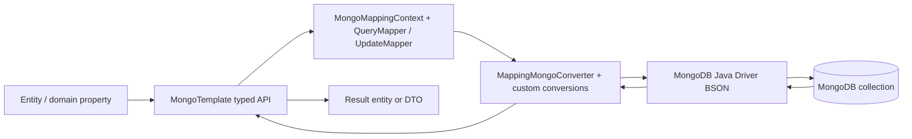

# Field Name and Data Type Mapping When Using Domain-Typed APIs

In **Spring Data MongoDB**, a Java property can differ in both name and storage type from the underlying MongoDB BSON data. For instance, an entity declares `customerId` while MongoDB stores `customer_id`; Java uses `Instant` while BSON stores `Date`; Java uses `String id` while `_id` may store an `ObjectId`. If you write queries with arbitrary field names and types, the application easily runs into **queries finding no documents**, **updates writing to the wrong field**, or **indexes being bypassed**.

`MongoTemplate` provides **domain-typed APIs** so Spring Data can inspect entity metadata to map **Java property names -> BSON field names**, while converting **query/update values** to appropriate storage types. Key metadata includes `@Document`, `@Id`, `@MongoId`, `@Field`, embedded object structures, and custom conversions.

This lesson belongs to the **MongoTemplate** chapter of the `SPRING_DATA_MONGODB` module. This knowledge applies across `Query`/`Criteria` queries, `Update` operations, projections, aggregations, indexes, reactive access, transactions, testing, and performance diagnostics.

> **Core takeaway:** When two overloads look nearly identical, **whether you pass the domain class or not** can change the level of field mapping, type conversion, and version support. Never treat `mongoTemplate.updateFirst(query, update, "collection")` as completely equivalent to `mongoTemplate.updateFirst(query, update, Entity.class)`.

## 1. Learning objectives

After completing this lesson, you will be able to:

1. Trace the path from Java properties, entity metadata, and `Query`/`Update` down to actual BSON fields.
2. Use `@Field` to assign storage names differing from Java properties, including on embedded properties.
3. Choose `@Id`/`@MongoId` appropriately to query `_id` with the right BSON type.
4. Write `MongoTemplate.find`, `count`, `updateFirst`, `findAndModify`, and Fluent API calls **with a domain type**.
5. Explain why overloads taking only `collectionName` may lack field mapping or `@Version` handling.
6. Distinguish how `Instant`, `BigDecimal`, value objects, and BSON types behave inside queries.
7. Understand the roles of `QueryMapper`, `UpdateMapper`, and `MappingMongoConverter` without reinventing framework logic.
8. Recognize when a query or aggregation is a **native BSON** expression and requires physical storage names.
9. Write tests cross-checking entities, mapped queries, and **raw BSON documents**.
10. Audit mappings when changing schemas, indexes, DTO projections, or upgrading Spring Data MongoDB versions.

## 2. Three layers of names and types in an operation

Separate three concepts:

| Layer | Example | Who understands this layer? |
| --- | --- | --- |
| **Java domain** | `customerId`, `totalCents`, `createdAt: Instant` | Entities, services, property-based `Criteria`/`Update` |
| **Mapping metadata** | `@Field("customer_id")`, `@Id`, `@MongoId` | Spring Data MongoDB mapping context and converters |
| **BSON in MongoDB** | `customer_id`, `total_cents`, `created_at: Date`, `_id` | MongoDB Server and Java Driver |

A simple write-and-read cycle:



This diagram is conceptual: when writing objects, reading objects, and translating queries/updates, the exact order of internal components can vary. Remember that **Spring Data-level mapping** and **driver-level BSON codecs** are not a single unified system.

### Why is inspecting Query.getQueryObject() alone not enough?

`Query` can still hold Java property names before Spring Data applies mapping metadata to build the command sent to the server.

```java
Query query = Query.query(
    Criteria.where("customerId").is("CUS-9")
);
System.out.println(query.getQueryObject());
```

Printing `getQueryObject()` helps inspect **`Criteria` structure**, yet **does not always reflect the final BSON command** after field-name and value mapping. To confirm the real command, use command monitoring, the profiler, or assert against raw BSON in tests.

## 3. Example entity: Java names vs BSON names

A retail application stores orders in the `shop_orders` collection. Java code uses clean camelCase names; in MongoDB, a legacy dataset uses snake_case.

### 3.1. Embedded object

```java
package dev.learning.orders;

import org.springframework.data.mongodb.core.mapping.Field;

public record ShippingAddress(
        @Field("city_name") String city,
        @Field("postal_code") String postalCode) {
}
```

### 3.2. Domain-typed aggregate root

```java
package dev.learning.orders;

import java.time.Instant;

import org.springframework.data.annotation.Id;
import org.springframework.data.annotation.Version;
import org.springframework.data.mongodb.core.mapping.Document;
import org.springframework.data.mongodb.core.mapping.Field;

@Document("shop_orders")
public record OrderDoc(
        @Id String id,
        @Field("customer_id") String customerId,
        @Field("total_cents") long totalCents,
        @Field("created_at") Instant createdAt,
        @Field("ship_to") ShippingAddress shippingAddress,
        String status,
        @Version Long version) {
}
```

In this example, each `public record` belongs in its own Java file, and input data/`Instant` values are non-null. Money is represented in **smallest currency units** as a `long` to avoid depending on decimal configuration while focusing on name and type mapping.

### 3.3. Expected BSON document

```javascript
{
  _id: "ORD-1001",
  customer_id: "CUS-9",
  total_cents: NumberLong("159900"),
  created_at: ISODate("2026-11-20T08:00:00Z"),
  ship_to: {
    city_name: "Da Nang",
    postal_code: "550000"
  },
  status: "PAID",
  version: NumberLong("0")
}
```

Mapping reference:

| Java property | BSON path | Java -> BSON type |
| --- | --- | --- |
| `id` | `_id` | `String` -> string or ObjectId per ID rules |
| `customerId` | `customer_id` | `String` -> BSON string |
| `totalCents` | `total_cents` | `long` -> BSON 64-bit integer |
| `createdAt` | `created_at` | `Instant` -> BSON Date |
| `shippingAddress` | `ship_to` | Java object -> BSON embedded document |
| `shippingAddress.city` | `ship_to.city_name` | `String` -> BSON string |
| `shippingAddress.postalCode` | `ship_to.postal_code` | `String` -> BSON string |
| `status` | `status` | Unchanged |
| `version` | `version` | `Long` -> BSON 64-bit integer |

The stored document may also contain `_class` depending on how Spring Data writes type hints. Thus the JSON above highlights the relevant fields for learning mapping, without guaranteeing every setup writes those exact fields only.

## 4. Field name mapping in domain-typed queries

Build a query using **Java property names**, then pass `OrderDoc.class` to `MongoTemplate.find`:

```java
import java.util.List;

import org.springframework.data.mongodb.core.MongoTemplate;
import org.springframework.data.mongodb.core.query.Criteria;
import org.springframework.data.mongodb.core.query.Query;

Query query = Query.query(
        Criteria.where("customerId").is("CUS-9")
                .and("totalCents").gte(100_000L));

List<OrderDoc> orders =
        mongoTemplate.find(query, OrderDoc.class);
```

Equivalent BSON query after mapping:

```javascript
db.shop_orders.find({
  customer_id: "CUS-9",
  total_cents: { $gte: NumberLong("100000") }
});
```

**Key takeaway:** the code uses `customerId` and `totalCents` because those are properties on `OrderDoc`. Spring Data uses `@Field` to translate them into `customer_id` and `total_cents`.

### 4.1. Why does the domain class matter?

`mongoTemplate.find(query, OrderDoc.class)` lets the framework:

- Know property metadata and `@Field` annotations.
- Know which `@Id`/`@MongoId` maps to `_id`.
- Know property domain types to apply appropriate conversions.
- Map BSON results back into `OrderDoc`.
- Resolve the collection from `@Document("shop_orders")` when no explicit collection name is passed.

With a plain native driver query, there is no domain object from which to derive this information.

### 4.2. BSON names may work, but avoid mixing randomly

In some mapping APIs, both property names and mapped field names may be recognized. However, writing a long query that mixes `customerId`, `customer_id`, and nested BSON paths is a source of subtle bugs.

**Safe convention:** With Spring Data **typed APIs**, use **Java property names** and verify the mapped output. With `mongosh` or Java Driver **raw APIs**, use **physical BSON names**.

## 5. Nested properties: mapping every path segment

Using `ShippingAddress` from section 3:

```java
Query query = Query.query(
    Criteria.where("shippingAddress.city").is("Da Nang")
);
List<OrderDoc> result = mongoTemplate.find(
    query, OrderDoc.class
);
```

Expected BSON:

```javascript
db.shop_orders.find({
  "ship_to.city_name": "Da Nang"
});
```

Spring Data inspects the entity metadata **and the embedded object's type** to translate:

```text
shippingAddress        . city
       │                  │
       ▼                  ▼
    "ship_to"          "city_name"
       │                  │
       └──── combined ─────┘
            "ship_to.city_name"
```

Likewise:

```java
Query query = Query.query(
    Criteria.where("shippingAddress.postalCode").is("550000")
);
```

targets `ship_to.postal_code` when a compatible domain type and mapping are present.

### 5.1. Do not confuse paths with field names containing dots

MongoDB treats dots in `"a.b"` as nested paths in many queries and updates. Spring Data also supports keys containing **literal dots** via `@Field(fieldNameType = KEY)`, which is a distinct case requiring special operators like `$getField`/`$setField` to manipulate.

Different meanings:

```javascript
// Nested path:
{ address: { city: "Hue" } }

// Literal key containing a dot:
{ "address.city": "Hue" }
```

These two documents **are not the same**. Do not write `Criteria.where("address.city")` expecting it to match a literal dotted key. If your schema has special keys, consult `@Field(fieldNameType = KEY)` documentation and access them with MongoDB expressions.

### 5.2. Maps and arrays

For embedded objects on an entity, Spring Data maps each property using metadata. However, for `Map<String, Object>`, map keys may be dynamic business data rather than Java properties, so do not assume every path segment inside a `Map` undergoes renaming.

For arrays of embedded objects, separate predicates on child properties can match different array elements. To require multiple conditions on **the same array element**, use `$elemMatch`. That is MongoDB query semantics, unchanged by using a domain-typed API.

## 6. Sort and projection also require mapping

Mapping is not limited to `Criteria`. `Sort` and field projections also use property paths.

```java
import org.springframework.data.domain.Sort;

Query query = Query.query(
    Criteria.where("customerId").is("CUS-9")
);

query.with(Sort.by(
    Sort.Order.desc("createdAt"),
    Sort.Order.desc("id")
));

query.fields()
    .include("customerId")
    .include("totalCents")
    .include("createdAt");

List<OrderDoc> partial =
    mongoTemplate.find(query, OrderDoc.class);
```

Semantically, MongoDB receives:

```javascript
db.shop_orders.find(
  { customer_id: "CUS-9" },
  {
    customer_id: 1,
    total_cents: 1,
    created_at: 1
  }
).sort({ created_at: -1, _id: -1 });
```

**Important note:** MongoDB generally **forbids mixing inclusions and exclusions** in the same field projection, aside from `_id`'s special rule. If you only want the three fields above, use `include`; if you want to omit `shippingAddress` while keeping everything else, use `exclude("shippingAddress")` in a separate query rather than combining it with `include` here.

`_id` is included by default unless explicitly excluded.

> **Never save a partially loaded entity back.** Missing properties may become `null`/defaults; calling `save(partialEntity)` can erase stored data or trigger optimistic locking errors. For display-only views, use dedicated projections or DTOs.

## 7. APIs with domain class vs APIs with collection name only

An important distinction explicitly documented in the `MongoOperations.updateFirst` Javadoc:

```java
// With domain type:
UpdateResult a = mongoTemplate.updateFirst(
    query, update, OrderDoc.class
);

// With domain type AND explicit collection name:
UpdateResult b = mongoTemplate.updateFirst(
    query, update, OrderDoc.class, "shop_orders"
);

// With collection name only:
UpdateResult c = mongoTemplate.updateFirst(
    query, update, "shop_orders"
);
```

These are **alternative call forms**, not three commands to run sequentially. Their support levels differ:

| Call | Domain metadata | Collection name | Field mapping/`@Version` |
| --- | --- | --- | --- |
| `updateFirst(q,u,OrderDoc.class)` | Yes | Inferred from entity | Supported via domain type |
| `updateFirst(q,u,OrderDoc.class,"shop_orders")` | Yes | Explicitly specified | Supported via domain type |
| `updateFirst(q,u,"shop_orders")` | Missing domain type | Explicitly specified | **Lacks full support** for entity field mapping/versioning |

According to the Javadoc, overloads taking only a collection name lack domain class information to perform **domain-type-aware features like field mapping or versioning**. Never claim the two call styles "only differ by collection name".

### 7.1. A subtle bug example

The entity declares `@Field("customer_id")` yet the query uses the Java property:

```java
Query q = Query.query(
    Criteria.where("customerId").is("CUS-9")
);
Update u = new Update().set("status", "SHIPPED");

// Do NOT assume this command automatically understands @Field("customer_id"):
mongoTemplate.updateFirst(q, u, "shop_orders");
```

If real BSON contains `customer_id` and not `customerId`, the command **matches zero documents**. Even worse, if the `Update` targets an aliased property, it can **write a brand-new misnamed field**, creating two parallel schemas.

Write instead:

```java
UpdateResult result = mongoTemplate.updateFirst(
    Query.query(Criteria.where("customerId").is("CUS-9")),
    new Update().set("status", "SHIPPED"),
    OrderDoc.class
);
```

If you need a non-default collection while preserving mapping, pass both `OrderDoc.class` and the collection name.

### 7.2. Choosing by design

- Use the **typed** overload when working with Spring Data entities that have annotations, versions, or converters.
- Use the **collection-only/raw** overload when deliberately operating on a raw BSON schema with verified field names and data types.
- In code reviews, check whether every `updateFirst`/`updateMulti`/`upsert`/`findAndModify` carries entity metadata—do not inspect only the `Query`.

## 8. Updating with `Update`: mapping both fields and values

Example changing the shipping city and incrementing total amount on a paid order:

```java
import com.mongodb.client.result.UpdateResult;
import org.springframework.data.mongodb.core.query.Criteria;
import org.springframework.data.mongodb.core.query.Query;
import org.springframework.data.mongodb.core.query.Update;

Query filter = Query.query(
    Criteria.where("id").is("ORD-1001")
            .and("status").is("PAID")
);

Update changes = new Update()
    .set("shippingAddress.city", "Hue")
    .inc("totalCents", 1_000L);

UpdateResult result = mongoTemplate.updateFirst(
    filter, changes, OrderDoc.class
);
```

Equivalent logical BSON:

```javascript
db.shop_orders.updateOne(
  { _id: "ORD-1001", status: "PAID" },
  {
    $set: { "ship_to.city_name": "Hue" },
    $inc: { total_cents: NumberLong("1000") }
  }
);
```

If `OrderDoc` has `@Version` and the update does not specify `version`, Spring Data may **auto-increment** `version` on domain-typed update APIs. Thus the illustrative BSON above focuses on the two requested mutations; the real command may include a version update added by the framework.

**Do not confuse:** auto-incrementing version on update **does not mean** the update checks an expected version from a previously read entity. For true compare-and-set, add the expected version condition to `Query`:

```java
Query filter = Query.query(
    Criteria.where("id").is(orderId)
            .and("version").is(expectedVersion)
            .and("status").is("PAID")
);

Update update = new Update().set("status", "SHIPPED");

UpdateResult result = mongoTemplate.updateFirst(
    filter, update, OrderDoc.class
);

if (result.getMatchedCount() != 1) {
    // Not found, status changed, or version was already updated.
}
```

`matchedCount` reports whether a document matched before the update. `modifiedCount` can be 0 if new values equal existing ones (depending on operation/versioning), so never use `modifiedCount == 0` alone to conclude an entity does not exist.

### 8.1. `@Version` in save vs update

- `save` on a versioned entity enforces optimistic locking against the entity's version per Spring Data rules.
- Domain-typed `updateFirst`/`findAndModify` may **auto-increment version** when not specified in `Update`, yet **cannot know the caller's expected version** unless you put it in the query filter.
- APIs **without a domain type** may not apply entity-specific versioning rules.
- Optimistic locking requires an acknowledged write concern to detect conflicts reliably.

## 9. `findAndModify` and the Fluent update API

`findAndModify` is useful when you need to update and retrieve the pre- or post-update document in one operation:

```java
import org.springframework.data.mongodb.core.FindAndModifyOptions;

OrderDoc changed = mongoTemplate.findAndModify(
    Query.query(
        Criteria.where("id").is("ORD-1001")
                .and("status").is("PAID")),
    new Update().set("shippingAddress.city", "Hue"),
    FindAndModifyOptions.options().returnNew(true),
    OrderDoc.class
);
```

`returnNew(true)` requests the document **after the update**, if a match exists. `findAndModify` does not upsert by default; enable `upsert(true)` only when creation is allowed by business rules.

You can use the Fluent API with the domain type stated right up front:

```java
UpdateResult result = mongoTemplate.update(OrderDoc.class)
    .matching(Query.query(
        Criteria.where("customerId").is("CUS-9")
                .and("status").is("PAID")))
    .apply(new Update().set("status", "SHIPPED"))
    .first();
```

Or use domain-typed fluent queries:

```java
OrderDoc order = mongoTemplate.query(OrderDoc.class)
    .matching(Query.query(
        Criteria.where("id").is("ORD-1001")))
    .oneValue();
```

The Fluent API puts the domain type prominently at the start of the chain, making the active mapping obvious to reviewers. It does not replace authorization checks, race-condition handling, or transactions when updating multiple documents.

## 10. `@Id`, `@MongoId`, and the actual type of `_id`

`_id` is a special field. Spring Data MongoDB can map:

```java
@Id
private String id;
```

to a BSON `ObjectId` **if the string is valid 24-char ObjectId hex**; if it cannot be converted, the value is stored as a string.

These two documents have `_id` with **different BSON types**:

```javascript
{ _id: ObjectId("507f1f77bcf86cd799439011"), status: "PAID" }
{ _id: "507f1f77bcf86cd799439011", status: "PAID" }
```

Both can coexist because an `ObjectId` and a BSON string are distinct values. Yet when querying via a typed entity with `@Id String`, Spring Data applies the entity's conversion rules, matching only one of the two.

Example:

```java
Query q = Query.query(
    Criteria.where("id").is("507f1f77bcf86cd799439011")
);
OrderDoc order = mongoTemplate.findOne(q, OrderDoc.class);
```

Do not conclude "MongoDB lacks the document" just because a typed query finds nothing; check the actual `_id` BSON type, collection, and annotations first.

### 10.1. Keeping string IDs, even 24-character hex

For domains storing fixed string IDs, you can use:

```java
import org.springframework.data.mongodb.core.mapping.MongoId;

@Document("external_orders")
public record ExternalOrder(
        @MongoId String id,
        String status) {
}
```

`@MongoId` without a target type generally stores the ID using the actual Java type, avoiding automatic conversion of 24-char hex strings to `ObjectId` as `@Id String` can do.

To enforce a specific target type, Spring Data offers `@MongoId(FieldType.OBJECT_ID)` where appropriate; never change ID mapping on a live collection without auditing and migrating existing data.

### 10.2. Do not assume every string becomes an ObjectId

Order codes like `"ORD-1001"` are not ObjectId hex, so `@Id String` stores them as BSON strings. Other strings that happen to be 24 hex characters can be converted. That is why production systems should pick a **stable ID convention** and test edge cases.

## 11. BSON type mapping for numbers and timestamps

### 11.1. Integers and Strings do not compare the same way

This document:

```javascript
{ total_cents: NumberLong("159900") }
```

differs from:

```javascript
{ total_cents: "159900" }
```

Range query:

```java
Query q = Query.query(
    Criteria.where("totalCents").gte(100_000L)
);
List<OrderDoc> result = mongoTemplate.find(q, OrderDoc.class);
```

expects to match compatible BSON numeric types; never expect MongoDB to parse strings as numbers automatically. If a migration or raw client wrote strings, clean up the schema explicitly.

### 11.2. Instant and BSON Date

`Instant` is normally stored as a BSON Date—a UTC timestamp with **millisecond** precision. Code:

```java
Instant from = Instant.parse("2026-11-20T00:00:00Z");
Instant until = Instant.parse("2026-11-21T00:00:00Z");

Query q = Query.query(
    Criteria.where("createdAt").gte(from).lt(until)
);
List<OrderDoc> orders = mongoTemplate.find(
    q, OrderDoc.class
);
```

Corresponding BSON:

```javascript
{
  created_at: {
    $gte: ISODate("2026-11-20T00:00:00Z"),
    $lt: ISODate("2026-11-21T00:00:00Z")
  }
}
```

Use half-open intervals `[start, nextStart)` for pagination and date filtering; avoid upper bounds like `"23:59:59.999999999"` hoping data and MongoDB share nanosecond precision. When dates originate in a user's local timezone, convert `LocalDate`/`ZoneId` to `Instant` before building the filter.

### 11.3. BigDecimal and Decimal128

MongoDB provides BSON `Decimal128`. In a domain model:

```java
import java.math.BigDecimal;
import org.springframework.data.mongodb.core.mapping.Field;
import org.springframework.data.mongodb.core.mapping.FieldType;

public record PaymentValue(
    @Field(targetType = FieldType.DECIMAL128)
    BigDecimal amount) {
}
```

`@Field(targetType = DECIMAL128)` expresses the intent to store BSON `Decimal128` for that field. It does not mean every possible `BigDecimal` fits without rounding/range limits in `Decimal128` (which has bounded range and precision).

**Version difference:** Spring Data MongoDB 4.5 had string-based defaults for `BigDecimal`/`BigInteger`; starting in the 5.x line, representation choices should be configured explicitly when storing these types. Appropriate configuration:

```java
import org.springframework.context.annotation.Bean;
import org.springframework.context.annotation.Configuration;
import org.springframework.data.mongodb.core.convert.MongoCustomConversions;
import org.springframework.data.mongodb.core.convert.MongoCustomConversions.BigDecimalRepresentation;

@Configuration(proxyBeanMethods = false)
class MongoDecimalConfiguration {

    @Bean
    MongoCustomConversions mongoCustomConversions() {
        return MongoCustomConversions.create(adapter -> {
            adapter.bigDecimal(BigDecimalRepresentation.DECIMAL128);
        });
    }
}
```

In a real application, **consolidate all custom converters** into a single `MongoCustomConversions` bean rather than defining competing beans. If existing data stores `amount` as strings, changing conversion without migrating data will break sorting and range queries due to mixed BSON types.

## 12. Custom conversions affect writes, reads, and query parameters

Suppose the domain uses an `EmailAddress` value object for validation while MongoDB stores emails as BSON strings:

```java
public record EmailAddress(String value) {}
```

You can define two converters:

```java
import org.springframework.core.convert.converter.Converter;
import org.springframework.data.convert.WritingConverter;
import org.springframework.data.convert.ReadingConverter;

@WritingConverter
public final class EmailWriteConverter
        implements Converter<EmailAddress, String> {
    @Override
    public String convert(EmailAddress source) {
        return source.value();
    }
}

@ReadingConverter
public final class EmailReadConverter
        implements Converter<String, EmailAddress> {
    @Override
    public EmailAddress convert(String source) {
        return new EmailAddress(source);
    }
}
```

Each `public class` here belongs in its own Java file. Register them in `MongoCustomConversions`:

```java
@Bean
MongoCustomConversions mongoCustomConversions() {
    return MongoCustomConversions.create(adapter -> {
        adapter.registerConverter(new EmailWriteConverter());
        adapter.registerConverter(new EmailReadConverter());
    });
}
```

This is a **standalone configuration** separate from the `BigDecimal` bean in the previous section. If your project needs both, use **one** bean:

```java
@Bean
MongoCustomConversions mongoCustomConversions() {
    return MongoCustomConversions.create(adapter -> {
        adapter.bigDecimal(BigDecimalRepresentation.DECIMAL128);
        adapter.registerConverter(new EmailWriteConverter());
        adapter.registerConverter(new EmailReadConverter());
    });
}
```

When a domain type holds an `EmailAddress email` property, Spring Data can apply writing conversion so `Criteria.where("email").is(new EmailAddress("a@example.test"))` translates to a BSON string. However, when writing native JSON queries, raw aggregation pipelines, or Java Driver calls, do not assume the same converter runs automatically.

**What to test:** a converter working on entity writes does not guarantee every complex query expression on that type converts automatically. Test real queries, raw BSON, and every pipeline used in the application.

## 13. Typed APIs with an explicit collection name

Some systems partition collections dynamically by year or tenant. You can keep domain-type mapping by supplying both the entity class and the collection name:

```java
Query q = Query.query(
    Criteria.where("customerId").is("CUS-9")
);

List<OrderDoc> orders = mongoTemplate.find(
    q, OrderDoc.class, "shop_orders_2026"
);

UpdateResult changed = mongoTemplate.updateFirst(
    q,
    new Update().set("status", "ARCHIVED"),
    OrderDoc.class,
    "shop_orders_2026"
);
```

Characteristics:

- `OrderDoc.class` provides mapping metadata.
- `"shop_orders_2026"` selects the target collection.
- Passing an explicit collection **does not change field-name mapping**.
- Dynamic collection selection must pass allowlist/authorization checks; never accept raw collection names from untrusted input.

Never rely on collection-per-tenant as an automatic isolation barrier if callers can pass unvalidated collection names.

## 14. Fluent queries and DTO projections

A read view needing only ID, customer, and total amount:

```java
import org.springframework.data.annotation.Id;
import org.springframework.data.mongodb.core.mapping.Field;

public record OrderSummary(
    @Id String id,
    @Field("customer_id") String customerId,
    @Field("total_cents") long totalCents) {
}
```

Fluent API:

```java
List<OrderSummary> summaries = mongoTemplate
    .query(OrderDoc.class)
    .as(OrderSummary.class)
    .matching(Query.query(
        Criteria.where("customerId").is("CUS-9")))
    .all();
```

In this snippet:

1. `query(OrderDoc.class)` sets the **source type** for filter and collection mapping.
2. `as(OrderSummary.class)` sets the **result type** (read projection).
3. `matching(...)` writes the query using Java properties of the source type.
4. `all()` maps results to the DTO.

`OrderSummary` also declares `@Field` annotations matching the BSON names it reads; verify projection mapping against your Spring Data version and the actual fields returned by the server.

**Do not confuse:** calling `as(OrderSummary.class)` does not turn `OrderSummary` into a write entity. Never `save` a partial DTO; unloaded fields will be lost or cause errors if forced onto the write path.

### 14.1. Field projection

```java
Query query = Query.query(
    Criteria.where("status").is("PAID")
);
query.fields()
    .include("customerId")
    .include("totalCents");

List<OrderDoc> partial = mongoTemplate.find(
    query, OrderDoc.class
);
```

Keys in `fields().include(...)` use Java properties when the query has a domain type; Spring Data maps them to `customer_id` and `total_cents`. `_id` is usually returned as well. The resulting `OrderDoc` lacks other properties, so use it **strictly for reading**; an explicit DTO is even safer.

### 14.2. Domain-typed distinct

```java
List<String> customerIds = mongoTemplate
    .query(OrderDoc.class)
    .distinct("customerId")
    .as(String.class)
    .all();
```

`distinct("customerId")` maps to the BSON field `customer_id` via `OrderDoc` metadata. `as(String.class)` requests the target element type; incompatible conversions can throw `DataAccessException`.

## 15. Typed aggregation: input class and field aliases

Aggregations are a frequent place to mix up **Java properties**, **post-`$group`/`$project` fields**, and **raw MongoDB expressions**.

Spring Data offers `TypedAggregation<T>`, which retains **input type** metadata to resolve entity property references.

```java
import org.springframework.data.mongodb.core.aggregation.Aggregation;
import org.springframework.data.mongodb.core.aggregation.TypedAggregation;
import org.springframework.data.mongodb.core.aggregation.AggregationResults;
import org.springframework.data.mongodb.core.query.Criteria;

public record RevenueByCustomer(
    String customerId,
    long sumCents) {
}

TypedAggregation<OrderDoc> aggregation =
    Aggregation.newAggregation(
        OrderDoc.class,
        Aggregation.match(
            Criteria.where("status").is("PAID")),
        Aggregation.group("customerId")
            .sum("totalCents").as("sumCents"),
        Aggregation.project("sumCents")
            .and("_id").as("customerId")
    );

AggregationResults<RevenueByCustomer> result =
    mongoTemplate.aggregate(
        aggregation, RevenueByCustomer.class
    );
```

Pipeline intent:

```javascript
db.shop_orders.aggregate([
  { $match: { status: "PAID" } },
  { $group: {
      _id: "$customer_id",
      sumCents: { $sum: "$total_cents" }
  } },
  { $project: { _id: 0, customerId: "$_id", sumCents: 1 } }
]);
```

In stages supported by Spring Data mapping, `customerId` and `totalCents` resolve via the domain type to `customer_id` and `total_cents`. After `$group`/`$project`, newly introduced aliases like `sumCents` belong to the **intermediate output shape**, not necessarily `OrderDoc` properties.

### 15.1. strictMapping is no longer the old default

Spring Data documentation notes that since 3.2, referencing a nonexistent property in `TypedAggregation` **no longer throws an error by default**. You can configure `AggregationOptions` with `strictMapping` when strict validation is desired. Always test pipelines after renaming fields rather than relying solely on IDE checks or compilation.

### 15.2. Native aggregation stages are not typed expressions

Example:

```java
Aggregation.stage("""
    { "$match": { "customer_id": "CUS-9" } }
""");
```

This is a native JSON stage and must use **actual BSON field names**. Never blindly write `customerId` instead of `customer_id` assuming `OrderDoc.class` input type converts raw JSON stages.

Similarly, raw expression strings like `MongoExpression.create(...)` can retain raw BSON references, whereas Spring Data `AggregationExpression` builders can map Java properties in a typed context.

**Practical rule:** check whether each API accepts a **mapped field reference** or a **native JSON/BSON expression** before choosing which name to write.

## 16. Raw `Document` and MongoDB Java Driver: metadata boundaries

When you need to inspect real BSON data, you can fetch the driver collection from `MongoTemplate.getCollection`:

```java
import org.bson.Document;

Document raw = mongoTemplate
    .getCollection("shop_orders")
    .find(new Document("_id", "ORD-1001"))
    .first();

if (raw != null) {
    System.out.println(raw.getString("customer_id"));
    System.out.println(raw.get("total_cents"));
    System.out.println(raw.get("ship_to"));
}
```

Here:

- `getCollection` returns a **MongoDB Java Driver** collection.
- `Document` uses **actual BSON names**: `customer_id`, `total_cents`, `ship_to`.
- `@Field` on `OrderDoc` is **not** applied by the driver to strings inside `Document`.
- The driver does not automatically run Spring Data `MongoCustomConversions` on raw queries or updates.

If you write:

```java
mongoTemplate.getCollection("shop_orders")
    .find(new Document("customerId", "CUS-9"));
```

MongoDB looks for a literal key named `customerId`—it will not translate it to `customer_id` just because a Java entity exists.

### 16.1. Raw queries are not always wrong

There are legitimate reasons to use the driver API: specialized BSON features, migration scripts, admin commands, or native pipelines. When doing so, write and review against the **actual MongoDB schema**, with dedicated tests so you never accidentally depend on Spring Data mapping that is not running.

### 16.2. Do not treat raw Document checks as sole proof of typed queries

A raw document verifies **names, BSON types, and structure**. To verify a **typed query** actually maps properly, execute the real typed query or observe the real command via a command listener. Both checks complement each other.

## 17. Indexes must match actual BSON names

Example frequent query:

```java
Query query = Query.query(
    Criteria.where("customerId").is("CUS-9")
);
query.with(Sort.by(Sort.Order.desc("createdAt")));
```

Corresponding final MongoDB command:

```javascript
db.shop_orders.find({
  customer_id: "CUS-9"
}).sort({ created_at: -1 });
```

An index supporting this query must use **BSON** field names:

```javascript
db.shop_orders.createIndex(
  { customer_id: 1, created_at: -1 },
  { name: "customer_created" }
);
```

An index mistakenly created on `customerId` in MongoDB will not serve predicates on `customer_id`. When declaring indexes via Spring Data entity mapping, `indexOps(OrderDoc.class)` accepts Java properties with mapping applied, yet you should still verify the actual index keys created in MongoDB.

Inspect the execution plan:

```javascript
db.shop_orders.find({
  customer_id: "CUS-9"
}).sort({ created_at: -1 })
  .explain("executionStats");
```

Check `winningPlan`, `totalKeysExamined`, `totalDocsExamined`, `nReturned`, and any unindexed sort stage. Correct mapping does not automatically make queries fast; indexes and data distribution still govern the major costs.

## 18. Integration testing: verifying Java, BSON, and updates

A test suite should prove at least four things:

1. `MongoTemplate.insert` writes the expected BSON names and types.
2. Typed queries using **Java properties** find the right documents.
3. Typed updates using **Java properties** mutate the right BSON fields without adding misnamed keys.
4. Reading back produces the expected Java entity values.

Example using the Spring Boot test starter and a dedicated test MongoDB instance:

```java
package dev.learning.orders;

import static org.assertj.core.api.Assertions.assertThat;

import java.time.Instant;
import java.util.UUID;

import org.bson.Document;
import org.junit.jupiter.api.Test;
import org.springframework.beans.factory.annotation.Autowired;
import org.springframework.boot.test.context.SpringBootTest;
import org.springframework.data.mongodb.core.MongoTemplate;
import org.springframework.data.mongodb.core.query.Criteria;
import org.springframework.data.mongodb.core.query.Query;
import org.springframework.data.mongodb.core.query.Update;

@SpringBootTest
class DomainTypedMappingIntegrationTest {

    @Autowired MongoTemplate template;

    @Test
    void mapsFieldNamesAndBsonTypesOnReadAndUpdate() {
        String id = "ORD-" + UUID.randomUUID();
        Instant moment =
                Instant.parse("2026-11-20T08:00:00Z");

        template.insert(new OrderDoc(
            id,
            "CUS-9",
            159_900L,
            moment,
            new ShippingAddress("Da Nang", "550000"),
            "PAID",
            null
        ));

        Document raw = template.getCollection("shop_orders")
            .find(new Document("_id", id))
            .first();

        assertThat(raw).isNotNull();
        assertThat(raw.getString("customer_id"))
            .isEqualTo("CUS-9");
        assertThat(raw.get("total_cents"))
            .isInstanceOf(Long.class);
        assertThat(raw.get("created_at"))
            .isInstanceOf(java.util.Date.class);

        Document address =
            raw.get("ship_to", Document.class);
        assertThat(address.getString("city_name"))
            .isEqualTo("Da Nang");

        OrderDoc found = template.findOne(
            Query.query(
                Criteria.where("customerId").is("CUS-9")
                    .and("shippingAddress.city").is("Da Nang")
                    .and("id").is(id)
            ),
            OrderDoc.class
        );
        assertThat(found).isNotNull();

        var updated = template.updateFirst(
            Query.query(Criteria.where("id").is(id)),
            new Update()
                .set("shippingAddress.city", "Hue")
                .inc("totalCents", 1_000L),
            OrderDoc.class
        );
        assertThat(updated.getMatchedCount()).isEqualTo(1);

        Document after = template.getCollection("shop_orders")
            .find(new Document("_id", id))
            .first();

        assertThat(after).isNotNull();
        assertThat(after.get("ship_to", Document.class)
                    .getString("city_name"))
            .isEqualTo("Hue");
        assertThat(after.getLong("total_cents"))
            .isEqualTo(160_900L);
        assertThat(after.containsKey("customerId")).isFalse();
        assertThat(after.containsKey("totalCents")).isFalse();

        OrderDoc reloaded =
            template.findById(id, OrderDoc.class);

        assertThat(reloaded).isNotNull();
        assertThat(reloaded.shippingAddress().city())
            .isEqualTo("Hue");
        assertThat(reloaded.totalCents())
            .isEqualTo(160_900L);
    }
}
```

**Limits of this illustrative test:** requires a real test MongoDB configured and a compatible Spring Data MongoDB version. Never run tests against production collections; use a dedicated test database with proper credentials. The `ORD-` prefix keeps IDs from converting to `ObjectId` as 24-char hex strings can.

### 18.1. Testing overload differences

Beyond the test above, write a separate test proving `updateFirst(q,u,OrderDoc.class)` applies `@Field` metadata while `updateFirst(q,u,"shop_orders")` **cannot be assumed** to apply the same mapping. Inspect the final raw BSON document, not just the HTTP or method status.

### 18.2. Observing real commands

To inspect commands sent to the server, attach a **MongoDB Java Driver `CommandListener`** or use the profiler in a test environment to examine `find`/`update`. Never log complete queries or documents holding sensitive data. In telemetry, redact emails, personal identifiers, tokens, addresses, and business payloads.

### 18.3. Testing boundary BSON types

Beyond happy-path data, test:

- `ObjectId` vs BSON string IDs during migrations.
- BSON `NumberLong` vs numeric strings.
- `Instant` at day/millisecond boundaries.
- Value objects with bidirectional custom converters.
- Nested objects with `@Field` aliases across multiple depths.
- Legacy documents missing fields or using older BSON names.
- Projections selecting only a subset of fields.
- Queries filtering by `version` under concurrent updates.

## 19. Common mistakes

| Mistake | Consequence | How to avoid |
| --- | --- | --- |
| Writing `Criteria.where("customer_id")` in every typed query then renaming properties | Coupling to BSON schema and fragile refactoring | Consistently use Java properties in typed APIs. |
| Calling `updateFirst(q,u,"shop_orders")` expecting `@Field` to apply | Zero matches or writes misnamed fields | Use the overload taking `OrderDoc.class`. |
| Inspecting only `Query.getQueryObject()` to verify MongoDB keys | May show pre-mapping structure | Test typed queries, raw BSON, and command monitoring. |
| Assuming `id` always stores as a BSON string | 24-char hex strings may become `ObjectId` | Choose `@Id`/`@MongoId` deliberately and test real types. |
| Switching `BigDecimal` from string to `Decimal128` without migrating | Broken sorting, ranges, and indexes | Pick a clear representation and migrate existing data. |
| Using Java names inside raw Driver `Document` | MongoDB looks for nonexistent keys | Use physical BSON names in driver APIs. |
| Using Java property names inside raw aggregation stages | Pipeline stages fail to match fields | Use physical BSON names or mapped typed aggregation expressions. |
| Calling `save` on an entity loaded with partial fields | Data loss or version errors | Use read-only DTOs or conditional field updates. |
| Assuming `@Version` enforces concurrency automatically in `updateFirst` | Fails to detect stale state | Put expected version into `Query` when CAS is needed. |
| Field names with dots treated as nested paths | Literal keys not found | Distinguish PATH vs KEY; use `$getField` when needed. |
| Creating camelCase indexes in `mongosh` while queries use snake_case BSON | Queries bypass the created index | Create indexes on physical BSON names and verify `explain`. |
| Accepting dynamic collection names straight from HTTP | Unauthorized access to other collections | Enforce server-side allowlist/authorization. |
| Skipping legacy-data tests | Post-migration mapping failures | Audit historical BSON and plan compatibility. |

## 20. Practice exercises

### Exercise 1 — Comparing field names

Using `OrderDoc` from section 3, write `Criteria.where("customerId").is("CUS-9")` and `Criteria.where("shippingAddress.postalCode").is("550000")`. Predict the resulting BSON query, then confirm via an integration test.

**Hint:** `customer_id` and `ship_to.postal_code`.

### Exercise 2 — Typed vs collection-only update

Write two `updateFirst` calls with identical `Query` and `Update`, one passing `OrderDoc.class` and the other passing only `"shop_orders"`. Seed data containing only `customer_id` and `ship_to.city_name`, and observe the runtime difference.

**Hint:** Without a domain type, do not assume `@Field`/version metadata is handled like the typed overload.

### Exercise 3 — Finding data with ObjectId-like IDs

Create two documents sharing the same 24-char hex representation, one with a BSON string `_id` and one with an `ObjectId` `_id`. Compare `@Id String` and `@MongoId String` entities using `findById`/`Criteria.where("id")`.

**Hint:** Never treat two different BSON types as equivalent; verify mappings and migrations.

### Exercise 4 — Updating an embedded object

Use `Update.set("shippingAddress.city","Hue")` with the domain type. Verify only `ship_to.city_name` changes while `ship_to.postal_code` remains intact.

### Exercise 5 — Filtering dates in UTC vs local day

Write a query covering one calendar day in `Asia/Ho_Chi_Minh`. Convert the local date boundaries to two `Instant` values and filter with `gte(start).lt(nextStart)`. Explain why `"23:59:59.999999999"` should be avoided.

### Exercise 6 — BigDecimal representation

A field currently stores strings like `"100.50"`, and users want numeric range queries. Explain why strings differ from `Decimal128`, how to configure `@Field(targetType=DECIMAL128)` and `MongoCustomConversions`, and why a data migration is needed.

### Exercise 7 — Typed aggregation

Group `OrderDoc` by `customerId`, compute `sum(totalCents)`, and return `RevenueByCustomer`. Which names use Java properties, and which use post-`$group` output aliases?

### Exercise 8 — Debugging real commands

Attach a `CommandListener` in tests to inspect commands sent to MongoDB. Identify which fields were mapped; ensure logs redact sensitive fields and never expose full production documents.

## 21. Implementation checklist

- [ ] Include a concrete domain class in `MongoTemplate`/Fluent API calls when entity mapping is expected.
- [ ] Use Java property names in `Criteria`, `Update`, `Sort`, and `Query.fields()` on domain-typed APIs.
- [ ] Verify `@Field` mappings for both top-level and nested properties.
- [ ] Avoid collection-name-only overloads whenever type-aware mapping or versioning is required.
- [ ] Verify `@Id`/`@MongoId` against the actual BSON type of `_id`.
- [ ] Test conversions for `String`, `long`, `Instant`, `BigDecimal`, and value objects.
- [ ] Never assume native `Document` or raw JSON stages are mapped by Spring Data.
- [ ] Keep BSON names consistent across indexes, raw aggregations, and admin tools.
- [ ] Add `expectedVersion` to filters when custom optimistic compare-and-set is required.
- [ ] Separate read DTOs from write entities; never `save` partially loaded entities.
- [ ] Write integration tests verifying raw BSON, typed queries, and typed updates.
- [ ] Use command monitoring and `explain` to diagnose real queries.
- [ ] Test against legacy data before changing annotations or converters.
- [ ] Never run unapproved migrations, index builds, or write-diagnostics on production.

## 22. Official references

1. [Spring Data MongoDB — Object Mapping](https://docs.spring.io/spring-data/mongodb/reference/mongodb/mapping/mapping.html): `@Field`, `@Id`, `@MongoId`, embedded mapping, BSON types, and special field names.
2. [Spring Data MongoDB — Querying Documents](https://docs.spring.io/spring-data/mongodb/reference/mongodb/template-query-operations.html): `Query`, `Criteria`, sorting, field projections, distinct, and Fluent projections.
3. [Spring Data MongoDB — MongoOperations API](https://docs.spring.io/spring-data/mongodb/reference/api/java/org/springframework/data/mongodb/core/MongoOperations.html): typed overloads; field-mapping and versioning differences when passing only a collection name.
4. [Spring Data MongoDB — Saving, Updating, and Removing Documents](https://docs.spring.io/spring-data/mongodb/reference/mongodb/template-crud-operations.html): typed `updateFirst`, `findAndModify`, `upsert`, and `@Version`.
5. [Spring Data MongoDB — Aggregation Framework Support](https://docs.spring.io/spring-data/mongodb/reference/mongodb/aggregation-framework.html): `TypedAggregation`, input classes, field mapping, and `strictMapping`.
6. [Spring Data MongoDB — Custom Conversions](https://docs.spring.io/spring-data/mongodb/reference/mongodb/mapping/custom-conversions.html): bidirectional converters, Spring Data MongoDB 5.x configuration, and `Decimal128`.
7. [Spring Data MongoDB — Projection](https://docs.spring.io/spring-data/mongodb/reference/repositories/projections.html): read DTOs and interface projections.
8. [MongoDB Manual — BSON Types](https://www.mongodb.com/docs/manual/reference/bson-types/): distinguishing `NumberLong`, `Date`, `String`, `ObjectId`, and `Decimal128`.
9. [MongoDB Manual — Explain Results](https://www.mongodb.com/docs/manual/reference/explain-results/): verifying indexes and query plans.
10. [MongoDB Manual — Fields with Periods and Dollar Signs](https://www.mongodb.com/docs/manual/core/dot-dollar-considerations/): constraints and syntax for special field names.

**Key takeaway:** Domain-typed `MongoTemplate` APIs carry **mapping context** to translate property names and BSON values consistently with the entity. Treat the domain class as an essential part of the call, not merely a return type. When switching to `Document`/Java Driver or native aggregation expressions, switch mentally to **physical BSON names and types**, and verify with integration tests and real commands before deploying schema changes.
