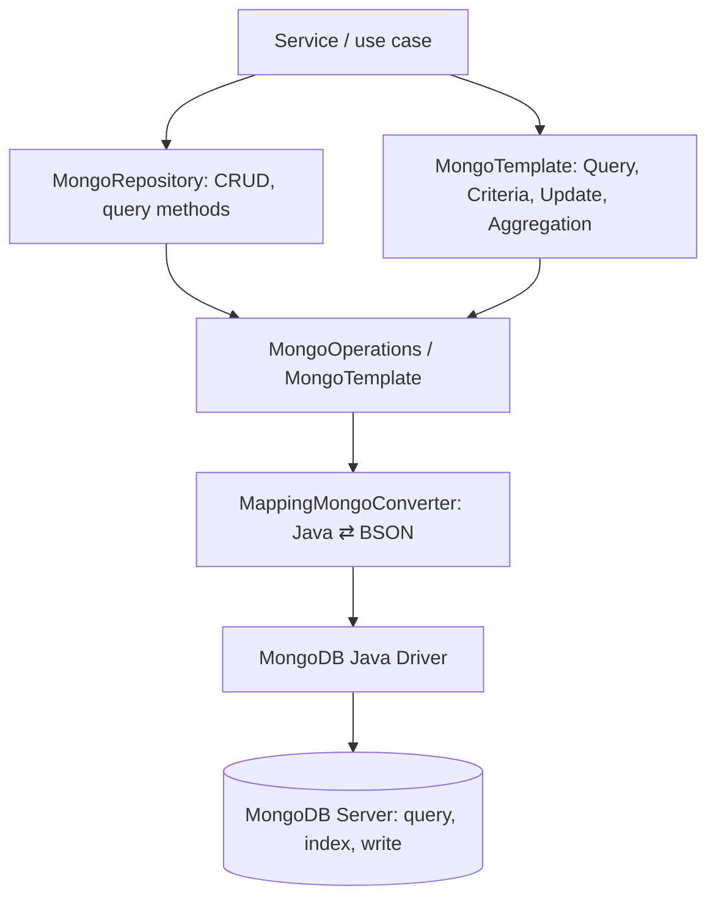

# Choosing Repository or Template by Customization Level

In **Spring Data MongoDB**, both `MongoRepository` and `MongoTemplate` let Java applications access MongoDB, offering two ways to express data operations. With a repository, you typically state **business intent via method names** such as `findBySku`, `findByStatus`, or `save`. With a template, you directly assemble **queries, updates, and aggregations** using APIs like `Query`, `Criteria`, `Update`, and `Aggregation`.

The question is not "which approach is more modern?" but rather: **is the customization needed by the operation high enough to require direct query control?** Choosing a repository for CRUD and clear fixed queries keeps code concise and readable; choosing `MongoTemplate` fits dynamic filters, conditional partial updates, aggregation pipelines, bulk operations, or per-use-case query tuning. Many applications work best **using both**, coordinated through services or custom repository fragments.

This lesson belongs to the **MongoTemplate** chapter of the `SPRING_DATA_MONGODB` module: MongoDB connections, BSON document mapping, queries, aggregations, indexes, transactions, reactive access, testing, and performance diagnostics. After this lesson, you will be able to:

- Distinguish the responsibilities of `MongoRepository`, `MongoTemplate`, `MongoOperations`, converters, and the MongoDB Java Driver.
- Select APIs based on **query stability**, filter dynamism, update style, and performance control needs.
- Build repositories for CRUD, derived queries, `@Query`, and pagination; use the template for `Criteria`, `$set`, `$inc`, `findAndModify`, `upsert`, aggregations, and bulk writes.
- Combine repositories and templates without duplicating data layers or breaking transaction boundaries.
- Test real BSON results, indexes, write concurrency, and scalability for each approach.

## 1. Repository and template live in the same ecosystem



`MongoRepository` is an interface implemented by Spring Data's repository infrastructure. It provides built-in CRUD, query generation from method names or annotations, `Pageable`/return-type support, and composition with custom repository fragments. `MongoTemplate` is the flagship implementation of `MongoOperations`, letting code construct MongoDB command structures directly via Java objects.

**These two APIs do not point to two different databases** just because their coding styles differ. When backed by the same `MongoDatabaseFactory`/MongoDB client and converter, they share Spring Data mapping and the same MongoDB Server. Both can operate together in one service and within the same properly configured transaction.

| Criterion | `MongoRepository` | `MongoTemplate` |
| --- | --- | --- |
| Abstraction level | High, domain-repository oriented | Lower, query/command oriented |
| Single-entity CRUD | `insert`, `save`, `findById`, `deleteById` | `insert`, `save`, `findById`, `remove` |
| Simple/fixed queries | Derived queries and `@Query` are concise | Manual `Query`/`Criteria`, yet explicit conditions |
| Dynamic multi-filter conditions | Leads to many methods; Specification is not a universal `MongoRepository` default | Flexible `Criteria` and `Query` |
| Projection, sorting, paging | Interface/DTO projections, `Pageable`, `Sort` | `Query.fields()`, `with(Sort)`, `with(Pageable)` |
| Conditional partial updates | Declarative update mechanisms vary by version; not equivalent to `save` | `updateFirst`, `updateMulti`, `findAndModify`, `Update` |
| Aggregation | `@Aggregation` suits fixed pipelines | `Aggregation` for dynamic/complex pipelines |
| Heterogeneous bulk commands | `saveAll` does not default to conditional bulk updates | `BulkOperations` |
| Low-level BSON/command access | Usually delegates to fragment/template | Template/driver per customization level |
| Maintainability | Great when methods stay short and clear | Great when encapsulated in reusable, tested methods |

**There is no performance rule that "template is faster than repository" or vice versa.** Execution time is normally governed by the actual query sent, indexes, returned document volume, mapping, round-trips, and MongoDB Server load. Switching APIs while producing the exact same query plan does not inherently speed anything up.

## 2. Data model used throughout the lesson

Suppose an e-commerce application has a `products` collection where each document belongs to a tenant and stores SKU, category, status, price, stock, and creation time.

```javascript
{
  _id: "P-100",
  tenantId: "T-A",
  sku: "BK-001",
  name: "Notebook",
  category: "BOOK",
  status: "ACTIVE",
  priceVnd: NumberLong("85000"),
  stock: 42,
  createdAt: ISODate("2026-11-01T09:00:00Z")
}
```

Java entity:

```java
import java.time.Instant;
import org.springframework.data.mongodb.core.mapping.Document;
import org.springframework.data.mongodb.core.mapping.MongoId;

@Document(collection = "products")
public record Product(
        @MongoId String id,
        String tenantId,
        String sku,
        String name,
        String category,
        String status,
        long priceVnd,
        int stock,
        Instant createdAt
) {}
```

`@MongoId String id` keeps the ID as a BSON String under default mapping settings. If existing data uses `ObjectId` for `_id`, adjust the declaration to match; **Java IDs looking similar does not guarantee matching BSON types**.

In multi-tenant applications, the `tenantId` predicate is a **critical data-access boundary**. Regardless of whether you use a repository or template, user-facing queries should scope tenant from an identity verified at the service/security layer, never trusting a client-asserted tenant ID.

### 2.1. Indexes tied to real queries

```javascript
// Unique SKU within each tenant.
db.products.createIndex(
  { tenantId: 1, sku: 1 },
  { unique: true }
);

// Newest ACTIVE list.
db.products.createIndex(
  { tenantId: 1, status: 1, createdAt: -1, _id: -1 }
);

// Filter by category and price range: evaluate after measuring workload.
db.products.createIndex(
  { tenantId: 1, category: 1, priceVnd: 1 }
);
```

These are illustrative indexes, **not a checklist to create verbatim**. Indexes carry write and storage overhead. Which indexes help depends on filters, sorts, selectivity, data distribution, and `explain` output.

## 3. Choosing repositories when queries have clear names

For business operations like "find by SKU", "fetch recent ACTIVE products", or "count by status", a repository expresses intent concisely:

```java
import java.util.Optional;
import java.util.List;
import org.springframework.data.domain.Page;
import org.springframework.data.domain.Pageable;
import org.springframework.data.mongodb.repository.MongoRepository;

public interface ProductRepository
        extends MongoRepository<Product, String> {

    Optional<Product> findByTenantIdAndSku(
            String tenantId, String sku);

    Page<Product> findByTenantIdAndStatus(
            String tenantId, String status, Pageable pageable);

    List<Product>
    findTop5ByTenantIdAndStatusOrderByCreatedAtDescIdDesc(
            String tenantId, String status);

    long countByTenantIdAndStatus(
            String tenantId, String status);

    boolean existsByTenantIdAndSku(
            String tenantId, String sku);
}
```

Service example:

```java
import java.util.Optional;
import org.springframework.data.domain.Page;
import org.springframework.data.domain.PageRequest;
import org.springframework.data.domain.Sort;
import org.springframework.stereotype.Service;

@Service
public class ProductReadService {
    private final ProductRepository repository;

    public ProductReadService(ProductRepository repository) {
        this.repository = repository;
    }

    public Optional<Product> getBySku(String tenantId, String sku) {
        return repository.findByTenantIdAndSku(tenantId, sku);
    }

    public Page<Product> activePage(String tenantId, int page) {
        int safePage = Math.max(0, page);
        return repository.findByTenantIdAndStatus(
                tenantId,
                "ACTIVE",
                PageRequest.of(
                        safePage,
                        20,
                        Sort.by(Sort.Order.desc("createdAt"),
                                Sort.Order.desc("id"))));
    }
}
```

`Page<T>` includes total-count metadata, which can trigger an extra count query; when you only need "is there a next page?", `Slice<T>` is often a better fit. For deep pagination, `skip`/`limit` can get expensive; consider keyset scrolling on `createdAt` and `_id`. Choosing a repository **does not eliminate the need for pagination and index design**.

### 3.1. `@Query` extends beyond derived method names

When criteria are still **fixed and easy to describe** yet the method name grows unwieldy, `@Query` offers a middle ground:

```java
import java.util.List;
import org.springframework.data.mongodb.repository.Query;

// Added inside ProductRepository:
@Query(
    value = "{ 'tenantId': ?0, 'status': 'ACTIVE', "
          + "'priceVnd': { '$gte': ?1, '$lt': ?2 } }",
    fields = "{ 'tenantId': 1, 'sku': 1, 'name': 1, 'priceVnd': 1 }"
)
List<ProductSummary> findActiveSummariesByPriceRange(
        String tenantId, long minPriceInclusive, long maxPriceExclusive);
```

`ProductSummary` is a read-only DTO matching the field projection:

```java
public record ProductSummary(
        String id,
        String tenantId,
        String sku,
        String name,
        long priceVnd
) {}
```

Placeholders `?0`, `?1`, `?2` are bound by Spring Data to method parameters, avoiding concatenating user input into JSON strings. With DTO/class-based projections, verify constructor mapping, field names, and your Spring Data version. **Never pass a DTO or partially loaded entity into `save`**, as `save` may overwrite the document with missing fields.

**Tipping point toward template:** when filters keep shifting with numerous user options, creating dozens of repository methods or unreadable JSON/SpEL strings is a clear sign to move dynamic querying into `MongoTemplate`, instead of stretching declarative queries endlessly.

## 4. Choosing `MongoTemplate` for dynamically filtered queries

Suppose a product search screen allows filtering by `category`, `status`, and min/max price, where any optional filter can be omitted. Writing a derived method for **every combination** explodes method names:

- `findByTenantIdAndStatus`
- `findByTenantIdAndCategory`
- `findByTenantIdAndStatusAndCategory`
- `findByTenantIdAndStatusAndPriceVndBetween`
- Plus dozens of other permutations...

Here `Query` and `Criteria` express the logic far better. First define a search command:

```java
public record ProductSearchFilter(
        String tenantId,
        String category,
        String status,
        Long minPriceVnd,
        Long maxPriceVnd,
        int limit
) {}
```

Build the query deliberately:

```java
import java.util.List;
import org.springframework.data.domain.Sort;
import org.springframework.data.mongodb.core.MongoTemplate;
import org.springframework.data.mongodb.core.query.Criteria;
import org.springframework.data.mongodb.core.query.Query;
import org.springframework.stereotype.Component;

@Component
public class ProductSearch {

    private final MongoTemplate template;

    public ProductSearch(MongoTemplate template) {
        this.template = template;
    }

    public List<Product> search(ProductSearchFilter filter) {
        if (filter.tenantId() == null || filter.tenantId().isBlank()) {
            throw new IllegalArgumentException("Missing authenticated tenant");
        }
        if (filter.minPriceVnd() != null
                && filter.maxPriceVnd() != null
                && filter.minPriceVnd() > filter.maxPriceVnd()) {
            throw new IllegalArgumentException("Invalid price range");
        }

        Query query = new Query();
        // Tenant is mandatory, never optional based on UI checkboxes.
        query.addCriteria(Criteria.where("tenantId").is(filter.tenantId()));

        if (filter.status() != null && !filter.status().isBlank()) {
            query.addCriteria(Criteria.where("status").is(filter.status()));
        }
        if (filter.category() != null && !filter.category().isBlank()) {
            query.addCriteria(Criteria.where("category").is(filter.category()));
        }

        if (filter.minPriceVnd() != null
                || filter.maxPriceVnd() != null) {
            Criteria price = Criteria.where("priceVnd");
            if (filter.minPriceVnd() != null) {
                price = price.gte(filter.minPriceVnd());
            }
            if (filter.maxPriceVnd() != null) {
                price = price.lte(filter.maxPriceVnd());
            }
            query.addCriteria(price);
        }

        query.with(Sort.by(
                Sort.Order.desc("createdAt"),
                Sort.Order.desc("id")));
        query.limit(Math.max(1, Math.min(filter.limit(), 100)));

        return template.find(query, Product.class);
    }
}
```

For example, `new ProductSearchFilter("T-A", "BOOK", "ACTIVE", 50_000L, 100_000L, 20)` corresponds semantically to:

```javascript
db.products.find({
  tenantId: "T-A",
  category: "BOOK",
  status: "ACTIVE",
  priceVnd: { $gte: NumberLong("50000"), $lte: NumberLong("100000") }
}).sort({ createdAt: -1, _id: -1 }).limit(20);
```

The advantage is that the service can **toggle individual predicates** without building JSON from raw input strings. `Criteria` handles query structure, while Spring Data maps Java property names and values to BSON. If users can choose sort columns, **allowlist** allowed field names rather than accepting arbitrary paths or expressions from clients.

### 4.1. Templates do not enforce tenant safety or performance automatically

Using `Criteria` does not generate an authorization policy. If a service omits the `tenantId` filter, the query can read out-of-scope data. Centralize tenant checks, cover them with tests, and obtain the identity from an **authenticated context** rather than trusting client query parameters.

When filters combine `category`, `status`, price ranges, and time sorting, a single index may not optimize every permutation. Inspect `explain("executionStats")` for the most common combinations and tune indexes accordingly rather than creating an index for every rare edge case.

### 4.2. Projections from a template remain read-only objects

To reduce returned data:

```java
query.fields()
        .include("sku")
        .include("name")
        .include("priceVnd");
```

If you then call `template.find(query, Product.class)`, `Product` holds only a subset of fields. **Never pass this entity into `repository.save` or `template.save`**, because saving an existing entity can replace the document with missing fields. Map to a dedicated read DTO or use field-level update APIs.

## 5. Choosing template when updating **strictly the fields that need changing**

A common reason to move from `repository.save` to `MongoTemplate` is **PATCH** semantics: modifying only specific fields under business conditions while preserving all other fields.

### 5.1. Atomic stock reservation example

When buying 3 units of a product, business rules forbid **dropping stock below 0**. The pattern "read stock -> subtract in Java -> `save`" suffers from lost updates under concurrent requests.

```java
import com.mongodb.client.result.UpdateResult;
import org.springframework.data.mongodb.core.MongoTemplate;
import org.springframework.data.mongodb.core.query.Criteria;
import org.springframework.data.mongodb.core.query.Query;
import org.springframework.data.mongodb.core.query.Update;
import org.springframework.stereotype.Service;

@Service
public class StockService {
    private final MongoTemplate template;

    public StockService(MongoTemplate template) {
        this.template = template;
    }

    public boolean reserve(
            String tenantId, String productId, int quantity) {
        if (quantity <= 0) {
            throw new IllegalArgumentException("Quantity must be positive");
        }

        Query query = Query.query(
                Criteria.where("_id").is(productId)
                        .and("tenantId").is(tenantId)
                        .and("stock").gte(quantity));

        Update update = new Update().inc("stock", -quantity);
        UpdateResult result = template.updateFirst(
                query, update, Product.class);

        return result.getModifiedCount() == 1;
    }
}
```

MongoDB Server checks `stock >= quantity` and applies `$inc` in **one single-document atomic write**. If stock is insufficient, the filter matches nothing and the method returns `false`; `updateFirst` does not insert new documents by default.

This beats `save` when only `stock` needs changing: it never overwrites `priceVnd`, `name`, or `status` with stale snapshots. Even so, **checkout involves orders, payments, idempotency, and multiple documents**, which may require transactions or compensating workflows. One successful stock update does not make the whole e-commerce flow atomic.

### 5.2. `findAndModify` when you need the updated value immediately

If the service must return the new stock count right after decrementing, `findAndModify` updates and returns the modified record in one operation:

```java
import org.springframework.data.mongodb.core.FindAndModifyOptions;

Query query = Query.query(
        Criteria.where("_id").is(productId)
                .and("tenantId").is(tenantId)
                .and("stock").gte(quantity));

Product updated = template.findAndModify(
        query,
        new Update().inc("stock", -quantity),
        FindAndModifyOptions.options().returnNew(true),
        Product.class
);
```

This **snippet sits inside a service with valid** `template`, `productId`, `tenantId`, and `quantity`. `updated == null` can mean missing product, wrong tenant, or insufficient stock; if the API must distinguish those reasons, query or design error responses accordingly. Returning the full entity can transfer unneeded fields; when only the new stock is needed, consider DTO/projection per API version.

### 5.3. `upsert` for "create if not yet present"

Another use case is seeding catalog items from an external system keyed by `tenantId + sku`. If the record already exists, we **must not overwrite user-edited fields**:

```java
import java.time.Instant;
import com.mongodb.client.result.UpdateResult;
import org.springframework.data.mongodb.core.query.Criteria;
import org.springframework.data.mongodb.core.query.Query;
import org.springframework.data.mongodb.core.query.Update;

Query query = Query.query(
        Criteria.where("tenantId").is(tenantId)
                .and("sku").is(sku));

Update update = new Update()
        .setOnInsert("tenantId", tenantId)
        .setOnInsert("sku", sku)
        .setOnInsert("name", incomingName)
        .setOnInsert("status", "DRAFT")
        .setOnInsert("category", incomingCategory)
        .setOnInsert("priceVnd", initialPriceVnd)
        .setOnInsert("stock", 0)
        .setOnInsert("createdAt", Instant.now());

UpdateResult result = template.upsert(
        query, update, Product.class);
```

`$setOnInsert` sets values **only when upsert inserts a new document**; if `tenantId + sku` already exists, existing fields are preserved across re-imports. To prevent duplicate records under concurrent requests, create a **unique index on the key pair** and handle write errors idempotently.

Note this snippet belongs inside a method with validated inputs. Never treat `upsert` as a blanket replacement for `save`: `upsert` states explicit **filters and update operators**, whereas `save` persists a mapped entity.

### 5.4. `@Version` and direct update paths

`repository.save` or `MongoTemplate.save` can enforce optimistic locking when an entity carries `@Version`. However, field-level updates like `updateFirst` must be designed **consistently regarding version checks**; never assume any arbitrary `Update` call automatically guards against every conflict like `save` does.

When compare-and-set is needed, place the expected version in `Criteria` and increment version per your mapping strategy. Spring Data may auto-increment version on some updates when not specified; if you **already declare `$inc("version", 1)`**, do not assume the framework increments it a second time. Test actual BSON so version increments strictly once and stale-version requests are rejected as expected.

## 6. Aggregation: fixed pipeline or flexible construction?

A report "counting ACTIVE products and total stock by category" is not simple CRUD. MongoDB Server provides the aggregation pipeline:

```javascript
db.products.aggregate([
  { $match: { tenantId: "T-A", status: "ACTIVE" } },
  {
    $group: {
      _id: "$category",
      productCount: { $sum: 1 },
      totalUnits: { $sum: "$stock" }
    }
  },
  { $sort: { productCount: -1 } }
]);
```

When a pipeline is fixed and returns a clean DTO, a repository can use `@Aggregation`. When a dashboard has optional filters, dynamic grouping fields, or conditional stages, `MongoTemplate.aggregate` is much clearer.

Template example:

```java
import java.util.List;
import org.bson.Document;
import org.springframework.data.domain.Sort;
import org.springframework.data.mongodb.core.MongoTemplate;
import org.springframework.data.mongodb.core.aggregation.Aggregation;
import org.springframework.data.mongodb.core.aggregation.AggregationResults;
import org.springframework.data.mongodb.core.query.Criteria;

public class ProductStatistics {
    private final MongoTemplate template;

    public ProductStatistics(MongoTemplate template) {
        this.template = template;
    }

    public List<Document> byCategory(String tenantId) {
        Aggregation pipeline = Aggregation.newAggregation(
                Aggregation.match(
                        Criteria.where("tenantId").is(tenantId)
                                .and("status").is("ACTIVE")),
                Aggregation.group("category")
                        .count().as("productCount")
                        .sum("stock").as("totalUnits"),
                Aggregation.sort(
                        Sort.Direction.DESC, "productCount")
        );

        AggregationResults<Document> result = template.aggregate(
                pipeline, Product.class, Document.class);
        return result.getMappedResults();
    }
}
```

In the output BSON, `_id` represents the category; `productCount` is the document count and `totalUnits` is the stock sum. In real applications, map to a DTO with explicit field names and test numeric types (int/long/decimal) for large totals or custom converters. Avoid passing raw `Document` objects across every service layer when the domain expects stable contracts.

**Aggregations can be resource-intensive** regardless of whether they use `@Aggregation` or `MongoTemplate`. What matters is an early `$match`, indexes, `$group` cardinality, sort stages, document counts, and pre-aggregation strategies when dashboards run frequently.

## 7. Bulk operations: different from `saveAll`

When updating stock across many products, `repository.saveAll(products)` is not equivalent to conditional bulk updates; mixed new and existing entities can trigger multiple `save` operations. `MongoTemplate.bulkOps` lets you batch explicit **updateOne/upsert/delete** commands with distinct filters:

```java
import com.mongodb.bulk.BulkWriteResult;
import org.springframework.data.mongodb.core.BulkOperations;
import org.springframework.data.mongodb.core.MongoTemplate;
import org.springframework.data.mongodb.core.query.Criteria;
import org.springframework.data.mongodb.core.query.Query;
import org.springframework.data.mongodb.core.query.Update;

BulkOperations bulk = template.bulkOps(
        BulkOperations.BulkMode.ORDERED,
        Product.class);

bulk.updateOne(
        Query.query(Criteria.where("_id").is("P-100")
                .and("tenantId").is("T-A")),
        new Update().inc("stock", 5));

bulk.updateOne(
        Query.query(Criteria.where("_id").is("P-101")
                .and("tenantId").is("T-A")),
        new Update().inc("stock", -2));

BulkWriteResult result = bulk.execute();
```

This snippet assumes a service holding `template`. Use `ORDERED` to execute operations sequentially; use `UNORDERED` only when order does not matter and partial-failure handling is ready. **Bulk writes do not default to an atomic multi-document transaction**, and entity lifecycle callbacks/optimistic locking may not apply the way regular `save` does.

Each `updateOne` still modifies only the document matching its filter. In practice, if stock must stay non-negative, include `stock >= quantity` as in section 5; the bulk example here illustrates syntax only. Designing retries, idempotency, and duplicate-event protection remains the application's responsibility.

## 8. Combining repository and template: a practical architecture

You do not need to pick **a single API for the whole system**. For example:

- `ProductRepository` handles creation, SKU lookup, counts, and simple paged lists.
- `StockService` uses `MongoTemplate.updateFirst` for conditional inventory updates.
- `ProductStatistics` uses `MongoTemplate.aggregate` for reporting.
- `ProductSearch` uses `Criteria` when filters depend on many optional parameters.

All of these classes can coexist. This keeps CRUD concise without forcing complex operations into unreadable, brittle repository method names.

### 8.1. Organizing by use case to avoid duplicate APIs

```text
application/
  ProductReadService       → ProductRepository
  ProductCommandService    → ProductRepository + MongoTemplate
  StockService             → MongoTemplate
  ProductReportingService  → ProductStatistics (MongoTemplate)

infrastructure/
  ProductRepository        → Spring Data MongoRepository
  ProductSearch            → Query/Criteria via MongoTemplate
  ProductStatistics        → Aggregation via MongoTemplate
```

This layout is illustrative, not a Spring requirement. Regardless of package structure, preserve these principles:

1. **Each use case has a clear method** like `reserveStock`, `searchProducts`, `countActive`; never let controllers construct MongoDB queries arbitrarily.
2. **Never duplicate the same business rule** (e.g., tenant checks, non-negative stock) in two places. Encapsulate shared rules or define clear command-service ownership.
3. **Do not burden domain services with a hundred repository methods** just to avoid `MongoTemplate`. When dynamic querying is genuinely complex, the template makes code cleaner.
4. **Do not use the template for everything just because it is flexible.** For `findById`/`existsBy...`, repositories express intent more cleanly with less boilerplate.

### 8.2. Custom repository fragments when you want a single unified entry point

Spring Data lets you compose custom behavior into a repository via a **repository fragment**. This is helpful when a team wants services to call one `ProductRepository` while implementing complex search with `MongoTemplate`.

Declare the fragment:

```java
import java.util.List;

public interface ProductSearchFragment {
    List<Product> search(ProductSearchFilter filter);
}
```

Add the fragment to the existing repository:

```java
// Update to the ProductRepository declaration in section 3:
public interface ProductRepository
        extends MongoRepository<Product, String>,
                ProductSearchFragment {
    // Keep existing CRUD/derived query methods unchanged.
}
```

Implement it with the `Impl` suffix per repository fragment conventions:

```java
import java.util.List;

public class ProductSearchFragmentImpl
        implements ProductSearchFragment {

    private final ProductSearch delegate;

    public ProductSearchFragmentImpl(ProductSearch delegate) {
        this.delegate = delegate;
    }

    @Override
    public List<Product> search(ProductSearchFilter filter) {
        return delegate.search(filter);
    }
}
```

`ProductSearch` from section 4 already uses `MongoTemplate`; this implementation simply **delegates**, avoiding duplicate filter logic. Spring Data wires fragments into the repository when the implementation class is in the scanned package and follows configured naming/postfix rules. If the bean is not detected, check package scanning, fragment naming, and configured postfix for your version.

**Never declare two `ProductRepository` interfaces with the same name in the same package**: the snippet above modifies the earlier declaration to illustrate the hybrid model, rather than creating two separate repositories.

## 9. Transactions, versioning, and consistency boundaries

Both repositories and templates can participate in MongoDB transactions when the application configures a transaction manager matching its MongoDB deployment. For example, a service can call `repository.insert(order)` followed by `template.updateFirst(...)` inside one Spring-managed transaction:

```java
import org.springframework.transaction.annotation.Transactional;

@Transactional
public void createOrderAndReserveStock(...) {
    // Validate business rules.
    // repository.insert(order);
    // template.updateFirst(queryStock, updateStock, Product.class);
    // Check matched/modifiedCount: throw on insufficient stock to trigger rollback.
}
```

This snippet shows only the boundary, **not a complete copy-paste implementation**. MongoDB transactions require a supported topology (typically a replica set or compatible sharded cluster) and a properly configured `MongoTransactionManager`; `@Transactional` alone does not guarantee MongoDB transactions are active. Reactive stacks require the reactive transaction manager and reactive transaction model.

**Critical:** `updateFirst` failing a stock condition returns `matchedCount = 0`; **it does not throw an exception automatically**. If the entire transaction must roll back, the service must inspect the count and apply rollback policy (e.g., throw an appropriate exception) rather than firing two commands and assuming success.

### 9.1. `@Version` and updates outside `save`

When an entity has `@Version`, repository `save` and template `save` enforce optimistic locking. For field-level template updates, verify carefully:

- Does the query filter by the current `version` when compare-and-set is required?
- Does the update increment `version` exactly once?
- Do all write paths (repository, template, bulk, or Java Driver) follow the same versioning contract?
- Is the write concern strong enough to report operation results reliably?

Never assume using `MongoTemplate` disables **all** mapping or `@Version` mechanics, nor assume bulk updates apply every callback and optimistic lock like `save`. Test your exact APIs, converters, and Spring Data version.

### 9.2. Neither API replaces database-level constraints

Neither repositories nor templates create **foreign keys** across collections. Referenced deletes/updates require explicit policies. Both remain subject to unique indexes and the **16 MiB/document** BSON limit. Operations across multiple documents outside a transaction can **partially succeed**.

For retries after network failures, knowing whether a write applied and keeping commands idempotent matters far more than whether you used a repository or template. `insert`, `save`, `upsert`, and `$inc` all behave differently upon retry.

## 10. Reactive access: choosing the parallel APIs

For reactive applications, the counterparts are **`ReactiveMongoRepository`** and **`ReactiveMongoTemplate`**. Selection rules are analogous: reactive repositories for clean CRUD/derived queries; reactive templates for dynamic filters, updates, or aggregations.

Reactive repository example:

```java
import reactor.core.publisher.Flux;
import reactor.core.publisher.Mono;
import org.springframework.data.mongodb.repository.ReactiveMongoRepository;

public interface ReactiveProductRepository
        extends ReactiveMongoRepository<Product, String> {

    Mono<Product> findByTenantIdAndSku(
            String tenantId, String sku);

    Flux<Product> findByTenantIdAndStatus(
            String tenantId, String status);
}
```

Reactive template for an equivalent query:

```java
import reactor.core.publisher.Flux;
import org.springframework.data.mongodb.core.ReactiveMongoTemplate;
import org.springframework.data.mongodb.core.query.Criteria;
import org.springframework.data.mongodb.core.query.Query;

public class ReactiveProductSearch {
    private final ReactiveMongoTemplate template;

    public ReactiveProductSearch(ReactiveMongoTemplate template) {
        this.template = template;
    }

    public Flux<Product> activeBooks(String tenantId) {
        Query query = Query.query(
                Criteria.where("tenantId").is(tenantId)
                        .and("status").is("ACTIVE")
                        .and("category").is("BOOK"));
        query.limit(100);
        return template.find(query, Product.class);
    }
}
```

`Flux` emits items only when subscribed to, and requires managing backpressure, cancellation, item limits, and concurrency. **Never call blocking `MongoTemplate` on a reactive event loop** or use `block()` casually to bridge the two models. A properly filtered `Flux` can still exhaust memory if `collectList()` buffers huge numbers of documents onto the heap.

Going reactive does not alter requirements for indexes, BSON types, versioning, unique constraints, or transactions. When multi-write reactive workflows require atomicity, configure reactive transactions properly; never assume `Mono`/`Flux` automatically wraps a pipeline in a transaction.

## 11. Performance and maintainability: measure equivalent queries

When comparing repository vs template, **never benchmark two Java snippets that run different queries**. Compare equivalent queries on the same MongoDB Server with realistic data distributions:

```java
// Repository: derived method.
repository.findByTenantIdAndSku("T-A", "BK-001");

// Template: identical data target.
Query query = Query.query(
        Criteria.where("tenantId").is("T-A")
                .and("sku").is("BK-001"));
Product product = template.findOne(query, Product.class);
```

In both calls, MongoDB Server looks up one document by `tenantId + sku`. When both go through the same converter, filter, and index, there is no basis for claiming the template is inherently faster just because its Java code is more explicit or skips a repository proxy.

### 11.1. Metrics to observe

| Aspect | How to inspect | Warning signs |
| --- | --- | --- |
| Query plan | `explain("executionStats")` | Unintended `COLLSCAN`, expensive in-memory sorts |
| Indexes | `getIndexes()` and query workload | Missing index for filter/sort, or too many indexes hurting writes |
| Returned data | Query projections, limits, pagination | Fetching whole documents when only a few fields are needed |
| Round-trips | Command monitoring / profiler | N+1 queries, many individual `save` calls instead of bulk |
| Java/BSON mapping | Inspect types, converters, callbacks | String/`ObjectId` ID mismatches, costly mapping overhead |
| Paged/stream reads | `Page`/`Slice`/cursor metrics | Redundant counts, deep skips, unclosed cursors |
| Concurrent writes | Contention integration tests | Lost updates, duplicate keys, negative stock |
| Resources | Heap, GC, connection pool, p95/p99 latency | Oversized payloads, queued requests |

Example index check for SKU lookups:

```javascript
db.products.find({
  tenantId: "T-A",
  sku: "BK-001"
}).explain("executionStats");
```

On a test database with three documents, MongoDB may pick a collection scan because it is cheaper; never conclude an index is useless from tiny fixtures. Conversely, a well-indexed query does not cure latency caused by network hops, serialization, UI rendering, or downstream services.

### 11.2. Signs an API is being overused

**Repositories are overstretched** when method names wrap across multiple lines, `@Query` contains sprawling dynamic SpEL, or you maintain dozens of nearly identical methods. Move those cases to `MongoTemplate` or a custom fragment.

**Templates are overused** when services repeatedly write `Query.query(Criteria.where("_id").is(id))` just to replace `findById`, duplicate the exact same SKU filter everywhere, or return raw `Document` everywhere despite having clear entities/DTOs. Repositories simplify those cases considerably.

Rule of thumb: **use the highest abstraction that expresses the operation transparently; drop down to `MongoTemplate` when you genuinely need extra control.** Never choose based purely on line counts, habit, or uncontrolled microbenchmarks.

## 12. Testing API choices against real MongoDB

**Unit tests mocking repositories or templates only verify method calls**, not that BSON saves properly, filters enforce tenant boundaries, or `$inc` protects stock. Use `@DataMongoTest` with an **isolated MongoDB test instance**, such as Testcontainers, to verify operations with distinct semantics.

Example for Spring Boot 3.x using `Product`, `ProductRepository`, `ProductSearch`, and `StockService`:

```java
import static org.assertj.core.api.Assertions.assertThat;

import java.time.Instant;
import org.junit.jupiter.api.BeforeEach;
import org.junit.jupiter.api.Test;
import org.springframework.beans.factory.annotation.Autowired;
import org.springframework.boot.test.autoconfigure.data.mongo.DataMongoTest;
import org.springframework.data.mongodb.core.MongoTemplate;
import org.springframework.data.mongodb.core.query.Criteria;
import org.springframework.data.mongodb.core.query.Query;

@DataMongoTest
class RepositoryVsTemplateTest {

    @Autowired ProductRepository repository;
    @Autowired MongoTemplate template;

    @BeforeEach
    void seed() {
        // Delete data only inside an isolated test MongoDB.
        template.remove(new Query(), Product.class);
        template.insert(product(
                "P-100", "T-A", "BK-001", "BOOK", "ACTIVE", 85_000, 2));
        template.insert(product(
                "P-101", "T-A", "PN-001", "PEN", "ACTIVE", 20_000, 9));
        template.insert(product(
                "P-102", "T-B", "BK-001", "BOOK", "ACTIVE", 90_000, 7));
    }

    private Product product(String id, String tenantId, String sku,
                            String category, String status,
                            long priceVnd, int stock) {
        return new Product(
                id, tenantId, sku, "Product " + id,
                category, status, priceVnd, stock,
                Instant.parse("2026-11-01T09:00:00Z"));
    }

    @Test
    void repositoryAndTemplateFindTheSameDocument() {
        Product fromRepository = repository
                .findByTenantIdAndSku("T-A", "BK-001")
                .orElseThrow();

        Product fromTemplate = template.findOne(
                Query.query(Criteria.where("tenantId").is("T-A")
                        .and("sku").is("BK-001")),
                Product.class);

        assertThat(fromTemplate).isEqualTo(fromRepository);
        assertThat(fromRepository.id()).isEqualTo("P-100");
    }

    @Test
    void dynamicSearchRespectsTenantAndFilters() {
        ProductSearch search = new ProductSearch(template);
        var result = search.search(new ProductSearchFilter(
                "T-A", "BOOK", "ACTIVE", 50_000L, 100_000L, 10));

        assertThat(result).extracting(Product::id)
                .containsExactly("P-100");
    }

    @Test
    void templateUpdatePreventsNegativeStockAndPreservesPrice() {
        StockService stockService = new StockService(template);
        assertThat(stockService.reserve("T-A", "P-100", 2)).isTrue();
        assertThat(stockService.reserve("T-A", "P-100", 1)).isFalse();
        assertThat(stockService.reserve("T-B", "P-100", 1)).isFalse();

        Product after = repository.findById("P-100").orElseThrow();
        assertThat(after.stock()).isZero();
        assertThat(after.priceVnd()).isEqualTo(85_000L);
    }
}
```

This test requires Spring Boot Test, JUnit, AssertJ, and a configured test MongoDB Server. `@DataMongoTest` does not launch a MongoDB Server in every environment; never run `template.remove(new Query(), ...)` against shared or production databases.

For aggregations, bulk writes, or transactions, add tests covering:

| Case | What must be verified |
| --- | --- |
| Derived query by tenant/SKU | Does not return another tenant's product sharing the same SKU |
| Dynamic filter omitting category/status | Never accidentally drops the mandatory tenant filter |
| Invalid input price range | Validation rejects before querying |
| `updateFirst` decrementing stock | Never goes negative; leaves price and name intact |
| Repeated `upsert` | Does not overwrite `$setOnInsert` fields; unique index holds |
| Category aggregation | Groups and totals match expected BSON types |
| `BulkOperations` with one failing op | Handles partial write outcomes per mode and business rules |
| `@Version` under concurrent requests | Detects conflicts and refuses stale-version overwrites |
| Field projection | Read DTO has needed fields; partial entity is never passed to `save` |
| Repository + template transaction | Both participate in a real transaction on supported topology |

Correctness testing and performance testing are separate concerns. Running against three documents verifies filters and updates on sample data, **not throughput or optimal query plans**.

## 13. Common mistakes

| Mistake | Consequence | Fix |
| --- | --- | --- |
| Always choosing `MongoTemplate` over repositories thinking it is faster | Extra boilerplate while sending identical queries | Compare real queries/indexes; prefer repositories for clear CRUD |
| Stuffing every filter permutation into derived method names | Long, brittle names and near-duplicate methods | Use `Criteria`, `Query`, or a custom fragment |
| Concatenating client input straight into JSON queries | Malformed queries and injection risks | Bind parameters in `@Query` or construct `Criteria` |
| Omitting tenant isolation in template queries | Cross-tenant data exposure | Enforce tenant filter from authenticated context |
| Reading a projection and then calling `save` | Risks losing unloaded fields | Use read-only DTOs and field-level `Update` |
| Using `save` to increment stock or balances | Lost updates under concurrency | Server-side conditional `$inc`, plus versioning if needed |
| Using `upsert` for uniqueness without a unique index | Race conditions create duplicate business keys | Create unique index on logical key and retry idempotently |
| Assuming `saveAll` equals conditional bulk updates | No per-filter control or update operators | Use `BulkOperations` when distinct conditional updates are needed |
| Assuming bulk automatically rolls back all ops on failure | Partial writes and inconsistent state | Use transactions if required; or reconciliation, state machines, and retries |
| Running dynamic aggregations without supporting indexes | Heavy CPU/RAM usage during group/sort | Filter early with `$match`, measure pipelines, index, and pre-aggregate |
| Calling blocking template on reactive event loops | Degrades non-blocking I/O throughput | Use `ReactiveMongoTemplate`/reactive repositories |
| Letting controllers accept arbitrary sort/update field names | Expensive queries or unauthorized field mutations | Allowlist sort/filter/update fields and enforce authorization |
| Only mocking repositories when testing updates | Misses BSON mismatches, bad filters, or duplicate keys | Add integration tests against a test MongoDB instance |

## 14. Practice exercise: choosing the right API for each requirement

An inventory system manages `products` with `tenantId`, `sku`, `category`, `stock`, `priceVnd`, and `createdAt`. Choose repository, template, or a hybrid:

| Requirement | Reasonable choice | Reason |
| --- | --- | --- |
| Look up one SKU within a tenant | Repository `findByTenantIdAndSku` | Fixed, concise query |
| Display the 20 newest ACTIVE products | Repository with `Pageable`/`Sort` | Built-in pagination and sorting support |
| Search across 6 optional filters | `MongoTemplate` + `Criteria` | Clean assembly of dynamic conditions |
| Create a new SKU, disallowing duplicates within tenant | Repository `insert` + unique index | Clear creation intent; server enforces uniqueness |
| Deduct 3 units if enough stock exists | Template `updateFirst`/`findAndModify` | Single-document atomic condition and `$inc` |
| Seed catalog initially without overwriting manual edits | Template `upsert`/`setOnInsert` | Sets fields strictly on insert |
| Summarize total stock by category | Template aggregation, or `@Aggregation` if fixed | Server-side grouping and summation |
| Decrement stock across 1,000 different SKUs | `BulkOperations` with individual filters | Batches conditional operations |
| Standard CRUD plus one highly specialized search | Repository + custom fragment/template | Keeps domain API clean while retaining flexibility |

### 14.1. Combined scenario

A reporting screen lets users select a tenant, optional status, and optional minimum price. When clicking "export report", the application must return the **top 10 categories with the highest total stock**, without loading all products into Java.

One clean design:

1. Build `Criteria` with mandatory tenant and optional `status` and minimum price.
2. Construct `Aggregation.match(criteria)`, `group("category").sum("stock").as("totalUnits")`, `sort(DESC, "totalUnits")`, and `limit(10)`.
3. Return a report DTO—never a partially grouped/projected `Product` entity.
4. Ensure indexes support the `$match` stage and benchmark the pipeline on representative data.
5. If the report runs frequently on huge datasets, consider pre-aggregation or caching with clear invalidation rules.

This scenario leans toward the template because both the filter and pipeline vary dynamically; if all parameters and stages were fixed, `@Aggregation` on a repository would also be valid. **Aggregation is not exclusive to `MongoTemplate`**, yet the template is far handier when constructing pipelines programmatically.

## 15. Quick decision checklist

1. **Is the operation standard CRUD or a fixed query?** Start with `MongoRepository`.
2. **Is the derived query method name still readable?** If not, consider `@Query` or `MongoTemplate`.
3. **Do filters, sorts, or limits vary across many user options?** Build with `Query`/`Criteria`; allowlist inputs.
4. **Updating only a few fields or checking server-side preconditions?** Use `Update`, `updateFirst`, and `findAndModify` instead of calling `save` on a partial entity.
5. **Creating only when absent?** Distinguish `insert`, `save`, and `upsert`; unique indexes and idempotency still matter.
6. **Need grouping, transforms, lookups, or dynamic multi-stage pipelines?** Template `Aggregation` expresses this cleanly; fixed pipelines can use `@Aggregation`.
7. **Issuing many heterogeneous write commands?** Consider `BulkOperations`, without confusing it with a transaction.
8. **Using transactions or `@Version`?** Keep write boundaries and versioning consistent across repository, template, and driver paths.
9. **Using reactive access?** Stay consistently with **reactive** repositories/templates, and never block the event loop.
10. **Have you checked query plans and tested on real MongoDB?** Never judge by Java line count or mocks alone.
11. **Can both coexist without duplicating logic?** Structure services/fragments around use cases.

**Rule to remember:** **Repositories** shine when concisely stating *"which entity to fetch, count, or save?"*; **`MongoTemplate`** shines when controlling *"how to filter, which fields to update under what conditions, and which pipeline to run?"*. Both complement each other under the same MongoDB BSON, indexing, transaction, and performance rules. Always pick the simplest option that **accurately expresses business intent, protects data, and remains easy to test**.
