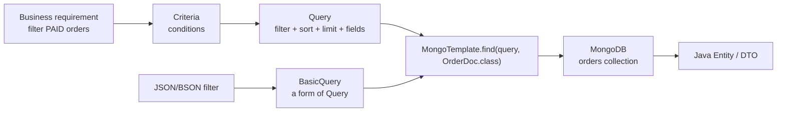
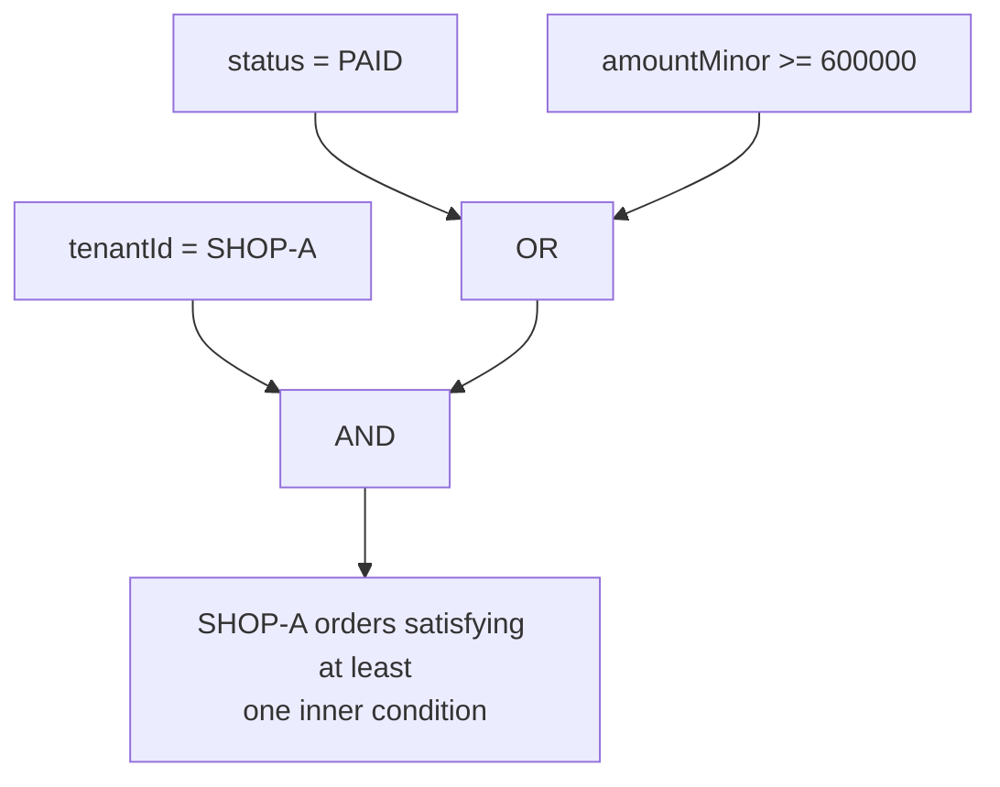

# Creating Query, Criteria, and BasicQuery

## 1. What Problems Do Query and Criteria Solve?

In **Spring Data MongoDB**, `MongoRepository` helps you quickly write simple queries based on method names, while `MongoTemplate` provides a more detailed API for building filter conditions, selecting fields, sorting, paginating, and performing other data access operations.

For example, a store's admin screen needs to find **paid orders**, created within a time range, with a total amount at or above a threshold. The filters selected by the user may change with every request. If you keep creating a new repository method for every combination of conditions, the interface will quickly become long and hard to manage. In that case, the pair `Query` and `Criteria` helps express queries **in a structured way**.

Three concepts to distinguish:

| Component | Role | Example |
| --- | --- | --- |
| `Criteria` | Represents one or a group of **conditions** | `Criteria.where("status").is("PAID")` |
| `Query` | Holds query conditions, along with options such as **sort, skip, limit, field projection** | `Query.query(criteria).with(sort).limit(20)` |
| `BasicQuery` | A type of `Query` that allows declaring a filter using **JSON or a BSON Document** and optionally specifying field projection | `new BasicQuery(filterJson)` |

In this example, `Criteria` and `Query` belong to the `org.springframework.data.mongodb.core.query` package. `BasicQuery` also belongs to that package and **extends `Query`**, so it can be passed to many `MongoTemplate` methods that accept a `Query` parameter.



**Learning outcomes:** you can create `Criteria` yourself, wrap it into a `Query`, read and understand `BasicQuery`, map Java property names to BSON fields, avoid errors when combining conditions, and verify a query with real MongoDB data.

## 2. Order Model and Practice Data

Suppose the application has an `orders` collection in the `orders_query_demo` database. Each order belongs to a tenant (store), has a status, creation timestamp, amount in the smallest currency unit, and a list of line items:

| Java Property | BSON Field | Illustrative Type | Meaning |
| --- | --- | --- | --- |
| `id` | `_id` | BSON String | Order identifier |
| `tenantId` | `tenant_id` | String | Owning store |
| `customerId` | `customer_id` | String | Purchasing customer |
| `status` | `status` | String | `PAID`, `CREATED`, `CANCELLED` |
| `amountMinor` | `amount_minor` | Int64 | Monetary value in the smallest unit |
| `createdAt` | `created_at` | Date | Creation timestamp |
| `tags` | `tags` | Array of String | Classification labels |
| `lines` | `lines` | Array of embedded document | Line items, with `sku` and `quantity` |

Example of a document displayed by `mongosh`:

```javascript
{
  _id: "ORD-1001",
  tenant_id: "SHOP-A",
  customer_id: "CUS-01",
  status: "PAID",
  amount_minor: NumberLong("450000"),
  created_at: ISODate("2026-11-10T08:00:00Z"),
  tags: ["priority", "online"],
  lines: [
    { sku: "BOOK-101", quantity: 2 },
    { sku: "BOOK-202", quantity: 1 }
  ]
}
```

### The `OrderDoc` Entity

The example uses Java 17 and the corresponding Spring Boot 3.x / Spring Data MongoDB configuration style. Specific APIs should be checked against the project's version during implementation:

```java
package com.example.orders;

import java.time.Instant;
import java.util.ArrayList;
import java.util.List;
import org.springframework.data.mongodb.core.mapping.Document;
import org.springframework.data.mongodb.core.mapping.Field;
import org.springframework.data.mongodb.core.mapping.FieldType;
import org.springframework.data.mongodb.core.mapping.MongoId;

@Document(collection = "orders")
public class OrderDoc {

    @MongoId(FieldType.STRING)
    private String id;

    @Field("tenant_id")
    private String tenantId;

    @Field("customer_id")
    private String customerId;

    private String status;

    @Field("amount_minor")
    private long amountMinor;

    @Field("created_at")
    private Instant createdAt;

    private List<String> tags = new ArrayList<>();
    private List<OrderLine> lines = new ArrayList<>();

    protected OrderDoc() {}

    public OrderDoc(
            String id, String tenantId, String customerId,
            String status, long amountMinor, Instant createdAt,
            List<String> tags, List<OrderLine> lines) {
        this.id = id;
        this.tenantId = tenantId;
        this.customerId = customerId;
        this.status = status;
        this.amountMinor = amountMinor;
        this.createdAt = createdAt;
        this.tags = new ArrayList<>(tags);
        this.lines = new ArrayList<>(lines);
    }

    public String getId() { return id; }
    public String getTenantId() { return tenantId; }
    public String getCustomerId() { return customerId; }
    public String getStatus() { return status; }
    public long getAmountMinor() { return amountMinor; }
    public Instant getCreatedAt() { return createdAt; }
    public List<String> getTags() { return tags; }
    public List<OrderLine> getLines() { return lines; }

    public static class OrderLine {
        private String sku;
        private int quantity;

        protected OrderLine() {}

        public OrderLine(String sku, int quantity) {
            this.sku = sku;
            this.quantity = quantity;
        }

        public String getSku() { return sku; }
        public int getQuantity() { return quantity; }
    }
}
```

`@Document` specifies the collection. `@Field` describes the BSON storage name; `@MongoId(FieldType.STRING)` instructs storing the ID as a BSON String. `OrderLine` is an embedded object, not a reference to another collection.

### Loading Sample Data

In a MongoDB database **dedicated to practice**, run once:

```javascript
use orders_query_demo

db.orders.insertMany([
  {
    _id: "ORD-1001", tenant_id: "SHOP-A", customer_id: "CUS-01",
    status: "PAID", amount_minor: NumberLong("450000"),
    created_at: ISODate("2026-11-10T08:00:00Z"),
    tags: ["priority", "online"],
    lines: [
      { sku: "BOOK-101", quantity: 2 },
      { sku: "BOOK-202", quantity: 1 }
    ]
  },
  {
    _id: "ORD-1002", tenant_id: "SHOP-A", customer_id: "CUS-02",
    status: "CREATED", amount_minor: NumberLong("180000"),
    created_at: ISODate("2026-11-11T08:00:00Z"),
    tags: ["online"],
    lines: [{ sku: "BOOK-202", quantity: 1 }]
  },
  {
    _id: "ORD-1003", tenant_id: "SHOP-A", customer_id: "CUS-01",
    status: "PAID", amount_minor: NumberLong("650000"),
    created_at: ISODate("2026-11-12T08:00:00Z"),
    tags: ["gift", "priority"],
    lines: [{ sku: "BOOK-303", quantity: 3 }]
  },
  {
    _id: "ORD-1004", tenant_id: "SHOP-B", customer_id: "CUS-03",
    status: "PAID", amount_minor: NumberLong("800000"),
    created_at: ISODate("2026-11-13T08:00:00Z"),
    tags: ["priority"],
    lines: [{ sku: "BOOK-101", quantity: 5 }]
  },
  {
    _id: "ORD-1005", tenant_id: "SHOP-A", customer_id: "CUS-04",
    status: "CANCELLED", amount_minor: NumberLong("220000"),
    created_at: ISODate("2026-11-14T08:00:00Z"),
    tags: [],
    lines: [{ sku: "BOOK-404", quantity: 1 }]
  }
])
```

Do not re-run `insertMany` with the same IDs unless you want to encounter duplicate key errors. The Spring Boot 3.x demo connection can be configured as:

```properties
spring.data.mongodb.uri=mongodb://localhost:27017/orders_query_demo
```

All subsequent Java snippets assume `MongoTemplate` has been injected by Spring into a service or component; small snippets are not standalone runnable applications.

## 3. Creating a Simple `Criteria` and `Query`

Requirement: retrieve orders with status `PAID` for `SHOP-A`. With `Criteria`:

```java
import java.util.List;
import org.springframework.data.mongodb.core.MongoTemplate;
import org.springframework.data.mongodb.core.query.Criteria;
import org.springframework.data.mongodb.core.query.Query;

Criteria criteria = Criteria.where("tenantId").is("SHOP-A")
    .and("status").is("PAID");

Query query = Query.query(criteria);

List<OrderDoc> orders =
    mongoTemplate.find(query, OrderDoc.class);
```

The Java condition above is semantically equivalent to the MongoDB query:

```javascript
db.orders.find({
  tenant_id: "SHOP-A",
  status: "PAID"
})
```

The results from the sample data include `ORD-1001` and `ORD-1003`, though **the order is not guaranteed** when the query does not have a `sort`.

### Separating Responsibilities by Layer

```java
// Criteria: states which conditions must be true.
Criteria condition = Criteria.where("status").is("PAID");

// Query: holds conditions, and can add sort/limit/fields.
Query query = new Query(condition);

// MongoTemplate: executes the query for the entity/collection.
List<OrderDoc> found = mongoTemplate.find(query, OrderDoc.class);
```

Both `new Query(condition)` and `Query.query(condition)` are common ways to instantiate a query. `MongoTemplate.find(query, OrderDoc.class)` uses `OrderDoc`'s metadata to map Java properties to BSON field names.

### `find`, `findOne`, `exists`, `count`

The same `Query` can be used for different intents:

```java
List<OrderDoc> found = mongoTemplate.find(query, OrderDoc.class);

OrderDoc first = mongoTemplate.findOne(query, OrderDoc.class);

boolean hasMatch = mongoTemplate.exists(query, OrderDoc.class);

long matches = mongoTemplate.count(query, OrderDoc.class);
```

Where:

- `find` returns a list; if nothing is found, it returns an empty list.
- `findOne` returns a single entity or `null` if no document matches; it **does not default to the newest order** when sort is missing.
- `exists` returns a boolean confirming whether at least one document matches.
- `count` counts the number of documents matching the conditions; you should not load all entities and call `size()` just to count.

If calling `findOne` when the business requirement asks for "newest", you must add an explicit sort. When building a query for count, you should use a separate filter-only query if you do not want skip/limit options from a list query to alter the counting semantics depending on the API/version.

## 4. Comparison and Value Filtering Operators

`Criteria` has many methods that map to MongoDB query operators:

| Java `Criteria` | Corresponding BSON Operator | Business Example |
| --- | --- | --- |
| `is(v)` | Value equals `v` | `status = PAID` |
| `ne(v)` | `$ne` | Status is not `CANCELLED` |
| `gt(v)` / `gte(v)` | `$gt` / `$gte` | Value greater than / at least a threshold |
| `lt(v)` / `lte(v)` | `$lt` / `$lte` | Before a timestamp / not exceeding a threshold |
| `in(values)` | `$in` | Status belongs to an accepted set |
| `nin(values)` | `$nin` | Exclude certain statuses |
| `exists(true/false)` | `$exists` | Whether the field exists |
| `regex(pattern)` | `$regex` | String pattern matching |
| `all(values)` | `$all` | Array contains all values |
| `size(n)` | `$size` | Array has exactly `n` elements |
| `elemMatch(criteria)` | `$elemMatch` | Multiple conditions on the same array element |

### Numeric and Time Range Comparisons

```java
import java.time.Instant;

Instant start = Instant.parse("2026-11-10T00:00:00Z");
Instant endExclusive = Instant.parse("2026-11-14T00:00:00Z");

Query paidInRange = Query.query(
    Criteria.where("tenantId").is("SHOP-A")
        .and("status").is("PAID")
        .and("amountMinor").gte(400_000L)
        .and("createdAt").gte(start).lt(endExclusive)
);
```

Here `createdAt` is bounded by a **half-open interval** `[start, endExclusive)` to avoid boundary errors. In MongoDB, these correspond to `created_at: { $gte: ISODate(...), $lt: ISODate(...) }` and `amount_minor: { $gte: NumberLong("400000") }`.

With the sample data, ignoring sort order, the matching orders are `ORD-1001` and `ORD-1003`. `Long` is used to represent monetary values in the smallest unit for the example, helping avoid confusing floating-point numbers with monetary prices.

### The `in` Condition

```java
import java.util.List;

Query activeOrders = Query.query(
    Criteria.where("tenantId").is("SHOP-A")
        .and("status").in(List.of("PAID", "CREATED"))
);
```

Equivalent:

```javascript
db.orders.find({
  tenant_id: "SHOP-A",
  status: { $in: ["PAID", "CREATED"] }
})
```

If the input set of statuses is empty, the business requirement might be to return empty immediately rather than creating an unnecessary query. If the value set is very large, you need to limit the input size and measure query cost; `$in` is not a safe replacement for every join or million-ID lookup problem.

## 5. Combining Conditions: AND, OR, and Parentheses Grouping

MongoDB requires multiple fields in a single filter to all be true (*implicit AND*):

```javascript
db.orders.find({
  tenant_id: "SHOP-A",
  status: "PAID"
})
```

In Java, you can use `.and(...)` to add a condition on another field:

```java
Criteria condition = Criteria.where("tenantId").is("SHOP-A")
    .and("status").is("PAID")
    .and("amountMinor").gte(400_000L);

Query query = Query.query(condition);
```

### Using `orOperator` for Alternatives

Requirement: view only `SHOP-A` orders and fetch orders that are **paid or have an amount of 600,000 or more**. The logical expression form is:

\[
\operatorname{tenant} = A
\;\land\;
(\operatorname{status} = PAID \;\lor\; \operatorname{amount} \ge 600000)
\]

```java
Criteria grouped = new Criteria().andOperator(
    Criteria.where("tenantId").is("SHOP-A"),
    new Criteria().orOperator(
        Criteria.where("status").is("PAID"),
        Criteria.where("amountMinor").gte(600_000L)
    )
);

Query query = Query.query(grouped);
List<OrderDoc> results =
    mongoTemplate.find(query, OrderDoc.class);
```

Equivalent MongoDB query:

```javascript
db.orders.find({
  $and: [
    { tenant_id: "SHOP-A" },
    {
      $or: [
        { status: "PAID" },
        { amount_minor: { $gte: NumberLong("600000") } }
      ]
    }
  ]
})
```

With the sample data, `ORD-1001` and `ORD-1003` satisfy the condition. Order `ORD-1004` has a high value and status `PAID` but is **excluded because it belongs to SHOP-B**. This also illustrates why tenant/access-control conditions must stay **outside the OR group** of other search criteria.



### When to Use `andOperator` Instead of `.and(...)`?

`.and("status")` is convenient when adding a condition on **a different field** in the same chain. `andOperator(...)` is useful when you need to group multiple sub-expressions, especially when there is an `$or`, nested groups, or multiple conditions on the same field.

For example, if you want a timestamp to be both `gte(start)` and `lt(end)`, write them on **one Criteria for that field**:

```java
Criteria dateRange = Criteria.where("createdAt")
    .gte(start)
    .lt(endExclusive);
```

You should not repeatedly add `Criteria.where("createdAt")` to the same `Query` via multiple `addCriteria` calls expecting the framework to automatically merge all conditions on the same key; that operation can fail due to duplicate keys or produce unpredictable semantics. When conditions are complex, build a clear logical structure and inspect the BSON query.

## 6. Querying Arrays and Embedded Documents

In `OrderDoc`, `tags` is `List<String>` while `lines` is `List<OrderLine>`. Both are stored as BSON arrays but have **different element types**.

### Finding Orders Containing a Tag

```java
Query priority = Query.query(
    Criteria.where("tenantId").is("SHOP-A")
        .and("tags").is("priority")
);
```

When a MongoDB field is an array, an equality condition against a single value matches when the array contains that element:

```javascript
db.orders.find({
  tenant_id: "SHOP-A",
  tags: "priority"
})
```

In the demo data, two orders `ORD-1001` and `ORD-1003` have the `priority` tag.

### `$all` and `$size`

```java
Query allTags = Query.query(
    Criteria.where("tags").all("priority", "online")
);

Query exactlyTwoTags = Query.query(
    Criteria.where("tags").size(2)
);
```

`all` requires the array to contain all specified values; `size` filters by exact element count. Both are criteria evaluated on the **existing BSON document**; they do not automatically convert the array into a Set or deduplicate values.

### `$elemMatch`: Two Conditions on the Same Line Item

Requirement: find orders belonging to `SHOP-A` that have **a line item** with both `sku = BOOK-101` and `quantity >= 2`:

```java
Criteria itemCondition = Criteria.where("sku").is("BOOK-101")
    .and("quantity").gte(2);

Query query = Query.query(
    Criteria.where("tenantId").is("SHOP-A")
        .and("lines").elemMatch(itemCondition)
);
```

Equivalent:

```javascript
db.orders.find({
  tenant_id: "SHOP-A",
  lines: {
    $elemMatch: {
      sku: "BOOK-101",
      quantity: { $gte: 2 }
    }
  }
})
```

`ORD-1001` satisfies the condition because its `BOOK-101` line has quantity 2. `ORD-1004` has a matching line item but belongs to `SHOP-B`, so it must not leak into `SHOP-A` results.

**Why not write two independent conditions on `lines.sku` and `lines.quantity`?** With an array of multiple objects, MongoDB can match `sku` in one element and `quantity` in another element. `$elemMatch` forces the conditions to hold on the **same embedded document**, matching the meaning of "a single line item".

## 7. Regex, Null, and Missing Fields

### `regex` for String Patterns

For example, finding `customerId` values starting with `CUS-0`:

```java
Query customers = Query.query(
    Criteria.where("customerId").regex("^CUS-0")
);
```

Regex is useful for some simple queries, but it should not be used indiscriminately as a full-text search engine. Unanchored regexes, case-insensitive regexes, or overly complex patterns can limit index usage and increase load. For true text search, consider a full-text search solution or appropriate search engine.

**Do not directly concatenate arbitrary regex strings entered by users** into an expression if the intent is only to search literally. You can escape them with `Pattern.quote(...)`:

```java
import java.util.regex.Pattern;

String userPrefix = "CUS.";
Pattern safePrefix = Pattern.compile(
    "^" + Pattern.quote(userPrefix)
);

Query query = Query.query(
    Criteria.where("customerId").regex(safePrefix)
);
```

This code treats `CUS.` as a literal prefix, rather than treating the dot as a regex character matching any character. If the API does not allow searching by arbitrary prefixes, restrict the input format even further.

### Distinguishing `null`, Missing, and Empty String

MongoDB distinguishes these documents:

```javascript
{ customer_id: null }
{ /* customer_id is completely missing */ }
{ customer_id: "" }
```

In a MongoDB query, the condition `{ customer_id: null }` typically matches both documents with a `null` field **and documents missing the field**. `Criteria.where("customerId").is(null)` has the corresponding semantics, so do not use it to reliably check "field exists and is null" without additional conditions.

Several cases:

```java
// Field exists, regardless of value (including null).
Criteria present = Criteria.where("customerId").exists(true);

// Field does not exist in the document.
Criteria missing = Criteria.where("customerId").exists(false);

// Field exists and is not null.
Criteria nonNull = Criteria.where("customerId")
    .exists(true)
    .ne(null);
```

If historical data has fields of the wrong type (for example `amount_minor` stored as String while the entity uses `long`), comparison operators may yield results that do not match business expectations. You need to inspect actual BSON using `$type`, define a schema, and have a clear migration plan.

## 8. `Query` Holds More Than Conditions: Sort, Limit, Skip, Fields

After building `Criteria`, `Query` adds options to decide **which documents and how many fields** are returned. For example, a screen wants 20 `PAID` orders for `SHOP-A`, sorted newest first, starting from the third page:

```java
import org.springframework.data.domain.Sort;
import org.springframework.data.mongodb.core.query.Criteria;
import org.springframework.data.mongodb.core.query.Query;

Query query = Query.query(
    Criteria.where("tenantId").is("SHOP-A")
        .and("status").is("PAID")
);

query.with(Sort.by(
    Sort.Order.desc("createdAt"),
    Sort.Order.desc("id")
));
query.skip(40);
query.limit(20);

List<OrderDoc> page =
    mongoTemplate.find(query, OrderDoc.class);
```

In `mongosh`, the query with the same meaning:

```javascript
db.orders.find({
  tenant_id: "SHOP-A",
  status: "PAID"
})
.sort({ created_at: -1, _id: -1 })
.skip(40)
.limit(20)
```

**Note:** `skip(40)` is just an example of page 2 with size 20 (0-indexed pages). In the small demo dataset, that page is empty. With large datasets, `skip` at deep offsets incurs the cost of scanning many results; check `explain("executionStats")` and consider keyset pagination if the UI only needs "load more".

### Selecting Only Specific Fields

`Query.fields()` lets you describe field projection:

```java
Query summary = Query.query(
    Criteria.where("tenantId").is("SHOP-A")
);

summary.fields()
    .include("id")
    .include("status")
    .include("amountMinor")
    .include("createdAt");

summary.with(Sort.by(Sort.Order.desc("createdAt")));
summary.limit(10);

List<OrderDoc> partial =
    mongoTemplate.find(summary, OrderDoc.class);
```

Because entity metadata is available, `id` maps to `_id`, `amountMinor` to `amount_minor`, and `createdAt` to `created_at`. You can compare the field selection using:

```javascript
db.orders.find(
  { tenant_id: "SHOP-A" },
  {
    _id: 1,
    status: 1,
    amount_minor: 1,
    created_at: 1
  }
).sort({ created_at: -1 }).limit(10)
```

**Do not treat a partial entity result as a fully loaded `OrderDoc`.** Unselected fields may be `null` or carry default values such as `0` for primitive types. Do not unconditionally `save` a partial entity back, as there is a risk of overwriting unloaded data. If you need to return list results for an API, an interface projection or a DTO with explicitly defined fields is usually easier to manage.

In an inclusion-style projection, you generally cannot arbitrarily mix `include` and `exclude` at the same level (the common exception is handling `_id`). You should verify the actual BSON field projection structure according to your requirements.

## 9. `BasicQuery`: Creating Queries from JSON or BSON Document

`Query` together with `Criteria` is the natural choice when an application builds conditions using Java properties. In other situations, you already have a **developer-controlled JSON** filter, or need to directly express a BSON structure that is inconvenient via fluent methods. In those cases, `BasicQuery` is an option.

### 9.1. `BasicQuery` from a JSON Filter

```java
import java.util.List;
import org.springframework.data.mongodb.core.query.BasicQuery;

String filterJson = """
    {
      "tenant_id": "SHOP-A",
      "status": { "$in": ["PAID", "CREATED"] },
      "amount_minor": { "$gte": 200000 }
    }
    """;

BasicQuery query = new BasicQuery(filterJson);

List<OrderDoc> found =
    mongoTemplate.find(query, OrderDoc.class);
```

The JSON snippet is a MongoDB filter (not an aggregation pipeline), with field names `tenant_id`, `status`, and `amount_minor` matching the stored BSON. `BasicQuery` extends `Query`, so it is passed to `MongoTemplate.find` just like a regular query.

The value `200000` in JSON is a number; during comparison, MongoDB has rules for comparing BSON numeric types. In applications needing strict control over the Int64 type, you can use a `Document` with a Java `Long` value or properly formatted Extended JSON and verify the type sent to the server. Do not arbitrarily convert monetary amounts to Strings when the goal is numeric range filtering.

### 9.2. Declaring Both Filter and Field Projection JSON

`BasicQuery` has a constructor accepting two strings: **filter JSON** and **field projection JSON**.

```java
String filterJson = """
    { "tenant_id": "SHOP-A", "status": "PAID" }
    """;

String fieldsJson = """
    { "_id": 1, "status": 1, "amount_minor": 1 }
    """;

BasicQuery query = new BasicQuery(filterJson, fieldsJson);

query.with(Sort.by(
    Sort.Order.desc("createdAt"),
    Sort.Order.desc("id")
));
query.limit(10);

List<OrderDoc> results =
    mongoTemplate.find(query, OrderDoc.class);
```

Here:

- `filterJson` selects `SHOP-A` documents with `status = PAID`.
- `fieldsJson` requests only the `_id`, `status`, and `amount_minor` fields in the results.
- `with(Sort)` and `limit` are methods inherited from `Query`.
- The results are **partial entities** because `tenantId`, `customerId`, `createdAt`, `tags`, and `lines` may not be returned. Do not treat them as complete aggregates to save back using `save`.

One distinction to keep in mind: `sort` can use a field for ordering even if that field **does not appear in the projection result**. Sorting by `created_at` is still meaningful for this query.

### 9.3. `BasicQuery` from a BSON `Document`

Instead of writing JSON as a string, you can build the filter with `org.bson.Document`:

```java
import java.util.List;
import org.bson.Document;
import org.springframework.data.mongodb.core.query.BasicQuery;

Document filter = new Document("tenant_id", "SHOP-A")
    .append("status", new Document("$in",
        List.of("PAID", "CREATED")))
    .append("amount_minor", new Document("$gte", 200_000L));

BasicQuery query = new BasicQuery(filter);

List<OrderDoc> results =
    mongoTemplate.find(query, OrderDoc.class);
```

`Document` is convenient when you must provide a BSON structure with Java type-controlled values. Even so, code building `Document` directly is often more verbose and harder to read than `Criteria` for common business filters.

### 9.4. Does `BasicQuery` Bypass Mapping Metadata?

You should not make an absolute statement that `BasicQuery` "always ignores" all Spring Data mapping mechanisms. When calling `mongoTemplate.find(query, OrderDoc.class)`, the query still passes through `MongoTemplate`'s processing pipeline with entity metadata; the framework can map property names that it recognizes.

However, with **hand-written JSON/BSON**, the least ambiguous approach is to proactively verify the **physical field names** of the collection, especially names renamed via `@Field`, nested paths, IDs, and dynamic operators. Mixing Java property keys and BSON keys in a single raw JSON string easily misleads maintainers. Decide on one convention, write tests, and observe the actual query sent to MongoDB.

### 9.5. Never Pass Arbitrary Client JSON into `BasicQuery`

**This is a critical safety rule.** If an HTTP API receives a JSON filter and passes it verbatim into `new BasicQuery(userJson)`, a caller can inject MongoDB operators like `$ne`, `$or`, `$regex`, or other conditions outside the intended business scope. This can create **NoSQL operator injection**, allow unauthorized data reads, or cause the database to execute very expensive queries.

Do not write:

```java
// DO NOT use with arbitrary user-supplied JSON.
BasicQuery unsafe = new BasicQuery(requestBody);
```

Instead, accept **typed and validated parameters** and build `Criteria`:

```java
Criteria safeCriteria = Criteria.where("tenantId")
    .is(authorizedTenantId)
    .and("status").is(validatedStatus);

Query safeQuery = Query.query(safeCriteria);
```

Here `authorizedTenantId` is obtained from the authenticated/authorized user context, and `validatedStatus` belongs to an allowed enum or list of statuses. Even with fluent `Query`, do not plug in user-specified field names without an allowlist.

## 10. Building a Dynamic Filter with `Criteria`

Suppose a list API receives **optional** parameters: `status`, `minAmountMinor`, `from`, and `untilExclusive`. Tenant is a mandatory condition obtained from a trusted source.

You can build a list of conditions and combine them with `andOperator`:

```java
package com.example.orders;

import java.time.Instant;
import java.util.ArrayList;
import java.util.List;
import org.springframework.data.domain.Sort;
import org.springframework.data.mongodb.core.MongoTemplate;
import org.springframework.data.mongodb.core.query.Criteria;
import org.springframework.data.mongodb.core.query.Query;
import org.springframework.stereotype.Service;

@Service
public class OrderSearchService {

    private final MongoTemplate template;

    public OrderSearchService(MongoTemplate template) {
        this.template = template;
    }

    public List<OrderDoc> search(
            String authorizedTenantId,
            String status,
            Long minAmountMinor,
            Instant fromInclusive,
            Instant untilExclusive,
            int limit) {

        if (authorizedTenantId == null || authorizedTenantId.isBlank()) {
            throw new IllegalArgumentException("Invalid tenant");
        }
        if (limit < 1 || limit > 100) {
            throw new IllegalArgumentException("Invalid limit");
        }
        if (minAmountMinor != null && minAmountMinor < 0) {
            throw new IllegalArgumentException("Amount must be non-negative");
        }
        if (fromInclusive != null && untilExclusive != null
                && !fromInclusive.isBefore(untilExclusive)) {
            throw new IllegalArgumentException("Invalid date range");
        }

        List<Criteria> conditions = new ArrayList<>();
        conditions.add(Criteria.where("tenantId").is(authorizedTenantId));

        if (status != null && !status.isBlank()) {
            conditions.add(Criteria.where("status").is(status));
        }
        if (minAmountMinor != null) {
            conditions.add(
                Criteria.where("amountMinor").gte(minAmountMinor));
        }
        if (fromInclusive != null || untilExclusive != null) {
            Criteria dates = Criteria.where("createdAt");
            if (fromInclusive != null) {
                dates.gte(fromInclusive);
            }
            if (untilExclusive != null) {
                dates.lt(untilExclusive);
            }
            conditions.add(dates);
        }

        Criteria combined = conditions.size() == 1
            ? conditions.get(0)
            : new Criteria().andOperator(
                conditions.toArray(new Criteria[0]));

        Query query = Query.query(combined);
        query.with(Sort.by(
            Sort.Order.desc("createdAt"),
            Sort.Order.desc("id")
        ));
        query.limit(limit);

        return template.find(query, OrderDoc.class);
    }
}
```

This snippet illustrates a **synchronous query path**. It has the following properties:

1. Always includes the `tenantId` filter, preventing a request from accidentally reading the entire multi-tenant collection.
2. Only adds provided criteria, without hardcoding every combination into method names.
3. Keeps both ends of the time range on a single `Criteria` for the `createdAt` property.
4. Does not concatenate user-supplied JSON, using typed values instead.
5. Caps results at 100 and sorts by `createdAt` plus secondary key `id` so ordering is deterministic when multiple orders share the same timestamp.

In a real application, you also need to validate `status` against an enum, bound the date range, authorize tenant viewing permissions, and apply rate limiting. Do not treat knowing a tenant ID as proof that the caller is authorized to read that tenant's data.

## 11. Query, Criteria, BasicQuery, and Repository: How to Choose?

| Scenario | Usually Suitable Choice | Why |
| --- | --- | --- |
| Lookup by a few fixed properties | Derived repository method | Concise, readable, minimal boilerplate |
| Filter with many optional parameters | `Query` + `Criteria` | Can add conditions dynamically at runtime |
| Nested fields, arrays, complex AND/OR | `Query` + `Criteria` | Explicit logical structure |
| Already have a trusted, code-controlled BSON/JSON query | `BasicQuery` | Keeps MongoDB syntax close to the original query |
| Need field selection, sort, skip, limit | `Query` or `BasicQuery` | Both support query options |
| Complex query but want a repository API | `@Query` on repository when appropriate | Binds the query to a repository method |
| Need multi-stage `$group`, `$lookup`, `$project` | Aggregation API / pipeline | Not a simple find filter command |
| Non-blocking application | `ReactiveMongoTemplate` | Same Query/Criteria concepts, returning reactive publishers |

### How Does `BasicQuery` Differ from `@Query`?

`BasicQuery` is a **runtime query object** passed to `MongoTemplate`. `@Query` is an **annotation** declaring a query on a repository method:

```java
import java.util.List;
import org.springframework.data.mongodb.repository.MongoRepository;
import org.springframework.data.mongodb.repository.Query;

public interface OrderRepository
        extends MongoRepository<OrderDoc, String> {

    @Query("{ 'tenant_id': ?0, 'status': ?1 }")
    List<OrderDoc> findMatching(
        String tenantId, String status);
}
```

This snippet demonstrates annotation parameter binding, unlike constructing a `BasicQuery` from an arbitrary string. If the same Java file needs both the `@Query` annotation and the `org.springframework.data.mongodb.core.query.Query` class, use appropriate imports or qualified names to avoid a name collision between the two `Query` types.

Neither derived queries nor `@Query` automatically join across collections. If you need conditions on documents referenced in another collection, you must run a two-step query, use aggregation `$lookup`, or design your data model accordingly.

## 12. Verifying Field Names, BSON Types, and Actual Queries

One of the most common mistakes is confusing **Java properties** with **MongoDB field names**. With `OrderDoc`:

```java
// With MongoTemplate.find(query, OrderDoc.class):
Criteria.where("tenantId").is("SHOP-A");
Criteria.where("createdAt").gte(start);
Criteria.where("amountMinor").gte(400_000L);
```

These properties map to:

```javascript
// In mongosh or raw JSON/BSON authored against the physical schema:
{
  tenant_id: "SHOP-A",
  created_at: { $gte: ISODate("2026-11-10T00:00:00Z") },
  amount_minor: { $gte: NumberLong("400000") }
}
```

**IDs need special attention:** `@MongoId(FieldType.STRING)` in the example stores `_id` as a BSON String. If another collection uses ObjectId, passing a string with the same characters into a direct BSON query is not guaranteed to match. You must know the actual `_id` type, mapping rules, and how the converter builds the query.

### Inspecting BSON Types via `mongosh`

```javascript
db.orders.aggregate([
  { $match: { _id: "ORD-1001" } },
  {
    $project: {
      _id: 0,
      idType: { $type: "$_id" },
      amountType: { $type: "$amount_minor" },
      createdType: { $type: "$created_at" },
      linesType: { $type: "$lines" }
    }
  }
])
```

Expected output for the example data includes `idType = "string"`, `amountType = "long"`, `createdType = "date"`, and `linesType = "array"`.

### Does `getQueryObject()` Show the Final MongoDB Command?

`Query` provides methods such as `getQueryObject()` and `getFieldsObject()` to inspect the structure currently held by the query object:

```java
Query query = Query.query(
    Criteria.where("tenantId").is("SHOP-A")
        .and("status").is("PAID")
);

System.out.println(query.getQueryObject());
```

This is a useful debugging tool, but **you should not treat the printed string as final proof of the BSON command sent to MongoDB**. When executing `MongoTemplate.find(query, OrderDoc.class)`, mapping, converters, and driver options continue processing the query. To be certain, use appropriate MongoDB command monitoring/logging in tests or observe behavior via `mongosh` and integration tests.

## 13. Indexes, Query Plans, and Execution Cost

The `Criteria` API only helps build semantically correct queries; it **does not automatically create indexes** or guarantee fast queries.

Suppose the workload mainly reads paid orders per tenant, sorted newest first. A candidate index:

```javascript
db.orders.createIndex(
  { tenant_id: 1, status: 1, created_at: -1, _id: -1 },
  { name: "orders_tenant_status_created_id" }
)
```

And the corresponding query:

```javascript
db.orders.find({
  tenant_id: "SHOP-A",
  status: "PAID"
})
.sort({ created_at: -1, _id: -1 })
.limit(20)
.explain("executionStats")
```

Reading the metrics:

| Indicator | What to Check? |
| --- | --- |
| `winningPlan` | Which plan did MongoDB choose, and which index is used? |
| `IXSCAN` | Is an index scanned; how many keys were examined? |
| `COLLSCAN` | Did it have to scan many/all documents in the collection? |
| `SORT` | Is a separate in-memory sort needed instead of leveraging index order? |
| `totalKeysExamined` | How many index keys were examined? |
| `totalDocsExamined` | How many documents had to be read? |
| `nReturned` | Does the number of returned documents match the limit? |
| `executionTimeMillis` | Latency measured in this run; check across multiple runs |

For queries on `amount_minor`, `lines.sku`, or combining `$or`, the plan may differ; an index tailored for one sort query does not automatically optimize every filter. Choose indexes from **real access patterns**, selectivity, and write overhead, rather than automatically indexing every property in an entity.

Example index on an array field:

```javascript
db.orders.createIndex(
  { tenant_id: 1, "lines.sku": 1 },
  { name: "orders_tenant_line_sku" }
)
```

This can become a **multikey index**, serving queries involving line items; with `$elemMatch`, verify the execution plan and compound index rules when multiple array fields participate. Every index increases storage and write overhead.

**Optimization differs from correctness:** the same `Criteria` condition may return the right result on a five-document collection yet be slow with millions of documents. Do not judge performance from demo examples alone; use representative data and load.

## 14. Testing Query, Criteria, and BasicQuery

You should test against a **real MongoDB** instance in an integration environment, such as an isolated test MongoDB or Testcontainers. Tests should verify both Java entity results and stored BSON data.

The example below uses `@DataMongoTest`, `MongoTemplate`, and BSON `Document` to seed fixtures directly. The test connection and MongoDB instance must be configured separately before running:

```java
package com.example.orders;

import java.time.Instant;
import java.util.Date;
import java.util.List;
import org.bson.Document;
import org.junit.jupiter.api.BeforeEach;
import org.junit.jupiter.api.Test;
import org.springframework.beans.factory.annotation.Autowired;
import org.springframework.boot.test.autoconfigure.data.mongo.DataMongoTest;
import org.springframework.data.mongodb.core.MongoTemplate;
import org.springframework.data.mongodb.core.query.BasicQuery;
import org.springframework.data.mongodb.core.query.Criteria;
import org.springframework.data.mongodb.core.query.Query;

import static org.assertj.core.api.Assertions.assertThat;

@DataMongoTest
class OrderQueryTest {

    @Autowired
    MongoTemplate template;

    @BeforeEach
    void seedIsolatedDatabase() {
        // Delete ONLY on an isolated test database!
        template.getCollection("orders").deleteMany(new Document());

        Date created = Date.from(
            Instant.parse("2026-11-10T08:00:00Z"));

        template.getCollection("orders").insertMany(List.of(
            new Document("_id", "ORD-A")
                .append("tenant_id", "SHOP-A")
                .append("customer_id", "CUS-01")
                .append("status", "PAID")
                .append("amount_minor", 450_000L)
                .append("created_at", created)
                .append("tags", List.of("priority"))
                .append("lines", List.of(
                    new Document("sku", "BOOK-101")
                        .append("quantity", 2))),
            new Document("_id", "ORD-B")
                .append("tenant_id", "SHOP-A")
                .append("customer_id", "CUS-02")
                .append("status", "CREATED")
                .append("amount_minor", 180_000L)
                .append("created_at", created)
                .append("tags", List.of("online"))
                .append("lines", List.of(
                    new Document("sku", "BOOK-202")
                        .append("quantity", 1))),
            new Document("_id", "ORD-C")
                .append("tenant_id", "SHOP-B")
                .append("customer_id", "CUS-03")
                .append("status", "PAID")
                .append("amount_minor", 800_000L)
                .append("created_at", created)
                .append("tags", List.of("priority"))
                .append("lines", List.of(
                    new Document("sku", "BOOK-101")
                        .append("quantity", 5)))
        ));
    }

    @Test
    void fluentCriteriaMapsJavaPropertiesToBsonNames() {
        Query query = Query.query(
            Criteria.where("tenantId").is("SHOP-A")
                .and("status").is("PAID")
                .and("amountMinor").gte(400_000L)
        );

        assertThat(template.find(query, OrderDoc.class))
            .extracting(OrderDoc::getId)
            .containsExactly("ORD-A");
    }

    @Test
    void basicQueryUsesExplicitBsonFilter() {
        BasicQuery query = new BasicQuery("""
            { "tenant_id": "SHOP-A", "status": "CREATED" }
            """);

        assertThat(template.find(query, OrderDoc.class))
            .extracting(OrderDoc::getId)
            .containsExactly("ORD-B");
    }

    @Test
    void elemMatchChecksSameEmbeddedLine() {
        Query query = Query.query(
            Criteria.where("tenantId").is("SHOP-A")
                .and("lines").elemMatch(
                    Criteria.where("sku").is("BOOK-101")
                        .and("quantity").gte(2))
        );

        assertThat(template.find(query, OrderDoc.class))
            .extracting(OrderDoc::getId)
            .containsExactly("ORD-A");
    }
}
```

**Warning:** `deleteMany(new Document())` deletes all documents in the connected `orders` collection. The setup snippet is strictly for a **completely isolated** test database; never run it on production or a shared database. `@DataMongoTest` does not automatically provision a safe MongoDB in every environment; test infrastructure must be configured beforehand.

Cases to add:

1. Filters with multiple optional `null` parameters, ensuring the mandatory tenant condition is never dropped.
2. Time ranges at both boundaries: included at the start boundary, excluded right at `untilExclusive`.
3. `$or` placed inside an `$and` group with tenant, never accidentally allowing another tenant's data.
4. Array queries: using `$elemMatch` so two different elements are not mismatched.
5. Missing/null/wrong-type BSON fields: explicitly document the handling policy.
6. `BasicQuery` with a wrong BSON name: tests should catch this instead of silently returning empty.
7. Field selection leading to partial entities: verify returned fields and do not use partial entities to save back.
8. With large data: measure `explain("executionStats")` and index impact rather than inferring performance from three records.

## 15. Reactive Query and Criteria

If the application uses reactive access, `ReactiveMongoTemplate` still accepts `Query`/`Criteria` built using the same principles, except results are `Flux` or `Mono`:

```java
import org.springframework.data.mongodb.core.ReactiveMongoTemplate;
import org.springframework.data.mongodb.core.query.Criteria;
import org.springframework.data.mongodb.core.query.Query;
import reactor.core.publisher.Flux;

Query query = Query.query(
    Criteria.where("tenantId").is("SHOP-A")
        .and("status").is("PAID")
);

Flux<OrderDoc> orders =
    reactiveMongoTemplate.find(query, OrderDoc.class);
```

This snippet belongs to a component that injects `ReactiveMongoTemplate` and uses the corresponding reactive starter. Do not call `block()` inside a reactive request just to turn a `Flux` into a synchronous list. At the same time, reactive does not automatically optimize a bad filter, missing index, or missing limit: the database still bears the actual query cost.

A `Query` is an object with mutating configuration methods such as `limit`, `skip`, and `addCriteria`. In multi-threaded services or reactive pipelines, you should **create a separate Query per request** rather than sharing a mutable instance and modifying conditions across concurrent tasks.

## 16. Common Errors and How to Diagnose Them

| Symptom | Possible Cause | Remediation |
| --- | --- | --- |
| `find` returns empty even though `mongosh` shows documents | Confused Java/BSON names, wrong database, wrong ID type | Check `@Field`, `_id`, `$type`, and connection URI |
| Time filter misses documents at boundaries | Wrong timezone or wrong `lt/lte` | Use `Instant` and half-open `[start, endExclusive)` |
| `andOperator`/`orOperator` returns out-of-tenant results | Misplaced logical parentheses; tenant inside OR group | Write clear grouping structure and test multi-tenant data |
| Adding criteria multiple times on the same field errors out | `addCriteria` with duplicate key fails to build valid BSON | Use one Criteria holding the operators or proper logical grouping |
| Array query matches wrong line items | Conditions apply across two different array elements | Use `elemMatch` |
| `BasicQuery` finds no data | Field names or BSON types in JSON do not match schema | Compare JSON filter against real documents |
| API reads out of scope or runs very expensive queries | Accepting arbitrary raw JSON filters from clients | Never pass user JSON directly to `BasicQuery`; use typed Criteria and allowlists |
| `regex` is too slow | Pattern cannot use index or scans many documents | Restrict input, use appropriate prefixes or full-text search |
| Fields in partial entity become null/0 | Query only includes a subset of fields | Use DTO/projection; never save partial entities |
| `findOne` does not return the newest document | Missing sort | Add sort by timestamp and a unique tie-breaker key |
| Query is slow despite short Criteria code | Missing index, low-selectivity filter, large payload | Use `explain`, measure index, bytes, and latency |
| Code changes do not appear in executed query | Sharing/reusing a mutable Query or running stale config | Create a new Query per request, inspect the actual command |

## 17. Self-Check Exercises

### Exercise 1: Identify Roles

**Question:** Is `Criteria.where("status").is("PAID")` already a complete `Query`? **Answer:** No. It is a condition; use `Query.query(criteria)` or `new Query(criteria)` to build the query object before calling APIs that accept `Query`.

### Exercise 2: Query Values Above a Threshold

**Question:** Find `PAID` orders of `SHOP-A` with `amountMinor >= 500000`.

```java
Query query = Query.query(
    Criteria.where("tenantId").is("SHOP-A")
        .and("status").is("PAID")
        .and("amountMinor").gte(500_000L)
);
```

**Answer on sample data:** `ORD-1003`.

### Exercise 3: Distinguish `$or` from `$and`

**Question:** You want only `SHOP-A` orders that satisfy **one of two conditions**: `PAID` or amount 600,000 or more. Should you use `orOperator` across all three criteria?

**Answer:** No. Tenant must be combined via `AND` with an `OR` group of the two business conditions, preventing `SHOP-B` data from leaking in.

### Exercise 4: Why Is `elemMatch` Needed?

**Question:** An order has two lines: `{ sku: "A", quantity: 1 }` and `{ sku: "B", quantity: 10 }`. Is there a single line with `sku = A` and `quantity >= 5`?

**Answer:** No. Use `$elemMatch` to ensure both conditions match on the **same line item**, instead of accidentally combining results from two different lines.

### Exercise 5: BasicQuery and Physical Fields

**Question:** A Java entity has `@Field("tenant_id") String tenantId`. When writing a raw JSON query against the BSON schema, what should the corresponding field name be?

**Answer:** `tenant_id`. In `Criteria` with entity metadata, you usually write `tenantId`. Always check the physical field and final command when using `BasicQuery` or raw BSON APIs.

### Exercise 6: API Security

**Question:** Should you accept raw JSON filters from clients and call `new BasicQuery(requestBody)`?

**Answer:** No for typical business APIs. Clients could supply unexpected operators or craft resource-intensive queries. Accept typed inputs, validate allowed fields/operators, enforce authorization filters, and build `Criteria`.

### Exercise 7: Query Instead of Repository

**Question:** When is `MongoTemplate` + `Query` a better fit than creating dozens of `findBy...` methods?

**Answer:** When there are many optional filters, complex AND/OR logical groups, array conditions, field projections, or dynamic query structures that are hard to express clearly in method names.

## 18. Project Usage Checklist

1. Define the **business question and authorization boundaries**, especially mandatory tenant filters.
2. Choose **Java property names** for `Criteria` with entity context; check `@Field` to know the physical BSON name.
3. Build conditions using `where`/`and`; when logical parentheses are needed, use explicit `andOperator`/`orOperator`.
4. Verify **value types**: Int64, Date/`Instant`, ObjectId/String, arrays; avoid silent type mismatches.
5. Add `Sort` with a unique tie-breaker key when deterministic order is needed; cap `limit` and manage deep `skip`.
6. Use `fields()` or DTOs when only a few fields are needed, and never carelessly save partial entities back.
7. Use `BasicQuery` for **trusted, code-managed JSON/BSON**, not unvalidated raw filters from clients.
8. Verify generated queries, BSON fields, and indexes via integration tests, `mongosh`, and `explain("executionStats")`.
9. Create a fresh `Query` per request when configuring dynamically or under concurrent access.
10. When a query needs joins or aggregation, switch to the appropriate API rather than forcing everything into a find query's `Criteria`.

**Conclusion:** In Spring Data MongoDB, **`Criteria` describes conditions**, **`Query` packages filters together with query options**, and **`BasicQuery` lets you provide conditions in explicit JSON/BSON form**. Default to `Criteria` for dynamic business filters; use `BasicQuery` when you genuinely need a controlled BSON structure. Whichever approach you use, correctness and performance depend on **field names, BSON types, logical grouping, authorization, indexes, and testing with a real MongoDB**.
