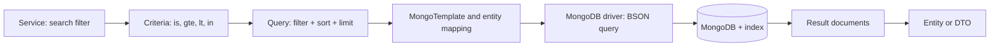

# Comparison, Range, and Set Conditions

## 1. Why Should You Understand Comparison Operators Thoroughly?

In **Spring Data MongoDB**, `Query` and `Criteria` let you write MongoDB conditions using a Java API instead of manually concatenating JSON strings. When a system searches for products, filters orders by time, or selects documents belonging to a set of statuses, bugs usually do not lie in syntax but in **boundary semantics** and **the data types being compared**.

For example, a store wants to find products belonging to tenant `shop-01`, currently active, with stock from 10 up to under 50, and belonging to either category `books` or `tools`:

```javascript
db.catalog_items.find({
  tenantId: "shop-01",
  active: true,
  stock: { $gte: 10, $lt: 50 },
  category: { $in: ["books", "tools"] }
});
```

At the Spring Data MongoDB layer, this query can be built with:

```java
Query query = Query.query(
    Criteria.where("tenantId").is("shop-01")
        .and("active").is(true)
        .and("stock").gte(10).lt(50)
        .and("category").in("books", "tools")
);
```

This example illustrates three groups of conditions:

1. **Equality and inequality comparisons:** `is`, `ne`.
2. **Ordering and range comparisons:** `gt`, `gte`, `lt`, `lte`.
3. **Set membership checks:** `in`, `nin`, and array-related cases.

This lesson belongs to the **Query and Criteria** chapter of the **SPRING_DATA_MONGODB** module. The goal is to construct filters with unambiguous semantics, handle boundaries and missing data, verify BSON queries, choose indexes, use them with `MongoTemplate` or repositories, and test error-prone edge cases.

## 2. What Roles Do Query, Criteria, and MappingMongoConverter Play?

`Criteria` describes one or more conditions. `Query` holds a set of conditions along with options such as sort, projection, skip, and limit. `MongoTemplate` receives `Query` and knows the entity type so it can map property names and values before handing off to the MongoDB driver.



Practical invocation example:

```java
import java.util.List;
import org.springframework.data.mongodb.core.MongoTemplate;
import org.springframework.data.mongodb.core.query.Criteria;
import org.springframework.data.mongodb.core.query.Query;

public List<CatalogItem> findInStock(MongoTemplate template) {
    Query query = Query.query(
        Criteria.where("stock").gte(1)
    );

    return template.find(query, CatalogItem.class);
}
```

In the example above, `CatalogItem` is the entity in section 3. There is no user-controlled JSON string concatenation; values are passed through the condition-building API. Still, a technically valid query can be **business-incorrect**, such as using `gte` when the actual requirement demands `gt`.

### Comparison Table of Java API and MongoDB Operators

| Meaning | Spring Data Criteria | MongoDB BSON |
| --- | --- | --- |
| Equals | `Criteria.where("stock").is(10)` | `{stock: 10}` or `{stock: {$eq: 10}}` |
| Differs from a value | `.ne(10)` | `{$ne: 10}` |
| Greater than | `.gt(10)` | `{$gt: 10}` |
| Greater than or equal to | `.gte(10)` | `{$gte: 10}` |
| Less than | `.lt(50)` | `{$lt: 50}` |
| Less than or equal to | `.lte(50)` | `{$lte: 50}` |
| In a set | `.in("books", "tools")` | `{$in: ["books", "tools"]}` |
| Not in a set | `.nin("books", "tools")` | `{$nin: ["books", "tools"]}` |
| Field exists | `.exists(true)` | `{$exists: true}` |

MongoDB comparisons depend on **BSON type**, collation, and server comparison rules. Spring Data does not automatically fix a field stored with the wrong type just because Java code passes a properly typed value.

## 3. Sample Entity and Practice Data

### 3.1. Java Entity

Suppose there is a `catalog_items` collection. For monetary consistency, the example represents `price` as `Decimal128` rather than `Double`; timestamps use BSON Date via `Instant`.

```java
package example.catalog;

import java.math.BigDecimal;
import java.time.Instant;
import java.util.List;
import org.springframework.data.mongodb.core.mapping.Document;
import org.springframework.data.mongodb.core.mapping.Field;
import org.springframework.data.mongodb.core.mapping.FieldType;
import org.springframework.data.mongodb.core.mapping.MongoId;

@Document(collection = "catalog_items")
public record CatalogItem(
    @MongoId(FieldType.STRING) String id,
    String tenantId,
    String sku,
    String category,
    @Field(targetType = FieldType.DECIMAL128) BigDecimal price,
    int stock,
    boolean active,
    Instant createdAt,
    List<String> tags
) {}
```

`@MongoId(FieldType.STRING)` specifies storing IDs as BSON String, avoiding accidental reliance on whether a string happens to look like an ObjectId. `@Field(targetType = FieldType.DECIMAL128)` explicitly indicates the expected BSON type for `price`. These annotations do not automatically convert legacy data in the collection to the new type.

### 3.2. Illustrative Dataset

```javascript
db.catalog_items.insertMany([
  {
    _id: "p-A", tenantId: "shop-01", sku: "BOOK-A",
    category: "books", price: NumberDecimal("15.00"),
    stock: NumberInt("0"), active: true,
    createdAt: ISODate("2026-11-19T10:00:00Z"),
    tags: ["sale"]
  },
  {
    _id: "p-B", tenantId: "shop-01", sku: "BOOK-B",
    category: "books", price: NumberDecimal("20.00"),
    stock: NumberInt("10"), active: true,
    createdAt: ISODate("2026-11-20T09:00:00Z"),
    tags: ["sale", "featured"]
  },
  {
    _id: "p-C", tenantId: "shop-01", sku: "TOOL-C",
    category: "tools", price: NumberDecimal("25.00"),
    stock: NumberInt("10"), active: true,
    createdAt: ISODate("2026-11-20T12:00:00Z"),
    tags: ["featured"]
  },
  {
    _id: "p-D", tenantId: "shop-01", sku: "TOY-D",
    category: "toys", price: NumberDecimal("30.00"),
    stock: NumberInt("50"), active: false,
    createdAt: ISODate("2026-11-20T15:00:00Z"),
    tags: []
  },
  {
    _id: "p-E", tenantId: "shop-01", sku: "BOOK-E",
    category: "books", price: NumberDecimal("40.00"),
    stock: NumberInt("100"), active: true,
    createdAt: ISODate("2026-11-21T08:00:00Z"),
    tags: ["sale"]
  },
  {
    _id: "p-X", tenantId: "shop-02", sku: "BOOK-X",
    category: "books", price: NumberDecimal("20.00"),
    stock: NumberInt("10"), active: true,
    createdAt: ISODate("2026-11-20T09:00:00Z"),
    tags: ["featured"]
  }
]);
```

The examples below focus on `shop-01` to illustrate **never accidentally dropping the tenant filter** in a multi-tenant application. Querying solely by an ID or client-supplied tenant does not replace authentication and authorization at the service layer.

## 4. Single Comparisons: is, ne, gt, gte, lt, and lte

### 4.1. Equal and Not Equal

```java
Criteria.where("category").is("books");
Criteria.where("stock").ne(0);
```

Equivalent queries:

```javascript
{ category: "books" }
{ stock: { $ne: 0 } }
```

`is("books")` matches values equal to the string `"books"` under the active comparison rules. `ne(0)` is not a full substitute for `gt(0)`: it matches negative values, non-zero values, and in many situations **documents missing the `stock` field**.

If you want products with positive stock, use:

```java
Criteria.where("stock").gt(0);
```

This condition directly expresses the business rule and excludes negative or missing stock according to numeric comparison rules.

### 4.2. Choosing the Right Inequality Sign

Given `stock` values `0`, `10`, `50`, `100`:

| Condition | Result on Sample Values |
| --- | --- |
| `stock > 10` | 50, 100 |
| `stock >= 10` | 10, 50, 100 |
| `stock < 50` | 0, 10 |
| `stock <= 50` | 0, 10, 50 |
| `stock != 10` | 0, 50, 100; documents missing `stock` may also match |

The numeric type of the query value must be considered alongside the stored BSON type. In MongoDB, **numeric** BSON types are compared by numeric value across many operators, but non-numeric types like String do not automatically turn into numbers just because the string looks like `"10"`. In particular, a `Double` value that already lost precision will not automatically regain it by casting to `Decimal128` at query time.

## 5. Value Ranges: Closed, Open, and Half-Open Boundaries

### 5.1. Four Common Range Types

Consider the range between `10` and `50`:

| Mathematical Notation | Meaning | Criteria |
| --- | --- | --- |
| `(10, 50)` | Excludes both endpoints | `.gt(10).lt(50)` |
| `[10, 50]` | Includes both endpoints | `.gte(10).lte(50)` |
| `[10, 50)` | Includes 10, excludes 50 | `.gte(10).lt(50)` |
| `(10, 50]` | Excludes 10, includes 50 | `.gt(10).lte(50)` |

Example finding items with stock from 10 to **under** 50:

```java
Criteria stockRange = Criteria.where("stock")
    .gte(10)
    .lt(50);

Query query = Query.query(
    Criteria.where("tenantId").is("shop-01")
        .and("stock").gte(10).lt(50)
);

List<CatalogItem> items = template.find(query, CatalogItem.class);
```

With the data in section 3, this query finds `p-B` and `p-C` (both stock 10), not `p-D` (stock 50) or `p-E` (stock 100). `stockRange` in the example can stand alone to illustrate condition structure; `query` recreates the equivalent condition combined with tenant.

### 5.2. Placing Both Operators on **the Same Criteria**

Correct:

```java
Criteria.where("price")
    .gte(new BigDecimal("20.00"))
    .lt(new BigDecimal("30.00"));
```

This creates a single condition for the `price` field with two operators:

```javascript
{
  price: {
    $gte: NumberDecimal("20.00"),
    $lt: NumberDecimal("30.00")
  }
}
```

When using a typed query for `CatalogItem`, the mapping for `price` needs to be applied so the query value matches Decimal128. Do not manually append two identical `price` keys to a BSON object or write duplicate-key Criteria in a way that causes `Document` construction to fail with a duplicate-key error. If you need multiple special logical expressions on the same field, use `andOperator` with separate branches and inspect the actual query.

### 5.3. Validating Boundaries Before Querying

If a client passes `min=50` and `max=10`, the condition `stock >= 50 AND stock < 10` will return empty. However, a misconfigured filter should fail early with an error rather than leading the user to think "no products exist".

```java
static void validateRange(Integer min, Integer maxExclusive) {
    if (min != null && maxExclusive != null
            && min >= maxExclusive) {
        throw new IllegalArgumentException(
            "min must be less than maxExclusive"
        );
    }
}
```

Depending on the data domain, an empty range might be allowed and treated as a valid result; however, the contract must be defined clearly. Avoid arithmetic like `max + 1` when `max` could equal `Integer.MAX_VALUE`, as it causes numeric overflow.

### 5.4. Monetary Prices and Decimal Precision

```java
import java.math.BigDecimal;

BigDecimal min = new BigDecimal("20.00");
BigDecimal maxExclusive = new BigDecimal("30.00");

Query query = Query.query(
    Criteria.where("tenantId").is("shop-01")
        .and("price").gte(min).lt(maxExclusive)
);
```

If the entity uses `@Field(targetType = FieldType.DECIMAL128)`, Spring Data MongoDB has target metadata to convert `BigDecimal` values to Decimal128 during query mapping. However, framework version, custom converters, and legacy data affect actual behavior. For monetary fields, verify the **raw BSON** and actual results; do not use `double` just for convenient decimal comparison.

With the sample dataset, prices `20.00` and `25.00` are selected, and `30.00` is excluded. Comparisons must always use the **same unit and rounding rules** between stored data and parameters.

## 6. Time Ranges: Prefer [from, to)

One of the easiest filters to get wrong is "all data for November 20, 2026". You should not express it with a handcrafted `endOfDay` like `23:59:59.999999999` in Java when MongoDB Date stores **milliseconds**, nor rely on `lte` end-of-day assuming constant resolution.

### 6.1. Half-Open Intervals

Convention:

\[
\text{from} \le \text{createdAt} < \text{toExclusive}
\]

Example filtering a UTC day:

```java
import java.time.Instant;
import org.springframework.data.mongodb.core.query.Criteria;
import org.springframework.data.mongodb.core.query.Query;

Instant from = Instant.parse("2026-11-20T00:00:00Z");
Instant toExclusive = Instant.parse("2026-11-21T00:00:00Z");

Query query = Query.query(
    Criteria.where("tenantId").is("shop-01")
        .and("createdAt").gte(from).lt(toExclusive)
);
```

`gte(from).lt(toExclusive)` does not drop records in the final milliseconds of the day and prevents two adjacent intervals from overlapping. With the sample data, it selects events for `p-B`, `p-C`, and `p-D` belonging to `shop-01` if no other filters are added.

### 6.2. Days in the User's Timezone

A "calendar day" in the `Asia/Ho_Chi_Minh` timezone does not start at `00:00:00Z`. Convert **local day** boundaries into `Instant`:

```java
import java.time.Instant;
import java.time.LocalDate;
import java.time.ZoneId;

LocalDate day = LocalDate.of(2026, 11, 20);
ZoneId zone = ZoneId.of("Asia/Ho_Chi_Minh");

Instant from = day.atStartOfDay(zone).toInstant();
Instant toExclusive = day.plusDays(1)
    .atStartOfDay(zone)
    .toInstant();
```

This approach also works properly in regions with daylight saving time transitions because it computes **two calendar boundaries in the same zone**, without assuming every day is exactly 24 hours long. Pass `Instant` into `Criteria` to compare against BSON Date. Test boundary dates if the product serves multiple timezones.

## 7. Value Sets: in and nin

### 7.1. $in — Belongs to at Least One Value

```java
List<String> categories = List.of("books", "tools");

Query query = Query.query(
    Criteria.where("tenantId").is("shop-01")
        .and("category").in(categories)
);
```

MongoDB equivalent:

```javascript
db.catalog_items.find({
  tenantId: "shop-01",
  category: { $in: ["books", "tools"] }
});
```

With the sample data, the query finds `p-A`, `p-B`, `p-C`, and `p-E`. You can pass varargs `.in("books", "tools")` or a collection depending on the Spring Data API.

**`in` means OR across values of the same field**, not AND. It is different from requiring a document to simultaneously have category equal to both `"books"` and `"tools"`, which is impossible for a scalar category field.

### 7.2. $nin — Does Not Belong to the Listed Set

```java
Query query = Query.query(
    Criteria.where("tenantId").is("shop-01")
        .and("category").nin(List.of("books", "tools"))
);
```

`$nin` filters documents whose `category` value is **not in** the list. Keep in mind: `$nin` can also match documents **missing the checked field**. If business rules only accept an existing category that is not in the forbidden list, add `exists(true)` according to appropriate logic.

```java
Criteria categoryAllowed = Criteria.where("category")
    .exists(true)
    .nin(List.of("books", "tools"));
```

The expression above excludes missing fields, but is **not enough to exclude BSON null** under every business policy. If `category` must not be null, you need data constraints or type-checking conditions. Do not mistake `nin` for a mechanism that "only returns valid records".

### 7.3. Empty Sets and Null

Two commonly misunderstood cases:

```javascript
{ category: { $in: [] } }
{ category: { $nin: [] } }
```

- `$in: []` matches no value; the result is typically empty.
- `$nin: []` excludes no value and can match nearly the entire set satisfying the remaining conditions, including missing fields.

Therefore, when a client sends an empty list, define the meaning clearly:

| API Intent | Handling Approach to Consider |
| --- | --- |
| "Select one of the user-chosen categories" and the chosen set is empty | Return an empty list intentionally; `in([])` expresses this accurately |
| "No category filter" | Do not add the `in` condition; different from `in([])` |
| "Exclude forbidden categories" and the forbidden list is empty | Do not add `nin` or apply an explicit policy |
| "Category list must contain at least one value" | Validate input and return an error if empty |

For a `null` collection argument itself, reject it or apply an explicit policy in the service. Do not assume `in(null)` means "skip condition".

### 7.4. Large Sets Are Not Always a Good Choice

An `$in` containing thousands or millions of values can make the query bulky, slow down index key lookups, or exceed BSON command size limits. Limit the input list size, consider reasonable batching, and revisit your data model if you frequently need to filter by huge sets. Exact costs depend on indexes, element count, and data distribution.

## 8. Array Fields: in, all, and $elemMatch Are Not the Same

Suppose `tags` is an array:

```javascript
{ _id: "p-B", tags: ["sale", "featured"] }
```

### 8.1. Contains at Least One Value in the Set

```java
Criteria.where("tags").in("featured", "clearance");
```

MongoDB matches the document if the `tags` array contains **at least one element** equal to `featured` or `clearance`. This can also be written:

```javascript
{ tags: { $in: ["featured", "clearance"] } }
```

### 8.2. Contains All Values

```java
Criteria.where("tags").all("sale", "featured");
```

Equivalent:

```javascript
{ tags: { $all: ["sale", "featured"] } }
```

`$all` requires the array to contain **all listed values**, regardless of element order in the array. With the sample data, `p-B` has both `sale` and `featured`. `$all` differs from `$in` (which only requires one of the values).

### 8.3. $elemMatch for Arrays of Objects

Suppose an order has an array:

```javascript
{
  _id: "order-1",
  lines: [
    { sku: "A", quantity: 2 },
    { sku: "B", quantity: 9 }
  ]
}
```

If you need **a single element simultaneously** having `sku = "A"` and `quantity >= 5`:

```java
Criteria.where("lines").elemMatch(
    Criteria.where("sku").is("A")
        .and("quantity").gte(5)
);
```

Equivalent query:

```javascript
{
  lines: {
    $elemMatch: {
      sku: "A",
      quantity: { $gte: 5 }
    }
  }
}
```

For example, document `order-1` **does not match** because line A has quantity 2, while line B has quantity 9. If you only write two independent conditions on `lines.sku` and `lines.quantity`, MongoDB can use different elements to satisfy the two conditions. `elemMatch` clearly expresses the intent "same element".

## 9. Combining Conditions: AND, OR, and Tenant Scoping

### 9.1. Simple AND Across Different Fields

```java
Criteria criteria = Criteria.where("tenantId").is("shop-01")
    .and("active").is(true)
    .and("stock").gte(10).lt(50)
    .and("category").in("books", "tools");

Query query = Query.query(criteria);
```

These conditions combine by default as **AND** in MongoDB. With the sample data, the results are `p-B` and `p-C`. `p-X` has matching stock/category but belongs to tenant `shop-02`, so it must be excluded.

### 9.2. OR Within the Same Tenant

Requirement: retrieve products for `shop-01` that are active and **either** belong to category books **or** have stock of 50 or more:

```java
Criteria criteria = new Criteria().andOperator(
    Criteria.where("tenantId").is("shop-01"),
    Criteria.where("active").is(true),
    new Criteria().orOperator(
        Criteria.where("category").is("books"),
        Criteria.where("stock").gte(50)
    )
);

Query query = Query.query(criteria);
```

Structurally equivalent MongoDB query:

```javascript
{
  $and: [
    { tenantId: "shop-01" },
    { active: true },
    {
      $or: [
        { category: "books" },
        { stock: { $gte: 50 } }
      ]
    }
  ]
}
```

**Never place the tenant condition inside only one branch of `$or`**: doing so can cause the other branch to fetch another tenant's data. The tenant value must come from the service's trusted security context, not verbatim from a client-chosen query parameter.

### 9.3. Avoid Arbitrarily Combining Duplicate-Key Criteria

A BSON/JSON object cannot safely represent two duplicate keys the way an application might expect. If you need `stock >= 10` and `stock < 50`, prefer `Criteria.where("stock").gte(10).lt(50)`. If you must combine complex expressions on the same field, use `andOperator` with independent branches and test the resulting BSON query.

Do not turn user input into arbitrary operator names or field names. `Criteria` helps build syntax, but **does not automatically grant authorization** for sensitive fields.

## 10. Building Safe Dynamic Queries for Optional Filters

Real-world search often has parameters `category`, `minPrice`, `maxPriceExclusive`, and a status set. A `null` value in a request may be defined to mean "do not apply this filter"; this is a **service-layer decision**, not a MongoDB default.

### 10.1. Filter Request and Service

```java
package example.catalog;

import java.math.BigDecimal;
import java.util.Collection;

public record ItemFilter(
    String category,
    BigDecimal minPrice,
    BigDecimal maxPriceExclusive,
    Collection<String> allowedSkus
) {}
```

```java
package example.catalog;

import java.math.BigDecimal;
import java.util.ArrayList;
import java.util.List;
import org.springframework.data.domain.Sort;
import org.springframework.data.mongodb.core.MongoTemplate;
import org.springframework.data.mongodb.core.query.Criteria;
import org.springframework.data.mongodb.core.query.Query;

public class ItemSearchService {

    private final MongoTemplate template;

    public ItemSearchService(MongoTemplate template) {
        this.template = template;
    }

    public List<CatalogItem> search(
            String authorizedTenantId,
            ItemFilter filter) {

        if (filter.minPrice() != null &&
                filter.maxPriceExclusive() != null &&
                filter.minPrice().compareTo(
                    filter.maxPriceExclusive()
                ) >= 0) {
            throw new IllegalArgumentException(
                "Price range must have min < maxExclusive"
            );
        }

        List<Criteria> conditions = new ArrayList<>();
        conditions.add(
            Criteria.where("tenantId").is(authorizedTenantId)
        );
        conditions.add(Criteria.where("active").is(true));

        if (filter.category() != null &&
                !filter.category().isBlank()) {
            conditions.add(
                Criteria.where("category").is(filter.category())
            );
        }

        if (filter.minPrice() != null ||
                filter.maxPriceExclusive() != null) {
            Criteria range = Criteria.where("price");
            if (filter.minPrice() != null) {
                range.gte(filter.minPrice());
            }
            if (filter.maxPriceExclusive() != null) {
                range.lt(filter.maxPriceExclusive());
            }
            conditions.add(range);
        }

        if (filter.allowedSkus() != null) {
            // Empty collection means no SKU is selected.
            conditions.add(
                Criteria.where("sku").in(filter.allowedSkus())
            );
        }

        Query query = Query.query(
            new Criteria().andOperator(
                conditions.toArray(new Criteria[0])
            )
        );

        query.with(Sort.by(
            Sort.Order.asc("price"),
            Sort.Order.asc("id")
        ));
        query.limit(100);

        return template.find(query, CatalogItem.class);
    }
}
```

Notable points:

- Tenant is an **authenticated** parameter passed to the service, not inside the client-modifiable `ItemFilter`.
- `null` for category/range means omitting the corresponding condition.
- `allowedSkus == null` means no restriction by SKU set; an empty collection means no SKU is selected. The two states have distinct defined behaviors.
- `BigDecimal` comparisons use `compareTo` instead of `doubleValue()`.
- Sort includes `id` as a tie-breaker when multiple products share the same price; `limit(100)` only caps results and does not yet implement full pagination.

**Note:** `ItemFilter` here is an internal contract example; it does not perform collection-size validation, category normalization, or access control on its own. In a production system, add checks on `authorizedTenantId`, length limits on `allowedSkus`, and an appropriate search policy.

## 11. Queries in Repositories and Choosing an Approach

For conditions with few branches, repository query derivation is easy to read:

```java
package example.catalog;

import java.util.Collection;
import java.util.List;
import org.springframework.data.mongodb.repository.MongoRepository;

public interface CatalogItemRepository
        extends MongoRepository<CatalogItem, String> {

    List<CatalogItem> findByTenantIdAndActiveTrueAndStockGreaterThanEqual(
        String tenantId,
        int minStock
    );

    List<CatalogItem> findByTenantIdAndCategoryIn(
        String tenantId,
        Collection<String> categories
    );
}
```

The same requirement can be written using `@Query` with a JSON query and binding:

```java
import org.springframework.data.mongodb.repository.Query;

// Inside CatalogItemRepository:
@Query(
    "{ 'tenantId': ?0, 'active': true, " +
    "'stock': { '$gte': ?1, '$lt': ?2 } }"
)
List<CatalogItem> findStockRange(
    String tenantId, int minStock, int maxStockExclusive
);
```

`?0`, `?1`, `?2` are Spring Data positional parameters, starting from 0. For queries needing many optional branches or a single place guaranteeing the tenant filter, `MongoTemplate`/custom repositories are usually clearer than stretching method names or stuffing in complex SpEL.

### Comparing Options

| Approach | Best Fit | Things to Watch |
| --- | --- | --- |
| Query derivation `findBy...` | Simple, stable conditions | Method names get long with many operators |
| `@Query` with parameter binding | Fixed JSON query, few parameters | Check BSON types, bind positions, and field names |
| `MongoTemplate` + `Criteria` | Dynamic filters, combined ranges and value sets | Must manage tenant condition, sort, limit, and validation |
| Custom repository | Complex query logic reused across services | Code organization and testing actual queries |

## 12. Null, Missing, Arrays, and BSON Types: Subtle Pitfalls

### 12.1. null Is Not Exactly the Same as Missing

```javascript
// Querying for null can match both null and missing fields:
db.catalog_items.find({ category: null });

// Missing field only:
db.catalog_items.find({
  category: { $exists: false }
});

// Field exists and holds BSON null:
db.catalog_items.find({
  category: { $exists: true, $eq: null }
});
```

In Java, you can use `Criteria.where("category").exists(false)` to find missing fields, or combine `exists(true)` with a null comparison when explicit null is needed. The exact combination should be checked against the generated BSON; do not infer that `.is(null)` guarantees the field exists.

### 12.2. ne and nin on Missing Fields

With `{category: {$ne: "books"}}` or `{category: {$nin: ["books"]}}`, MongoDB can match documents **that do not have the category field**. This is important semantics when translating a business rule like "category is not forbidden" into a query.

If the domain requires `category` to be a valid String, use schema validation and normalized data. `exists(true)` only distinguishes field presence; it does not ensure the value is non-null, non-empty, or a valid category.

### 12.3. Comparing Numbers, Strings, Dates, and BSON Types

```javascript
[
  { _id: "a", stock: NumberInt("10") },
  { _id: "b", stock: NumberLong("10") },
  { _id: "c", stock: "10" },
  { _id: "d", stock: 10.0 }
]
```

Do not rely on how a UI displays `10` to conclude all documents have the same type. MongoDB range operators follow **type bracketing** rules: numeric query values are generally compared across BSON numeric types, but a string `"10"` is not automatically treated as the number 10.

Similarly:

- BSON Date is different from a BSON String containing date-like text.
- `Double` may already have rounded a decimal fraction before comparison.
- `Decimal128` has specific decimal representation limits and mapping behavior.
- String sorting/comparison depends on collation when case-insensitivity or language rules are required.

To inspect actual data:

```javascript
db.catalog_items.aggregate([
  {
    $group: {
      _id: { $type: "$stock" },
      count: { $sum: 1 }
    }
  },
  { $sort: { count: -1 } }
]);
```

### 12.4. Avoid Using ne to Describe a Range

`stock != 0` is not equivalent to `stock > 0`. `price != 0` does not mean the price is valid; negative prices or missing fields can slip into the results. Use a condition that matches the exact business requirement, such as `gte(BigDecimal.ZERO)` paired with Decimal128 type validation.

## 13. Indexes and Performance of Comparison Conditions

### 13.1. Compound Indexes for Common Queries

For the query:

```javascript
db.catalog_items.find({
  tenantId: "shop-01",
  active: true,
  category: { $in: ["books", "tools"] },
  stock: { $gte: 10, $lt: 50 }
});
```

a candidate index to evaluate:

```javascript
db.catalog_items.createIndex(
  { tenantId: 1, active: 1, category: 1, stock: 1 },
  { name: "by_tenant_active_category_stock" }
);
```

Here `tenantId`/`active` are equality-matched; `$in` can act like multiple equality branches for a short list; `stock` is a range condition. This is an **index design hypothesis**, not an absolute optimal formula. Actual effectiveness depends on cardinality, `$in` set size, sort, data distribution, and other queries.

### 13.2. Distinguishing Range Conditions from Negation Conditions

`$gt`/`$gte`/`$lt`/`$lte` can take advantage of scanning a matching index key range. `$ne` and `$nin` often have low selectivity when most documents satisfy the condition; they can force the query to inspect many records even when an index exists.

If you want "products in stock", `stock > 0` expresses the intent more accurately and offers clearer optimization potential than `stock != 0`. Do not use a very long `$nin` as your sole substitute for data modeling or access control.

### 13.3. Using explain to Verify

```javascript
db.catalog_items.find({
  tenantId: "shop-01",
  active: true,
  stock: { $gte: 10, $lt: 50 }
})
.explain("executionStats");
```

Examine metrics such as `winningPlan`, `totalKeysExamined`, `totalDocsExamined`, and returned document count. Do not measure a query on just a few sample records and conclude the index is good for production. Indexes also increase write cost and storage usage.

For queries with sort, check whether the index supports both the filter and the ordering. When multiple documents share the same sort value, add a stable tie-breaker like `_id` to prevent non-deterministic pagination.

## 14. Testing Criteria with Data Right on the Boundaries

A test that only checks a value in the middle of a range easily misses bugs like using `gte` instead of `gt` or `lt` instead of `lte`. You should deliberately create documents right at **min**, right at **max**, outside the range, and in another tenant.

### 14.1. Integration Testing Ranges and Sets

Example using JUnit 5, Spring Boot test slice, and a running test MongoDB:

```java
package example.catalog;

import static org.junit.jupiter.api.Assertions.*;

import java.math.BigDecimal;
import java.time.Instant;
import java.util.List;
import java.util.UUID;
import org.junit.jupiter.api.BeforeEach;
import org.junit.jupiter.api.Test;
import org.springframework.beans.factory.annotation.Autowired;
import org.springframework.boot.test.autoconfigure.data.mongo.DataMongoTest;
import org.springframework.data.mongodb.core.MongoTemplate;
import org.springframework.data.mongodb.core.query.Criteria;
import org.springframework.data.mongodb.core.query.Query;

@DataMongoTest
class CatalogCriteriaTest {

    @Autowired
    MongoTemplate template;

    String tenant;

    @BeforeEach
    void setup() {
        String suffix = UUID.randomUUID().toString();
        tenant = "tenant-" + suffix;
        Instant now = Instant.parse("2026-11-20T12:00:00Z");

        template.insertAll(List.of(
            item("a-" + suffix, tenant, "A", "books", "15.00", 0, now),
            item("b-" + suffix, tenant, "B", "books", "20.00", 10, now),
            item("c-" + suffix, tenant, "C", "tools", "25.00", 10, now),
            item("d-" + suffix, tenant, "D", "toys", "30.00", 50, now),
            item("e-" + suffix, tenant, "E", "books", "40.00", 100, now),
            item("x-" + suffix, "other-" + suffix, "X",
                "books", "20.00", 10, now)
        ));
    }

    private static CatalogItem item(
            String id, String tenant, String sku, String category,
            String price, int stock, Instant time) {
        return new CatalogItem(
            id, tenant, sku, category,
            new BigDecimal(price), stock, true, time, List.of()
        );
    }

    @Test
    void halfOpenStockRangeIncludesMinAndExcludesMax() {
        Query query = Query.query(
            Criteria.where("tenantId").is(tenant)
                .and("stock").gte(10).lt(50)
        );

        List<String> skus = template.find(query, CatalogItem.class)
            .stream()
            .map(CatalogItem::sku)
            .sorted()
            .toList();

        assertEquals(List.of("B", "C"), skus);
    }

    @Test
    void decimalRangeAndInSetAreCombined() {
        Query query = Query.query(
            Criteria.where("tenantId").is(tenant)
                .and("price").gte(new BigDecimal("20.00"))
                    .lt(new BigDecimal("30.00"))
                .and("category").in(List.of("books", "tools"))
        );

        List<String> skus = template.find(query, CatalogItem.class)
            .stream().map(CatalogItem::sku).sorted().toList();

        assertEquals(List.of("B", "C"), skus);
    }

    @Test
    void emptyInSetMatchesNothing() {
        Query query = Query.query(
            Criteria.where("tenantId").is(tenant)
                .and("category").in(List.of())
        );
        assertTrue(template.find(query, CatalogItem.class).isEmpty());
    }
}
```

This test proves the result when using an entity with `@Field(targetType = DECIMAL128)`, but does not automatically prove the stored BSON type is correct if the system has custom converters. You can add a test that reads the raw `Document` and asserts `org.bson.types.Decimal128` in the `price` field.

`@DataMongoTest` scopes the Spring context to the MongoDB slice; it does not automatically ensure a MongoDB server is present in every environment. You can use Testcontainers MongoDB or a dedicated test instance. The example in this documentation step has not been executed in a build/test pipeline here.

### 14.2. Testing Missing and nin Using a Raw Document

To see how `$nin` differs from `$in` when a field is missing, use the driver to write a sample BSON document:

```java
import org.bson.Document;

String id = "missing-category-" + UUID.randomUUID();
template.getCollection("catalog_items").insertOne(
    new Document("_id", id).append("tenantId", tenant)
);

Query query = Query.query(
    Criteria.where("tenantId").is(tenant)
        .and("category").nin(List.of("books", "tools"))
);

List<CatalogItem> found = template.find(query, CatalogItem.class);
assertTrue(found.stream().anyMatch(item -> id.equals(item.id())));
```

This snippet belongs inside a test method of the class above, where `tenant` and `template` are already initialized. It confirms that a document missing `category` can still be selected by `nin`. You should also test `exists(true)` if business rules require the field to be present.

### 14.3. Additional Test Cases to Include

| Case | What to Verify |
| --- | --- |
| `stock = min` | `gte(min)` includes; `gt(min)` excludes |
| `stock = max` | `lt(max)` excludes; `lte(max)` includes |
| `min = max` | Contract for empty range or validation error |
| `price = 20.00` Decimal128 | Not dropped due to casting query value to Double/String |
| `categories = []` | Intentionally empty, does not become "all categories" |
| `categories = null` | Validation error or skipped filter per explicit policy |
| `category` field missing | Semantics of `nin` and `exists` are verified |
| `createdAt` right on UTC or local day boundary | `[from, to)` range neither overlaps nor misses |
| Document from another tenant | Not returned even if it matches all other conditions |
| Two different elements in an array | `elemMatch` does not falsely match |

## 15. Common Errors and Diagnostic Process

| Symptom | Common Cause | How to Handle |
| --- | --- | --- |
| Records at max value appear unexpectedly | Used `lte` instead of `lt` | Write exact boundary tests, pick closed/open bounds |
| Date query misses end-of-day records | Handcrafted `23:59:59` or wrong timezone | Use `gte(start).lt(nextDayStart)` |
| `stock != 0` returns products with no stock field | `ne` can match missing fields | Use `gt(0)` and schema validation |
| `nin` returns documents missing `category` | `$nin` semantics include missing fields | Add existence/type conditions when needed |
| Empty category set returns all products | Service skips filter when business expects empty | Define `null` vs empty collection separately |
| Price query returns empty despite existing data | Stored BSON String/Double differs from expected Decimal128 | Inspect raw BSON, `$type`, converters |
| Two conditions on the same field produce a broken BSON | Incorrectly merging duplicate-key Criteria | Chain operators `gte().lt()` or use `andOperator` |
| `OR` returns another tenant's results | Tenant condition was not applied to every branch | Place tenant at the outermost `AND` level |
| Query is slow despite having an index | Index doesn't match filter/sort, low-selectivity `nin`, huge `in` | Run `explain("executionStats")` and measure workload |
| String comparison differs from expectations | Collation and case/locale rules | Normalize data or use matching collation |

An investigation workflow:

1. Re-express the business requirement in terms of `=`, `>`, `>=`, `<`, `<=`, or value sets.
2. Check null parameters, empty collections, and validity of min/max.
3. Compare typed Java fields against actual BSON fields/types, especially money and timestamps.
4. Write the equivalent BSON query, checking `$or`/`$and` and the tenant filter.
5. Create documents right on the boundaries to verify inclusion/exclusion.
6. Inspect `explain`, scanned document count, and index used.
7. Re-test after schema migrations, converter changes, or collation adjustments.

## 16. Practice Exercises

### Exercise 1 — Four Range Types

With a `score` field containing values 9, 10, 11, 49, 50, and 51, write four queries describing `(10,50)`, `[10,50]`, `[10,50)`, and `(10,50]`. Predict and then verify the result set of each query.

### Exercise 2 — Time Range by Timezone

Find all orders occurring on November 20, 2026 in Vietnam time. Use `LocalDate` and `ZoneId.of("Asia/Ho_Chi_Minh")` to compute two `Instant` values. Explain why using `lte(23:59:59)` or applying a UTC date directly can be wrong.

### Exercise 3 — Value Sets and Empty Sets

Find products belonging to either `books` or `tools`; then test an empty list. Compare the meaning of `in([])` with **not adding the category condition**. Write an API contract that represents these two cases separately.

### Exercise 4 — Negation and Missing Fields

Create three documents: category `books`, category `tools`, and a document without a category. Test `ne("books")`, `nin(["books"])`, and `exists(true).nin(["books"])`. Record the differences and discuss a mandatory-category policy.

### Exercise 5 — Arrays and $elemMatch

Create an order with two lines `{sku:"A",quantity:2}` and `{sku:"B",quantity:9}`. Write a query finding line A with quantity at least 5 using `elemMatch`. Compare it with using two independent path conditions.

### Exercise 6 — Dynamic Queries and Indexes

Build an optional filter for tenant + active + price range + categories. Write a service using `Criteria`, test null/empty cases, and limit the number of elements. Propose a compound index and use `explain("executionStats")` to verify on a representative dataset.

### Self-Check Questions

- At what value do `gt(10)` and `gte(10)` differ?
- Why do time ranges usually use `[from, to)` instead of end-of-day `lte(endOfDay)`?
- How does `in("a", "b")` differ from `all("a", "b")` on an array?
- Can `nin(["a"])` match a document missing the field?
- When is `elemMatch` needed instead of multiple conditions on array fields?
- Why is `stock != 0` not equivalent to `stock > 0`?
- If the `price` field stores a String while the query uses `BigDecimal`, what needs to be verified?
- How do you keep the mandatory tenant filter intact when combining multiple `orOperator` branches?

## Key Takeaways

In **Spring Data MongoDB**, `Criteria` explicitly expresses **single comparisons**, **closed/open ranges**, and **value sets**: `is/ne` for equal/not equal, `gt/gte/lt/lte` for numeric or time boundaries, `in/nin` for choice sets; for arrays, `all` and `elemMatch` have distinct semantics. You must distinguish `null` from missing fields, empty sets from omitted filters, and Java types from actual BSON types. Prefer `[from,to)` time intervals, keep tenant conditions across every branch, test boundaries with integration tests, and measure queries with `explain` before concluding an index is suitable.

## References

- [Spring Data MongoDB Reference — Querying Documents](https://docs.spring.io/spring-data/mongodb/reference/mongodb/template-query-operations.html)
- [Spring Data MongoDB API — Criteria](https://docs.spring.io/spring-data/mongodb/docs/current/api/org/springframework/data/mongodb/core/query/Criteria.html)
- [MongoDB Manual — Comparison Query Operators](https://www.mongodb.com/docs/manual/reference/operator/query-comparison/)
- [MongoDB Manual — Query an Array](https://www.mongodb.com/docs/manual/tutorial/query-arrays/)
