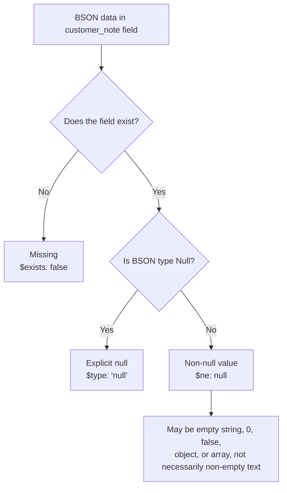

# exists, type, and Matching Null or Missing Fields

> **Chapter:** Query and Criteria  
> **Module:** `SPRING_DATA_MONGODB` — using Spring Data MongoDB to connect, map documents, and operate on MongoDB via `MongoTemplate` or repositories. This lesson focuses on three situations you must distinguish when querying: **missing field**, **field present with BSON null**, and **field present with a specific BSON type**. These decisions affect querying, aggregation, indexing, testing, data updates, transactions, reactive access, and performance diagnostics.

## 1. The Problem: "No Value" Is Not Always Null

An order management system may store delivery notes under the BSON field `customer_note`. Consider four documents:

```javascript
{ _id: "ORD-1", status: "PAID" }
{ _id: "ORD-2", status: "PAID", customer_note: null }
{ _id: "ORD-3", status: "PAID", customer_note: "" }
{ _id: "ORD-4", status: "PAID", customer_note: "Morning delivery" }
```

Here there are four distinct states:

1. **Missing:** `ORD-1` has no `customer_note` key in BSON.
2. **Explicit null:** `ORD-2` has the key, with value BSON Null.
3. **Empty string:** `ORD-3` has the key, containing an empty string; this is still a string.
4. **Non-empty string:** `ORD-4` has the key and actual content.

What surprises people used to SQL is the MongoDB condition:

```javascript
db.orders.find({ customer_note: null })
```

**matches both documents with value `null` and documents missing the field**. It does not find only explicit nulls.

If the business requirement asks for "this field has never been recorded", you must use `$exists: false`. If it asks for "the field was explicitly recorded as null", use `$type: "null"`. If you only want "has information, not null", you can use `$ne: null` with caveats regarding array data.



**Learning objectives:** accurately predict the set of documents each filter matches, translate filters into Spring Data MongoDB `Criteria`, and verify using real BSON rather than looking solely at materialized Java objects.

## 2. Creating a Dataset for Direct Comparison

Below is a dataset containing both a primary field and a legacy field intentionally holding multiple types. Run only on a **test database**, because `drop()` deletes the selected collection:

```javascript
db.orders.drop();

db.orders.insertMany([
  { _id: "ORD-1", status: "PAID" },
  {
    _id: "ORD-2",
    status: "PAID",
    customer_note: null,
    legacy_value: null
  },
  {
    _id: "ORD-3",
    status: "PAID",
    customer_note: "",
    legacy_value: "120"
  },
  {
    _id: "ORD-4",
    status: "PAID",
    customer_note: "Morning delivery",
    legacy_value: 120
  },
  {
    _id: "ORD-5",
    status: "PENDING",
    legacy_value: false
  },
  {
    _id: "ORD-6",
    status: "PENDING",
    legacy_value: []
  },
  {
    _id: "ORD-7",
    status: "PENDING",
    legacy_value: {}
  }
]);
```

Run a query displaying IDs for easy comparison:

```javascript
db.orders.find(
  { customer_note: { $exists: true } },
  { _id: 1 }
).sort({ _id: 1 });
```

In this lesson, examples on `customer_note` use scalar values (null or String), while `legacy_value` illustrates type queries on other BSON types. Because operators on **arrays** have additional element-matching rules, you should not generalize the scalar table to every nested array case.

## 3. $exists: Is the Field Present or Absent?

### 3.1. `$exists: true` — Has the Key, Including Null

```javascript
db.orders.find({ customer_note: { $exists: true } });
```

Matching results on the test dataset: **`ORD-2`, `ORD-3`, `ORD-4`**. Here `ORD-2` has a null value, yet the field still **exists**.

This condition **does not guarantee** a business-useful value. An empty string, number 0, `false`, an empty object, an empty array, and explicit null all count as existing fields.

### 3.2. `$exists: false` — Field Absent from the Document

```javascript
db.orders.find({ customer_note: { $exists: false } });
```

Results: **`ORD-1`, `ORD-5`, `ORD-6`, `ORD-7`**. Does not include `ORD-2` because that document has the `customer_note` key with value null.

`$exists: false` is especially useful for migrations, such as finding documents created before a `processedAt` field was introduced. However, if a field is missing due to corrupted records or because the current writer intentionally omits nulls, clarify the semantics before treating all of them as "unprocessed".

### 3.3. `$exists` Is Not a Java Null Check

Two BSON documents:

```javascript
{ _id: "A" }
{ _id: "B", customer_note: null }
```

when read into a Java `String customerNote` field **can both make the getter return `null`**. The getter value itself no longer tells you whether the original BSON key existed. To distinguish them, query `$exists` in the database, read raw `Document.containsKey(...)`, or adjust the domain/schema to represent this state explicitly.

## 4. Comparing Equality to Null and $ne: null

### 4.1. `{ field: null }` Matches Null **or** Missing

The following two expressions share the same core meaning in MongoDB:

```javascript
db.orders.find({ customer_note: null });

db.orders.find({ customer_note: { $eq: null } });
```

With the test dataset, they match **`ORD-1`, `ORD-2`, `ORD-5`, `ORD-6`, `ORD-7`**. One main reason is that MongoDB treats an equality condition against `null` as matching fields that have not been recorded.

**Business consequence:** if an API wants to find "users who deleted their note and the system stored an explicit null", the query above is **not enough** to distinguish the case where the system never had the note field.

### 4.2. `$ne: null` — Field Has a Non-Null Value

```javascript
db.orders.find({
  customer_note: { $ne: null }
});
```

With the scalar values in the dataset, the result is **`ORD-3` and `ORD-4`**. Unlike `{ field: null }`, `$ne: null` in MongoDB finds existing fields with a value other than null.

An important point to emphasize: `ORD-3` has an **empty string**, so it still satisfies `$ne: null`. If the requirement is "a string containing real content", add write-layer validation or corresponding business conditions. Do not equate **non-null** with **non-empty**, **valid**, or **meaningful**.

### 4.3. Comparison Table of Key Filters

| MongoDB Filter on `customer_note` | ORD-1 missing | ORD-2 null | ORD-3 `""` | ORD-4 non-empty string |
| --- | :---: | :---: | :---: | :---: |
| `{ customer_note: null }` | ✓ | ✓ | — | — |
| `{ customer_note: { $eq: null } }` | ✓ | ✓ | — | — |
| `{ customer_note: { $exists: true } }` | — | ✓ | ✓ | ✓ |
| `{ customer_note: { $exists: false } }` | ✓ | — | — | — |
| `{ customer_note: { $type: "null" } }` | — | ✓ | — | — |
| `{ customer_note: { $ne: null } }` | — | — | ✓ | ✓ |
| `{ customer_note: { $type: "string" } }` | — | — | ✓ | ✓ |

If a document has an **array containing null**, MongoDB's element-matching rules can affect `$eq`, `$ne`, and `$type`. The table applies strictly to the scalar values in the first four documents; to verify array fields, write dedicated tests with accurate BSON structures.

## 5. $type: Distinguishing BSON Null, String, Number, and Other Types

### 5.1. BSON Null Is a Real Type

`$type` in a **query filter** matches values by their BSON type:

```javascript
db.orders.find({
  customer_note: { $type: "null" }
});
```

On the test dataset, this filter matches **only `ORD-2`**, because `ORD-2` has the `customer_note` field with BSON type **Null**. A missing field is **not** considered BSON Null.

You can use the corresponding numeric BSON type code:

```javascript
db.orders.find({
  customer_note: { $type: 10 }
});
```

**10** is the code for BSON Null. Using the alias `"null"` is usually more readable in `mongosh`; in Spring Data, `Criteria.type(10)` is a direct representation.

### 5.2. Useful Aliases

| `$type` Alias | BSON Type | Example |
| --- | --- | --- |
| `"null"` | Null | `customer_note: null` |
| `"string"` | String | `legacy_value: "120"` |
| `"int"` | Int32 | `legacy_value: NumberInt(120)` |
| `"long"` | Int64 | `legacy_value: NumberLong(120)` |
| `"double"` | Double | `legacy_value: 120.5` in a BSON double context |
| `"decimal"` | Decimal128 | `legacy_value: NumberDecimal("120.50")` |
| `"number"` | BSON numeric types | Used when matching numeric types such as int, long, double, and decimal |
| `"bool"` | Boolean | `legacy_value: false` |
| `"date"` | Date | `createdAt: ISODate("...")` |
| `"object"` | Embedded document | `legacy_value: {}` |
| `"array"` | Array | `legacy_value: []` |
| `"objectId"` | ObjectId | `_id: ObjectId("...")` |

With the test data:

```javascript
db.orders.find({ legacy_value: { $type: "string" } });
// ORD-3

db.orders.find({ legacy_value: { $type: "number" } });
// ORD-4 (value 120)

db.orders.find({ legacy_value: { $type: "bool" } });
// ORD-5

db.orders.find({ legacy_value: { $type: "array" } });
// ORD-6

db.orders.find({ legacy_value: { $type: "object" } });
// ORD-7
```

MongoDB supports more BSON types than shown in the table above; when planning migrations, check the type alias list for your exact server and driver version.

### 5.3. `$type: "number"` Does Not Convert Strings to Numbers

`legacy_value: "120"` looks like a number but is still a **BSON String**. Filter:

```javascript
db.orders.find({ legacy_value: { $type: "number" } });
```

does not match `ORD-3`. It only recognizes documents whose stored value has an appropriate **BSON numeric type**; it does not call `parseInt` or automatically cast strings to Decimal128.

If a system previously stored monetary prices as Strings and now wants to migrate to Decimal128, `$type` is very helpful for **auditing historical data** before running a migration. It does not convert data on its own, nor can it recover lost precision if numbers were stored as doubles.

### 5.4. Array Fields Have Special Rules

For arrays, `$type` in a query can match **the type of elements inside the array**, not only the type of the outer field value itself. For example, an array containing strings can match `$type: "string"`, even though the outer field is a BSON Array.

To ask "is the field itself an array", use `$type: "array"`. If you want to check **the type of the entire field value** without allowing element-matching behavior, design an appropriate query/aggregation and test it. Do not use the scalar table above to reason about all array scenarios.

## 6. Translating Conditions to Spring Data MongoDB Criteria

### 6.1. Java Domain and BSON Field Aliases

Suppose the Java domain uses camelCase while the database uses snake_case:

```java
package demo.orders;

import org.springframework.data.annotation.Id;
import org.springframework.data.mongodb.core.mapping.Document;
import org.springframework.data.mongodb.core.mapping.Field;

@Document(collection = "orders")
public class OrderDocument {

    @Id
    private String id;
    private String status;

    @Field("customer_note")
    private String customerNote;

    @Field("legacy_value")
    private Object legacyValue;

    protected OrderDocument() {}

    public String getId() { return id; }
    public String getStatus() { return status; }
    public String getCustomerNote() { return customerNote; }
    public Object getLegacyValue() { return legacyValue; }
}
```

The `Criteria.where(...)` calls below use **Java property names** when `MongoTemplate` knows the entity type. With `@Field("customer_note")`, `MappingMongoConverter` translates property `customerNote` to BSON field `customer_note` in the query.

### 6.2. Comparison Operations in Criteria

```java
import org.springframework.data.mongodb.core.query.Criteria;
import org.springframework.data.mongodb.core.query.Query;

// Field present (including BSON null value).
Query present = Query.query(
    Criteria.where("customerNote").exists(true)
);

// Field completely absent in BSON.
Query missing = Query.query(
    Criteria.where("customerNote").exists(false)
);

// Null OR missing field.
Query nullOrMissing = Query.query(
    Criteria.where("customerNote").isNull()
);

// Explicit BSON null only: equivalent to $type: 10.
Query explicitNull = Query.query(
    Criteria.where("customerNote").isNullValue()
);

// Field exists and is not null (includes empty string).
Query notNull = Query.query(
    Criteria.where("customerNote").ne(null)
);

// Only fields with BSON String; includes empty string.
Query bsonString = Query.query(
    Criteria.where("customerNote").type(2)
);

// BSON Null by type code, equivalent to isNullValue().
Query bsonNull = Query.query(
    Criteria.where("customerNote").type(10)
);
```

**Distinguish two easily confused methods:**

- `Criteria.isNull()` expresses null matching under MongoDB semantics, **including missing**.
- `Criteria.isNullValue()` expresses **explicit BSON null**, excluding missing.

`isNull()`/`isNullValue()` belong to Spring Data MongoDB versions supporting those APIs. If the project uses an older version, you can use `Criteria.type(10)` to express BSON null or declare a `$type` filter with `@Query`. Verify Javadoc/APIs for your exact version before production use.

### 6.3. Executing via MongoTemplate

```java
import java.util.List;
import org.springframework.data.mongodb.core.MongoTemplate;

// mongoTemplate is injected into the service/test.
List<OrderDocument> absentOrders =
    mongoTemplate.find(missing, OrderDocument.class);

long numberOfExplicitNulls =
    mongoTemplate.count(explicitNull, OrderDocument.class);

boolean anyPopulatedNote =
    mongoTemplate.exists(notNull, OrderDocument.class);
```

**Note three similarly named concepts:**

1. `Criteria.exists(false)` generates a MongoDB **`$exists: false`** filter to check the presence of **a field**.
2. `mongoTemplate.exists(query, OrderDocument.class)` returns a `boolean` answering **whether any document matches the entire query**.
3. `repository.existsById(id)` is a repository API checking a document by **ID**, not an arbitrary BSON field check.

In other words, all three use the word "exists", but **the target being checked** differs.

### 6.4. Combining Business Conditions

Find paid orders that have no note field:

```java
Query query = Query.query(
    Criteria.where("status").is("PAID")
        .and("customerNote").exists(false)
);

List<OrderDocument> paidWithoutNote =
    mongoTemplate.find(query, OrderDocument.class);
```

Equivalent filter intent:

```javascript
db.orders.find({
  status: "PAID",
  customer_note: { $exists: false }
});
```

With the test dataset, the result is **`ORD-1`**. Documents `ORD-5`, `ORD-6`, and `ORD-7` also lack notes but have status `PENDING`, so they do not match.

If the logic involves both `OR` and `AND`, use `andOperator(...)`/`orOperator(...)` to represent condition groups cleanly. Do not try to attach two conflicting operators onto the same key via multiple `Criteria.where(...)` calls and assume they merge properly. Inspect the generated BSON query in tests.

## 7. Repository @Query and Differences from Derived Queries

When field presence or absence must be stated explicitly, `@Query` is straightforward:

```java
import java.util.List;
import org.springframework.data.mongodb.repository.MongoRepository;
import org.springframework.data.mongodb.repository.Query;

public interface OrderRepository
        extends MongoRepository<OrderDocument, String> {

    @Query("{ 'customer_note' : { '$exists' : false } }")
    List<OrderDocument> findWithoutCustomerNoteField();

    @Query("{ 'customer_note' : { '$type' : 'null' } }")
    List<OrderDocument> findWithExplicitNullNote();

    @Query("{ 'customer_note' : null }")
    List<OrderDocument> findWithNullOrMissingNote();

    @Query("{ 'customer_note' : { '$ne' : null } }")
    List<OrderDocument> findWithNonNullNote();

    @Query("{ 'legacy_value' : { '$type' : 'number' } }")
    List<OrderDocument> findWithNumericLegacyValue();
}
```

Because `@Query` declares a JSON filter, the names used in the examples are the **actual BSON names** `customer_note`/`legacy_value`. Spring Data has entity-based query mapping and parameter conversion, though you should not rely on that to obscure Java-to-BSON name differences in schema migration examples.

A derived method like:

```java
List<OrderDocument> findByCustomerNoteIsNull();
```

usually carries MongoDB null-comparison semantics, meaning **null or missing**, rather than "only fields with BSON Null". When strict distinction is required, use `Criteria.isNullValue()` or `@Query` with `$type: "null"` so it is easy to verify.

Add a direct server check via `mongosh` before trusting that a method name captures the exact business requirement.

## 8. Why Writing Null in Java Does Not Equal Storing BSON Null

### 8.1. Default Mapping May Omit Null Fields

In Spring Data MongoDB, properties with Java value `null` **are typically not written to BSON** under the default mapping strategy. For example:

```java
OrderDocument order = /* entity with customerNote == null */;
mongoTemplate.insert(order);
```

The document may **omit** `customer_note`, rather than storing `customer_note: null`. Thus an application may have very few explicit BSON nulls even though Java code passes `null` frequently.

When you need to force writing explicit null via a mapping annotation, modern Spring Data MongoDB provides an option:

```java
import org.springframework.data.mongodb.core.mapping.Field;

// Placed on the customerNote property of the entity.
@Field(value = "customer_note", write = Field.Write.ALWAYS)
private String customerNote;
```

The snippet above illustrates **a field inside a class**, not a standalone Java file. `Field.Write.ALWAYS` instructs persistence mapping to write the field even when its value is null; the corresponding option must be supported by your project's Spring Data version. Do not globally switch from omitting null fields to always writing nulls without evaluating existing queries and historical data.

### 8.2. `$set: null` and `$unset` Are Two Different Operations

If you want to **keep the key and set its value to null**:

```javascript
db.orders.updateOne(
  { _id: "ORD-4" },
  { $set: { customer_note: null } }
);
```

After this operation, document `ORD-4` satisfies:

```javascript
{ customer_note: { $exists: true } }
{ customer_note: { $type: "null" } }
```

If you want to **remove the field completely from BSON**:

```javascript
db.orders.updateOne(
  { _id: "ORD-4" },
  { $unset: { customer_note: 1 } }
);
```

After this operation, `ORD-4` satisfies `$exists: false`. `$unset` is a schema/data change, not setting null in memory.

Spring Data has corresponding APIs:

```java
import org.springframework.data.mongodb.core.query.Criteria;
import org.springframework.data.mongodb.core.query.Query;
import org.springframework.data.mongodb.core.query.Update;

Query byId = Query.query(Criteria.where("id").is("ORD-4"));

// Set BSON Null value.
mongoTemplate.updateFirst(
    byId, new Update().set("customerNote", null), OrderDocument.class
);

// Remove the field from BSON.
mongoTemplate.updateFirst(
    byId, new Update().unset("customerNote"), OrderDocument.class
);
```

`MongoTemplate` with a domain type can map `customerNote` to `customer_note`. These update commands run **sequentially**; if both are placed in the same example, the final state is that the field has been unset. In real code, pick only the operation matching the business intent.

### 8.3. Designing a Three-State PATCH API

In HTTP PATCH, you often need to distinguish:

| Payload | Example Intent |
| --- | --- |
| **Omit** the `customerNote` property | Leave the existing note unchanged. |
| Send `"customerNote": null` | Clear content, storing explicit null or unsetting per API contract. |
| Send `"customerNote": "Business hours delivery"` | Update to the new string. |

A regular DTO with a `String customerNote` field usually **cannot distinguish** an absent JSON property from a JSON property with a null value after deserialization. If business rules require distinguishing them, use an explicit presence representation such as JSON Patch, a DTO with a presence marker, or raw JSON handling with proper validation.

The decision of whether an API null becomes **BSON Null** or **missing** must be consistent at the service layer, not left to chance based on mapping annotations.

## 9. Nested Paths, Array Fields, and Structured Data

### 9.1. Nested Paths and Missing Parent Objects

Consider these documents:

```javascript
{ _id: "N1" }
{ _id: "N2", shippingAddress: null }
{ _id: "N3", shippingAddress: {} }
{ _id: "N4", shippingAddress: { city: null } }
{ _id: "N5", shippingAddress: { city: "Da Nang" } }
```

Dotted path query:

```javascript
db.orders.find({ "shippingAddress.city": { $exists: false } });
```

matches documents **without the `shippingAddress.city` path**, including missing `shippingAddress`, null parent, or a parent object without `city`. However:

```javascript
db.orders.find({
  "shippingAddress.city": { $type: "null" }
});
```

only matches explicit null at the `city` path (`N4` in the illustrative set).

**Do not use `shippingAddress.city: null` as a substitute for "parent object does not exist"**; it can additionally match documents with an explicit null `city` or an absent path. If you need to determine the state of the parent object, query `shippingAddress` directly with `$exists` or `$type`.

### 9.2. Distinguishing Empty Array Fields from Missing Fields

In MongoDB, these cases:

```javascript
{ _id: "A1" }
{ _id: "A2", tags: null }
{ _id: "A3", tags: [] }
{ _id: "A4", tags: ["priority"] }
```

are different:

| Goal | Filter |
| --- | --- |
| Field `tags` absent | `{ tags: { $exists: false } }` |
| Explicit null | `{ tags: { $type: "null" } }` |
| Field itself is an array | `{ tags: { $type: "array" } }` |
| Empty array | `{ tags: { $size: 0 } }` |
| Array containing string `priority` | `{ tags: "priority" }` under MongoDB array-matching semantics |

Do not use `tags: null` for "empty array" or `$exists: true` for "non-empty array". To check **a single element satisfying multiple conditions simultaneously**, use `$elemMatch` on arrays of documents instead of independent dotted path conditions.

## 10. $type in Filters Differs from $type in Aggregation

This is an important detail when inspecting legacy data.

### 10.1. Query Operator $type

```javascript
db.orders.find({
  customer_note: { $type: "null" }
});
```

This query **only matches** documents whose field has type BSON Null. It does **not** have a corresponding `"missing"` type for `$type` filtering via the same mechanism.

### 10.2. Aggregation Expression $type

In an **aggregation expression**, `$type` can return **the string `"missing"`** if the input field does not exist:

```javascript
db.orders.aggregate([
  {
    $project: {
      _id: 1,
      customerNoteType: { $type: "$customer_note" }
    }
  },
  { $sort: { _id: 1 } }
]);
```

With data `ORD-1` through `ORD-4`:

| ID | Aggregation `customerNoteType` Value |
| --- | --- |
| `ORD-1` | `"missing"` |
| `ORD-2` | `"null"` |
| `ORD-3` | `"string"` |
| `ORD-4` | `"string"` |

Thus, **`"missing"` is the result of an aggregation expression**, not a BSON type of an existing field in the database. Do not write `{ customer_note: { $type: "missing" } }` in a find query expecting it to behave like `$exists: false`.

This is a useful technique for surveying schema quality before a migration:

```javascript
db.orders.aggregate([
  {
    $project: {
      kind: { $type: "$customer_note" }
    }
  },
  {
    $group: {
      _id: "$kind",
      count: { $sum: 1 }
    }
  },
  { $sort: { count: -1 } }
]);
```

The pipeline reports how many documents fall into each state/type of the field in the collection. For very large collections, evaluate performance, access permissions, and workload before running heavy audits in production.

## 11. Indexes: $exists and Null Can Have Different Costs

### 11.1. Do Not Assume Every $exists Query Uses an Index Efficiently

```javascript
db.orders.createIndex({ customer_note: 1 });
```

A regular index can assist certain `$exists` queries or value comparisons, but that does not mean it always distinguishes **missing** from **explicit null** without examining actual documents. Efficiency depends on query shape, planner, dataset, index type, and MongoDB version.

Measure in practice:

```javascript
db.orders.find({
  customer_note: { $exists: true }
}).explain("executionStats");

db.orders.find({
  customer_note: { $exists: false }
}).explain("executionStats");

db.orders.find({
  customer_note: { $type: "null" }
}).explain("executionStats");
```

Inspect `winningPlan`, `totalKeysExamined`, `totalDocsExamined`, and execution time. In particular, **`$exists: false` often struggles to leverage a sparse index** because documents missing the field have no entries in that sparse index.

### 11.2. A Sparse Index Does Not Mean "Index Only Non-Null"

```javascript
db.orders.createIndex(
  { customer_note: 1 },
  { sparse: true, name: "note_sparse" }
);
```

A sparse index relies on **field presence**; it skips documents missing the field, but **still includes documents with explicit null** on the indexed field. That is why "sparse" should not be treated as synonymous with "excludes null values".

A sparse index can help `$exists: true` queries, yet cannot enumerate documents **missing the field** solely from the sparse index entries because those documents were omitted from the index. If the database has both a regular and a sparse index, the query planner picks based on conditions and actual cost estimates.

### 11.3. Partial Indexes and Specialized Data

A partial index uses a filter expression defining which documents are indexed:

```javascript
db.orders.createIndex(
  { status: 1, _id: 1 },
  {
    name: "orders_with_note",
    partialFilterExpression: {
      customer_note: { $exists: true }
    }
  }
);
```

This index only contains documents satisfying the partial filter. A query can only safely use the index if it guarantees no documents outside the index's scope would be missed; thus the planner only uses it when the query proves the corresponding condition. Always run `explain` instead of assuming a partial index accelerates every `status` search.

Before adding sparse or partial indexes, clearly identify whether the issue is multi-field querying, data distribution, the ratio of null/missing entries, or write cost. Indexes do not alter the semantics of `{field:null}`.

## 12. Migration Strategy for Missing or Wrongly Typed Fields

An example of schema evolution:

- Generation 1: documents lack `processed_at`.
- Generation 2: a newer writer may store `processed_at: null` when unprocessed.
- Generation 3: once processed, the writer stores a BSON Date.

If a service wants to fetch documents that are "unprocessed" in business terms, the query must cover the accepted states:

```javascript
db.orders.find({
  $or: [
    { processed_at: { $exists: false } },
    { processed_at: { $type: "null" } }
  ]
});
```

For simple scalar fields, `{ processed_at: null }` also matches missing or null; the `$or` form above **explicitly spells out both data groups** in migration scripts. If legacy data contains wrong types, such as date strings instead of BSON Dates, inspect further with `$type`.

Recommended workflow:

1. **Audit** the counts of missing, explicit null, Date, and String documents using aggregation `$type` or separate queries.
2. **Define business meaning** for each group; do not blindly equate "field absent" with "unprocessed" unless legacy schema rules guarantee it.
3. **Choose a target state**: for instance, all unprocessed documents will **omit** the field, or all will hold explicit null; pick one convention.
4. **Ensure compatibility** while multiple application versions run concurrently, before changing queries/validators.
5. **Backfill in batches** with limits and checkpoints; preserve valid existing values.
6. **Verify post-migration** using raw BSON, counts by type, and integration tests; do not rely solely on Java getters.

If multiple requests update the same document, use extra filter conditions, versioning/optimistic locking, or appropriate transactions to prevent overwriting valid data during backfill. `$exists`/`$type` are condition-matching tools, **not locking mechanisms**.

## 13. Consistency, Validation, and Security

### 13.1. Schema Validation Must Distinguish `required` and `bsonType`

MongoDB's JSON Schema validator has two related yet separate concepts:

- `required`: the field must be **present**.
- `bsonType`: when the field is present, its BSON type must belong to the allowed set.

For example, wanting `customer_note` to be **optional**, but if present, either String or Null:

```javascript
{
  $jsonSchema: {
    bsonType: "object",
    properties: {
      customer_note: {
        bsonType: [ "string", "null" ]
      }
    }
  }
}
```

This is an **illustrative rule fragment**, not a command deploying a validator onto a collection. Adding `customer_note` to the `required` array causes documents missing the field to fail validation under that rule, even if `bsonType` permits `"null"`. Coordinate business requirements and migrations before enabling strict validation.

### 13.2. Tenant-Scoped Queries and Visibility

If the database serves multiple tenants, every `$exists`/`$type` query must include access-control conditions:

```java
Query query = Query.query(
    Criteria.where("tenantId").is(tenantId)
        .and("customerNote").exists(false)
);
```

Queries for content, count, updates, and backfills must enforce the same tenant/ownership boundaries; otherwise APIs can leak record counts or modify another tenant's data. Never accept arbitrary client-supplied field/operator names in raw queries without validation/allowlists.

### 13.3. Transactions and Reactive Do Not Change Null Semantics

Running a query inside a transaction does not make `{field:null}` match only explicit null. Using `ReactiveMongoTemplate` or `ReactiveMongoRepository` likewise does not alter MongoDB `$exists`/`$type` rules; the difference is primarily return types like `Mono`/`Flux` and asynchronous execution.

Reactive query example:

```java
import reactor.core.publisher.Flux;
import org.springframework.data.mongodb.core.query.Criteria;
import org.springframework.data.mongodb.core.query.Query;

Query missingNote = Query.query(
    Criteria.where("customerNote").exists(false)
);

Flux<OrderDocument> orders =
    reactiveMongoTemplate.find(missingNote, OrderDocument.class);
```

Do not call `collectList()` on an entire large dataset just to process documents missing a field; use streaming/backpressure and bound downstream operations. For large-scale migrations, design retries and checkpoints/idempotency rather than relying on a single `Flux` for exactly-once processing.

## 14. Integration Testing: Checking Raw BSON and Mapping

### 14.1. Why Using `repository.save` Alone Is Not Enough

If you create an entity with `customerNote == null` and call `repository.save`, depending on the mapping strategy, BSON may omit the field. That prevents tests from producing the **explicit BSON null** case needing verification.

To test MongoDB semantics, seed data via the Java Driver or `mongosh` covering both cases:

```java
import org.bson.Document;
import java.util.List;

mongoTemplate.getCollection("orders").insertMany(List.of(
    new Document("_id", "T1").append("status", "PAID"),
    new Document("_id", "T2").append("status", "PAID")
        .append("customer_note", null),
    new Document("_id", "T3").append("status", "PAID")
        .append("customer_note", ""),
    new Document("_id", "T4").append("status", "PAID")
        .append("customer_note", "Delivery scheduled")
));
```

`Document.append("customer_note", null)` ensures the test document has an explicit null key at the BSON layer, independent of whether mapping annotations skip Java nulls.

### 14.2. Tests with MongoTemplate

The example below shows **methods inside an integration test class** configured with `MongoTemplate` and a test database; `@BeforeEach` should clean the test collection or delete IDs `T1`–`T4` before seeding:

```java
import static org.assertj.core.api.Assertions.assertThat;

import java.util.List;
import org.junit.jupiter.api.Test;
import org.springframework.data.mongodb.core.query.Criteria;
import org.springframework.data.mongodb.core.query.Query;

@Test
void nullAndMissingAreDifferent() {
    Query nullOrMissing = Query.query(
        Criteria.where("customerNote").isNull()
    );
    Query explicitNull = Query.query(
        Criteria.where("customerNote").isNullValue()
    );
    Query missing = Query.query(
        Criteria.where("customerNote").exists(false)
    );
    Query nonNull = Query.query(
        Criteria.where("customerNote").ne(null)
    );

    assertThat(idsFor(nullOrMissing))
        .containsExactlyInAnyOrder("T1", "T2");
    assertThat(idsFor(explicitNull))
        .containsExactly("T2");
    assertThat(idsFor(missing))
        .containsExactly("T1");
    assertThat(idsFor(nonNull))
        .containsExactlyInAnyOrder("T3", "T4");
}

private List<String> idsFor(Query query) {
    return mongoTemplate.find(query, OrderDocument.class)
        .stream()
        .map(OrderDocument::getId)
        .toList();
}
```

The test assumes the test collection only contains the four documents `T1`–`T4` at runtime. With Java 16+ you can use `Stream.toList()`; with older Java versions, replace with `collect(Collectors.toList())`.

To also verify **field presence** in BSON:

```java
Document missingRaw = mongoTemplate.getCollection("orders")
    .find(new Document("_id", "T1")).first();
Document nullRaw = mongoTemplate.getCollection("orders")
    .find(new Document("_id", "T2")).first();

assertThat(missingRaw).isNotNull();
assertThat(nullRaw).isNotNull();

assertThat(missingRaw.containsKey("customer_note")).isFalse();
assertThat(nullRaw.containsKey("customer_note")).isTrue();
assertThat(nullRaw.get("customer_note")).isNull();
```

This is why you must inspect raw `Document` rather than relying solely on `OrderDocument.getCustomerNote()`: the getter returns `null` for both cases.

### 14.3. Other Essential Test Cases

| Test Case | Outcome to Verify |
| --- | --- |
| Missing field | `$exists:false` matches; `$type:"null"` does not match. |
| Explicit null field | Both `$exists:true` and `$type:"null"` match. |
| Empty string field | `$ne:null` matches; not BSON Null. |
| Field with number 0 or Boolean false | `$exists:true` matches; these values do not equal null. |
| Empty array field | `$type:"array"` and `$size:0` match; differs from missing. |
| Nested path with missing parent | Dotted path `$exists:false` matches per MongoDB semantics. |
| Same field name with BSON String vs numeric | `$type:"number"` does not parse numeric strings. |
| Updating with `$set:null` vs `$unset` | Both operations produce two distinct BSON states. |
| Mapping with `@Field` | `Criteria.where("customerNote")` translates to BSON `customer_note`. |
| Sparse/partial index | Use `explain` to verify plan, not just timing. |

## 15. Common Errors and How to Diagnose Them

| Symptom | Likely Cause | Resolution |
| --- | --- | --- |
| `findByCustomerNoteIsNull` returns documents that never had the field | MongoDB treats field equals null as **null or missing**. | Use `$type:"null"` or `isNullValue()` if you only want explicit null. |
| `$exists:true` returns documents with null | `$exists` only checks key presence. | Combine type/value conditions per business requirements. |
| `$ne:null` returns empty strings | Empty string is not null. | Define and validate non-empty text separately. |
| `$type:"number"` skips String `"120"` | BSON String differs from numeric types. | Controlled migration or type conversion; do not expect query auto-casting. |
| `$type:"null"` skips documents missing the field | Missing is not BSON Null. | Use `$exists:false` or null-or-missing query as intended. |
| Java getter returns null yet `$type:"null"` does not match | Mapping omits null fields or legacy documents lack the field. | Inspect raw BSON; consider `Field.Write.ALWAYS` if explicit null must be stored. |
| Update sets null yet API still returns a different state | Writer/reader or converter has custom rules, or code unset the field. | Compare raw BSON after update against JSON serialization logic. |
| Query for missing fields runs slowly | `$exists:false` struggles to use sparse indexes, overly broad filter. | Measure `explain`; consider a materialized state field if hot path. |
| Querying by Java `customerNote` on raw driver finds nothing | Real BSON field is `customer_note`. | Use BSON names with driver/mongosh; Spring Data typed queries use Java properties. |
| Data mixes null, String, and Number in the same field | Schema evolved, inconsistent converters. | Audit with aggregation `$type` and run a planned migration. |
| Querying `parent.child` returns "strange" results | Parent is missing/null or field lives inside a nested array. | Check BSON shape and dotted path/array semantics. |

**Short debug workflow:** (1) fetch a real BSON document; (2) check `containsKey`/`$type`; (3) verify Java property and BSON field name; (4) write equivalent `mongosh` filter; (5) inspect `Criteria`/`@Query`; (6) run an integration test with distinct seed data; (7) check `explain` if slow.

## 16. Hands-On Exercise: Normalizing the `processed_at` Field

**Context:** a sync system has a `processed_at` field. Old documents lack this field; some new documents store explicit null; processed documents store a BSON Date. In addition, a few corrupted records store a datetime String.

Requirements:

1. Create an `import_jobs` collection with sample documents: missing `processed_at`, explicit null, BSON Date, datetime String, and a document with `processed_at: false` to simulate corrupted data.
2. Write an `$exists:false` filter to find documents without the field; compare it with `{processed_at:null}` and explain the difference.
3. Write a `$type:"null"` filter to find only explicit nulls; verify it excludes documents missing the field.
4. Write `$type:"date"` and `$type:"string"` filters; count each group and explain the risks of storing timestamps as strings.
5. Translate the filters to `MongoTemplate`/`Criteria`; use `Criteria.isNull()` and `Criteria.isNullValue()` to compare result sets.
6. Try `$set: {processed_at:null}` and `$unset:{processed_at:1}` on a document, observing changes under `$exists`/`$type`.
7. Write an aggregation projection `{kind:{$type:"$processed_at"}}` and group by `kind`; observe `"missing"` values in the output.
8. Propose a migration so unprocessed records follow **a single convention** (either missing or explicit null) and timestamp records store BSON Dates.
9. If querying `processed_at` is a hot path, benchmark regular/sparse/partial indexes with `explain("executionStats")` on a sufficiently large test dataset.
10. Write tests for null/missing/type cases before and after migration; ensure count/filters include tenant conditions if multi-tenant.

### Self-Check Questions

- How does `{field:null}` differ from `{field:{$type:"null"}}`?
- Does `$exists:true` match a document with explicit null?
- Does `$ne:null` exclude empty strings, 0, and Boolean false?
- Why does a Java object whose getter returns `null` not distinguish BSON missing from explicit null?
- How does `Criteria.isNull()` differ from `Criteria.isNullValue()`?
- How does `MongoTemplate.exists(query, Entity.class)` differ from `Criteria.exists(false)`?
- Why does `$type:"number"` not match the String `"120"`?
- Why can `$type` in aggregation return `"missing"` while query operator `$type` cannot be used to find missing fields?
- Is `$unset` equivalent to `$set:null`?
- Why is a sparse index not "an index of only non-null documents"?

## 17. Key Takeaways and Reference Links

- **Missing** means the field is absent from BSON; **explicit null** means the field exists and holds BSON Null.
- **`$exists:true`** finds present fields **including null**; **`$exists:false`** finds absent fields.
- **`{field:null}`** or `$eq:null` matches **both null and missing**; insufficient to distinguish the two states.
- **`$type:"null"`** or `$type:10` finds **explicit BSON Null**.
- **`$ne:null`** in scalar contexts finds existing non-null fields; it does **not** guarantee a valid business value.
- **`Criteria.isNull()` and `Criteria.isNullValue()`** represent two distinct semantics; pick the method matching business intent.
- **`MongoTemplate.exists(...)`** returns a boolean checking whether any document matches a query, distinct from the **`$exists`** field operator.
- **Java null does not uniquely determine BSON representation**; mapping may omit fields, while `$set:null` and `$unset` create two different states.
- **Aggregation expression `$type`** can report `"missing"` for schema statistics, unlike query operator `$type`.
- Indexes, sparse/partial indexes, nested queries, and array data must be verified using **real BSON and `explain`**, not solely by Java property names.

Official references to check against your active version:

- [Spring Data MongoDB — Querying Documents / Criteria](https://docs.spring.io/spring-data/mongodb/reference/mongodb/template-query-operations.html)
- [Spring Data MongoDB — Criteria API](https://docs.spring.io/spring-data/mongodb/reference/api/java/org/springframework/data/mongodb/core/query/Criteria.html)
- [Spring Data MongoDB — Mapping](https://docs.spring.io/spring-data/mongodb/reference/mongodb/mapping/mapping.html)
- [MongoDB — $exists](https://www.mongodb.com/docs/manual/reference/operator/query/exists/)
- [MongoDB — $type (query)](https://www.mongodb.com/docs/manual/reference/operator/query/type/)
- [MongoDB — Query for Null or Missing Fields](https://www.mongodb.com/docs/manual/tutorial/query-for-null-fields/)
- [MongoDB — $type (aggregation)](https://www.mongodb.com/docs/manual/reference/operator/aggregation/type/)
- [MongoDB — Sparse Indexes](https://www.mongodb.com/docs/manual/core/index-sparse/)
